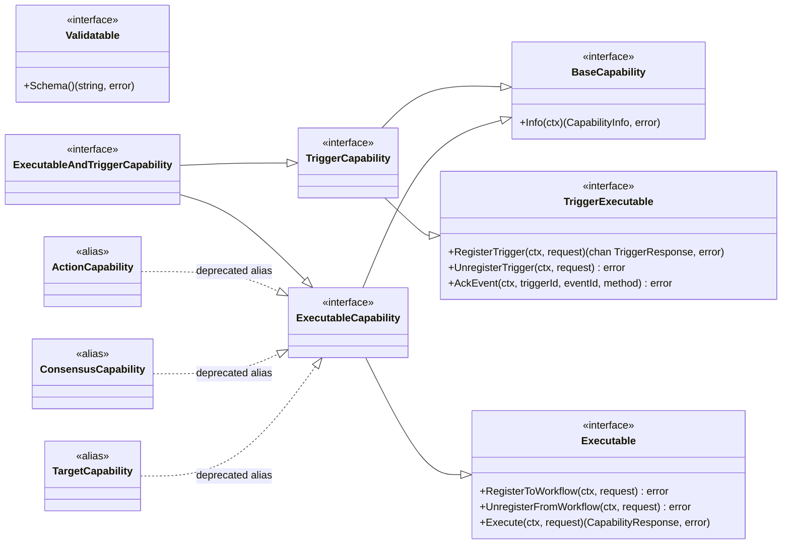
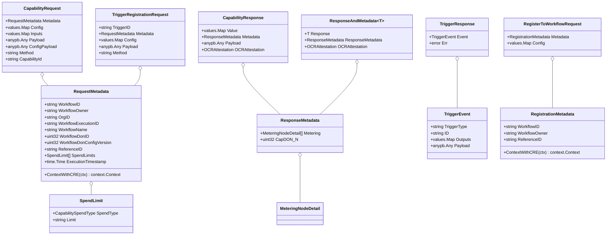
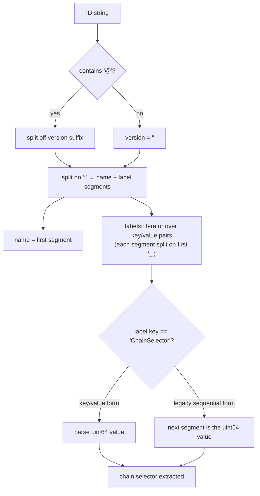
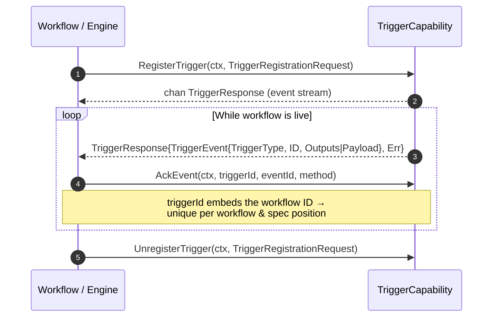
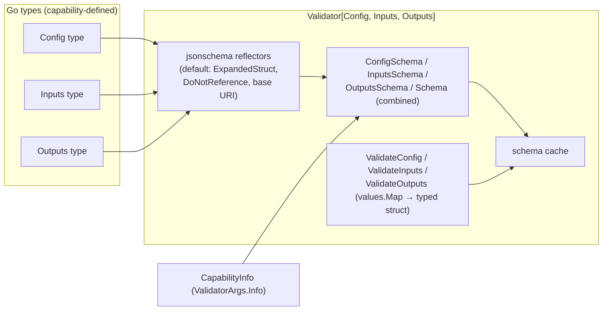
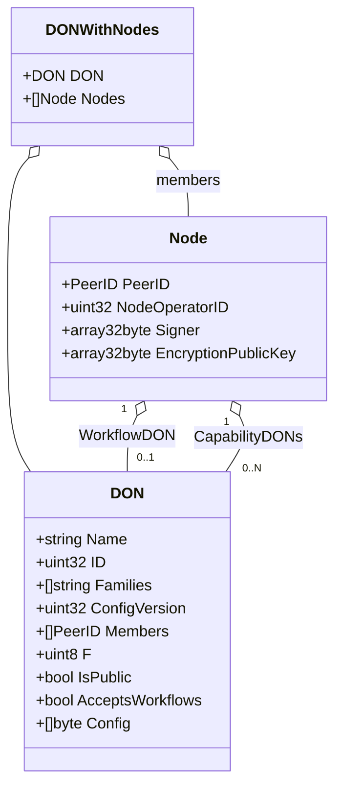
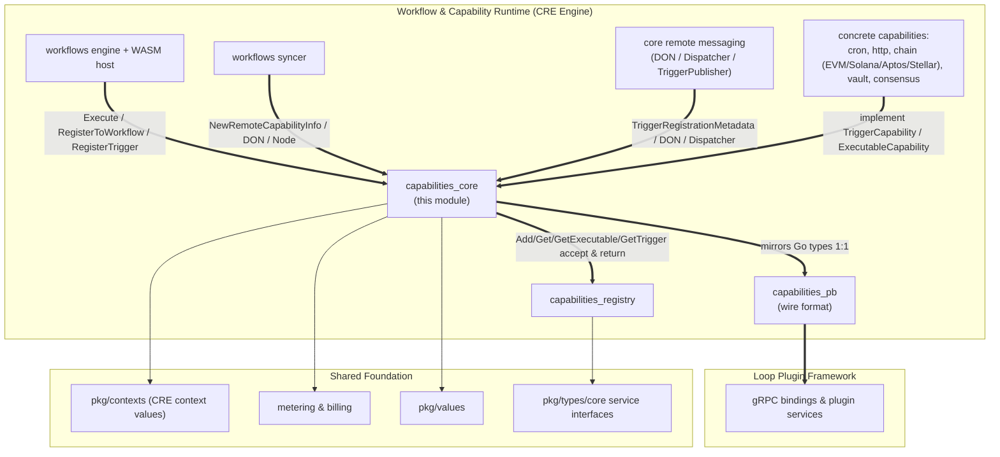

# Capabilities Core — `chainlink-common/pkg/capabilities`

## Introduction

**Capabilities Core** is the foundational contract package of the Chainlink Runtime Environment (CRE). It lives in the `chainlink-common` Go module (`chainlink-common/go.mod`, module path `github.com/smartcontractkit/chainlink-common`) at `chainlink-common/pkg/capabilities/` and defines the *lingua franca* every capability — trigger, action, consensus, or target — must speak:

- **Core interfaces** every capability implements (`BaseCapability`, `Executable`, `TriggerExecutable`, and their composites).
- **Data contracts** exchanged between the workflow engine and capabilities (`CapabilityRequest`, `CapabilityResponse`, trigger registration/event types).
- **Identity & metadata** types (`RequestMetadata`, `RegistrationMetadata`, `CapabilityInfo`, `DON`, `Node`) that carry workflow context, billing inputs, and DON topology across process and network boundaries.
- **Control-flow sentinel errors** (`ErrStopExecution`, `ErrResponsePayloadNotAvailable`) the engine uses to interpret capability outcomes.
- **Metering & attestation helpers** that feed capability responses into billing and OCR-signed reports.
- **Remote-capability configuration** (`RemoteTriggerConfig`, `RemoteExecutableConfig`, `CapabilityConfiguration`) for Don2Don capabilities.
- **A generic JSON-Schema validation framework** (`Validator[Config, Inputs, Outputs]`) that capabilities use to expose and enforce their config/input/output schemas.

The package is intentionally free of business logic: it is the stable dependency that the [capability registry](capabilities_registry.md), the [workflow engine](../workflows/workflows_engine.md), the [remote messaging runtime](../core_capabilities_runtime/core_capabilities_runtime_remote_messaging.md), the [protobuf wire layer](capabilities_pb.md), and every concrete capability ([cron](../cron_capability.md), [HTTP trigger/action](../http_trigger_capability.md), [chain capabilities](../chain_capability_evm.md), …) all compile against.

> **Module position:** `Workflow & Capability Runtime (CRE Engine) → capabilities → capabilities_core` — see the [module overview](../capabilities.md) and the [CRE Engine root](../Workflow___Capability_Runtime_(CRE_Engine).md).

---

## 1. Core Concepts

### 1.1 Capability Types

`CapabilityType` is the package-level enum (`capabilities.go`):

| Value | Meaning |
|---|---|
| `CapabilityTypeUnknown` | Invalid placeholder; rejected by `IsValid()` |
| `CapabilityTypeTrigger` | Produces events that start/continue workflow executions |
| `CapabilityTypeAction` | Executable read/API call step |
| `CapabilityTypeConsensus` | Executable step that aggregates observations into a consensus artifact |
| `CapabilityTypeTarget` | Executable step that writes results on-chain |
| `CapabilityTypeCombined` | A single capability offering both trigger and executable behaviour |

The same taxonomy is mirrored 1:1 by the `CapabilityType` enum in [`pb/capabilities.proto`](capabilities_pb.md) (proto values `CAPABILITY_TYPE_* = 0..5`), so Go types and wire messages stay aligned.

### 1.2 Dual Execution Model: DAG vs no-DAG

All request/response types carry *two* parallel payloads. The engine and SDKs pick the right one:

| Concern | DAG workflows (v1 SDK) | no-DAG workflows (v2 SDK) |
|---|---|---|
| Request config | `CapabilityRequest.Config` (`*values.Map`) | `CapabilityRequest.ConfigPayload` (`*anypb.Any`) |
| Request inputs | `CapabilityRequest.Inputs` (`*values.Map`) | `CapabilityRequest.Payload` (`*anypb.Any`) + `Method`, `CapabilityId` |
| Response value | `CapabilityResponse.Value` (`*values.Map`) | `CapabilityResponse.Payload` (`*anypb.Any`) |

`values.Map` comes from the shared `chainlink-common/pkg/values` library (see [Shared Foundation Libraries](../../Shared_Foundation_Libraries___Domain_Types/types-core.md)).

### 1.3 Key Design Invariants

1. **One metering record per node.** `ResponseMetadata.Metering` is repeated only because the Don2Don aggregation layer collects per-node reports; a capability must emit exactly one `MeteringNodeDetail` (the proto comment in `pb/capabilities.proto` states the same contract).
2. **The sender is excluded from report hashes.** `ResponseToReportData` passes an empty `PeerID` to `ExtractMeteringFromMetadata` so the sender identity never enters the attestation hash.
3. **IDs are strictly validated** — ≤ 128 characters and semver versions (see §4).
4. **Interfaces are intentionally duplicated** (e.g. `ExecutableCapability` re-declares `BaseCapability` + `Executable` rather than embedding aliases) to keep future evolution cheap — a note preserved from the source.
5. **`MinResponsesToAggregate` constraints** — `0` means "default to `F+1` of the remote DON"; a non-zero value must satisfy `F+1 ≤ MinResponsesToAggregate ≤ N`.

---

## 2. Interface Architecture

The package defines a small, composable interface hierarchy. Concrete capabilities — the [cron capability](../cron_capability.md), [HTTP capabilities](../http_trigger_capability.md), [chain capabilities](../chain_capability_evm.md), the [vault](capabilities_vault.md) and [consensus](capabilities_consensus.md) capabilities — implement one of the composite types.



**Semantics**

- **`BaseCapability`** — the minimal contract: `Info(ctx)` returns a validated `CapabilityInfo`. `CapabilityInfo` itself satisfies it (its `Info` method returns itself), so values can be registered directly.
- **`Executable`** — the execution lifecycle: a workflow registers interest (`RegisterToWorkflow`), runs steps (`Execute`), and unregisters. Implemented by action, consensus, and target capabilities.
- **`TriggerExecutable`** — the trigger lifecycle: `RegisterTrigger` returns a *channel* of `TriggerResponse`s over which events stream; `AckEvent` confirms at-least-once delivery; `UnregisterTrigger` tears down.
- **`ExecutableCapability`** — `BaseCapability` + `Executable`. The deprecated aliases `ActionCapability`, `ConsensusCapability`, `TargetCapability` exist purely as type aliases for backward compatibility.
- **`ExecutableAndTriggerCapability`** — a capability that is both a trigger and an executable (the `CapabilityTypeCombined` case).
- **`Validatable`** — optional contract for exposing the capability's JSON schema; implemented by the `Validator` described in §8.

---

## 3. Data Contracts

### 3.1 Requests, Responses, and Trigger Types



Notable behaviours:

- **`ResponseAndMetadata[T proto.Message]`** is the typed, generic action-output wrapper — it pairs a decoded protobuf response with its billing metadata and optional OCR attestation.
- **`RequestMetadata.ExecutionTimestamp`** is the *DonTime-derived* execution timestamp, propagated to capability DONs so they can evaluate feature flags atomically with the workflow DON.
- **`RequestMetadata.ContextWithCRE`** injects a normalized `contexts.CRE{Org, Owner, Workflow}` value into the `context.Context` (via `chainlink-common/pkg/contexts/contexts.go`, which lowercases and strips `0x` prefixes). `RegistrationMetadata.ContextWithCRE` does the same while preserving an already-present `Org`. This is how per-organization/owner/workflow context (logging KVs, rate limits) flows through the runtime.

### 3.2 Control-Flow Sentinel Errors

Capabilities and the engine communicate *control-flow* outcomes with package-level sentinel errors rather than ad-hoc messages:

| Sentinel | Struct | Wire marker | Meaning |
|---|---|---|---|
| `ErrStopExecution` | `errStopExecution` | `__workflow_stop_execution` | The capability requests the workflow stop; the engine halts execution. |
| `ErrResponsePayloadNotAvailable` | `responsePayloadNotAvailableError` | `__response_payload_not_available` | `Execute` cannot provide a payload *yet*; the engine must wait for a subsequent response instead of failing. |
| `ErrUnableToDetermineRegistrationStatus` | — | — | A registration-status call ended before status could be determined. |

Each sentinel implements `Is(err)` via substring matching on the marker string, so wrapped/chained errors that embed the marker are still recognized by `errors.Is`. This convention matters for engine-side handling in the [workflows engine](../workflows/workflows_engine.md) and for remote aggregation paths in [remote messaging](../core_capabilities_runtime/core_capabilities_runtime_remote_messaging.md).

---

## 4. Capability Identity

A capability ID is a fully qualified, human-parseable identifier:

```
{name}:{label1_key}_{label1_value}:{label2_key}_{label2_value}@{version}
```

**Parsing flow (`ParseID` + helpers):**



- **Validation:** `newCapabilityInfo` enforces `len(id) ≤ 128` (`idMaxLength`) and matches `idRegex`, a semver-compatible pattern (major.minor.patch with optional pre-release/build metadata). Workflow ingestion re-validates the same shape on the workflow side (see the [workflows syncer](../workflows/workflows_syncer.md)).
- **`CapabilityInfo.Version()`** extracts the semver substring after `@`.
- **`ChainSelectorLabel`** supports both the normal `ChainSelector_<value>` key/value form and a legacy *sequential* form (empty value ⇒ the next label segment holds the number) for historical reasons.
- **Constructors:** `NewCapabilityInfo` (local capabilities, `IsLocal = true`), `NewRemoteCapabilityInfo` (remote capabilities — requires the hosting `DON`; described as "largely intended for internal use by the registry syncer", consumed by the [syncer](../workflows/workflows_syncer.md) and the [capabilities registry](capabilities_registry.md)), plus `MustNew*` variants that panic on invalid input.

`CapabilityInfo` fields: `ID`, `CapabilityType`, `Description`, `DON` (remote only), `IsLocal`, and `SpendTypes` — the spend types the capability expects to bill during an invocation (see [metering & billing](../../Shared_Foundation_Libraries___Domain_Types/metering-and-billing.md)).

---

## 5. Execution Flow (Executable Capabilities)

How an action/consensus/target invocation flows through the contracts, including billing and attestation:

```mermaid
sequenceDiagram
    autonumber
    participant E as Workflow Engine
    participant C as Capability (Executable)
    participant B as Billing / Metering
    participant O as OCR Report Pipeline

    E->>C: Execute(ctx, CapabilityRequest)
    Note over E,C: ctx carries CRE values (org/owner/workflow)

    alt Capability halts the workflow
        C-->>E: error wrapping ErrStopExecution
        Note over E: engine stops the workflow execution
    else Payload not ready yet
        C-->>E: error wrapping ErrResponsePayloadNotAvailable
        Note over E: engine waits for the next response
    else Success
        C-->>E: CapabilityResponse{Value | Payload, ResponseMetadata, OCRAttestation?}
        E->>B: ExtractMeteringFromMetadata(sender, metadata)
        Note over B: expects exactly 1 MeteringNodeDetail;<br/>stamps the sender PeerID into it
        E->>O: ResponseToReportData(workflowExecutionID, referenceID, payload, metadata)
        Note over O: SHA3-256 over domain separator<br/>"CapabilityResponseReportData:v1" +<br/>workflowExecutionID + referenceID + payload +<br/>spendUnit + spendValue
        O-->>O: [32]byte report-data digest used with OCRAttestation
    end
```

**`ResponseToReportData` details** — the digest is the deterministic, ambiguity-free binding of a capability response to its billing context:

1. Fixed-width (BigEndian `uint64`) length prefixes precede every field so encoding is unambiguous.
2. The domain separator `"CapabilityResponseReportData:v1"` versioned-pins the scheme.
3. Metering is extracted with an **empty PeerID** — the sender must not influence the hash.

For Don2Don invocations, the response and its metadata cross the wire as `pb.CapabilityResponse` / `pb.ResponseMetadata` (see [capabilities_pb](capabilities_pb.md)); the metering detail maps onto `metering.MeteringReportNodeDetail` from the shared [metering protos](../../Shared_Foundation_Libraries___Domain_Types/metering-and-billing.md), and aggregates are surfaced by the [workflow metering component](../workflows/workflows_metering.md).

---

## 6. Trigger Flow



`TriggerEvent` carries the DAG payload in `Outputs` (`*values.Map`) or the no-DAG payload in `Payload` (`*anypb.Any`). For remote trigger capabilities, registration freshness, batching, and expiry are governed by `RemoteTriggerConfig` (§7); the wire transport is the `TriggerRegistrationMetadata` messaging layer described in [core_capabilities_runtime remote messaging](../core_capabilities_runtime/core_capabilities_runtime_remote_messaging.md).

---

## 7. Remote Capability Configuration

Don2Don capabilities declare per-method runtime configuration through `CapabilityMethodConfig`, embedded in `CapabilityConfiguration`:

```go
type CapabilityMethodConfig struct {
    RemoteTriggerConfig    *RemoteTriggerConfig
    RemoteExecutableConfig *RemoteExecutableConfig
    AggregatorConfig       *AggregatorConfig
}
```

### 7.1 Defaults (applied by `ApplyDefaults()`)

| Setting | Default constant | Value |
|---|---|---|
| Trigger `RegistrationRefresh` | `DefaultRegistrationRefresh` | 30 s |
| Trigger `RegistrationExpiry` | `DefaultRegistrationExpiry` | 2 min |
| Trigger `MessageExpiry` | `DefaultMessageExpiry` | 2 min |
| Trigger `MaxBatchSize` | `DefaultBatchSize` | 100 |
| Trigger `BatchCollectionPeriod` | `DefaultBatchCollectionPeriod` | 100 ms |
| Executable `RequestTimeout` | `DefaultExecutableRequestTimeout` | 8 min |
| Executable `ServerMaxParallelRequests` | `DefaultServerMaxParallelRequests` | 1000 |

### 7.2 Enumerated Policies

| Type | Values |
|---|---|
| `TransmissionSchedule` | `Schedule_AllAtOnce` (0) — all nodes transmit together; `Schedule_OneAtATime` (1) — staggered with `DeltaStage` spacing |
| `AggregatorType` | `AggregatorType_Mode` (0); `AggregatorType_SignedReport` (1) |
| `RequestHasherType` | `RequestHasherType_Simple` (0); `RequestHasherType_WriteReportExcludeSignatures` (1) |

### 7.3 `CapabilityConfiguration`

The full capability-configuration envelope returned by the registry's `ConfigForCapability` (see [capabilities_registry](capabilities_registry.md)):

| Field | Purpose |
|---|---|
| `DefaultConfig`, `RestrictedKeys`, `RestrictedConfig` | Baseline `values.Map` config; keys users may not set; operator-only config that **takes precedence** over user config |
| `CapabilityMethodConfig` | Per-method remote trigger/executable/aggregator config (v2 / no-DAG capabilities) |
| `LocalOnly` | When true, the capability is not callable via Don2Don |
| `Ocr3Configs` | Map of OCR instance name → `ocrtypes.ContractConfig`; `"__default__"` for single-instance capabilities, custom keys (e.g. `"blue"`/`"green"`) for multi-instance blue/green deployments. Consumed by `OCRConfigService` to feed `ContractConfigTracker` into libocr. |
| `OracleFactoryConfigs` | Per-OCR-instance oracle factory configs (migrated out of job specs) |
| `SpecConfig` | Config migrated from job specs |

---

## 8. Schema Validation Framework

`validate.go` provides `Validator[Config, Inputs, Outputs]` — a generic, reflection-based JSON-Schema toolkit that satisfies `Validatable`. This is the standard way capabilities generate and enforce their schemas.



- **`NewValidator[Config, Inputs, Outputs](args ValidatorArgs)`** builds a default `jsonschema.Reflector` (`ExpandedStruct: true`, `DoNotReference: true`, fixed base schema ID) unless the caller overrides any of the four reflectors in `ValidatorArgs` (`DefaultReflector`, `SchemaReflector`, `ConfigReflector`, `InputsReflector`, `OutputsReflector`). Generated schemas are cached per validator instance.
- **`ValidatorArgs.Info`** stamps the capability's `CapabilityInfo` into the combined schema document.
- **Validation functions** accept a `values.Map` (the wire-native representation), validate it against the generated schema, and decode it into the typed Go struct.

### 8.1 Canonical Usage — `validate_test.go` Fixtures

The test file (`chainlink-common/pkg/capabilities/validate_test.go`) doubles as the reference example, using three fixture types:

```go
type TestConfig  struct { Foo *values.List; Bar int; Bonk values.Map }
type TestInputs  struct { Baz string `jsonschema:"pattern=^world$"`; Qux int }
type TestOutputs struct { Quux string; Corge int `jsonschema:"minimum=1"` }
```

The tests establish the framework's contracts:

- `ConfigSchema`, `InputsSchema`, `OutputsSchema`, and combined `Schema` all produce non-empty JSON Schema (draft 2020-12) documents.
- `ValidateInputs` enforces struct-tag constraints — e.g. `"worl"` fails the `pattern=^world$`; `ValidateOutputs` enforces `"corge: 0"` fails `minimum=1`.
- **Triggers have no inputs**: `NewValidator[TestConfig, any, TestOutputs]` is legal and produces a schema without input requirements, but any other permutation of `any` type parameters is rejected at schema-generation time.
- Golden schemas are compared against fixtures under `testdata/fixtures/validator/schema.json` and `trigger_schema.json` (semantic JSON comparison), pinning the generated output format across releases.

---

## 9. DON and Node Topology

`DON` and `Node` describe the network topology that remote capabilities and the [registry](capabilities_registry.md) operate over.



Key relationships (documented in the source):

- **Node ↔ workflow DON: `1 : 0..1`** — a node belongs to *at most one* workflow DON at a time; absence is asserted by checking for zero values on the value-typed `WorkflowDON` field.
- **Node ↔ capability DONs: `1 : N`** — a node can simultaneously be a member of many capability DONs.
- `Node.Signer` is the on-chain OCR signing public key; `Node.EncryptionPublicKey` is the workflow public key.
- `DON.F` is the byzantine-fault tolerance threshold — remote executable config derives its default `MinResponsesToAggregate = F+1` from it.
- `DON.Families` groups DONs into families (e.g. zone membership), resolvable authoritatively via the registry's `DONByID`.

The [remote messaging layer](../core_capabilities_runtime/core_capabilities_runtime_remote_messaging.md) serializes `DON`/`Node` in its `Dispatcher` protocol, and [deployment tooling](../../CRE___Keystone_Deployment_Suite/cre-capabilities-registry.md) provisions the same topology on-chain.

---

## 10. Integration Map

Where `capabilities_core` sits relative to its consumers and providers:



Consumption highlights:

- **[Capabilities registry](capabilities_registry.md)** — its `CapabilitiesRegistryBase` stores and hands out exactly the core interfaces (`Get` → `BaseCapability`, `GetExecutable` → `ExecutableCapability`, `GetTrigger` → `TriggerCapability`, `Add`/`Remove`), and `CapabilitiesRegistryMetadata` returns core topology types (`Node`, `DONWithNodes`) and `CapabilityConfiguration`. `metadata.go`'s `Capability` struct composes `capabilities.CapabilityType`.
- **[Protobuf layer](capabilities_pb.md)** — `pb/capabilities.proto` defines `BaseCapability`, `TriggerExecutable`, `Executable`, `StandardCapabilities`, and `Settings` gRPC services whose messages (`CapabilityRequest`, `CapabilityResponse`, `RequestMetadata`, `TriggerRegistrationRequest`, `TriggerEvent`, …) mirror the Go contracts field-for-field (including the reserved/added `org_id` and `execution_timestamp`). The [Loop plugin framework](../../Plugin_Process_Framework_(Loop)/loop-plugin-core.md) uses these services so capabilities can run out-of-process; the `StandardCapabilities.Initialise` RPC injects the node's core services (keystore, pipeline runner, telemetry, relayer set, …) defined in [types-core](../../Shared_Foundation_Libraries___Domain_Types/types-core.md).
- **[Workflow engine](../workflows/workflows_engine.md)** — invokes `Executable`/`TriggerCapability`, interprets the sentinel errors, and consumes `CapabilityResponse` for DAG and no-DAG workflows; the standalone engine config (`workflows_standalone`) wires capability hosts from these same contracts.
- **[Workflows syncer](../workflows/workflows_syncer.md)** — uses `NewRemoteCapabilityInfo`/`MustNewRemoteCapabilityInfo` when syncing on-chain registry state into the node.
- **Concrete capabilities** — [cron](../cron_capability.md), [HTTP trigger/action](../http_trigger_capability.md)/[http_action](../http_action_capability.md), [chain capabilities](../chain_capability_evm.md), [vault](capabilities_vault.md), and [consensus](capabilities_consensus.md) all implement these interfaces; v2 capabilities additionally rely on the protoc tooling documented in [capabilities_v2_tooling](capabilities_v2_tooling.md) and `MonitoringLabels`.

---

## 11. Build, Tooling, and Testing

- **Go module:** the package is part of the `chainlink-common` module declared in `chainlink-common/go.mod` (Go 1.27); dependencies include `github.com/iancoleman/jsonschema` (schema generation), `google.golang.org/protobuf`, and `p2ptypes` from `libocr/ragep2p` (PeerID).
- **Code generation:** `chainlink-common/Makefile` drives it — `make generate` runs mockery + protoc + the `cre-protoc` target (which builds the `protoc-gen-cre` plugin from `pkg/capabilities/v2/protoc`, the generator documented in [capabilities_v2_tooling](capabilities_v2_tooling.md)). Mocks for these interfaces are generated via mockery from `chainlink-common/.mockery.yaml`.
- **Testing:** `validate_test.go` is the executable specification of the `Validator` framework (§8). Interface implementations are exercised end-to-end by the CRE [system tests](../../Dev,_Test___Simulation_Environments/system-tests.md) and by per-capability test suites.

---

## Related Documentation

| Topic | Page |
|---|---|
| Capabilities group overview | [capabilities.md](../capabilities.md) |
| Protobuf wire contracts & gRPC services | [capabilities_pb.md](capabilities_pb.md) |
| In-node capability registry | [capabilities_registry.md](capabilities_registry.md) |
| Vault capability | [capabilities_vault.md](capabilities_vault.md) |
| Consensus request handling | [capabilities_consensus.md](capabilities_consensus.md) |
| v2 protoc / monitoring tooling | [capabilities_v2_tooling.md](capabilities_v2_tooling.md) |
| Workflow engine & WASM host | [workflows_engine.md](../workflows/workflows_engine.md) |
| Workflow registry syncer | [workflows_syncer.md](../workflows/workflows_syncer.md) |
| Workflow metering | [workflows_metering.md](../workflows/workflows_metering.md) |
| Remote messaging (Don2Don) | [core_capabilities_runtime_remote_messaging.md](../core_capabilities_runtime/core_capabilities_runtime_remote_messaging.md) |
| Loop plugin framework | [loop-plugin-core.md](../../Plugin_Process_Framework_(Loop)/loop-plugin-core.md) |
| Core service interface types | [types-core.md](../../Shared_Foundation_Libraries___Domain_Types/types-core.md) |
| Metering & billing | [metering-and-billing.md](../../Shared_Foundation_Libraries___Domain_Types/metering-and-billing.md) |

*Source files for this document: `chainlink-common/pkg/capabilities/capabilities.go`, `chainlink-common/pkg/capabilities/validate.go`, `chainlink-common/pkg/capabilities/validate_test.go`, `chainlink-common/pkg/capabilities/pb/capabilities.proto`, `chainlink-common/pkg/contexts/contexts.go`, `chainlink-common/go.mod`, `chainlink-common/Makefile`.*
