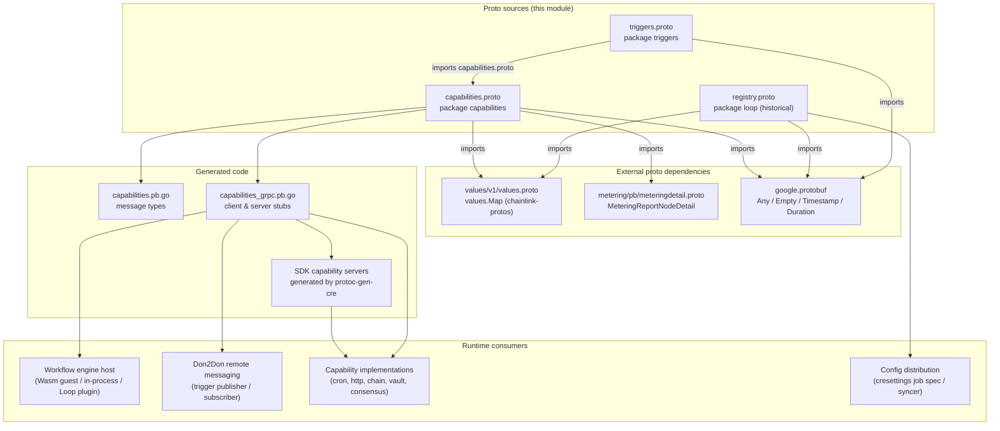
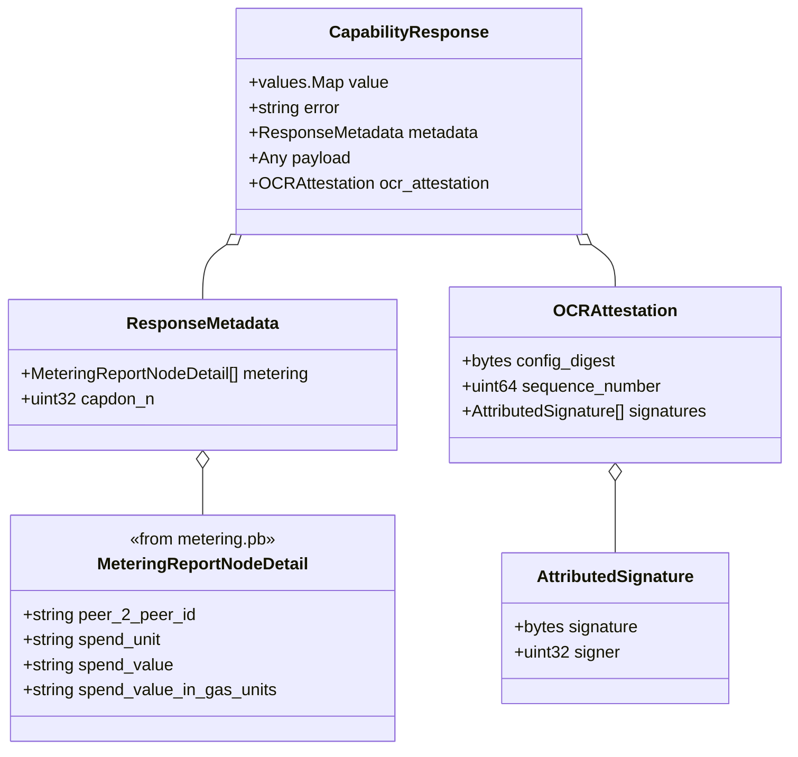
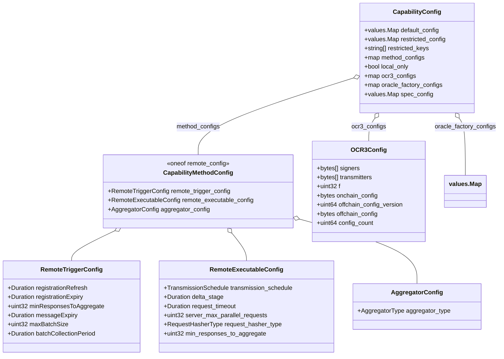
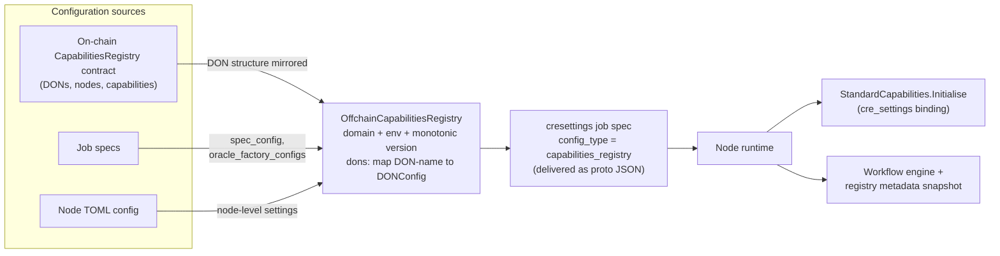
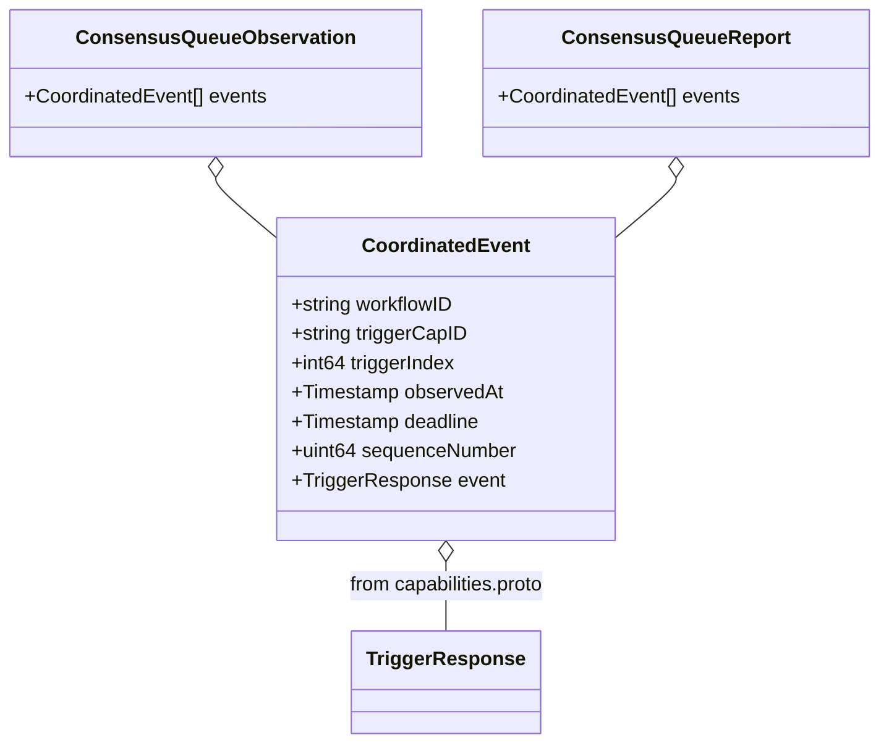

# Capabilities PB — Wire Protocol & gRPC Services (`chainlink-common/pkg/capabilities/pb`)

## Introduction

**Capabilities PB** is the wire-protocol layer of the Chainlink Capability Runtime (CRE). It lives in `chainlink-common/pkg/capabilities/pb/` and consists of three protobuf schemas plus their generated Go gRPC bindings:

| File | Protobuf package | Contents |
|---|---|---|
| `capabilities.proto` | `capabilities` | The five capability gRPC services (`BaseCapability`, `TriggerExecutable`, `Executable`, `StandardCapabilities`, `Settings`), capability request/response messages, capability-type taxonomy, metering and OCR attestation payloads |
| `registry.proto` | `loop` *(historical name)* | Per-capability configuration (`CapabilityConfig`), Don2Don remote trigger/executable settings, OCR3 instance configuration, and the `OffchainCapabilitiesRegistry` distribution document |
| `triggers.proto` | `triggers` | Coordinated trigger events (`CoordinatedEvent`) and consensus-queue observation/report messages |
| `capabilities_grpc.pb.go` | — | Generated gRPC client/server stubs for all five services (protoc-gen-go-grpc v1.5.1, protoc v5.29.3) |

All three schemas share `option go_package = "github.com/smartcontractkit/chainlink-common/pkg/capabilities/pb"`, so the generated Go code lands in a single package even though the protobuf package names differ.

This module is the **shared contract that lets heterogeneous participants interoperate**:

- The **workflow engine host** invokes capabilities (in Wasm guests, in-process, or in external plugin processes) exclusively through these messages — see [workflows_engine](../workflows/workflows_engine.md).
- The **Loop plugin framework** tunnels these exact gRPC services across process boundaries — see [loop-plugin-core](<../../Plugin_Process_Framework_(Loop)/loop-plugin-core.md>).
- The **Don2Don remote messaging runtime** carries trigger registrations, events, and capability responses between workflow DONs and capability DONs as these protobuf types — see [core_capabilities_runtime_remote_messaging](../core_capabilities_runtime/core_capabilities_runtime_remote_messaging.md).
- The **generated capability SDKs** (v2 "no-DAG" typed SDKs) are produced from these schemas by the `protoc-gen-cre` plugin — see [capabilities_v2_tooling](capabilities_v2_tooling.md).

The Go-side (in-process) mirror of these contracts — `BaseCapability`, `Executable`, `TriggerExecutable` interfaces, sentinel errors, and DON topology — is documented in [capabilities_core](capabilities_core.md). This page focuses on the wire format itself.

---

## 1. Architecture Overview



Key dependency facts:

- `capabilities.proto` imports `values/v1/values.proto` (the shared `values.Map` dynamic-value type, see the [values module](../../Shared_Foundation_Libraries___Domain_Types/values.md)) and `metering/pb/meteringdetail.proto` (`MeteringReportNodeDetail`, see [metering & billing](../../Shared_Foundation_Libraries___Domain_Types/metering-and-billing.md)).
- `triggers.proto` imports `capabilities.proto` to embed `capabilities.TriggerResponse` inside `CoordinatedEvent`.
- `registry.proto` imports only `values` and `google/protobuf/duration`; it defines **configuration**, not RPCs.

---

## 2. Service Model (`capabilities.proto`)

Five gRPC services form the capability contract. Every capability SDK — whether a generated v2 SDK server, a chain capability, or a plugin served over Loop — implements one or more of them.

```mermaid
classDiagram
    direction TB

    class BaseCapability {
        <<service>>
        +Info(Empty) CapabilityInfoReply
    }
    class TriggerExecutable {
        <<service server-streaming RegisterTrigger>>
        +RegisterTrigger(TriggerRegistrationRequest) stream TriggerResponseMessage
        +UnregisterTrigger(TriggerRegistrationRequest) Empty
        +AckEvent(AckEventRequest) Empty
    }
    class Executable {
        <<service server-streaming Execute>>
        +RegisterToWorkflow(RegisterToWorkflowRequest) Empty
        +UnregisterFromWorkflow(UnregisterFromWorkflowRequest) Empty
        +Execute(CapabilityRequest) stream CapabilityResponse
    }
    class StandardCapabilities {
        <<service>>
        +Initialise(InitialiseRequest) Empty
        +Infos(Empty) CapabilityInfosReply
    }
    class Settings {
        <<service server-streaming Subscribe>>
        +Subscribe(Empty) stream SettingsUpdate
    }
```



| Service | Purpose | Typical implementer | Typical caller |
|---|---|---|---|
| `BaseCapability` | Discovery: `Info` returns `CapabilityInfoReply` (id, type, description, version, `isLocal`, spend types) | Every capability | Registry sync, engine metadata queries |
| `TriggerExecutable` | Trigger lifecycle: registration, event streaming, acks | Trigger capabilities (cron, log/HTTP triggers, chain log triggers) | Node runtime, workflow engine, remote trigger subscribers |
| `Executable` | Execution lifecycle: workflow (de)registration + `Execute` | Action, consensus, target, and combined capabilities | Workflow engine host |
| `StandardCapabilities` | Node-provided capability bundles: bootstrap with service bindings, enumerate bundled capabilities | Standard capability plugins (webapi, vault, …) | Node runtime at plugin start-up |
| `Settings` | Push-based node settings distribution (TOML + sha256 hash) | Hosted inside standard capability plugins | CRE settings service |

### 2.1 Capability type taxonomy

`CapabilityType` mirrors the Go-side enum 1:1 (see [capabilities_core §1.1](capabilities_core.md)):

| Value | Name | Meaning |
|---|---|---|
| 0 | `CAPABILITY_TYPE_UNKNOWN` | Invalid placeholder |
| 1 | `CAPABILITY_TYPE_TRIGGER` | Produces events that start/continue executions |
| 2 | `CAPABILITY_TYPE_ACTION` | Executable read / API-call step |
| 3 | `CAPABILITY_TYPE_CONSENSUS` | Executable step aggregating observations into a consensus artifact |
| 4 | `CAPABILITY_TYPE_TARGET` | Executable step writing results on-chain |
| 5 | `CAPABILITY_TYPE_COMBINED` | Trigger + executable in one capability |

### 2.2 Dual payload styles: DAG vs no-DAG

Request and response messages deliberately carry **two parallel payload encodings** so both SDK generations interoperate over the same services:

| Concern | DAG SDK (v1) | no-DAG SDK (v2) |
|---|---|---|
| Request config | `CapabilityRequest.config` (`values.Map`) | `CapabilityRequest.configPayload` (`google.protobuf.Any`) |
| Request inputs | `CapabilityRequest.inputs` (`values.Map`) | `CapabilityRequest.payload` (`Any`) + `method` + `capabilityId` |
| Trigger registration config | `TriggerRegistrationRequest.config` (`values.Map`) | `TriggerRegistrationRequest.payload` (`Any`) + `method` |
| Trigger event outputs | `TriggerEvent.outputs` (`values.Map`) | `TriggerEvent.payload` (`Any`) |
| Response value | `CapabilityResponse.value` (`values.Map`) | `CapabilityResponse.payload` (`Any`) |

---

## 3. Message Reference

### 3.1 Execution context and billing

`RequestMetadata` rides on every request and carries the full workflow identity, billing inputs, and registry provenance:

| Field | Purpose |
|---|---|
| `workflow_id`, `workflow_execution_id`, `workflow_owner`, `workflow_name`, `decoded_workflow_name`, `workflow_tag` | Workflow and execution identity |
| `org_id` | Owning organization |
| `workflow_don_id`, `workflow_don_config_version` | Workflow DON identity and config epoch |
| `reference_id` | Engine-side correlation reference |
| `spend_limits` | Repeated `SpendLimit{spend_type, limit}` — pre-authorized billing budget per spend type |
| `workflow_registry_chain_selector`, `workflow_registry_address` | Where the workflow is registered on-chain |
| `engine_version` | Engine version that produced the request |
| `execution_timestamp` | DonTime-derived execution timestamp (atomic feature-flag evaluation across DONs) |

The Go-side behaviour of these fields (CRE context injection, spend-type validation) is covered in [capabilities_core](capabilities_core.md); the metering lifecycle they feed is described in [workflows_metering](../workflows/workflows_metering.md).

### 3.2 Response aggregation, metering, and attestation



Two design constraints are encoded directly in the proto source:

- **Metering is repeated because responses are aggregated, not because nodes emit many.** The proto comment on `ResponseMetadata.metering` states that identical capability responses are expected from each capability-DON node, but metering reports are per-node — the field must hold one report per responding node, and *a capability must emit exactly one metering report per node*.
- **`ocr_attestation` is `optional`** — only OCR-based capability methods produce `OCRAttestation{config_digest, sequence_number, signatures[]}`, which the engine binds to the report-data digest (see the attestation flow in [capabilities_core §5](capabilities_core.md)).

### 3.3 Standard capability bootstrap (`InitialiseRequest`)

`StandardCapabilities.Initialise` wires a freshly loaded plugin to the node's services. Its request is a **table of service binding IDs** plus the plugin config string:

| Binding field | Node-provided service (Go contract) |
|---|---|
| `error_log_id` | `core.ErrorLog` |
| `pipeline_runner_id` | `core.PipelineRunner` |
| `telemetry_id` | `core.TelemetryClient` |
| `capRegistry_id` | Capabilities registry (see [capabilities_registry](capabilities_registry.md)) |
| `keyValueStore_id` | `core.KeyValueStore` |
| `relayer_set_id` | `core.RelayerSet` |
| `oracle_factory_id` | `core.OracleFactory` |
| `gateway_connector_id` | Gateway connector |
| `keystore_id` | `core.Keystore` |
| `org_resolver_id` | Org resolver |
| `cre_settings_id` | CRE settings (carrying `OffchainCapabilitiesRegistry`, see §5) |
| `trigger_event_store_id` | Trigger event store |
| `capability_don_id` | Local capability DON identity |

All of these contracts are defined in [types-core](../../Shared_Foundation_Libraries___Domain_Types/types-core.md) and transported over Loop via the bindings in [loop-grpc-bindings](<../../Plugin_Process_Framework_(Loop)/loop-grpc-bindings.md>). The standalone engine configures plugins through the same `config` string (see `standardCapConfig` in [workflows_standalone](../workflows/workflows_standalone.md): *"Config will be passed to Initialise method of plugin"*).

`SettingsUpdate` completes the picture: settings are distributed as a TOML string with a sha256 `hash` for change detection, streamed by the `Settings` service.

---

## 4. Runtime Flows

### 4.1 Trigger registration and event delivery

```mermaid
sequenceDiagram
    autonumber
    participant W as Workflow Engine / Node Runtime
    participant T as Trigger Capability<br/>(TriggerExecutable server)
    participant S as External Event Source

    W->>T: RegisterTrigger(TriggerRegistrationRequest)
    Note over W,T: server-streaming RPC stays open;<br/>config carries trigger settings
    T-->>W: TriggerResponseMessage { ack }
    S->>T: event observed
    T-->>W: TriggerResponseMessage { response: TriggerEvent }
    W->>T: AckEvent(AckEventRequest { trigger_id, event_id, method })
    Note over W,T: at-least-once delivery:<br/>events stay unacked until acknowledged
    W->>T: UnregisterTrigger(TriggerRegistrationRequest)
    T--xW: stream closed
```

`TriggerResponseMessage` is a `oneof` (`ack` | `response`), making the open-stream protocol explicit: the ack confirms registration, subsequent messages are events, and `AckEventRequest.trigger_id` is unique per workflow because it embeds the workflow ID. The trigger-event persistence side (durability, redelivery) is documented in [core_capabilities_runtime_trigger_event_store](../core_capabilities_runtime/core_capabilities_runtime_trigger_event_store.md).

### 4.2 Executable invocation

```mermaid
sequenceDiagram
    autonumber
    participant W as Workflow Engine
    participant C as Capability DON nodes<br/>(Executable servers)

    W->>C: Execute(CapabilityRequest)
    Note over W,C: metadata = workflow identity + spend limits;<br/>DAG: config/inputs (values.Map)<br/>no-DAG: payload/configPayload (Any) + method
    C-->>W: stream CapabilityResponse
    alt aggregated outcome not yet available
        C-->>W: response error marker __response_payload_not_available
        Note over W: engine keeps waiting for an identical response
    else workflow stop requested
        C-->>W: response error marker __workflow_stop_execution
        Note over W: engine halts the execution
    else final aggregated response
        C-->>W: CapabilityResponse { value|payload, ResponseMetadata, ocr_attestation? }
        Note over W: metering reports collected one per node;<br/>OCRAttestation bound to report digest
    end
```

`Execute` is server-streaming so a remote capability can surface aggregation progress; the sentinel error markers interpreted by the engine are Go-side contracts from [capabilities_core §3.2](capabilities_core.md). For remote (Don2Don) capabilities, this exchange happens between the workflow DON and the capability DON through the remote messaging layer — see [core_capabilities_runtime_remote_messaging](../core_capabilities_runtime/core_capabilities_runtime_remote_messaging.md).

---

## 5. Capability Configuration Schema (`registry.proto`)

`registry.proto` (protobuf package `loop` — a historical name; the generated Go code lives in the same `pb` package) defines **how a capability is configured on a DON** and **how that configuration is distributed off-chain**.

### 5.1 Configuration model



Notable elements:

- **Method-scoped remote configs.** `method_configs` maps a method name to a `CapabilityMethodConfig`, whose `oneof remote_config` selects either trigger-style or executable-style Don2Don behaviour. `AggregatorConfig` selects `Mode` or `SignedReport` aggregation.
- **Response-aggregation invariant.** `RemoteExecutableConfig.min_responses_to_aggregate` (and the trigger counterpart): `0` defaults to **F+1 of the remote DON**; a non-zero value must satisfy **F+1 ≤ MinResponsesToAggregate ≤ N**. This is the primary tuning knob for read consistency vs. availability.
- **Transmission scheduling.** `TransmissionSchedule` (`AllAtOnce` / `OneAtATime`), `delta_stage`, `request_timeout`, and `server_max_parallel_requests` shape how a capability DON fans requests out; `RequestHasherType` (`Simple` / `WriteReportExcludeSignatures`) selects request deduplication.
- **OCR3 instance configuration.** `ocr3_configs` maps an OCR instance name to `OCR3Config`, which mirrors the libocr `ContractConfig` (signers, transmitters, `f`, on-chain/off-chain configs, `config_count` for digest computation). The key `"__default__"` is used for single-instance capabilities; custom keys (e.g. `"methodXYZ"` or `"blue"/"green"`) support multi-instance and blue/green rollouts. When present, `OCRConfigService` uses these entries to provide the `ContractConfigTracker` to libocr. `oracle_factory_configs` uses the same keying.
- **Config provenance migration.** `spec_config` and `oracle_factory_configs` carry configuration *moved from job specs* into the registry, consolidating what was previously split across job specs and node TOML.
- **Restricted config.** `restricted_config` / `restricted_keys` let DON administrators pin settings that workflow authors cannot override (the Go-side enforcement is part of the registry — see [capabilities_registry](capabilities_registry.md)).
- **`local_only`** marks a capability that must not be callable via the Don2Don framework.

### 5.2 Offchain registry distribution

`OffchainCapabilitiesRegistry` is the top-level, versioned container that consolidates capability configuration and delivers it to nodes:



Design properties stated in the proto source:

- Its **DON structure mirrors the on-chain `CapabilitiesRegistry` contract**, and it **reuses `CapabilityConfig`** so the off-chain and on-chain shapes stay identical and can be **compared field-by-field** (drift detection between what operators configured off-chain and what is committed on-chain).
- `version` is monotonically increasing (`0` = unset), enabling ordered application of configuration updates.
- Delivery mechanism: a **cresettings job spec** with `config_type = "capabilities_registry"`, serialized as proto JSON.

The on-chain registry deployment side is documented in [cre-capabilities-registry](../../CRE___Keystone_Deployment_Suite/cre-capabilities-registry.md), and the off-chain sync machinery that consumes such configuration in [workflows_syncer](../workflows/workflows_syncer.md).

---

## 6. Coordinated Trigger Events (`triggers.proto`)

`triggers.proto` defines the event format used when trigger events must be **consensually agreed** across a capability DON before being released to workflows:



- `CoordinatedEvent` wraps a `capabilities.TriggerResponse` with coordination context: which workflow and trigger it belongs to, when it was observed, the **processing deadline**, and a `sequenceNumber` for deterministic ordering in consensus.
- `ConsensusQueueObservation` is what a node *observes*; `ConsensusQueueReport` is what enters the consensus round. The identical shape of the two messages keeps the observation→report mapping trivial and auditable.

These types are consumed by the remote trigger consensus paths in [core_capabilities_runtime](../core_capabilities_runtime.md) and by the generic consensus request plumbing in [capabilities_consensus](capabilities_consensus.md).

---

## 7. Generated gRPC Bindings (`capabilities_grpc.pb.go`)

The `*_grpc.pb.go` files are generated by `protoc-gen-go-grpc` v1.5.1 with protoc v5.29.3 and are marked `DO NOT EDIT`. For each of the five services they provide:

- a **client interface** + `New*Client` constructor (e.g. `TriggerExecutableClient`),
- a **server interface** that must embed `Unimplemented*Server` by **value** for forward compatibility,
- an opt-out `Unsafe*Server` interface (not recommended — adding methods causes compile errors in implementors),
- request/response handler plumbing and the `grpc.ServiceDesc` registration descriptor.

| Unsafe server interface (from this module) | Service | Streaming RPCs |
|---|---|---|
| `UnsafeBaseCapabilityServer` | `capabilities.BaseCapability` | — |
| `UnsafeTriggerExecutableServer` | `capabilities.TriggerExecutable` | `RegisterTrigger` (server stream of `TriggerResponseMessage`) |
| `UnsafeExecutableServer` | `capabilities.Executable` | `Execute` (server stream of `CapabilityResponse`) |
| `UnsafeStandardCapabilitiesServer` | `capabilities.StandardCapabilities` | — |
| `UnsafeSettingsServer` | `capabilities.Settings` | `Subscribe` (server stream of `SettingsUpdate`) |

Implementation notes for maintainers:

- The bindings require **gRPC-Go ≥ 1.64** (`grpc.SupportPackageIsVersion9`) and use the **generic stream APIs** (`grpc.GenericClientStream[T, R]`, `grpc.ServerStreamingClient[TriggerResponseMessage]`, …), with backwards-compatible type aliases (e.g. `Executable_ExecuteClient`) for pre-generics call sites.
- Embedding `Unimplemented*Server` **by pointer** panics at first use; `Register*Server` defends by asserting `testEmbeddedByValue()` at registration time.

---

## 8. Codegen & Build Integration

Proto generation for this module is wired through the `chainlink-common` module build (see [build-and-repo-tooling](../../Build,_CI___Release_Infrastructure/build-and-repo-tooling.md)); relevant targets in `chainlink-common/Makefile`:

- **`install-protoc`** — installs `protoc` (version pinned in `.tool-versions`), `protoc-gen-go`, and `protoc-gen-go-grpc` (version pinned in `.tool-versions`; the checked-in `capabilities_grpc.pb.go` was generated with v1.5.1 / protoc v5.29.3).
- **`cre-protoc`** — builds `protoc-gen-cre` from `chainlink-common/pkg/capabilities/v2/protoc` (the `TemplateGenerator` plugin documented in [capabilities_v2_tooling](capabilities_v2_tooling.md)), which emits typed capability SDK servers from these schemas.
- **`generate`** — chains mockery + protoc installation + `cre-protoc` + module housekeeping.

Because the plugin **processes live across versions and module boundaries** (node binary vs. capability plugin binary vs. Wasm guest), wire compatibility is a first-class concern. The schemas follow strict protobuf evolution discipline — see the invariants below.

---

## 9. Wire-Compatibility Invariants

1. **Reserved field numbers are never reused.** The schemas deliberately reserve superseded field numbers, and future edits must preserve them:
   - `RequestMetadata`: `reserved 5`
   - `TriggerEvent`: `reserved 5` (previously `v1.OCRTriggerEvent`)
   - `RemoteExecutableConfig`: `reserved 1, 2, 3` (deprecated v1 fields)
   - `CapabilityConfig`: `reserved 2, 3, 4` (deprecated v1 fields)
2. **Both payload styles must be maintained.** Every request/response type keeps the DAG (`values.Map`) and no-DAG (`Any` + `method`) fields in sync; removing either breaks the other SDK generation (see §2.2 and [cre-sdk-generated-capabilities](../../Developer_Toolchain_(CLI,_SDKs___API_Clients)/cre-sdk-generated-capabilities.md)).
3. **Exactly one metering report per node.** `ResponseMetadata.metering` is repeated only for cross-node aggregation; per-node emitters must produce a single `MeteringReportNodeDetail` (see [metering & billing](../../Shared_Foundation_Libraries___Domain_Types/metering-and-billing.md) and [workflows_metering](../workflows/workflows_metering.md)).
4. **Aggregation bounds.** A non-zero `min_responses_to_aggregate` must satisfy F+1 ≤ value ≤ N of the remote DON; `0` means default F+1 (§5.1).
5. **OCR3 config integrity.** `OCR3Config.config_count` must be incremented on every configuration change; it feeds the config-digest computation.
6. **Generated files are never hand-edited.** Regenerate via the `chainlink-common` Make targets (§8); the Go-side contracts they mirror are documented in [capabilities_core](capabilities_core.md).

---

## 10. Relationship to Other Modules

| Related module | Relationship |
|---|---|
| [capabilities_core](capabilities_core.md) | Go-side mirror of every service and message here (`Executable` ↔ `ExecutableServer`, `CapabilityRequest` ↔ `pb.CapabilityRequest`, sentinel errors ↔ wire markers). |
| [capabilities_registry](capabilities_registry.md) | In-process `CapabilitiesRegistry` + registry metadata whose per-DON capability configuration is the `CapabilityConfig` message from `registry.proto`. |
| [capabilities_v2_tooling](capabilities_v2_tooling.md) | `protoc-gen-cre` / `TemplateGenerator` turns these schemas into typed SDK capability servers. |
| [workflows_engine](../workflows/workflows_engine.md) | The engine's host bridge calls `Executable.Execute` / `TriggerExecutable` RPCs against capabilities. |
| [workflows_syncer](../workflows/workflows_syncer.md) | Consumes registry/workflow configuration; `OffchainCapabilitiesRegistry` is delivered to nodes through the cresettings job it processes. |
| [workflows_metering](../workflows/workflows_metering.md) | Consumes `ResponseMetadata.metering` from capability responses. |
| [core_capabilities_runtime](../core_capabilities_runtime.md) | Implements the Don2Don transport (trigger publisher/subscriber, `Dispatcher`) that carries `CapabilityRequest`/`CapabilityResponse`/trigger messages between DONs. |
| [Plugin_Process_Framework_(Loop)](<../../Plugin_Process_Framework_(Loop)/loop-plugin-core.md>) | Transports these gRPC services to external plugin binaries; `InitialiseRequest` bindings map to Loop's internal pb services. |
| [types-core](../../Shared_Foundation_Libraries___Domain_Types/types-core.md) | Go contracts behind the `InitialiseRequest` service bindings (keystore, pipeline runner, telemetry, relayer set, …). |
| [metering-and-billing](../../Shared_Foundation_Libraries___Domain_Types/metering-and-billing.md) | Source of `MeteringReportNodeDetail` and the billing pipeline fed by capability responses. |
| [cre-capabilities-registry](../../CRE___Keystone_Deployment_Suite/cre-capabilities-registry.md) | Deploys and configures the on-chain registry that `OffchainCapabilitiesRegistry` mirrors. |

---

*Module position: `Workflow & Capability Runtime (CRE Engine) → capabilities → capabilities_pb` — see the [capabilities overview](../capabilities.md) and the [CRE Engine root](<../Workflow___Capability_Runtime_(CRE_Engine).md>).*
