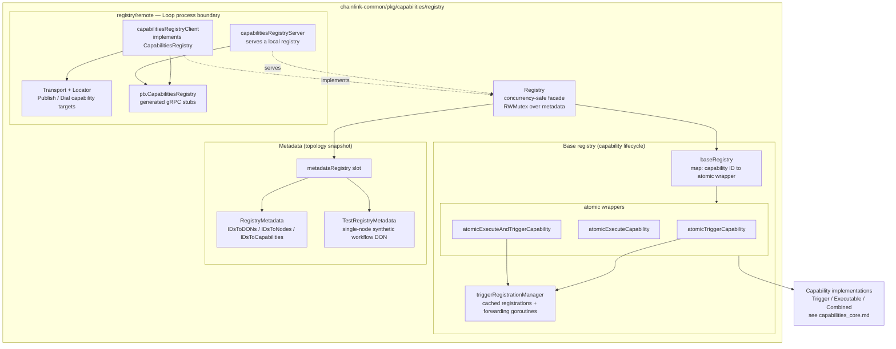
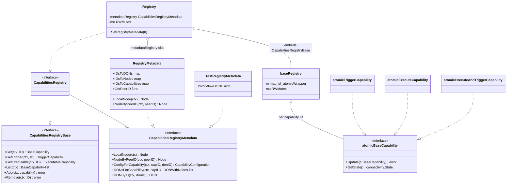
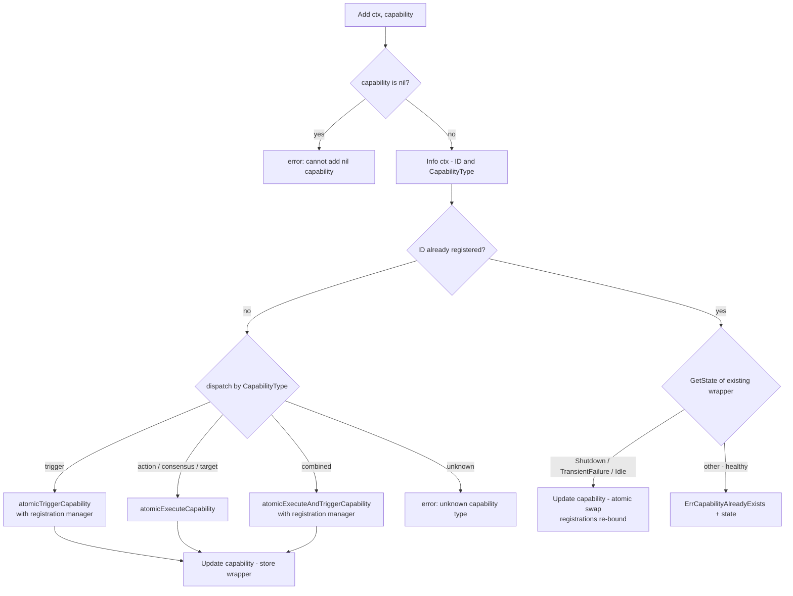
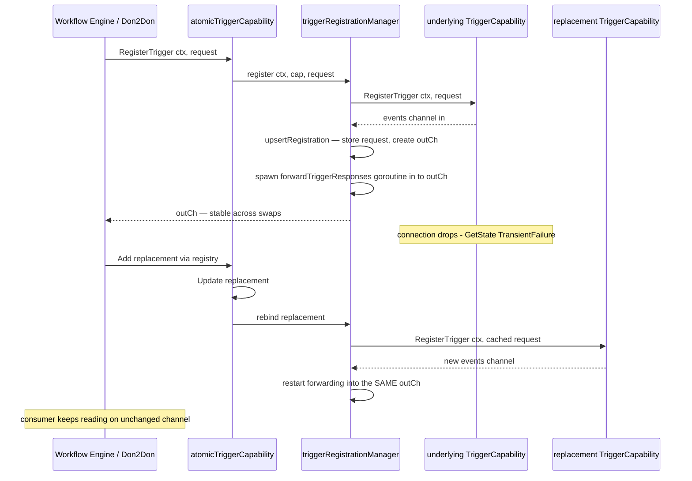
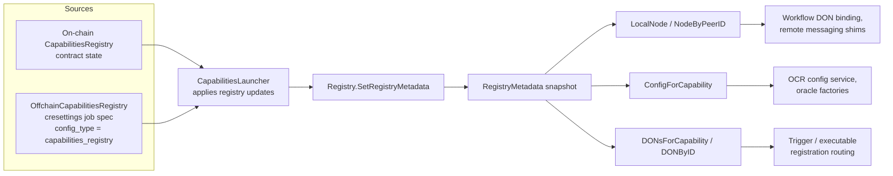
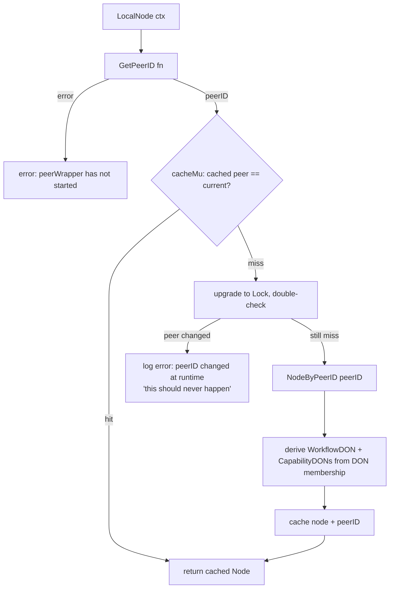
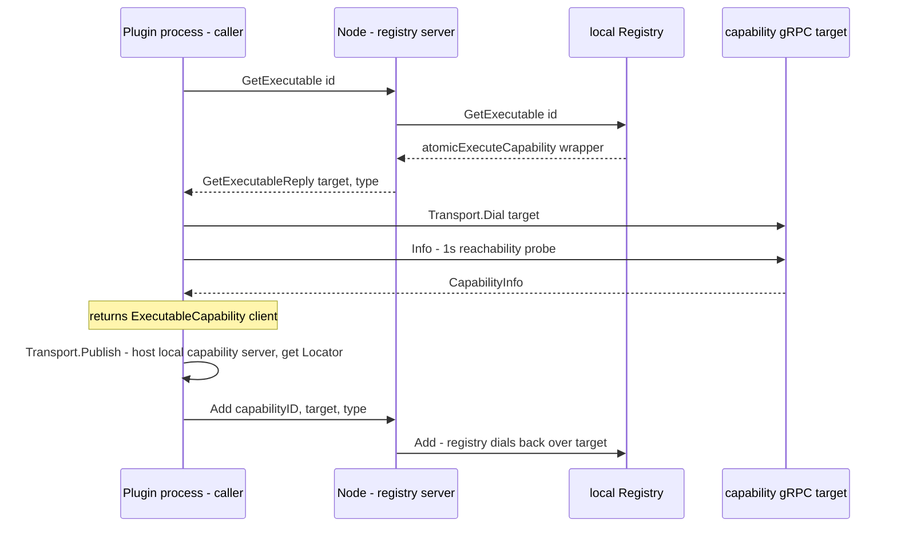

# Capabilities Registry

> **Module path:** `chainlink-common/pkg/capabilities/registry` (subpackage: `registry/remote`)
> **Parent module:** [Capabilities](../capabilities.md) — part of the [Workflow & Capability Runtime (CRE Engine)](../../Workflow___Capability_Runtime_(CRE_Engine).md)

## Introduction

The **Capabilities Registry** is the in-memory service-discovery backbone of the Chainlink Runtime Environment (CRE). It solves two distinct problems for a chainlink node:

1. **Capability lifecycle & lookup** — every capability available to the node (triggers, actions, consensus methods, targets, and combined trigger+executable capabilities) is registered under a versioned ID (e.g. `cron-trigger@1.0.0`). The workflow engine and the DON-to-DON (Don2Don) machinery resolve capabilities by ID from this registry before invoking them.
2. **Registry metadata** — a local, queryable snapshot of the *network topology* recorded in the on-chain CapabilitiesRegistry contract (and its offchain counterpart): which DONs exist, which nodes belong to them, which DONs host which capabilities, and the per-DON capability configuration (default/restricted config, remote trigger/executable method config, OCR3 configs, oracle-factory configs).

The module is deliberately small and interface-driven: the same `CapabilitiesRegistry` interface is satisfied by an in-process `Registry`, by a gRPC client for out-of-process plugin hosts, and by test doubles — so consumers (workflow engine, capabilities launcher, remote-messaging shims) are agnostic to where capabilities actually run.

**Source files:**

| File | Core components |
|---|---|
| `chainlink-common/pkg/capabilities/registry/registry.go` | `CapabilitiesRegistry`, `CapabilitiesRegistryBase`, `CapabilitiesRegistryMetadata`, `Registry`, `TestRegistryMetadata` |
| `chainlink-common/pkg/capabilities/registry/base.go` | `baseRegistry`, `NewBaseRegistry`, `ErrCapabilityAlreadyExists` |
| `chainlink-common/pkg/capabilities/registry/atomic.go` | `atomicBaseCapability`, `atomicTriggerCapability`, `atomicExecuteCapability`, `atomicExecuteAndTriggerCapability`, `StateGetter` |
| `chainlink-common/pkg/capabilities/registry/trigger_registration_manager.go` | `triggerRegistrationManager`, `triggerRegistration` |
| `chainlink-common/pkg/capabilities/registry/metadata.go` | `RegistryMetadata`, `DON`, `CapabilityConfiguration`, `NodeInfo`, `Capability`, `DeepCopyRegistryMetadata` |
| `chainlink-common/pkg/capabilities/registry/remote/registry.go` | `capabilitiesRegistryClient`, `capabilitiesRegistryServer`, `NewCapabilitiesRegistryClient` |
| `chainlink-common/pkg/capabilities/registry/remote/transport.go` | `Transport`, `Locator` |
| `chainlink-common/pkg/capabilities/registry/remote/pb/capabilities_registry_grpc.pb.go` | `CapabilitiesRegistryClient`, `CapabilitiesRegistryServer`, `UnsafeCapabilitiesRegistryServer` (generated) |

---

## Architecture Overview

The `Registry` facade composes two halves: an embedded **base registry** that owns capability objects, and a swappable **metadata registry** that owns topology state. Every capability stored in the base registry is wrapped in an *atomic wrapper* so the underlying implementation (typically a gRPC client connection into a plugin process) can be hot-swapped without racing callers.



The capability interfaces themselves (`BaseCapability`, `TriggerCapability`, `ExecutableCapability`, `ExecutableAndTriggerCapability`) and the capability domain types (`Node`, `DON`, `DONWithNodes`, `CapabilityConfiguration`) are defined in the parent [`capabilities` package](../capabilities.md) and documented in [Capabilities Core](capabilities_core.md).

---

## Core Interface Model

`CapabilitiesRegistry` is the union of two orthogonal concerns. This split lets callers that only need topology metadata (e.g. OCR config services) depend on `CapabilitiesRegistryMetadata` without pulling in capability lifecycle.



### The `Registry` facade (`registry.go`)

- **`NewRegistry(lggr)`** constructs a `Registry` whose embedded base is a `NewBaseRegistry` map; the metadata slot starts `nil`.
- **Metadata delegation.** All five metadata methods take an `RLock` and return the sentinel error *"metadataRegistry information not available"* if `SetRegistryMetadata` has not been called yet. This makes callers fail fast and explicitly rather than silently operating on empty topology.
- **`SetRegistryMetadata(lr)`** swaps in a metadata snapshot. The doc comment is explicit: *"only public for testing purposes; the only production use should be from the CapabilitiesLauncher"* (see [Core Capabilities Runtime](../core_capabilities_runtime.md)).
- **`TestRegistryMetadata`** fabricates a synthetic single-node workflow DON (ID `1`, config version `1`, the local peer as the only member, configurable fault tolerance via `WorkflowDONF`, `AcceptsWorkflows: true`). It keeps compatibility paths that still expect a multi-signer DON shape working when no external registry is available — the standard substitute in unit tests.

---

## Base Registry: Capability Lifecycle (`base.go`)

`baseRegistry` is a mutex-guarded `map[capabilityID]atomicBaseCapability`. Its semantics matter because multiple actors (local capability manager, remote registry sync, plugin host) mutate the map concurrently.

### Add / replace semantics



Key behaviors:

- **Type-driven wrapping.** On first `Add`, the `CapabilityType` from `Info()` selects the wrapper: `trigger` → `atomicTriggerCapability`, `action`/`consensus`/`target` → `atomicExecuteCapability`, `combined` → `atomicExecuteAndTriggerCapability`.
- **Crash-recovery replaces.** A duplicate `Add` is rejected with `ErrCapabilityAlreadyExists` **unless** the existing wrapper's gRPC connectivity state is `Shutdown`, `TransientFailure`, or `Idle` — i.e. the old capability is provably dead, so replacing it (via `Update`) is safe. This is what makes plugin-process restarts recoverable.
- **Remove is a soft remove.** `Remove` calls `Update(nil)` on the wrapper instead of deleting the map entry. Subsequent lookups still return the wrapper, but every operation on it fails with *"capability unavailable"*, and connectivity reports `Shutdown` — allowing a later `Add` to swap in a healthy replacement.

### Version-aware lookup

`Get` first tries an exact ID match. On miss it parses the `name@version` ID and performs semantic-version resolution over all registered IDs with the same name:

1. Same **major** version only (no breaking-change coercion).
2. Candidate must be **greater than** the requested version; the **smallest such version** wins (closest compatible upgrade).
3. **Pre-release candidates are skipped** unless the request itself is a pre-release.

If nothing matches, the error is `"no compatible capability found for id <id>"`. `GetTrigger` and `GetExecutable` layer interface coercion on top, failing with *"does not satisfy the capability interface"* when the stored wrapper cannot be narrowed.

---

## Atomic Wrappers & Hot-Swap (`atomic.go`)

Plugin capabilities usually live in separate OS processes reached over gRPC (see [Plugin Process Framework (Loop)](../../Plugin_Process_Framework_(Loop)/loop-plugin-core.md)). When such a process restarts or is upgraded, the underlying client object must be replaced without interrupting in-flight callers. The atomic wrappers provide exactly that:

- `atomicBaseCapability` extends `capabilities.BaseCapability` with `Update(BaseCapability) error` and `StateGetter`.
- **`StateGetter`** is satisfied by `*grpc.ClientConn`: `GetState() connectivity.State`. Wrappers report `connectivity.Shutdown` when the slot is empty and an *unknown* state (`-1`) when the underlying capability predates the interface.
- Every delegated method takes a short `RLock`, copies the pointer, then operates **outside** the lock — so a long-running `Execute` never blocks a concurrent `Update`.
- When the slot is empty, all operations return *"capability unavailable"* immediately.

### Trigger registration continuity

The trigger wrappers embed a `triggerRegistrationManager` (`trigger_registration_manager.go`). Trigger registrations are the expensive, stateful part of a trigger capability's lifecycle (they describe *which workflows want which events*), so they must survive capability swaps:



Manager semantics worth knowing when debugging trigger delivery:

- **Not thread-safe by itself** — the owning wrapper serializes `register`/`unregister`/`rebind` under its own write lock.
- **One registration per `TriggerID`** (the engine keys it as `(workflowID, triggerIndex)`). Re-registering upserts: the same `outCh` is handed back, the previous forwarding goroutine is cancelled and joined, and a new one is started for the fresh upstream channel.
- **Optimistic backward compatibility.** If the remote node returns `capabilities.ErrUnableToDetermineRegistrationStatus` (it predates trigger-registration messages), the manager still records the registration and returns the channel alongside the error — matching legacy behavior during node-version migration.
- **Rebind failures are logged, not fatal.** If re-registering with the replacement capability fails, the error is logged and the user's channel is left connected to nothing rather than crashing the swap.
- **`unregister`** cancels the forwarding goroutine, waits for its exit (`done`), closes the user channel, deletes the entry, then delegates to the underlying `UnregisterTrigger`.

---

## Registry Metadata: Topology Snapshot (`metadata.go`)

`RegistryMetadata` is the local resolution layer over the CapabilitiesRegistry state. It holds three maps, mirroring the on-chain contract's tables:

| Map | Key | Value | Derived from |
|---|---|---|---|
| `IDsToDONs` | `DonID` (uint32) | `DON` (embeds `capabilities.DON`) + `map[capabilityID]CapabilityConfiguration` | Registry contract DON records |
| `IDsToNodes` | ragep2p `PeerID` | `NodeInfo` (node operator, config count, workflow DON id, signer, P2P id, encryption public key, hashed capability IDs, capability DON ids, v2 `CsaKey`) | Registry contract node records |
| `IDsToCapabilities` | capability ID | `Capability{ID, CapabilityType}` | Registry contract capability records |

### How snapshots reach the node



The offchain container (`OffchainCapabilitiesRegistry` in `chainlink-common/pkg/capabilities/pb/registry.proto`, schema documented in [Capabilities PB](capabilities_pb.md)) is the offchain-distributed consolidation of configuration that was previously split across the on-chain registry, job specs, and node TOML. It deliberately reuses the same `CapabilityConfig` shape as the on-chain registry so the two can be compared field-by-field.

### Local node resolution and caching

`LocalNode` is the hottest metadata query — every workflow execution needs the node's own `DON` context:



`NodeByPeerID` scans all DONs for membership and derives the `capabilities.Node` view:

- **Workflow DON** — the first member DON with `AcceptsWorkflows: true`. A node belonging to more than one workflow DON is logged as a configuration error (the first wins).
- **Capability DONs** — every DON the peer belongs to.
- plus operator/signer/encryption-key fields copied from `NodeInfo`.

### Lookups

- **`DONByID`** performs a direct map lookup and — unlike `DONsForCapability` — resolves *any* known DON, including caller/workflow DONs that host no capability. This is required to authoritatively read a caller DON's **Families** (e.g. zone membership) from its `WorkflowDonID` during Don2Don request validation.
- **`DONsForCapability`** scans every DON's `CapabilityConfigurations` for the capability ID and returns `DONWithNodes` entries with fully resolved member nodes; it errors when no DON hosts the capability.
- **`ConfigForCapability`** locates the DON, then the capability's config within it, and decodes it.
- **`ensureNotEmpty`** guards all lookups: any of the three maps being empty produces a targeted *"empty metadata registry"* error — the canonical symptom of a node that has not yet picked up registry state (system tests explicitly wait for this state; see [System Tests](../../Dev,_Test___Simulation_Environments/system-tests.md)).

### `CapabilityConfiguration` decoding

`DON.CapabilityConfigurations` stores **raw protobuf bytes**; `CapabilityConfiguration.Unmarshal()` converts them into the runtime `capabilities.CapabilityConfiguration`:

- `DefaultConfig`, `RestrictedConfig`, `SpecConfig` — decoded from `values.v1.Map` protos.
- `RestrictedKeys` — passthrough string list.
- `MethodConfigs` — per-method **remote trigger** config (registration refresh/expiry, min responses to aggregate, message expiry, max batch size, batch collection period) or **remote executable** config (transmission schedule, delta stage, request timeout, server max parallel requests, request hasher type, min responses to aggregate), plus optional aggregator config (`Mode` or `SignedReport`).
- `Ocr3Configs` — converted to libocr `ContractConfig` per OCR instance name (`"__default__"` or custom keys for blue/green instances). Transmitters are hex-encoded here to stay byte-compatible with the external OCR config service, and an `F` value exceeding `uint8` is rejected with a bounds check.
- `OracleFactoryConfigs` — per-instance `values.Map` consumed by oracle-factory-based capabilities.
- `LocalOnly` — when true, the capability cannot be invoked via Don2Don.

### Serialization

`RegistryMetadata` implements `MarshalJSON`/`UnmarshalJSON` so snapshots can be persisted/transported as JSON (byte-array fields are encoded via `types.PeerID`, big-int DON ids as decimal strings). `DeepCopyRegistryMetadata` produces a fully independent copy (cloned slices, byte slices, and maps) for safe hand-off between the launcher and consumers.

---

## Remote Registry: gRPC Across the Loop Boundary

The same `CapabilitiesRegistry` interface must also work when the *caller* runs in a separate plugin process (the Loop plugin model). The `registry/remote` subpackage provides both ends:

- **`capabilitiesRegistryServer`** wraps any local `CapabilitiesRegistry` and exposes it as `loop.CapabilitiesRegistry` gRPC service (generated code in `remote/pb/capabilities_registry_grpc.pb.go` from `remote/pb/capabilities_registry.proto`).
- **`capabilitiesRegistryClient`** (via `NewCapabilitiesRegistryClient`) implements `registry.CapabilitiesRegistry` for a remote caller, backed by a `grpc.ClientConnInterface` plus a `Transport`.

### Service contract

| RPC | Maps to | Reply carries |
|---|---|---|
| `LocalNode` | `CapabilitiesRegistryMetadata.LocalNode` | `NodeReply` (peer id, workflow DON, capability DONs, operator, signer, encryption key) |
| `NodeByPeerID` | `NodeByPeerID` | `NodeReply` |
| `ConfigForCapability` | `ConfigForCapability` | `CapabilityConfig` (shared proto with the on-chain/offchain registry shape) |
| `DONsForCapability` | `DONsForCapability` | repeated `DONWithNodes` |
| `DONByID` | `DONByID` | `DON` |
| `Get` / `GetTrigger` / `GetExecutable` | base lookups | locator: `target` (gRPC target) + deprecated `capabilityID` (legacy go-hashicorp-plugin handle) + `ExecuteAPIType` |
| `List` | `List` | repeated locators (`targets`) |
| `Add` | `Add` | `AddRequest{capabilityID, target, type}` |
| `Remove` | `Remove` | — |

The `ExecuteAPIType` enum (`TRIGGER`, `EXECUTE`, `COMBINED`) tells the caller which generated client wrapper to dial the capability with.

### Transport & locator model



- **`Locator{Target, LegacyHandle}`**: `Target` is a gRPC target string whose scheme only the serving host must understand; `LegacyHandle` is the opaque numeric connection id of the legacy go-hashicorp-plugin transport. Resolvers treat `Target` as authoritative when non-empty and fall back to `LegacyHandle` otherwise — this is what allows the same protocol to work over both plugin handles and modern dial targets.
- **`Transport`** (interface in `remote/transport.go`): `Publish` hosts a local capability's gRPC server and returns its `Locator` plus a closer; `Dial` resolves a locator lazily (the resolve function may be re-invoked) and returns a `ClientConn`.
- **Reachability probe**: `Get`/`GetTrigger`/`GetExecutable` immediately call `Info()` with a 1-second timeout so callers get a connection error at resolution time instead of a confusing failure at first execution.
- **`Add` is bidirectional**: the caller first publishes a gRPC server for its capability, *then* tells the registry where to reach it; the node-side registry stores a wrapper that dials that target.

Code generation: the gRPC stubs are checked in and regenerated with the protoc toolchain configured in `chainlink-common/Makefile` (targets `generate` / `cre-protoc`, protoc installed via `chainlink-common/script/install-protoc.sh`).

---

## Concurrency Model

| Structure | Guard | Notes |
|---|---|---|
| `Registry` metadata slot | `sync.RWMutex` | Metadata methods take read lock; `SetRegistryMetadata` takes write lock |
| `baseRegistry` map | `sync.RWMutex` | Reads (`Get`/`List`) shared; `Add`/`Remove` exclusive |
| Atomic wrappers | per-wrapper `sync.RWMutex` | Pointer copied under lock, work done outside; `RegisterTrigger`/`UnregisterTrigger`/`Update` exclusive |
| `RegistryMetadata` local-node cache | `cacheMu sync.RWMutex` | Double-checked locking; logs (and recovers from) peer-ID change at runtime |
| `triggerRegistrationManager` | none (caller-locked) | Explicitly documented as not thread-safe |

The lock ordering is simple and shallow: registry → wrapper → (no further locks), which avoids deadlocks during capability swaps triggered from metadata callbacks.

## Error Semantics

| Error | Raised when |
|---|---|
| `metadataRegistry information not available` | Metadata query before `SetRegistryMetadata` |
| `capability unavailable` | Operation on a wrapper whose underlying capability is nil (removed or failed swap) |
| `ErrCapabilityAlreadyExists` | `Add` of an ID whose existing wrapper is in a healthy gRPC state |
| `no compatible capability found for id %s` | Version-aware `Get` exhausted same-major candidates |
| `capability %s does not satisfy the capability interface` | `GetTrigger`/`GetExecutable` type coercion failure |
| `unknown capability type: %s` | `Add` with a `CapabilityType` outside trigger/action/consensus/target/combined |
| `empty metadata registry...` | Any metadata lookup while a snapshot map is empty (node has not picked up registry state) |
| `could not find peerID/don/capability configuration ...` | Metadata lookup misses within a loaded snapshot |
| `capabilities.ErrUnableToDetermineRegistrationStatus` | Remote node predates registration messages; registration is recorded optimistically |

---

## Testing Support

- **`TestRegistryMetadata`** (`registry.go`) — drop-in metadata for tests; synthesizes a single-node workflow DON with configurable fault tolerance.
- **`core/capabilities/mocks`** — generated mocks for the capability interfaces consumed through the registry.
- Package tests: `base_test.go`, `metadata_test.go`; cross-boundary compatibility is covered by `remote/registry_compat_test.go` and `remote/listener_transport_test.go`.
- End-to-end: the CRE system tests wait for the node to pick up registry state (`capabilityRegistrySyncState`) before asserting workflow behavior — see [System Tests](../../Dev,_Test___Simulation_Environments/system-tests.md).

---

## How This Module Fits into CRE

```mermaid
graph LR
    subgraph "Registry state sources"
        CHAIN["On-chain CapabilitiesRegistry contract"]
        OFFCHAIN["OffchainCapabilitiesRegistry<br/>cresettings config"]
    end
    subgraph "Node process"
        LAUNCH["CapabilitiesLauncher<br/>core/capabilities/launcher.go"]
        REG2["CapabilitiesRegistry"]
        LCM["LocalCapabilityManager<br/>localcapmgr"]
        REMOTE["Remote messaging shims<br/>CombinedClient, TriggerPublisher / Subscriber,<br/>executable client / server"]
        ENGINE["Workflow engine<br/>workflows_engine.md"]
    end
    subgraph "Plugin processes"
        LOOP["Loop plugins<br/>loop-plugin-core"]
    end
    DEPLOY["Deployment suite<br/>register capabilities / DONs / nodes / NOPs"]

    DEPLOY -->|"deploys + configures contract"| CHAIN
    CHAIN -->|"registry updates"| LAUNCH
    OFFCHAIN --> LAUNCH
    LAUNCH -->|"SetRegistryMetadata"| REG2
    REG2 --> LCM
    REG2 --> REMOTE
    LCM -->|"Add local capabilities"| REG2
    REG2 -->|"resolve capabilities"| ENGINE
    ENGINE -->|"invoke triggers / actions / targets"| REG2
    LOOP -.|"publish / reach capabilities over gRPC"| REG2
```

- **Consumers.** The [workflow engine](../workflows/workflows_engine.md) resolves trigger and executable capabilities from the registry for every execution; the [core capabilities runtime](../core_capabilities_runtime.md) (launcher + remote messaging) owns the registry instance, feeds it metadata, and builds per-`(capability, DON, method)` remote shims on top of it.
- **Producers.** Local capabilities register via the local capability manager; out-of-process capabilities register through the remote transport when a Loop plugin host starts.
- **Deployment.** The on-chain registry's contents (registered capabilities, DONs, nodes, NOPs, DON families) are managed by the CRE deployment suite's capabilities-registry changesets — see [CRE Capabilities Registry deployment](../../CRE___Keystone_Deployment_Suite/cre-capabilities-registry.md). The workflow registry syncer that consumes DON/capability membership for workflow placement is documented in [Workflows Syncer](../workflows/workflows_syncer.md).

## Related Documentation

- [Capabilities](../capabilities.md) — parent module overview
- [Capabilities Core](capabilities_core.md) — `BaseCapability`/`TriggerCapability`/`ExecutableCapability` contracts and domain types
- [Capabilities PB](capabilities_pb.md) — `CapabilityConfig`, `OCR3Config`, method-config protos
- [Core Capabilities Runtime](../core_capabilities_runtime.md) — launcher, DON notifier, remote messaging
- [Workflows Engine](../workflows/workflows_engine.md) — primary consumer of resolved capabilities
- [Plugin Process Framework (Loop)](../../Plugin_Process_Framework_(Loop)/loop-plugin-core.md) — process isolation model the atomic wrappers and remote registry support
- [CRE Capabilities Registry (deployment)](../../CRE___Keystone_Deployment_Suite/cre-capabilities-registry.md) — on-chain registry deployment & administration
