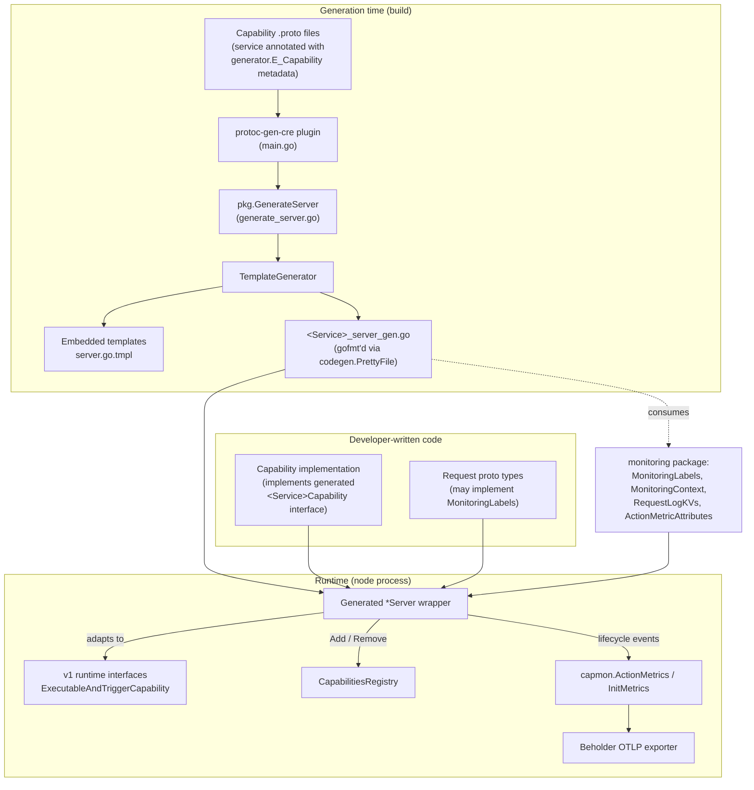
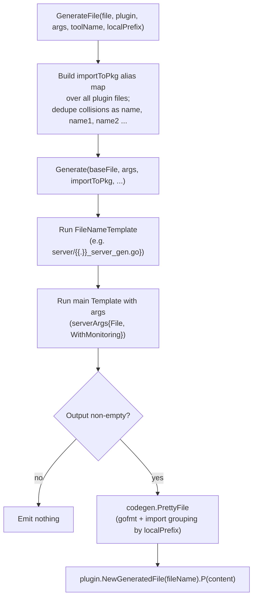
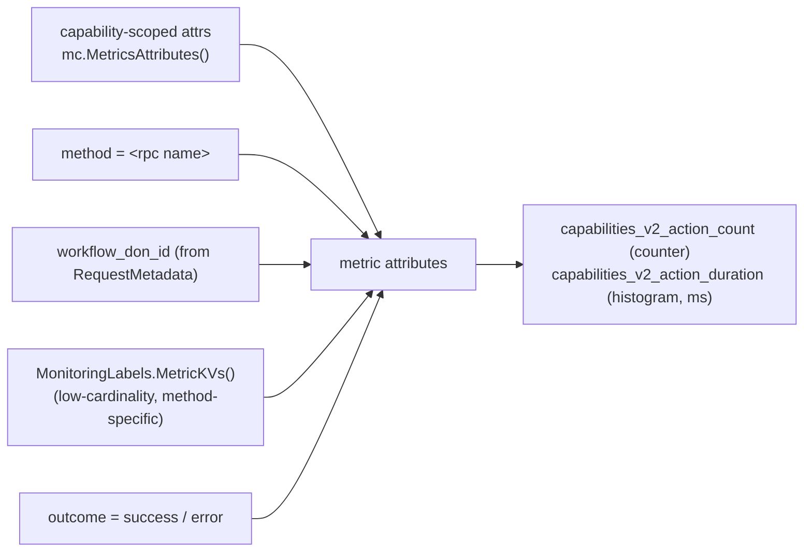
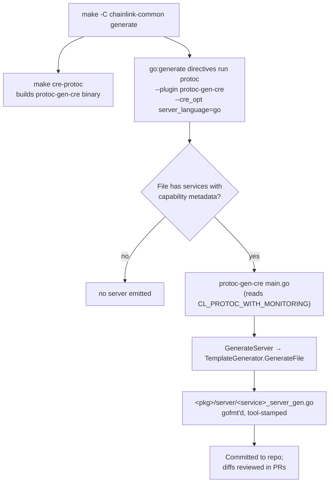

# Capabilities v2 Tooling

## 1. Introduction

`capabilities_v2_tooling` is the **developer-experience toolchain for the v2 (CRE) capability framework**. While the v1 capability stack ([capabilities_core](capabilities_core.md), [capabilities_pb](capabilities_pb.md)) defines runtime interfaces and wire contracts that developers wire up by hand, the v2 tooling **generates all of that boilerplate from proto definitions** and **standardizes observability** for every generated capability.

The module consists of two cooperating pieces, both living in `chainlink-common/pkg/capabilities/v2/`:

| Piece | Location | Runs at | Purpose |
|---|---|---|---|
| **`TemplateGenerator`** | `chainlink-common/pkg/capabilities/v2/protoc/pkg/template_generator.go` | Build time | The template-driven code-generation engine behind the `protoc-gen-cre` protoc plugin; turns annotated capability protos into Go server wrapper code |
| **`MonitoringLabels`** | `chainlink-common/pkg/capabilities/v2/monitoring/labels.go` | Runtime | An optional interface that generated capability request protos implement to enrich lifecycle logs and metrics with method-specific fields |

The two are complementary: `TemplateGenerator` emits server code that **type-asserts its inputs against `MonitoringLabels` at call time**, so capability authors get rich, consistent telemetry by simply declaring methods on their request messages.

For the surrounding runtime — how workflows invoke capabilities, how the capabilities registry works, and how the standalone CRE engine is assembled — see the parent [Capabilities](../capabilities.md) page and the top-level [Workflow & Capability Runtime (CRE Engine)](../../Workflow___Capability_Runtime_(CRE_Engine).md) overview.

---

## 2. Architecture Overview

The module spans two phases of the capability lifecycle:

1. **Generation time** — `protoc-gen-cre` (a binary built from `pkg/capabilities/v2/protoc/main.go`) reads `.proto` files whose services carry `generator.CapabilityMetadata` / `generator.CapabilityMethodMetadata` extensions and emits a `<service>_server_gen.go` wrapper per file. `TemplateGenerator` owns the template execution, import management, and code formatting.
2. **Runtime** — the generated `*Server` wraps a developer-written capability implementation, adapts it to the v1 runtime interfaces ([capabilities_core](capabilities_core.md)), registers it with the [capabilities registry](capabilities_registry.md), and instruments every action with the `monitoring` package helpers, exported via [Beholder telemetry](../../Telemetry___Observability_Platform/beholder-telemetry.md).



Key relationships to the rest of the system:

- **Generated ↔ v1 runtime**: the generated wrapper satisfies `capabilities.ExecutableAndTriggerCapability` (`var _ capabilities.ExecutableAndTriggerCapability = (*basicActionCapability)(nil)` appears in every generated file), delegating to the v1 contracts documented in [capabilities_core](capabilities_core.md).
- **Generated ↔ Loop plugin framework**: generated server code imports `github.com/smartcontractkit/chainlink-common/pkg/loop`; standard capabilities are hosted in plugin processes using this framework (see [Plugin Process Framework (Loop)](../../Plugin_Process_Framework_(Loop).md)).
- **Monitoring ↔ observability platform**: `ActionMetrics` instruments are created from `beholder.GetMeter()` and exported over OTLP, as described in [Beholder telemetry](../../Telemetry___Observability_Platform/beholder-telemetry.md).

---

## 3. Component: `TemplateGenerator`

**File:** `chainlink-common/pkg/capabilities/v2/protoc/pkg/template_generator.go`

`TemplateGenerator` is a reusable, language-agnostic code generation engine. It is not specific to servers — any generator (Go server today; TS SDK generators live in the external `chainlink-protos` repo) can instantiate one with its own template.

### 3.1 Structure

```go
type TemplateGenerator struct {
    Name               string               // e.g. "go_server"; used as template names
    Template           string               // main template text (go:embed'ed)
    FileNameTemplate   string               // e.g. "server/{{.}}_server_gen.go"
    Partials           map[string]string    // named sub-templates
    StringLblValue     func(name string, label *generator.Label) (string, error)
    PbLabelTLangLabels func(labels map[string]*generator.Label) ([]Label, error)
    ExtraFns           template.FuncMap     // language-specific helpers
    importToPkg        map[protogen.GoImportPath]protogen.GoPackageName
}
```

The two callback fields are the **language plug-in points**: `StringLblValue` produces a Go expression that stringifies a label value at runtime (from `pkg/label.go` + `pkg/utils.go`), and `PbLabelTLangLabels` converts protobuf label metadata into language-typed `Label{Name, Type, DefaultValues}` structs.

### 3.2 Generation flow



Notable behaviors:

- **Import aliasing**: because a protoc invocation can process many files, package names may clash (e.g. two `v1` packages). The alias map assigns `base`, `base1`, `base2`, … and template helpers like `ImportAlias`, `name` (i.e. `TypeName`), and `addImport` consult it, so generated code always compiles. This is exercised by the `test_capabilities/importclash` fixture.
- **Empty-output suppression**: if the rendered template is whitespace-only, no file is emitted (useful when a language template has nothing to generate for a given file).
- **Formatting**: output runs through `codegen.PrettyFile` with `PrettySettings{Tool, LocalPrefix}` — `toolName` is stamped into the generated header (`// Code generated by github.com/smartcontractkit/chainlink-common/pkg/capabilities/v2/protoc, DO NOT EDIT.`) and `localPrefix` groups `smartcontractkit` imports separately.

### 3.3 Template function library

`runTemplate` registers a standard `template.FuncMap` (extensible via `ExtraFns`) that templates use to interrogate the proto model:

| Function | Reads from | Purpose |
|---|---|---|
| `ImportAlias(path)` / `addImport(path, ignore)` / `allimports()` | alias map | Manage ordered, de-duplicated import block; aliased only when dir name ≠ package name |
| `isTrigger(method)` | descriptor | A server-streaming RPC is a **trigger**; unary RPC is an **action** |
| `MapToUntypedAPI(method)` | `E_Method` extension (`CapabilityMethodMetadata`) | Opt-in flag to dispatch the method under the empty (untyped) method name |
| `name(ident)` | alias map | Fully-qualified Go type name, e.g. `basicaction.Inputs` |
| `CapabilityId(service)` | `E_Capability` extension | Bare capability ID, e.g. `basic-test-action@1.0.0` |
| `FullCapabilityId(service)` | `E_Capability` extension | Compose full ID with **labels**: `"name" + ":LabelName:" + <labelExpr> + "@version"`, labels sorted by name |
| `Labels(service)` | `E_Capability` extension | Typed label accessors via `PbLabelTLangLabels` (string / uint32 / uint64 / int64 kinds, with defaults) |
| `Mode(service)` | `E_Capability` extension | `MODE_NODE` → `"Node"`, `MODE_DON` → `""` |
| `TeeEnabled(service)` | `E_Capability` extension | True when `AdditionalEnvironments_ADDITIONAL_ENVIRONMENTS_TEE` is present (drives TEE-flavored generation, cf. the [TypeScript SDK runtimes](../../Developer_Toolchain_(CLI,_SDKs___API_Clients)/cre-sdk-core.md)) |
| `ConfigType(service)` | — | Currently fixed to `emptypb.Empty` (per-capability config is a reserved extension point) |
| `CleanComments`, `LowerFirst`, `ToLower`, `dict` | — | Text / data helpers |

**Capability ID format** (from `FullCapabilityId`): the plain ID is `name@version`; with labels the runtime ID is `name:LabelName:labelValue@1.0.0` (e.g. `evm:ChainSelector:5009297550715157269@1.0.0` for Ethereum mainnet). Label expressions are emitted as Go code — e.g. for a string label on method-level accessors the generated expression is `c.ChainSelector()` combined via `StringLblValue(true)`; integer labels are formatted with `strconv.Format*`.

Metadata extraction is fail-fast: if `E_Capability` / `E_Method` extensions are present but of the wrong type, `getCapabilityMetadata` / `getCapabilityMethodMetadata` return errors that abort generation.

---

## 4. Component: `protoc-gen-cre` and the generated server

**Entry point:** `chainlink-common/pkg/capabilities/v2/protoc/main.go`
**Driver:** `chainlink-common/pkg/capabilities/v2/protoc/pkg/generate_server.go`
**Template:** `chainlink-common/pkg/capabilities/v2/protoc/pkg/templates/server.go.tmpl`

### 4.1 Plugin CLI contract

| Input | Default | Meaning |
|---|---|---|
| `server_language` protoc param | `go` | Target language of the generated server (only `go` validated today) |
| `CL_PROTOC_WITH_MONITORING=true` env var | unset | Equivalent of a `--with-monitoring` flag; makes generated code include lifecycle logging + action metrics |

For every file with services marked `file.Generate`, `GenerateServer` selects the language's `TemplateGenerator` (`go_server`) and renders it. Files without services are skipped.

### 4.2 What gets generated

For each proto service, the generated `<Service>_server_gen.go` contains (see a real example at `chainlink-common/pkg/capabilities/v2/protoc/pkg/test_capabilities/basicaction/server/basic_action_server_gen.go`):

1. **`<Service>Capability` interface** — the contract the developer implements:
   - one method per RPC: `Register<Method>` / `Unregister<Method>` (triggers, with typed `<-chan capabilities.TriggerAndId[...]>` streams) or `<Method>` (actions, returning `*capabilities.ResponseAndMetadata[*<Output>]`, `caperrors.Error`);
   - `AckEvent` if triggers exist;
   - generated label accessors (`<LabelName>() <Type>`);
   - `MonitoringContext() capmon.MonitoringContext` **when monitoring is enabled**;
   - service lifecycle: `Start`, `Close`, `HealthReport`, `Name`, `Description`, `Ready`, `Initialise(ctx, core.StandardCapabilitiesDependencies)`.
2. **`New<Service>Server(capability)`** — constructor wiring a `capmon.NewActionMetrics()` instance into the internal wrapper when monitoring is enabled.
3. **`<Service>Server`** — outer service object: `Initialise` records an init metric (`capability_initialization_failure`, tagged with the full capability ID) and registers the internal wrapper in `dependencies.CapabilityRegistry`; `Close` deregisters it (1s timeout ctx) and closes a stop channel that unblocks trigger pumps.
4. **`<service>Capability`** (internal wrapper) — adapts the typed interface to the v1 untyped runtime:
   - `var _ capabilities.ExecutableAndTriggerCapability = (*<service>Capability)(nil)`;
   - `RegisterTrigger` / `UnregisterTrigger` / `AckEvent` switch on `request.Method` (dispatching under `""` when `MapToUntypedAPI` is set), decoding payloads with `capabilities.FromValueOrAny`;
   - `Execute` dispatches actions and, **when monitoring is enabled**, wraps each call with the instrumentation sequence described in section 6;
   - a generated `const <Service>ID = "<capability id>"` plus `Info()` reporting `CapabilityTypeCombined`.

---

## 5. Component: `MonitoringLabels`

**File:** `chainlink-common/pkg/capabilities/v2/monitoring/labels.go`

```go
type MonitoringLabels interface {
    LogKVs() []any                       // appended to lifecycle log lines
    MetricKVs() []attribute.KeyValue     // appended to ActionMetrics OTel attributes
}
```

This is the **contract between the generated server and capability-specific request types**. The generated server performs `any(input).(capmon.MonitoringLabels)` at call time; the interface is optional — if the request type does not implement it, monitoring still works and log lines simply carry the method name plus standard request metadata.

Design guidance encoded in the interface docs:

| Method | Intended content | Cardinality |
|---|---|---|
| `LogKVs()` | High-cardinality identifiers: receiver addresses, job IDs, tx hashes, etc. | High — safe because these go to logs only |
| `MetricKVs()` | Additional OTel attributes on `capabilities_v2_action_*` metrics | **Low** — extra attributes multiply metric series and overload metric storage |

A typical implementation on a generated request type (from the interface's own docs):

```go
func (r *WriteReportRequest) LogKVs() []any {
    return []any{"receiver", hex.EncodeToString(r.GetReceiver())}
}

func (r *WriteReportRequest) MetricKVs() []attribute.KeyValue {
    return nil
}
```

Because the check is `any(input).(MonitoringLabels)` on the **concrete proto message**, capability authors add these methods via a Go file in the same package as the generated protobuf code — no changes to the generation pipeline are needed.

### 5.1 Runtime monitoring context (supporting pieces)

`MonitoringLabels` plugs into a small monitoring toolkit in the same package, all consumed by generated code:

- **`MonitoringContext`** (`context.go`) — supplied by the capability via the generated `MonitoringContext()` method; carries a `logger.Logger` and a `MetricsAttributes func() []attribute.KeyValue` for capability-scoped, low-cardinality labels (e.g. `chain_family_name`, `chain_id`, `network_name`, `capability_id`).
- **`RequestLogKVs(metadata)` / `RequestID` / `workflowName`** (`metadata.go`) — standard per-request log fields derived from `capabilities.RequestMetadata` (workflow ID/owner/name/execution ID/DON ID/config version, reference ID, and a combined `requestID`).
- **`ActionMetricAttributes(method, metadata, capAttrsFn, extra)`** (`metadata.go`) — the single composition point for metric attributes: capability-scoped attributes + `method` + `workflow_don_id` + `MonitoringLabels.MetricKVs()`.
- **`ActionMetrics`** (`metrics.go`) — `OnSuccess` / `OnError(isUserError, …)`; user-origin errors (from `caperrors.OriginUser`, see [capabilities_core](capabilities_core.md)) are logged as warnings but **not** counted as errors in metrics. Instruments: `capabilities_v2_action_count` (Int64Counter) and `capabilities_v2_action_duration` (Int64Histogram, ms), created lazily from `beholder.GetMeter()`.
- **`InitMetrics`** (`init_metrics.go`) — records capability initialization outcome (`capability_initialization_failure`).
- **`MetricViews()`** (`views.go`) — an explicit-bucket histogram view for the duration metric (18 buckets, 0 ms → 30 000 ms) that must be registered via `loop.WithOtelViews` before instrument creation.
- **Metric catalog** (`catalog.go`) — canonical metric/label name constants under the `capabilities_v2` prefix, keeping generated code and dashboards consistent.

---

## 6. Data Flow: instrumented action execution

The sequence below shows the code path generated into `Execute` when `CL_PROTOC_WITH_MONITORING=true`. Every step except the call into the implementation is emitted by `server.go.tmpl`, using the helpers from section 5.1.

```mermaid
sequenceDiagram
    participant W as Workflow engine / registry caller
    participant S as Generated wrapper (basicActionCapability)
    participant L as MonitoringLabels (request proto)
    participant C as Capability implementation
    participant M as capmon.ActionMetrics
    participant B as Beholder (OTLP → metrics backend)

    W->>S: Execute(ctx, CapabilityRequest)
    S->>S: decode input/config, ctx = Metadata.ContextWithCRE(ctx)
    S->>S: tsStart = time.Now(); mc = MonitoringContext()
    S->>S: logKVs = method + capmon.RequestLogKVs(metadata)
    S->>L: any(input).(capmon.MonitoringLabels)
    L-->>S: LogKVs(), MetricKVs() (optional)
    S->>S: mc.Logger.Debugw("Capability Initiated", logKVs...)
    S->>C: PerformAction(ctx, metadata, input)
    C-->>S: (*ResponseAndMetadata[Outputs], caperrors.Error)

    alt error
        S->>S: isUserError = err.Origin() == OriginUser
        S->>S: Warnw / Errorw("Capability Failed", logKVs + err)
        S->>M: OnError(ctx, method, tsStart, now, isUserError, ActionMetricAttributes(...))
        M->>B: capabilities_v2_action_count +, _action_duration record (skipped if user error)
        S-->>W: propagate error
    else success
        S->>S: Infow("Capability Succeeded", logKVs)
        S->>M: OnSuccess(ctx, method, tsStart, now, ActionMetricAttributes(...))
        M->>B: capabilities_v2_action_count +, _action_duration record
        S-->>W: CapabilityResponse (response, metadata, OCR attestation)
    end
```

Attribute composition for a single metric emission (`capmon.ActionMetricAttributes`):



---

## 7. Process Flow: code generation pipeline

The plugin is wired into the `chainlink-common` build via Make targets (see `chainlink-common/Makefile`):

- `make cre-protoc` → `cd pkg/capabilities/v2/protoc && go build -o protoc-gen-cre .`
- `make generate` → installs protoc tooling (`install-protoc`), runs mockery, builds the plugin, then executes all `go:generate` directives (`gomods -go generate -x ./...`).

The `capabilities` workspace (see `capabilities/Makefile` and `capabilities/script/install-protoc.sh`) installs the matching protoc + `protoc-gen-go` versions consumed by its own go:generate rules for chain capabilities (EVM/Solana/Aptos/Stellar — see [chain capability pages](../capabilities.md)).



Generation coverage is regression-tested inside the module itself: `pkg/test_capabilities/` contains fixtures (`basicaction`, `basictrigger`, `actionandtrigger`, `consensus`, `nodeaction`, `importclash`) whose generated `server/*_server_gen.go` files are checked in, so template changes surface as reviewable diffs.

---

## 8. Configuration & Build Integration

| Concern | Where | Notes |
|---|---|---|
| Plugin build | `chainlink-common/Makefile` → `cre-protoc` | Builds `protoc-gen-cre` from `pkg/capabilities/v2/protoc` |
| Full generation | `chainlink-common/Makefile` → `generate` | Toolchain install + mockery + `go:generate` across all modules |
| Monitoring toggle | `CL_PROTOC_WITH_MONITORING=true` env var (`main.go`) | Controls whether generated wrappers emit logging/metrics code |
| Target language | `--cre_opt server_language=go` | Validated by `ServerLanguage.Validate()`; currently only `go` |
| Formatting | `codegen.PrettyFile`, `localPrefix = "http://github.com/smartcontractkit/chainlink"` | Groups smartcontractkit imports; stamps generator tool name |
| Provenance header | `toolName` constant in `main.go` | `// Code generated by .../v2/protoc, DO NOT EDIT.` |

---

## 9. Extending the Module

**Adding monitoring labels to a capability** — implement `MonitoringLabels` on the generated request type (section 5). No proto or template changes required; the generated wrapper picks it up via type assertion.

**Adding a new target language or artifact** — register a new `TemplateGenerator` in the appropriate template map (mirroring `serverTemplates` in `generate_server.go`), embed the template, implement `StringLblValue` / `PbLabelTLangLabels` for the language, and extend `main.go` to validate and dispatch. The engine already handles import aliasing, partials, and `ExtraFns` extension.

**Adding template capabilities** — prefer adding helpers to `ExtraFns` per-generator; shared generic helpers (`isTrigger`, label handling, ID composition) belong in `template_generator.go` / `utils.go` so all artifacts stay consistent.

---

## 10. Related Documentation

- [Capabilities](../capabilities.md) — parent module: the v1/v2 capability stack as a whole.
- [Capabilities core](capabilities_core.md) — `ExecutableAndTriggerCapability`, `RequestMetadata`, error origins consumed by the generated wrapper.
- [Capabilities protobuf contracts](capabilities_pb.md) — v1 wire contracts; the v2 annotations (`E_Capability`, `E_Method`) come from the `chainlink-protos/cre` generator schema.
- [Capabilities registry](capabilities_registry.md) — the `CapabilitiesRegistry.Add/Remove` API used by generated `Initialise`/`Close`.
- [Workflows engine](../workflows/workflows_engine.md) — how workflow executions reach capabilities at runtime.
- [Plugin Process Framework (Loop)](../../Plugin_Process_Framework_(Loop).md) — hosts generated standard capabilities as plugins; `loop.WithOtelViews` installs the metric views from `MetricViews()`.
- [Beholder telemetry](../../Telemetry___Observability_Platform/beholder-telemetry.md) — OTLP export path for the `capabilities_v2_*` instruments.
- [Shared foundation: types-core](../../Shared_Foundation_Libraries___Domain_Types/types-core.md) — `core.StandardCapabilitiesDependencies`, `core.CapabilitiesRegistry` and related service types.
- [TypeScript SDK core](../../Developer_Toolchain_(CLI,_SDKs___API_Clients)/cre-sdk-core.md) — the client-side counterpart: TS SDK capability clients are generated from the same annotated protos using the same metadata schema.
