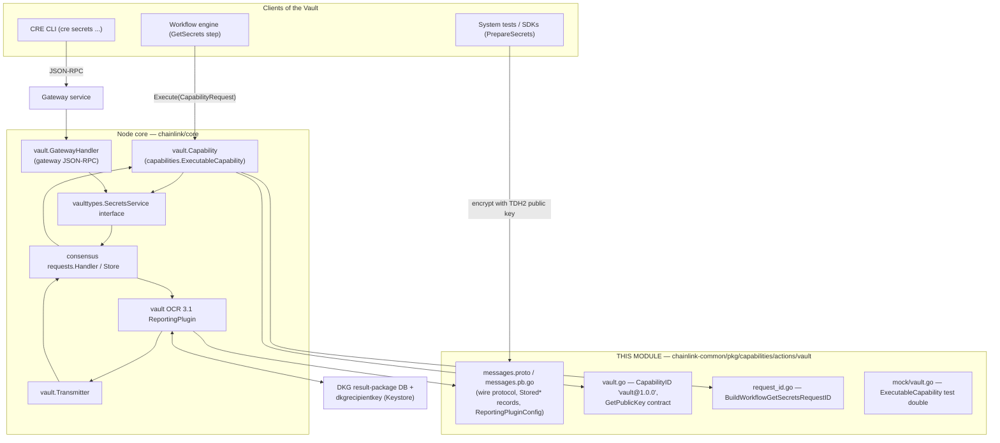
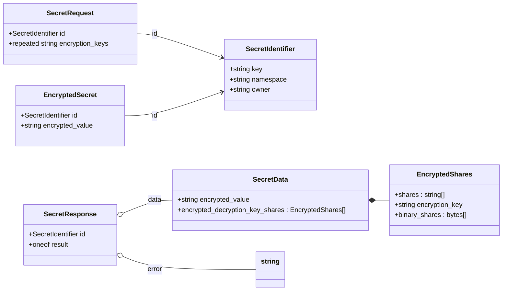
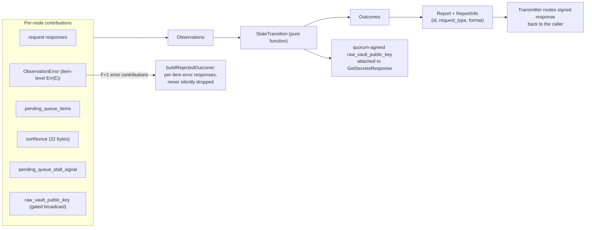
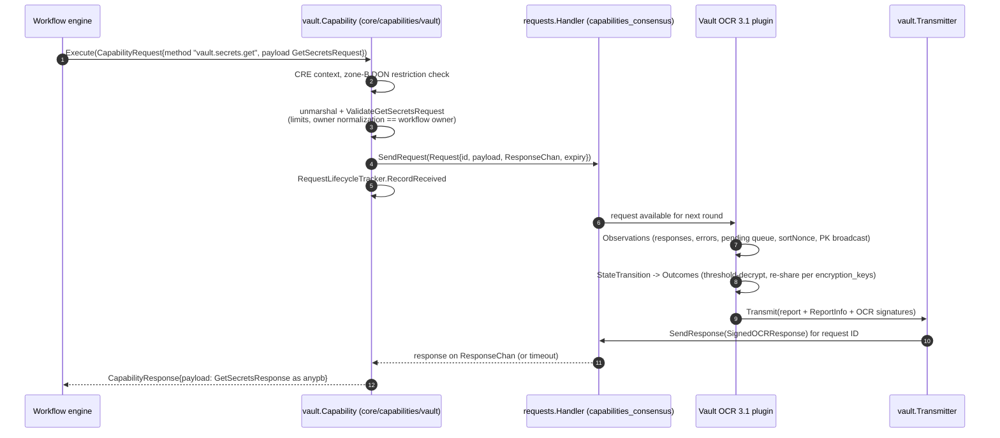
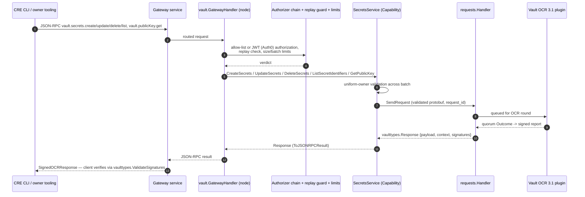
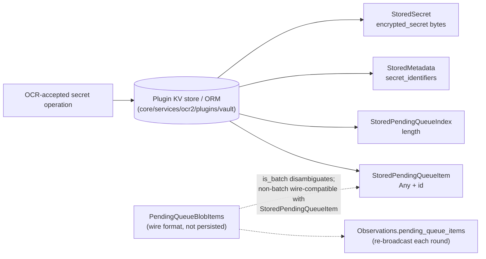

# Capabilities Vault — `chainlink-common/pkg/capabilities/actions/vault`

## Introduction

**Capabilities Vault** is the shared wire-protocol and contract package for the **Vault capability** (`vault@1.0.0`) — the decentralized, threshold-encrypted *secrets management* capability of the Chainlink Runtime Environment (CRE). It lives in the `chainlink-common` Go module (`chainlink-common/go.mod`, module path `github.com/smartcontractkit/chainlink-common`) at `chainlink-common/pkg/capabilities/actions/vault/` and contains:

| File | Role |
|---|---|
| `messages.proto` → `messages.pb.go` | The protobuf wire protocol for every Vault request/response, the OCR 3.1 consensus artifacts (`Observation(s)`, `Outcome(s)`, `ReportInfo`), the persisted on-disk records (`Stored*`), and the plugin configuration schema (`ReportingPluginConfig`). Canonical schema artifact of the repo. |
| `vault.go` | Capability identity constants (`CapabilityID = "vault@1.0.0"`, the deprecated `MethodGetSecrets`) and the `GetPublicKeyRequest` / `GetPublicKeyResponse` contract. Also carries the `protoc` `go:generate` directive used to regenerate `messages.pb.go`. |
| `request_id.go` | `BuildWorkflowGetSecretsRequestID` — the single canonical constructor of workflow GetSecrets request IDs (pending-queue / OCR request IDs). |
| `mock/vault.go` | A test double implementing `capabilities.ExecutableCapability` so workflows, the engine, and other capabilities can be tested without a live Vault DON. |
| `messages_test.go`, `request_id_test.go` | Contract tests for the generated types and request-ID format. |

The package is deliberately **free of business logic**. It is the stable contract consumed by:

- the **node-side capability** (`chainlink/core/capabilities/vault` — `Capability`, `GatewayHandler`, validators/authorizers), which registers `vault@1.0.0` as an *action* capability in the [capabilities registry](capabilities_registry.md);
- the **OCR 3.1 reporting plugin** (`chainlink/core/services/ocr2/plugins/vault`), which reaches quorum over secret operations and performs TDH2 threshold decryption using key material produced by a DKG instance (see [Oracle engines](../../Oracle_Engines___Data_Pipelines/ocr.md));
- **clients** — CRE workflows executed by the [workflow engine](../workflows/workflows_engine.md), the [CRE CLI secrets commands](../../Developer_Toolchain_(CLI,_SDKs___API_Clients)/cre-cli-secrets.md), and the [system-test secret helpers](../../Dev,_Test___Simulation_Environments/system-tests.md) — that encrypt secrets against the Vault TDH2 public key and fetch them at execution time.

> **Module position:** `Workflow & Capability Runtime (CRE Engine) → capabilities → capabilities_vault` — see the [capabilities overview](../capabilities.md) and the [CRE Engine root](../../Workflow___Capability_Runtime_(CRE_Engine).md).

---

## 1. The Vault capability in one paragraph

A workflow owner stores secrets (e.g. API keys) **encrypted client-side** with the TDH2 threshold public key of a Vault DON's DKG instance, via gateway JSON-RPC methods (`vault.secrets.create|update|delete|list`). During execution, a workflow step invokes the capability `vault@1.0.0` with method `vault.secrets.get`; the Vault DON runs an OCR 3.1 consensus round, threshold-decrypts the stored ciphertext, and returns the secret re-shared for the workflow DON's decryption keys — so plaintext secrets never exist on any single node and never appear in workflow bytecode. The node-side `Capability` exposes this only through the [capability core](capabilities_core.md) `ExecutableCapability` interface (see `chainlink/core/capabilities/vault/capability.go`: *"unsupported method: can only call GetSecrets via capability interface"*); every other operation flows through the gateway path described in §7.

---

## 2. Package Architecture & Dependencies

The package sits at the bottom of the Vault stack: everything above it depends on its types, and it depends only on [capabilities core](capabilities_core.md) types and protobuf primitives.



**Key dependency facts**

- The node-side `Capability` implements `capabilities.ExecutableCapability` (asserted via `var _ capabilities.ExecutableCapability = (*Capability)(nil)` in `chainlink/core/capabilities/vault/capability.go`) and registers itself into the [capabilities registry](capabilities_registry.md) on `Start`, removing itself on `Close` under `vaultcommon.CapabilityID`.
- Both the `Capability` and the OCR plugin are connected through the generic request handler/store from the [capabilities consensus package](capabilities_consensus.md) (`requests.Handler[*vaulttypes.Request, *vaulttypes.Response]` / `requests.Store`).
- The plugin's key material (TDH2 `PublicKey` / `PrivateKeyShare`) is read from a DKG result-package database; the recipient (decryption) keys are managed by the node [Keystore](../../Node_Platform_Services/keystore.md).
- The gateway transport and network topology are documented in [Platform Services → Gateway](../../Node_Platform_Services/gateway.md); the Vault-specific JSON-RPC method set lives in `chainlink/core/capabilities/vault/vaulttypes` (see [core capabilities runtime → vault types](../core_capabilities_runtime/core_capabilities_runtime_vault_types.md)).

---

## 3. Wire Protocol (`messages.proto`)

### 3.1 Secret addressing and the encryption envelope



Semantics:

- **`SecretIdentifier`** addresses a secret by `(key, namespace, owner)`. Empty namespaces normalize to `"main"` on the node side (`vaulttypes.NormalizeNamespace`); identifiers are keyed as `owner::namespace::key`. `org_id` / `workflow_owner` request-level fields are **deprecated** — ownership is now carried by the identifier and request metadata.
- **`EncryptedSecret`** is the client-side write payload: the secret value already encrypted with the Vault TDH2 public key.
- **`SecretRequest`** is the read payload: besides the identifier, the caller supplies **`encryption_keys`** — public keys under which the returned decryption-key shares should be encrypted.
- **`SecretData`** is the read result: the (still-encrypted) secret value plus **`EncryptedShares`** — the secret's decryption-key shares, each encrypted for one of the requested `encryption_keys`. Only a quorum of the workflow DON can combine them, matching the TDH2 threshold model.
- **`SecretResponse`** returns either `SecretData` or a string `error` per requested secret (item-level results).

### 3.2 CRUD request/response pairs

| Operation (`RequestType`) | Request message | Response message | Notes |
|---|---|---|---|
| `GET_SECRETS` | `GetSecretsRequest {requests[], org_id*, workflow_owner*}` | `GetSecretsResponse {responses[], raw_vault_public_key}` | `raw_vault_public_key` carries the TDH2 Vault public key of the DKG instance that produced the shares, so decrypt-side callers read the matching key live from the response instead of from CapReg / static config. |
| `CREATE_SECRETS` | `CreateSecretsRequest {request_id, encrypted_secrets[], org_id*, workflow_owner*}` | `CreateSecretsResponse {responses[]{id, success, error}, request_id}` | Batch of client-encrypted secrets. |
| `UPDATE_SECRETS` | `UpdateSecretsRequest {request_id, encrypted_secrets[], org_id*, workflow_owner*}` | `UpdateSecretsResponse {responses[]{id, success, error}, request_id}` | Same batch shape as create. |
| `DELETE_SECRETS` | `DeleteSecretsRequest {request_id, ids[], org_id*, workflow_owner*}` | `DeleteSecretsResponse {responses[]{id, success, error}, request_id}` | Identifiers only, no ciphertext. |
| `LIST_SECRET_IDENTIFIERS` | `ListSecretIdentifiersRequest {request_id, owner, namespace, org_id*, workflow_owner*}` | `ListSecretIdentifiersResponse {identifiers[], success, error, request_id}` | Enumerates keys a given owner holds. |

\* deprecated fields, kept for wire compatibility. The node caps create/update/delete batches at `vaulttypes.MaxBatchSize = 10`.

### 3.3 Consensus artifacts (OCR 3.1 plugin protocol)

These messages are **not** part of the client-facing API; they are the observation/outcome vocabulary of the Vault OCR 3.1 reporting plugin (see [Oracle engines → OCR](../../Oracle_Engines___Data_Pipelines/ocr.md)):

- **`Observation`** — one node's contribution for a pending request: `id`, `request_type`, a `oneof request`, a `oneof response`, and **`ObservationError`** — an *item-level* `Err(E)` contribution. When set, the observation is an error contribution for that request ID.
- **`Observations`** — the round's aggregate proposal:
  - `observations` — per-request contributions;
  - `pending_queue_items` — opaque blobs the node re-broadcasts so queued work survives node churn;
  - `sortNonce` — 32 bytes used to derive a deterministic processing order;
  - `pending_queue_stall_signal` — `CONTINUE` / `STALLED` health signal for the pending queue;
  - `raw_vault_public_key` — this node's view of the DKG instance's TDH2 public key, broadcast **once per observation when the include-public-key gate is open**.
- **`Outcome` / `Outcomes`** — the quorum result for a request, mirroring the `Observation` request/response oneofs. The plugin's `StateTransition` is a *pure function of observations* — e.g. it aggregates the quorum-agreed `raw_vault_public_key` onto `GetSecretsResponse`s rather than reading node-local config.
- **`ReportInfo`** (`id`, `request_type`, `ReportFormat` ∈ `JSON` | `PROTOBUF`) — embedded in the OCR report's `ReportWithInfo` so the [transmitter](#6) can route the signed report back to the originating caller.



### 3.4 Persisted records (backwards-compatibility contract)

The proto marks four records with *"IMPORTANT: this record is persisted so any changes must be backwards compatible"*:

| Message | Stored content |
|---|---|
| `StoredSecret` | `encrypted_secret` (bytes) — the ciphertext written by `CREATE`/`UPDATE`. |
| `StoredMetadata` | `secret_identifiers` — the index of live secrets. |
| `StoredPendingQueueIndex` | `length` — pending-queue size marker. |
| `StoredPendingQueueItem` | `google.protobuf.Any item` + `id` — one queued request. |

`PendingQueueBlobItems` is the **wire format** (not persisted) for pending-queue blobs: with `is_batch = false` it is wire-compatible with `StoredPendingQueueItem` (field 1 = `Any`, field 2 = `id`); with `is_batch = true`, each `Any` wraps a `StoredPendingQueueItem`. The node persists these via the plugin's KV store / ORM (`chainlink/core/services/ocr2/plugins/vault/kvstore.go`, `orm.go`), so any schema change here is a migration concern.

### 3.5 `ReportingPluginConfig`

The OCR job spec config for the Vault plugin (see `chainlink/core/services/ocr2/plugins/vault/config.go` for the node-side wrapper: `requestExpiryDuration`, `DKG`, `Auth0`):

| Field group | Fields | Meaning |
|---|---|---|
| Throughput | `BatchSize` | Max requests handled per OCR round. |
| Limits | `MaxSecretsPerOwner`, `MaxCiphertextLengthBytes`, `MaxIdentifierKeyLengthBytes`, `MaxIdentifierOwnerLengthBytes`, `MaxIdentifierNamespaceLengthBytes` | Request-size and per-owner caps enforced before a request enters the OCR queue. |
| Key material | `DKGInstanceID` (optional) | Ties the plugin to a specific DKG instance whose key shares protect the secrets. |
| OCR 3.1 limits | `LimitsMaxQueryLength`, `LimitsMaxObservationLength`, `LimitsMaxReportsPlusPrecursorLength`, `LimitsMaxReportLength`, `LimitsMaxReportCount`, `LimitsMaxKeyValueModifiedKeysPlusValuesLength`, `LimitsMaxBlobPayloadLength`, `LimitsMaxKeyValueModifiedKeys`, `LimitsMaxPerOracleUnexpiredBlobCumulativePayloadBytes`, `LimitsMaxPerOracleUnexpiredBlobCount` | libocr 3.1 message-size ceilings (queries, observations, reports, key/value diffs, blob payloads). |
| Reserved | field `8` reserved | Never reuse. |

At runtime the plugin mirrors these as bound limiters and **gate limiters** (`MaxBatchSize`, `MaxSecretsPerOwner`, `MaxShareLengthBytes`, `MaxPendingQueueWriteSize`, `MaxBlobPayloadBytes`, `VaultForceEmptyOCRRounds`, `VaultGetSecretsIncludePublicKey`, `VaultPendingQueueStallThreshold`) built from the shared [settings/limits framework](../../Shared_Foundation_Libraries___Domain_Types/settings.md).

---

## 4. Identity, Methods, and Request IDs

### 4.1 Capability identity

`vault.go` defines:

```go
CapabilityID  = "vault@1.0.0"          // fully-qualified capability ID
MethodGetSecrets = "vault.secrets.get" // Deprecated - use the types in core instead.
```

The full method taxonomy lives in `chainlink/core/capabilities/vault/vaulttypes`: `vault.secrets.create|get|update|delete|list` and `vault.publicKey.get`, with `GatewaySecretsMethods` enumerating the JSON-RPC methods reachable through the gateway. `GetPublicKeyResponse{PublicKey}` carries the hex-encoded TDH2 public-key JSON (`{Group, G_bar, H, HArray}`); when the encrypt-only setting is open, the node strips `HArray` so encrypt-only consumers (e.g. the CRE CLI) are unaffected by DKG reshares.

### 4.2 Workflow request IDs (`request_id.go`)

`BuildWorkflowGetSecretsRequestID(md capabilities.RequestMetadata)` returns `"{WorkflowID}::{phaseOrExecution}::{ReferenceID}"`, where `phaseOrExecution` is the workflow execution ID — or the literal `"subscription"` when the call happens during the subscription phase (blank execution ID). The reference ID is unique per phase, so the phase discriminator is required to keep pending-queue IDs collision-free. **This is the only place this format should be defined**; the node-side `Capability.Execute` and the [workflow engine](../workflows/workflows_engine.md) both rely on it. (The `RequestMetadata` type itself is documented in [capabilities core](capabilities_core.md) / [shared foundation types](../../Shared_Foundation_Libraries___Domain_Types/types-core.md).)

---

## 5. Process Flow — `GetSecrets` via the capability interface

This is the path a workflow step takes at execution time (node-side code in `chainlink/core/capabilities/vault/capability.go`):



Notable guarantees along this path:

- **Method restriction** — only `vault.secrets.get` is reachable via `Execute`; v1 (`values.Map`) requests are rejected (`"capability does not support v1 requests"`).
- **Owner binding** — each requested `SecretIdentifier.owner` must normalize to the invoking workflow owner; mismatches are rejected before queueing.
- **Deterministic user errors** — pre-OCR validation failures are wrapped as public `caperrors` user errors (`LimitExceeded` / `InvalidArgument`) so classification survives the [remote capability boundary](../core_capabilities_runtime/core_capabilities_runtime_remote_messaging.md).
- **Response trust** — signatures from the OCR report can be dropped in the in-process response *"since only a valid report will be successfully decryptable by the workflow DON"* (capability.go).

The mock in §8 implements exactly this contract for tests.

---

## 6. Component Interaction — Gateway secrets management (create / update / delete / list, public key)

Secret *writes* and listings never go through the capability interface. Owners use the [CRE CLI](../../Developer_Toolchain_(CLI,_SDKs___API_Clients)/cre-cli-secrets.md), which speaks JSON-RPC through the [gateway service](../../Node_Platform_Services/gateway.md):



Security layers on this path (all node-side, all consuming this package's types): the authorizer chain (`allow_list_based_auth.go`, `jwt_based_auth.go` with `Auth0` config), the request replay guard, the request lifecycle tracker, the zone-B DON restriction, and the limits factory — see the [vault types page](../core_capabilities_runtime/core_capabilities_runtime_vault_types.md) for the `SecretsService` interface and `SignedOCRResponse` verification rules (`config digest` + `epoch/round` in the 64-byte context, minimum signer count). The plugin job itself is configured per node via `chainlink/core/services/ocr2/plugins/vault/config.go` (`requestExpiryDuration`, `DKG`, `Auth0`).

---

## 7. Persistence & the pending queue

Secret state and queued work must survive node restarts and OCR-round boundaries:



- Pending-queue blobs are broadcast with a 2 s timeout, at most 10 concurrent broadcasts (`plugin.go` constants).
- If the queue cannot drain, nodes emit `PENDING_QUEUE_STALL_SIGNAL_STALLED`; the configured stall threshold (`VaultPendingQueueStallThreshold`) governs when the plugin halts taking new work rather than silently growing the backlog.

---

## 8. Testing Support (`mock/vault.go`)

`mock.Vault` is a minimal `capabilities.ExecutableCapability` test double:

```go
type Vault struct {
    Fn func(ctx context.Context, req *vault.GetSecretsRequest) (*vault.GetSecretsResponse, error)
}
```

- `Info` returns `CapabilityInfo{ID: vault.CapabilityID, CapabilityType: CapabilityTypeAction, IsLocal: true}` — i.e. it advertises itself as a **local action capability** exactly as the real one does.
- `Execute` enforces the real contract before delegating: the request method must be `vault.secrets.get`, the payload must unmarshal to `*vault.GetSecretsRequest`; responses are wrapped via `anypb.New(vresp)` into a `CapabilityResponse`.
- `RegisterToWorkflow` / `UnregisterFromWorkflow` intentionally return *"not used"* errors — the vault capability never participates in trigger registration.

Use it when testing [workflow engine](../workflows/workflows_engine.md) steps, other capabilities, or tooling that consumes `vault@1.0.0` without a live Vault DON. For local *simulation* runs (no OCR at all), the standalone engine substitutes a file-based secrets provider instead — see [workflows → standalone engine](../workflows/workflows_standalone.md).

---

## 9. Deployment & Operations

The Vault is a full product deployment, not just a node feature. The [CRE Deployment Suite](../../CRE___Keystone_Deployment_Suite/cre-jobs.md) provisions it end-to-end:

1. **DKG bootstrap jobs** — `chainlink/deployment/cre/jobs/sequences/propose_vault_bootstrap_jobs.go` proposes the OCR bootstrap jobs that run the DKG instances (their result packages later feed the plugin's key material).
2. **OCR3 / vault plugin configuration** — changesets `ConfigureVaultDKG` and `ConfigureVaultPlugin` (see [CRE → OCR3](../../CRE___Keystone_Deployment_Suite/cre-ocr3.md)) wire `ReportingPluginConfig` (including `DKGInstanceID`) into the OCR 3.1 job specs.
3. **Runtime keys** — DKG recipient/decryption shares are provisioned through the node [Keystore](../../Node_Platform_Services/keystore.md) (`corekeys/dkgrecipientkey`).
4. **Verification in CI** — `chainlink/system-tests/lib/cre/workflow/secrets.go` (`PrepareSecrets`) encrypts test secrets with the vault public key and validates retrieval; `chainlink/system-tests/lib/cre/features/vault/vault.go` drives the feature end-to-end.

Operational guardrails worth knowing when on-call: per-owner secret caps, ciphertext/identifier size caps, batch size 10, request expiry (`requestExpiryDuration`), the pending-queue stall signal, and Beholder metrics emitted by the gateway handler (`vault_node_request_success`, `vault_node_request_internal_error`).

---

## 10. Related Documentation

| Topic | Page |
|---|---|
| Capability interfaces, `CapabilityRequest`/`Response`, `RequestMetadata` | [capabilities_core](capabilities_core.md) |
| Capability registration & DON topology | [capabilities_registry](capabilities_registry.md) |
| Generic request handler/store used by Vault | [capabilities_consensus](capabilities_consensus.md) |
| gRPC/pb layer of the capability framework | [capabilities_pb](capabilities_pb.md) |
| Node-side `SecretsService`, `SignedOCRResponse`, signature verification | [core_capabilities_runtime → vault types](../core_capabilities_runtime/core_capabilities_runtime_vault_types.md) |
| Workflow engine that invokes `vault.secrets.get` | [workflows → engine](../workflows/workflows_engine.md) |
| OCR 3.1 mechanics | [Oracle engines → OCR](../../Oracle_Engines___Data_Pipelines/ocr.md) |
| Gateway transport | [Node Platform Services → gateway](../../Node_Platform_Services/gateway.md) |
| Key management (DKG recipient keys) | [Node Platform Services → keystore](../../Node_Platform_Services/keystore.md) |
| CLI secrets commands | [cre-cli → secrets](../../Developer_Toolchain_(CLI,_SDKs___API_Clients)/cre-cli-secrets.md) |
| Secrets in system tests | [Dev/Test/Simulation → system-tests](../../Dev,_Test___Simulation_Environments/system-tests.md) |
| Provisioning vault bootstrap & OCR jobs | [CRE Deployment → jobs](../../CRE___Keystone_Deployment_Suite/cre-jobs.md), [CRE Deployment → OCR3](../../CRE___Keystone_Deployment_Suite/cre-ocr3.md) |
| Metering of capability spend | [workflows → metering](../workflows/workflows_metering.md) |
