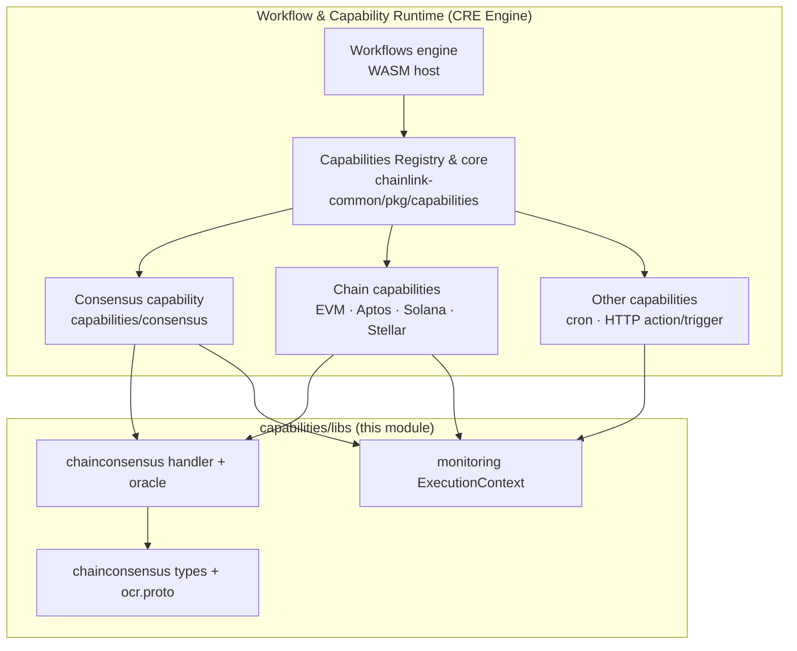
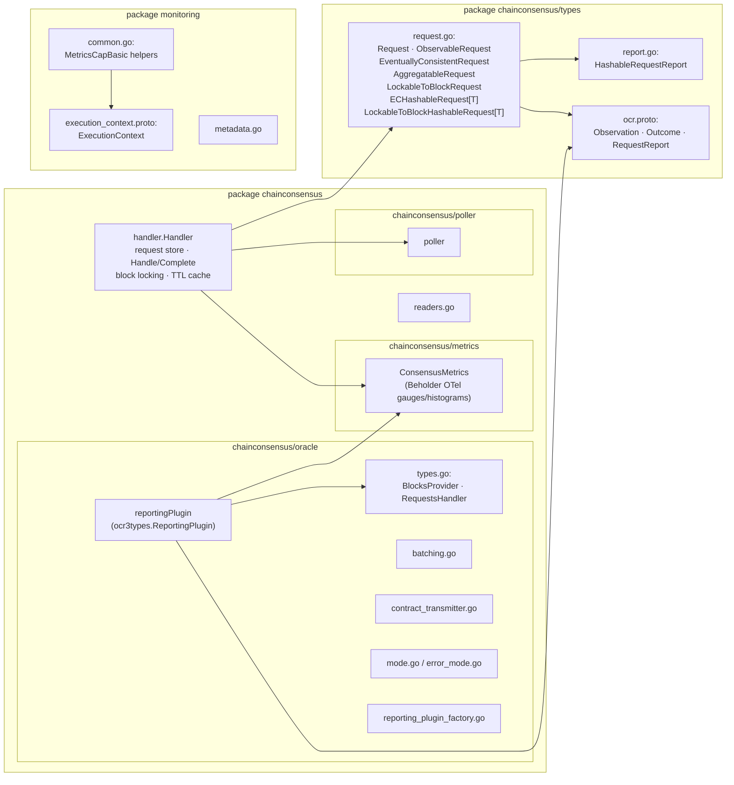
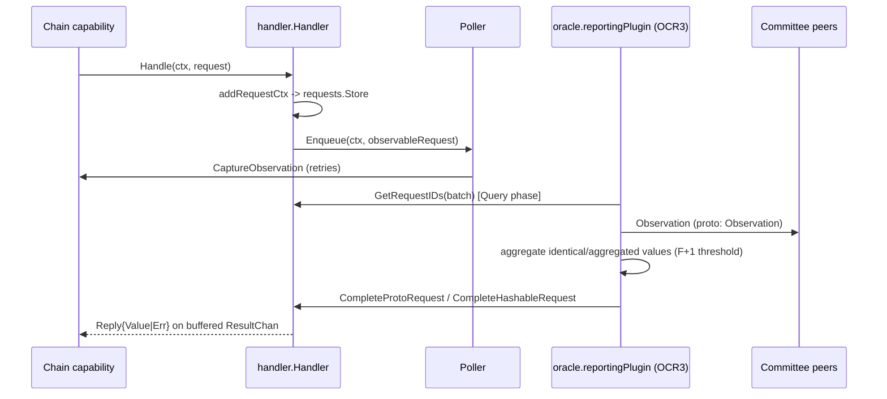

# Capabilities Shared Libs (`capabilities/libs`)

## 1. Overview

`capabilities/libs` is the shared foundation Go module for all capabilities in the Chainlink Runtime Environment (CRE). It is a dedicated Go module — `github.com/smartcontractkit/capabilities/libs` (see [`capabilities/libs/go.mod`](capabilities_shared_libs/capabilities_shared_libs_chainconsensus.md)) — that lives inside the `capabilities/` multi-module workspace, alongside the chain capability modules (EVM, Aptos, Solana, Stellar), the consensus capability, and the cron/HTTP capabilities.

Its purpose is to provide functionality that every capability needs but that must not be duplicated inside each capability:

| Area | What it provides |
|---|---|
| **Chain consensus (`chainconsensus`)** | A reusable request-handling service and OCR3 reporting plugin that let chain capabilities perform **on-chain read operations with DON-wide consensus** — i.e. reads whose result is agreed by the observing committee instead of being trusted from a single RPC. |
| **Wire contract (`chainconsensus/types`)** | The `Request` type system (eventually-consistent, aggregatable, lockable-to-block, hashable) and the `ocr.proto` protobuf contract used to exchange observations, outcomes and reports between OCR nodes. |
| **Monitoring (`monitoring`)** | The `ExecutionContext` protobuf (the standard telemetry/metering context attached to every capability execution) plus ready-made Beholder/OpenTelemetry metric helpers and the canonical `RequestID` composition. |

> From `capabilities/libs/chainconsensus/README.md`: *"It's a library that provides consensus-related functionalities for chain capabilities to perform read operations."*

## 2. Position in the System

This module is a **leaf library** in the [Workflow & Capability Runtime (CRE Engine)](../Workflow___Capability_Runtime_(CRE_Engine).md):

* **Consumers** — the [Consensus capability](consensus_capability.md) wraps the `chainconsensus` oracle into a consensus plugin; the chain capabilities ([EVM](chain_capability_evm.md), [Aptos](chain_capability_aptos.md), [Solana](chain_capability_solana.md), [Stellar](chain_capability_stellar.md)) use the consensus reads and the `monitoring` context for their triggers/actions.
* **Shared platform dependencies** — `chainlink-common` for the [capability core types](capabilities/capabilities_core.md) (`ResponseMetadata`, `ResponseToReportData`), the [service framework](../Shared_Foundation_Libraries___Domain_Types/services.md), the [logger](../Shared_Foundation_Libraries___Domain_Types/logger.md), [CRE settings/limits](../Shared_Foundation_Libraries___Domain_Types/settings.md) and [Beholder telemetry](../Telemetry___Observability_Platform/beholder-telemetry.md); plus `libocr` for the OCR3 reporting-plugin framework and OpenTelemetry for metrics.

## 3. Architecture

**Dependency layers (inner → outer):**

1. `chainconsensus/types` — pure types & protobuf contract; depends only on `chainlink-common/pkg/capabilities`, `libocr` types, gRPC/protobuf.
2. `chainconsensus/metrics`, `chainconsensus/poller` — infrastructure adapters (Beholder/OTel metrics, observation polling).
3. `chainconsensus` (handler) — the stateful service that owns in-flight requests.
4. `chainconsensus/oracle` — the OCR3 integration: implements `ocr3types.ReportingPlugin[[]byte]` on top of the `RequestsHandler`/`BlocksProvider` interfaces.
5. `monitoring` — independent telemetry primitives used by all capabilities.

**Runtime data flow of a consensus read:**

Detailed request/observation semantics — including when each of the four request kinds is used and how observations become report data hashes — are covered in the sub-module pages below.

## 4. Sub-module Documentation

| Sub-module | Contents | Documentation |
|---|---|---|
| **Chain Consensus Engine** | `handler.go` request-handling service, `oracle` OCR3 integration and the `BlocksProvider`/`RequestsHandler` contracts, metrics, poller, module build context (`go.mod`). | [capabilities_shared_libs_chainconsensus.md](capabilities_shared_libs/capabilities_shared_libs_chainconsensus.md) |
| **Consensus Request Types & OCR Wire Contract** | `types/request.go` request taxonomy (eventually-consistent, aggregatable, lockable-to-block, hashable), `types/ocr.proto` messages, `types/report.go`, and the observable-behaviour tests. | [capabilities_shared_libs_chainconsensus_types.md](capabilities_shared_libs/capabilities_shared_libs_chainconsensus_types.md) |
| **Monitoring & Execution Context** | `monitoring/execution_context.proto` (the standard telemetry envelope), capability metric helpers, `RequestID` composition. | [capabilities_shared_libs_monitoring.md](capabilities_shared_libs/capabilities_shared_libs_monitoring.md) |

## 5. Build & Tooling

The module is part of the `capabilities/` Go workspace (root module `github.com/smartcontractkit/capabilities`, see `capabilities/go.mod`). Relevant build artifacts:

* `capabilities/libs/go.mod` — module definition `github.com/smartcontractkit/capabilities/libs`; key direct requirements: `chainlink-common` (capabilities/services/logger/settings/beholder), `chainlink-protos/cre/go` (generated values/pb), `libocr`, `shopspring/decimal` (aggregatable decimal observations), OpenTelemetry metric SDK, gRPC/protobuf.
* `capabilities/Makefile` — workspace targets used by this module: `protoc` (installs protoc + `protoc-gen-go` via `script/install-protoc.sh`), `generate` (runs `go generate ./...` across all modules), `gomodtidy`/`tidy`, `mockery` (mock generation), `update-chain-capabilities`.
* Proto generation is wired through `go:generate`: `capabilities/libs/chainconsensus/types/generate.go` (`go run ./gen/main.go` + `mockery`) regenerates `ocr.pb.go` and mocks; `capabilities/libs/monitoring/generate.go` regenerates `execution_context.pb.go`.
* Per-package CI orchestration uses Nx (`capabilities/nx.json`, e.g. `chainconsensus/project.json`, `monitoring/project.json`), with linting configured in `capabilities/.golangci.yml`.

## 6. Related Modules

* [Workflows engine](workflows.md) — executes user workflows; capabilities from this module are invoked by the engine.
* [Capabilities Registry & core types](capabilities/capabilities_core.md) — `ExecutableAndTriggerCapability`, `ResponseMetadata` consumed by `chainconsensus/types`.
* [Consensus capability](consensus_capability.md) — productises the chain-consensus library into a consensus oracle plugin.
* [Telemetry & Observability Platform](../Telemetry___Observability_Platform/beholder-telemetry.md) — the Beholder client used by `chainconsensus/metrics` and `monitoring`.
* [Node Platform Services / Keystore](../Node_Platform_Services/keystore.md) and [P2P](../Node_Platform_Services/p2p.md) — infrastructure the hosting node provides to capability oracles (signing, peer communication).
