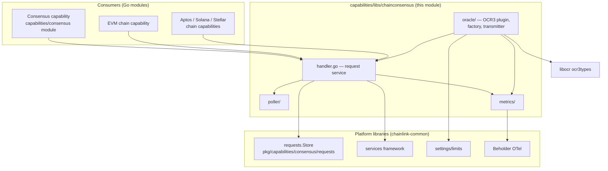
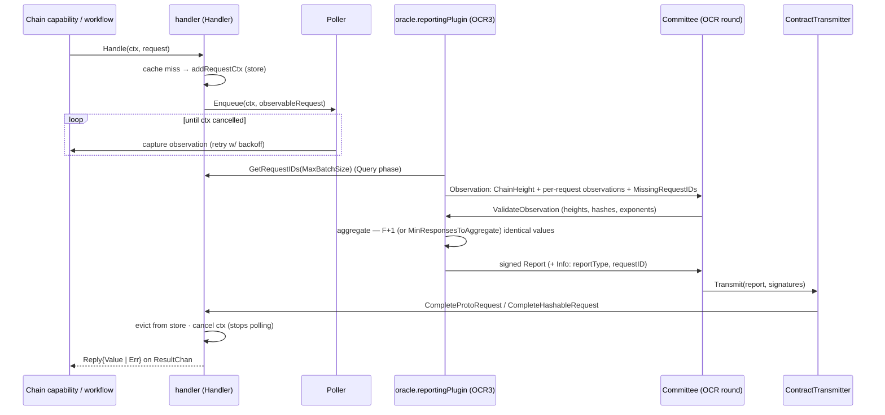
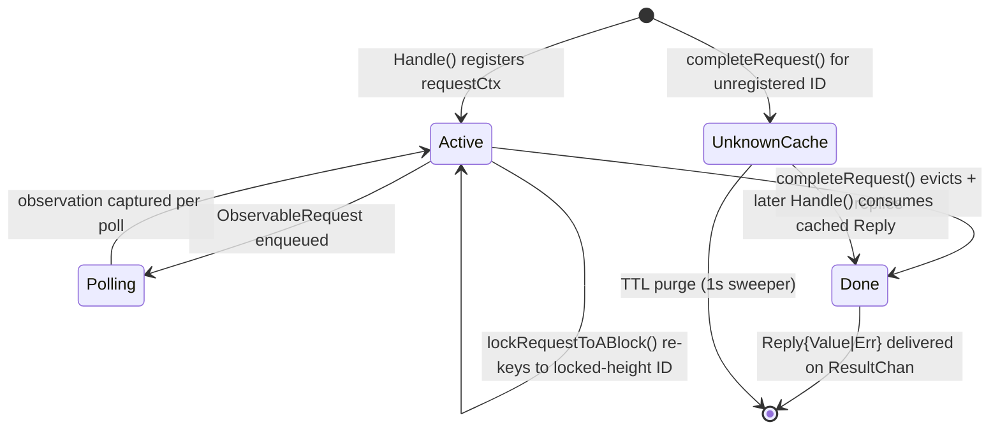
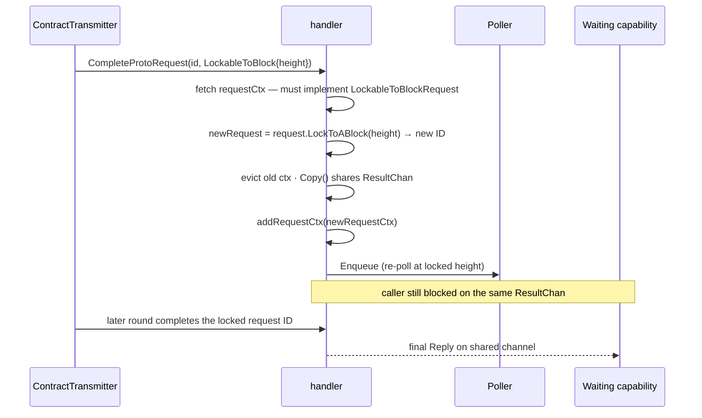
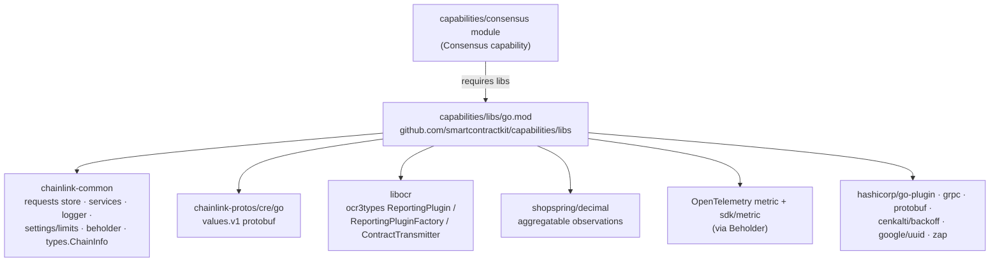

# Chain Consensus Engine (`capabilities/libs/chainconsensus`)

> Parent module: [Capabilities Shared Libs](../capabilities_shared_libs.md) · Sibling pages: [Consensus Request Types & OCR Wire Contract](capabilities_shared_libs_chainconsensus_types.md) · [Monitoring & Execution Context](capabilities_shared_libs_monitoring.md)

## 1. Overview

The `chainconsensus` package tree inside the `capabilities/libs` Go module (`github.com/smartcontractkit/capabilities/libs`, see [`capabilities/libs/go.mod`](../../../capabilities/libs/go.mod)) provides the **consensus machinery that lets chain capabilities perform on-chain *read* operations whose result is agreed upon by the whole Decentralized Oracle Network (DON)** instead of being trusted from a single RPC node.

From the package's own [`capabilities/libs/chainconsensus/README.md`](../../../capabilities/libs/chainconsensus/README.md): *"It's a library that provides consensus-related functionalities for chain capabilities to perform read operations."*

Concretely, this module delivers:

| Capability | Where | What it does |
|---|---|---|
| **Request-handling service** | [`capabilities/libs/chainconsensus/handler.go`](../../../capabilities/libs/chainconsensus/handler.go) | A long-running `services.Service` that accepts read requests from capabilities, keeps them in a bounded in-memory store, feeds them to an OCR3 oracle round, and delivers the DON-agreed result back on a Go channel. |
| **OCR3 oracle integration** | [`capabilities/libs/chainconsensus/oracle/`](../../../capabilities/libs/chainconsensus/oracle/) | A `libocr` `ReportingPlugin[[]byte]`, its factory and a `ContractTransmitter` that run an OCR round per batch of read requests: query → observe → validate → aggregate → report → complete. |
| **Oracle contracts** | [`capabilities/libs/chainconsensus/oracle/types.go`](../../../capabilities/libs/chainconsensus/oracle/types.go) | The seam between the library and the host chain: `BlocksProvider` (chain heights) and `RequestsHandler` (the handler store), plus the report-info keys used on-chain. |
| **Observation poller** | [`capabilities/libs/chainconsensus/poller/poller.go`](../../../capabilities/libs/chainconsensus/poller/poller.go) | A worker-pool service that re-captures chain observations for pending requests with retries/backoff until the consensus round completes them. |
| **Telemetry** | [`capabilities/libs/chainconsensus/metrics/metrics.go`](../../../capabilities/libs/chainconsensus/metrics/metrics.go) | Beholder/OpenTelemetry gauges and histograms for chain heights, queue depths and observation sizes. |
| **Module manifest** | [`capabilities/libs/go.mod`](../../../capabilities/libs/go.mod) | Pins the shared dependencies (`chainlink-common`, `libocr`, OpenTelemetry, gRPC/protobuf, `shopspring/decimal`). |

The request *type system* (`Request`, `ObservableRequest`, aggregatable / eventually-consistent / lockable-to-block / hashable / volatile requests) and the `ocr.proto` wire contract are documented separately in [Consensus Request Types & OCR Wire Contract](capabilities_shared_libs_chainconsensus_types.md); this page links to it wherever the semantics of a request kind matter.

## 2. Position in the System

This module is a **leaf library** consumed by products of the [Workflow & Capability Runtime (CRE Engine)](../../Workflow___Capability_Runtime_(CRE_Engine).md):



* **Primary consumer** — the [Consensus capability](../consensus_capability.md) (`capabilities/consensus` module, whose `go.mod` requires `github.com/smartcontractkit/capabilities/libs`) productises this library into the value-consensus OCR plugin used by CRE workflows. How the *capability-level* consensus semantics (value aggregation, `valueOccurrence` counting) are layered on top is covered in [Consensus Capability](../consensus_capability.md); the generic `chainlink-common` consensus request-store it builds on is covered in [Capabilities: Consensus](../capabilities/capabilities_consensus.md).
* **Chain capability consumers** — chain capabilities such as [EVM](../chain_capability_evm.md) register their read calls as requests and supply the `BlocksProvider` implementation backed by their head tracker.
* **Request taxonomy & wire format** — the `Request` interfaces and `ocr.proto` messages consumed by everything above are documented in [Chainconsensus Types](capabilities_shared_libs_chainconsensus_types.md).

## 3. Architecture

The package is organised as concentric layers with a narrow contract (`RequestsHandler`) between the stateful handler and the OCR integration:

```mermaid
flowchart LR
    subgraph PKG["package chainconsensus (handler.go)"]
        H["handler struct<br/>implements Handler"]
        STORE["requests.Store&#91;*requestCtx&#93;<br/>bounded in-memory queue"]
        UCACHE["unknown-request TTL cache<br/>map + ordered list"]
        TICK["1s sweeper ticker"]
        H --> STORE
        H --> UCACHE
        H --> TICK
    end

    subgraph ORP["package chainconsensus/oracle"]
        IF["types.go<br/>BlocksProvider · RequestsHandler<br/>report-info keys"]
        RP["reportingPlugin<br/>ocr3types.ReportingPlugin"]
        RPF["ReportingPluginFactory"]
        CT["ContractTransmitter<br/>ocr3types.ContractTransmitter"]
        BAT["batching.go · mode.go · error_mode.go"]
    end

    subgraph POLL["package chainconsensus/poller"]
        PL["Poller<br/>worker pool + retry queue"]
    end

    subgraph MET["package chainconsensus/metrics"]
        CM["consensusMetrics<br/>implements ConsensusMetrics"]
    end

    subgraph TYPES["package chainconsensus/types — see types page"]
        RQ["Request / ObservableRequest<br/>HashableRequest&#91;T&#93;"]
        PB["ocr.pb.go<br/>Observation · Outcome · RequestReport"]
    end

    H -->|"implements"| IF
    RP -->|"reads via"| IF
    CT -->|"completes via"| IF
    RPF --> RP
    PL -->|"Enqueue"| H
    H --> CM
    RP --> CM
    PL --> CM
    H --> RQ
    RP --> PB
    RQ --> PB
```



**Layering (inner → outer):**

1. `types` — pure request types and the protobuf wire contract (see [types page](capabilities_shared_libs_chainconsensus_types.md)).
2. `metrics` — Beholder/OTel instrumentation, no business logic.
3. `chainconsensus` (handler) — the stateful service owning in-flight requests; depends on `chainlink-common`'s [requests store](../capabilities/capabilities_consensus.md), [services framework](../../Shared_Foundation_Libraries___Domain_Types/services.md) and [logger](../../Shared_Foundation_Libraries___Domain_Types/logger.md).
4. `poller` — infrastructure adapter that turns observable requests into repeated chain calls.
5. `oracle` — the OCR3 integration; it *only* knows the `RequestsHandler`/`BlocksProvider` interfaces, never the concrete handler.

## 4. Core Components

### 4.1 Request-handling service — `handler.go`

[`capabilities/libs/chainconsensus/handler.go`](../../../capabilities/libs/chainconsensus/handler.go) defines the public contract and its implementation:

```go
type Handler interface {
    RequestHandler                                  // Handle(ctx, request) (<-chan types.Reply, error)
    Start(context.Context) error
    Close() error
    GetRequestIDs(batchSize int) ([]string, error)  // ascending by attempts; requests remain queued
    GetRequest(id string) (types.Request, bool)
    CompleteProtoRequest(id string, report *types.RequestReport) error
    CompleteHashableRequest(id string, report *types.HashableRequestReport) error
}
```

Key implementation points:

* **Service lifecycle** — `newHandler` builds the service via `services.Config{Name: "ChainConsensusHandler"}.NewServiceEngine(lggr)`; a ticker (`services.TickerConfig{Initial: time.Second}`) runs `removeExpiredRequests` every second to purge the unknown-request cache.
* **`requestCtx`** — wraps a `types.Request` with an engine-bound `context.Context` + `Cancel`, and a **buffered** `ResultChan chan types.Reply` (capacity 1). `Copy()` shares the context/cancel/channel (documented as thread-safe by usage) but copies the request, so the same waiting caller survives a re-keying of the request.
* **`Handle`** — the entry point used by capabilities. It first consults the unknown-request cache (§5.4); on a miss it binds the caller context to the service engine, adds the `requestCtx` to the store, and — if the request implements `types.ObservableRequest` — hands it to the `Poller` via `Enqueue`. It returns the reply channel immediately; the reply arrives only once the DON agrees on the result.
* **`GetRequestIDs(limit)`** — returns up to `limit` IDs in ascending order by number of attempts (via `requests.Store.FirstN`), silently evicting entries whose context is already cancelled. Requests are **not** removed by this call; removal happens only on completion.
* **`CompleteProtoRequest`** — dispatches on the `RequestReport` oneof:

| Report case | Action |
|---|---|
| `Aggregatable` | `completeRequest(id, Reply{Value: decimal})` |
| `LockableToBlock` | `lockRequestToABlock(id, *ChainHeight)` — see §5.3 |
| `EventuallyConsistent` | `completeRequest(id, Reply{Value: rawBytes})` |
| `Error` | `completeError` — converts every `RequestError.Errors` entry to an `ObservationError` and joins them with `errors.Join` into `Reply{Err}` |
| other | error `"unknown request type %T"` |

* **`CompleteHashableRequest`** — completes with the `HashableRequestReport` (digest, seqNr, report data hash, signatures) as the reply value.
* **`completeRequest`** — under the write lock: if the ID is registered, the request is evicted from the store, the reply is pushed on the buffered channel (non-blocking) and the context is **cancelled to stop further polling**. If the ID is *not* registered, the reply is cached instead (§5.4).
* **`LockableToBlockRequest`** — the opt-in interface a request implements to support block anchoring:

```go
type LockableToBlockRequest interface {
    LockToABlock(chainHeight *types.ChainHeight) types.Request
}
```

* **Concurrency** — one `sync.RWMutex` guards the store and both cache structures; all completions and registrations are serialised, while reply delivery relies on the buffered channel.

### 4.2 Oracle contracts — `oracle/types.go`

[`capabilities/libs/chainconsensus/oracle/types.go`](../../../capabilities/libs/chainconsensus/oracle/types.go) is the seam between the library and its hosts:

```go
type BlocksProvider interface {          // supplied by the chain capability / head tracker
    GetLatest() int64
    GetSafe() int64
    GetFinalized() int64
}

type RequestsHandler interface {         // implemented by handler.Handler
    GetRequestIDs(batchSize int) ([]string, error)
    GetRequest(id string) (types.Request, bool)
    CompleteProtoRequest(id string, report *types.RequestReport) error
    CompleteHashableRequest(id string, report *types.HashableRequestReport) error
}
```

It also defines the **report-info keys** used by the [ContractTransmitter](../../../capabilities/libs/chainconsensus/oracle/contract_transmitter.go) to route signed reports back to requests:

| Constant | Value | Purpose |
|---|---|---|
| `reportInfoKeyReportType` | `"reportType"` | key in the report's `Info` `structpb` map |
| `reportInfoKeyRequestID` | `"requestID"` | request ID for hashable reports |
| `reportTypeProtoReport` | `"proto"` | report carries a full `RequestReport` proto (default) |
| `reportTypeHashable` | `"hashable"` | report payload is a 32-byte `ctypes.Hash` |

The `ChainHeight` message (`latest` ≥ `safe` ≥ `finalized`) and the observation/outcome/report messages referenced below are part of [`capabilities/libs/chainconsensus/types/ocr.proto`](../../../capabilities/libs/chainconsensus/types/ocr.proto), described in the [types page](capabilities_shared_libs_chainconsensus_types.md).

### 4.3 OCR3 oracle integration — `oracle` package

* **`reportingPlugin`** ([`oracle/reporting_plugin.go`](../../../capabilities/libs/chainconsensus/oracle/reporting_plugin.go)) implements `ocr3types.ReportingPlugin[[]byte]`:
  * `Query` — pulls up to `MaxBatchSize` ready request IDs from the `RequestsHandler` and marshals a `types.Query` proto.
  * `Observation` — builds a `ctypes.Observation` with the `ChainHeight` from the `BlocksProvider` (raised monotonically against the previous round's outcome), proposes `MissingRequestIDs` (locally queued IDs the leader's query omitted — recovery of these is gated by a `limits.GateLimiter` from [CRE settings/limits](../../Shared_Foundation_Libraries___Domain_Types/settings.md)), adds observations for previously-missing requests, then collects per-request observations via `request.GetOCRObservation()` while enforcing `MaxObservationLength`. Observation sizes are recorded in metrics.
  * `ValidateObservation` — rejects peer observations with invalid chain-height ordering, contradictions with the previous outcome, duplicate/oversized missing-ID lists, aggregatable decimals whose exponent exceeds `MaxAggregatableExponent` (±128), malformed hashable hashes (`ctypes.HashLength`), and invalid volatile observation sets (count/hash-length/duplicates).
  * Aggregation accepts a value only when at least `matchingThreshold()` nodes returned identical observations — `MinResponsesToAggregate` if configured (validated by the factory to lie within `[F+1, N]`), otherwise `F+1`. Rounds are additionally capped by `OCRRoundMaxBatchSize = 1000`.
* **`ReportingPluginFactory`** ([`oracle/reporting_plugin_factory.go`](../../../capabilities/libs/chainconsensus/oracle/reporting_plugin_factory.go)) implements `ocr3types.ReportingPluginFactory[[]byte]`. `NewReportingPlugin` decodes the offchain `ReportingPluginConfig` (defaulting to ~1 MiB query / 95 KiB observation / `MaxBatchSize` 200 when unset), validates `MinResponsesToAggregate`, and returns the plugin with its `ReportingPluginLimits`.
* **`ContractTransmitter`** ([`oracle/contract_transmitter.go`](../../../capabilities/libs/chainconsensus/oracle/contract_transmitter.go)) implements `ocr3types.ContractTransmitter[[]byte]`. `Transmit` unmarshals the report `Info`, reads `reportType` (default `"proto"`) and `requestID`, then:
  * `"proto"` → unmarshal `ctypes.RequestReport` → `RequestsHandler.CompleteProtoRequest`;
  * `"hashable"` → report payload must be `ctypes.HashLength` bytes → `RequestsHandler.CompleteHashableRequest` with config digest, sequence number and attributed signatures.
  * `FromAccount` is intentionally unused (the hosting `OracleFactory` supplies the real one).
* **Support files** — `batching.go` (batch size negotiation across committee versions), `mode.go` / `error_mode.go` (per-round operation modes and error reporting).

### 4.4 Observation poller — `poller` package

[`capabilities/libs/chainconsensus/poller/poller.go`](../../../capabilities/libs/chainconsensus/poller/poller.go) is a `services.Service` that owns the "make the chain calls" side of the loop:

* a worker pool (`maxWorkers`) driven by a `pollPeriod` tick and an `inputNotify` channel,
* a work list of `requestToPoll` items and a channel feeding the workers,
* a **retry queue** with backoff (the `cenkalti/backoff/v5` dependency in [`capabilities/libs/go.mod`](../../../capabilities/libs/go.mod)) for failed captures,
* queue-depth telemetry via `RecordQueueSize` / `RecordRetryQueueSize`.

The handler enqueues each `ObservableRequest` on registration and again after a lockable-to-block re-keying; polling stops automatically when `completeRequest` cancels the request context.

### 4.5 Metrics — `metrics` package

[`capabilities/libs/chainconsensus/metrics/metrics.go`](../../../capabilities/libs/chainconsensus/metrics/metrics.go) implements `ConsensusMetrics` on top of the [Beholder](../../Telemetry___Observability_Platform/beholder-telemetry.md) OTel meter. All instruments are attributed with `chain_id`, `family_name`, `network_name`, `network_name_full`:

| Instrument | Metric name (prefixed per chain) | Purpose |
|---|---|---|
| Int64Gauge | `capability_consensus_outcome_chain_safe_height` | consensus-agreed safe height |
| Int64Gauge | `capability_consensus_outcome_chain_latest_height` | consensus-agreed latest height |
| Int64Gauge | `capability_consensus_outcome_chain_finalized_height` | consensus-agreed finalized height |
| Int64Histogram | `capability_consensus_round_observation_size` | marshalled per-round observation bytes |
| Int64Histogram | `capability_consensus_request_observation_size` | per-request observation bytes |
| Int64Histogram | `capability_consensus_identical_response_count` | nodes agreeing per value (adds `observation_type` attribute) |
| Int64Gauge | `capability_consensus_queue_size` | poller queue depth |
| Int64Gauge | `capability_consensus_retry_queue_size` | poller retry queue depth |
| Int64Gauge | `capability_consensus_request_count` | handler store depth |

The store is created with `requests.NewStoreWithStatsCollector`, so handler-side gauges update automatically. The general-purpose execution-context envelope used alongside these metrics is documented in [Monitoring & Execution Context](capabilities_shared_libs_monitoring.md).

## 5. Request Lifecycle & Data Flow

### 5.1 End-to-end consensus read



### 5.2 Request state machine



### 5.3 Lockable-to-block re-anchoring

Some reads must not be answered "eventually consistent" but pinned to a specific block. When the committee agrees on a `RequestReport_LockableToBlock` outcome (a `ChainHeight`), the handler **re-anchors** the request instead of replying:



Behaviour details: a nil height is rejected; a request that no longer implements `LockableToBlockRequest` (e.g. already locked) is logged and ignored; polling of the *old* ID stops because the store entry is evicted, while the shared context/channel wiring guarantees exactly one reply reaches the caller.

### 5.4 Unknown-request cache (early completions)

Because the OCR round is asynchronous with respect to local request registration, `completeRequest` can fire for an ID that is not (or no longer) in the store. The reply is then cached as an `unknownRequest` with:

* `unknownRequestTTL` — expiry timestamp, swept by the 1-second ticker,
* `maxUnknownRequestsCacheSize` — FIFO bound enforced via an intrusive ordered list (oldest evicted first, with a warning log).

`Handle` checks this cache before registering, so a request that races the transmitting round is answered instantly with the DON-agreed result instead of being re-consensed.

## 6. Module Dependencies & Build

This module is one Go module — `github.com/smartcontractkit/capabilities/libs` (`go 1.27.1`) — inside the `capabilities/` workspace.



Build/tooling notes (see [Capabilities Workspace Tooling](../../Build,_CI___Release_Infrastructure/capabilities_workspace_tooling.md)):

* [`capabilities/Makefile`](../../../capabilities/Makefile) — `protoc` (installs protoc + `protoc-gen-go` via `script/install-protoc.sh`), `generate` (runs `go generate ./...` across all workspace modules, regenerating `types/ocr.pb.go` and mocks through `types/generate.go`), `mockery` (generates the `mocks/` packages used by handler tests), `gomodtidy`/`tidy`, `update-chain-capabilities`.
* [`capabilities/nx.json`](../../../capabilities/nx.json) plus [`capabilities/libs/chainconsensus/project.json`](../../../capabilities/libs/chainconsensus/project.json) provide per-package Nx task orchestration; lint rules live in [`capabilities/.golangci.yml`](../../../capabilities/.golangci.yml).
* A standalone test harness lives in [`capabilities/libs/chainconsensus/test/main.go`](../../../capabilities/libs/chainconsensus/test/main.go); unit tests (`handler_test.go`, `oracle/reporting_plugin_test.go`, `poller/poller_test.go`, `types/request_test.go`) cover the semantics above.

## 7. Reference — Interface Contracts

| Interface | Defined in | Implemented by | Consumed by |
|---|---|---|---|
| `Handler` | `handler.go` | `handler` struct | chain capabilities / consensus capability host wiring |
| `RequestHandler` | `handler.go` | `handler` (subset of `Handler`) | capability callers of `Handle` |
| `Poller` | `handler.go` | `poller.Poller` (and mocks) | `handler.addRequestCtx` |
| `LockableToBlockRequest` | `handler.go` | lockable request types ([types page](capabilities_shared_libs_chainconsensus_types.md)) | `handler.lockRequestToABlock` |
| `BlocksProvider` | `oracle/types.go` | chain capability head trackers (e.g. [EVM](../chain_capability_evm.md)) | `reportingPlugin.Observation` |
| `RequestsHandler` | `oracle/types.go` | `handler.Handler` | `reportingPlugin`, `ReportingPluginFactory`, `ContractTransmitter` |
| `ocr3types.ReportingPlugin[[]byte]` | libocr | `oracle.reportingPlugin` | OCR3 oracle runtime |
| `ocr3types.ReportingPluginFactory[[]byte]` | libocr | `oracle.ReportingPluginFactory` | oracle factory / node job wiring |
| `ocr3types.ContractTransmitter[[]byte]` | libocr | `oracle.ContractTransmitter` | OCR3 transmission pipeline |
| `ConsensusMetrics` | `metrics` package | `consensusMetrics` (Beholder) | handler, poller, reporting plugin |

## 8. Related Documentation

* [Capabilities Shared Libs](../capabilities_shared_libs.md) — parent module overview.
* [Chainconsensus Types & OCR Wire Contract](capabilities_shared_libs_chainconsensus_types.md) — request taxonomy, `HashableRequest[T]`, `ocr.proto` messages.
* [Monitoring & Execution Context](capabilities_shared_libs_monitoring.md) — `ExecutionContext` proto and shared metric helpers.
* [Consensus Capability](../consensus_capability.md) — the product-level value-consensus oracle built on this library; and [Capabilities: Consensus](../capabilities/capabilities_consensus.md) for the `chainlink-common` request store.
* [Workflow & Capability Runtime (CRE Engine)](../../Workflow___Capability_Runtime_(CRE_Engine).md) — the engine that schedules the workflows invoking these reads.
* [Beholder Telemetry](../../Telemetry___Observability_Platform/beholder-telemetry.md) — telemetry backend used by `metrics`.
* [Shared Services Framework](../../Shared_Foundation_Libraries___Domain_Types/services.md) and [Settings & Limits](../../Shared_Foundation_Libraries___Domain_Types/settings.md) — lifecycle and feature-gate primitives used by the handler and reporting plugin.
