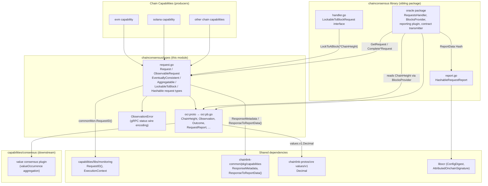
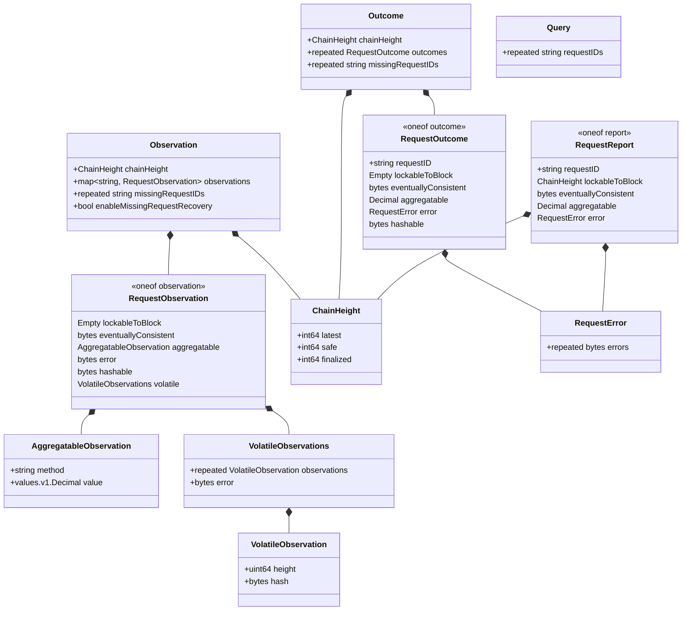
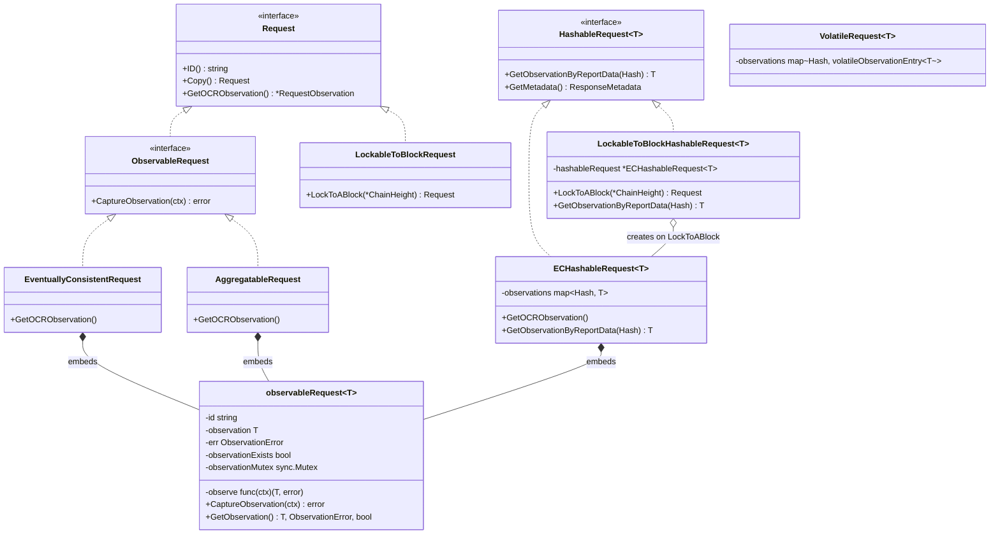
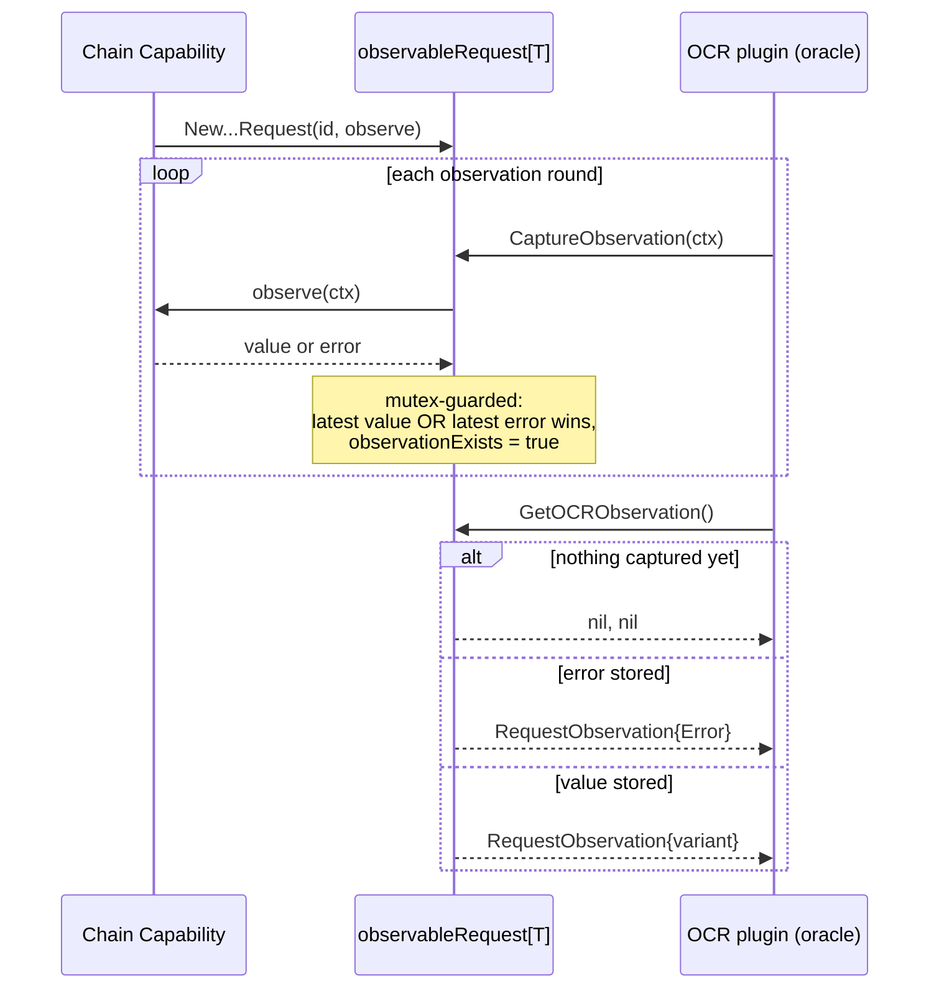
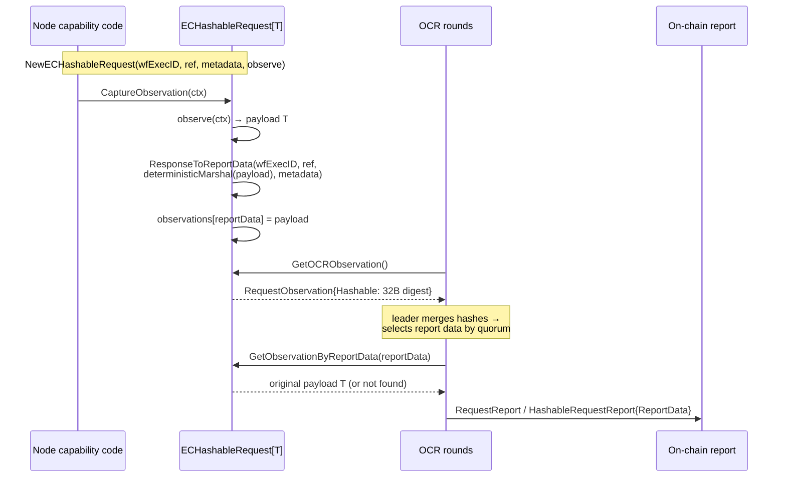
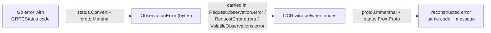

# Chain Consensus Shared Types (`capabilities/libs/chainconsensus/types`)

## Introduction

`capabilities_shared_libs_chainconsensus_types` is the **protocol and request-type contract** of the Chain Capability Consensus library. It lives in the Go package `github.com/smartcontractkit/capabilities/libs/chainconsensus/types` (Go module `github.com/smartcontractkit/capabilities/libs`, see `capabilities/libs/go.mod`) and provides:

1. **The OCR wire protocol** (`ocr.proto`) — protobuf messages exchanged between nodes of a DON when they reach consensus on the results of *on-chain read* requests (heights, observations, outcomes, and reports).
2. **The request type system** (`request.go`) — Go abstractions that chain capabilities use to describe *how* a value should be observed and turned into an OCR observation: eventually-consistent, aggregatable, lockable-to-block, and hash-based requests.
3. **The error wire encoding** (`ObservationError`) — a gRPC-status-based error serialization that preserves status codes when errors are shipped between OCR nodes.
4. **The test suite** (`request_test.go`) — behavioral guarantees for observation capture, error round-tripping, hash-based report data, and lockable-to-block delegation.

The package is consumed by the [chain consensus oracle and handler layer](capabilities_shared_libs_chainconsensus.md) and, indirectly, by the [value consensus plugin of the consensus capability](../consensus_capability.md). It is one of the shared libraries grouped under [Capabilities Shared Libs](../capabilities_shared_libs.md).

> **Design intent** (from `capabilities/libs/chainconsensus/README.md`): *"It's a library that provides consensus-related functionalities for chain capabilities to perform read operations."* This `types` sub-package is the dependency-free contract that both capability implementations and the oracle agree upon.

---

## Architecture Overview

The types package sits at the boundary between **chain capabilities** (which produce observations of chain state) and the **chain consensus oracle** (an OCR3 reporting plugin that reaches agreement on those observations). It depends on a small set of shared foundation libraries and is referenced by every chain-capability consensus flow.



### Position in the CRE Engine

Within the [Workflow & Capability Runtime (CRE Engine)](../README.md) the module belongs to the shared-libs tier of the [capability framework](../capabilities.md):

| Layer | Responsibility |
|---|---|
| [Capabilities core contracts](../capabilities.md) | Generic `Capability` interfaces, protobuf schemas, registry |
| [Chain consensus library](capabilities_shared_libs_chainconsensus.md) | Poller, request handler, batching, OCR3 reporting plugin + contract transmitter for chain reads |
| **Chain consensus types (this module)** | Wire messages + request observation semantics shared by both sides |
| [Monitoring shared lib](capabilities_shared_libs_monitoring.md) | Execution-context protobuf, request IDs, telemetry helpers used by the request types |
| [Consensus capability](../consensus_capability.md) | The `consensus` capability plugin (value aggregation) that sits on top of OCR3 and reuses the same observation taxonomy |

The generic (chain-agnostic) capability interfaces the request types rely on — `ResponseMetadata`, `ResponseToReportData`, `ResponseAndMetadata` — are documented in [Shared Foundation Libraries: types-core](../../Shared_Foundation_Libraries___Domain_Types/types-core.md).

---

## Wire Protocol Reference (`ocr.proto`)

Source: `capabilities/libs/chainconsensus/types/ocr.proto`.

> **Note on naming:** the proto package is historically `chain_capabilities.evm.types`, while the generated Go package is `github.com/smartcontractkit/capabilities/libs/chainconsensus/types` (`option go_package`). Code generation is driven by `types/generate.go` → `types/gen/main.go`, which uses the `chainlink-protos/cre/go` protoc installer with the `go` and `go-grpc` plugins and links `values/v1/values.proto` to `github.com/smartcontractkit/chainlink-protos/cre/values/v1` (see [Capabilities workspace tooling](../../Build,_CI___Release_Infrastructure/capabilities_workspace_tooling.md) for the protoc toolchain).

### Message relationships



### Messages

| Message | Purpose |
|---|---|
| `ChainHeight` | Triplet of block heights — `latest`, `safe`, `finalized` — produced by the oracle's `BlocksProvider` (see [chain consensus lib](capabilities_shared_libs_chainconsensus.md)). Also used as the *resolution* value of lockable-to-block requests in reports. |
| `Observation` | A follower's full OCR observation round payload: the current `ChainHeight`, per-request `RequestObservation`s keyed by request ID, the IDs of requests the observer knows about but the leader did not request (`missingRequestIDs`), and the `enableMissingRequestRecovery` flag driving missing-request recovery. |
| `RequestObservation` | One node's observation for a single request. A `oneof` discriminated by the `ObservationType` taxonomy below. |
| `AggregatableObservation` | A numeric observation plus its aggregation `method` (e.g. `f+1-highest`); the value is a `values.v1.Decimal`. |
| `VolatileObservation` / `VolatileObservations` | Observations tied to a specific block (`height` + block `hash`). Errors are **not** eventually consistent for volatile calls, so they travel alongside successful observations as a single aggregated `error` blob (different RPC clients may phrase the same failure differently). |
| `Query` | Leader → followers request-ID list (which requests to observe in this round). |
| `Outcome` | The aggregated, agreed result of an OCR round: consensus `ChainHeight`, per-request `RequestOutcome`s, and `missingRequestIDs` known by at least F+1 observers but not requested by the leader. |
| `RequestOutcome` | Per-request consensus result; the same observation taxonomy minus the volatile variant. |
| `RequestReport` | The on-chain report entry per request; `lockableToBlock` resolves to the agreed `ChainHeight` at which the value was observed. |
| `RequestError` | One or more `ObservationError` blobs for a request. |
| `ObservationType` (enum) | `UNKNOWN`, `EVENTUALLY_CONSISTENT`, `LOCKABLE_TO_BLOCK`, `AGGREGATABLE`, `ERROR`, `HASHABLE`, `VOLATILE` — the canonical observation taxonomy. |

The three `oneof` families share a deliberate shape:

| Value class | Wire form | Consensus approach |
|---|---|---|
| Lockable-to-block | `google.protobuf.Empty` during observation; `ChainHeight` in report | Two-step: agree on a block height first, then read at it |
| Eventually-consistent / hashable | raw `bytes` payload, or a 32-byte `hashable` digest | Replay-observation or hash-based (leader-selected report data) consensus |
| Aggregatable | `values.v1.Decimal` + method | Arithmetic aggregation across nodes (e.g. `f+1-highest`) |
| Error | `bytes` = `google.rpc.Status` proto | Errors participate in consensus like any observation |

---

## Request Type System (`request.go`)

Chain capabilities express *what kind of read they are performing* by choosing a request implementation. All types implement the base interfaces:

```go
type Request interface {
    ID() string
    Copy() Request
    GetOCRObservation() (*RequestObservation, error)
}

type ObservableRequest interface {
    Request
    CaptureObservation(ctx context.Context) error
}

type HashableRequest[T proto.Message] interface {
    Request
    GetObservationByReportData(reportData Hash) (T, bool)
    GetMetadata() commoncap.ResponseMetadata
}
```

### Type hierarchy



> `VolatileRequest[T]` (defined in the package's `volatile_request.go`) completes the taxonomy for the `VOLATILE` wire type: observations are stored per-block-hash with a latest-error slot, mirroring `VolatileObservations`.

### Request semantics matrix

| Type | Semantics | Wire mapping (`RequestObservation`) | Thread safety / `Copy()` |
|---|---|---|---|
| `EventuallyConsistentRequest` | Value may diverge across RPCs briefly (reorgs, propagation lag) but converges with time, e.g. a receipt. Newest-generation successor of this pattern is `ECHashableRequest`. | `eventuallyConsistent` (raw bytes) or `error` | Mutex-guarded single-slot observation; `Copy()` returns the *same* instance to always serve the most recent capture |
| `AggregatableRequest` | Value can be aggregated across nodes with a declared `method` (`AggregationMethodFPlusOneHighest = "f+1-highest"`), e.g. gas estimation. ⚠️ Must **not** be used for values that were never observed on-chain (e.g. balances) — with `[10, 20, 30, 30]` and f+1-highest the result `20` was never observed. | `aggregatable` (`AggregatableObservation`) or `error` | Same as eventually-consistent |
| `LockableToBlockRequest` | Volatile value that becomes consistent if captured at one agreed block height, e.g. `getBlock`. Two-step consensus: (1) nodes agree on a height, (2) the request is locked to that height and treated as eventually consistent. | `lockableToBlock` (`Empty`) while unlocked; observation captured via `LockToABlock(chainHeight)` → `EventuallyConsistentRequest` | `Copy()` returns a fresh shallow copy (no captured state yet); `LockToABlock` binds the agreed `ChainHeight` into a new observe closure |
| `ECHashableRequest[T]` | Hash-based consensus for large payloads: nodes exchange only a 32-byte digest of `commoncap.ResponseToReportData(workflowExecutionID, reference, payload, metadata)` instead of the full payload, avoiding transmitting big observations repeatedly. The payload must be **deterministic** (no timestamps/random values). Used for hashable eventually-consistent reads. | `hashable` (32-byte `Hash`) or `error` | Same shared instance via `Copy()`; all captured observations are retained in a `map[Hash]T` (no eviction — only a few captures are expected per request lifetime) until the report is generated or the request times out |
| `LockableToBlockHashableRequest[T]` | Combination of lockable-to-block + hashable: capture at an agreed height **and** transmit only the digest. | `lockableToBlock` (`Empty`) while unlocked; after `LockToABlock` delegates to the wrapped `ECHashableRequest` (`hashable`) | `Copy()` returns same instance; `LockToABlock` lazily creates and memoizes the wrapped `ECHashableRequest` (guarded by an `RWMutex`); `GetObservationByReportData` delegates |

### ID and identity

Request IDs are composed by the [monitoring shared lib](capabilities_shared_libs_monitoring.md):

```go
// capabilities/libs/monitoring/common.go
func RequestID(workflowExecutionID, reference string) string {
    return workflowExecutionID + ":" + reference
}
```

Hashable requests additionally carry `workflowExecutionID`, `reference` and `commoncap.ResponseMetadata` (metering details contributed by the peer capability), because the report-data digest is computed over all four — the same derivation used by [capabilities core](../capabilities.md) when converting capability responses into OCR report data.

### Observation lifecycle

The embedded `observableRequest[T]` is the concurrency core of all observing request types:

1. `CaptureObservation(ctx)` invokes the injected `observe` closure and **always prefers the latest observation**, even a failed one — a non-transient error means all honest nodes may converge on the error. Failures are converted with `NewObservationError`; if conversion fails, both errors are joined and returned.
2. `GetObservation()` returns `(observation, ObservationError, exists)` under the mutex.
3. `GetOCRObservation()` translates the slot into the wire form: *no observation yet* → `nil, nil` (node contributes nothing for that request); *error* → `RequestObservation_Error`; *value* → the type-specific `oneof` variant.



### Hash-based consensus data flow

For `ECHashableRequest` / `LockableToBlockHashableRequest`, the report-data hash is the rendezvous point between the observation and reporting phases. Because OCR rounds and observation captures race, **every** captured observation is retained keyed by its digest, and the reporting phase looks the winning payload back up by the report's `ReportData` (`HashableRequestReport`, see the [chain consensus lib](capabilities_shared_libs_chainconsensus.md)).



Key properties enforced by implementation and tests:

- Digests are `Hash` = `[32]byte` (`HashLength = 32`) and match `commoncap.ResponseToReportData` exactly (deterministic proto marshaling is used when hashing).
- Different payloads necessarily produce different digests; two captured observations coexist in the map.
- Malformed metadata (e.g. zero metering records) fails digest computation with `failed to convert response to report data: failed to extract metering from metadata: unexpected number of metering records received from peer` — metering is part of the signed report data, feeding [workflow metering/billing](../../Shared_Foundation_Libraries___Domain_Types/metering-and-billing.md).
- Pre-lock `GetObservationByReportData` on `LockableToBlockHashableRequest` gracefully returns `zero, false` before any block height was agreed.

### Two-step lockable-to-block consensus

```mermaid
flowchart TD
    A[Capability enqueues<br/>LockableToBlock*Request] --> B[OCR round 1:<br/>each node observes with<br/>RequestObservation_LockableToBlock<br/>= Empty marker]
    B --> C[Oracle consensus:<br/>agree on ChainHeight<br/>latest / safe / finalized<br/>from BlocksProvider]
    C --> D[handler.LockToABlock chainHeight]
    D --> E[OCR round 2+:<br/>locked request behaves as<br/>eventually-consistent<br/>(or hashable) request]
    E --> F[Outcome report:<br/>RequestReport.lockableToBlock<br/>carries the agreed ChainHeight]
```

The `LockableToBlockRequest` interface consumed by the oracle layer (defined in the sibling package's `handler.go`) is exactly `LockToABlock(chainHeight *types.ChainHeight) types.Request` — see [chain consensus library](capabilities_shared_libs_chainconsensus.md).

---

## Error Wire Encoding (`ObservationError`)

Errors must survive node-to-node transmission without losing gRPC status information (capabilities may surface codes like `AlreadyExists`):

- **Encoding:** `NewObservationError(err) = proto.Marshal(status.Convert(err).Proto())` — any Go error is normalized to a `google.rpc.Status` and serialized to bytes.
- **Decoding:** `ObservationError.Err()` unmarshals a `google.golang.org/genproto/.../spb.Status` and restores a `*status.Status` error, preserving code and message (verified for custom `GRPCStatus()` implementations).
- **Empty encoding:** `ObservationError([]byte{}).Err()` returns `nil` — used as the "no error" zero value in observation slots and `VolatileObservations.error`.
- **Aggregation note (volatile):** because different RPC clients phrase the same failure differently, multiple error blobs may be merged into a single `RequestError`/`VolatileObservations.error`.



---

## Testing (`request_test.go`)

The test suite pins the behavioral contract of the module (component `capabilities/libs/chainconsensus/types/request_test.go::grpcStatus` covers the gRPC-status preservation check):

| Test | Guarantee |
|---|---|
| `TestRequest_CaptureObservation` | No capture → zero value/`false`; latest capture always wins (success after failure, failure after success); failed capture stores the `ObservationError` |
| `TestObservationError` | Custom `GRPCStatus()` codes survive a marshal → transmit → unmarshal round-trip; empty `ObservationError` yields `nil` |
| `TestNewHashableRequest` | ID equals `commonMon.RequestID(wf, ref)`; metadata round-trips |
| `TestHashableRequest_GetOCRObservation` | No observation → `nil, nil`; errors surface as `RequestObservation_Error`; successful digests equal `commoncap.ResponseToReportData` (32 bytes, distinct per payload) and both payloads remain retrievable via `GetObservationByReportData`; invalid metering metadata produces the documented conversion error |
| `TestNewLockableToBlockHashableRequest` / `...GetOCRObservation` | Construction and pre-lock `lockableToBlock` marker |
| `TestLockableToBlockHashableRequest_LockToABlock_delegatesToHashableRequest` | Locking binds the agreed `ChainHeight` (e.g. `Latest: 42`) into the observe closure, delegates digest production to the memoized `ECHashableRequest`, and exposes the payload via the outer type's `GetObservationByReportData` |

Mocks for the package interfaces are generated with mockery (see `types/generate.go` and `types/mocks/`), consistent with the [capabilities workspace tooling](../../Build,_CI___Release_Infrastructure/capabilities_workspace_tooling.md).

---

## Dependencies & Build

| Concern | Detail |
|---|---|
| Go module | `github.com/smartcontractkit/capabilities/libs` (`capabilities/libs/go.mod`, Go 1.27.1) — direct deps include `smartcontractkit/chainlink-common`, `smartcontractkit/chainlink-protos/cre/go` (values), `libocr`, `google.golang.org/{grpc,protobuf}` |
| Proto codegen | `types/generate.go` → `types/gen/main.go` (protoc `go` + `go-grpc` plugins; `values/v1/values.proto` linked to `github.com/smartcontractkit/chainlink-protos/cre/values/v1`); produces `ocr.pb.go` |
| Mocks | mockery from the `libs` root (`//go:generate sh -c "cd .. && mockery"`) → `types/mocks/` |
| Monitoring integration | `commonMon.RequestID`, `ExecutionContext` metadata from the [monitoring shared lib](capabilities_shared_libs_monitoring.md) |
| Report plumbing | `HashableRequestReport{ConfigDigest, SeqNr, ReportData Hash, AttributedOnchainSignature}` (libocr types) in the sibling package's `report.go` |

## Related Documentation

- [Capabilities Shared Libs](../capabilities_shared_libs.md) — parent grouping of shared capability libraries
- [Chain Consensus Library](capabilities_shared_libs_chainconsensus.md) — poller, request handler, batching, OCR3 reporting plugin and contract transmitter that consume these types (`RequestsHandler`, `BlocksProvider`, `HashableRequestReport`)
- [Monitoring Shared Lib](capabilities_shared_libs_monitoring.md) — request IDs and execution-context protobuf
- [Capabilities Core](../capabilities.md) — capability interfaces, `ResponseMetadata`, registry, and protobuf schemas
- [Consensus Capability](../consensus_capability.md) — value-consensus plugin consuming the same observation taxonomy
- [Types Core (chainlink-common)](../../Shared_Foundation_Libraries___Domain_Types/types-core.md) — `ResponseMetadata`, `ResponseToReportData`, capability response contracts
- [Metering & Billing](../../Shared_Foundation_Libraries___Domain_Types/metering-and-billing.md) — how report-data metering metadata is consumed
- [Capabilities Workspace Tooling](../../Build,_CI___Release_Infrastructure/capabilities_workspace_tooling.md) — protoc toolchain, mockery, Nx build targets
