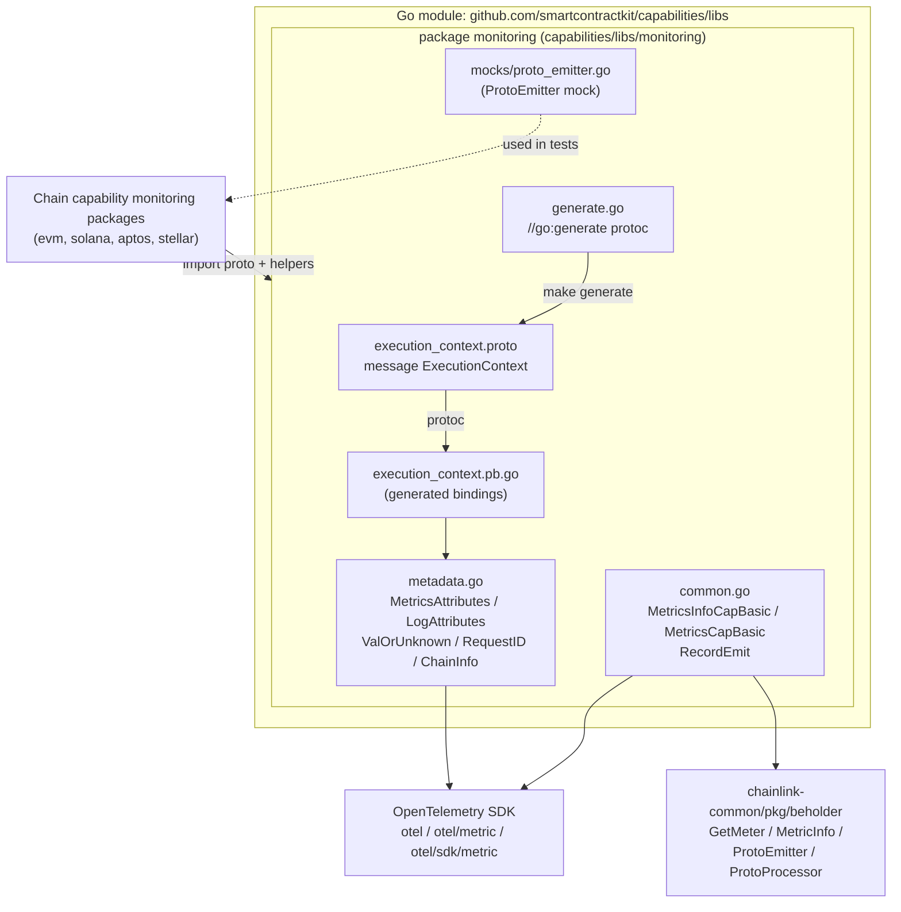
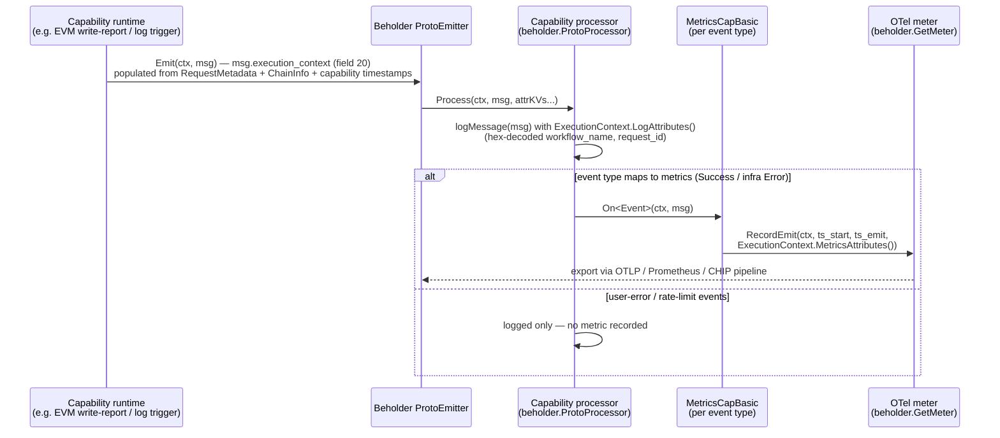
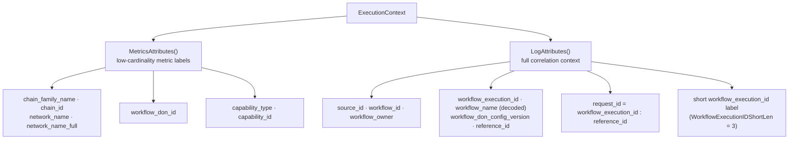
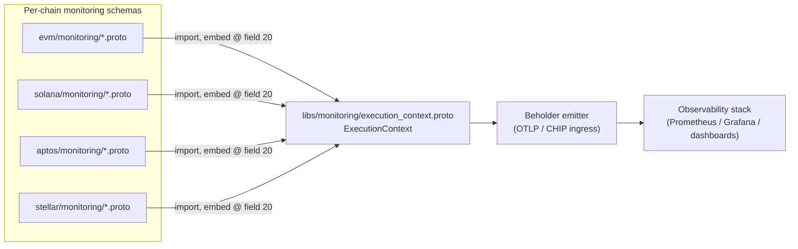

# Capabilities Shared Libs — Monitoring

> **Module path:** `capabilities/libs/monitoring/` · **Go module:** `github.com/smartcontractkit/capabilities/libs` (see `capabilities/libs/go.mod`) · **Parent:** [Capabilities Shared Libs](../capabilities_shared_libs.md)

## 1. Introduction

The **capabilities_shared_libs_monitoring** module is the shared telemetry foundation for every capability in the Chainlink Runtime Environment (CRE). It answers one question consistently across the entire capability ecosystem: *“what was the chain, workflow, and capability context in which this telemetry event happened?”*

It provides:

1. **`ExecutionContext`** — a single protobuf message (`execution_context.proto`, package `monitoring`) that acts as the canonical, wire-format correlation envelope attached to every capability monitoring event (source, chain, workflow, and capability identity, plus lifecycle timestamps).
2. **Attribute extraction** (`metadata.go`) — helpers that turn an `ExecutionContext` into OpenTelemetry attributes for **metrics** (curated, low-cardinality) and **logs** (full context, including a decoded workflow name and a composite `request_id`).
3. **Reusable metric instruments** (`common.go`) — the `MetricsCapBasic` primitive (counter + start/emit timestamp gauges + duration histogram) built on the [Beholder](../../Telemetry___Observability_Platform/beholder-telemetry.md) meter, so every capability emits a uniform `{prefix}_count`, `{prefix}_cap_timestamp_start`, `{prefix}_cap_timestamp_emit`, `{prefix}_cap_duration` metric family.
4. **Code generation & test support** — a `go:generate` protoc directive and a mockery-generated `ProtoEmitter` mock for unit-testing telemetry processors.

Because the schema lives in a shared lib, all chain capabilities (EVM, Solana, Aptos, Stellar) emit structurally identical, joinable telemetry: every event message embeds `monitoring.ExecutionContext` at **field number 20**, giving observability pipelines a stable join key across chains and capabilities.

## 2. Core Component: `execution_context.proto`

- **File:** `capabilities/libs/monitoring/execution_context.proto`
- **Proto package:** `monitoring` · **Go package:** `github.com/smartcontractkit/capabilities/libs/monitoring`
- **Generated code:** `capabilities/libs/monitoring/execution_context.pb.go` via the `go:generate` directive in `generate.go`

### Field reference

| Group | Field | Type | Semantics |
|---|---|---|---|
| **Source** | `meta_source_id` (1) | string | Identifier of the emitting source/node component |
| **Chain** | `meta_chain_family_name` (2) | string | Chain family (e.g. `evm`, `solana`, `aptos`, `stellar`) |
| | `meta_chain_id` (3) | string | Chain identifier within the family |
| | `meta_network_name` (4) | string | Short network name (e.g. `mainnet`, `sepolia`) |
| | `meta_network_name_full` (5) | string | Fully-qualified network name |
| **Workflow** (mirrors `capabilities.RequestMetadata`) | `meta_workflow_id` (6) | string | Workflow ID (from on-chain registration / versioned ID) |
| | `meta_workflow_owner` (7) | string | Workflow owner address |
| | `meta_workflow_execution_id` (8) | string | Unique ID of this workflow execution |
| | `meta_workflow_name` (9) | string | Workflow name, **hex-encoded** (decoded for logs, see below) |
| | `meta_workflow_don_id` (10) | uint32 | DON ID the workflow runs on |
| | `meta_workflow_don_config_version` (11) | uint32 | Workflow DON config version |
| | `meta_reference_id` (12) | string | Step reference ID within the workflow DAG |
| **Capability** | `meta_capability_type` (13) | string | Capability type (e.g. `logtrigger`, `cron`, `http`) |
| | `meta_capability_id` (14) | string | Capability ID (hashed config from the capabilities registry) |
| | `meta_capability_timestamp_start` (15) | uint64 | Local timestamp (ms) at capability execution start |
| | `meta_capability_timestamp_emit` (16) | uint64 | Local timestamp (ms) at message emit |

The **Workflow** field block is the protobuf projection of `capabilities.RequestMetadata` from `chainlink-common/pkg/capabilities/capabilities.go` (`WorkflowID`, `WorkflowOwner`, `WorkflowExecutionID`, `WorkflowName`, `WorkflowDonID`, `WorkflowDonConfigVersion`, `ReferenceID`). Note that `RequestMetadata` exposes `DecodedWorkflowName`; the proto carries the raw (hex) form and the shared Go helpers decode it on demand — keeping the wire format stable while logs stay human-readable.

The two capability timestamps power the latency story: every consumer records `emit − start` as a duration histogram, plus both timestamps as gauges for clock-drift-free inspection (see `common.go`).

## 3. Go Runtime API

### 3.1 Attribute extraction — `metadata.go`

| Symbol | Purpose |
|---|---|
| `(*ExecutionContext).MetricsAttributes()` | Returns the **metric attribute set**: `chain_family_name`, `chain_id`, `network_name`, `network_name_full`, `workflow_don_id`, `capability_type`, `capability_id`. Deliberately **excludes** high-cardinality workflow identifiers to keep metric series manageable. |
| `(*ExecutionContext).LogAttributes()` | Extends `MetricsAttributes` with `source_id`, `workflow_id`, `workflow_owner`, `workflow_execution_id`, `workflow_name` (**hex-decoded** via `decodeWorkflowName`), `workflow_don_config_version`, `reference_id`, and the composed `request_id`. |
| `ValOrUnknown(val string)` | Replaces empty strings with `"unknown"` — required so OTel → Prometheus export doesn't drop attributes (see `INFOPLAT-1349` reference in the source). Applied to every string attribute. |
| `ValShortOrUnknown(val, len)` | Truncates to the first `len` characters (or `"unknown"`). With `WorkflowExecutionIDShortLen = 3` it yields a **mid-high cardinality** short execution-ID label (~16³ = 4,096 buckets). |
| `DistinctAttributes([]attribute.KeyValue)` | Key-deduplicating merge (first wins) — used when merging per-message and per-context attributes. |
| `ChainInfo` | Plain struct (`FamilyName`, `ChainID`, `NetworkName`, `NetworkNameFull`) used by capability code to populate the chain block of the context. |

### 3.2 Metric primitives — `common.go`

`MetricsInfoCapBasic` / `NewMetricsInfoCapBasic(metricPrefix, eventRef)` (and `...WithBuckets` for custom histogram boundaries) describe the uniform metric family; `NewMetricsCapBasic(info)` instantiates it on the Beholder meter:

| Instrument | Name | Type | Unit |
|---|---|---|---|
| Count | `{prefix}_count` | `Int64Counter` | — |
| Start timestamp | `{prefix}_cap_timestamp_start` | `Int64Gauge` | ms |
| Emit timestamp | `{prefix}_cap_timestamp_emit` | `Int64Gauge` | ms |
| Duration | `{prefix}_cap_duration` | `Int64Histogram` | ms (`emit − start`) |

`(*MetricsCapBasic).RecordEmit(ctx, start, emit, attrKVs...)` records all four in one call. `RequestID(workflowExecutionID, reference)` composes the `request_id` log attribute (`"<workflow_execution_id>:<reference_id>"`).

### 3.3 Test support — `mocks/proto_emitter.go`

A mockery-generated `ProtoEmitter` mock (regenerated via the `mockery` tooling of the [capabilities workspace](../../Build,_CI___Release_Infrastructure/capabilities_workspace_tooling.md)) lets consumers test their `beholder.ProtoProcessor` implementations without a live Beholder exporter.

## 4. Architecture

**Dependency posture** (per `capabilities/libs/go.mod`): the lib module requires `github.com/smartcontractkit/chainlink-common` (Beholder, logger), the OpenTelemetry metric SDK, `google.golang.org/protobuf` and `google.golang.org/grpc`. There is **no dependency on any specific chain capability** — the arrow points the other way: capabilities depend on this module.

## 5. Data Flow: From Capability Execution to Metrics & Logs

The user-error/limit-error filtering visible above is the pattern implemented by the [EVM chain capability](../chain_capability_evm.md): its `processor.go` implements `beholder.ProtoProcessor` and dispatches each `*WriteReportSuccess`, `*LogTriggerError`, etc. to a matching `Metrics` method; `metrics.go` declares one `commoncapbeholder.MetricsCapBasic` per event type plus OTel `View`s that pin explicit latency bucket boundaries for the `_cap_duration` histograms.

## 6. Attribute Design

Design rules encoded in the module:

- **Cardinality control:** metrics carry only chain/DON/capability identity; per-execution identifiers (`workflow_execution_id`, `reference_id`, `workflow_owner`) are log-only (or short-form), preventing unbounded series growth in Prometheus.
- **Never-empty labels:** all string attributes pass through `ValOrUnknown` so Prometheus never sees empty label values.
- **Uniform metric family:** every capability event exposes the same four instruments, so dashboards can be templated per `{prefix}`/`eventRef` across chains.

## 7. Consumers and Ecosystem Integration

| Consumer | How it uses this module |
|---|---|
| **Chain capabilities** — [EVM](../chain_capability_evm.md), [Solana](../chain_capability_solana.md), [Aptos](../chain_capability_aptos.md), [Stellar](../chain_capability_stellar.md) | Import `libs/monitoring/execution_context.proto` into their monitoring protos (`write_report.proto`, `log_trigger.proto`, `read_actions.proto`, `view.proto`, …) and embed `monitoring.ExecutionContext` at **field 20** of every event message. Their `metrics.go` embeds `MetricsCapBasic` per event; their `processor.go` implements the Beholder processor dispatch. |
| **Shared chain-capability monitoring lib** (`capabilities/chain_capabilities/common/monitoring`) | Common processor scaffolding reused by the per-chain packages. |
| **Beholder / telemetry platform** | This module *consumes* Beholder (`GetMeter`, `ProtoEmitter`, `ProtoProcessor`); emitted protobuf events flow onward through the [telemetry ingress / CHIP pipeline](../../Telemetry___Observability_Platform/beholder-telemetry.md) and ops monitoring stack. |
| **CRE engine** | Workflow fields originate from `capabilities.RequestMetadata` produced by the [workflow engine](../workflows/workflows_engine.md) and the [capabilities core contracts](../capabilities/capabilities_core.md); capability IDs match the capabilities registry. Metering/billing ([workflows metering](../workflows/workflows_metering.md)) is a separate but complementary spend-tracking stream. |

## 8. Build, Code Generation, and Testing

The module is an nx project inside the `capabilities` pnpm/nx workspace (`capabilities/nx.json`, `capabilities/libs/monitoring/project.json`).

| Concern | Mechanism | Where |
|---|---|---|
| Proto → Go generation | `//go:generate protoc --go_out=. --go-grpc_out=. ... execution_context.proto` | `capabilities/libs/monitoring/generate.go` |
| Toolchain install | `make protoc` installs protoc 29.3 + `protoc-gen-go` v1.36.10; `make generate` runs all `go:generate` directives via `gomods` | `capabilities/Makefile` |
| Lint | `golangci-lint run ./...` | `project.json` target `lint` |
| Tests | `go test ./... -coverpkg=./... -coverprofile=coverage.txt` and a dedicated `go test -race ./...` target | `project.json` targets `test`, `race` |
| Dependency hygiene | `make tidy` / `make gomodtidy` across all workspace Go modules | `capabilities/Makefile` |

**Adding a new telemetry event to a chain capability:** define the message in the capability's `monitoring/*.proto` with `import "libs/monitoring/execution_context.proto"` and `monitoring.ExecutionContext execution_context = 20;`, regenerate, add a `MetricsInfoCapBasic`/`MetricsCapBasic` pair keyed by a `{prefix}`/`eventRef`, and handle the new type in the capability's processor.

## 9. Design Notes & Pitfalls

- **Field 20 convention:** telemetry messages reserve fields 1–19 for event payloads and place `ExecutionContext` at field 20 uniformly — tooling and dashboards rely on this. Preserve it when extending schemas.
- **Hex-encoded workflow name:** `meta_workflow_name` is the raw hex-encoded name; always use `LogAttributes()` (not the raw getter) when surfacing names in logs, and mirror the decoded value into `capabilities.RequestMetadata.DecodedWorkflowName` where available.
- **Timestamps are local wall-clock ms**, not consensus times: useful for latency (`emit − start`), not for cross-node ordering.
- **`ValOrUnknown` is not optional:** omitting it breaks OTel → Prometheus export (tracked as `INFOPLAT-1349`).
- **User errors are not metric errors:** processors deliberately skip metrics for user-caused failures and rate-limit drops to keep error SLOs meaningful; they are still logged with full context.

## 10. Related Documentation

- Parent: [Capabilities Shared Libs](../capabilities_shared_libs.md) — sibling libs: [chainconsensus](capabilities_shared_libs_chainconsensus.md), [chainconsensus types](capabilities_shared_libs_chainconsensus_types.md)
- Consumers: [EVM chain capability](../chain_capability_evm.md) · [Solana](../chain_capability_solana.md) · [Aptos](../chain_capability_aptos.md) · [Stellar](../chain_capability_stellar.md) · [Chain capabilities common](../chain_capabilities_common.md)
- Runtime context origin: [Capabilities core](../capabilities/capabilities_core.md) · [Workflow engine](../workflows/workflows_engine.md) · [Metering](../workflows/workflows_metering.md)
- Transport & backend: [Beholder telemetry](../../Telemetry___Observability_Platform/beholder-telemetry.md) · [Ops monitoring stack](../../Telemetry___Observability_Platform/ops-monitoring-stack.md)
- Tooling: [Capabilities workspace tooling](../../Build,_CI___Release_Infrastructure/capabilities_workspace_tooling.md) · [CRE engine overview](../../Workflow___Capability_Runtime_(CRE_Engine).md)
