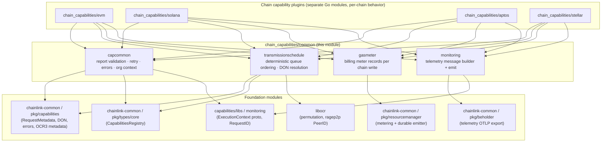
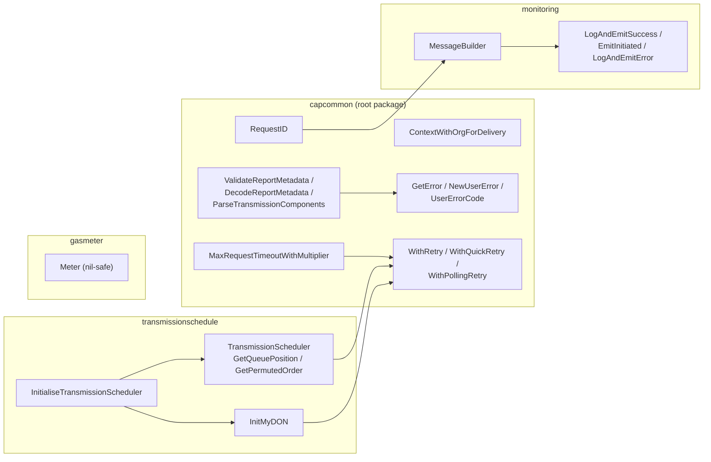
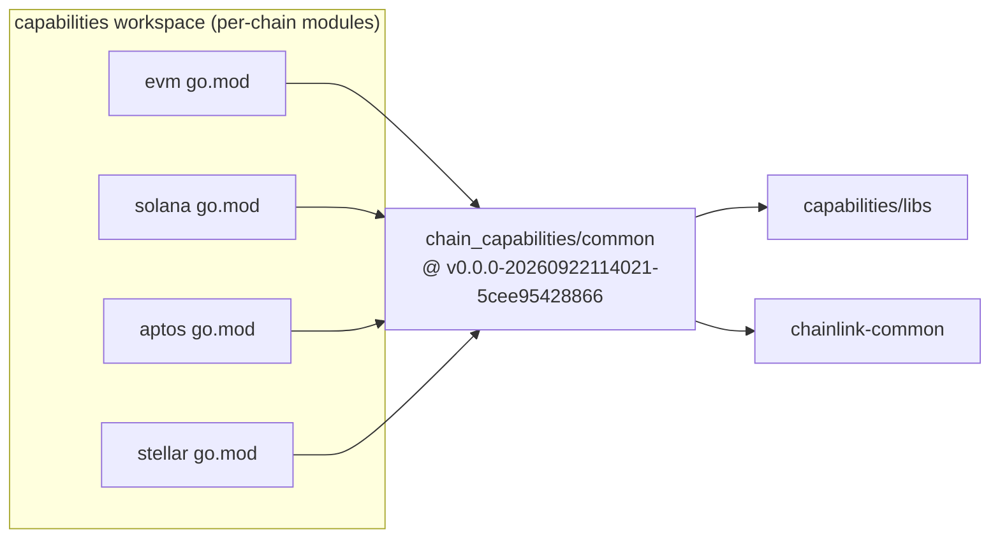
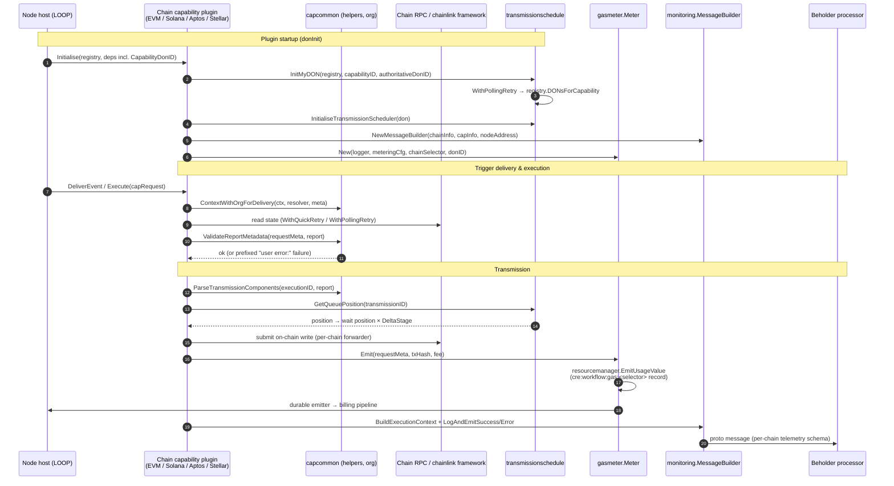
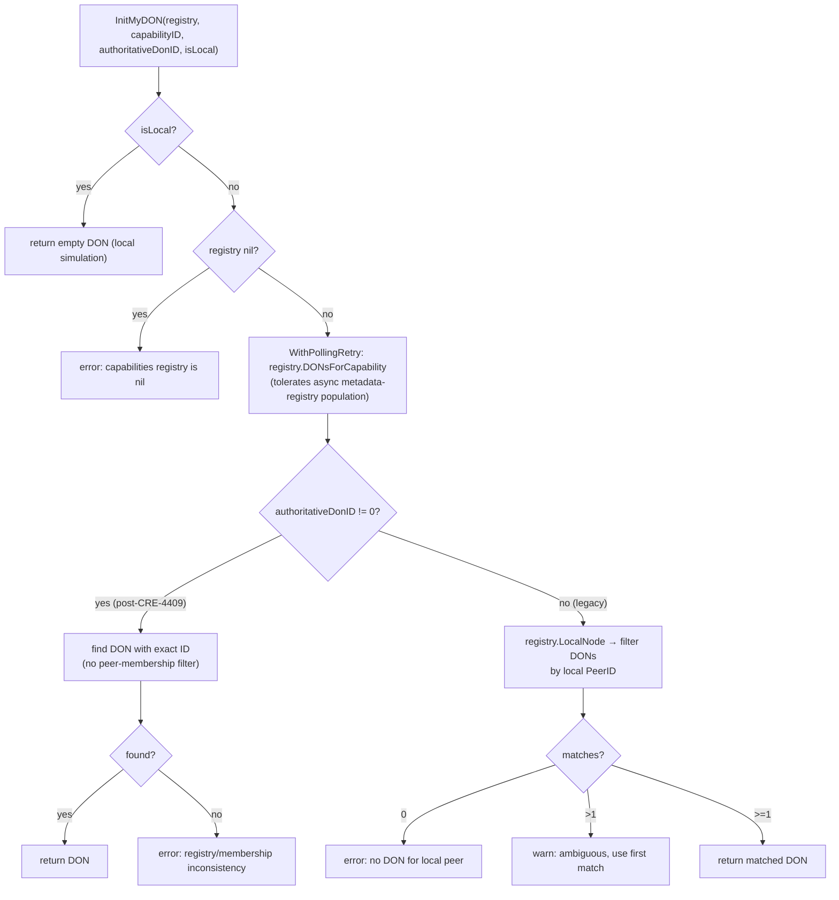

# Chain Capabilities Common (chain_capabilities_common)

> **Go module:** `github.com/smartcontractkit/capabilities/chain_capabilities/common`
> **Location:** `capabilities/chain_capabilities/common/`
> **Type:** Go library module (no binaries — `projectType: "library"` in `capabilities/chain_capabilities/common/project.json`)
> **Parent domain:** [Workflow & Capability Runtime (CRE Engine)](../Workflow___Capability_Runtime_(CRE_Engine).md)

---

## 1. Introduction

Every CRE chain capability plugin — [EVM](chain_capability_evm.md), [Solana](chain_capability_solana.md), [Aptos](chain_capability_aptos.md), and [Stellar](chain_capability_stellar.md) — is an independently versioned Go module that runs as a [LOOP plugin process](../Plugin_Process_Framework_(Loop)/loop-plugin-core.md). Although each chain speaks a different wire protocol, all of them must share a large amount of *chain-agnostic* behavior:

* validating and decoding **OCR3 report metadata** for workflow-execution identity checks,
* computing a **deterministic transmission order** across the nodes of a capability DON,
* emitting **gas-usage meter records** for billing every on-chain write,
* building and emitting **beholder telemetry** with a shared `ExecutionContext`,
* propagating **CRE organization context** for delivery-time retransmit policy,
* uniform **retry / error-classification** semantics for chain RPC calls.

`chain_capabilities_common` is the shared library module that extracts exactly this logic, so that every chain capability behaves identically across chains and cannot drift into copy-paste divergence. It deliberately contains **no chain-specific code** — no chain clients, codecs, key handling, or contract bindings. Those live in the individual chain capability modules.

The canonical module definition is `capabilities/chain_capabilities/common/go.mod`, which is the single core component of this module in the [module tree](../Workflow___Capability_Runtime_(CRE_Engine).md); the Go source it fronts is described in this page.

---

## 2. Module snapshot

| Field | Value |
|---|---|
| Module path | `github.com/smartcontractkit/capabilities/chain_capabilities/common` |
| Go directive | `go 1.27.1` |
| Project type | nx **library** (`capabilities/chain_capabilities/common/project.json`) |
| Direct dependencies | `capabilities/libs`, `chainlink-common`, `libocr`, `chainlink-protos/metering/go`, `jpillora/backoff`, `go.opentelemetry.io/otel`, `go.uber.org/zap`, `google.golang.org/protobuf`, `testify` |
| Consumers | `chain_capabilities/{evm,solana,aptos,stellar}` (each pins the same pseudo-version) |
| Test helpers importable by consumers | `.../common/test` package |

---

## 3. Package structure

| Package | Files | Responsibility |
|---|---|---|
| `capcommon` (root) | `org_context.go`, `helpers.go` | Report-metadata validation, request IDs, error classification, retry strategies, timeout derivation, org-context propagation |
| `capcommon/gasmeter` | `gasmeter/gasmeter.go` | Emits one billing meter record per chain write via the LOOP `resourcemanager` |
| `capcommon/transmissionschedule` | `transmission_schedule/transmission_schedule.go` | Deterministic, DON-consistent transmission queue ordering; capability-DON resolution |
| `capcommon/monitoring` | `monitoring/monitoring.go` | Builds telemetry messages with the shared `ExecutionContext` and emits them through the beholder processor |
| `capcommon/test` | `test/test_utils.go` | Shared test utilities (`RandomBytes`, `NopBeholderProcessor`) |

---

## 4. Architecture

The module sits **between the chain plugins and the platform foundation**. Chain plugins depend on it (it is a leaf library with no binary entry point), and it in turn depends only on foundation modules from `chainlink-common` and `capabilities/libs`.



### Internal component relationships



Notable internal couplings:

* `transmissionschedule.InitMyDON` reuses `capcommon.WithPollingRetry` to tolerate the host's asynchronously-populated capabilities metadata registry.
* `monitoring.MessageBuilder` builds messages that carry workflow metadata matching `capcommon.RequestID` semantics (execution ID + reference ID).
* The `Meter` type is **nil-safe by design** — every method on a nil `*Meter` is a no-op, so chain plugins do not need nil checks in hot paths (see [§8 Design conventions](#8-design-conventions)).

---

## 5. Dependencies

### 5.1 Declared dependencies (`capabilities/chain_capabilities/common/go.mod`)

| Dependency | Purpose in this module |
|---|---|
| `github.com/smartcontractkit/chainlink-common` | Core CRE capabilities API: `RequestMetadata`, `DON`, `CapabilityConfiguration`, capability `errors` package (public user/system errors), OCR3 report `Metadata` codec, `logger`, `contexts` (CRE org context), `services/orgresolver`, `settings/limits` (`LimitError`), `types/core` (`CapabilitiesRegistry`), `utils/retry`, `resourcemanager`, `beholder` |
| `github.com/smartcontractkit/capabilities/libs` | Shared capability workspace library: `monitoring.ExecutionContext` proto (see [capabilities shared libs](capabilities_shared_libs/capabilities_shared_libs_monitoring.md)) and `monitoring.RequestID` |
| `github.com/smartcontractkit/libocr` | `permutation.Permutation` (deterministic DON-wide ordering) and `ragep2p/types.PeerID` |
| `github.com/smartcontractkit/chainlink-protos/metering/go` | Metering protobuf contracts used by the resource-manager emit path (see [metering & billing](../Shared_Foundation_Libraries___Domain_Types/metering-and-billing.md)) |
| `github.com/jpillora/backoff` | Exponential backoff strategy used by `WithRetry` |
| `go.opentelemetry.io/otel` | `attribute.KeyValue` for telemetry/log attributes |
| `go.uber.org/zap` | Logging stack |
| `google.golang.org/protobuf` | `proto.Message` interface for telemetry messages |
| `github.com/stretchr/testify` | Test assertions |

### 5.2 Reverse dependencies (consumers)

All four chain capability modules pin **the same pseudo-version** of this module:

```
github.com/smartcontractkit/capabilities/chain_capabilities/common v0.0.0-20260922114021-5cee95428866
```

in their `capabilities/chain_capabilities/{evm,solana,aptos,stellar}/go.mod` files. Pinning a common version across chains guarantees identical report-validation, scheduling, metering and telemetry behavior chain-to-chain. Because each consumer's `go.mod` may require different versions of `chainlink-common`/`capabilities/libs`, Go's minimal-version selection resolves the *maximum* across the graph — e.g. the EVM module requires `chainlink-common v0.11.2-0.20260925…` while `common` requires `v0.11.2-0.20261006…`, and MVS wins with the newer one.



---

## 6. Core components

### 6.1 `capcommon` — report metadata, request identity, errors (`helpers.go`)

* **`RequestID(meta capabilities.RequestMetadata) string`** — builds a stable request identifier from `WorkflowExecutionID` + `ReferenceID` (delegates to `capabilities/libs/monitoring.RequestID`).
* **`DecodeReportMetadata(data []byte)`** — decodes the OCR3 report metadata from raw report bytes (`ocrtypes.Metadata`).
* **`ValidateReportMetadata(requestMetadata, rawReport)`** — verifies the report embedded in a capability request matches the request's workflow identity: report version must be `1`; `WorkflowExecutionID`, `WorkflowOwner` (case-insensitive, so checksummed addresses match), padded 10-byte `WorkflowName`, and `WorkflowID` must all match. Any mismatch is an error that identifies the diverging field.
* **`ValidateReportMetadataWithPrefix(prefix, …)`** — as above, wrapping the failure with a prefix such as the `UserError` marker (`"user error:"`) so the error is classified as user-facing.
* **`ParseTransmissionComponents(workflowExecutionID, rawReport)`** — extracts the 32-byte execution ID and 2-byte report ID that all chain transmission ID constructions share; failures are wrapped as `UserError`s.
* **`GetError(err, isUserError)` / `NewUserError(err)` / `UserErrorCode(err)`** — classify errors into public user errors vs public system errors; `limits.LimitError` maps to the `LimitExceeded` code (rate/size limit breaches become user-visible, per the [settings & limits library](../Shared_Foundation_Libraries___Domain_Types/settings.md)).
* **`MaxRequestTimeoutWithMultiplier(ctx, registry, capabilityID, donID, fallback, lggr)`** — polls `CapabilitiesRegistry.ConfigForCapability` (via `WithPollingRetry`), takes the maximum `RemoteExecutableConfig.RequestTimeout` across readable methods (excluding `WriteReport` and `LogTrigger`, whose timeout semantics differ), and multiplies by `2` to derive the "unknown-state" TTL. Falls back to the provided default when the registry is unavailable or has no eligible config.
* **`Ptr[T](v T) *T`** — trivial pointer helper (marked `//go:fix inline`).

### 6.2 `capcommon` — retry strategies (`helpers.go`)

All retries use `utils/retry.Strategy` with `jpillora/backoff` exponential backoff (factor 2, min 100 ms) and return the **original** error from the wrapped function rather than the retry wrapper error:

| Helper | Timeout | Max backoff | Max retries | Intended use |
|---|---|---|---|---|
| `WithQuickRetry` | 10 s | 1 s | 10 | Simple RPC reads (expected sub-second) |
| `WithPollingRetry` | 60 s | 3 s | 25 | Operations that poll for state changes on slow chains |
| `WithRetry` (generic) | caller-set | caller-set | caller-set | Custom profiles |

### 6.3 `capcommon` — org context (`org_context.go`)

**`ContextWithOrgForDelivery(ctx, lggr, resolver orgresolver.OrgResolver, meta capabilities.RequestMetadata)`** ensures the CRE org is populated in the context needed by `BaseTriggerCapability.DeliverEvent`'s org-scoped retransmit policy. Resolution order:

1. If the context already carries a CRE org, return it unchanged.
2. Else if `meta.OrgID` is set (propagated over P2P from the workflow DON), inject it via `meta.ContextWithCRE`.
3. Else resolve the org **locally** from `meta.WorkflowOwner` via the optional `OrgResolver` (see [services library](../Shared_Foundation_Libraries___Domain_Types/services.md)); failures are logged at warn and degrade gracefully (context returned unmodified).

This covers the case where the workflow DON did not propagate `OrgID` over P2P and the capability DON must resolve the org itself.

### 6.4 `transmissionschedule` — deterministic transmission ordering

**`TransmissionScheduler`** gives every node of a capability DON the same, cryptographically-seeded view of "who transmits next" for a given transmission:

* Members are sorted by `PeerID` bytes, then permuted with `permutation.Permutation(len, key)` where `key = first 16 bytes of SHA3-256(transmissionID)`. Because seed and membership are identical on every node, **all nodes compute the same queue** without extra communication.
* `GetQueuePosition(transmissionID)` returns this node's position `0..N-1` (or `-1` if not in the DON); `GetPermutedOrder` returns the full ordered member list. Callers wait `position × DeltaStage` before transmitting (the scheduler itself does *not* check transmission state — that remains the responsibility of each chain's `WriteReport`).
* `DefaultDeltaStage = 15s` is used when a non-positive `deltaStage` is configured.
* `F` (fault tolerance) and an immutable cloned member list are captured at construction; concurrent reads are safe.

**`InitMyDON(ctx, registry, capabilityID, authoritativeDonID, lggr, isLocal)`** resolves which `capabilities.DON` this plugin process serves, with two paths:

* **Post-CRE-4409 (authoritative):** if the host injected a non-zero `CapabilityDonID`, the DON with that exact ID is looked up in `registry.DONsForCapability` — *no peer-membership filtering*, since a node may legitimately serve multiple DONs for the same capability.
* **Legacy:** when `authoritativeDonID == 0`, the function filters DONs by the local node's `PeerID` (`registry.LocalNode`), warns if the node belongs to multiple matching DONs, and returns the first match.

The registry lookup is wrapped in `WithPollingRetry` because the host populates its capabilities metadata registry asynchronously (after the first on-chain registry sync) and an eager `Initialise` call can otherwise race with "metadataRegistry information not available".

**`InitialiseTransmissionScheduler(ctx, capRegistry, deltaStage, lggr, don, isLocal)`** validates the resolved DON (non-nil, non-empty members, no duplicate peer IDs, local peer is a member) and constructs the scheduler with `don.F` as fault tolerance.

### 6.5 `gasmeter` — billing for chain writes

The package doc states its contract directly: *emit the `cre:workflow:gas:<chain_selector>` usage `MeterRecord` that bills one chain write; every chain-write capability uses it so the record shape, identity and reconciler log line stay identical across chains.*

* **`New(lggr, cfg resourcemanager.Config, chainSelector, capabilityDonID)`** — returns `nil` when `MeterRecordsEnabled` is false (gas records share the durable-resource-metering gate). Builds a `resourcemanager.ResourceIdentity` with `EmittingServiceChainWrite` + a per-chain `WorkflowGasResourceType(chainSelector)` usage pool, tagged with the capability DON ID when non-zero. Snapshots are always disabled for these records.
* **`Emit(ctx, metadata, txHash, fee)`** — emits one `EmitUsageValue` record per on-chain write. `txHash` (or tx signature) is the capability event ID: **one record per write, identical on every node of the DON that observes it**. The accompanying `"Emitted capability usage meter record"` log line is a **contract consumed by the billing reconciler** (fields: `executionID`, `eventID`, `resourceType`, `value`, `orgID`, `txHash`) and must stay stable.
* **Fail-open:** metering errors never affect the capability's reply to the workflow.
* **Nil-safe:** `Start`/`Close`/`Emit` on a nil `*Meter` are no-ops, so callers only nil-check when registering the meter as a service.
* Lifecycle (`Start`/`Close`) simply forwards to the underlying `ResourceManager` (see [metering & billing](../Shared_Foundation_Libraries___Domain_Types/metering-and-billing.md) for the record schemas and delivery pipeline).

### 6.6 `monitoring` — telemetry emission

Wraps [beholder](../Telemetry___Observability_Platform/beholder-telemetry.md) with the shared execution context so all chain capabilities emit consistently attributed telemetry:

* **`MessageBuilder`** (`NewMessageBuilder(chainInfo, capInfo, nodeAddress)`) — carries chain info (family/ID/network name), capability info (type/ID) and the node address.
* **`BuildExecutionContext(tc TelemetryContext)`** — produces a `capabilities/libs/monitoring.ExecutionContext` proto (schema in `capabilities/libs/monitoring/execution_context.proto`) populated with source ID, chain identity, workflow metadata (`WorkflowID/Owner/ExecutionID/Name/DonID/DonConfigVersion/ReferenceID`), capability metadata, and start/emit timestamps.
* **`Message` / `ErrorMessage`** interfaces — proto messages exposing `LogAttributes()` / `MetricAttributes()` (and `GetSummary` / `GetCause` for errors).
* **`LogAndEmitSuccess` / `EmitInitiated` / `LogAndEmitError`** — the standard emit entry points. Error messages are logged at **Warn** when `GetIsUserError()` is true, **Error** otherwise; emission failures are logged but never propagated (telemetry is best-effort).
* **`RequestLggr`** — returns a sugared logger enriched with the execution-context attributes.
* **`AttrsToErrorKV` / `GetMessageName`** — helpers converting OTel attributes into logger key/values and extracting short message names from proto schema full names.

Chain plugins embed a `*MessageBuilder` (e.g. the EVM `LogTriggerService`) and use the per-chain monitoring protos (`write_report.proto`, `log_trigger.proto`, …) as messages — see [chain capability EVM monitoring](chain_capability_evm/chain_capability_evm_monitoring.md) and its siblings for the message schemas.

### 6.7 `test` — shared test utilities

`RandomBytes(n)` (crypto/rand-backed, panics on RNG failure) and `NopBeholderProcessor` (a beholder `ProtoProcessor` that discards messages) — importable by any consumer module via `github.com/smartcontractkit/capabilities/chain_capabilities/common/test`.

---

## 7. Runtime flows

### 7.1 End-to-end chain write (representative flow through the module)



### 7.2 Capability-DON resolution (`InitMyDON` decision flow)



---

## 8. Design conventions

The module encodes several deliberate conventions that consumers must respect:

1. **Identical behavior across chains.** Report validation, transmission ordering, meter-record shape, and telemetry context are defined once here; per-chain modules must not reimplement them.
2. **Nil-safe `*Meter`.** All `gasmeter` methods tolerate a nil receiver, which removes nil-checks from chain-plugin hot paths.
3. **Fail-open billing and telemetry.** Metering and beholder emission failures are logged, never returned to the workflow; capability results are unaffected.
4. **Stable reconciler log contract.** The `gasmeter` success log line's field set is a machine-consumed contract with the billing reconciler — changes are breaking.
5. **User vs system error classification.** Validation failures are prefixed `"user error:"` and limit breaches map to `LimitExceeded`, so workflows receive actionable, public errors while system faults stay opaque.
6. **Determinism without coordination.** Transmission order derives from sorted peer IDs + a SHA3-seeded permutation — every node independently computes the same queue.
7. **Tolerate async host state.** Registry-dependent initialization (`InitMyDON`, `MaxRequestTimeoutWithMultiplier`) polls with backoff because the host populates capability metadata asynchronously.
8. **Legacy compatibility paths are permanent.** Both DON-resolution boot paths (authoritative DON ID and peer-ID fallback) are supported indefinitely.

---

## 9. Build, test and dependency maintenance

The module participates in the [capabilities workspace tooling](../Build,_CI___Release_Infrastructure/capabilities_workspace_tooling.md):

* **nx project targets** (`capabilities/chain_capabilities/common/project.json`):
  * `lint` → `golangci-lint run ./...`
  * `test` → `go test ./... -coverpkg=./... -coverprofile=coverage.txt`
  * `race` → `go test -race ./...`
  * `tidy` → `go mod tidy`
  * `update-libs` (inherited executor from `capabilities/nx.json`) → `go get github.com/smartcontractkit/capabilities/libs@<version>` followed by a workspace-wide `tidy`.
* **Workspace Makefile** (`capabilities/Makefile`): `gomodtidy` runs `go mod tidy` across **all** workspace modules via `gomods`; `generate` runs all `go:generate` directives (protoc + mockery); `update-chain-capabilities` delegates to `capabilities/script/update-chain-capabilities.sh`, which bumps a given module (e.g. `chainlink-common` or `capabilities/libs`) to a branch/commit **in all four chain capability modules** (`aptos`, `evm`, `solana`, `stellar`) via `go get MODULE@REF && go mod tidy`.

> **Note:** the update script does not currently include `chain_capabilities/common` in its loop — bumping `common` itself requires updating each consumer's `go.mod` manually (e.g. `go get github.com/smartcontractkit/capabilities/chain_capabilities/common@<ref>` from each chain module), while `common`'s own foundation dependencies ride the pseudo-version pinning in its `go.mod`.

---

## 10. Related documentation

| Topic | Page |
|---|---|
| Parent domain overview | [Workflow & Capability Runtime (CRE Engine)](../Workflow___Capability_Runtime_(CRE_Engine).md) |
| Capabilities API (`RequestMetadata`, `DON`, errors, OCR3 metadata) | [Capabilities core](capabilities/capabilities_core.md) |
| Capability registry & protobuf contracts | [Capabilities registry & pb](capabilities/capabilities_registry.md) |
| Shared `ExecutionContext` proto & monitoring lib | [Capabilities shared libs — monitoring](capabilities_shared_libs/capabilities_shared_libs_monitoring.md) |
| Consumer: EVM capability | [Chain capability EVM](chain_capability_evm.md) |
| Consumer: Solana capability | [Chain capability Solana](chain_capability_solana.md) |
| Consumer: Aptos capability | [Chain capability Aptos](chain_capability_aptos.md) |
| Consumer: Stellar capability | [Chain capability Stellar](chain_capability_stellar.md) |
| LOOP plugin hosting (how these modules run as processes) | [Loop plugin core](../Plugin_Process_Framework_(Loop)/loop-plugin-core.md) |
| Beholder telemetry pipeline | [Beholder telemetry](../Telemetry___Observability_Platform/beholder-telemetry.md) |
| Metering record schemas & billing client | [Metering & billing](../Shared_Foundation_Libraries___Domain_Types/metering-and-billing.md) |
| Logger foundation | [Logger](../Shared_Foundation_Libraries___Domain_Types/logger.md) |
| Settings & limits (`LimitError`) | [Settings](../Shared_Foundation_Libraries___Domain_Types/settings.md) |
| OrgResolver service | [Services](../Shared_Foundation_Libraries___Domain_Types/services.md) |
| Workspace build tooling | [Capabilities workspace tooling](../Build,_CI___Release_Infrastructure/capabilities_workspace_tooling.md) |
