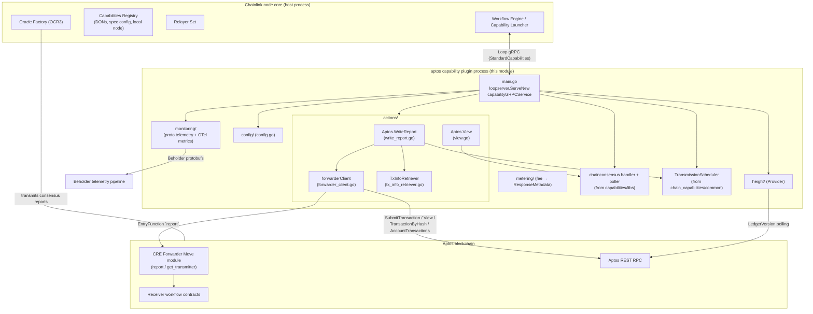

# Chain Capability: Aptos (`chain_capability_aptos`)

## 1. Purpose

`chain_capability_aptos` is the **Aptos chain capability** of the Chainlink Runtime Environment (CRE). It is the Go module `github.com/smartcontractkit/capabilities/chain_capabilities/aptos`, built as a standalone plugin binary that runs next to the Chainlink node and exposes Aptos on-chain functionality to CRE workflows as **standard capabilities**:

| Capability method | Type | What it does |
|---|---|---|
| `WriteReport` | Action (write) | Validates an OCR3-signed consensus report and submits it to the Aptos **CRE Forwarder** Move module, which dispatches it to the receiving workflow contract. Returns the on-chain tx hash, tx status, transaction fee (in octas), receiver-contract execution status and (feature-flagged) block timestamp. |
| `View` | Action (read) | Executes a **consensus-gated read** of a Move module function ("view call") at a pinned ledger version, with the response agreed upon by the DON via the chain-consensus library. |

The capability registers itself as `aptos:ChainSelector:<chainSelector>@1.0.0` (`CapabilityName = "aptos"`, `CapabilityVersion = "1.0.0"` in `main.go`), so a single node can run one plugin process per Aptos chain it serves.

The module is a sibling of the other chain capabilities and shares their infrastructure:

- [chain_capability_evm](chain_capability_evm.md), [chain_capability_solana](chain_capability_solana.md), [chain_capability_stellar](chain_capability_stellar.md) — the other per-chain capability plugins
- [chain_capabilities_common](chain_capabilities_common.md) — shared retry helpers (`WithQuickRetry`/`WithPollingRetry`), OCR3 report-metadata validation, transmission-component parsing, and the `TransmissionScheduler`
- [capabilities_shared_libs](capabilities_shared_libs.md) — the `chainconsensus` request handler/poller/oracle used for consensus-gated reads and transmissions

## 2. How it fits into CRE

The plugin is a **Loop standard-capability process**: it is launched and supervised by the node's capability launcher and communicates with the node core exclusively over gRPC (see [Plugin Process Framework (Loop)](../Plugin_Process_Framework_(Loop)/loop-plugin-core.md)). At start-up the node core injects `StandardCapabilitiesDependencies` (config JSON, `CapabilitiesRegistry`, `RelayerSet`, `OracleFactory`, limits factory), from which the plugin resolves everything it needs:

- **`types.AptosService`** — obtained from the relayer set for the configured network/chain ID; the only component that talks to Aptos RPC (submit tx, view, tx-by-hash, account transactions). The interface and Aptos wire types are defined in the shared foundation libraries — see [types-chains](../Shared_Foundation_Libraries___Domain_Types/types-chains.md).
- **`core.CapabilitiesRegistry`** — used to resolve the node's DON (`DONsForCapability`), the local node identity, and the `p2pToTransmitterMap` spec config when it is not supplied in the JSON config.
- **`core.OracleFactory`** — used to create the OCR3 oracle whose `ContractTransmitter` and reporting-plugin factory are backed by the chain-consensus handler (consensus reports are transmitted *by the node core* on behalf of the plugin).
- **`limits.Factory`** — provides the runtime-bounded limiters for report size, max gas amount, and the block-timestamp feature window (see [settings](../Shared_Foundation_Libraries___Domain_Types/settings.md)).

## 3. Architecture overview



### Package map

| Package | Key files | Responsibility | Detailed docs |
|---|---|---|---|
| `main` | `main.go` | Plugin entry point; Loop gRPC service; `Initialise` wires config → relayer → services → actions | this page (§4) |
| `actions` | `actions.go`, `write_report.go`, `view.go`, `forwarder_client.go`, `tx_info_retriever.go` | The `Aptos` capability service: WriteReport orchestration, View consensus reads, forwarder contract client, post-submission tx forensics | [chain_capability_aptos_actions](chain_capability_aptos/chain_capability_aptos_actions.md) |
| `config` | `config/config.go` | JSON config schema (forwarder address, delta stage, poll periods, p2p→transmitter map, tx-search buffer) | [chain_capability_aptos_config](chain_capability_aptos/chain_capability_aptos_config.md) |
| `monitoring` | `view.proto`, `write_report.proto`, `messages.go`, `metrics.go`, `processor.go` | Beholder protobuf telemetry messages, OTel metric instruments, message builder and processor | [chain_capability_aptos_monitoring](chain_capability_aptos/chain_capability_aptos_monitoring.md) |
| `height` | `height/provider.go` | Polls the Aptos ledger version and exposes it as latest/safe/finalized chain heights for consensus | this page (§5) |
| `metering` | `metering/metering.go` | Converts tx fee (octas) into billing `ResponseMetadata` | this page (§6) |
| `internal/monitoring` | mocks | Generated gomock for the Beholder emitter (tests only) | — |

## 4. Plugin lifecycle (`main.go`)

`main()` serves the capability with `loopserver.ServeNew(CapabilityName, ...)` and wraps it with `aptoscapserver.NewClientServer`, which adapts the generated Aptos capability gRPC contract to the `loop.StandardCapabilities` interface. OTel views from the chain-consensus metrics library are attached via `loop.WithOtelViews(consmetrics.MetricViews())`.

`capabilityGRPCService.Initialise` performs the bootstrap, in order:

1. **Config** — `unmarshalConfig` parses the JSON config into `config.Config` and applies defaults for every zero value: `deltaStage` 10s, `observationPollerWorkersCount` 10, `observationPollPeriod` 2s, `chainHeightPollPeriod` 1s, `unknownRequestsTTL` 10s, `maxUnknownRequestsCacheSize` 1000, `txSearchStartingBuffer` 1m.
2. **Relayer resolution** — builds `types.NewRelayID(cfg.Network, cfg.ChainID)`, fetches the relayer from `dependencies.RelayerSet`, and obtains `relayer.Aptos()` (`types.AptosService`) plus `GetChainInfo`.
3. **Telemetry** — creates `monitoring.NewMetrics()` and `monitoring.NewProcessor(...)` (the Beholder `ProtoProcessor`).
4. **Chain selector** — `setSelector` maps the numeric Aptos chain ID to a chain selector via `chain_selectors.AptosChainIdToChainSelector()` and derives the capability ID `aptos:ChainSelector:<selector>@1.0.0`.
5. **DON resolution** — `ts.InitMyDON` (with the legacy first-match fallback while Aptos does not yet emit `KeyDonID` events, see CRE-4409 comment).
6. **Consensus stack** — creates `poller.NewPoller` (observation workers/period), derives the unknown-request TTL from the registry method timeouts (`capcommon.MaxRequestTimeoutWithMultiplier`), and `chainconsensus.NewHandler`; creates `height.NewProvider` for ledger-version polling.
7. **Oracle** — `dependencies.OracleFactory.NewOracle` with a `LocalConfig` (20s blockchain timeout, 10s transmit timeout, etc.), a `chainconsensus` reporting-plugin factory and a chain-consensus contract transmitter; the oracle is owned and run by the node core.
8. **P2P→transmitter map** — taken from the JSON config if present, otherwise fetched from the on-chain capability registry (`fetchP2PConfig` reads `ConfigForCapability(...).SpecConfig["p2pToTransmitterMap"]`); all addresses are normalized to carry the `0x` prefix. A missing local-node entry only warns (empty `MetaSourceId`).
9. **Message builder** — `monitoring.NewMessageBuilder(chainInfo, capabilityInfo, nodeAddress)`.
10. **Transmission scheduler** — `ts.InitialiseTransmissionScheduler` (permuted round-robin queue order, `DeltaStage` stagger).
11. **Actions** — `actions.NewAptos(...)` constructs the `Aptos` service (forwarder client, limiters for report size / max gas / block-timestamp window).
12. **Start** — height provider, consensus handler, request poller and oracle are started; `Close` tears them down in reverse dependency order.

```mermaid
sequenceDiagram
    participant Host as Node core (host)
    participant Svc as capabilityGRPCService
    participant Rel as Relayer Set
    part as OracleFactory
    participant Act as actions.Aptos

    Host->>Svc: Initialise(config, deps)
    Svc->>Svc: unmarshalConfig + defaults
    Svc->>Rel: Get(relayID) → relayer.Aptos()
    Svc->>Svc: chain selector + capability ID
    Svc->>Host: InitMyDON via CapabilitiesRegistry
    Svc->>Svc: poller + consensus handler + height provider
    Svc->>part: NewOracle(localConfig, plugin factory, transmitter)
    Svc->>Svc: p2pToTransmitterMap (config or capReg)
    Svc->>Act: NewAptos(...)
    Svc-->>Host: started (height, consensus, poller, oracle)
```

## 5. Supporting packages

### `height` — ledger-version provider

`height.Provider` is a small service that polls the Aptos latest ledger version every `ChainHeightPollPeriod` and stores it under a read-write lock. Because Aptos has **single-shot finality**, one value backs `GetLatest()`, `GetSafe()` and `GetFinalized()` of the chain-consensus height interface. Backwards movements are ignored with a warning, and versions that would overflow `int64` are rejected. The height provider is what allows `View` requests to pin reads to a consensus-agreed ledger version.

### `metering` — fee reporting

`metering.GetResponseMetadataWriteReport(feeInOctas, chainSelector)` converts a transaction fee in **octas** into `capabilities.ResponseMetadata`: `SpendValue` carries the legacy APT value (octas / 1e8), `SpendValueInGasUnits` the raw octas, and `SpendUnit` the format `"GAS.<chainSelector>"`. It is used on every WriteReport reply path (see the [actions sub-module](chain_capability_aptos/chain_capability_aptos_actions.md)).

## 6. End-to-end behavior at a glance

- **WriteReport** (`actions/write_report.go`): validate inputs (report metadata vs request metadata, gas bounds, `ForwarderGasOverhead = 4000` floor) → derive the `TransmissionID` → poll the forwarder's transmission state with queue-position-aware stagger → if already on-chain, recover the winning tx hash via `TxInfoRetriever`; otherwise submit via `forwarderClient.InvokeOnReport` and reconcile (success / duplicate / failure attributed to a prior transmitter). Full detail: [chain_capability_aptos_actions](chain_capability_aptos/chain_capability_aptos_actions.md).
- **View** (`actions/view.go`): convert the proto payload, resolve the ledger version against consensus chain height, wrap it as a `chainconsensus.LockableToBlockRequest`, and return the DON-agreed response bytes.
- **Telemetry**: every method emits Beholder protobuf events (`*Initiated`, `*Success`, `*Error`, plus dedicated `WriteReport*` diagnostic events) that are logged as JSON and recorded as OTel metrics. Schemas and instruments: [chain_capability_aptos_monitoring](chain_capability_aptos/chain_capability_aptos_monitoring.md).

## 7. Configuration

The full field reference, JSON unmarshalling behavior (hex forwarder address, optional `p2pToTransmitterMap`) and host-side defaults live in [chain_capability_aptos_config](chain_capability_aptos/chain_capability_aptos_config.md). The config JSON is produced per chain by the node core and passed through `StandardCapabilitiesDependencies.Config`.

## 8. Build, packaging and dependencies

Module manifest (`capabilities/chain_capabilities/aptos/go.mod`) declares the module as part of the `capabilities` Nx workspace. Key direct dependencies:

| Dependency | Role |
|---|---|
| `github.com/aptos-labs/aptos-go-sdk` | Aptos types, BCS serialization, `TransactionPayload`/`EntryFunction`, address handling |
| `github.com/smartcontractkit/chainlink-aptos` | Generated bindings for the CRE Forwarder Move module (`ForwarderEncoder`) |
| `github.com/smartcontractkit/chainlink-common` | capabilities contracts, `AptosService` types, beholder, limits, logger, services |
| `github.com/smartcontractkit/chainlink-protos/cre/go` | CRE SDK protobufs (`sdk.ReportResponse`) |
| `github.com/smartcontractkit/chain-selectors` | Aptos chain ID → chain selector mapping |
| `github.com/smartcontractkit/libocr` | `permutation` for the transmission schedule, OCR2/3 types |
| `capabilities/chain_capabilities/common`, `capabilities/libs` | workspace-internal shared helpers and chain-consensus libs |
| `go.opentelemetry.io/otel{,/metric}` | OTel metric instruments |

Build and packaging notes:

- `capabilities/chain_capabilities/aptos/project.json` defines the Nx targets: `build` cross-compiles a static binary (`CGO_ENABLED=0 GOOS=linux GOARCH=amd64|arm64`) into `capabilities/chain_capabilities/bin/<arch>/aptos`; `generate` runs `go generate ./...` (regenerating `monitoring/*.pb.go` from `view.proto` / `write_report.proto` via `monitoring/generate.go`) plus mockery; additional targets `test`, `race`, `lint` (golangci-lint), `tidy`, and `update-libs` (bump the `capabilities/libs` / `chain_capabilities/common` workspace deps together).
- The plugin depends on `loopserver` as an implicit Nx dependency (`project.json` → `implicitDependencies: ["loopserver"]`), i.e. it is built and released with the Loop plugin framework — see [Plugin_Process_Framework_(Loop)](../Plugin_Process_Framework_(Loop)/loop-plugin-core.md) and the workspace tooling in [capabilities_workspace_tooling](../Build,_CI___Release_Infrastructure/capabilities_workspace_tooling.md).
- Protobuf schemas under `monitoring/` are part of the same generate step and import the shared execution context from `capabilities/libs/monitoring/execution_context.proto` (see [capabilities_shared_libs_monitoring](capabilities_shared_libs/capabilities_shared_libs_monitoring.md)).

## 9. Sub-module documentation

- [chain_capability_aptos_actions](chain_capability_aptos/chain_capability_aptos_actions.md) — the `actions` package: `Aptos` service, WriteReport state machine, View consensus reads, CRE Forwarder client, and the three-phase `TxInfoRetriever`.
- [chain_capability_aptos_config](chain_capability_aptos/chain_capability_aptos_config.md) — the `config` package: JSON schema, forwarder address parsing, and host-applied defaults.
- [chain_capability_aptos_monitoring](chain_capability_aptos/chain_capability_aptos_monitoring.md) — the `monitoring` package: Beholder proto schemas (`view.proto`, `write_report.proto`), message builder, OTel metrics and the processor.
