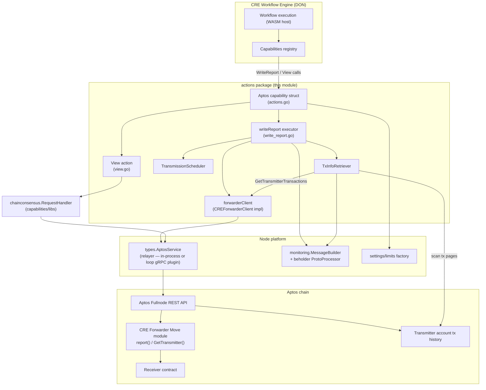
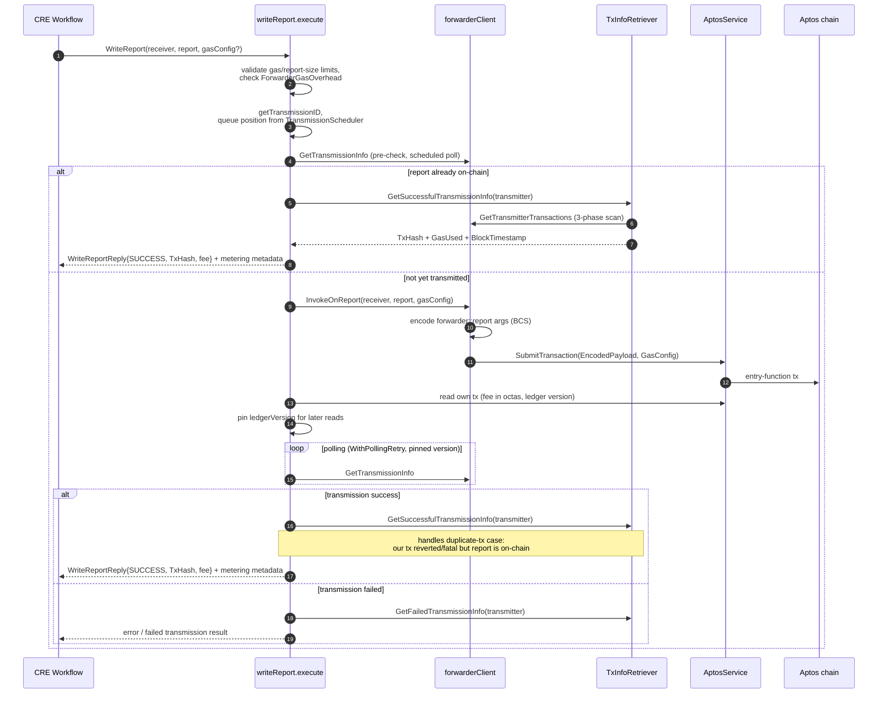
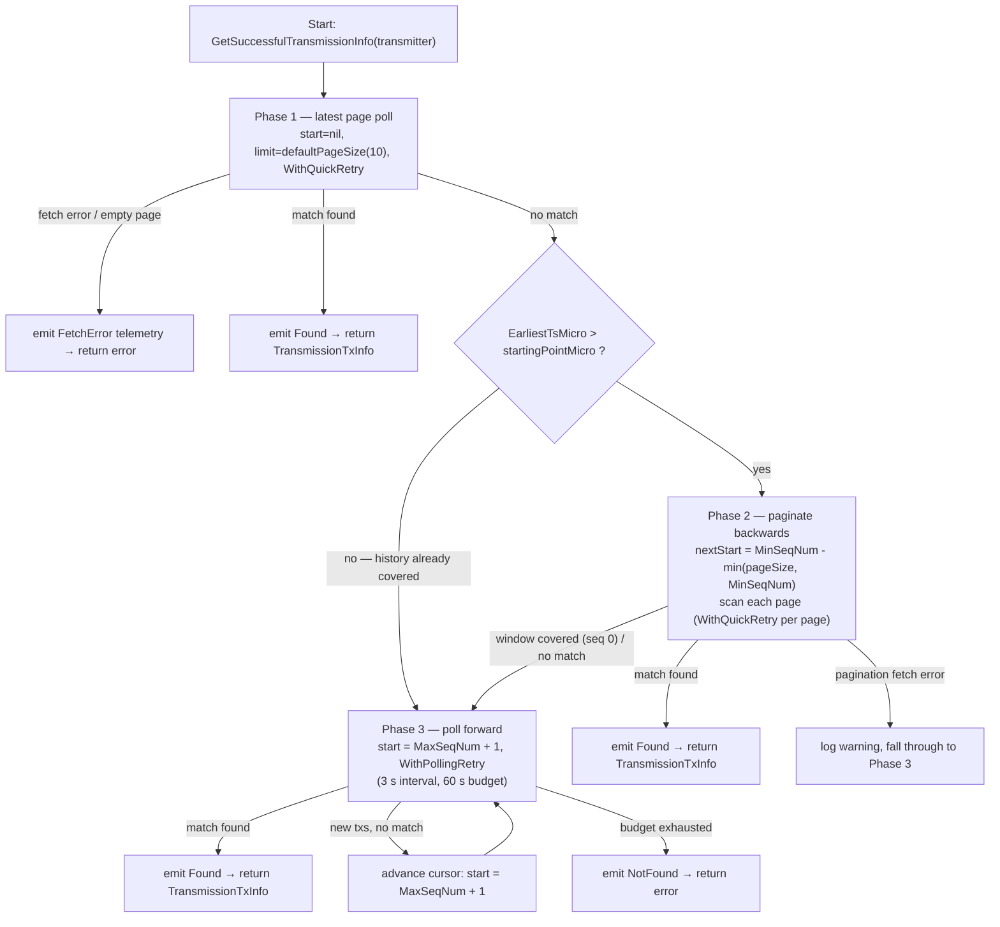

# Aptos Chain Capability — Actions (`chain_capability_aptos/actions`)

## 1. Overview

The **`chain_capability_aptos_actions`** module corresponds to the Go package
`capabilities/chain_capabilities/aptos/actions` (Go module
`github.com/smartcontractkit/capabilities/chain_capabilities/aptos`, see
`capabilities/chain_capabilities/aptos/go.mod`). It implements the **on-chain interaction
layer of the Aptos chain capability** for the Chainlink Runtime Environment (CRE).

Its responsibilities are:

1. **Writing consensus reports on-chain** — building, BCS-encoding and submitting
   `forwarder::report` entry-function transactions to the CRE Forwarder Move module on Aptos
   (`forwarder_client.go`, orchestrated by `write_report.go`).
2. **Reading forwarder transmission state** — resolving *which* DON member successfully
   transmitted a report for a given transmission ID (`GetTransmissionInfo` view calls).
3. **Transaction forensics for metering & idempotency** — scanning a transmitter account's
   history to locate the exact `forwarder::report` transaction (success **or** failure),
   extracting tx hash, gas usage and VM status (`tx_info_retriever.go`).
4. **Chain reads via consensus** — the `View` action performs quorum-validated contract
   reads through the chain-consensus library (`view.go`).

The package is consumed exclusively by the parent Aptos chain capability
([chain_capability_aptos](../chain_capability_aptos.md)), which registers the `Aptos`
capability with the CRE workflow engine.

> **Parent context:** See [chain_capability_aptos](../chain_capability_aptos.md) for the
> capability plugin lifecycle and [chain_capability_aptos_config](chain_capability_aptos_config.md)
> / [chain_capability_aptos_monitoring](chain_capability_aptos_monitoring.md) for
> configuration and telemetry siblings.

---

## 2. Architecture

### 2.1 Component map



### 2.2 External dependencies

| Dependency | Role in this module |
|---|---|
| `chainlink-common/pkg/types` (`AptosService`) | The relayer service used for `SubmitTransaction`, `View` and `AccountTransactions`; the concrete implementation may be in-process or a [loop gRPC relayer plugin](../../Plugin_Process_Framework_(Loop)/loop-relayer-services.md). |
| `chainlink-common/pkg/types/chains/aptos` | Shared Aptos chain types: `SubmitTransactionRequest/Reply`, `ViewRequest/Reply`, `AccountTransactionsRequest`, `Transaction`, `GasConfig`, `ModuleID` (see [types-chains](../../Shared_Foundation_Libraries___Domain_Types/types-chains.md)). |
| `chainlink-common/pkg/capabilities/v2/chain-capabilities/aptos` | Proto request/reply messages (`WriteReportRequest`, `WriteReportReply`, `ViewRequest`, …) that define the capability's wire contract. |
| `chainlink-aptos/bindings/platform/forwarder` | `ForwarderEncoder` — generates BCS-encoded entry-function args and view-call args for the Forwarder contract. |
| `aptos-labs/aptos-go-sdk` (+ `bcs`) | `AccountAddress`, `TransactionPayload`/`EntryFunction`, BCS serialization, relaxed hex address parsing. |
| `chainlink-protos/cre/go/sdk` | `ReportResponse` (report context, raw report, signatures) coming from the workflow runtime. |
| `capabilities/chain_capabilities/common` | `WithQuickRetry` / `WithPollingRetry` helpers, user-error classification, `RequestID` (see [chain_capabilities_common](../chain_capabilities_common.md)). |
| `capabilities/chain_capabilities/common/transmission_schedule` | Deterministic per-node transmission ordering (`TransmissionScheduler`, queue positions). |
| `capabilities/libs/chainconsensus` | Quorum-consensus contract reads used by the `View` action (see [capabilities_shared_libs_chainconsensus](../capabilities_shared_libs/capabilities_shared_libs_chainconsensus.md)). |
| `chainlink-common/pkg/beholder` + `aptos/monitoring` | OTLP telemetry emission of proto messages (see [beholder-telemetry](../../Telemetry___Observability_Platform/beholder-telemetry.md) and [chain_capability_aptos_monitoring](chain_capability_aptos_monitoring.md)). |
| `chainlink-common/pkg/settings/limits` + `cresettings` | Per-workflow limiters: `PerWorkflow.ChainWrite.Aptos.ReportSizeLimit`, `PerWorkflow.ChainWrite.Aptos.GasLimit` (see [settings](../../Shared_Foundation_Libraries___Domain_Types/settings.md)). |

---

## 3. Core components

### 3.1 `CREForwarderClient` — Forwarder contract adapter (`forwarder_client.go`)

An interface that abstracts all Aptos-chain interaction with the CRE Forwarder:

```go
type CREForwarderClient interface {
    InvokeOnReport(ctx, receiver []byte, report *sdk.ReportResponse, gasConfig *aptoscap.GasConfig) (*aptostypes.SubmitTransactionReply, error)
    GetTransmissionInfo(ctx, transmissionID TransmissionID, ledgerVersion *uint64) (TransmissionInfo, error)
    GetTransmitterTransactions(ctx, transmitter aptos_sdk.AccountAddress, start, limit *uint64) ([]*aptostypes.Transaction, error)
}
```

The concrete `forwarderClient` **embeds `types.AptosService`** (so the adapter *is* an
AptosService) and adds a `ForwarderEncoder` built from the configured forwarder address
(`newForwarderClient`). It is constructed once by `NewAptos` using
`config.Config.CREForwarderAddress` (see [chain_capability_aptos_config](chain_capability_aptos_config.md)).

| Method | Behaviour | Underlying chain call |
|---|---|---|
| `InvokeOnReport` | Extracts signatures, concatenates `ReportContext + RawReport` into `fullRawReport`, encodes the `report(receiver, fullRawReport, signatures)` entry function via the encoder, BCS-serializes the `TransactionPayload`, and submits it with the optional `GasConfig` translated to the relayer's `GasConfig` (MaxGasAmount / GasUnitPrice). | `SubmitTransaction` |
| `GetTransmissionInfo` | Encodes `GetTransmitter(receiver, workflowExecutionID, reportID)` as a **view call** (report ID decoded as big-endian `uint16` from the 2-byte `ReportID`). A non-nil `ledgerVersion` **pins the read** to avoid stale-fullnode false negatives; `nil` reads "latest". | `View` |
| `GetTransmitterTransactions` | Pages through a transmitter account's user transactions (`start`/`limit`; `nil, nil` = latest page with default size). | `AccountTransactions` |

**Supporting types:**

- `TransmissionID` — `Receiver` (32-byte address) + `ReportID` ([2]byte) +
  `WorkflowExecutionID` ([32]byte). `GetDebugID()` renders a human-readable identity used
  consistently in logs and telemetry.
- `TransmissionInfo` — `{Success bool, Transmitter AccountAddress}`.
- `moveOptionAddress` — JSON shape of a Move `Option<address>`. Since
  `Option<T>` is `struct { vec: vector<T> }`, the Aptos REST API serializes
  `some(addr)` as `[{"vec": ["0xaddr"]}]` and `none` as `[{"vec": []}]`;
  `GetTransmissionInfo` decodes this explicitly and treats an empty vec as "not yet
  transmitted".

### 3.2 `TxInfoRetriever` — transmission transaction forensics (`tx_info_retriever.go`)

`TxInfoRetriever` answers: *"Did this report transmission already reach the chain, in which
transaction, and what did it cost?"* It scans the transmitter account's transaction history
for a `forwarder::report` call whose arguments match the expected transmission, and returns a
`TransmissionTxInfo`:

```go
type TransmissionTxInfo struct {
    TxHash         string
    GasUsed        uint64   // fee in octas = GasUsed * GasUnitPrice
    GasUnitPrice   uint64
    MaxGasAmount   uint64
    VMStatus       string
    BlockTimestamp uint64   // micros since Unix epoch
}
```

This data feeds both the **reply to the workflow** (tx hash, fee, block timestamp) and the
**metering metadata** (`metering.GetResponseMetadataWriteReport`, see
[metering-and-billing](../../Shared_Foundation_Libraries___Domain_Types/metering-and-billing.md)).

**Matching rules** (`scanTransactions` + `matchesTransmissionByReport`):

1. Unmarshal the raw tx JSON into the local `userTxData` struct (uppercase keys — see §3.3).
2. Filter by success/failure status (`expectedSuccessValue`).
3. Unmarshal the payload into `entryFunctionPayload` and match
   `Inner.Function == "<forwarderAddress>::forwarder::report"`.
4. Match arguments: `arg[0]` must equal the expected receiver address, `arg[1]` must equal
   `hex(ReportContext ‖ RawReport)` — i.e. *exactly what this node would have submitted*.

While scanning, the retriever also tracks `MinSeqNum`, `MaxSeqNum` and `EarliestTsMicro` per
page, which drive pagination.

**Search algorithms:**

- `GetSuccessfulTransmissionInfo` — **three-phase** search (see §5.2):
  1. *Latest-page poll* — fetch the most recent page (`limit = defaultPageSize = 10`,
     chosen from RPC latency benchmarks) with `WithQuickRetry`; empty results are retried as
     a likely RPC error.
  2. *Backward pagination* — walk older pages (`paginateBackwards`) until the scanned
     window covers `startingPointMicro` (see §3.3), guaranteeing the transaction cannot be
     missed; stops on match, empty page, or sequence number 0.
  3. *Forward polling* — poll forward starting at `MaxSeqNum + 1` with
     `WithPollingRetry`, advancing the cursor past each scanned batch so transactions
     arriving *between* phases cannot slip out of a sliding window.
- `GetFailedTransmissionInfo` — **two-phase** variant (latest-page poll + backward
  pagination), with no forward-polling phase: if our own transmission failed the transmitting
  node may be down, so the caller must not block indefinitely.

**Retry primitives** (from `capabilities/chain_capabilities/common/helpers.go`):

| Helper | Parameters | Used for |
|---|---|---|
| `WithQuickRetry` | 10 s timeout · 1 s interval · 10 attempts | Phase-1 latest-page fetches and each backward page |
| `WithPollingRetry` | 60 s timeout · 3 s interval · 25 attempts | Phase-3 forward polling; post-submission transmission-state polling in `write_report.go` |

**Monitoring option** — `WithTxInfoRetrieverMonitoring(beholderProcessor, messageBuilder,
telemetryContext)` wires phase-level telemetry (§6). Telemetry is emitted for every phase
transition with phase, result (`Found` / `NotFound` / `FetchError`), duration, tx hash,
transmitter and lookup type (`SuccessfulTransmission` / `FailedTransmission`).

### 3.3 Deliberate JSON/encoding details

- **`userTxData`** — the Aptos Go SDK's `UserTransaction` type implements a custom
  `UnmarshalJSON` expecting the *REST-API* format (lowercase keys, string-encoded numbers),
  which is incompatible with `json.Marshal` output. The local `userTxData` struct matches the
  Go-default JSON output (uppercase keys, numeric types) instead, because transactions are
  round-tripped through mocks/marshalling in this code path. `Timestamp` is int64 micros
  (matches `time.UnixMicro`); negative timestamps are skipped defensively.
- **`entryFunctionPayload`** — minimal projection of the payload JSON
  (`Inner.Function`, `Inner.Arguments`) used for matching only.
- **`receiverAddressesEqual`** — Aptos APIs may omit leading zero hex digits of addresses
  (e.g. `0x0447…` is returned as `0x4476…`). Both sides are therefore parsed with
  `ParseStringRelaxed` before comparison. This guards a real incident where nodes 1–9 failed
  to match node 0's successful `WriteReport` transaction because of a missing leading zero.

---

## 4. Supporting members of the `actions` package

Although the module's core components live in `forwarder_client.go` and
`tx_info_retriever.go`, the package also contains the capability orchestration that drives
them:

- **`actions.go` — `Aptos` struct** (`NewAptos`): assembles the capability from
  `config.Config`, the `AptosService`, the chain-consensus handler, the monitoring
  `MessageBuilder`, a beholder `ProtoProcessor`, a limits factory and a
  `TransmissionScheduler`. It instantiates the `forwarderClient` and initializes the
  per-workflow limiters (report size, max gas amount, block-timestamp active range).
- **`write_report.go` — `WriteReport`**: validates inputs against limits, rejects
  `MaxGasAmount < ForwarderGasOverhead` (4000 units — gas consumed by the forwarder before
  dispatching to the receiver, measured ~2,093 units on testnet), computes the
  `TransmissionID`, then executes the flow in §5.1.
- **`view.go` — `View`**: converts the proto payload, resolves the ledger version from chain
  height, wraps the read in a `chainconsensus.LockableToBlockRequest` and returns the
  quorum-validated result.
- **`transmission_scheduler.go` — `TransmissionScheduler`**: derives each node's queue
  position from the DON member ordering and the `p2pConfig` (peer ID → transmitter address)
  so transmissions are staged deterministically (`deltaStage`).

---

## 5. Key flows

### 5.1 `WriteReport` end-to-end



Two idempotency mechanisms cooperate here:

- **On-chain dedupe** — the forwarder records transmissions per `TransmissionID`; a duplicate
  submission reverts, and the code detects this (`TxReverted`/`TxFatal` + `Success=true`) and
  returns the *original* successful tx's hash and fee, emitting a
  `WriteReportDuplicateTx` telemetry event.
- **Off-chain dedupe** — the pre-submission `GetTransmissionInfo` poll (timed by queue
  position) short-circuits submission entirely when another member already transmitted.

### 5.2 Transmission transaction search (`GetSuccessfulTransmissionInfo`)



`GetFailedTransmissionInfo` runs only Phases 1–2 with `expectedSuccessValue = false`
and returns "no matching failed transaction found" without a forward-polling phase.

---

## 6. Telemetry & monitoring

The actions package is heavily instrumented via Beholder proto events defined in
`capabilities/chain_capabilities/aptos/monitoring/write_report.proto`
(generated Go code + `MessageBuilder` live in the
[chain_capability_aptos_monitoring](chain_capability_aptos_monitoring.md) module):

| Message | Emitted when |
|---|---|
| `WriteReportInitiated` / `WriteReportSuccess` / `WriteReportError` | Around every `WriteReport` call (`isUserError` flag distinguishes caller mistakes). |
| `WriteReportTxInfoRetrievalPhase` | Per retrieval phase: `phase` (`LastPagePoll`/`BackwardPoll`/`LatestPagePoll`), `result` (`Found`/`NotFound`/`FetchError`), `phase_duration_ms`, `tx_hash`, `transmitter`, `lookup_type` (`SuccessfulTransmission`/`FailedTransmission`). |
| `WriteReportInvokeOnReportDuration` | Inclusion latency, measured to the transaction's on-chain **block timestamp** rather than to when the submit call returned (excludes TxManager poll-loop overshoot). |
| `WriteReportDuplicateTx` | Our tx reverted/fatal but the report was already on-chain (includes duplicate and successful tx hashes). |
| `WriteReportTxFeeCalculationError` | Own-transaction fee lookup failed (metering falls back to zero). |
| `WriteReportTransmitterMismatch`, `WriteReportSuccessfulEarlyReturn`, `WriteReportP2pConfigIncomplete` | Diagnostic edge cases around transmitter ordering. |

All events carry a `monitoring.ExecutionContext` (workflow/execution metadata) and are
emitted through the `beholder.ProtoProcessor` (see
[beholder-telemetry](../../Telemetry___Observability_Platform/beholder-telemetry.md)).
The `view.proto` schema covers the analogous `ViewInitiated` / `ViewSuccess` / `ViewError`
events for the read path.

---

## 7. Configuration, limits & build

- **Module boundaries** — the Aptos chain capability is an independent Go module
  (`capabilities/chain_capabilities/aptos/go.mod`, `go 1.27.1`) within the `capabilities`
  pnpm/nx workspace (`capabilities/go.mod`, `capabilities/nx.json`). Sibling chain modules
  (`evm`, `solana`, `stellar`) follow the same layout — compare
  [chain_capability_evm](../chain_capability_evm.md).
- **Capability configuration** — forwarder address (`CREForwarderAddress`) and the tx-search
  window (`TxSearchStartingBuffer`) come from the sibling
  [chain_capability_aptos_config](chain_capability_aptos_config.md) module; the search
  starting point is `requestStartTime − TxSearchStartingBuffer`, i.e. "anything before this
  is not relevant" for tx lookup.
- **Runtime limits** — report size and gas limits are read from
  `cresettings.Default.PerWorkflow.ChainWrite.Aptos.*` via the `settings/limits` factory
  (see [settings](../../Shared_Foundation_Libraries___Domain_Types/settings.md)); exceeding
  them is classified as a **user error** by `capabilities/chain_capabilities/common`.
- **Code generation** — proto messages (`monitoring/*.proto`) and mockery mocks
  (`test_cre_forwarder_client_mock.go`) are generated with `make generate` /
  `make mockery` / `make protoc` in `capabilities/Makefile`
  (`PROTOC_GEN_GO_VERSION=1.36.10`, `MOCKERY_VERSION=2.53.7`), and module bumps across
  chain capabilities are handled by `make update-chain-capabilities`
  (`capabilities/script/update-chain-capabilities.sh`).

---

## 8. Testing

Unit tests co-locate with the code: `forwarder_client` behaviour is exercised through the
generated `CREForwarderClient` mock (`test_cre_forwarder_client_mock.go`), while
`tx_info_retriever_test.go`, `write_report_test.go`, `view_test.go` and
`transmission_scheduler_test.go` cover the search phases, matching rules (including the
leading-zero address case), limit enforcement and scheduling. End-to-end verification of the
Aptos capability in a full CRE environment is covered by the
[system-tests](../../Dev,_Test___Simulation_Environments/system-tests.md) module
(`chainlink/system-tests/lib/cre/features/aptos`).

---

## 9. Operational notes & known pitfalls

1. **Pinned ledger version reads** — after submitting, the node resolves its own
   transaction's ledger version and pins all subsequent `GetTransmissionInfo` reads to it.
   Reading at `>= V_ours` avoids *stale-fullnode false negatives* (a fullnode that has not
   yet indexed our transaction reporting "not transmitted").
2. **Forwarder gas overhead** — `MaxGasAmount` below `ForwarderGasOverhead` (4000) is
   rejected up front: such transactions fail before reaching the receiver contract.
3. **Leading-zero addresses** — always compare Aptos addresses via relaxed parsing, never by
   raw hex string equality (see §3.3).
4. **Page-size assumption** — the 3-phase search assumes an account submits few transactions
   between rounds (`defaultPageSize = 10`); phase 3's advancing cursor compensates for
   bursts.
5. **Duplicate-tx economics** — a duplicate submission is *expected* to revert on-chain; the
   code keys on the forwarder's transmission state rather than tx status to decide success,
   and reports metering for the original successful transaction (zero-fee fallback if a
   fatal duplicate is observed).

---

## 10. Related documentation

- [chain_capability_aptos](../chain_capability_aptos.md) — parent module: capability
  plugin, `main.go` wiring, metering and height provider.
- [chain_capability_aptos_config](chain_capability_aptos_config.md) — `config.Config`
  (forwarder address, tx-search buffer).
- [chain_capability_aptos_monitoring](chain_capability_aptos_monitoring.md) — proto
  schemas, `MessageBuilder`, metrics.
- [chain_capabilities_common](../chain_capabilities_common.md) — retry helpers, user-error
  classification, transmission schedule.
- [capabilities_core](../capabilities/capabilities_core.md) — the capability interfaces
  (`ExecutableAndTriggerCapability`, `ResponseAndMetadata`) implemented by chain
  capabilities.
- [capabilities_shared_libs_chainconsensus](../capabilities_shared_libs/capabilities_shared_libs_chainconsensus.md)
  — consensus read framework used by the `View` action.
- [types-chains](../../Shared_Foundation_Libraries___Domain_Types/types-chains.md) —
  `AptosService` and `chains/aptos` type definitions.
- [loop-relayer-services](../../Plugin_Process_Framework_(Loop)/loop-relayer-services.md)
  — how `AptosService` may be served over the loop gRPC plugin boundary.
- [chain_capability_evm](../chain_capability_evm.md),
  [chain_capability_solana](../chain_capability_solana.md),
  [chain_capability_stellar](../chain_capability_stellar.md) — sibling chain capabilities
  with parallel structure.
- [Workflow & Capability Runtime (CRE Engine)](../../Workflow___Capability_Runtime_(CRE_Engine).md)
  — top-level context for capability registration and workflow execution.
