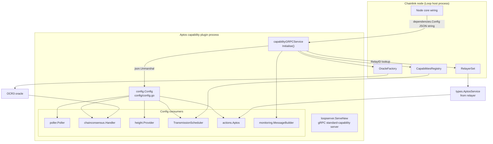
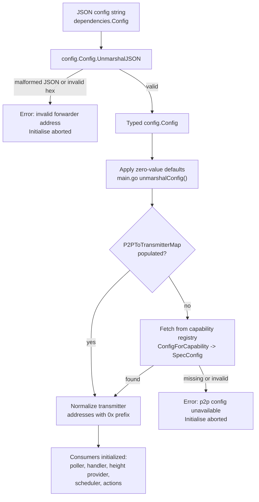
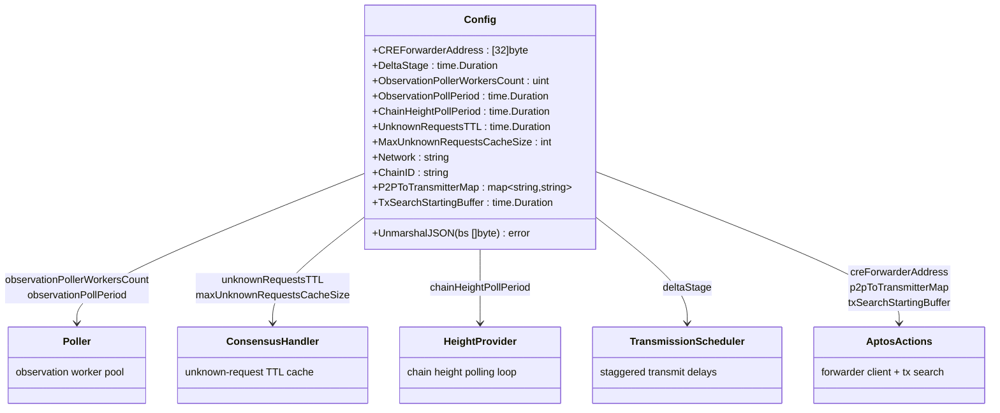

# chain_capability_aptos_config

The `chain_capability_aptos_config` module defines the **configuration contract** for the Aptos chain capability plugin of the Chainlink Runtime Environment (CRE). It lives in a single, dependency-light Go package:

- Source: `capabilities/chain_capabilities/aptos/config/config.go`
- Go module: `github.com/smartcontractkit/capabilities/chain_capabilities/aptos` (see `capabilities/chain_capabilities/aptos/go.mod`)

Its only exported type, `Config`, is the typed representation of the JSON configuration string that the node core hands to the Aptos capability plugin during `Initialise()`. It also owns the custom JSON deserialization logic — most notably hex-decoding and validating the CRE Forwarder account address on Aptos — and therefore is the first (and strictest) validation gate the capability's configuration passes through.

For the capability itself (triggers, actions, consensus, oracle wiring), see [chain_capability_aptos](../chain_capability_aptos.md). This page focuses exclusively on the config package and everything that flows out of it.

---

## Role in the Aptos capability lifecycle

The Aptos capability is a Loop plugin: a standalone process that exposes gRPC standard capabilities to the node core (see [loop-plugin-core](../../Plugin_Process_Framework_(Loop)/loop-plugin-core.md)). Its lifecycle is:

1. `main.go` starts a gRPC server via `loopserver.ServeNew("aptos", ...)`.
2. The node core calls `Initialise(ctx, dependencies)` with a **raw JSON config string** in `dependencies.Config`.
3. `capabilityGRPCService.unmarshalConfig` decodes that string into this module's `config.Config`, applies zero-value defaults, and uses the result to construct every runtime component of the capability.

Because every downstream subsystem (poller, consensus handler, height provider, transmission scheduler, chain actions) is parameterized from this single struct, the config package is the de-facto *schema definition* of the Aptos capability.



---

## Configuration contract

### Fields

| Go field | JSON key | Go type | Default (applied by `main.go`) | Description |
|---|---|---|---|---|
| `CREForwarderAddress` | `creForwarderAddress` | `[32]byte` (hex string in JSON, with or without `0x` prefix) | none — **required, validated** | 32-byte Aptos account address of the CRE Forwarder module. Decoded via `aptos_sdk.ConvertToAddress`. |
| `DeltaStage` | `deltaStage` | `time.Duration` | `10s` (`defaultDeltaStage`) | Staggered transmission scheduling delay per queue position. |
| `ObservationPollerWorkersCount` | `observationPollerWorkersCount` | `uint` | `10` | Worker-pool size for the observation request poller. |
| `ObservationPollPeriod` | `observationPollPeriod` | `time.Duration` | `2s` | Polling interval for observation requests. |
| `ChainHeightPollPeriod` | `chainHeightPollPeriod` | `time.Duration` | `1s` | Polling interval of the chain-height provider. |
| `UnknownRequestsTTL` | `unknownRequestsTTL` | `time.Duration` | `10s` (then derived via `MaxRequestTimeoutWithMultiplier`) | Base TTL for the consensus handler's unknown-request cache. |
| `MaxUnknownRequestsCacheSize` | `maxUnknownRequestsCacheSize` | `int` | `1000` | Capacity bound for the unknown-request cache. |
| `Network` | `network` | `string` | — | Network name; combined with `ChainID` into a `types.RelayID` for relayer lookup. |
| `ChainID` | `chainId` | `string` | — | Aptos chain ID (decimal string). Parsed to `uint64` and mapped to a chain selector via `chain_selectors.AptosChainIdToChainSelector()`. |
| `P2PToTransmitterMap` | `p2pToTransmitterMap` (optional) | `map[string]string` | — (fallback fetch, see below) | Maps peer-ID hex strings → Aptos transmitter account addresses. |
| `TxSearchStartingBuffer` | `txSearchStartingBuffer` | `time.Duration` | `1m` | Lookback buffer when searching for a transaction hash after submission. |

Notes:

- Duration fields follow standard `encoding/json` semantics for `time.Duration`: they are JSON **numbers of nanoseconds** (e.g. `10s` = `10000000000`).
- `ChainID` is a JSON *string*, not a number — the capability parses it and converts it into a chain selector during `Initialise` to derive the capability ID `aptos:ChainSelector:<n>@1.0.0`.
- Unlike the Solana and EVM configs, the Aptos config has **no `isLocal` flag** and no per-chain trigger settings; its chain-specific surface is the transmitter map and the tx-search buffer.

### Example configuration

```json
{
  "creForwarderAddress": "0x9a7f...",
  "deltaStage": 10000000000,
  "observationPollerWorkersCount": 10,
  "observationPollPeriod": 2000000000,
  "chainHeightPollPeriod": 1000000000,
  "unknownRequestsTTL": 10000000000,
  "maxUnknownRequestsCacheSize": 1000,
  "network": "aptos-mainnet",
  "chainId": "2",
  "p2pToTransmitterMap": {
    "<peer-id-hex>": "0x<transmitter-account-address>"
  },
  "txSearchStartingBuffer": 60000000000
}
```

---

## JSON deserialization (`UnmarshalJSON`)

`Config` implements a custom `UnmarshalJSON` using the common **shadow-struct pattern** (the same approach used by the Solana config in `capabilities/chain_capabilities/solana/config/config.go`):

1. An unexported `config` struct mirrors all fields, with every field carrying its JSON tag and `CREForwarderAddress` typed as a raw `string` (hex, `0x` prefix optional).
2. The raw payload is unmarshalled into the shadow struct.
3. All plain fields are copied field-by-field into the exported `Config`.
4. The forwarder address string is converted with `aptos_sdk.ConvertToAddress` and stored as a fixed `[32]byte`. A failure produces a wrapped error:

   ```
   invalid forwarder address %q: %w
   ```

Key behavior:

- **Validation, not defaults.** The package validates the address format but deliberately does *not* fill in zero-value defaults; that responsibility belongs to `capabilityGRPCService.unmarshalConfig` in `capabilities/chain_capabilities/aptos/main.go`, which logs each substitution (e.g. `ObservationPollPeriod is zero, setting to 2s`).
- **Fail-fast.** A deserialization error (malformed JSON or an invalid forwarder address) aborts `Initialise` before any component is constructed — the capability never runs with a partially-specified config.



---

## Config consumers and field flow

Every field is consumed exactly once, at a well-defined point in `Initialise`:



### Consumer details

| Consumer | Created with | Fields used |
|---|---|---|
| `poller.NewPoller` | `capabilities/libs/chainconsensus/poller` | `ObservationPollerWorkersCount`, `ObservationPollPeriod` |
| `chainconsensus.NewHandler` | `capabilities/libs/chainconsensus` | `UnknownRequestsTTL` (first passed through `capcommon.MaxRequestTimeoutWithMultiplier`, see [chain_capabilities_common](../chain_capabilities_common.md)), `MaxUnknownRequestsCacheSize` |
| `height.NewProvider` | `capabilities/chain_capabilities/aptos/height` | `ChainHeightPollPeriod` |
| `ts.InitialiseTransmissionScheduler` | `capabilities/chain_capabilities/common/transmission_schedule` | `DeltaStage` (zero → 10s default) |
| `actions.NewAptos` | `capabilities/chain_capabilities/aptos/actions` (see [chain_capability_aptos_actions](chain_capability_aptos_actions.md)) | `CREForwarderAddress` (builds the `CREForwarderClient` and `forwarderAddress`), `TxSearchStartingBuffer`, `P2PToTransmitterMap` |
| `monitoring.NewMessageBuilder` | `capabilities/chain_capabilities/aptos/monitoring` (see [chain_capability_aptos_monitoring](chain_capability_aptos_monitoring.md)) | `P2PToTransmitterMap` — resolves the local node's transmitter address (used as `MetaSourceId`) |
| Relay/capability identity | `types.NewRelayID`, `chain_selectors` | `Network`, `ChainID` |

### `p2pToTransmitterMap` sourcing

The transmitter map is the only field with a **dual-source resolution strategy**:

1. **Inline (preferred).** If `p2pToTransmitterMap` is present in the JSON config, it is used directly. Values are normalized to include a `0x` prefix so they match addresses read from chain.
2. **Registry fallback.** If absent, `Initialise` calls `ConfigForCapability` on the capability registry over gRPC and extracts the `p2pToTransmitterMap` key from the capability's `SpecConfig`. A missing key, wrong type, or failed fetch aborts startup.

This map underpins the deterministic transmission order (peer queue positions in the [TransmissionScheduler](chain_capability_aptos_actions.md)), transmitter-mismatch detection, and telemetry attribution — which is why the monitoring schemas define dedicated messages such as `WriteReportTransmitterMismatch` and `WriteReportP2pConfigIncomplete` (`capabilities/chain_capabilities/aptos/monitoring/write_report.proto`).

---

## Comparison with sibling chain-capability configs

All chain capabilities follow the same config-package convention, making new chain integrations predictable. The closest relatives are:

| Concern | Aptos (this module) | [EVM](../chain_capability_evm.md) | [Solana](../chain_capability_solana.md) |
|---|---|---|---|
| Forwarder address | `creForwarderAddress` → `[32]byte` (validated via aptos-go-sdk) | `creForwarderAddress` (string) | `creForwarderAddress` + `creForwarderState` (`solana.PublicKey`) |
| Chain identity | `network` + `chainId` (string) | `chainId` (uint64) + `network` | `network` + `chainId` |
| Consensus/observation settings | workers, poll period, height poll period, TTL, cache size | same set | same set (no height poll period) |
| Transmission scheduling | `deltaStage` | `deltaStage` | `deltaStage` |
| Chain-specific extras | `p2pToTransmitterMap`, `txSearchStartingBuffer` | log-trigger settings, `forwarderLookbackBlocks`, `receiverGasMinimum`, `nodeAddress`, `isLocal` | `readsEnabled`, `transmitter`, `isLocal` |
| Custom `UnmarshalJSON` | Yes (address decoding) | No | Yes (shadow struct) |

Shared concerns (limits, request-timeout derivation, transmission scheduling primitives) live in the [chain_capabilities_common](../chain_capabilities_common.md) module, and the capability interfaces consumed by this plugin (`types.AptosService`, `RelayerSet`, `RelayID`) are defined in [types-core](../../Shared_Foundation_Libraries___Domain_Types/types-core.md).

---

## Dependencies

Per `capabilities/chain_capabilities/aptos/go.mod`, the config package itself depends only on:

- `encoding/json`, `fmt`, `time` (standard library)
- `github.com/aptos-labs/aptos-go-sdk` — `ConvertToAddress` for forwarder-address decoding

The wider module additionally requires `chainlink-common`, `chain-selectors`, `chainlink-aptos`, `libocr`, and the `capabilities/libs` workspace modules — these are consumed by the config's *users*, not by the config package itself. The module is part of the `capabilities/` Go workspace; build and code-generation targets (`protoc`, `gomods`, `tidy`) are provided by `capabilities/Makefile`, with per-project metadata in `capabilities/chain_capabilities/aptos/project.json`.

---

## Testing

Unit tests for the deserialization and default-handling behavior live alongside the package in `capabilities/chain_capabilities/aptos/config/config_test.go` and `capabilities/chain_capabilities/aptos/main_test.go` (which exercises `unmarshalConfig` defaults). End-to-end coverage of the Aptos capability — including config-driven startup against a local Aptos node — is maintained by the CRE system tests' `aptos` feature suite ([system-tests](../../Dev,_Test___Simulation_Environments/system-tests.md)).

---

## Related documentation

- [chain_capability_aptos](../chain_capability_aptos.md) — parent module: full Aptos chain capability architecture
- [chain_capability_aptos_actions](chain_capability_aptos_actions.md) — primary consumer: forwarder client, tx-info retrieval, write-report
- [chain_capability_aptos_monitoring](chain_capability_aptos_monitoring.md) — telemetry schemas referencing transmitter configuration
- [capabilities](../capabilities.md) — capability model (`CapabilityInfo`, request metadata) shared by all capabilities
- [chain_capabilities_common](../chain_capabilities_common.md) — shared transmission scheduling and request-timeout derivation
- [chain_capability_evm](../chain_capability_evm.md) / [chain_capability_solana](../chain_capability_solana.md) / [chain_capability_stellar](../chain_capability_stellar.md) — sibling chain capabilities
- [types-core](../../Shared_Foundation_Libraries___Domain_Types/types-core.md) — `AptosService`, `Relayer`, `RelayerSet` interfaces
- [loop-plugin-core](../../Plugin_Process_Framework_(Loop)/loop-plugin-core.md) — plugin process lifecycle that delivers the config
