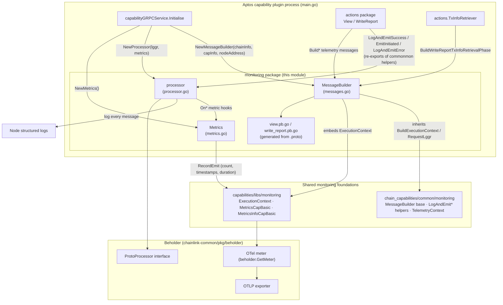
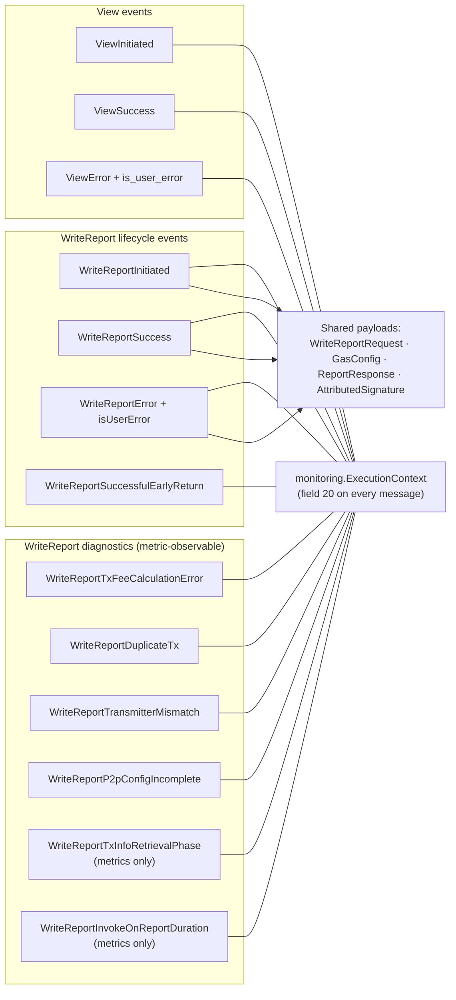
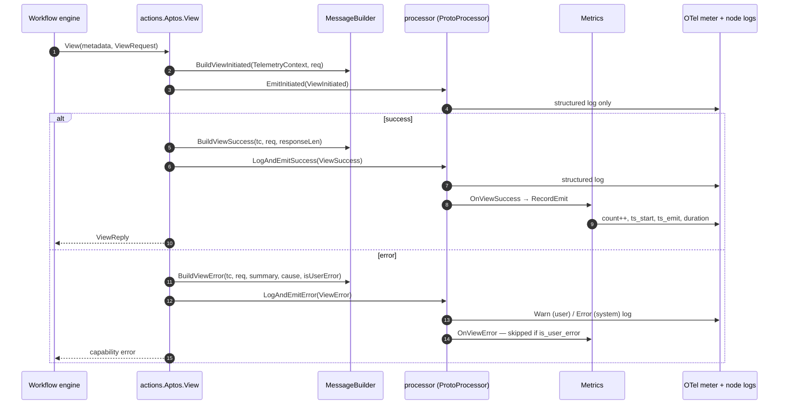
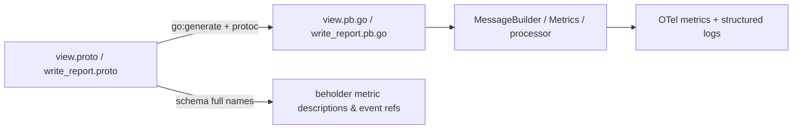

# Aptos Chain Capability — Monitoring (`chain_capability_aptos_monitoring`)

## Overview

The `chain_capability_aptos_monitoring` module provides the **telemetry schema and dispatch runtime** for observing the [Aptos chain capability](../chain_capability_aptos.md). It defines two protobuf schemas — `view.proto` and `write_report.proto` — that describe every observable event of the capability's `View` and `WriteReport` operations, plus a small Go runtime that converts those messages into structured logs and OpenTelemetry (OTel) metrics.

**Module location:** `capabilities/chain_capabilities/aptos/monitoring/` (own Go module, see `capabilities/chain_capabilities/aptos/go.mod`)

| Core Component | File | Role |
|---|---|---|
| `view.proto` | `capabilities/chain_capabilities/aptos/monitoring/view.proto` | Telemetry events for on-chain `View` (read) calls |
| `write_report.proto` | `capabilities/chain_capabilities/aptos/monitoring/write_report.proto` | Telemetry events for on-chain `WriteReport` (report transmission) calls |
| `view.pb.go` / `write_report.pb.go` | same directory (generated) | Go bindings produced by `protoc` via `go:generate` |
| `MessageBuilder` | `messages.go` | Converts live runtime data into monitoring-safe proto messages |
| `Metrics` | `metrics.go` | OTel instrument registry (`apt_capability_*` counters, gauges, histograms) |
| `processor` / `NewProcessor` | `processor.go` | Implements `beholder.ProtoProcessor`; dispatches each message to logs and/or metrics |

### Design principles

1. **Schema-first telemetry** — every event is a protobuf message in the `chain_capabilities.aptos` package. The proto schema doubles as the telemetry contract (event names, payload shape) and drives metric descriptions through `beholder.ToSchemaFullName`.
2. **Privacy-minimized request capture** — `ViewRequest` "intentionally captures only the small, non-sensitive subset of the capability request that is useful for monitoring" (module address, module name, function, optional requested ledger version). No arguments, results, or credentials are recorded.
3. **User-vs-system error separation** — error messages carry `is_user_error`. User mistakes (bad input) are logged as warnings and excluded from system-health metrics; infrastructure failures increment metrics and log as errors.
4. **Shared execution context** — every message embeds a common `monitoring.ExecutionContext` at field `20` (fields 1–19 are reserved for event-specific data), giving every log line and metric a uniform chain/workflow/capability identity.
5. **Shared foundations** — the module builds on the cross-chain monitoring library documented in [capabilities_shared_libs_monitoring](../capabilities_shared_libs/capabilities_shared_libs_monitoring.md) and the chain-capability helpers in [chain_capabilities_common](../chain_capabilities_common.md).

---

## Architecture

The `processor` satisfies the `ProtoProcessor` interface (`Process(ctx, proto.Message, attrKVs...) error`) declared in `chainlink-common/pkg/beholder/proto_emitter.go`. Actions do **not** call `Metrics` directly — they build messages and hand them to the processor via the shared `LogAndEmitSuccess` / `EmitInitiated` / `LogAndEmitError` helpers (re-exported in `processor.go` from `chain_capabilities/common/monitoring`). This keeps emission points declarative and dispatch rules centralized.

### Relation to sibling chain capabilities

The Aptos monitoring module follows the same schema-plus-processor pattern as the other chain capabilities. Each has its own `monitoring/` package with a `write_report.proto` and operation-specific schemas:

- EVM: `log_trigger.proto`, `read_actions.proto`, `write_report.proto` — see [chain_capability_evm](../chain_capability_evm.md)
- Solana: `log_trigger.proto`, `write_report.proto` — see [chain_capability_solana](../chain_capability_solana.md)
- Stellar: `read_contract.proto`, `write_report.proto` — see [chain_capability_stellar.md](../chain_capability_stellar.md)

Changes to the shared execution context or metric conventions are coordinated through [capabilities_shared_libs_monitoring](../capabilities_shared_libs/capabilities_shared_libs_monitoring.md) and the v2 capability tooling ([MonitoringLabels](../capabilities/capabilities_v2_tooling.md)).

---

## Telemetry message schema

### `view.proto` — View (on-chain read) events

Imported from `libs/monitoring/execution_context.proto`; every event carries `execution_context` at field `20`.

| Message | Fields | Emitted when |
|---|---|---|
| `ViewRequest` | `module_address` (bytes), `module_name`, `function`, `requested_ledger_version` (optional uint64) | Embedded in the events below — non-sensitive request summary only |
| `ViewInitiated` | `req`, `execution_context` | Start of every `View` call |
| `ViewSuccess` | `req`, `response_len`, `execution_context` | View completed; only the response *length* is recorded |
| `ViewError` | `req`, `summary`, `cause`, `is_user_error`, `execution_context` | View failed (user input error or system error) |

### `write_report.proto` — WriteReport (report transmission) events

| Message | Fields | Emitted when |
|---|---|---|
| `WriteReportInitiated` | `req` (`WriteReportRequest`), `execution_context` | Start of every `WriteReport` call |
| `WriteReportSuccess` | `req`, `execution_context` | Report published / already on-chain and resolved |
| `WriteReportError` | `req`, `summary`, `cause`, `isUserError`, `execution_context` | Validation or submission failure |
| `WriteReportTxFeeCalculationError` | `req`, `summary`, `cause`, `tx_hash`, `execution_context` | Post-submit fee lookup failed (metering falls back to 0) |
| `WriteReportDuplicateTx` | `req`, `duplicate_tx_hash`, `successful_tx_hash`, `execution_context` | This node's tx reverted because the report was already on-chain |
| `WriteReportSuccessfulEarlyReturn` | `execution_context` only | Transmission already successful, no action needed |
| `WriteReportTransmitterMismatch` | `transmitter`, `ordered_transmitters` (repeated), `execution_context` | Successful transmitter is not in the expected ordered list |
| `WriteReportP2pConfigIncomplete` | `position`, `execution_context` | Node's position/transmitter configuration is incomplete |
| `WriteReportTxInfoRetrievalPhase` | `phase`, `result`, `phase_duration_ms`, `tx_hash`, `transmitter`, `lookup_type`, `execution_context` | Per-phase timing of transaction-hash lookups (from `TxInfoRetriever`) |
| `WriteReportInvokeOnReportDuration` | `duration_ms`, `tx_status`, `execution_context` | Submission→inclusion latency, measured to the tx's on-chain block timestamp |

Shared payload messages (sanitized mirrors of the [actions](chain_capability_aptos_actions.md) request types):

| Message | Fields |
|---|---|
| `WriteReportRequest` | `receiver` (bytes), `gas_config` (optional `GasConfig`), `report` (`ReportResponse`) |
| `GasConfig` | `max_gas_amount`, `gas_unit_price` |
| `ReportResponse` | `config_digest`, `seq_nr`, `report_context`, `raw_report`, `sigs` (repeated `AttributedSignature`) |
| `AttributedSignature` | `signature`, `signer_id` |

### Message taxonomy

> **Schema note:** the error flag is named `is_user_error` (snake_case) in `view.proto` but `isUserError` (camelCase) in `write_report.proto`. Both generate the same `GetIsUserError()` accessor in Go, but raw JSON/schema consumers must account for the difference.

### Shared `ExecutionContext`

Defined once in `capabilities/libs/monitoring/execution_context.proto` (package `monitoring`) and embedded by every event:

| Group | Fields |
|---|---|
| Source | `meta_source_id` (node transmitter address) |
| Chain | `meta_chain_family_name`, `meta_chain_id`, `meta_network_name`, `meta_network_name_full` |
| Workflow | `meta_workflow_id`, `meta_workflow_owner`, `meta_workflow_execution_id`, `meta_workflow_name`, `meta_workflow_don_id`, `meta_workflow_don_config_version`, `meta_reference_id` |
| Capability | `meta_capability_type`, `meta_capability_id`, `meta_capability_timestamp_start`, `meta_capability_timestamp_emit` |

---

## Runtime components

### `MessageBuilder` (messages.go)

A thin Aptos wrapper embedding the common `MessageBuilder` from `chain_capabilities/common/monitoring`, constructed in `main.go` with the relayer's `types.ChainInfo`, the `capabilities.CapabilityInfo`, and the local node's transmitter address (used as `meta_source_id`). It provides:

- `Build*` factories for every event, injecting a shared `TelemetryContext` (start timestamp + `capabilities.RequestMetadata`) into the `ExecutionContext`.
- **Sanitizing converters** that map the capability's proto request types (`aptoscap.ViewRequest`, `aptoscap.WriteReportRequest`) into the minimal monitoring representations: `convertViewRequest`, `convertWriteReportRequest`, `convertGasConfig`, `convertAttributedSignature` (from `chainlink-protos/cre/go/sdk`).
- `LogAttributes()` / `MetricAttributes()` implementations on each generated message:
  - **Metric attributes** (low cardinality, Prometheus-safe): the ExecutionContext chain/workflow/capability subset with empty values replaced by `"unknown"` (`ValOrUnknown`, see `metadata.go`) plus event-specific keys (`phase`, `result`, `lookup_type`, `tx_status`).
  - **Log attributes** (high cardinality allowed): everything above plus `source_id`, `workflow_id`, `workflow_owner`, `workflow_execution_id`, hex-decoded `workflow_name`, `workflow_don_config_version`, `reference_id`, and a composite `request_id` (`<workflow_execution_id>:<reference_id>`), plus message-specific fields such as `receiver` (hex) or `duplicate_tx_hash`.

### `Metrics` (metrics.go)

All instruments are created from the Beholder OTel meter (`beholder.GetMeter()`) with names prefixed by the `ns()` helper: **`apt_capability_<event>`**. Nine events use the shared `MetricsCapBasic` bundle; two diagnostic events use bespoke instruments:

| Instrument | Type | Unit | Events |
|---|---|---|---|
| `apt_capability_<event>_count` | Int64Counter | — | view_success, view_error, write_report_success, write_report_error, write_report_duplicate_tx, write_report_tx_fee_calculation_error, write_report_successful_early_return, write_report_transmitter_mismatch, write_report_p2p_config_incomplete |
| `apt_capability_<event>_cap_timestamp_start` | Int64Gauge | ms | same nine events |
| `apt_capability_<event>_cap_timestamp_emit` | Int64Gauge | ms | same nine events |
| `apt_capability_<event>_cap_duration` | Int64Histogram | ms | same nine events (`ts.emit − ts.start`) |
| `apt_capability_write_report_tx_info_retrieval_phase_count` | Int64Counter | — | tx-info retrieval phases, by `lookup_type`/`phase`/`result` |
| `apt_capability_write_report_tx_info_retrieval_phase_duration_ms` | Int64Histogram | ms | same |
| `apt_capability_write_report_invoke_on_report_duration_ms` | Int64Histogram | ms | submission→block-inclusion duration, by `tx_status` |

The basic bundle is instantiated via `NewMetricsInfoCapBasic` / `NewMetricsCapBasic` from the shared library, whose instrument descriptions are derived from the protobuf schema full names — keeping metrics and schema in lockstep.

### `processor` (processor.go)

`NewProcessor(lggr, metrics)` returns a `beholder.ProtoProcessor` that dispatches messages by concrete type:

| Message(s) | Structured log | Metrics | Notes |
|---|---|---|---|
| `ViewInitiated`, `WriteReportInitiated` | ✅ (`[Aptos Monitoring]`) | — | lifecycle start, log-only |
| `ViewSuccess`, `WriteReportSuccess` | ✅ | `MetricsCapBasic` | |
| `ViewError`, `WriteReportError` | ✅ (Warn if user error, else Error) | `MetricsCapBasic` — **skipped when `is_user_error`** | keeps caller mistakes out of system-health metrics |
| `WriteReportTxFeeCalculationError`, `WriteReportDuplicateTx`, `WriteReportSuccessfulEarlyReturn`, `WriteReportTransmitterMismatch`, `WriteReportP2pConfigIncomplete` | ✅ | `MetricsCapBasic` | system-level diagnostics |
| `WriteReportTxInfoRetrievalPhase` | — | phase count + phase duration histogram | metric-only (avoids log spam per lookup phase) |
| `WriteReportInvokeOnReportDuration` | — | duration histogram | metric-only |
| *anything else* | — | — | returns `nil` — forward compatible with new message types |

Messages are logged as proto-JSON (`protojson` with `UseProtoNames`/`EmitUnpopulated`) unmarshalled into a map, tagged with the message descriptor name as `entity_name`. Metric failures are wrapped and returned so callers can log the dispatch failure.

---

## Telemetry flow

### View call

### WriteReport diagnostics

The [actions](chain_capability_aptos_actions.md) layer emits the diagnostic events at precise points of the transmission pipeline (`actions/write_report.go`):

- `WriteReportInitiated` at entry; `WriteReportError` on validation failure or submission failure.
- `WriteReportInvokeOnReportDuration` after `InvokeOnReport` returns, computed from the transaction's **on-chain block timestamp** (skipped when no timestamp is available).
- `WriteReportTxFeeCalculationError` when the post-submit fee lookup fails (metering falls back to zero fee).
- `WriteReportDuplicateTx` when the node's own tx reverted but transmission info shows the report already on-chain.
- `WriteReportTransmitterMismatch` from `logIfSuccessfulTransmitterNotInOrderedList` when the winning transmitter is unexpected.
- `WriteReportTxInfoRetrievalPhase` from `TxInfoRetriever` (wired via `WithTxInfoRetrieverMonitoring`) for each hash-lookup phase.
- `WriteReportSuccessfulEarlyReturn` / `WriteReportP2pConfigIncomplete` in the transmission-scheduler and consensus paths.

---

## Build and code generation

- `monitoring/generate.go` carries the `go:generate` directives:
  `protoc --proto_path=../../../ --go_out=paths=source_relative:../../../ --go-grpc_out=paths=source_relative:../../../ chain_capabilities/aptos/monitoring/{view,write_report}.proto`
- The capabilities workspace `capabilities/Makefile` wires this up: the `protoc` target installs protoc 29.3 (`capabilities/script/install-protoc.sh`) and `protoc-gen-go` v1.36.10, and `make generate` runs `go generate ./...` across all modules.
- Generated bindings use `option go_package = "github.com/smartcontractkit/capabilities/chain_capabilities/aptos;monitoring"`, placing both schemas in one Go package so the processor can type-switch over them.
- Module dependencies (see `capabilities/chain_capabilities/aptos/go.mod`): `chainlink-common` (beholder, logger, capabilities types), `chainlink-protos/cre/go` (SDK `AttributedSignature`), `go.opentelemetry.io/otel` + `otel/metric`, and `google.golang.org/protobuf`. See [capabilities workspace tooling](../../Build,_CI___Release_Infrastructure/capabilities_workspace_tooling.md) for the overall build setup.

---

## Integration and wiring

In `capabilities/chain_capabilities/aptos/main.go`, `capabilityGRPCService.Initialise`:

1. Resolves the relayer and `types.ChainInfo` for the configured Aptos chain.
2. Creates `monitoring.NewMetrics()` and `monitoring.NewProcessor(logger, metrics)` — failure here aborts startup.
3. Resolves the local node's transmitter address from `p2pToTransmitterMap` (JSON config, falling back to the on-chain capability registry) and constructs `monitoring.NewMessageBuilder(chainInfo, capInfo, nodeAddress)`. An empty address triggers a warning and an empty `meta_source_id`.
4. Passes the builder and processor into `actions.NewAptos(...)`, which forwards them to `TxInfoRetriever` and the write-report executor.

Monitoring is scoped to the plugin process — the same `Metrics`/`processor` instances serve all views and writes of that chain. Metering (billing spend) is a **separate** concern handled by the sibling `metering` package and is intentionally not part of this module.

Exported telemetry flows into the node's OTel pipeline; see the [Telemetry & Observability Platform](../../Telemetry___Observability_Platform.md), specifically [Beholder telemetry](../../Telemetry___Observability_Platform/beholder-telemetry.md) for the exporter, and [CHIP ingress](../../Telemetry___Observability_Platform/chip-ingress.md) for upstream ingestion.

---

## Related documentation

- Parent module: [chain_capability_aptos](../chain_capability_aptos.md)
- Sibling sub-modules: [chain_capability_aptos_actions](chain_capability_aptos_actions.md) · [chain_capability_aptos_config](chain_capability_aptos_config.md)
- Sibling chain capabilities: [chain_capability_evm](../chain_capability_evm.md) · [chain_capability_solana](../chain_capability_solana.md) · [chain_capability_stellar](../chain_capability_stellar.md)
- Shared helpers: [chain_capabilities_common](../chain_capabilities_common.md) · [capabilities_shared_libs_monitoring](../capabilities_shared_libs/capabilities_shared_libs_monitoring.md) · [capabilities_v2_tooling](../capabilities/capabilities_v2_tooling.md)
- Runtime & capability framework: [Workflow & Capability Runtime (CRE Engine)](../../Workflow___Capability_Runtime_(CRE_Engine).md) · [capabilities](../capabilities.md)
- Observability: [Telemetry & Observability Platform](../../Telemetry___Observability_Platform.md)
