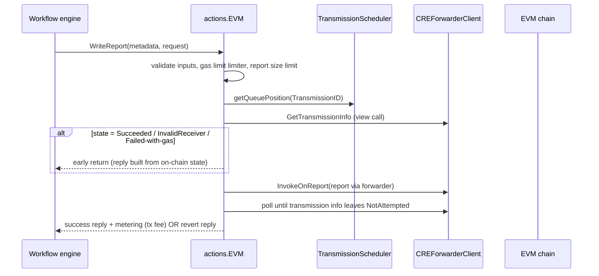
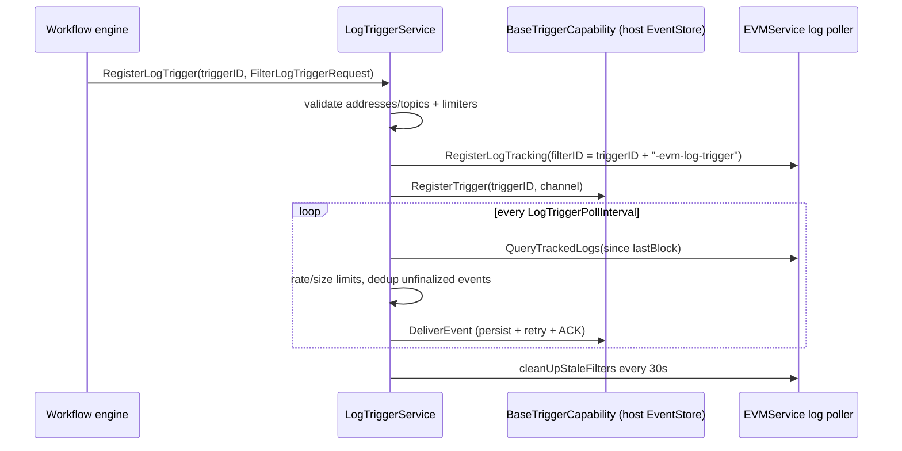
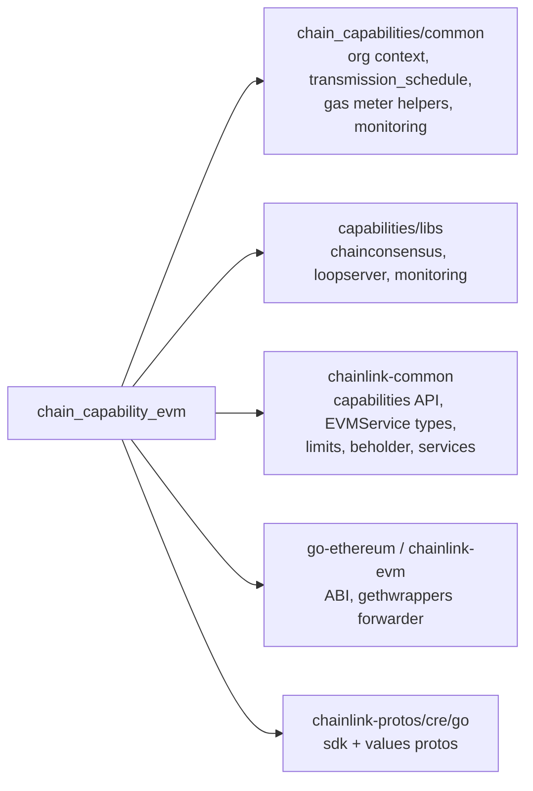

# EVM Chain Capability (`chain_capability_evm`)

## Overview

The **EVM Chain Capability** is a standalone Go module (`capabilities/chain_capabilities/evm`) that packages EVM blockchain interaction as a **Chain Capability plugin** for the Chainlink Capability Runtime (CRE). It is distributed as a separate **Loop plugin process** (a gRPC-plugin binary served through `loopserver.ServeNew`) so that the EVM logic — and its `go-ethereum` dependency tree — is isolated from the node core while still exposing a standard capabilities API to the workflow engine.

The capability is registered under the ID `evm` (version `1.0.0`) and provides three families of functionality to workflow executions:

| Family | Functionality | Implementation |
|---|---|---|
| **Chain reads** | `CallContract`, `FilterLogs`, `BalanceAt`, `EstimateGas`, `GetTransactionByHash`, `GetTransactionReceipt`, `HeaderByNumber` — with DON-wide consensus over results | [actions](chain_capability_evm/chain_capability_evm_actions.md) |
| **Chain writes** | `WriteReport` — reliably transmits signed OCR3 reports through the on-chain **CRE Forwarder** contract, with deduplication, gas-budget retries, and per-DON transmission scheduling | [actions](chain_capability_evm/chain_capability_evm_actions.md) |
| **Log triggers** | `RegisterLogTrigger` / `UnregisterLogTrigger` / `AckEvent` — polls EVM logs via the log poller and delivers events reliably to workflows | [trigger](chain_capability_evm/chain_capability_evm_trigger.md) |

All operations are metered (spend credits / gas fees), limited per-workflow, and emit structured telemetry.

## Role in the CRE Engine

The EVM chain capability is one of several per-chain capabilities under the [Workflow & Capability Runtime (CRE Engine)](../Workflow___Capability_Runtime_(CRE_Engine).md) module tree, alongside its siblings [chain_capability_aptos](chain_capability_aptos.md), [chain_capability_solana](chain_capability_solana.md), and [chain_capability_stellar](chain_capability_stellar.md). It shares cross-chain plumbing (org context, transmission scheduling, gas metering, telemetry envelope) with [chain_capabilities_common](chain_capabilities_common.md) and consensus primitives from [capabilities_shared_libs](capabilities_shared_libs.md).

```mermaid
flowchart LR
    subgraph CRE Host (chainlink node)
        WF[Workflow Engine] -->|gRPC capability calls| LS[Loop Server]
        RS[RelayerSet] -->|types.EVMService| EVMS
        OF[OracleFactory] -->|NewOracle| ORA[OCR3 Oracle]
        TES[TriggerEventStore]
        CR[CapabilityRegistry]
    end

    subgraph evm plugin process (this module)
        LS --> CAPS[capabilityGRPCService]
        CAPS --> ACT[actions.EVM]
        CAPS --> TRG[LogTriggerService]
        CAPS --> HGT[height.Provider]
        ORA -->|ReportingPluginFactory + Transmitter| CH[chainconsensus Handler]
        CH --> HGT
        CH <--> ACT
        ACT --> FWD[CREForwarderClient]
        TRG --> EVMS
        FWD --> EVMS
        ACT & TRG & FWD --> MON[monitoring + metering]
    end

    EVMS -->|RPC| EVM[(EVM Chain)]
    FWD -->|report\(\) tx via forwarder| FWDADDR[CRE Forwarder contract]
    CH -->|OCR3 reports| OCR[(OCR3 Contract)]
```

## Architecture

The module is composed of a bootstrap/runtime layer plus four functional packages. Each is documented in its own page:

```mermaid
flowchart TB
    subgraph runtime[Plugin Runtime & Bootstrap]
        MAIN[main.go — capabilityGRPCService]
        CFG[config.Config]
        MOD[go.mod — separate Go module]
    end

    subgraph capability[Capability API surface]
        ACT[actions — reads + WriteReport]
        TRG[trigger — LogTriggerService]
    end

    subgraph infra[Support Infrastructure]
        FWD[internal/contracts — CRE Forwarder client]
        MON[monitoring — telemetry + metrics]
        MET[metering — spend accounting]
        HGT[height — block-height poller]
    end

    MAIN -->|Initialise\(\) wires| ACT
    MAIN --> TRG
    MAIN --> HGT
    MAIN -->|unmarshalConfig| CFG
    ACT --> FWD
    ACT --> MON
    ACT --> MET
    TRG --> MON
    FWD --> MON
```

### Package map

| Path | Responsibility | Documentation |
|---|---|---|
| `main.go`, `config/config.go`, `go.mod`, `height/` | Plugin bootstrap, config parsing/defaults, lifecycle wiring, block-height polling service | [chain_capability_evm_plugin_runtime](chain_capability_evm/chain_capability_evm_plugin_runtime.md) |
| `actions/actions.go`, `actions/write_report.go` | Read actions with hash-based/eventually-consistent consensus; `WriteReport` transmission state machine | [chain_capability_evm_actions](chain_capability_evm/chain_capability_evm_actions.md) |
| `trigger/trigger.go`, `trigger/store.go` | Log trigger registration, polling, limits, reliable delivery, stale-filter cleanup | [chain_capability_evm_trigger](chain_capability_evm/chain_capability_evm_trigger.md) |
| `internal/contracts/cre_forwarder.go` | ABI codec + client for the on-chain Keystone CRE Forwarder (`report()`, `getTransmissionInfo()`, `ReportProcessed` events) | [chain_capability_evm_forwarder_contracts](chain_capability_evm/chain_capability_evm_forwarder_contracts.md) |
| `monitoring/` (protos, processor, messages, metrics), `metering/metering.go` | Protobuf telemetry events, Beholder/OTel metrics pipeline, spend-credit accounting | [chain_capability_evm_monitoring](chain_capability_evm/chain_capability_evm_monitoring.md) |

## Key flows

### 1. Write report (chain write)

`WriteReport` is the most intricate flow. It implements an idempotent transmission state machine so that a DON of nodes can jointly publish an OCR3 report exactly-once through the CRE Forwarder:



Details, the `TransmissionState` semantics, and error classification (user vs system) are covered in [chain_capability_evm_actions](chain_capability_evm/chain_capability_evm_actions.md) and [chain_capability_evm_forwarder_contracts](chain_capability_evm/chain_capability_evm_forwarder_contracts.md).

### 2. Log trigger



See [chain_capability_evm_trigger](chain_capability_evm/chain_capability_evm_trigger.md) for the store schema, limiters, and delivery semantics.

### 3. Consensus-based chain reads

Reads that need agreement across the capability DON (block-height-relative calls, and all reads when the hash-based OCR feature window is active) route through the shared `chainconsensus` handler (see [capabilities_shared_libs](capabilities_shared_libs.md)):

- **V1 path** — `LockableToBlock` requests lock execution to a specific block; `EventuallyConsistent` requests converge on any node's answer.
- **V2 path** — hash-based OCR requests are aggregated through `ReadHashableRequestReport` using the module's `height.Provider` and the OCR3 oracle created via the host's `OracleFactory` (`NewReportingPluginFactory` + `NewContractTransmitter` from `capabilities/libs/chainconsensus/oracle`).

The `height.Provider` polls latest/safe/finalized headers and enforces the invariant `finalized <= safe <= latest` for the consensus layer.

## Configuration reference

The plugin receives a single JSON blob (parsed into `config.Config` by `unmarshalConfig` in `main.go`). Key fields:

| Field | Purpose | Default when zero |
|---|---|---|
| `ChainID`, `Network` | Target chain; used to build a `RelayID` and look up the relayer in the `RelayerSet` and the chain selector | — (required) |
| `CREForwarderAddress` | On-chain address of the Keystone CRE Forwarder (hex; validated) | — (required) |
| `ReceiverGasMinimum` | Minimum gas the receiver contract must get to process a forwarded report | — (required > 0) |
| `ForwarderLookbackBlocks` | Blocks to search back for `ReportProcessed` events | `100` |
| `LogTriggerPollInterval` | Log-poller polling cadence | must be ≥ 0 |
| `LogTriggerSendChannelBufferSize` | Delivery channel buffer | `1000` |
| `LogTriggerLimitQueryLogSize` | Max logs per query (must be ≤ send buffer) | `1000` |
| `ObservationPollerWorkersCount` / `ObservationPollPeriod` | Consensus observation polling | `10` / `2s` |
| `ChainHeightPollPeriod` | Height provider cadence | `1s` |
| `UnknownRequestsTTL` / `MaxUnknownRequestsCacheSize` | Consensus handler unknown-request cache | `10s` / `1000` |
| `DeltaStage` | Enables the transmission scheduler when > 0 (staggered per-node transmission slots) | scheduling disabled |
| `NodeAddress` | Node identity stamped into telemetry | — |
| `IsLocaL` | Local/integration-test mode (skips transmission-scheduler init for log triggers) | — |

Per-workflow ceilings (payload sizes, gas limits, log-trigger filter sizes, rate limits, feature activation windows such as hash-based OCR and EVM write-report L1 fee) come from the host-injected `limits.Factory` bound to `cresettings.Default` — see [settings](../Shared_Foundation_Libraries___Domain_Types/settings.md).

## Observability and metering

Every operation emits a protobuf telemetry trio (`Initiated`, `Success`, `Error`) defined in `monitoring/*.proto` and enriched with a shared `ExecutionContext` (chain family/ID, DON ID, workflow execution ID, capability timestamps). The `processor` dispatches messages to Beholder logs and OTel metrics (`evm_capability_*`), with dedicated histogram buckets for read latency and special events for duplicate transmissions, invalid transmission states, insufficient-gas retries, and dropped trigger events. User-origin errors are logged but not counted as system error metrics.

Metering assigns spend credits per read action (unit `RPC_EVM`) and reports write-report fees as `GAS.<chainSelector>` using the actual transaction fee from the revert/success receipt. Full message catalogs, metric names, and the processor dispatch table are documented in [chain_capability_evm_monitoring](chain_capability_evm/chain_capability_evm_monitoring.md).

## Dependencies



- **[chain_capabilities_common](chain_capabilities_common.md)** — `capcommon` error helpers, org-context delivery, gas meter (`WithPollingRetry`), the `transmission_schedule` scheduler (`DeltaStage`-driven queue positions), and the shared monitoring `MessageBuilder`.
- **[capabilities_shared_libs](capabilities_shared_libs.md)** — `chainconsensus` handler/oracle/poller used for read consensus; `loopserver` used by `main.go`; shared `ExecutionContext` proto.
- **[Plugin Process Framework (Loop)](../Plugin_Process_Framework_(Loop).md)** — the plugin-process hosting mechanism (`loopserver.ServeNew`, gRPC capability server, OTEL views registration).
- **[Shared Foundation Libraries & Domain Types](../Shared_Foundation_Libraries___Domain_Types.md)** — `types.EVMService`, `evmtypes`, query primitives, `limits`/`cresettings`, Beholder, logger/services primitives.
- **Operational suite** — the forwarder contract itself is deployed via [CRE & Keystone Deployment Suite](../CRE___Keystone_Deployment_Suite/cre-forwarder.md); end-to-end behaviour is exercised in [capabilities integration tests](../Dev,_Test___Simulation_Environments/capabilities_integration_tests.md).

## Build, generation and tooling

- The module is an independent Go module (`go.mod`, `go 1.27.1`) within the Nx-managed `capabilities` pnpm/Go workspace, which orchestrates lint (`capabilities/.golangci.yml`), Sonar analysis, and per-module targets (`capabilities/nx.json`).
- The protobuf telemetry messages (`monitoring/*.proto`) are generated with protoc via the workspace `make generate` / `make protoc` targets (`capabilities/Makefile`); `monitoring/generate.go` contains the `go:generate` directives, and mockery mocks live under `internal/monitoring/mocks`.
- Version pinning/updating of chain-capability modules across the workspace is automated by `make update-chain-capabilities` (`capabilities/script/update-chain-capabilities.sh`).

## Testing

- Unit tests co-located with packages (`actions/`, `trigger/`, `metering/`, `height/`), including a `tickerFactory` seam that lets trigger tests mock time.
- `monitoring/monitoring_test.go` verifies the processor dispatch table, legacy + generic metric emission, and latency-bucket views using a manual OTel `MetricReader` and a no-op Beholder client; `ProcessorMock` is reused by actions tests.
- `main_test.go` covers configuration unmarshalling/defaults and `Initialise` wiring against a mocked `RelayerSet`; `test/test_utils.go` provides shared fixtures.
- Cross-module integration coverage (multi-node consensus, forwarder deployment) lives in the [Dev, Test & Simulation Environments](../Dev,_Test___Simulation_Environments.md) tree.
