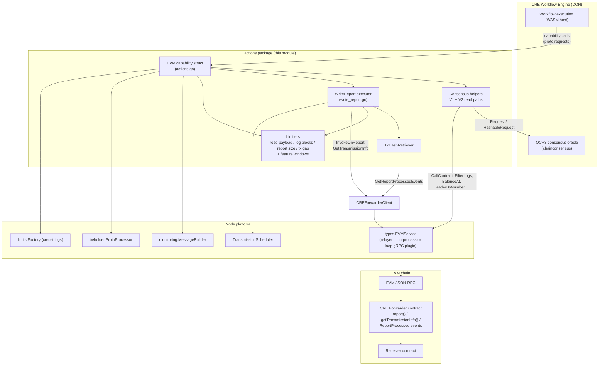
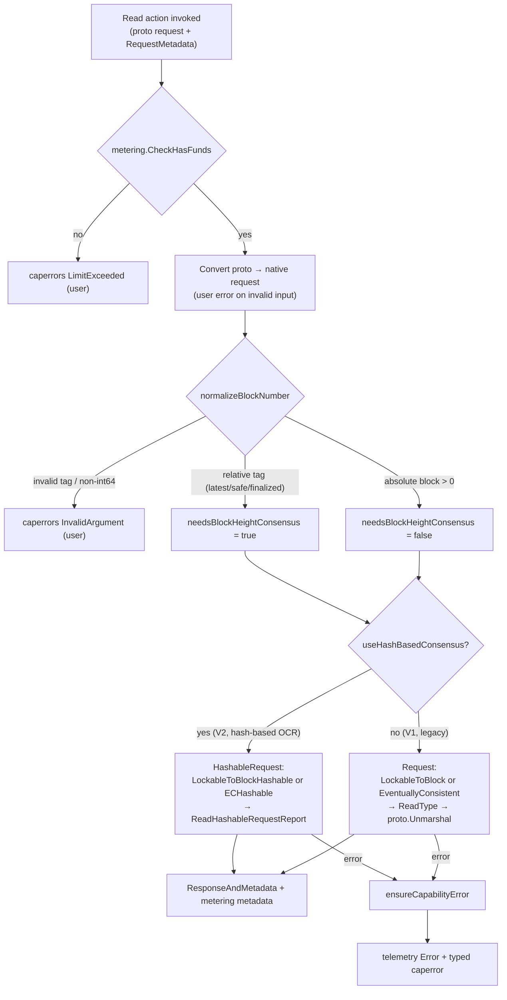
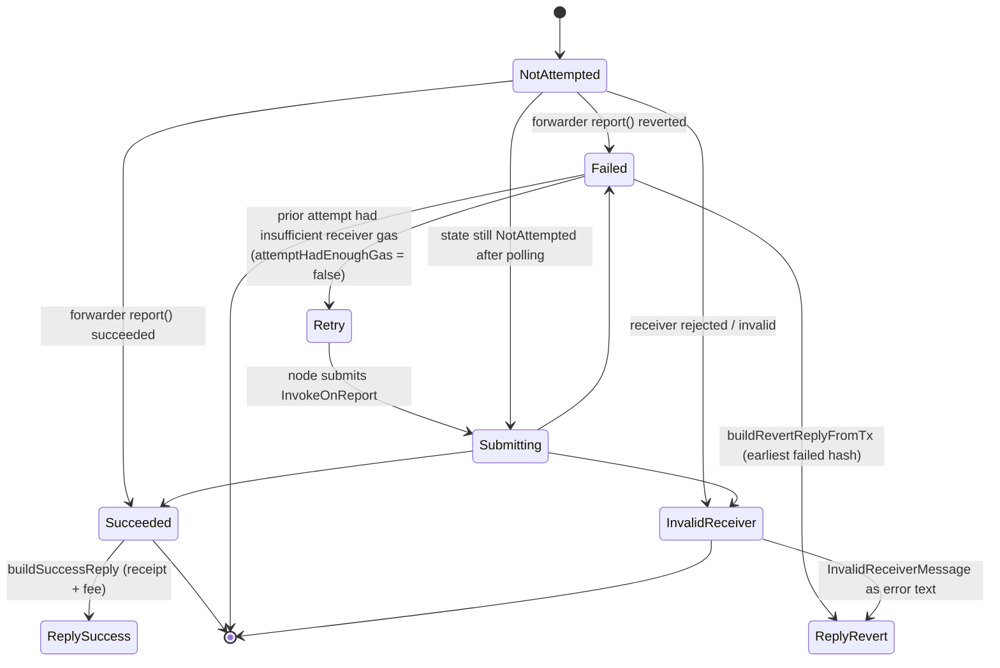
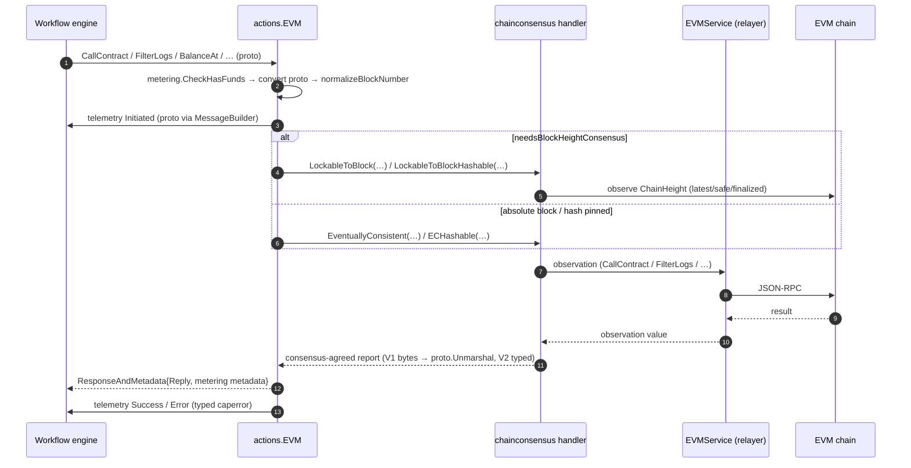
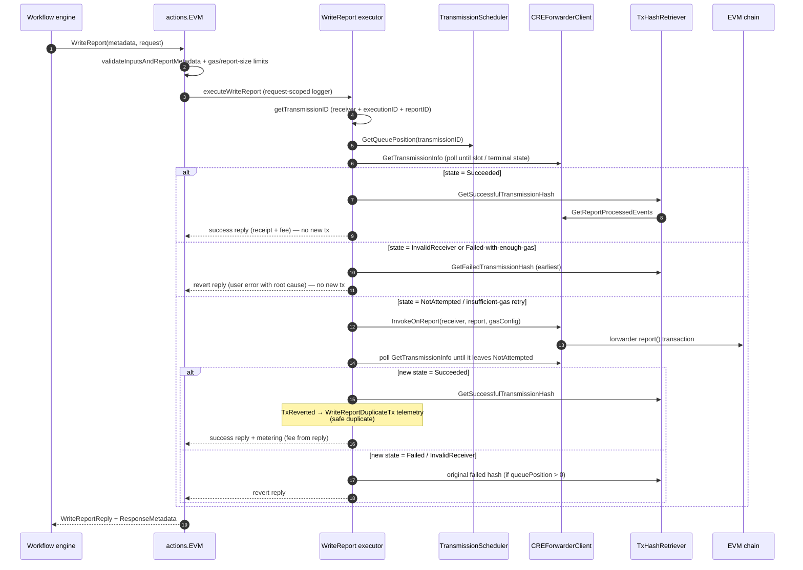

# EVM Chain Capability — Actions (`chain_capability_evm/actions`)

## 1. Overview

The **`chain_capability_evm_actions`** module corresponds to the Go package
`capabilities/chain_capabilities/evm/actions` (Go module
`github.com/smartcontractkit/capabilities/chain_capabilities/evm`, see
`capabilities/chain_capabilities/evm/go.mod`). It implements the **on-chain interaction
layer of the EVM chain capability** for the Chainlink Runtime Environment (CRE).

The package is not registered with the workflow engine directly. It is compiled into the
parent plugin process ([chain_capability_evm](../chain_capability_evm.md)), whose `main.go`
exposes `capabilityGRPCService` — the registered capability — over the host→plugin gRPC
boundary (`loopserver.ServeNew`). Workflow calls therefore flow: workflow → Loop server
(host) → `capabilityGRPCService` (plugin) → `actions.EVM` / `LogTriggerService`; this package
implements the capability logic that `capabilityGRPCService` dispatches to. Bootstrap, config
parsing and wiring of `capabilityGRPCService` are documented in
[chain_capability_evm_plugin_runtime](chain_capability_evm_plugin_runtime.md).

Its responsibilities are:

1. **Consensus-based chain reads** — `CallContract`, `FilterLogs`, `BalanceAt`,
   `EstimateGas`, `GetTransactionByHash`, `GetTransactionReceipt` and `HeaderByNumber`
   (`actions.go`, orchestrated by the `EVM` struct). Every read result is agreed across the
   capability DON through the shared chain-consensus library before it is returned to the
   workflow.
2. **Report transmission (chain write)** — `WriteReport` (`write_report.go`), an idempotent
   transmission state machine that publishes a signed OCR3 report exactly-once through the
   on-chain **CRE Forwarder** contract, with deduplication, receiver-gas budget analysis and
   per-DON staggered scheduling.
3. **Transmission forensics** — the `TxHashRetriever` resolves the exact on-chain
   `ReportProcessed` event (success or failure) for a transmission so every node can build
   byte-identical replies and meter the same transaction fee.
4. **Cross-cutting policy enforcement** — per-workflow limiters (payload sizes, gas limits,
   log-query block ranges, feature activation windows), spend-credit metering
   (`metering.CheckHasFunds`), user/system error classification and protobuf telemetry
   emission for every operation.

> **Parent context:** See [chain_capability_evm](../chain_capability_evm.md) for the plugin
> lifecycle and wiring, [chain_capability_evm_plugin_runtime](chain_capability_evm_plugin_runtime.md)
> for bootstrap/config, [chain_capability_evm_forwarder_contracts](chain_capability_evm_forwarder_contracts.md)
> for the forwarder client used here, and [chain_capability_evm_monitoring](chain_capability_evm_monitoring.md)
> for the telemetry/metering helpers this package calls.

---

## 2. Architecture

### 2.1 Component map

### 2.2 External dependencies

| Dependency | Role in this module |
|---|---|
| `chainlink-common/pkg/types` (`EVMService`) | The relayer service used for all raw chain operations (`CallContract`, `FilterLogs`, `BalanceAt`, `EstimateGas`, `GetTransactionByHash`, `GetTransactionReceipt`, `HeaderByNumber`, `CalculateTransactionFee`); the concrete implementation may be in-process or a [loop gRPC relayer plugin](../../Plugin_Process_Framework_(Loop)/loop-relayer-services.md). |
| `chainlink-common/pkg/types/chains/evm` | Shared EVM chain types: `CallContractRequest`, `FilterLogsRequest`, `BalanceAtRequest`, `HeaderByNumberRequest`, `Log`, `Receipt`, `Hash`, `TxStatus` (see [types-chains](../../Shared_Foundation_Libraries___Domain_Types/types-chains.md)). |
| `chainlink-common/pkg/capabilities/v2/chain-capabilities/evm` | Proto request/reply messages (`CallContractRequest`, `FilterLogsReply`, `WriteReportRequest`, `WriteReportReply`, …) that define the capability's wire contract, plus proto↔native converters. |
| `chainlink-common/pkg/capabilities` + `capabilities/errors` | `RequestMetadata`, `ResponseAndMetadata`, and typed capability errors (`InvalidArgument`, `LimitExceeded`, `Internal`, `FailedPrecondition`) — see [capabilities_core](../capabilities/capabilities_core.md). |
| `capabilities/libs/chainconsensus` | `RequestHandler`, request builders (`LockableToBlockRequest`, `EventuallyConsistentRequest`, `HashableRequest` variants) and readers (`ReadType`, `ReadHashableRequestReport`, `ReadDecimal`) — see [capabilities_shared_libs_chainconsensus](../capabilities_shared_libs/capabilities_shared_libs_chainconsensus.md) and its [request types](../capabilities_shared_libs/capabilities_shared_libs_chainconsensus_types.md). |
| `capabilities/chain_capabilities/common` | `capcommon.GetError` user/system error classification, `ValidateReportMetadata`, `ParseTransmissionComponents`, `WithQuickRetry` / `WithPollingRetry` (see [chain_capabilities_common](../chain_capabilities_common.md)). |
| `capabilities/chain_capabilities/common/transmission_schedule` | `TransmissionScheduler` — deterministic per-node queue position from DON membership ordering. |
| `capabilities/chain_capabilities/evm/metering` | `CheckHasFunds` spend-credit gate and `GetResponseMetadata*` billing metadata builders. |
| `capabilities/chain_capabilities/evm/monitoring` | `MessageBuilder`, `TelemetryContext` and `EmitInitiated` / `LogAndEmitSuccess` / `LogAndEmitError` helpers (see [chain_capability_evm_monitoring](chain_capability_evm_monitoring.md)). |
| `chainlink-common/pkg/beholder` | OTLP telemetry emission of proto messages (see [beholder-telemetry](../../Telemetry___Observability_Platform/beholder-telemetry.md)). |
| `chainlink-common/pkg/settings/limits` + `cresettings` | Per-workflow limiters: `PerWorkflow.ChainRead.*`, `PerWorkflow.ChainWrite.EVM.GasLimit`, feature windows `FeatureChainCapabilityHashBasedOCRActivePeriod`, `FeatureEVMWriteReportL1FeeActivePeriod` (see [settings](../../Shared_Foundation_Libraries___Domain_Types/settings.md)). |
| `chainlink-framework/multinode` | `ErrNodeError` — used to classify EVM-node infrastructure failures as *system* errors. |
| `go-ethereum` (`rpc`, `common`) | Block-number tags (`LatestBlockNumber`, `SafeBlockNumber`, `FinalizedBlockNumber`) and address/hash primitives. |

---

## 3. Core components

### 3.1 `EVM` — capability struct (`actions.go`)

The `EVM` struct is the capability entry point. It **embeds `types.EVMService`** (so the
capability *is* an EVM relayer) and wires together every cross-cutting concern:

| Field | Purpose |
|---|---|
| `consensusHandler` | `chainconsensus.RequestHandler` — routes read observations through the OCR3 consensus oracle. |
| `chainSelector` | Chain identity stamped into write-report metering metadata. |
| `keystoneForwarderAddress` / `forwarderClient` | On-chain CRE Forwarder address (validated non-zero in `NewEVM` with `FailedPrecondition` otherwise) and its client (see [chain_capability_evm_forwarder_contracts](chain_capability_evm_forwarder_contracts.md)). |
| `ReceiverGasMinimum` | Minimum gas the receiver contract must receive to process a forwarded report. |
| `LookbackBlocks` | Forwarder event lookback passed to the forwarder client. |
| limiters | `readPayloadSizeLimiter`, `logQueryBlockLimit`, `reportSizeLimit`, `txGasLimit` (upper bounds) and `featureChainCapabilityHashBasedOCRActiveAt`, `writeReportL1FeeActive` (time-range feature windows). |
| `transmissionScheduler` | Staggered transmission scheduling for `WriteReport` (`DeltaStage`-driven). |
| `messageBuilder` / `beholderProcessor` | Telemetry construction and emission. |

**Construction (`NewEVM`)** — validates the forwarder address, builds the
`CREForwarderClient`, and initialises all limiters from the host-injected `limits.Factory`
bound to `cresettings.Default`:

| Limiter | Setting |
|---|---|
| `readPayloadSizeLimiter` | `PerWorkflow.ChainRead.PayloadSizeLimit` |
| `logQueryBlockLimit` | `PerWorkflow.ChainRead.LogQueryBlockLimit` |
| `reportSizeLimit` | `PerWorkflow.ChainWrite.ReportSizeLimit` |
| `txGasLimit` | `PerWorkflow.ChainWrite.EVM.GasLimit` |
| `featureChainCapabilityHashBasedOCRActiveAt` | `PerWorkflow.FeatureChainCapabilityHashBasedOCRActivePeriod` |
| `writeReportL1FeeActive` | `PerWorkflow.FeatureEVMWriteReportL1FeeActivePeriod` |

`Close()` releases all limiters via `services.CloseAll`. Request correlation uses
`requestID(meta)` = `commonMon.RequestID(WorkflowExecutionID, ReferenceID)`, and the
hash-based OCR feature is enabled per request via `useHashBasedConsensus` (checks the
execution timestamp against the feature window).

### 3.2 Read actions and the dual consensus paths

Every read action follows the same skeleton: **meter → validate/convert proto → emit
`Initiated` telemetry → observe via `EVMService` (optionally against a consensus-locked
chain height) → agree via consensus → emit `Success`/`Error` telemetry → return
`ResponseAndMetadata`**.

| Action | Consensus semantics | Notes |
|---|---|---|
| `CallContract` | Lockable-to-block when the call targets a relative block; otherwise eventually consistent | Observation returns `CallContractReply{Data}`; V1 path round-trips raw bytes. |
| `FilterLogs` | Block-range queries lock to a height; block-hash queries never need consensus | `convertLogsFilterFromProto` rejects combining block hash with a block range; `validateBlockRangeInput` rejects negative/overflowing ranges and enforces `logQueryBlockLimit`. `filterLogsObserve` converts logs, deterministically marshals the reply and enforces `readPayloadSizeLimiter`. `getLockedFilterLogsQuery` re-resolves from/to from the consensus `ChainHeight` and re-validates the range. |
| `BalanceAt` | Same lockable/eventually-consistent split | Address conversion errors are user errors; reply is a proto `BigInt`. |
| `EstimateGas` | Always aggregatable | Uses `AggregatableRequest` with `AggregationMethodFPlusOneHighest` and `chainconsensus.ReadDecimal`; estimate is normalised to a `valuespb.Decimal`. |
| `GetTransactionByHash` / `GetTransactionReceipt` | Always eventually consistent (no height lock) | Both requests are marked `IsExternal: true`. |
| `HeaderByNumber` | Lockable-to-block for relative tags | Rejects nil headers as internal system errors. |

**Block-number normalisation (`normalizeBlockNumber`)** replicates the `ethclient` API:

- `nil` → `LatestBlockNumber`, **requires block-height consensus**, confidence `Unconfirmed`.
- positive number → exact block, no consensus, `Unconfirmed`.
- negative tags → `SafeBlockNumber` → confidence `Safe`, `FinalizedBlockNumber` → `Finalized`,
  `LatestBlockNumber` → `Unconfirmed`; any other negative value is rejected.
- `getCallBlockNumber` later resolves the tags against the consensus `ChainHeight`
  (`Latest`/`Safe`/`Finalized` fields) and errors if the height is `nil`.

### 3.3 `WriteReport` — transmission state machine (`write_report.go`)

`WriteReport` publishes an OCR3-signed report through the CRE Forwarder. The exported
`EVM.WriteReport` method validates, emits telemetry, and delegates to a **per-request
`WriteReport` executor struct** that carries request-scoped logger attributes and the
execution timestamp.

**Validation (`validateInputsAndReportMetadata`)** — non-nil request/report, 20-byte
receiver, at least one signature, `capcommon.ValidateReportMetadata` over the raw report,
and (when a gas limit is supplied) `gasLimit ≥ ReceiverGasMinimum +
contracts.ForwarderContractLogicGasCost`.

**Execution flow (`executeWriteReport`)**:

1. **Transmission identity** — `getTransmissionID` parses the workflow execution ID and
   report ID from the raw report into `contracts.TransmissionID{Receiver, WorkflowExecutionID, ReportID}`.
2. **Gas limit** — defaults to `txGasLimit.Limit()` when unset; supplied values are checked
   against the same limiter.
3. **Queue position** — `transmissionScheduler.GetQueuePosition(transmissionID.String())`
   returns this node's slot in the DON ordering, or `-1` when un-scheduled (logged as a warning).
4. **Pre-transmission polling (`pollTransmissionInfo`)** — for `queuePosition > 0`, the node
   waits `queuePosition × DeltaStage` (the "delta stage") while polling `GetTransmissionInfo`
   with exponential backoff (100 ms doubling, capped at 2 s). It stops early on terminal
   states (`Succeeded`, `InvalidReceiver`) or on a `Failed` transmission that had sufficient
   gas, or once the number of failed `ReportProcessed` events reaches the queue position (all
   prior nodes have finished). Early termination before the delta stage emits a dedicated
   `WriteReportSuccessfulEarlyReturn` telemetry event; total polling failure within the window
   is an error.
5. **State dispatch** (see state machine below) — either short-circuit with a reply built
   from on-chain state, or proceed to submission.
6. **Submission** — after the `reportSizeLimit` check, `forwarderClient.InvokeOnReport`
   submits the report, then `WithPollingRetry` polls `GetTransmissionInfo` until it leaves
   `NotAttempted`.
7. **Reply construction** — success replies and revert replies are built from the resolved
   transaction hash via `replyFromReceipt` (receipt with quick retry using `IsExternal=false`,
   `ReceiptGasInfo` with optional `L1Fee` when the `writeReportL1FeeActive` window is active
   for the execution timestamp, `CalculateTransactionFee`, and `TxStatus` mapping from the
   receipt status). `meteringFromReply` converts the reply's transaction fee into
   `metering.GetResponseMetadataWriteReport(feeInWei, chainSelector)` so **every node meters
   the fee of the transaction that actually landed on chain**, regardless of which node
   transmitted.

Key decision helpers:

- `attemptHadEnoughGas(request, info)` — computes the receiver gas budget
  (`max(ReceiverGasMinimum + ForwarderContractLogicGasCost, GasLimit − ForwarderContractLogicGasCost)`)
  and reports whether the prior failed transmission already received **more** gas than that
  budget (i.e. resubmitting cannot help — it was a receiver-contract revert).
- `revertReason` / `revertReplyBuildError` — surface the root cause (`InvalidReceiverMessage`
  or `UnknownIssueExecutingReceiverContractMessage`) as a **user error**, even when the
  receipt/fee lookups failed, so users learn why their receiver reverted.
- Duplicate submissions are safe: if a resubmitted transaction reverts while the transmission
  is already `Succeeded`, a `WriteReportDuplicateTx` telemetry event is emitted and the
  original successful hash is returned.

### 3.4 `TxHashRetriever` — `ReportProcessed` forensics

`TxHashRetriever` guarantees all DON members converge on the **same** transaction hash for a
transmission:

| Method | Behaviour |
|---|---|
| `fetchAndParseLogs` | `WithPollingRetry` over `forwarderClient.GetReportProcessedEvents(receiver, workflowExecutionID, reportID)` until logs appear, then parses each `ReportProcessed` log into `logDetails{TxHash, BlockNumber, IsSuccess}`. `parseReportResult` requires ≥ 32 bytes of log data and reads `logData[31] == 0x01` (the non-indexed `result` bool); malformed data aborts the whole batch. |
| `GetSuccessfulTransmissionHash` | Returns the hash of the first log with `IsSuccess = true`, or an error listing every found (failed) transaction. |
| `GetFailedTransmissionHashWithCount` | Errors with `ErrUnexpectedSuccessfulTransmission` if **any** log succeeded; otherwise returns the **earliest** log by block number (chosen deliberately for cross-node consensus consistency) plus the total count, which `pollTransmissionInfo` uses to detect when all queued predecessors have finished. |

---

## 4. Key flows

### 4.1 Consensus-based chain read

### 4.2 `WriteReport` end-to-end

---

## 5. Limits, metering and error handling

### 5.1 Limiters and feature windows

All limiters are created in `NewEVM` from the host-injected `limits.Factory` (see
[settings](../../Shared_Foundation_Libraries___Domain_Types/settings.md)) and checked inline:

- `CheckHasFunds` (metering) compares the request's spend limit (`RequestMetadata.SpendLimits`)
  against the action's spend unit before any chain interaction; failure is a `LimitExceeded`
  **user** error.
- `readPayloadSizeLimiter` bounds the deterministically-marshalled `FilterLogs` reply.
- `logQueryBlockLimit` bounds `FilterLogs` block ranges (both as requested and after
  height-lock resolution).
- `txGasLimit` bounds `WriteReport` gas (as default *and* as user-supplied ceiling).
- `reportSizeLimit` bounds `WriteReportRequest.Report.RawReport` before submission.
- Feature windows (`featureChainCapabilityHashBasedOCRActiveAt`, `writeReportL1FeeActive`)
  are `RangeLimiter`s evaluated against execution timestamps, enabling the V2 hash-based
  consensus path and L1-fee inclusion respectively.

### 5.2 Error classification

The module strictly separates **user** errors from **system** errors so the workflow-DON side
of the platform can react correctly (see [capabilities_core](../capabilities/capabilities_core.md)):

- Requests that fail validation or limits produce `caperrors.NewPublicUserError` with codes
  `InvalidArgument` / `LimitExceeded`.
- Infrastructure failures are system errors; `isEVMNodeInfraError` treats
  `multinode.ErrNodeError` as system, and `context.DeadlineExceeded` is never classified as a
  user error.
- `ensureCapabilityError` is a final safety net guaranteeing every read action returns a
  typed `caperrors.Error` (unclassified errors default to **system** errors via
  `capcommon.GetError`); it logs a warning if a user-shaped error reaches it (legacy paths
  should have classified it earlier). `WriteReport` instead classifies via the
  `capcommon.UserError` message prefix (`isUserErrorWriteReport`).

### 5.3 Telemetry and billing

Every action emits an `Initiated` / `Success` / `Error` protobuf telemetry trio with a shared
`ExecutionContext` (message schemas:
`capabilities/chain_capabilities/evm/monitoring/read_actions.proto` and
`write_report.proto`; dispatch pipeline documented in
[chain_capability_evm_monitoring](chain_capability_evm_monitoring.md)). Write-report-specific
events include `WriteReportDuplicateTx`, `WriteReportInvalidTransmissionState`,
`WriteReportInsufficientGasRetry` and `WriteReportSuccessfulEarlyReturn`. Billing metadata is
produced per action (`metering.GetResponseMetadata`) and, for writes, carries the actual
on-chain transaction fee (`GetResponseMetadataWriteReport`) — see
[metering-and-billing](../../Shared_Foundation_Libraries___Domain_Types/metering-and-billing.md).

---

## 6. Related documentation

- Parent module and plugin wiring: [chain_capability_evm](../chain_capability_evm.md)
- Plugin bootstrap, `main.go` / `capabilityGRPCService` and config parsing: [chain_capability_evm_plugin_runtime](chain_capability_evm_plugin_runtime.md)
- CRE Forwarder client and on-chain ABI: [chain_capability_evm_forwarder_contracts](chain_capability_evm_forwarder_contracts.md)
- Telemetry protos, metrics and metering internals: [chain_capability_evm_monitoring](chain_capability_evm_monitoring.md)
- Log trigger counterpart: [chain_capability_evm_trigger](chain_capability_evm_trigger.md)
- Consensus request types and OCR oracle: [capabilities_shared_libs_chainconsensus](../capabilities_shared_libs/capabilities_shared_libs_chainconsensus.md) · [types](../capabilities_shared_libs/capabilities_shared_libs_chainconsensus_types.md)
- Shared chain-capability helpers (retries, org context, scheduler): [chain_capabilities_common](../chain_capabilities_common.md)
- Peer per-chain capabilities: [chain_capability_aptos](../chain_capability_aptos.md)

## 7. Build and testing notes

- The package is part of the standalone Go module `github.com/smartcontractkit/capabilities/chain_capabilities/evm`
  (`capabilities/chain_capabilities/evm/go.mod`), which pins `go-ethereum`, `chainlink-evm`
  (gethwrappers for the forwarder), `chainlink-common`, the `capabilities/libs` chain-consensus
  library and the CRE protos.
- Monitoring protos consumed by these actions are generated with protoc through the workspace
  targets in `capabilities/Makefile` (`make protoc` / `make generate`); monitoring behaviour is
  verified in `capabilities/chain_capabilities/evm/monitoring/monitoring_test.go` with the
  reusable `ProcessorMock`.
- Unit tests for the read/write flows live alongside the package; multi-node consensus and
  forwarder end-to-end behaviour are exercised in the
  [capabilities integration tests](../../Dev,_Test___Simulation_Environments/capabilities_integration_tests.md).
