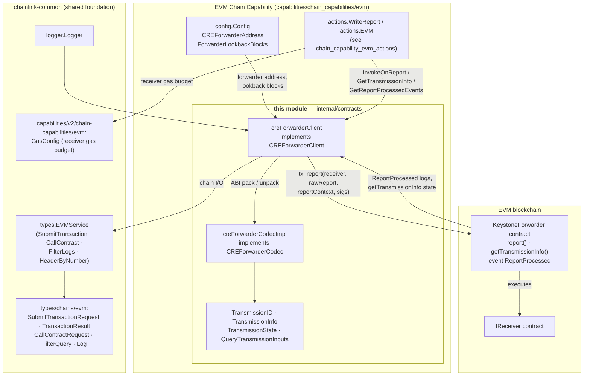
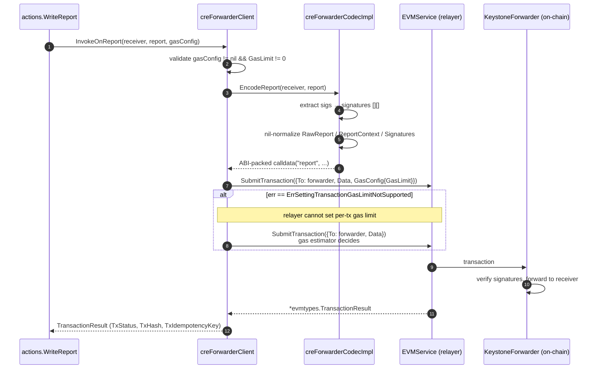
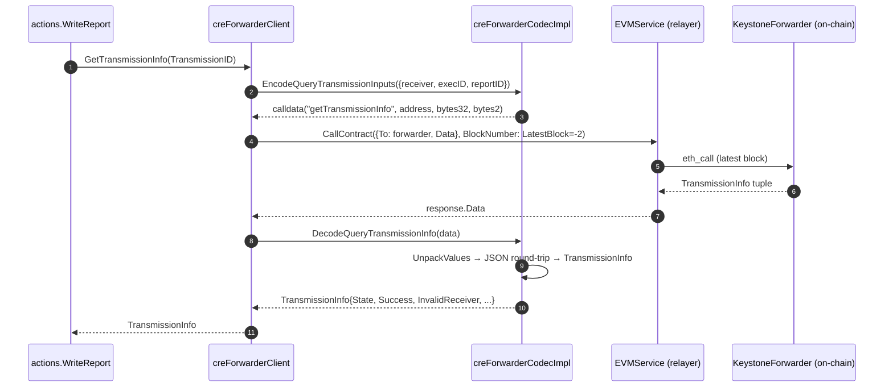
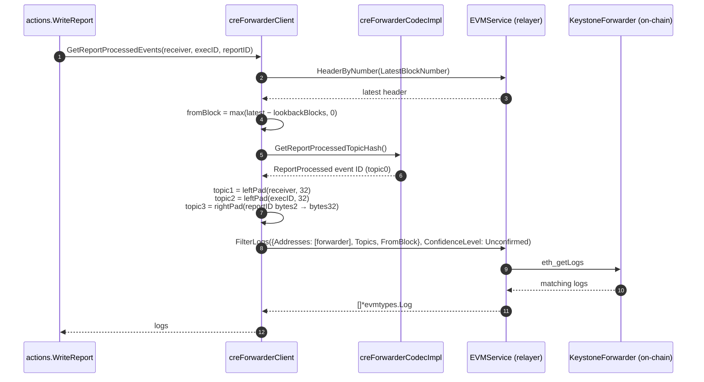
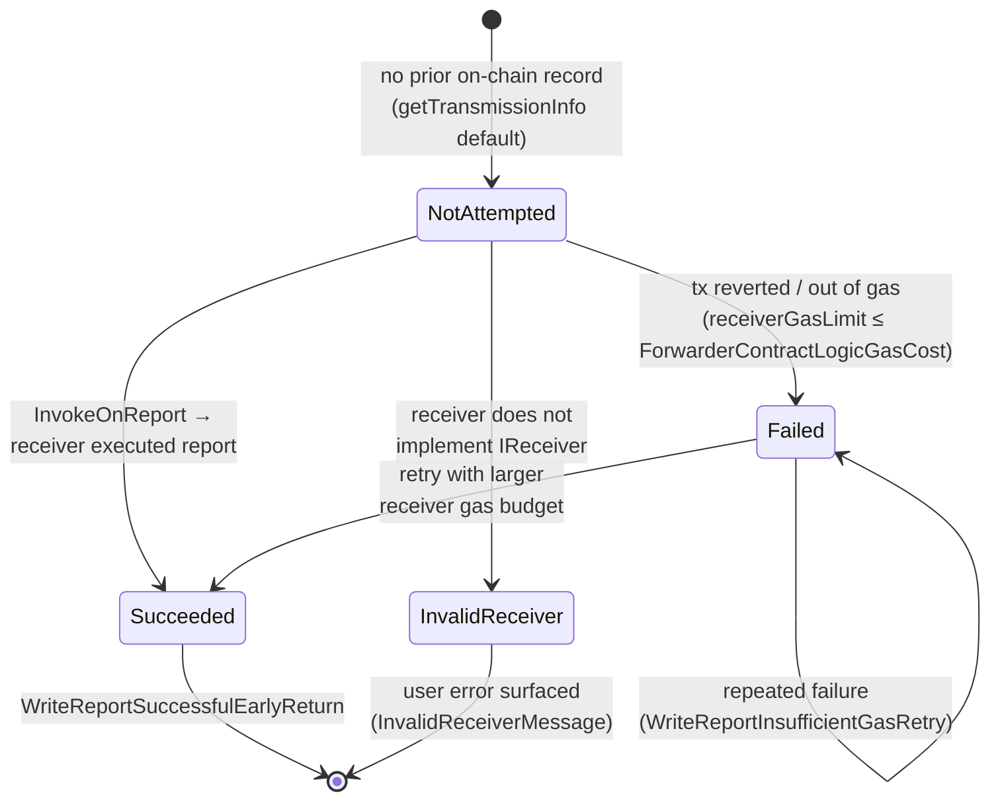

# EVM Chain Capability — CRE Forwarder Contracts

> **Module location:** `capabilities/chain_capabilities/evm/internal/contracts/cre_forwarder.go`
> **Parent module:** [chain_capability_evm](../chain_capability_evm.md) · **Domain:** [Workflow & Capability Runtime (CRE Engine)](../capabilities.md)

## Overview

The `chain_capability_evm_forwarder_contracts` module is the on-chain **contract access layer** of the EVM chain capability. It provides the Go client (`CREForwarderClient`) and ABI codec (`CREForwarderCodec`) used to interact with the **Keystone CRE Forwarder smart contract** — the on-chain entry point through which Capability Runtime Engine (CRE) workflow reports (OCR-signed consensus reports) are transmitted to destination ("receiver") contracts.

The module deliberately isolates all forwarder-contract knowledge (ABI encoding/decoding, event topic hashes, gas accounting constants, block lookback semantics) behind two small interfaces, so that the higher-level [EVM actions](chain_capability_evm_actions.md) — most notably `WriteReport` — never touch raw ABI bytes or RPC plumbing. All chain I/O is delegated to the chain-agnostic `types.EVMService` abstraction defined in [types-core](../../Shared_Foundation_Libraries___Domain_Types/types-core.md), which makes this module usable both in-process and through the Loop plugin boundary described in [Plugin Process Framework (Loop)](../../../Plugin_Process_Framework_(Loop)/loop-plugin-core.md).

At a glance, the client supports three on-chain operations:

| Operation | EVMService call | Purpose |
|---|---|---|
| `InvokeOnReport` | `SubmitTransaction` | Transmit a signed workflow report through the forwarder's `report(...)` function |
| `GetTransmissionInfo` | `CallContract` | Read the forwarder's `getTransmissionInfo(...)` state for a report (idempotency / retry decisions) |
| `GetReportProcessedEvents` | `HeaderByNumber` + `FilterLogs` | Search recent `ReportProcessed` events emitted by the forwarder for a specific report |

---

## Architecture

The module sits between the capability's action layer and the EVM chain. It owns three concerns: **ABI encoding/decoding** (codec), **transaction/read orchestration** (client), and **transmission domain types** (`TransmissionID`, `TransmissionInfo`, `TransmissionState`).

**Module boundary:** the `internal/contracts` Go package is import-restricted to the EVM chain-capability module (declared in [`capabilities/chain_capabilities/evm/go.mod`](../chain_capability_evm.md) as `github.com/smartcontractkit/capabilities/chain_capabilities/evm`). Consumers outside the capability should depend on the interfaces, not the implementations.

---

## Core Components

### `CREForwarderClient` (interface)

The operational API consumed by the [EVM actions](chain_capability_evm_actions.md). Constructed via `NewCREForwarderClient(evmService, forwarderAddress, forwarderLookbackBlocks, logger)`.

| Method | Description |
|---|---|
| `InvokeOnReport(ctx, receiverAddress, report *workflowpb.ReportResponse, gasConfig *evmcap.GasConfig)` | Encodes and submits the `report(...)` transaction through the forwarder. Enforces a non-zero gas limit, with a fallback for relayers that do not support per-transaction gas limits. Returns `*evmtypes.TransactionResult` (status, hash, idempotency key). |
| `GetTransmissionInfo(ctx, transmissionID)` | Read-only (`eth_call` at latest block) query of the forwarder's transmission record for the given `TransmissionID`. Returns a `TransmissionInfo`. |
| `GetReportProcessedEvents(ctx, receiver, workflowExecutionID, reportID)` | Filters `ReportProcessed` logs emitted by the forwarder within the configured lookback window, topic-matched on receiver + execution ID + report ID. Returns `[]*evmtypes.Log`. |

### `CREForwarderCodec` (interface)

The ABI layer, constructed via `NewCREForwarderCodec()` from the generated `forwarder.KeystoneForwarderMetaData` ABI in the `chainlink-evm/gethwrappers` module (see [`capabilities/chain_capabilities/evm/go.mod`](../chain_capability_evm.md)).

| Method | Description |
|---|---|
| `EncodeReport(receiver, report)` | ABI-packs the forwarder's `report(address, bytes, bytes, bytes[])` call: receiver address, `RawReport`, `ReportContext`, and extracted signatures. |
| `EncodeQueryTransmissionInputs(query)` | ABI-packs `getTransmissionInfo(address, bytes32, bytes2)` from a `QueryTransmissionInputs`. |
| `DecodeQueryTransmissionInfo(data)` | ABI-unpacks `getTransmissionInfo` outputs into a `TransmissionInfo` (via a JSON round-trip to map tuple fields onto struct fields). |
| `GetReportProcessedTopicHash()` | Returns the `keccak256` event ID of `ReportProcessed`, used as topic₀ in log filters. |

### Domain types

- **`TransmissionID`** — the composite on-chain key of a report transmission: `Receiver` (`common.Address`), `ReportID` (`[2]byte`), `WorkflowExecutionID` (`[32]byte`). Provides hex accessors (`ReceiverHex`, `ReportIDHex`, `WorkflowExecutionIDHex`), structured-log attributes (`LogAttrs`), and an `InvalidReceiverMessage()` helper. Its `String()` form **must remain stable across releases**: it seeds the transmission-schedule permutation, so changing it would desynchronize transmission queue ordering across the DON (see [Write Report flow](chain_capability_evm_actions.md)).
- **`TransmissionInfo`** — the forwarder's answer for a transmission: `State`, `Success`, `InvalidReceiver`, `GasLimit`, `TransmissionId`, `Transmitter`. Implements `LogAttrs()` for structured logging.
- **`TransmissionState`** — mirrors the on-chain state machine:
- **`QueryTransmissionInputs`** — the wire form of a transmission lookup: receiver hex string, execution ID, report ID.

### Constants

| Constant | Value | Meaning |
|---|---|---|
| `ForwarderContractLogicGasCost` | `200_000` | Rough lower-bound gas for the forwarder's own logic (state updates + event emission). Over-provisioned ~2× so that retry logic does not resend transactions that actually failed with "enough gas left" for the receiver. Tracked by PLEX-1524 (make configurable). |
| `LatestBlock` | `-2` | Sentinel block number mapped to `rpc.LatestBlockNumber` for read calls (PLEX-1524: replace with an EVM types constant). |
| `DefaultLookbackBlocks` | `100` | Fallback event-search window when the configured value is zero/negative (the constructor logs a `Debugf` warning when substituting). |

---

## Data Flow

### 1. Report transmission (`InvokeOnReport`)

This is the write path used by `actions.WriteReport` (documented in [chain_capability_evm_actions](chain_capability_evm_actions.md)) to deliver a DON-signed report to a receiver contract via the forwarder.

Key behaviors:

- **Gas-limit enforcement:** the call fails fast if `gasConfig` is nil or `GasLimit` is zero — a receiver gas budget is mandatory for report delivery.
- **Relayer capability fallback:** if the relayer returns `types.ErrSettingTransactionGasLimitNotSupported`, the client transparently resubmits without a gas limit and lets the node's gas estimator decide. This maps directly to the `TxMeta.GasLimit` contract in [types-core](../../Shared_Foundation_Libraries___Domain_Types/types-core.md).
- **Nil-safety workaround:** the ChainWriter codec cannot handle `nil` slices, so `EncodeReport` coerces `nil` `RawReport` / `ReportContext` / `Signatures` into empty values before packing.

### 2. Transmission-state reads (`GetTransmissionInfo`)

The JSON marshal/unmarshal round-trip inside the decoder bridges the gap between the anonymous Go tuple produced by `abi.Methods["getTransmissionInfo"].Outputs.UnpackValues` and the named `TransmissionInfo` struct.

### 3. Processed-event search (`GetReportProcessedEvents`)

Notes on the filter construction:

- Topics are matched exactly on the three indexed parameters of `ReportProcessed`, plus the event ID as `topic0`.
- `padBytes2ToBytes32` **right-pads** the 2-byte report ID to 32 bytes for Solidity `bytes2`-in-`bytes32` topic compatibility, while address and execution-ID topics are **left-padded** (standard EVM value-topic padding).
- The query runs at `primitives.Unconfirmed` confidence — fast freshness over finality, appropriate for the retry/verification logic of `WriteReport`. See [chain_capability_evm_monitoring](chain_capability_evm_monitoring.md) for how these outcomes are surfaced as telemetry (`WriteReportDuplicateTx`, `WriteReportInvalidTransmissionState`, `WriteReportSuccessfulEarlyReturn` in `monitoring/write_report.proto`).

---

## Transmission State Machine

`TransmissionState` mirrors the forwarder contract's per-report record. `WriteReport` consumes it to decide between early success return, retry with a higher receiver gas budget, surfacing a user error (invalid receiver), or a fresh transmission attempt. `ForwarderContractLogicGasCost` is used to distinguish a genuine failure from a transaction that only "failed" because the receiver portion of the gas was under-budgeted.

---

## Configuration

The client is parameterized through the capability's [plugin configuration](chain_capability_evm_plugin_runtime.md) (`capabilities/chain_capabilities/evm/config/config.go`):

| Config field | Feeds into | Default / behavior |
|---|---|---|
| `CREForwarderAddress` | `forwarderAddress` | Address of the deployed `KeystoneForwarder` proxy on this chain (deployed via the [CRE/Keystone deployment suite](../../CRE___Keystone_Deployment_Suite/cre-forwarder.md)). |
| `ForwarderLookbackBlocks` | `forwarderLookbackBlocks` | How many blocks back to search for `ReportProcessed` events; `≤ 0` falls back to `DefaultLookbackBlocks = 100` with a debug-level warning. |

The receiver-side gas floor applied by `WriteReport` (`ReceiverGasMinimum`) and the per-call gas budget (`evmcap.GasConfig`) are owned by the actions layer — see [chain_capability_evm_actions](chain_capability_evm_actions.md).

---

## Dependencies

Declared in `capabilities/chain_capabilities/evm/go.mod`:

- **`github.com/smartcontractkit/chainlink-evm/gethwrappers`** — generated `KeystoneForwarderMetaData` ABI (source of truth for all encoding in this module).
- **`github.com/smartcontractkit/chainlink-common`** — `pkg/types` (`EVMService`, `ErrSettingTransactionGasLimitNotSupported`), `pkg/types/chains/evm` (request/result/log types), `pkg/types/query/primitives` (`ConfidenceLevel`), `pkg/logger`, `pkg/capabilities/v2/chain-capabilities/evm` (receiver `GasConfig`).
- **`github.com/smartcontractkit/chainlink-protos/cre/go`** — `workflowpb.ReportResponse` (the consensus report produced by the [consensus capability](../consensus_capability.md)).
- **`github.com/ethereum/go-ethereum`** — `abi`, `common`, `rpc` primitives.

Related documentation:

- [chain_capability_evm](../chain_capability_evm.md) — parent EVM chain-capability module.
- [chain_capability_evm_actions](chain_capability_evm_actions.md) — primary consumer (`WriteReport`, `ReadActions`).
- [chain_capability_evm_plugin_runtime](chain_capability_evm_plugin_runtime.md) — gRPC plugin wiring and config parsing.
- [chain_capability_evm_monitoring](chain_capability_evm_monitoring.md) — telemetry emitted from these flows.
- [chain_capability_aptos](../chain_capability_aptos.md) — the Aptos counterpart, which interacts with an equivalent forwarder on Move-based chains.
- [types-chains](../../Shared_Foundation_Libraries___Domain_Types/types-chains.md) — the `evm` wire types (`Log`, `FilterQuery`, `CallMsg`, …) used across the RPC boundary.
