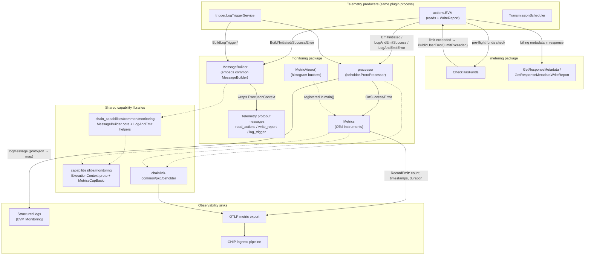
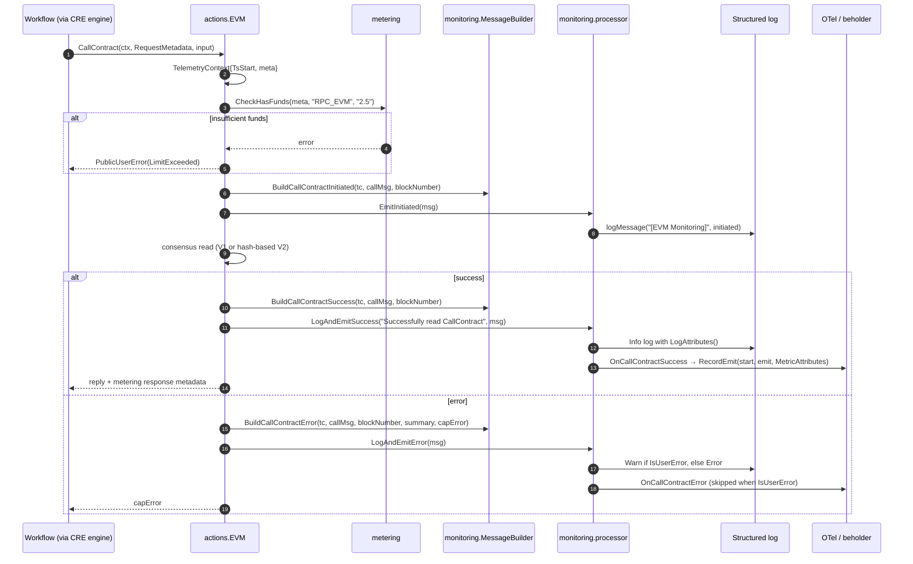
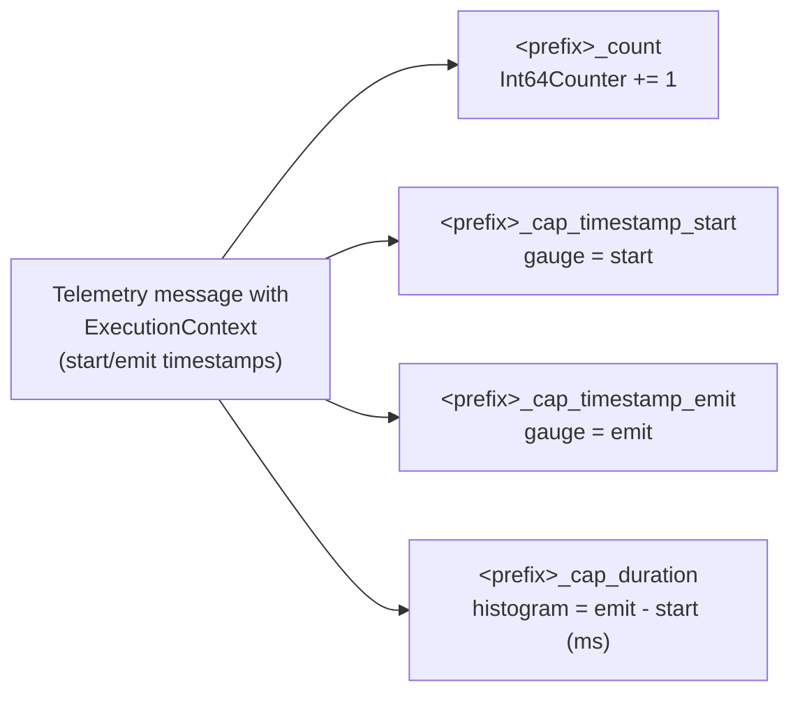
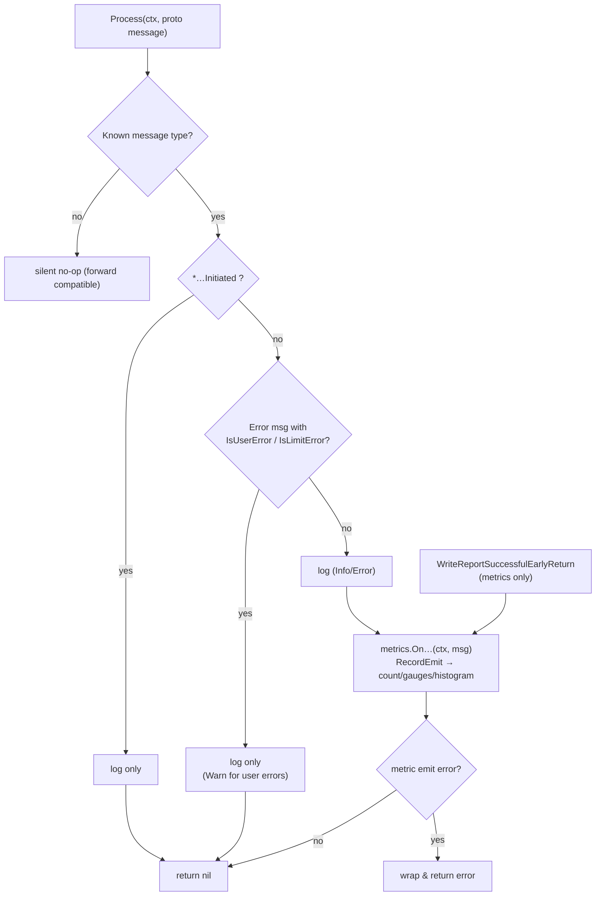
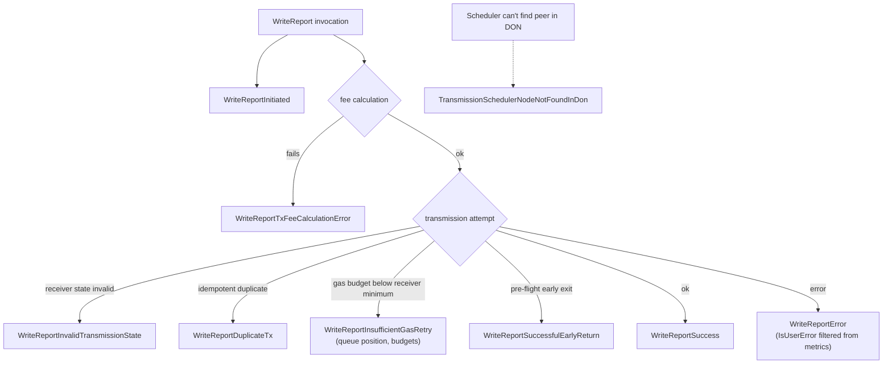

# EVM Chain Capability — Monitoring & Metering

## 1. Introduction

The `chain_capability_evm_monitoring` module is the **observability and metering layer** of the EVM chain capability plugin (`capabilities/chain_capabilities/evm`). It lives in two sibling packages of the EVM plugin module:

| Package | Source | Responsibility |
|---|---|---|
| `evm/monitoring` | `capabilities/chain_capabilities/evm/monitoring/` | Telemetry message schemas (protobuf), message construction (`MessageBuilder`), message dispatch (`processor`), OpenTelemetry metric instruments (`Metrics`, `MetricViews`) |
| `evm/metering` | `capabilities/chain_capabilities/evm/metering/metering.go` | CRE spend accounting: spend units/credits per action, spend-limit enforcement (`CheckHasFunds`), billing response metadata |

Every EVM chain interaction exposed to workflows — contract reads (`CallContract`, `FilterLogs`, `BalanceAt`, `EstimateGas`, `GetTransactionByHash`, `GetTransactionReceipt`, `HeaderByNumber`), report writes (`WriteReport`), and log triggers — passes through this module twice:

1. **Before execution** — metering verifies the calling workflow has sufficient spend funds.
2. **During/after execution** — monitoring emits typed protobuf telemetry events that are simultaneously converted into **structured logs** and **OpenTelemetry metrics**, then exported via [beholder](../../Telemetry___Observability_Platform/beholder-telemetry.md).

For the surrounding plugin architecture, see the parent module [EVM Chain Capability](../chain_capability_evm.md) and the [Capabilities overview](../capabilities.md).

---

## 2. Module Position in the System

```
Workflow SDK  ──gRPC──►  EVM capability plugin (loop process)
                            ├── main.go (plugin runtime)      → wiring & OTel views
                            ├── actions.EVM (read/write)      → business logic
                            ├── trigger.LogTriggerService     → log triggers
                            ├── ** monitoring (this module) ** → telemetry schemas + dispatch + metrics
                            └── ** metering   (this module) ** → spend limits & billing metadata
```

The monitoring components are instantiated exactly once per plugin process, during `capabilityGRPCService.Initialise` in `capabilities/chain_capabilities/evm/main.go`:

```go
metrics, _ := monitoring.NewMetrics()
processor, _ := monitoring.NewProcessor(c.lggr, metrics)         // beholder.ProtoProcessor
messageBuilder := monitoring.NewMessageBuilder(chainInfo, c.CapabilityInfo, cfg.NodeAddress)
// both are injected into actions.NewEVM(...) and trigger.NewLogTriggerService(...)
```

Additionally, `main()` registers the module's histogram views with the loop-process OTel meter provider:

```go
loopserver.ServeNew(CapabilityName, ..., loop.WithOtelViews(append(consMetrics.MetricViews(), monitoring.MetricViews()...)))
```

---

## 3. Architecture



### 3.1 Design principles

- **Single dispatch point** — the `processor` is the sole implementation of `beholder.ProtoProcessor` in the plugin. Producers never touch metrics or log formatting directly; they only build messages and call one of three helpers (`EmitInitiated`, `LogAndEmitSuccess`, `LogAndEmitError`, re-exported from the common package).
- **Schema-first telemetry** — every event is a protobuf message in the `chain_capabilities.evm` package, embedding the shared [`monitoring.ExecutionContext`](../capabilities_shared_libs/capabilities_shared_libs_monitoring.md) at field 20. This guarantees a uniform attribute model across chain capabilities (EVM, Aptos, Solana, Stellar).
- **User-error filtering** — errors originating from the workflow user (`caperrors.OriginUser`, surfaced as `IsUserError`) are logged but *not* published as error metrics, keeping operational dashboards free of customer-induced noise. The same principle applies to rate-limit drops (`IsLimitError`) on log triggers.
- **Shared instrument primitive** — per-event metrics reuse `MetricsCapBasic` from `capabilities/libs/monitoring`, which emits a 4-instrument family (count, start-gauge, emit-gauge, duration-histogram) so every chain capability reports identically.

---

## 4. Core Components

### 4.1 Processor (`processor.go`)

`NewProcessor(lggr, metrics) (beholder.ProtoProcessor, error)` constructs the dispatcher. Its `Process(ctx, proto.Message, attrKVs...)` method performs a type switch over all known telemetry messages:

| Message category | Log | Metric | Notes |
|---|---|---|---|
| `*…Initiated` (all 9 operations) | ✅ | ❌ | Signals operation start; carries request snapshot |
| `*…Success` (all operations) | ✅ | ✅ `On…Success` | Duration histogram from `ExecutionContext` timestamps |
| `*…Error` (reads: CallContract, FilterLogs, BalanceAt, EstimateGas, GetTxByHash, GetTxReceipt, HeaderByNumber) | ✅ | ✅ `On…Error` **only if `!IsUserError`** | |
| `WriteReportError` | ✅ | ✅ **only if `!IsUserError`** | |
| `WriteReportTxFeeCalculationError`, `WriteReportInvalidTransmissionState`, `WriteReportDuplicateTx`, `WriteReportInsufficientGasRetry` | ✅ | ✅ always | Operational write-path failure taxonomy |
| `WriteReportSuccessfulEarlyReturn` | ❌ | ✅ | Metrics-only event |
| `LogTriggerSuccess`, `LogTriggerError`, `LogTriggerCleanUpError` | ✅ | ✅ always | |
| `LogTriggerEventDroppedError` | ✅ | ✅ **only if `!IsLimitError`** | Prevents alert storms during backpressure |
| `TransmissionSchedulerNodeNotFoundInDon` | ✅ | ✅ | Scheduler fallback telemetry |
| unknown message | ❌ | ❌ | Silent no-op — forward compatible |

Logging is implemented by `logMessage`, which serialises the message with `protojson` (`UseProtoNames`, `EmitUnpopulated`), unmarshals it into a `map[string]any`, and logs at Info level with `[EVM Monitoring]`, the message map, and `entity_name` (the proto descriptor name).

### 4.2 Message builder (`messages.go`)

`MessageBuilder` embeds `*commonmon.MessageBuilder` (from `capabilities/chain_capabilities/common/monitoring`), inheriting `BuildExecutionContext` and `RequestLggr`. It is created with:

```go
NewMessageBuilder(chainInfo types.ChainInfo, capInfo capabilities.CapabilityInfo, nodeAddress string)
```

Each `Build*` method converts EVM domain types (`evmtypes.CallMsg`, `evmcap.WriteReportRequest`, `evmtypes.FilterQuery`, `evmtypes.Log`, `evmcap.Receipt`, `evmcap.Header`, …) into the corresponding monitoring protobuf, normalising byte fields to hex (`common.Bytes2Hex`), converting big integers to protobuf-safe representations, and classifying errors via `err.Origin() == caperrors.OriginUser → IsUserError`. Shared types are aliased from the common package:

```go
type TelemetryContext = commonmon.TelemetryContext  // TsStart + capabilities.RequestMetadata
type Message          = commonmon.Message           // proto.Message + Log/MetricAttributes()
type ErrorMessage     = commonmon.ErrorMessage      // + GetSummary / GetCause
```

### 4.3 Metrics (`metrics.go`)

- `NewMetrics() (Metrics, error)` constructs **28 `MetricsCapBasic` instrument families** — generic read success/error plus per-operation success/error for all read actions, all `WriteReport` outcomes, all log-trigger outcomes, and the transmission-scheduler event. Each family is bound to its protobuf event ref via `commonbeholder.ToSchemaFullName`.
- `MetricViews() []sdkmetric.View` configures explicit-bucket histogram boundaries for **16 latency instruments** (generic `read_success`/`read_error` and the 7 read actions × success/error). Boundaries in ms: `0, 5, 10, 25, 50, 75, 100, 250, 500, 750, 1000, 2500, 5000, 7500, 10000, 15000, 30000`. Write-report latencies intentionally keep SDK default buckets.
- Every metric name is prefixed `evm_capability_` (helper `ns`), e.g. `evm_capability_call_contract_success_count` / `_cap_timestamp_start` / `_cap_timestamp_emit` / `_cap_duration`.
- Read actions additionally record the **generic** `evm_capability_read_success` / `evm_capability_read_error` instruments with an `action` attribute (de-duplicated via `DistinctAttributes`), while the legacy per-action instruments remain for existing dashboards (see `PLEX-2401` TODO).
- Each protobuf message implements `LogAttributes()` (high-cardinality context for structured logs) and `MetricAttributes()` (low-cardinality `ExecutionContext.MetricsAttributes()` for OTel — chain family/id, network names, workflow DON, capability type/id).

### 4.4 Telemetry schemas (protobuf)

Three schema files, package `chain_capabilities.evm`, all importing `libs/monitoring/execution_context.proto` and embedding the `ExecutionContext` at field 20:

| File | Coverage |
|---|---|
| [`read_actions.proto`](../../../capabilities/chain_capabilities/evm/monitoring/read_actions.proto) | `CallContract`, `FilterLogs`, `BalanceAt`, `EstimateGas`, `GetTransactionByHash`, `GetTransactionReceipt`, `HeaderByNumber` — each with `Initiated` / `Success` / `Error` variants plus request/result payloads (`Receipt`, `TransactionData`, `BlockData`, `Topics`) |
| [`write_report.proto`](../../../capabilities/chain_capabilities/evm/monitoring/write_report.proto) | `WriteReportInitiated/Success/Error`, `WriteReportTxFeeCalculationError`, `WriteReportInvalidTransmissionState`, `WriteReportDuplicateTx`, `WriteReportSuccessfulEarlyReturn`, `WriteReportInsufficientGasRetry`, `TransmissionSchedulerNodeNotFoundInDon`, plus `WriteReportRequest`/`ReportResponse`/`GasConfig`/`AttributedSignature` |
| [`log_trigger.proto`](../../../capabilities/chain_capabilities/evm/monitoring/log_trigger.proto) | `LogTriggerInitiated/Success/Error`, `LogTriggerEventDroppedError`, `LogTriggerCleanUpError`, `FilterLogTriggerRequest`, `TopicValues` |

The [ExecutionContext](../capabilities_shared_libs/capabilities_shared_libs_monitoring.md) carries: node identity (`meta_source_id`), chain identity (`meta_chain_family_name`, `meta_chain_id`, `meta_network_name(_full)`), workflow identity (`meta_workflow_id/owner/execution_id/name`, DON id + config version, `meta_reference_id`), capability identity and the start/emit timestamps used for duration metrics.

### 4.5 Metering (`metering/metering.go`)

The metering package implements CRE spend accounting for EVM chain interactions. For background on the billing pipeline see [metering-and-billing](../../Shared_Foundation_Libraries___Domain_Types/metering-and-billing.md).

**Spend units and credits:**

| Constant | Value | Meaning |
|---|---|---|
| `ActionSpendUnit` | `RPC_EVM` | Spend unit for all read actions |
| `WriteReportSpendUnitFormat` | `GAS.<chainSelector>` | Spend unit for report writes, keyed by EVM chain selector |
| `BalanceAt`, `HeaderByNumber`, `GetTransactionReceipt`, `GetTransactionByHash`, `EstimateGas` | `1` credit | Cheap reads |
| `CallContract`, `FilterLogs` | `2.5` credits | Expensive reads (arbitrary ABI / wide log scans) |

**Functions:**

- `CheckHasFunds(lggr, meta, unit, actionSpendStr) error` — looks up the workflow's spend limit for `unit` in `capabilities.RequestMetadata.SpendLimits`; if absent it logs a warning and **allows** the request; otherwise compares limit vs. spend with exact decimal arithmetic (`big.Rat` via `parseDecimalString`/`compareStringNumbers`) and returns an error (`"insufficient CRE funds: …"`) when the limit is exceeded. Callers (e.g. `actions.CallContract`) convert this into `caperrors.NewPublicUserError(err, caperrors.LimitExceeded)`.
- `GetResponseMetadata(action)` — returns `capabilities.ResponseMetadata` with a `MeteringNodeDetail` (`SpendValue` = credits, `SpendUnit` = `RPC_EVM`); `Peer2PeerID` is assigned by the engine.
- `GetResponseMetadataWriteReport(feeInWei, chainSelector)` — bills report writes by realised transaction fee: `SpendValueInGasUnits` = wei, legacy `SpendValue` = ETH (wei ÷ 1e18), `SpendUnit` = `GAS.<chainSelector>`.

---

## 5. Data Flow

### 5.1 Lifecycle of a read action (CallContract example)



The metric instruments updated by `RecordEmit` per event are:



### 5.2 Processor dispatch logic



### 5.3 Write-path (WriteReport) telemetry taxonomy

Report transmission has the richest failure model; each distinct outcome has a dedicated protobuf event and metric:



---

## 6. Telemetry Message Catalog

| Operation | Initiated | Success | Error | Extra events |
|---|---|---|---|---|
| `CallContract` | ✅ | ✅ (block number, contract address) | ✅ (user-error filtered) | — |
| `FilterLogs` | ✅ | ✅ (from/to block, log count) | ✅ (user-error filtered) | — |
| `BalanceAt` | ✅ | ✅ (account, balance) | ✅ (user-error filtered) | — |
| `EstimateGas` | ✅ | ✅ (from/to, gas) | ✅ (user-error filtered) | — |
| `GetTransactionByHash` | ✅ | ✅ (nonce, gas, gas price, value) | ✅ (user-error filtered) | — |
| `GetTransactionReceipt` | ✅ | ✅ (status, gas used, contract address…) | ✅ (user-error filtered) | — |
| `HeaderByNumber` | ✅ | ✅ (hash, height, timestamp) | ✅ (user-error filtered) | — |
| `WriteReport` | ✅ | ✅ | ✅ (user-error filtered) | `TxFeeCalculationError`, `InvalidTransmissionState`, `DuplicateTx`, `SuccessfulEarlyReturn`, `InsufficientGasRetry` |
| `LogTrigger` | ✅ | ✅ (trigger id, log count, offset block) | ✅ | `EventDroppedError` (limit filtered), `CleanUpError` |
| Transmission scheduler | — | — | — | `NodeNotFoundInDon` |

---

## 7. Metric Catalog

All metrics are namespaced `evm_capability_`. Each success/error family exposes `_count`, `_cap_timestamp_start`, `_cap_timestamp_emit`, `_cap_duration`.

| Family | Triggering events | Histogram buckets |
|---|---|---|
| `evm_capability_read_{success,error}` | Any of the 7 read actions (with `action` attribute) | explicit (see §4.3) |
| `evm_capability_call_contract_{success,error}` | `CallContractSuccess/Error` | explicit |
| `evm_capability_filter_logs_{success,error}` | `FilterLogsSuccess/Error` | explicit |
| `evm_capability_balance_at_{success,error}` | `BalanceAtSuccess/Error` | explicit |
| `evm_capability_estimate_gas_{success,error}` | `EstimateGasSuccess/Error` | explicit |
| `evm_capability_get_transaction_by_hash_{success,error}` | `GetTransactionByHashSuccess/Error` | explicit |
| `evm_capability_get_transaction_receipt_{success,error}` | `GetTransactionReceiptSuccess/Error` | explicit |
| `evm_capability_header_by_number_{success,error}` | `HeaderByNumberSuccess/Error` | explicit |
| `evm_capability_write_report_*` | `write_report_{success, error, successful_early_return, tx_fee_calculation_error, invalid_transmission_state, duplicate_tx, insufficient_gas_retry}` | SDK default |
| `evm_capability_log_trigger_{success, error, clean_up_error, event_dropped_error}` | log-trigger lifecycle | SDK default |
| `evm_capability_transmission_scheduler_node_not_found_in_don` | scheduler fallback | SDK default |

---

## 8. Integration & Wiring

### 8.1 Consumers

- **[EVM actions](chain_capability_evm_actions.md)** — `actions.EVM` holds the `beholderProcessor` and `MessageBuilder`; every exported read method and the write-report path emit `Initiated` events before execution and success/error events afterwards, and invoke `metering.CheckHasFunds` + attach `ResponseMetadata` to replies.
- **[EVM log trigger](chain_capability_evm_trigger.md)** — `LogTriggerService` emits trigger lifecycle telemetry (registration, delivered batches, dropped events due to store limits, clean-up failures).
- **[Plugin runtime](chain_capability_evm_plugin_runtime.md)** — `main.go` composes `MetricViews()` into the loop process's OTel provider and injects metrics/processor/builder in `Initialise`; the [forwarder contracts](chain_capability_evm_forwarder_contracts.md) supply transmission-state details consumed by `BuildWriteReportInvalidTransmissionState`.

### 8.2 External dependencies

Per `capabilities/chain_capabilities/evm/go.mod`, this module depends on:

| Dependency | Role |
|---|---|
| `chainlink-common/pkg/beholder` | `ProtoProcessor` interface, OTLP export client, `ToSchemaFullName` event refs — see [beholder-telemetry](../../Telemetry___Observability_Platform/beholder-telemetry.md) |
| `capabilities/libs` (`libs/monitoring`) | `ExecutionContext` proto + `MetricsCapBasic` + `DistinctAttributes` — see [capabilities_shared_libs_monitoring](../capabilities_shared_libs/capabilities_shared_libs_monitoring.md) |
| `capabilities/chain_capabilities/common` (`common/monitoring`) | Common `MessageBuilder`, `LogAndEmit*`/`EmitInitiated` helpers, `TelemetryContext` |
| `go.opentelemetry.io/otel/sdk/metric` | Views / explicit-bucket histograms |
| `go.opentelemetry.io/otel` | Attribute model |

Exported metrics flow through the OTLP exporter into the [CHIP ingress](../../Telemetry___Observability_Platform/chip-ingress.md) telemetry pipeline (part of the [observability platform](../../Telemetry___Observability_Platform/monitoring.md)).

### 8.3 Code generation

The monitoring protobufs are generated with `protoc` via the `protoc` target in [`capabilities/Makefile`](../../Build,_CI___Release_Infrastructure/capabilities_workspace_tooling.md) (the workspace also exposes `update-chain-capabilities` for syncing generated chain-capability SDKs). Generated Go types live beside the `.proto` sources.

---

## 9. Testing

`monitoring_test.go` (package `monitoring_test`) covers:

- **Processor dispatch** — table-driven tests for all `Initiated`, `Success`, and `Error` messages (verifying `Process` returns nil for each); unknown messages are a silent no-op (`dummyProto`).
- **Metric semantics** — `TestMetrics_ReadActionsEmitLegacyAndGenericMetrics` swaps in a beholder client backed by an `sdkmetric.ManualReader`, records success/error for all seven read actions with a fully populated `ExecutionContext`, collects `ResourceMetrics`, and asserts that both the legacy per-action metrics and the generic `evm_capability_read_{success,error}` metrics (with `action` attribute and `chain_id` label) exist as counts and duration histograms.
- **Histogram views** — `TestMetricViews_ReadLatencyBuckets` asserts all 16 view names exist with exactly the explicit boundaries from §4.3 and that write-report metrics keep default buckets.
- **Helper testing** — `ProcessorMock` (`mock.Mock`) allows consumer packages to stub `beholder.ProtoProcessor`; `TestLogEmit_SuccessCases` / `TestLogEmit_ErrorCases` verify the common `LogAndEmitSuccess`/`LogAndEmitError` behaviour, including the "Failed to process …" error path and Warn-vs-Error log levels for user errors.

---

## 10. Operations Notes

- **Alerting** — error metrics exclude user errors by design; alerts on `*_error_count` represent genuine system/node faults. Rate-limit-induced trigger drops (`IsLimitError`) are likewise excluded from metrics but still logged.
- **Cardinality** — `MetricAttributes()` intentionally exposes only low-cardinality context (chain/network/DON/capability); high-cardinality identifiers (workflow execution ID, tx hashes, addresses) appear only in `LogAttributes()` and the `request_id` log field (`workflowExecutionID:referenceID`).
- **Cost visibility** — read actions are pre-authorised against workflow spend limits (credits, `RPC_EVM` unit); report writes are post-billed on realised gas (`GAS.<chainSelector>` unit), so `WriteReportSuccess` telemetry is the reconciliation source for chain-write spend.
- **Unknown events** — new protobuf event types appended to the schemas are safely ignored by older processors, enabling rolling deployments.

---

## 11. Related Documentation

- Parent: [EVM Chain Capability](../chain_capability_evm.md) — plugin composition and module map
- Siblings: [actions](chain_capability_evm_actions.md) · [forwarder contracts](chain_capability_evm_forwarder_contracts.md) · [plugin runtime](chain_capability_evm_plugin_runtime.md) · [log trigger](chain_capability_evm_trigger.md)
- Shared capability monitoring library: [capabilities_shared_libs_monitoring](../capabilities_shared_libs/capabilities_shared_libs_monitoring.md)
- Capabilities domain model: [capabilities](../capabilities.md)
- Telemetry transport: [beholder-telemetry](../../Telemetry___Observability_Platform/beholder-telemetry.md) · [chip-ingress](../../Telemetry___Observability_Platform/chip-ingress.md)
- Billing pipeline: [metering-and-billing](../../Shared_Foundation_Libraries___Domain_Types/metering-and-billing.md)
- CRE engine overview: [Workflow & Capability Runtime (CRE Engine)](../../Workflow___Capability_Runtime_(CRE_Engine).md)
