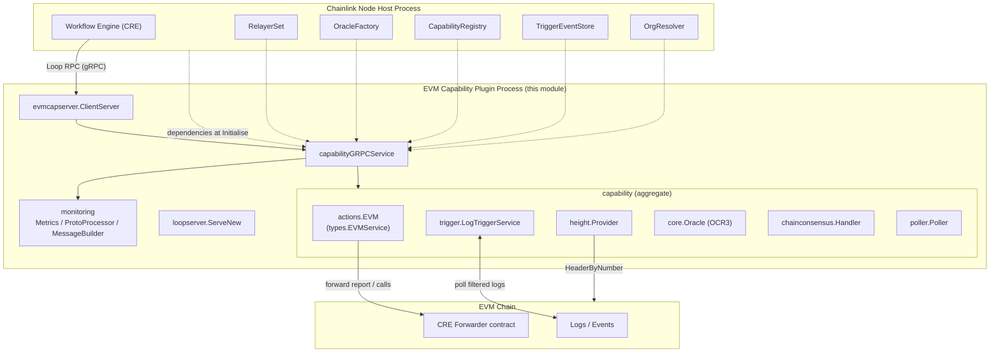
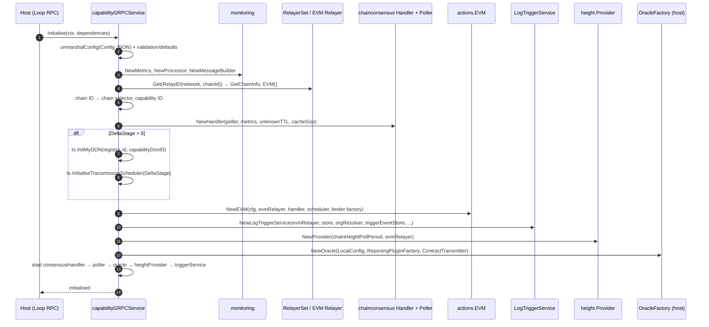
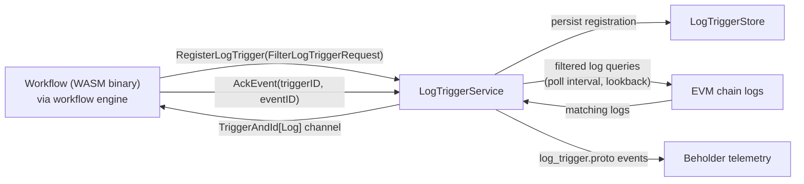
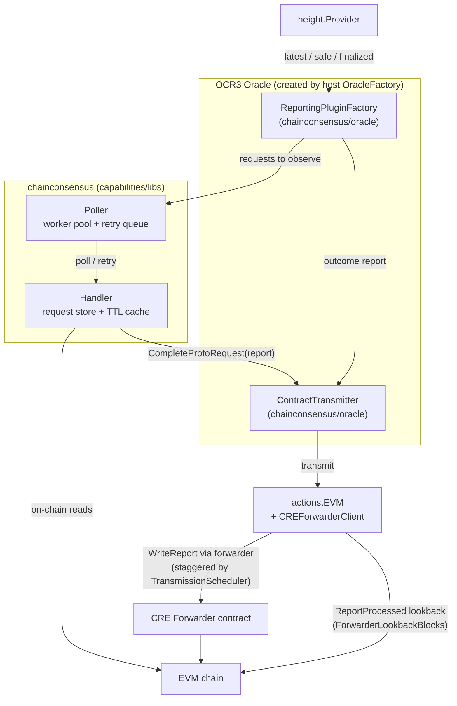
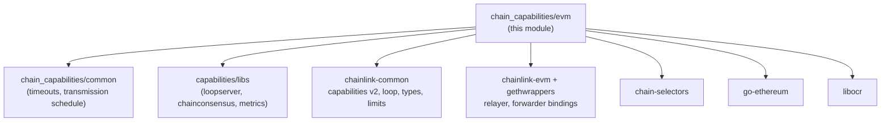

# EVM Chain Capability — Plugin Runtime

> **Source module:** `capabilities/chain_capabilities/evm` (Go module `github.com/smartcontractkit/capabilities/chain_capabilities/evm`, Go 1.27.1)
> **Core files:** `main.go`, `config/config.go`, `height/provider.go`, `go.mod`

## 1. Overview

This module is the **executable runtime** for the EVM chain capability (`evm`) of the Chainlink Capability Runtime (CRE). It is compiled into a standalone **plugin binary** that is spawned and supervised by the Chainlink node host process over Loop RPC (gRPC via hashicorp-go-plugin), as described in [Plugin Process Framework (Loop)](<../../Plugin_Process_Framework_(Loop).md>).

The plugin hosts the `evm` **standard capability** (name `evm`, version `1.0.0`) and wires together everything the capability needs to operate against an EVM chain:

| Concern | Realized by | Details |
|---|---|---|
| Plugin process bootstrap | `main` → `loopserver.ServeNew` | Registers the standard-capabilities gRPC server and OpenTelemetry metric views |
| Capability service | `capabilityGRPCService` | Implements `evmcapserver.ClientCapability`; owns lifecycle, config, and delegation to sub-services |
| On-chain reads / writes | [`actions.EVM`](chain_capability_evm_actions.md) | `types.EVMService` implementation backed by the EVM relayer and the CRE forwarder contract |
| Log triggers | [`trigger.LogTriggerService`](chain_capability_evm_trigger.md) | Filtered log polling, trigger registration/ack, event emission |
| Read consensus (OCR3) | `chainconsensus` (Handler + Poller + oracle adapters) | Request store, polling workers, reporting-plugin factory, contract transmitter |
| Block height tracking | `height.Provider` | Polls latest/safe/finalized headers with ordering invariants |
| Observability | `monitoring` (metrics, proto processor, message builder) | Beholder protobuf telemetry for read actions, write reports and log triggers |
| Contract surface | [`CREForwarderClient`](chain_capability_evm_forwarder_contracts.md) | Go bindings for the CRE Forwarder that relays consensus reports on-chain |

The workflow-facing capabilities it implements (log triggers, on-chain reads/writes) are consumed by the CRE workflow engine — see [Workflows](../workflows.md) and the [Capabilities framework](../capabilities.md).

## 2. Position in the System

The EVM capability runs as a **separate OS process** from the Chainlink node. The node (host) launches the binary, performs the Loop handshake, and calls `Initialise` with a dependency bundle (`core.StandardCapabilitiesDependencies`) containing the relayer set, capability registry, oracle factory, org resolver, trigger event store and capability DON ID. All chain access is mediated by the **EVM relayer** obtained from the host's `RelayerSet` — the plugin holds no direct RPC connections of its own.



Key architectural properties:

- **Process isolation:** `main` calls `loopserver.ServeNew`, which runs `hashicorp-go-plugin` `plugin.Serve` with the Loop standard-capabilities handshake. Host settings updates are intercepted and stored atomically (`cresettings`) by a `settingsInterceptor` inside `loopserver`, so runtime settings changes propagate without re-launching the plugin.
- **Host-injected infrastructure:** relayer, oracle factory, registry, trigger event store and org resolver all arrive via `dependencies` — the plugin never opens DB connections or RPC endpoints itself.
- **DON identity injection:** `dependencies.CapabilityDonID` is resolved authoritatively by the host and injected at `Initialise` time. On the syncer boot path it is always populated; on the job-spec boot path it is populated only when unambiguous (otherwise `0`, e.g. multi-DON nodes or nodes predating CRE-4409). When `0`, the trigger service falls back to the consumer workflow's DON ID. The plugin deliberately does **not** re-resolve the DON from the registry, because that lookup cannot disambiguate multi-DON nodes (see CRE-4409 comment in `main.go`).

## 3. Component Reference

### 3.1 `main` (`capabilities/chain_capabilities/evm/main.go`)

```go
func main() {
    loopserver.ServeNew(CapabilityName, func(s *loop.Server) loop.StandardCapabilities {
        return evmcapserver.NewClientServer(&capabilityGRPCService{lggr: s.Logger, limitsFactory: s.LimitsFactory})
    }, loop.WithOtelViews(append(consMetrics.MetricViews(), monitoring.MetricViews()...)))
}
```

Responsibilities:

- Serves the plugin under the fixed name **`evm`** and version **`1.0.0`** (`CapabilityName`, `CapabilityVersion`).
- Wraps `capabilityGRPCService` in the generated `evmcapserver.ClientServer` (from `chainlink-common/pkg/capabilities/v2/chain-capabilities/evm/server`).
- Registers OpenTelemetry **metric views** at process start — both the chain-consensus metric views (`chainconsensus/metrics`) and the EVM monitoring views — so instrumentation is initialized before any traffic flows. The telemetry pipelines themselves are described in [Telemetry & Observability Platform](<../../Telemetry___Observability_Platform.md>).

### 3.2 `capabilityGRPCService`

The top-level service struct; compile-time asserted as `evmcapserver.ClientCapability`:

```go
type capabilityGRPCService struct {
    capabilities.CapabilityInfo   // name/version metadata
    chainSelector uint64
    capability                    // embedded aggregate (below)
    lggr          logger.Logger
    limitsFactory limits.Factory
}
```

Its `Initialise(ctx, dependencies core.StandardCapabilitiesDependencies)` method is the wiring heart of the module:

1. **Config:** unmarshals `dependencies.Config` (JSON) into [`config.Config`](#35-configconfig) with validation and defaults (`unmarshalConfig`).
2. **Monitoring:** creates `monitoring.NewMetrics`, `monitoring.NewProcessor` (beholder proto processor) and `monitoring.NewMessageBuilder(chainInfo, CapabilityInfo, nodeAddress)` that stamps every emitted telemetry message with chain, capability and node identity.
3. **Relayer resolution:** builds `types.NewRelayID(cfg.Network, chainID)` and fetches the relayer from `dependencies.RelayerSet.Get(ctx, relayID)`; fetches `chainInfo` via `relayer.GetChainInfo` and obtains the chain-specific `relayer.EVM()` service.
4. **Identity:** maps EVM chain ID → chain selector via `chainselectors.EvmChainIdToChainSelector()`; builds the capability ID `evm:ChainSelector:<selector>@1.0.0`.
5. **Consensus stack:** creates `consMetrics.NewConsensusMetrics`, the `poller.Poller` (workers + poll period), derives the unknown-request TTL via `capcommon.MaxRequestTimeoutWithMultiplier` (registry-aware, DON-aware), and builds `chainconsensus.NewHandler(...)` — the request store shared by the reporting plugin and transmitter.
6. **Transmission scheduling (optional):** if `cfg.DeltaStage > 0`, resolves this DON via `ts.InitMyDON` and creates a staggered `ts.TransmissionScheduler` so report transmissions are spread across DON members. Unset `DeltaStage` disables scheduling entirely (also skipped when `IsLocaL` is set in integration tests).
7. **Actions + triggers + heights:** constructs `actions.NewEVM(...)` (passing the scheduler), `trigger.NewLogTriggerService(...)` (with `LogTriggerStore`, org resolver and host trigger event store), and `height.NewProvider(...)`.
8. **Oracle:** asks the **host** to create the OCR3 oracle via `dependencies.OracleFactory.NewOracle`, injecting:
   - an OCR `LocalConfig` (timeouts below),
   - `oracle.NewReportingPluginFactory` (chain-consensus reporting plugin backed by the request store and height provider),
   - `oracle.NewContractTransmitter` (transmits completed reports through the consensus handler → forwarder).
9. **Start:** starts, in order: `consensusHandler`, `requestPoller`, `oracle`, `heightProvider`, `triggerService`.

Other methods:

| Method | Behavior |
|---|---|
| `Start` | No-op (services already started in `Initialise`) |
| `Close` | `errors.Join` of: `EVM.Close`, `requestPoller.Close`, `consensusHandler.Close`, `oracle.Close`, `triggerService.Close`, `heightProvider.Close` |
| `HealthReport` | Reports `nil` error for its own name (health aggregation is delegated to sub-services) |
| `Name` / `Description` / `ChainSelector` / `Ready` | Identity accessors; `Ready` always `nil` |
| `RegisterLogTrigger` / `UnregisterLogTrigger` / `AckEvent` | Delegates to `trigger.LogTriggerService` (see [Log trigger flow](#52-log-trigger-flow)) |
| `RegisterToWorkflow` / `UnregisterFromWorkflow` | **Not implemented** — returns an error |

### 3.3 `capability` (internal aggregate)

```go
type capability struct {
    *actions.EVM                  // chain service surface (reads, WriteReport, forwards)
    id               string       // "evm:ChainSelector:<selector>@1.0.0"
    requestPoller    *poller.Poller
    consensusHandler chainconsensus.Handler
    oracle           core.Oracle
    triggerService   *trigger.LogTriggerService
    heightProvider   *height.Provider
}
```

This struct is the composition root that keeps the sub-services together; the resolved capability DON (used by transmission scheduling) is attached here as `c.DON` after `ts.InitMyDON`.

### 3.4 `height.Provider` (`capabilities/chain_capabilities/evm/height/provider.go`)

A poll-based service (built on `chainlink-common/pkg/services`) that tracks the chain's block heights through the relayer's `HeaderProvider` interface:

- Every `pollPeriod` (config: `ChainHeightPollPeriod`) it fetches three headers via `HeaderByNumber`:
  - **latest** (`Number: nil`),
  - **safe** (`rpc.SafeBlockNumber`),
  - **finalized** (`rpc.FinalizedBlockNumber`).
- Enforces the invariant **`finalized <= safe <= latest`**: on violation it logs a sanitization warning and bumps the offending value upward; for finalized blocks it retains the historical maximum (finality never regresses).
- Exposes goroutine-safe getters `GetLatest()`, `GetSafe()`, `GetFinalized()` guarded by an `RWMutex`.

The provider is injected into `oracle.NewReportingPluginFactory`, so the OCR3 consensus plugin can stage observations and reports against the appropriate finality level.

### 3.5 `config.Config` (`capabilities/chain_capabilities/evm/config/config.go`)

The single JSON configuration document delivered by the host at `Initialise`. Validation and defaults are applied in `unmarshalConfig`:

| Field | Type | Validation / Default | Purpose |
|---|---|---|---|
| `chainId` | `uint64` | required | EVM chain ID; must exist in the chain-selectors registry |
| `network` | `string` | required | Network family used to build the relay ID |
| `logTriggerPollInterval` | `time.Duration` | must be ≥ 0 | Log-trigger polling cadence |
| `logTriggerSendChannelBufferSize` | `uint64` | optional | Buffered channel size for emitted trigger events |
| `logTriggerLimitQueryLogSize` | `uint64` | optional | Upper bound on logs fetched per filtered query |
| `creForwarderAddress` | `string` | must be a valid 20-byte hex address | CRE Forwarder contract that receives consensus reports |
| `forwarderLookbackBlocks` | `int64` | default 100 | How far back to search for `ReportProcessed` events |
| `receiverGasMinimum` | `uint64` | must be > 0 | Default gas floor for receiver processing of forwarded reports |
| `nodeAddress` | `string` | optional | Node identity stamped into telemetry messages |
| `observationPollerWorkersCount` | `uint` | default 10 | Consensus observation worker pool size |
| `observationPollPeriod` | `time.Duration` | default 2s | Consensus request poll cadence |
| `chainHeightPollPeriod` | `time.Duration` | default 1s | Height provider poll cadence |
| `unknownRequestsTTL` | `time.Duration` | default 10s (then registry-multiplier derived) | TTL for consensus requests that are never claimed |
| `maxUnknownRequestsCacheSize` | `int` | default 1000 | Cache bound for unknown consensus requests |
| `deltaStage` | `time.Duration` | optional (0 disables) | Stagger between DON members for report transmission scheduling |
| `isLocal` | `bool` | optional | Integration-test flag: skips transmission-scheduler initialization for log triggers |

## 4. Runtime Lifecycle



Lifecycle notes:

- **Start order is deliberate:** the consensus request store and poller must be running before the oracle begins producing observations; the height provider is ready before reports reference block heights; the trigger service comes last.
- **Shutdown** is symmetric and aggregated via `errors.Join` so a failure closing one sub-service does not mask the others (`main.go::Close`).
- The Oracle `LocalConfig` used for the host-created oracle: `BlockchainTimeout` 20s, `ContractConfigTrackerPollInterval` 10s, `ContractConfigConfirmations` 1, `ContractTransmitterTransmitTimeout` 10s, `DatabaseTimeout` 10s, `ContractConfigLoadTimeout` 10s, `DefaultMaxDurationInitialization` 10s.
- All resource bounds used by actions and triggers (payload sizes, log-query limits, gas limits, rate limits) are enforced through `limits.Factory` supplied by the Loop server — see [Settings & limits](../../Shared_Foundation_Libraries___Domain_Types/settings.md).

## 5. Data & Process Flows

### 5.1 Plugin ↔ host transport

The binary itself is a Loop plugin: `loopserver.ServeNew` performs the hashicorp-go-plugin handshake, publishes the standard-capabilities service (`loop.PluginStandardCapabilitiesName`) and applies atomic settings interception. The wire protocol and pb bindings are documented in [loop-plugin-core](../../Plugin_Process_Framework_(Loop)/loop-plugin-core.md).

### 5.2 Log trigger flow



Steps:

1. A workflow registers a log trigger (address + topics filters); the registration is persisted in the `LogTriggerStore` and recorded in the host's trigger event store.
2. The service periodically queries logs for all active registrations (bounded by `logTriggerLimitQueryLogSize`, filter/topic limiters and event rate limiters).
3. Matching logs are processed by the monitoring proto processor, labeled by the message builder, and pushed to the workflow over the `TriggerAndId[*evmcappb.Log]` channel; the workflow acknowledges events with `AckEvent`.
4. Emitted DON identity uses the injected `capabilityDonID`, falling back to the workflow's DON ID when unknown (see [Position in the System](#2-position-in-the-system)).

### 5.3 Consensus & report transmission flow



Steps:

1. The host-created OCR3 oracle requests observations each round. The chain-consensus **reporting plugin** polls pending read requests from the `Handler` via the `Poller` (worker pool bounded by `ObservationPollerWorkersCount`, cadence `ObservationPollPeriod`), executes the on-chain reads, and produces a consensus report.
2. The **contract transmitter** receives the report, marks the corresponding stored request complete (`CompleteProtoRequest` / `CompleteHashableRequest`), and hands the transmission to `actions.EVM`.
3. `actions.EVM` encodes and forwards the report through the **CRE Forwarder** contract, optionally staggered per node using the `TransmissionScheduler` (`DeltaStage`), enforcing receiver gas minimum and report-size limits.
4. Processed reports are confirmed by scanning `ReportProcessed` events within `ForwarderLookbackBlocks`; unclaimed requests expire after the derived `UnknownRequestsTTL` and are pruned from the bounded cache.

The consensus library itself is documented in [Capabilities shared libs](../capabilities_shared_libs.md); the forwarder contract bindings in [Forwarder contracts](chain_capability_evm_forwarder_contracts.md); the read/write action surfaces in [EVM actions](chain_capability_evm_actions.md).

### 5.4 Block height tracking

`height.Provider` continuously samples `latest`, `safe` and `finalized` block numbers and publishes them to the consensus plugin. It guarantees monotonic finality and the ordering invariant `finalized <= safe <= latest` (self-healing on out-of-order RPC responses), so the OCR3 plugin can safely choose observation/report stages relative to chain finality.

## 6. gRPC Capability Surface

Exposed through `evmcapserver.ClientServer` (generated from the `evm` capability protos in `chainlink-common/pkg/capabilities/v2/chain-capabilities/evm`):

| RPC | Delegates to | Notes |
|---|---|---|
| `Initialise` | wiring in §3.2 | One-time host-provided config + dependencies |
| `RegisterLogTrigger` | `LogTriggerService` | Returns a `TriggerAndId[*Log]` stream channel |
| `UnregisterLogTrigger` | `LogTriggerService` | Removes registration from store |
| `AckEvent` | `LogTriggerService` | Acknowledges a delivered trigger event |
| `RegisterToWorkflow` / `UnregisterFromWorkflow` | — | Not implemented (explicit errors) |
| `ChainSelector`, `Description`, `Name`, `HealthReport`, `Ready`, `Start`, `Close` | service lifecycle | Standard capability info surface |

## 7. Observability

- **Metrics:** OpenTelemetry views from `chainconsensus/metrics` (request/poll/transmission counters and histograms, labeled with chain info) and `chain_capabilities/evm/monitoring` are registered on the Loop server in `main` via `loop.WithOtelViews(...)`.
- **Structured telemetry:** the beholder `ProtoProcessor` handles the EVM monitoring protobufs — [`read_actions.proto`](chain_capability_evm_monitoring.md), `write_report.proto` and `log_trigger.proto` — enriching each message via `MessageBuilder` (chain info, capability info, node address, DON identity).
- **Logging:** a single sugared logger from the Loop server is shared with all sub-services; height-provider sanitization and consensus warnings are logged with context fields.

See [Telemetry & Observability Platform](<../../Telemetry___Observability_Platform.md>) for the downstream pipelines.

## 8. Dependencies

Key direct dependencies from `capabilities/chain_capabilities/evm/go.mod`:

| Dependency | Role |
|---|---|
| `github.com/smartcontractkit/capabilities/libs` | `loopserver` (plugin hosting), `chainconsensus` (handler, poller, oracle adapters), consensus metrics |
| `github.com/smartcontractkit/capabilities/chain_capabilities/common` | `capcommon.MaxRequestTimeoutWithMultiplier`, `transmission_schedule` (`ts`) |
| `github.com/smartcontractkit/chainlink-common` | capabilities v2 protos/servers (`evmcappb`, `evmcapserver`), `loop`, `types` (relayer, `EVMService`), `logger`, `settings/limits` |
| `github.com/smartcontractkit/chainlink-evm` (+ `gethwrappers`) | EVM relayer integration and forwarder contract bindings |
| `github.com/smartcontractkit/chain-selectors` | EVM chain ID → chain selector mapping |
| `github.com/smartcontractkit/libocr` | OCR2/3 types (`ocrtypes.LocalConfig`) |
| `github.com/ethereum/go-ethereum` | Common types (`common.Address`), RPC block-number sentinels |
| `go.opentelemetry.io/otel` (+ `sdk/metric`), `go.uber.org/zap` | Instrumentation and logging |



Domain types consumed across this boundary (relayer services, EVM chain request/reply types such as `HeaderByNumberRequest/Reply`) live in the [Shared Foundation Libraries & Domain Types](<../../Shared_Foundation_Libraries___Domain_Types.md>) modules.

## 9. Build, Packaging & Release

- **Module layout:** the plugin is its own Go module (`capabilities/chain_capabilities/evm/go.mod`, `go 1.27.1`) within the `capabilities` multi-module workspace. The workspace `Makefile` provides:
  - `make protoc` / `make generate` — regenerate the monitoring protobufs (`monitoring/*.proto`) and mocks across all modules (`capabilities/Makefile`),
  - `make update-chain-capabilities MODULE=<mod> REF=<ref>` — bumps a shared dependency (e.g. `chainlink-common`, `capabilities/libs`) **in lockstep across the aptos/evm/solana/stellar chain capabilities** via `capabilities/script/update-chain-capabilities.sh`.
- **Plugin installation:** the Chainlink node builds and installs remote LOOPP binaries with `loopinstall` (`make install-plugins-public|private|testing` in `chainlink/GNUmakefile`), and the experimental `make docker-plugins` target produces the `chainlink-plugins` Docker image that bundles plugin binaries with the node. Build tooling is documented in [Build, CI & Release Infrastructure](<../../Build,_CI___Release_Infrastructure.md>).
- **Testing:** the `IsLocaL` config flag suppresses transmission-scheduler initialization for log triggers in integration environments; end-to-end exercising of this plugin happens in the CRE system/integration test environments ([Dev, Test & Simulation Environments](<../../Dev,_Test___Simulation_Environments.md>)). Deployment of the forwarder contracts the plugin targets is covered by the [CRE & Keystone Deployment Suite](<../../CRE___Keystone_Deployment_Suite.md>).

## 10. Related Documentation

- Parent overview: [EVM Chain Capability](../chain_capability_evm.md)
- Sibling components: [EVM Actions](chain_capability_evm_actions.md) · [Log Trigger](chain_capability_evm_trigger.md) · [Forwarder Contracts](chain_capability_evm_forwarder_contracts.md) · [Monitoring](chain_capability_evm_monitoring.md)
- Runtime host: [Plugin Process Framework (Loop)](<../../Plugin_Process_Framework_(Loop).md>) · [loop-plugin-core](../../Plugin_Process_Framework_(Loop)/loop-plugin-core.md)
- CRE engine context: [Workflow & Capability Runtime (CRE Engine)](<../../Workflow___Capability_Runtime_(CRE_Engine).md>) · [Workflows](../workflows.md) · [Capabilities framework](../capabilities.md)
- Supporting platforms: [Shared Foundation Libraries](<../../Shared_Foundation_Libraries___Domain_Types.md>) · [Telemetry & Observability](<../../Telemetry___Observability_Platform.md>)
