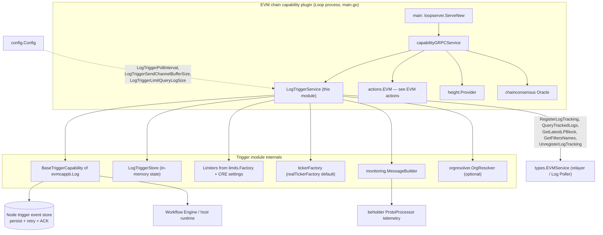
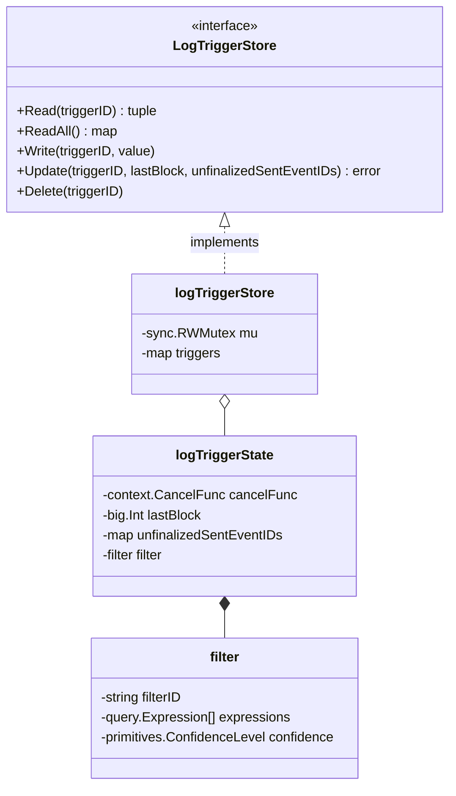
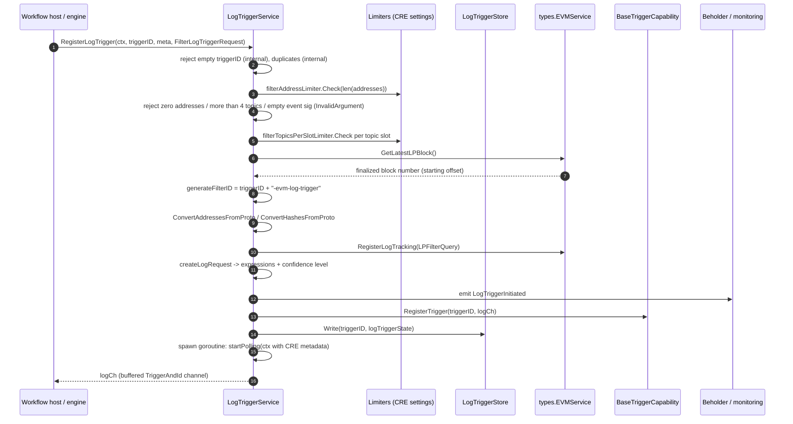
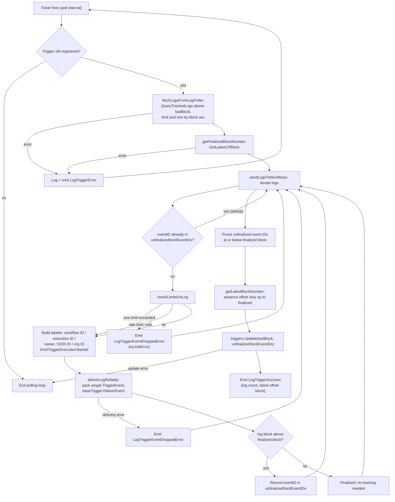
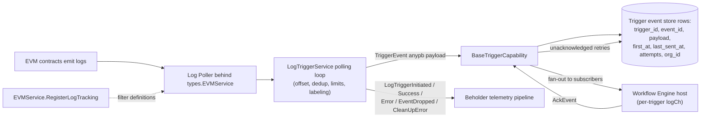

# EVM Chain Capability — Log Trigger Service

The `chain_capability_evm_trigger` module implements the **EVM log trigger capability** of the Chainlink Runtime Environment (CRE). It allows deployed workflows to be initiated by contract events (logs) emitted on EVM chains. The module lives in `capabilities/chain_capabilities/evm/trigger/` and is part of the broader [EVM chain capability](../chain_capability_evm.md), which ships as a standalone [Loop plugin process](../../../Plugin_Process_Framework_(Loop)/loop-plugin-core.md) alongside the [EVM actions](chain_capability_evm_actions.md), [forwarder contracts](chain_capability_evm_forwarder_contracts.md), and [monitoring](chain_capability_evm_monitoring.md) components.

Two source files define the module:

| File | Core components |
|---|---|
| `capabilities/chain_capabilities/evm/trigger/trigger.go` | `LogTriggerService`, `tickerFactory`, `realTickerFactory` |
| `capabilities/chain_capabilities/evm/trigger/store.go` | `LogTriggerStore` (interface + in-memory `logTriggerStore`) |

The trigger is a **poll-based** capability: for every registered trigger it periodically queries the node's Log Poller for new matching logs above a per-trigger offset, converts them to protobuf `evmcappb.Log` events, and hands them to the [core capabilities runtime trigger event store](../core_capabilities_runtime/core_capabilities_runtime_trigger_event_store.md) via `BaseTriggerCapability`, which owns persistence, retransmission, and acknowledgement semantics.

---

## Module Context and Dependencies

### Build and packaging

The trigger is compiled into the EVM chain-capability binary. It is a Go module in its own right — `github.com/smartcontractkit/capabilities/chain_capabilities/evm` (see `capabilities/chain_capabilities/evm/go.mod`) — managed by the [capabilities workspace tooling](../../Build,_CI___Release_Infrastructure/capabilities_workspace_tooling.md) (`capabilities/Makefile` targets `gomodtidy`, `generate`, `update-chain-capabilities`). The monitoring protobufs it depends on (`capabilities/chain_capabilities/evm/monitoring/log_trigger.proto`) are generated through the `protoc`/`generate` Make targets. The plugin process is launched by `capabilities/chain_capabilities/evm/main.go::main`, which registers the gRPC service via `loopserver.ServeNew` and wires OpenTelemetry views with `loop.WithOtelViews(append(consMetrics.MetricViews(), monitoring.MetricViews()...))` — see [plugin runtime](chain_capability_evm_plugin_runtime.md).

### Architectural position

Key external interfaces consumed by `LogTriggerService`:

- **`types.EVMService`** (`chainlink-common/pkg/types`) — the chain abstraction used for all on-chain-log interactions: `RegisterLogTracking`, `UnregisterLogTracking`, `QueryTrackedLogs`, `GetLatestLPBlock`, `GetFiltersNames`. Its query layer is built from `chainlink-common/pkg/types/query` and `.../query/primitives/evm` expressions.
- **`capabilities.BaseTriggerCapability`** (`chainlink-common/pkg/capabilities`) — generic trigger foundation that persists `TriggerEvent` payloads, re-sends unacknowledged events, and fans deliveries out to the workflow host. The service composes it rather than reimplementing delivery (see [capabilities core](../capabilities/capabilities_core.md)).
- **`limits.Factory` + CRE settings** (`chainlink-common/pkg/settings/cresettings`, see [settings](../../Shared_Foundation_Libraries___Domain_Types/settings.md)) — per-workflow resource limits instantiated in `initLimiters`.
- **`orgresolver.OrgResolver`** (`chainlink-common/pkg/services/orgresolver`, see [services](../../Shared_Foundation_Libraries___Domain_Types/services.md)) — optional resolver that maps a workflow owner address to an organization ID for telemetry and delivery routing.
- **`monitoring.MessageBuilder` / `beholder.ProtoProcessor`** — observability stack for the `LogTrigger*` telemetry messages (see [monitoring](chain_capability_evm_monitoring.md) and [beholder telemetry](../../Telemetry___Observability_Platform/beholder-telemetry.md)).

---

## Core Components

### `LogTriggerService`

Defined in `capabilities/chain_capabilities/evm/trigger/trigger.go`. It is the complete trigger capability: registration, polling, filtering, limiting, delivery, and lifecycle management.

**Structure (selected fields):**

| Field | Role |
|---|---|
| `baseTrigger *capabilities.BaseTriggerCapability[*evmcappb.Log]` | Reliable event persistence, retransmission, ACKing, and registration bookkeeping |
| `EVMService types.EVMService` | Chain access: log-tracking registration, tracked-log queries, finalized block lookups, filter listing |
| `triggers LogTriggerStore` | Per-trigger runtime state (offset, dedup map, cancel func, filter config) |
| `logTriggerPollInterval` | Cadence of the per-trigger polling loop |
| `logTriggerSendChannelBufferSize` | Buffer of the per-trigger event channel handed back to the host |
| `limitAndSort query.LimitAndSort` | Reusable query clause: `Limit{Count: logTriggerLimitQueryLogSize}` sorted by block ascending |
| `filterAddressLimiter`, `filterTopicsPerSlotLimiter`, `eventRateLimit`, `eventPayloadSizeLimiter` | Resource limiters built from CRE settings |
| `capabilityDonID uint32` | The **sending capability DON's** on-chain ID, used to label emitted events (fallback: `RequestMetadata.WorkflowDonID` when zero) — see CRE-4409 note below |
| `orgResolver orgresolver.OrgResolver` | Optional owner→organization resolver |
| `beholderProcessor`, `messageBuilder` | Telemetry emission of the `monitoring` protobufs |

**Lifecycle.** The service is itself a `services.Service` created through `services.Config{Name: "EvmLogTriggerService", Start, Close}.NewServiceEngine(lggr)`:

- `start` — starts `baseTrigger`, then schedules `cleanUpStaleFilters` every **30 seconds** via `srvcEng.GoTick`.
- `close` — stops `baseTrigger`.

**Public API** (the trigger half of a `TriggerCapability`):

| Method | Behaviour |
|---|---|
| `RegisterLogTrigger(ctx, triggerID, meta, *evmcappb.FilterLogTriggerRequest)` | Validates input, registers a Log Poller filter, starts a polling goroutine, returns a buffered `<-chan capabilities.TriggerAndId[*evmcappb.Log]` to the host |
| `AckEvent(ctx, triggerID, eventID)` | Delegates to `baseTrigger.AckEvent`; wraps failures as private system errors |
| `UnregisterLogTrigger(ctx, triggerID, meta, input)` | Cancels the polling goroutine, deletes store state, unregisters from `baseTrigger`, and calls `EVMService.UnregisterLogTracking` for the derived filter ID |

### `LogTriggerStore`

Defined in `capabilities/chain_capabilities/evm/trigger/store.go`. A small concurrency-safe abstraction over the map of live triggers, explicitly an interface "for managing locking/unlocking of log triggers, and … to inject it from a test context".

- **`logTriggerState`** holds everything a live trigger needs: the polling `cancelFunc`, `lastBlock` (the latest finalized block the trigger has consumed), `unfinalizedSentEventIDs` (map of event ID → block number, used to suppress duplicate delivery of not-yet-finalized events), and the embedded `filter` (derived query expressions, confidence level, and the Log Poller filter ID).
- **`Update`** replaces only `lastBlock` and `unfinalizedSentEventIDs` while preserving `cancelFunc` and `filter`; it errors if the trigger is missing.
- **`ReadAll`** returns a defensive copy (via `maps.Copy`), which `cleanUpStaleFilters` uses to iterate triggers safely.

### Ticker abstraction

`tickerFactory` / `tickerWrapper` (interfaces) decouple the polling loop from `time.Ticker`. `realTickerFactory` is the production implementation; the package variable `defaultTickerFactory` can be swapped in tests to drive the loop deterministically.

---

## Registration Flow

`RegisterLogTrigger` is the entry point used by the workflow host when a workflow declares an EVM log trigger. It is fully validated before any on-chain registration occurs, and every failure is classified through the `caperrors` taxonomy (user-visible vs. internal, see [capabilities core](../capabilities/capabilities_core.md)).

Validation and derived state details:

- **Address limits** — at least one address is mandatory (`InvalidArgument`); the count is bounded by `filterAddressLimiter` (`LimitExceeded` on breach).
- **Topic limits** — at most 4 topic slots; slot 0 (event signatures) must contain at least one value; each slot's value count is bounded by `filterTopicsPerSlotLimiter`.
- **Starting offset** — `getFinalizedBlockNumber` reads the latest Log Poller block and uses its `FinalizedBlockNumber`, so replay never re-delivers events older than finality at registration time.
- **Filter query construction** (`createLogRequest`) — builds `query.Expression`s: an `Or` over address filters (`evm.NewAddressFilter`), an `Or` over event-signature filters, per-topic `Or` filters for slots 2–4 (`makeEventByTopicFilter`), and maps `ConfidenceLevel` proto values: `FINALIZED → primitives.Finalized`, `LATEST → primitives.Unconfirmed`, default `SAFE → primitives.Safe`.
- **Failure containment** — if `RegisterLogTracking` returns a `caperrors.Error` with `OriginUser`, the error is surfaced as a public user error with the original code; otherwise it is logged, emitted as `LogTriggerError` telemetry, and returned as an `Unavailable` system error.

---

## Polling and Event Delivery Pipeline

Each registered trigger runs one polling goroutine (`startPolling`). The loop is driven by the injected `tickerFactory` at `logTriggerPollInterval` cadence and terminates when the per-trigger context is cancelled (unregistration) or when the trigger disappears from the store.

Important behaviours inside the loop:

- **Event identity** — `generateLogIdentifier` produces `"<txhash>:<blockhash>:<logindex>"` (format `%x:%x:%d`). This ID is both the dedup key and the trigger event ID passed to the engine; execution IDs are derived via `workflows.GenerateExecutionIDWithTriggerIndex` using the trigger index parsed from `RequestMetadata.ReferenceID`.
- **Limit policy** — payload-size violations **drop** the event (with `LogTriggerEventDroppedError` telemetry flagged `isLimitError`), while the rate limiter **waits** (`eventRateLimit.Wait`) because the code explicitly "prefers increased delivery time to event dropping". A limit failure on one log never aborts processing of the remaining logs.
- **Reliable delivery** — `deliverLogReliably` wraps the proto log in `anypb`, builds a `capabilities.TriggerEvent{TriggerType: triggerID, ID, Payload}`, enriches the context with org metadata (`capcommon.ContextWithOrgForDelivery`), and calls `baseTrigger.DeliverEvent`. Once persisted, the event is considered "sent" from the trigger's point of view; retries, ACKs, and lost-event recovery are the base capability's responsibility. Delivery failures are logged and emitted as `LogTriggerEventDroppedError`, and the loop continues with the next log.
- **DON identity labeling (CRE-4409)** — the labeler attaches the *sending* capability DON ID (`capabilityDonID`) so the workflow service can resolve on-chain quorum parameters (N, F). When `capabilityDonID` is 0 (multi-DON job-spec nodes or cores predating CRE-4409), the code permanently falls back to `RequestMetadata.WorkflowDonID`. Additional labels include workflow name/owner/registry selector/address and engine version.
- **Organization labeling** — when `orgResolver` is configured, the owner address is resolved to an organization ID and attached to the telemetry labeler; resolution failures only produce a warning and never block delivery.

### Offset, finality and deduplication invariants

These invariants guarantee at-least-once delivery with no finalized duplicates:

1. `lastBlock` starts at the **finalized** block observed during registration.
2. Queries fetch only logs **strictly above** `lastBlock` (`query.Block(block, primitives.Gt)` appended to the stored expressions).
3. The offset only advances to a log's block when that block is **≤ the current finalized block** (`getLatestBlockNumber` iterates all logs; multiple addresses can produce differing block heights).
4. Unfinalized logs are still delivered, but their event IDs are recorded in `unfinalizedSentEventIDs`; subsequent polls skip them until finality catches up.
5. Once `finalizedBlockNumber ≥` an event's block, the ID is pruned from the map and the pruned set is persisted back via `triggers.Update`.
6. Per-query result volume is capped by `logTriggerLimitQueryLogSize` (default 1000), sorted ascending by block, so backlogs drain in order.

### Filter cleanup

`cleanUpStaleFilters` (every 30 s, using the fake workflow ID `evm-log-trigger-cleanup` for telemetry) guards against orphaned Log Poller filters — e.g. after a crash or restart where in-memory trigger state was lost:

1. `EVMService.GetFiltersNames` lists all registered filters.
2. Filters ending in the module's suffix constant `SuffixLogTriggerFilterID` (`"-evm-log-trigger"`) are candidates.
3. Filter IDs still owned by a live trigger (per `triggers.ReadAll()`) are removed from the candidate set.
4. The remaining orphans are unregistered via `EVMService.UnregisterLogTracking`; failures are emitted as `LogTriggerCleanUpError`.

---

## Resource Limiting and CRE Settings

All limiters are constructed in `initLimiters` from the `limits.Factory` passed to the constructor, using per-workflow defaults from `cresettings.Default.PerWorkflow.LogTrigger` (see the [settings framework](../../Shared_Foundation_Libraries___Domain_Types/settings.md)):

| Limiter | CRE setting | Enforced at |
|---|---|---|
| `filterAddressLimiter` (upper bound) | `PerWorkflow.LogTrigger.FilterAddressLimit` | Registration: number of contract addresses per trigger |
| `filterTopicsPerSlotLimiter` (upper bound) | `PerWorkflow.LogTrigger.FilterTopicsPerSlotLimit` | Registration: topic values per slot (per slot 0–3) |
| `eventRateLimit` (rate limiter) | `PerWorkflow.LogTrigger.EventRateLimit` | Delivery: per-event `Wait` before sending |
| `eventPayloadSizeLimiter` (upper bound) | `PerWorkflow.LogTrigger.EventSizeLimit` | Delivery: `proto.Size` of the serialized log payload |

Because limiters are per-workflow-scoped settings, operators can tune ingestion pressure per workflow without code changes; the related `BaseTrigger*` settings (retry interval, max retries, prune age, max sends per tick) govern the downstream redelivery behaviour of `BaseTriggerCapability` itself.

---

## Telemetry and Monitoring

The module emits structured protobuf telemetry through beholder, with message shapes defined in `capabilities/chain_capabilities/evm/monitoring/log_trigger.proto` (generated via the workspace `make protoc`/`make generate` targets, see the [capabilities workspace tooling](../../Build,_CI___Release_Infrastructure/capabilities_workspace_tooling.md)):

| Message | Emitted when |
|---|---|
| `LogTriggerInitiated` | Registration of a trigger succeeds (carries the `FilterLogTriggerRequest`) |
| `LogTriggerSuccess` | A poll cycle completes (trigger ID, request, `log_count`, `latestOffsetBlock`) |
| `LogTriggerError` | Polling, registration, finality, or unregistration failures (trigger ID, summary, cause) |
| `LogTriggerEventDroppedError` | An individual event is dropped — delivery failure or limit violation (`tx_hash`, `block_hash`, `log_index`, `isLimitError`) |
| `LogTriggerCleanUpError` | The stale-filter cleanup loop fails |

Each message embeds `monitoring.ExecutionContext`, populated from `monitoring.TelemetryContext{TsStart, RequestMetadata}` so events are attributable to workflow, owner, and DON. The message construction is delegated to `monitoring.MessageBuilder` and emission to the injected `beholder.ProtoProcessor`; metric views are registered at plugin startup in `main.go` — details in [chain capability EVM monitoring](chain_capability_evm_monitoring.md).

---

## Configuration Reference

Constructor parameters are sourced from the plugin's `Config` (`capabilities/chain_capabilities/evm/config/config.go::Config`) and resolved in `NewLogTriggerService`, which also enforces its own defaults and cross-validation:

| Parameter | Config JSON key | Default | Validation / notes |
|---|---|---|---|
| `evmService` | — | — | Required `types.EVMService`; panics-free nil-checks are the caller's responsibility |
| `store` | — | — | `LogTriggerStore` (typically `NewLogTriggerStore()`); injectable for tests |
| `capabilityID` | — | — | Must be non-empty, otherwise the constructor fails |
| `capabilityDonID` | — | `0` | Zero means "unknown"; telemetry then falls back to the workflow's DON ID |
| `logTriggerPollInterval` | `logTriggerPollInterval` | — (required) | Must be positive |
| `logTriggerSendChannelBufferSize` | `logTriggerSendChannelBufferSize` | `1000` (`defaultSendChannelBufferSize`) | `0` selects the default |
| `logTriggerLimitQueryLogSize` | `logTriggerLimitQueryLogSize` | `1000` (`defaultLimitQueryLogSize`) | Must be ≤ the send-channel buffer size, otherwise the constructor fails |
| `limitsFactory` | — | — | Supplies the four limiters and the CRE settings handle for the base trigger |
| `orgResolver` | — | `nil` (optional) | When nil, a warning is logged and organization labeling/dispatch context is skipped |
| `triggerEventStore` | — | — | Required; backs `BaseTriggerCapability` |

Other `Config` fields (e.g. `CREForwarderAddress`, `ObservationPollerWorkersCount`, `IsLocaL`) belong to the actions and scheduler components and are documented in [chain capability EVM actions](chain_capability_evm_actions.md) and [plugin runtime](chain_capability_evm_plugin_runtime.md).

---

## End-to-End Data Flow

The diagram below shows the complete journey of a contract event from chain to workflow execution, including the acknowledgement path.

On the node side, the persisted rows (see `chainlink/core/capabilities/triggers/trigger_event_store.go::row`) carry the `OrgID` resolved through `capcommon.ContextWithOrgForDelivery`, enabling multi-tenant accounting and quota enforcement for trigger redelivery — see the [trigger event store module](../core_capabilities_runtime/core_capabilities_runtime_trigger_event_store.md). The remote DON-to-DON propagation of trigger registrations and events is handled by the [remote messaging layer](../core_capabilities_runtime/core_capabilities_runtime_remote_messaging.md) and is outside this module's scope.

---

## Error Handling Taxonomy

All API errors use `caperrors` (see [capabilities core](../capabilities/capabilities_core.md)) and are classified by origin and code:

| Situation | Classification |
|---|---|
| Empty `triggerID` on register | Public system error, `Internal` |
| Duplicate trigger ID | Public system error, `Internal` |
| No addresses provided / more than 4 topics / empty event signature | Public user error, `InvalidArgument` |
| Address or hash conversion failures | Public user error, `InvalidArgument` |
| Registration breaching address/topic limits | Public user error, `LimitExceeded` |
| `RegisterLogTracking` failure (user-originated) | Public user error with the inner code |
| `RegisterLogTracking` failure (system) | Public system error, `Unavailable` + `LogTriggerError` telemetry |
| Finalized-block lookup failure during registration | Private system error, `Unavailable` |
| `AckEvent` failure | Private system error, `Internal` (wrapped) |
| Unregister of unknown trigger | Public system error, `NotFound` |
| `UnregisterLogTracking` failure | Private system error, `Unavailable` + `LogTriggerError` telemetry |

Transient poll-cycle failures (log fetch, finality lookup, store update) never crash the loop: fetch/finality errors `continue` to the next tick; store-update errors terminate that trigger's loop (the stale-filter cleanup will eventually reclaim the orphaned filter).

---

## Testing and Extensibility Points

The module is deliberately test-friendly:

- **`LogTriggerStore` interface** — production code depends on the interface; tests inject fakes to simulate trigger state, offsets, and dedup maps.
- **`tickerFactory` / `tickerWrapper`** — the package-level `defaultTickerFactory` can be replaced with a controllable fake so polling loops run deterministically in tests.
- **Constructor validation** — parameter cross-checks (buffer size vs. query size) surface misconfiguration at startup rather than at runtime.
- **Monitoring mocks** — `monitoring.ProcessorMock` (mockery-generated, see `.mockery.yaml` in the [capabilities workspace tooling](../../Build,_CI___Release_Infrastructure/capabilities_workspace_tooling.md)) supports isolating telemetry in tests.

Integration scenarios for this trigger are exercised by the [capabilities integration tests](../../Dev,_Test___Simulation_Environments/capabilities_integration_tests.md) (e.g. the `MessageEmitter` contract) and the [CRE system tests EVM feature suite](../../Dev,_Test___Simulation_Environments/system-tests.md).

---

## Related Documentation

- [chain_capability_evm](../chain_capability_evm.md) — parent module overview and component map
- [chain_capability_evm_plugin_runtime](chain_capability_evm_plugin_runtime.md) — plugin process bootstrap, gRPC service wiring, height provider
- [chain_capability_evm_actions](chain_capability_evm_actions.md) — the executable (write/read) side of the EVM capability
- [chain_capability_evm_forwarder_contracts](chain_capability_evm_forwarder_contracts.md) — CRE forwarder bindings used by report transmission
- [chain_capability_evm_monitoring](chain_capability_evm_monitoring.md) — processors, message builders, metric views
- [core_capabilities_runtime_trigger_event_store](../core_capabilities_runtime/core_capabilities_runtime_trigger_event_store.md) — node-side persistence behind `BaseTriggerCapability`
- [capabilities_core](../capabilities/capabilities_core.md) — capability interfaces, `caperrors`, base trigger semantics
- [capabilities_registry](../capabilities/capabilities_registry.md) — how this capability is registered with DONs
- [settings](../../Shared_Foundation_Libraries___Domain_Types/settings.md) — CRE settings framework powering the limiters
- [workflows_engine](../workflows/workflows_engine.md) — the consumer side of trigger events
