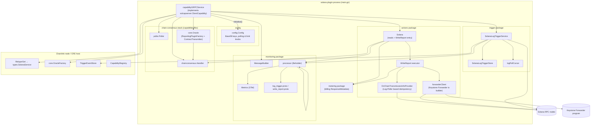
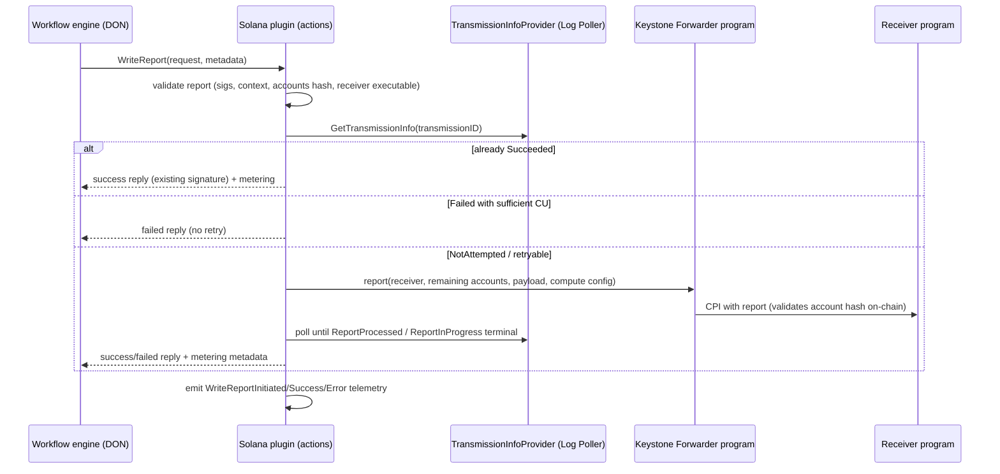
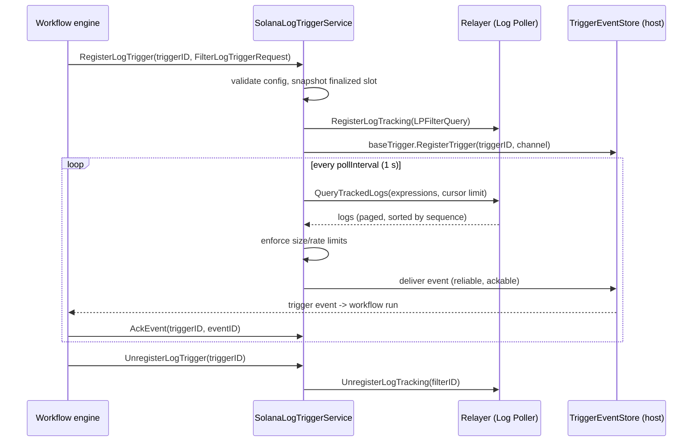
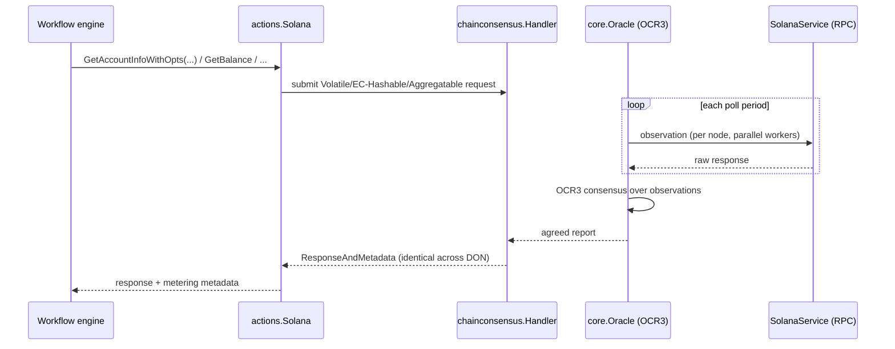

# Solana Chain Capability (`chain_capabilities/solana`)

## 1. Purpose and Scope

The `capabilities/chain_capabilities/solana` module is the **Solana chain capability of the CRE (Chainlink Runtime Environment) engine**. It is a standalone Go plugin binary that runs as a separate OS process next to the Chainlink node (via the [Loop plugin framework](../../Plugin_Process_Framework_(Loop)/loop-plugin-core.md)) and exposes Solana-specific chain functionality to workflows:

- **On-chain reads** — `GetAccountInfoWithOpts`, `GetBalance`, `GetBlock`, `GetFeeForMessage`, `GetMultipleAccountsWithOpts`, `GetSignatureStatuses`, `GetSlotHeight`, `GetTransaction`, executed through the **chain-consensus** layer so that all DON nodes observe identical values.
- **On-chain writes** — `WriteReport` submits OCR3-signed consensus reports to receiver programs through the on-chain **Keystone Forwarder** program, with idempotent transmission handling and compute-budget (CU) management.
- **Log triggers** — `RegisterLogTrigger` / `UnregisterLogTrigger` watch Solana program events (via the Log Poller) and stream matching logs into workflows, with rate limiting, payload-size limits, and reliable at-least-once delivery.
- **Observability & metering** — every operation emits Beholder telemetry (logs + OTel metrics) defined by protobuf schemas, and produces billing `ResponseMetadata` for workflow spend accounting.

The capability registers under the capability name **`solana`** (`CapabilityName` in `main.go`) with capability ID `solana:ChainSelector:<selector>@1.0.0` and capability type `CapabilityTypeCombined` (it is both a trigger and an executable capability).

> **Module identity** — `capabilities/chain_capabilities/solana/go.mod` (Go module `github.com/smartcontractkit/capabilities/chain_capabilities/solana`, Go 1.27.1). Its key dependencies are `gagliardetto/solana-go` (Solana SDK), `chainlink-solana` + `chainlink-solana/contracts` (generated Keystone Forwarder bindings), `chainlink-common` (capabilities framework, shared `SolanaService` types), `chain-selectors` (chain ID → selector mapping), and the in-repo `capabilities/libs` (chain-consensus, poller, metrics, loopserver) and `capabilities/chain_capabilities/common` (shared monitoring/transmission-schedule/limiting helpers — documented in [chain_capabilities_common](chain_capabilities_common.md)).

## 2. Position in the System

```
Workflow Engine (DON)  ──gRPC──▶  Solana capability plugin (this module, `main.go`)
                                      │
        ┌─────────────────────────────┼──────────────────────────────┐
        ▼                             ▼                              ▼
  Log trigger service           Chain-consensus oracle          Solana actions
  (Log Poller events)           (reads via OCR3 pipeline)       (WriteReport / reads RPC)
        │                             │                              │
        ▼                             ▼                              ▼
   Solana relayer service (types.SolanaService, from the RelayerSet) ──▶ Solana RPC nodes
                                      │
                                      ▼
                        Keystone Forwarder program (on-chain)
                                      │ CPI
                                      ▼
                        Receiver program (workflow target)
```

Relationships to other modules:

| Concern | Provided by | Documentation |
|---|---|---|
| Capability interfaces, trigger/exec abstractions | `chainlink-common/pkg/capabilities` | [capabilities](capabilities.md) |
| Plugin process serving (loop/loopserver) | `capabilities/libs/loopserver`, `chainlink-common/pkg/loop` | [loop-plugin-core](../../Plugin_Process_Framework_(Loop)/loop-plugin-core.md) |
| Chain-consensus library (volatile/EC-hashable/aggregatable reads, oracle wiring) | `capabilities/libs/chainconsensus` | [capabilities_shared_libs_chainconsensus](capabilities_shared_libs/capabilities_shared_libs_chainconsensus.md) |
| Shared monitoring / transmission schedule / retry helpers | `capabilities/chain_capabilities/common` | [chain_capabilities_common](chain_capabilities_common.md) |
| Solana chain types (`SolanaService`, `LPFilterQuery`, logs, commitments) | `chainlink-common/pkg/types/chains/solana` | [types-chains](../Shared_Foundation_Libraries___Domain_Types/types-chains.md) |
| Generated Solana client capability proto + server | `chainlink-common/pkg/capabilities/v2/chain-capabilities/solana(/server)` | [types-chains](../Shared_Foundation_Libraries___Domain_Types/types-chains.md) |
| Forwarder program deployment (incl. Solana MCMS) | `chainlink/deployment/cre/forwarder` | [cre-forwarder](../CRE___Keystone_Deployment_Suite/cre-forwarder.md) |
| E2E tests exercising this capability | `chainlink/system-tests/lib/cre/features/solana` | [system-tests](../Dev,_Test___Simulation_Environments/system-tests.md) |
| CCIP Solana lane support (separate package) | `chainlink/core/capabilities/ccip/ccipsolana` | [ccip](../CCIP_Cross-Chain_Protocol/ccip.md) |

## 3. Architecture Overview

The plugin binary is wired in `main.go` and served over gRPC by `loopserver.ServeNew` using the generated `solcapserver.NewClientServer` adapter (the server half of the generated Solana client-capability protocol in `chainlink-common/pkg/capabilities/v2/chain-capabilities/solana`). The `capabilityGRPCService.Initialise` step resolves everything the sub-packages need and then starts them:



Key wiring performed by `Initialise` (`main.go`):

1. **Config** — unmarshals `config.Config` from the capability config JSON (Base58 forwarder program/state/transmitter keys) and applies defaults for polling knobs (see [Configuration](#5-configuration-reference)).
2. **Relayer** — resolves `types.SolanaService` from `dependencies.RelayerSet` via `types.NewRelayID(network, chainID)`; derives the chain selector with `chain_selectors` (fixed test selector when `IsLocal`).
3. **Monitoring** — builds `monitoring.MessageBuilder` from chain/capability info, `monitoring.NewMetrics`, and a Beholder `ProtoProcessor` (schema URLs point at `chain_capabilities/solana/monitoring`).
4. **Transmission scheduling** — if `DeltaStage > 0`, initialises the shared [transmission scheduler](chain_capabilities_common.md) to stagger transmissions by queue position.
5. **Chain reads (optional, `ReadsEnabled`)** — starts `poller.Poller` + `chainconsensus.Handler` and creates a `core.Oracle` from `dependencies.OracleFactory` with a reporting-plugin factory and contract transmitter from `capabilities/libs/chainconsensus/oracle`, using a `noopBlocksProvider` (Solana has no lockable-to-block requests).
6. **Actions** — creates `actions.NewSolana` (forwarder client + on-chain transmission-info provider + limiters).
7. **Triggers** — creates `trigger.NewLogTriggerService` wired to the host `TriggerEventStore`, `OrgResolver`, Beholder processor and a fresh `SolanaLogTriggerStore`; starts all services.

## 4. Functional Sub-modules

The module is organised into five functional sub-modules. Detailed documentation for each:

| Sub-module | Files | Responsibility | Detailed docs |
|---|---|---|---|
| Plugin runtime & lifecycle | `main.go`, `block_provider.go`, `go.mod`, `project.json` | gRPC plugin entry point, lifecycle, dependency wiring, build/dependency graph | [chain_capability_solana_plugin_runtime](chain_capability_solana/chain_capability_solana_plugin_runtime.md) |
| Configuration | `config/config.go` | Capability config schema, Base58 key parsing, JSON unmarshalling | [chain_capability_solana_config](chain_capability_solana/chain_capability_solana_config.md) |
| Actions (reads & WriteReport) | `actions/*.go`, `metering/metering.go` | Consensus-mediated chain reads, OCR3 report transmission via the Keystone Forwarder, idempotency, metering | [chain_capability_solana_actions](chain_capability_solana/chain_capability_solana_actions.md) |
| Log trigger | `trigger/*.go` | Program-event triggers: registration, Log-Poller filters, polling with cursors, limits, stale-filter cleanup | [chain_capability_solana_trigger](chain_capability_solana/chain_capability_solana_trigger.md) |
| Monitoring & telemetry schemas | `monitoring/*.go`, `monitoring/*.proto` | Telemetry messages, OTel metrics, Beholder processor, protobuf schemas | [chain_capability_solana_monitoring](chain_capability_solana/chain_capability_solana_monitoring.md) |

### 4.1 Plugin runtime & lifecycle

`main.go` defines `capabilityGRPCService`, the gRPC service served by `loopserver.ServeNew(CapabilityName, ...)` with OTel views merged from consensus metrics and capability-monitoring metrics (`consMetrics.MetricViews()`, `capmon.MetricViews()`). It implements the generated `solcapserver.ClientCapability` interface (`RegisterLogTrigger`, `UnregisterLogTrigger`, `AckEvent`, plus the standard capability lifecycle: `Initialise`, `Start`, `Close`, `HealthReport`, `Ready`, `Name`, `Description`, `ChainSelector`). `Close` tears down oracle → poller → consensus handler → trigger service → actions in order. `block_provider.go` supplies the `noopBlocksProvider` required by the chain-consensus oracle wiring.

### 4.2 Configuration

`config.Config` carries the forwarder program address, forwarder state address, transmitter key, network/chain identification, transmission staging delay, and the reads subsystem knobs (`ReadsEnabled`, poller worker count/period, unknown-request TTL/cache size). A custom `UnmarshalJSON` parses Solana keys from Base58 strings via `solana.PublicKeyFromBase58` and fails fast on malformed keys. Defaults for the zero-valued knobs are applied in `main.go` (`ObservationPollerWorkersCount=10`, `ObservationPollPeriod=200ms` — half of Solana's ~400 ms slot time, `UnknownRequestsTTL=10s`, `MaxUnknownRequestsCacheSize=1000`).

### 4.3 Actions — reads, WriteReport, forwarder, idempotency

The `actions` package is the executable face of the capability:

- **Reads** (`GetAccountInfoWithOpts`, `GetBalance`, `GetBlock`, `GetFeeForMessage`, `GetMultipleAccountsWithOpts`, `GetSignatureStatuses`, `GetSlotHeight`, `GetTransaction`) each wrap the RPC call in a chain-consensus request type (`VolatileRequest` / `EC-HashableRequest` / `AggregatableRequest`) and resolve it through `chainconsensus.ReadHashableRequestReport` / `ReadDecimal`, so responses are agreed across the DON before they reach the workflow. Payload size and batch-item limits are enforced via `limits.BoundLimiter`s.
- **WriteReport** validates the signed report (signature count/lengths, report context, remaining-accounts SHA-256 hash against the raw report, forwarder-state match, receiver existence/executability), then performs an idempotent transmission cycle: extract the transmission ID → check on-chain state (`NotAttempted` / `Succeeded` / `Failed`, with compute-limit-mismatch retry assessment) → submit via `forwarderClient.InvokeOnReport` → poll the provider for terminal state → return success/failed reply with billing metadata.
- **Forwarder client** builds the Keystone Forwarder `report` instruction (PDA derivation for oracle config, forwarder authority `["forwarder", state, receiver]`, execution state `["execution_state", state, transmissionID]`), encodes the payload (sig count ‖ sigs ‖ raw report ‖ context) and submits the transaction through `SolanaService.SubmitTransaction`.
- **Transmission info provider** registers Log-Poller filters for the forwarder's `ReportInProgress` (reverted txs included) and `ReportProcessed` (successful txs only) events and derives transmission state from tracked logs keyed by `TransmissionId` and `State` subkeys.
- **Metering** converts tx fees (lamports → SOL) and fixed per-call credits into `capabilities.ResponseMetadata`.

### 4.4 Log trigger

`SolanaLogTriggerService` turns Solana program events into workflow trigger events:

1. **Register** — validates the `FilterLogTriggerRequest` (address, event name, IDL JSON, optional CPI filter, subkey comparers), snapshots the current finalized slot as the start block, converts the request to an `LPFilterQuery` (filter name = `<triggerID>-solana-log-trigger`), registers it with the Log Poller through `SolanaService.RegisterLogTracking`, and spawns a polling goroutine.
2. **Poll** — every tick, builds query expressions (address, event signature, block range, subkey comparators) and pages through `QueryTrackedLogs` with keyset pagination (cursor `block-logIndex-txHash`, ≤ 5 pages × 1000 logs per poll), enforcing per-event payload-size and rate limits before delivering logs into the registered channel via the `BaseTriggerCapability` (reliable delivery backed by the host `TriggerEventStore`); events over limit are dropped and reported as `LogTriggerEventDroppedError`.
3. **Unregister / cleanup** — stops polling, unregisters the filter and removes state; a 30 s ticker also removes stale `-solana-log-trigger` filters that no longer have a registered trigger.

### 4.5 Monitoring & telemetry schemas

The `monitoring` package extends the [common chain-capability MessageBuilder](chain_capabilities_common.md) with Solana-specific telemetry messages for both WriteReport and LogTrigger lifecycles. The protobuf schemas `log_trigger.proto` and `write_report.proto` define the wire messages (`WriteReportInitiated/Success/Error/TxFeeCalculationError/ComputeLimitMismatch`, `LogTriggerInitiated/Success/Error/EventDroppedError/CleanUpError`), each carrying a shared `monitoring.ExecutionContext` (field 20) defined in [`capabilities/libs/monitoring/execution_context.proto`](capabilities_shared_libs/capabilities_shared_libs_monitoring.md). The `processor` dispatches each message to Beholder log emission and to the corresponding OTel metric (user/limit errors are intentionally excluded from error metrics).

## 5. Configuration Reference

| Field | Type | Meaning |
|---|---|---|
| `creForwarderAddress` | Base58 string → `solana.PublicKey` | Keystone Forwarder **program** address |
| `creForwarderState` | Base58 string → `solana.PublicKey` | Forwarder **state** (PDA seed) address |
| `transmitter` | Base58 string → `solana.PublicKey` | Transaction payer/transmitter account |
| `isLocal` | `bool` | Run against a local validator (local CRE); fixes chain selector to the test selector and synthesises chain info for monitoring labels |
| `network` / `chainId` | `string` | Used to build the relay ID for the RelayerSet |
| `deltaStage` | `time.Duration` | Staggered transmission scheduling delay per queue position (0 = disabled) |
| `readsEnabled` | `bool` | Enables the chain-consensus oracle and read methods |
| `observationPollerWorkersCount` | `uint` | Workers for the observation poller (default 10) |
| `observationPollPeriod` | `time.Duration` | Poll period for volatile reads (default 200 ms) |
| `unknownRequestsTTL` | `time.Duration` | TTL for unknown-request consensus cache (default 10 s) |
| `maxUnknownRequestsCacheSize` | `int` | Cache size bound (default 1000) |

## 6. Key Flows

### 6.1 WriteReport (write path)



### 6.2 Log trigger (trigger path)



### 6.3 Chain read (consensus path)



## 7. Build, Test and Tooling

- **Nx project** — `capabilities/chain_capabilities/solana/project.json` (`projectType: capability`, implicit dependency on `loopserver`): targets `build` (static linux binaries for amd64/arm64 into `../bin/`), `test`, `race`, `lint` (golangci-lint), `generate` (`go generate` + mockery), `tidy`, `update-libs`.
- **Workspace build** — orchestrated by the [capabilities workspace tooling](../Build,_CI___Release_Infrastructure/capabilities_workspace_tooling.md) (`capabilities/Makefile`, protoc generation, gomod management).
- **Generated code** — monitoring protos produce `log_trigger.pb.go` / `write_report.pb.go` (`monitoring/generate.go`); the client-capability protocol implemented by `main.go` is generated in `chainlink-common/pkg/capabilities/v2/chain-capabilities/solana` (see [types-chains](../Shared_Foundation_Libraries___Domain_Types/types-chains.md)).
- **Test support** — `contracts/utils.go` embeds a test IDL; `utils/utils.go` funds accounts against a local validator for integration-style tests (`trigger/test` hosts local-validator helpers); mocks for the forwarder client and transmission-info provider are generated under `actions/`.

## 8. Related Documentation

- Parent: [Workflow & Capability Runtime (CRE Engine)](Workflow___Capability_Runtime_(CRE_Engine).md) — overview of the runtime, engine and sibling chain capabilities ([EVM](chain_capability_evm.md), [Aptos](chain_capability_aptos.md), [Stellar](chain_capability_stellar.md)).
- Shared capability framework: [capabilities](capabilities.md) and [capabilities_shared_libs](capabilities_shared_libs.md).
- Consensus plumbing used for reads: [capabilities_shared_libs_chainconsensus](capabilities_shared_libs/capabilities_shared_libs_chainconsensus.md).
- Shared helpers (monitoring, transmission scheduling, retry/limits): [chain_capabilities_common](chain_capabilities_common.md).
- Telemetry pipeline (Beholder): [beholder-telemetry](../Telemetry___Observability_Platform/beholder-telemetry.md).
- Solana forwarder & MCMS deployment: [cre-forwarder](../CRE___Keystone_Deployment_Suite/cre-forwarder.md) and [deployment-common](../Deployment_Framework_Core___Product_Deployments/deployment-common.md).
