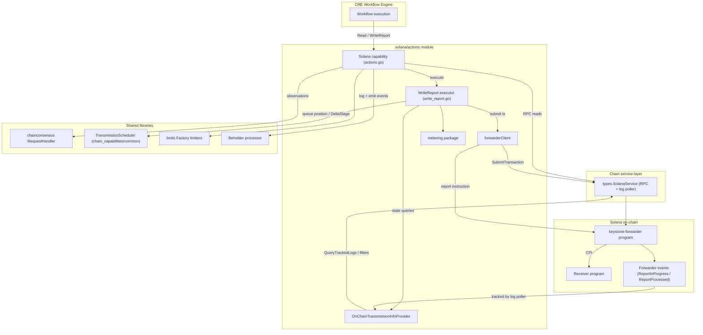
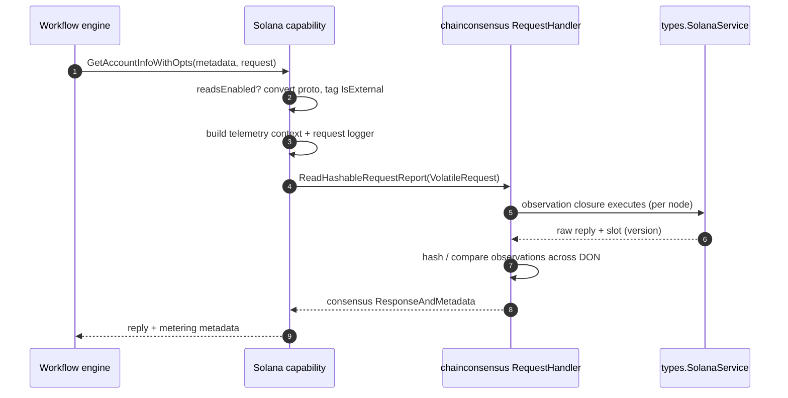
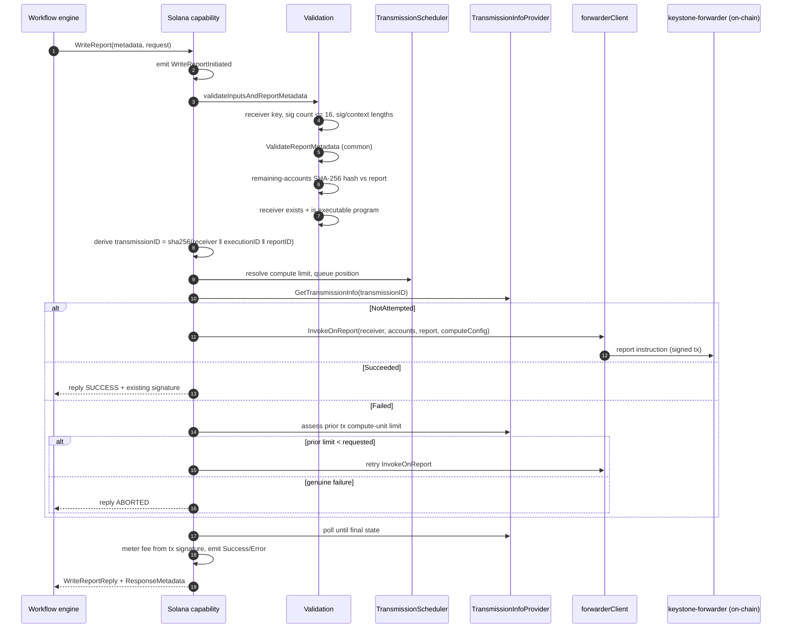
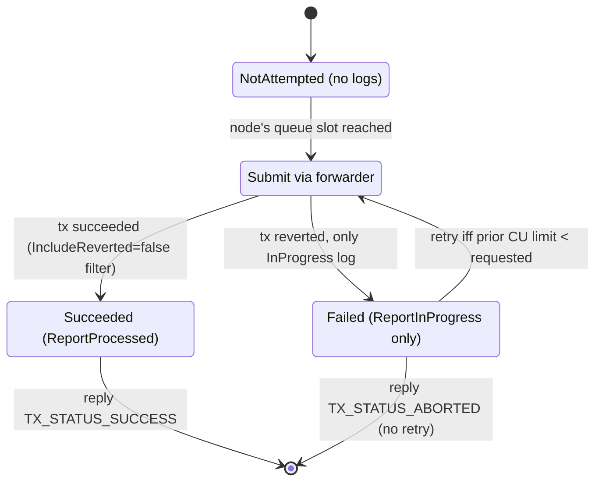
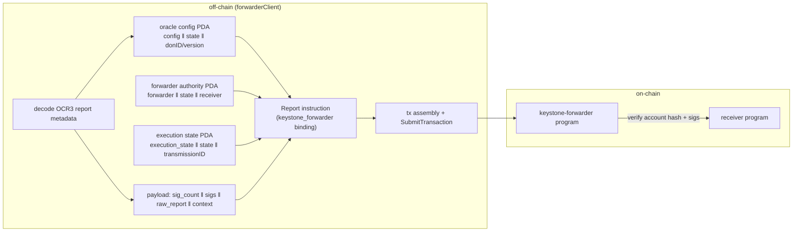
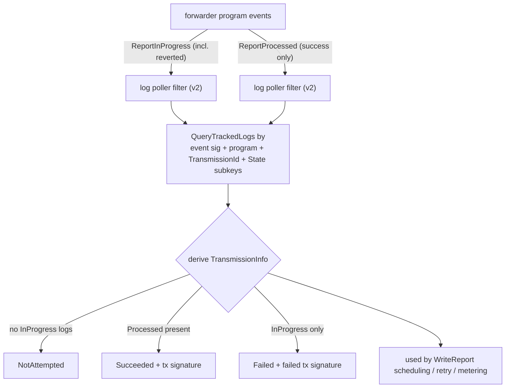

# Solana Chain Capability — Actions (`chain_capability_solana_actions`)

> **Module path:** `capabilities/chain_capabilities/solana/actions` (+ `.../solana/metering`)
> **Parent:** [Solana Chain Capability](../chain_capability_solana.md)

## 1. Overview

The **actions** module is the executable core of the Solana [chain capability](../chain_capability_solana.md) for the Chainlink Runtime Environment (CRE). It is the layer that workflows invoke to interact with the Solana blockchain, and it exposes two families of operations:

1. **Consensus-backed reads** — account, balance, block, fee, signature-status, slot-height and transaction reads that are executed on every DON node and reconciled through the chain-consensus library so that all nodes agree on the returned value (see [Chain Consensus shared libs](../capabilities_shared_libs/capabilities_shared_libs_chainconsensus.md)).
2. **Report writes (`WriteReport`)** — transmission of a signed OCR3 consensus report to a receiver program via the on-chain **keystone-forwarder** program, with deduplication, staggered scheduling, failure analysis and per-transaction fee metering.

The module is deliberately thin over the chain: all RPC traffic flows through the `types.SolanaService` interface (see [Chain Types — chains](../../Shared_Foundation_Libraries___Domain_Types/types-chains.md)), which is satisfied by the node's Solana relayer. All execution lives behind the standard capability interfaces (`ExecutableCapability`) defined in [Capabilities Core](../capabilities/capabilities_core.md), and the capability binary itself is wired up in the [Solana plugin runtime](chain_capability_solana_plugin_runtime.md).

```
Workflow → CRE Engine → capability host (gRPC) → actions.Solana → SolanaService → Solana RPC / forwarder program
```

## 2. Component inventory

| Component | File | Responsibility |
|---|---|---|
| `Solana` | `actions/actions.go` | Top-level capability: construction, limiter init, all read methods, `WriteReport` entry point, `MonitoringContext`, error classification |
| `WriteReport` | `actions/write_report.go` | Write-report executor: validation, transmission-ID derivation, scheduling/polling, retry assessment, reply construction, fee metering |
| `forwarderClient` | `actions/forwarder_client.go` | Builds and submits the keystone-forwarder `report` instruction (PDA derivation, payload encoding, tx assembly) |
| `OnChainTransmissionInfoProvider` | `actions/transmission_info_provider.go` | Registers log-poller filters for forwarder events and derives `TransmissionInfo` (NotAttempted / Succeeded / Failed) from tracked logs |
| `metering` helpers | `metering/metering.go` | Builds `capabilities.ResponseMetadata` billing records for reads and writes |
| `Config` (consumed) | `config/config.go` | Forwarder addresses, transmitter, `DeltaStage`, `ReadsEnabled` — documented in [Solana config](chain_capability_solana_config.md) |
| monitoring protos (emitted) | `monitoring/write_report.proto` | `WriteReportInitiated/Success/Error/TxFeeCalculationError/ComputeLimitMismatch` — documented in [Solana monitoring](chain_capability_solana_monitoring.md) |

The Go module manifest for the capability is [`capabilities/chain_capabilities/solana/go.mod`](../../../capabilities/chain_capabilities/solana/go.mod) (repo root), which pins the key dependencies discussed in §4.

## 3. Architecture



Key structural points:

- **`Solana` is both reader and writer.** It embeds `types.SolanaService` for direct chain access and delegates writes to a per-call `WriteReport` instance (built by `Solana.executeWriteReport`) that shares the forwarder client, transmission-info provider, limiters and scheduler.
- **Writes never talk to the receiver program directly.** All report submissions are routed through the **keystone-forwarder** program, which performs on-chain verification (account-hash check, signature aggregation) and CPIs into the receiver.
- **Transmission truth lives on-chain.** Instead of an in-memory write cache, `OnChainTransmissionInfoProvider` derives transmission state from forwarder events captured by the node's log poller, so every node — including nodes that did not transmit — converges on the same view.

## 4. Dependencies

### Internal

| Dependency | Usage |
|---|---|
| `capabilities/libs/chainconsensus` | `RequestHandler` with `NewVolatileRequest` / `NewECHashableRequest` / `NewAggregatableRequest`, `ReadHashableRequestReport`, `ReadDecimal` — see [chainconsensus](../capabilities_shared_libs/capabilities_shared_libs_chainconsensus.md) |
| `capabilities/chain_capabilities/common` | `GetError` / `NewUserError` error helpers, `ValidateReportMetadata`, retry helpers (`WithQuickRetry`, `WithPollingRetry`), `TransmissionScheduler` — see [chain_capabilities_common](../chain_capabilities_common.md) |
| `chainlink-common/pkg/capabilities` (+ `v2/chain-capabilities/solana`) | Capability framework types (`RequestMetadata`, `ResponseAndMetadata`) and Solana capability protos — see [Capabilities Core](../capabilities/capabilities_core.md) |
| `chainlink-common/pkg/capabilities/consensus/ocr3/types` | Signed-report decoding (`MetadataLen`) used for the account-hash check and transmission-ID extraction — see [Consensus capability](../consensus_capability.md) |
| `chainlink-common/pkg/types/chains/solana` | Chain client types (`SubmitTransactionRequest`, `GetAccountInfoRequest`, `LPFilterQuery`, …) — see [types-chains](../../Shared_Foundation_Libraries___Domain_Types/types-chains.md) |
| `chainlink-common/pkg/settings/limits`, `cresettings` | Per-workflow limiters (`ReportSizeLimit`, `GasLimit`, payload/batch limits) — see [Settings & limits](../../Shared_Foundation_Libraries___Domain_Types/settings.md) |
| `chainlink-common/pkg/capabilities/v2/monitoring`, `beholder` | Telemetry emission — see [Beholder telemetry](../../Telemetry___Observability_Platform/beholder-telemetry.md) |
| `chainlink-solana/contracts/generated/keystone_forwarder` | Generated binding for the on-chain forwarder `report` instruction |
| `chainlink-framework/multinode` | `ErrNodeError` marker for node-infrastructure error classification |
| `chainlink-protos/cre/go/sdk` | `ReportResponse` / `ComputeConfig` wire types |

### External

`github.com/gagliardetto/solana-go` (types, PDA derivation, compute-budget instruction decoding), `google.golang.org/protobuf` (deterministic marshalling for payload-size checks), `go.opentelemetry.io/otel`. The full set is declared in the module's `go.mod` artifact (`capabilities/chain_capabilities/solana/go.mod`), which also shows this is a standalone Go workspace module under the `capabilities` multi-module build (see [Capabilities workspace tooling](../../Build,_CI___Release_Infrastructure/capabilities_workspace_tooling.md)).

## 5. Consensus-backed reads

All read methods are gated by `Config.ReadsEnabled` and follow the same pattern:

1. Convert the proto request into a native `soltypes` request (user errors on malformed input).
2. Enforce limits where applicable (`readPayloadSizeLimiter` on responses, `batchItemLimit` on multi-account/signature batches).
3. Wrap the RPC call as a consensus request and submit it to the injected `chainconsensus.RequestHandler`, so observations from all nodes are compared rather than trusted from a single node.
4. Return a `capabilities.ResponseAndMetadata[T]` carrying the agreed response plus a metering record (see §10).

Two consensus strategies are used:

- **Hashable requests** (`ReadHashableRequestReport`) — full response payloads are hashed and matched across nodes.
  - *Volatile requests* (`NewVolatileRequest`): slot-versioned observations for data that changes with chain state (accounts, balances, programs). The slot is used as the observation version.
  - *Event-consensus requests* (`NewECHashableRequest`): for immutable, execution-context-consistent data (blocks, transactions, signature statuses).
- **Aggregatable requests** (`ReadDecimal`) — each node produces a numeric observation and the handler aggregates it with the `F+1 Highest` method. Used by `GetFeeForMessage` and `GetSlotHeight`, where per-node RPC values can legitimately differ slightly and a quorum-wide maximum is the correct answer.

| Method | Consensus strategy | Extra limits / notes |
|---|---|---|
| `GetAccountInfoWithOpts` | Volatile (slot-versioned) | Payload size limit; marks `IsExternal` for billing |
| `GetBalance` | Volatile | — |
| `GetBlock` | EC-hashable | Payload size limit |
| `GetMultipleAccountsWithOpts` | Volatile | Batch-item limit + payload size limit |
| `GetSignatureStatuses` | EC-hashable | Batch-item limit + payload size limit |
| `GetTransaction` | EC-hashable | Payload size limit |
| `GetProgramAccounts` | Volatile | Results sorted by pubkey before hashing (RPC nodes don't guarantee ordering, so sorting is required for identical hashes across nodes); payload size limit |
| `GetFeeForMessage` | Aggregatable (`F+1 Highest`) | Returns quorum-agreed fee |
| `GetSlotHeight` | Aggregatable (`F+1 Highest`) | Returns quorum-agreed height |

### Read request flow



Errors from the consensus round-trip are normalised by `getReadError`: node-infrastructure failures (`multinode.ErrNodeError`) and deadline exceeded are classified as system errors, everything else as user errors (see §11).

## 6. WriteReport lifecycle

`WriteReport` transmits a signed OCR3 report (produced by the [consensus capability](../consensus_capability.md)) to a receiver program via the forwarder. The high-level flow:



### 6.1 Input validation (`validateInputsAndReportMetadata`)

- Request and `SignedReport` present; receiver is a non-zero 32-byte public key.
- Signature constraints: 1–`maxOracles` (16) signatures, each exactly `signatureLen` (65) bytes; report context exactly `reportContextLen` (96) bytes. These constants mirror the on-chain keystone-forwarder payload layout.
- Generic report metadata is validated by `capcommon.ValidateReportMetadata` (chain-capability shared helpers).
- **Remaining-accounts hash check** (`validateRemainingAccountsHash`): the SHA-256 over the concatenated 32-byte keys of all remaining accounts (forwarder state + forwarder authority + receiver accounts) must equal the `account_hash` embedded in the report's `ForwarderReport` section — replicating the on-chain verification so invalid submissions fail early, off-chain.
- **Receiver liveness check** (off-chain replica of on-chain checks): the receiver account must exist and be an executable program. RPC unreachability is distinguished via the `ErrRPC` sentinel so it is not misreported as a user error.

### 6.2 Transmission ID

`extractTransmissionID` computes `sha256(receiver ‖ executionID ‖ reportID)` where `executionID` is read at offset 1 (32 bytes) and `reportID` at offset 107 (2 bytes) of the raw report — a derivation aligned with the forwarder program, and the key under which the forwarder tracks execution state on-chain.

### 6.3 Compute-budget handling and staggered scheduling

- If the workflow did not supply a compute limit, the default comes from the `txComputeLimit` limiter (per-workflow settings); user-supplied limits are validated against the same bound.
- The `TransmissionScheduler` assigns each node a **queue position** derived from the transmission ID. A node with position > 0 must not transmit immediately; it waits `queuePosition × DeltaStage` (`Config.DeltaStage`) while polling, so exactly one node normally pays for the transmission:
  - Before its slot: check `GetTransmissionInfo` once — if another node already succeeded, return that result.
  - During its window (`pollTransmissionInfo`): exponential-backoff polling (100 ms → 2 s). Early exit on `Succeeded`, or on `Failed` where the failed tx had a sufficient compute-unit limit. At the stage boundary, a final poll decides between "transmit now" and "state unchanged".
- When a prior transmission **failed**, `assessFailedTransmission` decides whether to retry: it fetches the failed transaction and decodes its `SetComputeUnitLimit` instruction (compute-budget program, clamped to `MAX_COMPUTE_UNIT_LIMIT`). The failure is only retried when the prior tx's compute-unit limit was lower than the requested one — i.e., the failure was plausibly caused by under-provisioning rather than by the report itself. A missing `SetComputeUnitLimit` instruction always triggers a retry. Mismatches are surfaced through the `WriteReportComputeLimitMismatch` telemetry event.

### 6.4 Submission and reconciliation

`forwarderClient.InvokeOnReport`:

1. Decodes OCR3 report metadata (DON ID, config version) and derives the **oracle config PDA** (`config` ‖ forwarder-state ‖ (donID<<32|configVersion)), verifying the account exists.
2. Derives the **forwarder authority PDA** (`forwarder` ‖ state ‖ receiver) and the **execution state PDA** (`execution_state` ‖ state ‖ transmissionID).
3. Encodes the payload: `sig_count ‖ sig[0..N] ‖ raw_report ‖ report_context` (Borsh-compatible with the forwarder program).
4. Builds the `Report` instruction (forwarder program), appends the converted remaining account metas (skipping the first two, already embedded), assembles the transaction with the transmitter as payer and submits it through `SolanaService.SubmitTransaction` with the resolved `ComputeConfig`.

After submission, the executor polls the transmission-info provider until the execution state is visible on-chain (`NotAttempted` after submission is retried, since the state account may not be committed yet), then returns one of the replies:

| TxStatus | Meaning |
|---|---|
| `TX_STATUS_SUCCESS` | `ReportProcessed` observed — report executed by the receiver |
| `TX_STATUS_ABORTED` | Transmission attempted but receiver execution reverted (`UnknownIssueExecutingReceiverContractMessage`) |
| `TX_STATUS_FATAL` | Internal invariant violation (unexpected transmission state) |

## 7. Transmission state machine



The state is derived exclusively from log-poller data (`OnChainTransmissionInfoProvider`):

- `ReportInProgress` filter tracks **all** attempts including reverted transactions (`IncludeReverted: true`) — proof that an attempt was made; subkeys `TransmissionId` and forwarder `State` scope queries per transmission and per forwarder deployment.
- `ReportProcessed` filter tracks only **successfully executed** transactions (`IncludeReverted: false`) — its presence proves success, and its tx hash is the successful signature.
- Mapping: no in-progress logs → `NotAttempted`; processed log present → `Succeeded`; in-progress without processed → `Failed`.
- A legacy filter registration (`eventReportInProgress_<programID>` without the `_v2` suffix) is unregistered at startup for backward compatibility.

## 8. Forwarder client ↔ on-chain program



The client validates every remaining-account meta (nil check, exactly 32-byte public keys) before converting protobuf metas into `solana.AccountMeta`, preventing panics on short keys and mirroring the on-chain account ordering. The tx is encoded with an empty blockhash — the chain service fills in a recent blockhash at submission time.

## 9. On-chain transmission info provider data flow



Query limits are deliberately small (`inProgressLogsLimit = 1`, `CountLimit(1)` for processed) with ascending sequence sort, since only the first observation per transmission is needed for the state decision.

## 10. Metering & billing

The `metering` package turns execution outcomes into `capabilities.ResponseMetadata` consumed by the CRE metering pipeline (see [Metering & billing](../../Shared_Foundation_Libraries___Domain_Types/metering-and-billing.md)):

- **Writes** — `GetResponseMetadataWriteReport(feeInLamports, chainSelector)`: the actual fee of the transmitting transaction (read from tx meta via `getFee`, looked up by the final transmission signature with quick-retry). `SpendValueInGasUnits` is the raw lamports, legacy `SpendValue` is the lamports→SOL conversion, and `SpendUnit` is `GAS.<chainSelector>` — so **every** node reports the same spend regardless of which node transmitted.
- **Reads** — `GetResponseMetadata(GetAccountInfo)`: a placeholder credit entry (`SpendUnit: "RPC_EVM"`) pending product-defined pricing and unit generalisation (tracked as TODO PLEX-3022 in `metering/metering.go`).

A fee-lookup failure after a successful write is surfaced as a `WriteReportTxFeeCalculationError` telemetry event and yields empty metadata instead of failing the workflow reply.

## 11. Error classification

The module distinguishes **user errors** (bad request data → surfaced to the workflow author) from **system/infrastructure errors** (node or RPC problems → retried/alerted):

- `isUserError` on the read path: anything that is not `context.DeadlineExceeded` and not a node-infrastructure error (`multinode.ErrNodeError` match).
- On the write path, user errors are identified by the `capcommon.UserError` prefix attached by the shared validation helpers; RPC failures during receiver validation map to `ErrRPC` and are classified as system errors even though they occur inside validation.
- Final classification/translation into `caperrors.Error` (public/private, kind) is delegated to `capcommon.GetError` / `NewUserError`, shared with the other chain capabilities ([EVM](../chain_capability_evm.md), [Aptos](../chain_capability_aptos.md), [Stellar](../chain_capability_stellar.md)).

## 12. Configuration & limits

The actions module consumes the Solana capability `Config` (documented in [Solana config](chain_capability_solana_config.md)); the fields that directly drive behaviour here:

| Field | Effect on actions |
|---|---|
| `CREForwarderAddress` / `CREForwarderState` / `Transmitter` | Forwarder program, state PDA and payer for report submission and for log-filter registration |
| `ReadsEnabled` | Feature flag gating every read method (disabled reads return a public system error) |
| `DeltaStage` | Per-queue-position transmission delay used by the scheduler |
| `ObservationPollerWorkersCount`, `ObservationPollPeriod`, `UnknownRequestsTTL`, `MaxUnknownRequestsCacheSize` | Used by the surrounding capability service, not by actions directly |

Limiters are created from the CRE settings framework's per-workflow defaults (`ChainWrite.Solana.ReportSizeLimit`, `ChainWrite.Solana.GasLimit`, `ChainRead.Solana.PayloadSizeLimit`, `ChainRead.Solana.BatchItemLimit`) via `limits.Factory`, and all are closed together by `Solana.Close()` via `services.CloseAll`.

## 13. Observability

- Structured request loggers are derived per call via `monitoring.MessageBuilder.RequestLggr` (request ID, queue position, payloads).
- Beholder proto events (defined in [`monitoring/write_report.proto`](../../../capabilities/chain_capabilities/solana/monitoring/write_report.proto), repo root): `WriteReportInitiated`, `WriteReportSuccess`, `WriteReportError` (with `isUserError`), `WriteReportTxFeeCalculationError`, `WriteReportComputeLimitMismatch` — all carrying the full request and an `ExecutionContext`. Event building/emission semantics are covered in [Solana monitoring](chain_capability_solana_monitoring.md); transport in [Beholder telemetry](../../Telemetry___Observability_Platform/beholder-telemetry.md).
- `Solana.MonitoringContext()` exposes the logger and capability metric attributes for the v2 monitoring framework.

## 14. Related modules

- [Solana Chain Capability](../chain_capability_solana.md) — parent overview and capability wiring.
- [Solana config](chain_capability_solana_config.md) · [Solana monitoring](chain_capability_solana_monitoring.md) · [Solana plugin runtime](chain_capability_solana_plugin_runtime.md) (gRPC service, block provider) · [Solana trigger](chain_capability_solana_trigger.md) (log-trigger counterpart for workflow triggers).
- [chain_capabilities_common](../chain_capabilities_common.md) — shared error helpers, report-metadata validation, retry utilities, transmission scheduling.
- [Capabilities Core](../capabilities/capabilities_core.md) and [Capabilities PB](../capabilities/capabilities_pb.md) — capability interfaces and wire format this module implements.
- [Chain consensus shared libs](../capabilities_shared_libs/capabilities_shared_libs_chainconsensus.md) — request-handler semantics used by reads.
- [Consensus capability](../consensus_capability.md) — produces the OCR3 reports consumed by `WriteReport`.
- [types-chains](../../Shared_Foundation_Libraries___Domain_Types/types-chains.md) — `types.SolanaService` and Solana chain types.
- [Metering & billing](../../Shared_Foundation_Libraries___Domain_Types/metering-and-billing.md) and [Settings & limits](../../Shared_Foundation_Libraries___Domain_Types/settings.md) — downstream consumers of the metadata and sources of the limiter defaults.
- [Keystone/CRE deployment suite](../../CRE___Keystone_Deployment_Suite/cre-forwarder.md) — deploys and configures the forwarder programs this module targets (including Solana forwarder deployment).
