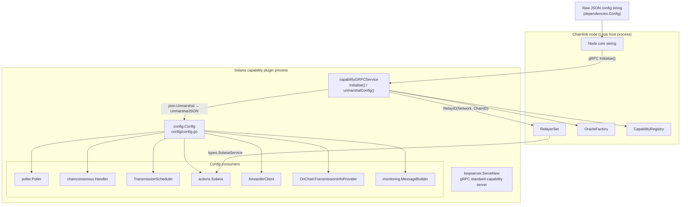
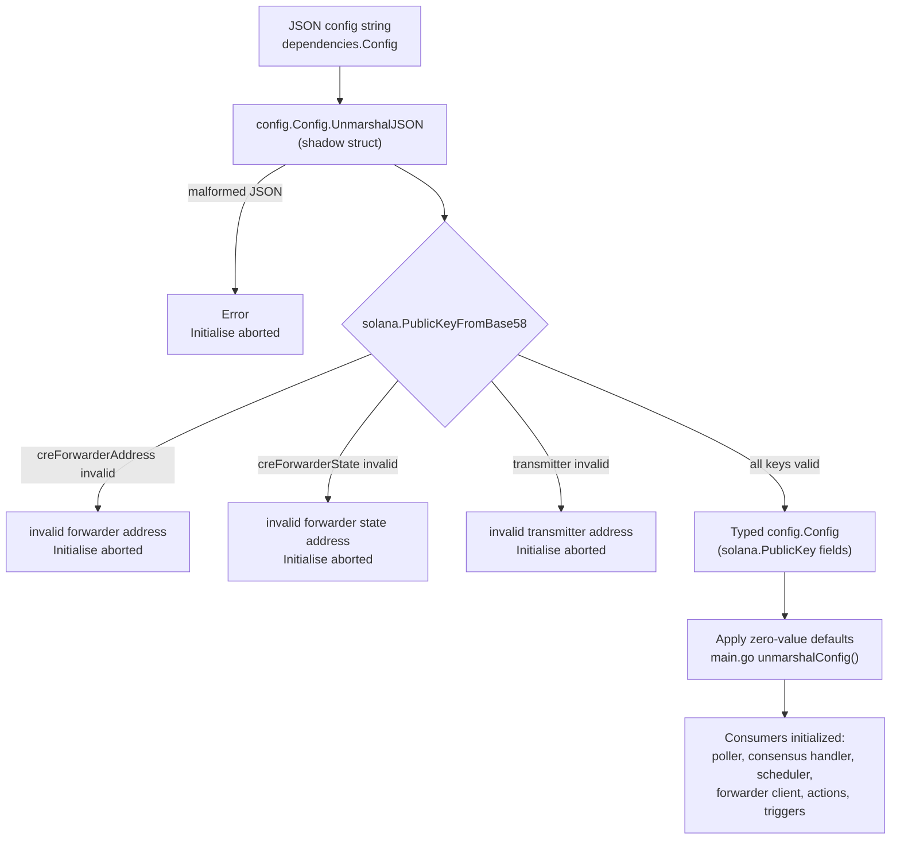
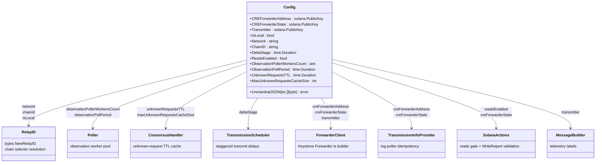

# chain_capability_solana_config

The `chain_capability_solana_config` module defines the **configuration contract** for the Solana chain capability plugin of the Chainlink Runtime Environment (CRE). It lives in a single, dependency-light Go package:

- Source: `capabilities/chain_capabilities/solana/config/config.go`
- Go module: `github.com/smartcontractkit/capabilities/chain_capabilities/solana` (see `capabilities/chain_capabilities/solana/go.mod`)

Its only exported type, `Config`, is the typed representation of the JSON configuration string that the node core hands to the Solana capability plugin during `Initialise()`. It also owns the custom JSON deserialization logic — most notably Base58-decoding and validating the three Solana public keys (forwarder program, forwarder state, transmitter) — and is therefore the first (and strictest) validation gate the capability's configuration passes through.

For the capability itself (plugin runtime, actions, triggers, monitoring), see [chain_capability_solana](../chain_capability_solana.md). This page focuses exclusively on the config package and everything that flows out of it.

---

## Role in the Solana capability lifecycle

The Solana capability is a Loop plugin: a standalone process that exposes gRPC standard capabilities to the node core (see [loop-plugin-core](../../Plugin_Process_Framework_(Loop)/loop-plugin-core.md)). Its lifecycle is:

1. `main.go` starts a gRPC server via `loopserver.ServeNew("solana", ...)`.
2. The node core calls `Initialise(ctx, dependencies)` with a **raw JSON config string** in `dependencies.Config`.
3. `capabilityGRPCService.unmarshalConfig` decodes that string into this module's `config.Config` (which runs `UnmarshalJSON` internally), applies zero-value defaults, and uses the result to construct every runtime component of the capability.

Because every downstream subsystem (observation poller, consensus handler, OCR3 oracle, transmission scheduler, forwarder client, actions) is parameterized from this single struct, the config package is the de-facto *schema definition* of the Solana capability.



---

## Configuration contract

### Fields

| Go field | JSON key | Go type | Default (applied by `main.go`) | Description |
|---|---|---|---|---|
| `CREForwarderAddress` | `creForwarderAddress` | `solana.PublicKey` (Base58 string in JSON) | none — **required, validated** | Keystone Forwarder **program** address. Also assigned to the generated binding's `ks_forwarder.ProgramID` package variable when the forwarder client is built. |
| `CREForwarderState` | `creForwarderState` | `solana.PublicKey` (Base58 string in JSON) | none — **required, validated** | Forwarder **state** PDA address. Used for PDA/authority derivation, transmission-idempotency lookups, and the forwarder-state match check in `WriteReport` input validation. |
| `Transmitter` | `transmitter` | `solana.PublicKey` (Base58 string in JSON) | none — **required, validated** | The node's transmitter account (payer of forwarder transactions). Emitted as a telemetry label via `cfg.Transmitter.String()` in the monitoring `MessageBuilder`. |
| `IsLocal` | `isLocal` | `bool` | `false` | Run against a local validator (local CRE runs only). Pins the chain selector to the test selector and synthesizes `ChainInfo` for monitoring labels when the relayer cannot resolve them. |
| `Network` | `network` | `string` | — | Network name; combined with `ChainID` into a `types.RelayID` for RelayerSet lookup. Falls back to `"local"` in monitoring labels when `IsLocal` and unset. |
| `ChainID` | `chainId` | `string` | — | Solana chain ID (genesis-hash string). Mapped to a chain selector via `chain_selectors.SolanaChainIdToChainSelector()`; falls back to the selector value in monitoring labels when `IsLocal` and unset. |
| `DeltaStage` | `deltaStage` | `time.Duration` | `0` (scheduling disabled) | Staggered transmission scheduling delay per queue position. The shared transmission scheduler is only initialized when **greater than zero**. |
| `ReadsEnabled` | `readsEnabled` | `bool` | `false` | Gates the chain-reads subsystem (observation poller, consensus handler, OCR3 oracle). Read APIs return a public `"reads are not available"` system error when false. |
| `ObservationPollerWorkersCount` | `observationPollerWorkersCount` | `uint` | `10` | Worker-pool size for the observation request poller. |
| `ObservationPollPeriod` | `observationPollPeriod` | `time.Duration` | `200ms` | Polling interval for observation requests — half of Solana's ~400 ms slot time, so volatile requests observe every block. |
| `UnknownRequestsTTL` | `unknownRequestsTTL` | `time.Duration` | `10s` | Base TTL for the consensus handler's unknown-request cache; further derived via `capcommon.MaxRequestTimeoutWithMultiplier` (see [chain_capabilities_common](../chain_capabilities_common.md)). |
| `MaxUnknownRequestsCacheSize` | `maxUnknownRequestsCacheSize` | `int` | `1000` | Capacity bound of the consensus handler's unknown-request cache. |

Notes:

- Duration fields follow standard `encoding/json` semantics for `time.Duration`: they are JSON **numbers of nanoseconds** (e.g. `200ms` = `200000000`). String forms such as `"200ms"` are **not** accepted — this differs from TOML-based node configuration.
- `ChainID` is a JSON *string* (the Solana genesis-hash identifier, e.g. `5eykt4UsFv8P8NJdTREpY1vzqKqZKvdpKuc147dw2N9d` for mainnet-beta), not a number — the capability converts it into a chain selector during `Initialise` to derive the capability ID `solana:ChainSelector:<n>@1.0.0`.
- The exported `Transmitter` field carries **no JSON tag** (the shadow struct inside `UnmarshalJSON` supplies the `transmitter` tag). Deserialization is unaffected, but tools that round-trip `config.Config` through `json.Marshal` must be aware the exported field would serialize under its Go field name.
- Unlike the EVM config, the Solana config has no log-trigger tuning, gas or lookback fields; trigger behavior is driven entirely by registered `FilterLogTriggerRequest`s (see [chain_capability_solana_trigger](chain_capability_solana_trigger.md)).

### Example configuration

```json
{
  "creForwarderAddress": "ForwarderProgramBase58Address",
  "creForwarderState": "ForwarderStatePDABase58Address",
  "transmitter": "NodeTransmitterBase58Address",
  "isLocal": false,
  "network": "solana-mainnet",
  "chainId": "5eykt4UsFv8P8NJdTREpY1vzqKqZKvdpKuc147dw2N9d",
  "deltaStage": 1000000000,
  "readsEnabled": true,
  "observationPollerWorkersCount": 10,
  "observationPollPeriod": 200000000,
  "unknownRequestsTTL": 10000000000,
  "maxUnknownRequestsCacheSize": 1000
}
```

---

## JSON deserialization (`UnmarshalJSON`)

`Config` implements a custom `UnmarshalJSON` using the common **shadow-struct pattern** (the same approach used by the Aptos config in `capabilities/chain_capabilities/aptos/config/config.go`):

1. An unexported `config` struct mirrors all fields, with the three Solana keys (`CREForwarderAddress`, `CREForwarderState`, `Transmitter`) typed as raw `string`s (Base58) and all other fields carrying their JSON tags.
2. The raw payload is unmarshalled into the shadow struct.
3. All plain fields are copied field-by-field into the exported `Config`.
4. Each Base58 string is converted with `solana.PublicKeyFromBase58` (from `github.com/gagliardetto/solana-go`). A failure aborts startup with a wrapped error identifying the offending key:

   | Field | Error on failure |
   |---|---|
   | `CREForwarderAddress` | `invalid forwarder address: %w` |
   | `CREForwarderState` | `invalid forwarder state address: %w` |
   | `Transmitter` | `invalid transmitter address: %w` |

Key behavior:

- **Validation, not defaults.** The package validates the key formats but deliberately does *not* fill in zero-value defaults; that responsibility belongs to `capabilityGRPCService.unmarshalConfig` in `capabilities/chain_capabilities/solana/main.go`, which logs each substitution (e.g. `ObservationPollPeriod is zero, setting to 200ms`).
- **Fail-fast.** A deserialization error (malformed JSON or an invalid Base58 key) aborts `Initialise` before any component is constructed — the capability never runs with a partially-specified config.
- A stale copy-paste comment in the shadow struct describes `Transmitter` as *"Address of forwarder program state"*; the actual semantic is the node's transmitter key, as shown in the table above.



---

## Config consumers and field flow

Every field is consumed at a well-defined point in `Initialise` (`capabilities/chain_capabilities/solana/main.go`):



### Consumer details

| Consumer | Created with | Fields used |
|---|---|---|
| Relayer resolution | `types.NewRelayID` + `dependencies.RelayerSet.Get` | `Network`, `ChainID` |
| Chain-selector resolution | `setSelector` + `chain_selectors.SolanaChainIdToChainSelector()` | `ChainID`; fixed test selector when `IsLocal` |
| Capability identity | `capabilities.CapabilityInfo{IsLocal: cfg.IsLocal, ...}` | `IsLocal` |
| Local chain info | `localChainInfo` (synthesizes `types.ChainInfo` when `IsLocal`) | `ChainID`, `Network` (fallbacks: selector value / `"local"`) |
| Monitoring | `monitoring.NewMessageBuilder(chainInfo, capInfo, cfg.Transmitter.String())` (see [chain_capability_solana_monitoring](chain_capability_solana_monitoring.md)) | `Transmitter` |
| Transmission scheduler | `ts.InitialiseTransmissionScheduler(..., cfg.DeltaStage, ...)` | `DeltaStage` — scheduler **skipped entirely** when zero |
| Observation poller | `poller.NewPoller` (`capabilities/libs/chainconsensus/poller`) | `ObservationPollerWorkersCount`, `ObservationPollPeriod` |
| Consensus handler | `chainconsensus.NewHandler` | `UnknownRequestsTTL` (first passed through `capcommon.MaxRequestTimeoutWithMultiplier`, see [chain_capabilities_common](../chain_capabilities_common.md)), `MaxUnknownRequestsCacheSize` |
| Reads subsystem gate | `Initialise` — poller, handler, and OCR3 oracle are only created when `ReadsEnabled` is true | `ReadsEnabled` |
| Forwarder client | `actions.newForwarderClient` (see [chain_capability_solana_actions](chain_capability_solana_actions.md)) — also sets `ks_forwarder.ProgramID` from the program address | `CREForwarderAddress`, `CREForwarderState`, `Transmitter` |
| Transmission-info provider | `actions.newOnChainTransmissionInfoProvider` | `CREForwarderAddress`, `CREForwarderState` |
| Solana actions | `actions.NewSolana(ctx, cfg, solService, ...)` | `ReadsEnabled` (read-API gate), `CREForwarderState` (forwarder-state match in `WriteReport` validation) |

### `IsLocal` semantics

`IsLocal` is the only field that changes *resolution logic* rather than mere runtime parameters. When set:

- `setSelector` skips `SolanaChainIdToChainSelector` (a local validator's chain ID is not a known network) and pins the selector to `chain_selectors.TEST_22222…` (the fixed test selector).
- `localChainInfo` builds `types.ChainInfo` locally (`FamilyName: "solana"`, `NetworkNameFull: <network>-local`, `ChainID` defaulting to the selector) instead of querying `relayer.GetChainInfo`, since a local relayer cannot derive chain metadata from a fixed genesis hash.

### `DeltaStage` and `ReadsEnabled` opt-outs

Two fields deliberately **disable** subsystems when at their zero value:

- `DeltaStage == 0` → no transmission scheduler; reports are transmitted immediately without queue-position staggering.
- `ReadsEnabled == false` → no observation poller, consensus handler, or oracle; the read methods of the actions API fail with a public system error, while `WriteReport` and log triggers remain fully functional.

---

## Comparison with sibling chain-capability configs

All chain capabilities follow the same config-package convention, making new chain integrations predictable. The closest relatives are:

| Concern | Solana (this module) | [EVM](../chain_capability_evm.md) | [Aptos](../chain_capability_aptos.md) |
|---|---|---|---|
| Forwarder address | `creForwarderAddress` + `creForwarderState` + `transmitter` (`solana.PublicKey`, Base58-decoded) | `creForwarderAddress` (plain string) | `creForwarderAddress` (`[32]byte`, hex-decoded) |
| Chain identity | `network` + `chainId` (string) | `chainId` (uint64) + `network` | `network` + `chainId` (string) |
| Consensus/observation settings | workers, poll period, TTL, cache size | same set | same set (+ `chainHeightPollPeriod`) |
| Transmission scheduling | `deltaStage` (0 disables) | `deltaStage` | `deltaStage` |
| Chain-specific extras | `readsEnabled`, `isLocal` | log-trigger settings, `forwarderLookbackBlocks`, `receiverGasMinimum`, `nodeAddress`, `isLocaL` | `p2pToTransmitterMap`, `txSearchStartingBuffer` |
| Custom `UnmarshalJSON` | Yes (Base58 key decoding, shadow struct) | No | Yes (hex address decoding, shadow struct) |

Shared concerns (limits, request-timeout derivation, transmission-scheduling primitives) live in the [chain_capabilities_common](../chain_capabilities_common.md) module, and the capability interfaces consumed by this plugin (`types.SolanaService`, `RelayerSet`, `RelayID`) are defined in [types-core](../../Shared_Foundation_Libraries___Domain_Types/types-core.md).

---

## Dependencies

Per `capabilities/chain_capabilities/solana/go.mod`, the config package itself depends only on:

- `encoding/json`, `fmt`, `time` (standard library)
- `github.com/gagliardetto/solana-go` — `PublicKey` type and `PublicKeyFromBase58` decoder

The wider module additionally requires `chainlink-common`, `chain-selectors`, `chainlink-solana` (+ generated forwarder contracts), `chainlink-framework/multinode`, `libocr`, and the in-repo `capabilities/libs` workspace modules — these are consumed by the config's *users*, not by the config package itself. The module is part of the `capabilities/` Go workspace; build and code-generation targets (`protoc`, `gomods`, `tidy`, `update-chain-capabilities`) are provided by `capabilities/Makefile`, with per-project metadata in `capabilities/chain_capabilities/solana/project.json` and the workspace graph in `capabilities/nx.json`.

---

## Testing

Unit tests for the deserialization and default-handling behavior live in the actions package (`capabilities/chain_capabilities/solana/actions/actions_test.go`, `write_report_test.go`), which constructs `config.Config` values to drive `NewSolana`, the forwarder client, and the transmission-info provider. End-to-end coverage of the Solana capability — including config-driven startup against a local Solana validator (`isLocal: true`) — is maintained by the CRE system tests' `solana` feature suite (`chainlink/system-tests/lib/cre/features/solana/v2/solana.go`; see [system-tests](../../Dev,_Test___Simulation_Environments/system-tests.md)).

---

## Related documentation

- [chain_capability_solana](../chain_capability_solana.md) — parent module: full Solana chain capability architecture and lifecycle wiring
- [chain_capability_solana_actions](chain_capability_solana_actions.md) — primary consumer: reads, WriteReport, forwarder client, transmission-info provider
- [chain_capability_solana_trigger](chain_capability_solana_trigger.md) — log-trigger service consuming the relayer resolved via `Network`/`ChainID`
- [chain_capability_solana_monitoring](chain_capability_solana_monitoring.md) — telemetry schemas referencing the `Transmitter` label
- [chain_capability_solana_plugin_runtime](chain_capability_solana_plugin_runtime.md) — plugin entry point and default application (`unmarshalConfig`)
- [capabilities](../capabilities.md) — capability model (`CapabilityInfo`, request metadata) shared by all capabilities
- [chain_capabilities_common](../chain_capabilities_common.md) — shared transmission scheduling and request-timeout derivation
- [chain_capability_evm](../chain_capability_evm.md) / [chain_capability_aptos](../chain_capability_aptos.md) / [chain_capability_stellar](../chain_capability_stellar.md) — sibling chain capabilities
- [types-core](../../Shared_Foundation_Libraries___Domain_Types/types-core.md) — `SolanaService`, `Relayer`, `RelayerSet` interfaces
- [loop-plugin-core](../../Plugin_Process_Framework_(Loop)/loop-plugin-core.md) — plugin process lifecycle that delivers the config
