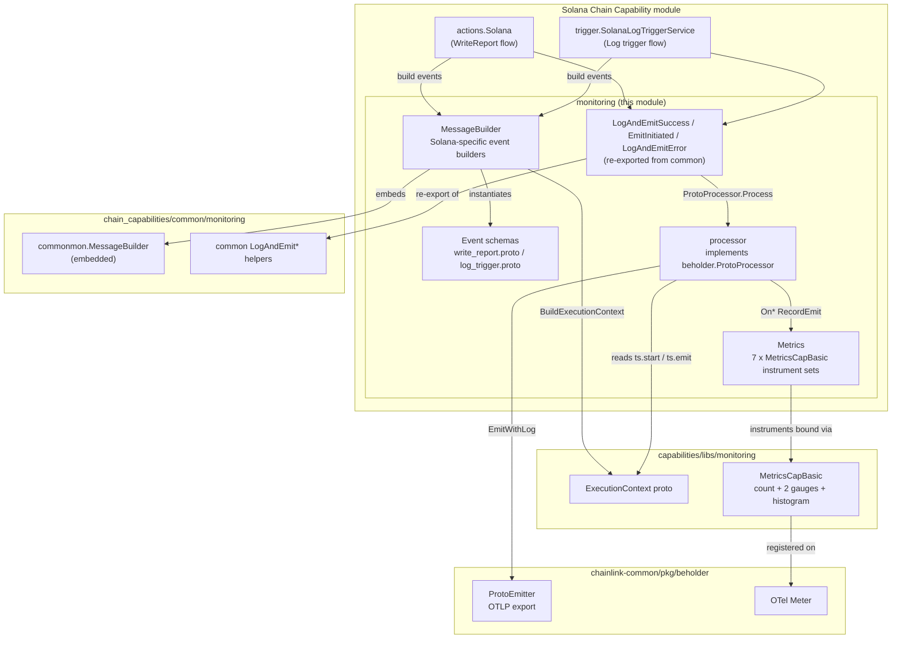
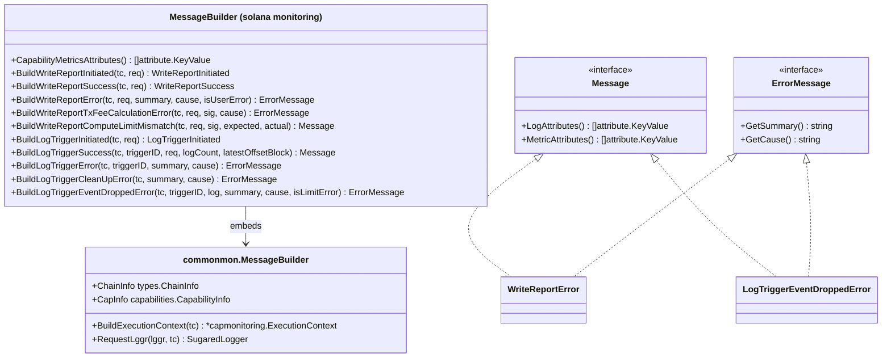
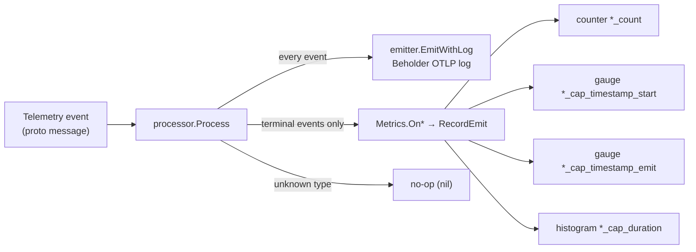
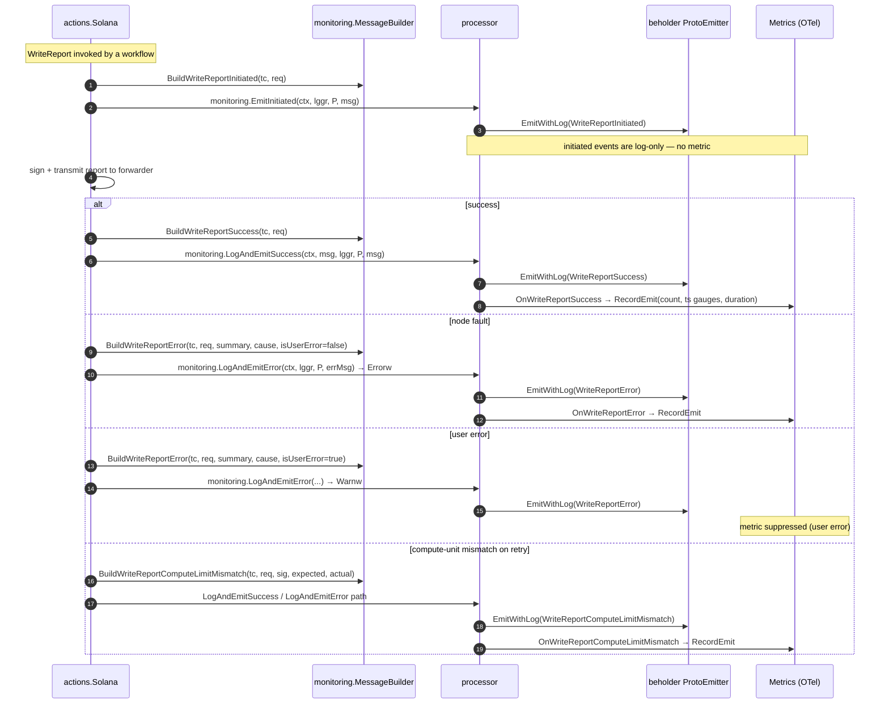
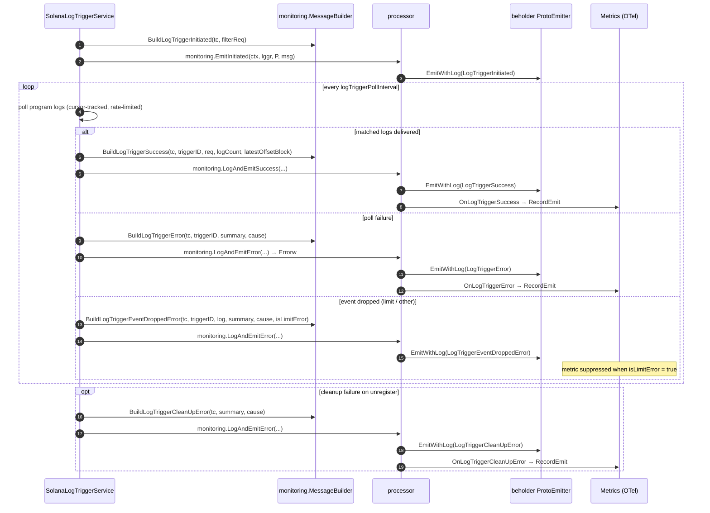

# Solana Chain Capability — Monitoring

The `chain_capability_solana_monitoring` module (Go package `capabilities/chain_capabilities/solana/monitoring`) is the **telemetry layer of the Solana Chain Capability**. It converts operational events from the Solana capability's two execution surfaces — **on-chain report transmission** (`WriteReport`) and **program log triggering** (`LogTrigger`) — into:

- **Structured protobuf telemetry events** (schemas in [`log_trigger.proto`](#log_triggerproto--log-trigger-events) and [`write_report.proto`](#write_reportproto--write-report-events)), each carrying a shared `ExecutionContext`;
- **OpenTelemetry metrics** (counters, timestamp gauges, and duration histograms) emitted through [Beholder](../../Telemetry___Observability_Platform/beholder-telemetry.md);
- **Local structured logs** with the same attribute sets.

It follows the monitoring pattern shared by all chain capabilities (see the EVM counterpart, [Chain Capability EVM Monitoring](../chain_capability_evm/chain_capability_evm_monitoring.md)) and is consumed by the capability's [Actions](chain_capability_solana_actions.md) and [Log Trigger](chain_capability_solana_trigger.md) services, which are wired up in the [Solana Plugin Runtime](chain_capability_solana_plugin_runtime.md).

| | |
|---|---|
| **Package** | `capabilities/chain_capabilities/solana/monitoring` |
| **Go module** | `github.com/smartcontractkit/capabilities/chain_capabilities/solana` (`capabilities/chain_capabilities/solana/go.mod`) |
| **Parent module** | [Chain Capability: Solana](../chain_capability_solana.md) |
| **Key dependencies** | `capabilities/chain_capabilities/common/monitoring`, `capabilities/libs/monitoring`, `chainlink-common/pkg/beholder`, `go.opentelemetry.io/otel`, `github.com/gagliardetto/solana-go`, `github.com/mr-tron/base58` |
| **Consumers** | `actions.Solana` (WriteReport), `trigger.SolanaLogTriggerService` (log trigger) |

---

## Architecture

The module is a thin, Solana-specific veneer over three shared monitoring layers:

1. **`capabilities/chain_capabilities/common/monitoring`** — the generic per-chain-capability pattern: the embedded `MessageBuilder` (execution-context construction, request loggers), the `Message`/`ErrorMessage` interfaces, and the `LogAndEmitSuccess` / `EmitInitiated` / `LogAndEmitError` one-call helpers.
2. **`capabilities/libs/monitoring`** — chain-agnostic primitives shared across all capabilities: the `ExecutionContext` proto message and the `MetricsCapBasic` instrument set (see [Capabilities Shared Libs — Monitoring](../capabilities_shared_libs/capabilities_shared_libs_monitoring.md)).
3. **`chainlink-common/pkg/beholder`** — the OTLP export pipeline: `ProtoEmitter` (OTLP logs/events) and the OTel `Meter` used to register instruments (see [Beholder Telemetry](../../Telemetry___Observability_Platform/beholder-telemetry.md)).



### Components at a glance

| File | Component | Responsibility |
|---|---|---|
| `messages.go` | `MessageBuilder` | Constructs typed telemetry events for Solana WriteReport and log-trigger operations; embeds the common `MessageBuilder` for `BuildExecutionContext` / `RequestLggr`; converts domain requests (`solanacappb.WriteReportRequest`, `solanacappb.FilterLogTriggerRequest`) into monitoring schemas. |
| `metrics.go` | `Metrics` | Owns all OTel instruments (7 `MetricsCapBasic` sets) and `On*` recording methods; also implements `LogAttributes()` for the initiated events. |
| `processor.go` | `processor` (via `NewProcessor`) | The `beholder.ProtoProcessor` for the Solana capability: type-switches on telemetry messages, emits each as an OTLP log, and additionally records metrics for terminal events (with user-error / rate-limit suppression). |
| `processor.go` | `LogAndEmitSuccess`, `EmitInitiated`, `LogAndEmitError` | Package-level re-exports of the common helpers so services have a single entry point that logs locally **and** dispatches through the processor. |
| `log_trigger.proto` | `log_trigger.proto` | Telemetry event schemas for the log-trigger surface. |
| `write_report.proto` | `write_report.proto` | Telemetry event schemas for the WriteReport surface. |

---

## MessageBuilder (messages.go)

`MessageBuilder` **embeds** the chain-agnostic [`commonmon.MessageBuilder`](../chain_capability_solana.md) (`capabilities/chain_capabilities/common/monitoring/monitoring.go`), inheriting:

- `BuildExecutionContext(tc)` — populates the shared [`ExecutionContext`](#executioncontext-reference) from the builder's `ChainInfo` (family/chain/network), `CapabilityInfo` (type/ID) and the `TelemetryContext` (workflow metadata + start timestamp; emit timestamp is set to `time.Now().UnixMilli()`).
- `RequestLggr(lggr, tc)` — a sugared logger pre-enriched with the execution-context attributes.
- The `nodeAddress` used as `meta_source_id`.

It additionally provides:

- `CapabilityMetricsAttributes()` — the label set for capability-scoped v2 metrics, using [`MonitoringLabels`](../capabilities/capabilities_v2_tooling.md) constants: `chain_family_name`, `chain_id`, `network_name`, `network_name_full`, `capability_type`, `capability_id` (unknown/empty values are normalized to `"unknown"`).
- One `Build*` method per telemetry event (see the [event catalog](#telemetry-event-catalog)).
- Conversion helpers (`convertWriteReportRequest`, `convertRemainingAccounts`, `convertAttributedSignature`, `logTriggerRequestToMonitoring`) that map the Solana capability's **domain protobufs** (`chainlink-common/pkg/capabilities/v2/chain-capabilities/solana`) into the monitoring schemas. Conversions are nil-tolerant and copy only the fields relevant for observability (receiver, accounts, report digest/seq/context/raw report/signatures, compute config).

The module also aliases the common interfaces for callers:

```go
type TelemetryContext = commonmon.TelemetryContext // TsStart + capabilities.RequestMetadata
type Message          = commonmon.Message          // proto.Message + LogAttributes + MetricAttributes
type ErrorMessage     = commonmon.ErrorMessage     // Message + GetSummary/GetCause
```

### Class view



---

## Metrics (metrics.go)

`Metrics` holds **one `MetricsCapBasic` instrument set per terminal event**. Each set (from [`capabilities/libs/monitoring/common.go`](../capabilities_shared_libs/capabilities_shared_libs_monitoring.md)) contains:

| Instrument | Type | Unit | Semantics |
|---|---|---|---|
| `<prefix>_count` | Int64Counter | — | Occurrences of the event |
| `<prefix>_cap_timestamp_start` | Int64Gauge | ms | Local timestamp of capability execution start |
| `<prefix>_cap_timestamp_emit` | Int64Gauge | ms | Local timestamp of event emission |
| `<prefix>_cap_duration` | Int64Histogram | ms | `ts.emit − ts.start` (capability latency) |

`NewMetrics()` constructs all seven sets in one pass, binding each to:

- a **metric name prefix** produced by the package's `ns()` helper: `sol_capability_<name>`; and
- the **Beholder schema full name** of the corresponding proto event (e.g. `chain_capabilities.solana.LogTriggerSuccess`), used in the instrument descriptions. This ties every metric to its protobuf event schema, so dashboards and alerts stay in lockstep with the wire format.

The `On*` methods (e.g. `OnWriteReportSuccess`, `OnLogTriggerError`) extract `MetaCapabilityTimestampStart` / `MetaCapabilityTimestampEmit` from the message's `ExecutionContext` and call `RecordEmit(ctx, start, emit, msg.MetricAttributes()...)`. Metric attributes therefore come **from the event's ExecutionContext** (chain/network/workflow/capability labels), not from per-message payload fields — payload details go to logs instead.

### Metric reference

| Event | Metric prefix (`sol_capability_*`) | Recorded when | Suppressed when |
|---|---|---|---|
| `WriteReportSuccess` | `write_report_success` | Report transmission succeeded | — |
| `WriteReportError` | `write_report_error` | Report transmission failed (node fault) | `isUserError = true` |
| `WriteReportComputeLimitMismatch` | `write_report_compute_limit_mismatch` | A prior failed tx used a different CU limit than requested | — |
| `LogTriggerSuccess` | `log_trigger_success` | Log-poll cycle delivered logs | — |
| `LogTriggerError` | `log_trigger_error` | Log-poll cycle failed | — |
| `LogTriggerCleanUpError` | `log_trigger_clean_up_error` | Trigger cleanup failed | — |
| `LogTriggerEventDroppedError` | `log_trigger_event_dropped_error` | A log event was dropped (non-limit causes) | `isLimitError = true` |

Initiated events (`WriteReportInitiated`, `LogTriggerInitiated`) and `WriteReportTxFeeCalculationError` have **no instruments** — see [Behavior notes](#behavior-notes--gotchas).

### Receiver formatting

The `getReceiver` helper renders the 32-byte `receiver` field for log attributes: `nil` → `"nil receiver"`, wrong length → `"invalid length receiver: <n>"`, otherwise a base58 public key via `solana.PublicKeyFromBytes`.

---

## Processor (processor.go)

`NewProcessor(emitter, metrics)` builds a `processor` that implements `beholder.ProtoProcessor`. Its `Process(ctx, msg, attrKVs...)` method is the single dispatch point for all Solana capability telemetry:



Dispatch rules per message type:

| Message | OTLP log emitted | Metric recorded | Special handling |
|---|---|---|---|
| `WriteReportInitiated` | ✅ | ❌ | Log-only (lifecycle start marker) |
| `WriteReportSuccess` | ✅ | ✅ | — |
| `WriteReportError` | ✅ | ✅ | **Metric skipped when `GetIsUserError()`** — user-caused failures are logged (as `Warn` by `LogAndEmitError`) but not counted as node faults |
| `WriteReportComputeLimitMismatch` | ✅ | ✅ | — |
| `LogTriggerInitiated` | ✅ | ❌ | Log-only |
| `LogTriggerSuccess` | ✅ | ✅ | — |
| `LogTriggerError` | ✅ | ✅ | — |
| `LogTriggerCleanUpError` | ✅ | ✅ | — |
| `LogTriggerEventDroppedError` | ✅ | ✅ | **Metric skipped when `GetIsLimitError()`** — rate-limit drops are expected backpressure, not faults |
| `WriteReportTxFeeCalculationError` | ❌ | ❌ | Not handled — falls through to the `default` case |
| anything else | ❌ | ❌ | `default: return nil` (forward-compatible no-op) |

Emission and metric failures are wrapped with per-message context (`"failed to emit …"`, `"failed to publish …"`) and returned; the `LogAndEmit*` helpers catch them and log `"Failed to process <MessageName> message"` so telemetry failures never panic the capability.

### Helper re-exports

`processor.go` re-exports the common one-call helpers as package variables so the [Actions](chain_capability_solana_actions.md) and [Trigger](chain_capability_solana_trigger.md) services use a uniform API:

- `LogAndEmitSuccess(ctx, successMessage, lggr, processor, msg)` — local `Infow` with the message's `LogAttributes()`, then `Process`.
- `EmitInitiated(ctx, lggr, processor, msg)` — `Process` only (initiated events carry their own log attributes through the processor's `EmitWithLog`).
- `LogAndEmitError(ctx, lggr, processor, errMsg)` — strips the `summary` attribute from the log KV pairs (it is folded into the message line as `"<summary> err: <cause>"`), logs at **Warn** level for messages implementing `GetIsUserError() → true` and **Error** otherwise, then `Process`.

---

## Proto schemas

Both schemas live in package `chain_capabilities.solana` (`option go_package = "github.com/smartcontractkit/capabilities/chain_capabilities/solana;monitoring"`) and import the shared execution context from `capabilities/libs/monitoring/execution_context.proto`. Every event message embeds `monitoring.ExecutionContext` at field **20**.

### `write_report.proto` — WriteReport events

| Message | Fields | Role |
|---|---|---|
| `WriteReportInitiated` | `req`, `execution_context` | WriteReport call started |
| `WriteReportSuccess` | `req`, `log_count`, `execution_context` | Report transmitted successfully |
| `WriteReportError` | `req`, `summary`, `cause`, `isUserError`, `execution_context` | Transmission failed; `isUserError` distinguishes caller-caused failures |
| `WriteReportTxFeeCalculationError` | `req`, `summary`, `cause`, `signature`, `execution_context` | Transaction fee calculation failed (with the offending signature, when available) |
| `WriteReportComputeLimitMismatch` | `req`, `expected_compute_unit_limit`, `actual_compute_unit_limit`, `signature`, `execution_context` | A previously failed transmission's tx carried a compute-unit limit different from the requested one |

Supporting (non-event) messages: `WriteReportRequest` (`remaining_accounts`, `receiver`, `compute_config`, `report`), `AccountMeta` (`public_key`, `is_writable` — all metas are non-signers), `ReportResponse` (`config_digest`, `seq_nr`, `report_context`, `raw_report`, `sigs`), `ComputeConfig` (`compute_limit`, `compute_max_price`), `AttributedSignature` (`signature`, `signer_id`).

### `log_trigger.proto` — LogTrigger events

| Message | Fields | Role |
|---|---|---|
| `LogTriggerInitiated` | `req`, `execution_context` | Trigger subscription started |
| `LogTriggerSuccess` | `trigger_id`, `req`, `log_count`, `latest_offset_block`, `execution_context` | Poll cycle matched logs |
| `LogTriggerError` | `trigger_id`, `summary`, `cause`, `execution_context` | Poll cycle failed |
| `LogTriggerEventDroppedError` | `trigger_id`, `tx_hash`, `block_hash`, `log_index`, `summary`, `cause`, `is_limit_error`, `execution_context` | A matched log was dropped (e.g. payload/rate limits) |
| `LogTriggerCleanUpError` | `summary`, `cause`, `execution_context` | Trigger cleanup failed |

Supporting (non-event) message: `FilterLogTriggerRequest` (`address` — 32-byte program public key, `event_name`, `event_sig` — 8-byte event discriminator, `starting_block`).

---

## Telemetry event catalog

Full mapping of builder → message → log attributes → metric:

| Builder method | Event | Log attributes (beyond ExecutionContext) | OTLP log | Metric |
|---|---|---|---|---|
| `BuildWriteReportInitiated` | `WriteReportInitiated` | receiver | ✅ | — |
| `BuildWriteReportSuccess` | `WriteReportSuccess` | receiver | ✅ | ✅ |
| `BuildWriteReportError` | `WriteReportError` | receiver, summary, isUserError | ✅ | ✅ unless user error |
| `BuildWriteReportTxFeeCalculationError` | `WriteReportTxFeeCalculationError` | receiver, summary | (see notes) | — |
| `BuildWriteReportComputeLimitMismatch` | `WriteReportComputeLimitMismatch` | receiver, signature, expected/actual compute unit limit | ✅ | ✅ |
| `BuildLogTriggerInitiated` | `LogTriggerInitiated` | event_name, starting_block | ✅ | — |
| `BuildLogTriggerSuccess` | `LogTriggerSuccess` | trigger_id, log_count | ✅ | ✅ |
| `BuildLogTriggerError` | `LogTriggerError` | trigger_id, summary | ✅ | ✅ |
| `BuildLogTriggerCleanUpError` | `LogTriggerCleanUpError` | summary | ✅ | ✅ |
| `BuildLogTriggerEventDroppedError` | `LogTriggerEventDroppedError` | trigger_id, tx_hash, block_hash, log_index, summary, is_limit_error | ✅ | ✅ unless limit error |

Note the Solana-specific encodings in `messages.go`:

- `LogTriggerEventDroppedError` encodes `TxHash` and `BlockHash` as **base58** strings (`github.com/mr-tron/base58`), matching Solana's native transaction hash representation.
- `WriteReportTxFeeCalculationError` includes the offending transaction signature (base58 via `solgo.Signature`) in the summary when non-zero.
- Integer narrowing (`logCount` → `int32`) is annotated with `nolint:gosec // G115`.

---

## End-to-end flows

### WriteReport lifecycle (actions)



### Log-trigger lifecycle (trigger service)



---

## ExecutionContext reference

Every event embeds `monitoring.ExecutionContext` (defined in `capabilities/libs/monitoring/execution_context.proto`, generated via the `go:generate` directive in `capabilities/libs/monitoring/generate.go`). It is what makes all Solana telemetry queryable by chain, workflow, and capability:

| Field group | Fields | Source |
|---|---|---|
| Source | `meta_source_id` | Node address (`MessageBuilder.nodeAddress`) |
| Chain | `meta_chain_family_name`, `meta_chain_id`, `meta_network_name`, `meta_network_name_full` | `types.ChainInfo` (see [Chain Types](../../Shared_Foundation_Libraries___Domain_Types/types-chains.md)) |
| Workflow | `meta_workflow_id`, `meta_workflow_owner`, `meta_workflow_execution_id`, `meta_workflow_name`, `meta_workflow_don_id`, `meta_workflow_don_config_version`, `meta_reference_id` | `capabilities.RequestMetadata` carried in `TelemetryContext` |
| Capability | `meta_capability_type`, `meta_capability_id` | `capabilities.CapabilityInfo` |
| Timing | `meta_capability_timestamp_start`, `meta_capability_timestamp_emit` (unix ms) | `TelemetryContext.TsStart` / emission time — also drive the timestamp gauges and duration histogram |

---

## Integration points

- **WriteReport path** — `actions.Solana` holds a `beholder.ProtoProcessor` and a `*monitoring.MessageBuilder` and reports every transmission outcome (see [Solana Actions](chain_capability_solana_actions.md), including `GetResponseMetadataWriteReport` metering interplay in the same module).
- **Trigger path** — `SolanaLogTriggerService` holds the same pair and instruments polling, delivery, drops, and cleanup (see [Solana Log Trigger](chain_capability_solana_trigger.md); its cursor/rate-limit state explains the `isLimitError` / `latestOffsetBlock` fields).
- **Runtime wiring** — the capability's gRPC service (`capabilityGRPCService` in `main.go`) constructs the trigger service with processor + message builder; see [Solana Plugin Runtime](chain_capability_solana_plugin_runtime.md). Configuration of limits and chains that shape these events is covered in [Solana Config](chain_capability_solana_config.md).
- **Process isolation** — the Solana capability runs as a loop plugin process; the telemetry protobufs cross the gRPC boundary the same way as capability traffic (see [Plugin Process Framework (Loop)](../../Plugin_Process_Framework_(Loop)/loop-plugin-core.md)).

### Build & code generation

The monitoring protos are ordinary proto3 files in the capabilities workspace. Code generation runs through the workspace toolchain:

- `make protoc` installs `protoc` (via `capabilities/script/install-protoc.sh`) and `protoc-gen-go`; `make generate` then runs `go generate ./...` across all modules — see `capabilities/Makefile`.
- The pattern for generated files is the `go:generate protoc --go_out=. ...` directive shown in `capabilities/libs/monitoring/generate.go`.
- Runtime dependencies pinned in `capabilities/chain_capabilities/solana/go.mod` include `go.opentelemetry.io/otel`, `google.golang.org/protobuf`, `github.com/gagliardetto/solana-go`, `github.com/mr-tron/base58`, `chainlink-common` (beholder + capability types) and `chainlink-protos/cre/go` (`sdk.AttributedSignature`).

---

## Behavior notes & gotchas

1. **`WriteReportTxFeeCalculationError` is not dispatched.** The builder creates it and `metrics.go` defines its `LogAttributes`, but `processor.Process` has no `case` for it — it falls through to `default` and is silently dropped (no OTLP log, no metric). Local logging still occurs if the caller uses `LogAndEmitError`. When adding handling, note it also has **no metric instrument** in `NewMetrics()`.
2. **Suppression is intentional.** `isUserError` (WriteReport) and `isLimitError` (log trigger) mark expected, caller- or rate-limit-induced outcomes; they are logged but excluded from fault-oriented metrics so alerts signal genuine node problems.
3. **`WriteReportSuccess.log_count` is declared in the proto but never populated by the builder** — only `Req` and `ExecutionContext` are set.
4. **Metric attributes are ExecutionContext-only.** Payload specifics (receiver, trigger ID, hashes) appear in **log attributes**, not metric labels — keep label cardinality low when extending.
5. **`MetricAttributes()` vs `CapabilityMetricsAttributes()`.** Event-level `MetricAttributes()` come from `ExecutionContext`; `MessageBuilder.CapabilityMetricsAttributes()` is the broader capability-scoped label set (chain family/ID/network/capability type+ID) for v2 action metrics.
6. **`Process` never fails silently for known types** — emission/metric errors are wrapped and returned, and the `LogAndEmit*` wrappers degrade to an error log entry, keeping telemetry failures non-fatal to workflow execution.

---

## Related documentation

- [Chain Capability: Solana](../chain_capability_solana.md) — parent module overview
- [Solana Actions](chain_capability_solana_actions.md) · [Solana Log Trigger](chain_capability_solana_trigger.md) · [Solana Config](chain_capability_solana_config.md) · [Solana Plugin Runtime](chain_capability_solana_plugin_runtime.md)
- [Chain Capability EVM Monitoring](../chain_capability_evm/chain_capability_evm_monitoring.md) · [Chain Capability Aptos Monitoring](../chain_capability_aptos/chain_capability_aptos_monitoring.md) — sibling monitoring modules following the same pattern
- [Capabilities Core](../capabilities/capabilities_core.md) · [Capabilities v2 Tooling (MonitoringLabels)](../capabilities/capabilities_v2_tooling.md)
- [Capabilities Shared Libs — Monitoring](../capabilities_shared_libs/capabilities_shared_libs_monitoring.md) — `ExecutionContext`, `MetricsCapBasic`
- [Beholder Telemetry](../../Telemetry___Observability_Platform/beholder-telemetry.md) — OTLP export pipeline backing `ProtoEmitter`
- [Chain Types (Solana)](../../Shared_Foundation_Libraries___Domain_Types/types-chains.md) — `types.SolanaService`, Solana chain client types
- [Plugin Process Framework (Loop)](../../Plugin_Process_Framework_(Loop)/loop-plugin-core.md) — plugin process hosting for the capability
