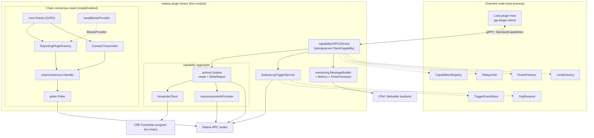
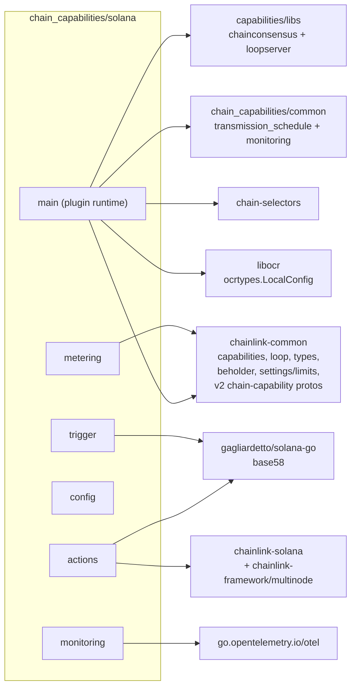
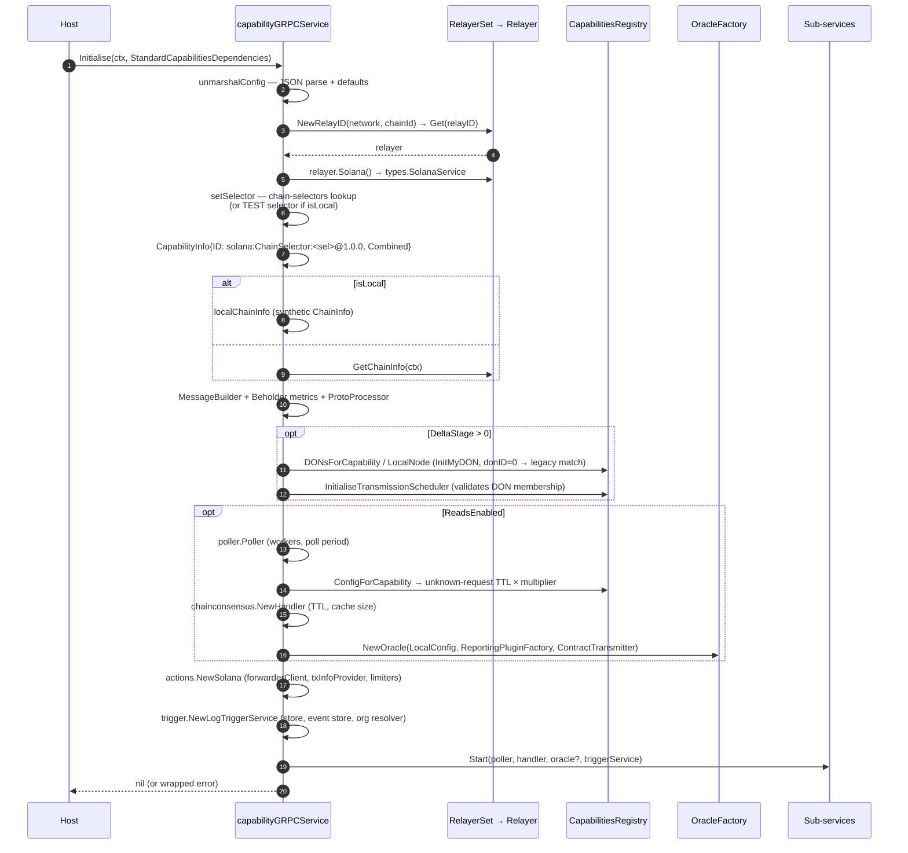
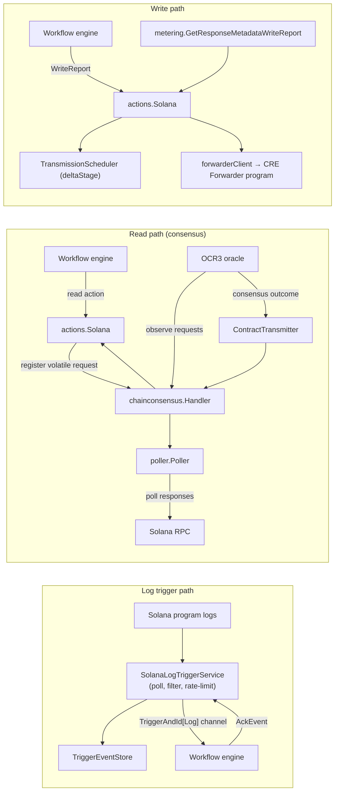
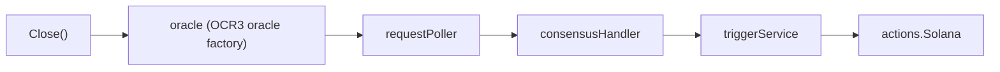

# Solana Chain Capability — Plugin Runtime

**Go module:** `github.com/smartcontractkit/capabilities/chain_capabilities/solana` (package `main`)
**Sources covered:**

- `capabilities/chain_capabilities/solana/main.go` — `capabilityGRPCService` (and embedded `capability` aggregate)
- `capabilities/chain_capabilities/solana/block_provider.go` — `noopBlocksProvider`
- `capabilities/chain_capabilities/solana/go.mod` — module manifest & dependency pins

**Part of:** [Chain Capability Solana](../chain_capability_solana.md) · [Workflow & Capability Runtime (CRE Engine)](../capabilities.md)

---

## 1. Overview

This module is the **process entry point and orchestration layer** of the Solana chain capability for the Chainlink Runtime Environment (CRE). It is compiled into a standalone plugin binary that a Chainlink node launches through the [Loop plugin framework](../../Plugin_Process_Framework_(Loop)/loop-plugin-core.md) and that exposes Solana chain functionality — log triggers, on-chain reads backed by OCR3 chain-consensus, and report writes via the CRE forwarder program — to CRE workflows.

The plugin runtime itself owns three concerns:

1. **Serving the capability as a plugin process.** `main()` boots a Loop gRPC server (hashicorp go-plugin handshake) that satisfies the `loop.StandardCapabilities` contract, so the host node can discover, configure, start and stop the capability over gRPC.
2. **Wiring the capability's functional pillars.** `capabilityGRPCService.Initialise` resolves the configured chain from the host-provided `RelayerSet`, then constructs and starts:
   - the **actions layer** (`actions.Solana`) — on-chain reads/writes via the CRE forwarder program (see [Actions](chain_capability_solana_actions.md));
   - the **log trigger service** (`SolanaLogTriggerService`) — Solana program-log triggers (see [Trigger](chain_capability_solana_trigger.md));
   - the **chain-consensus stack** (`poller.Poller` + `chainconsensus.Handler` + an OCR3 `core.Oracle` from the host `OracleFactory`) used when reads are enabled (see [Chain Consensus shared libs](../capabilities_shared_libs/capabilities_shared_libs_chainconsensus.md));
   - the **telemetry pipeline** (Beholder proto emitter + OTel metrics, see [Monitoring](chain_capability_solana_monitoring.md)).
3. **Lifecycle, identity and configuration.** It derives the capability identity (`solana:ChainSelector:<selector>@1.0.0`), applies configuration defaults, supports a special *local validator* mode for local CRE runs, and coordinates orderly shutdown of every sub-service.

The on-chain/telemetry behaviour of those pillars is documented in the sibling pages; this page focuses on the runtime skeleton that binds them together.

### Key facts

| Property | Value |
|---|---|
| Capability name | `solana` (`CapabilityName` constant) |
| Capability ID | `solana:ChainSelector:<uint64>@1.0.0` |
| Capability type | `capabilities.CapabilityTypeCombined` (trigger + executable in one process) |
| Served contract | `solcapserver.ClientCapability` (chainlink-common v2 Solana chain-capability gRPC API), wrapped as `loop.StandardCapabilities` |
| Read-consensus | OCR3 oracle created via host `OracleFactory`, backed by `capabilities/libs/chainconsensus` |
| Local mode | `isLocal: true` pins the test chain selector `TEST_22222222222222222222222222222222222222222222` and synthesises monitoring chain info |

---

## 2. Position in the system

The Solana capability is one of four chain capabilities (`aptos`, `evm`, `solana`, `stellar`) maintained as separate Go modules under `capabilities/chain_capabilities/`. Each follows the same shape: a `main` package that serves the capability as a Loop plugin, plus `actions`, `trigger`, `config` and `monitoring` packages. CRE workflow engines ([workflows_engine](../workflows/workflows_engine.md)) execute workflow specs that declare dependencies on these capabilities; the host node routes capability calls to the plugin process over gRPC.

The runtime depends on several platform services of the host node, all injected through `core.StandardCapabilitiesDependencies`:

| Dependency | Provided by | Used for |
|---|---|---|
| `RelayerSet` | Node relayer services | Resolving `types.SolanaService` (RPC client, tx submission) for the configured `chainId` |
| `OracleFactory` | Node OCR services | Creating the OCR3 oracle (reporting plugin factory + contract transmitter) for read consensus |
| `CapabilitiesRegistry` | Node capability registry | DON membership (`DONsForCapability`, `LocalNode`), per-capability method config (request timeouts) |
| `TriggerEventStore` | Node trigger event store | Durable trigger event buffering for log triggers |
| `OrgResolver` | Node org resolver services | Organisation IDs attached to trigger telemetry |
| `LimitsFactory` | Node settings/limits ([settings](../../Shared_Foundation_Libraries___Domain_Types/settings.md)) | Bounded limiters/rate limiters for tx compute, payload sizes, event rates |

The Solana RPC surface (`types.SolanaService`) and chain client types live in the shared foundation libraries — see [types-core](../../Shared_Foundation_Libraries___Domain_Types/types-core.md) and [types-chains](../../Shared_Foundation_Libraries___Domain_Types/types-chains.md).

---

## 3. Architecture

### 3.1 Component architecture



Reading the diagram:

- The outer **`capabilityGRPCService`** is the only object the host talks to. It implements the v2 Solana chain-capability gRPC contract (compile-time asserted by `var _ solcapserver.ClientCapability = &capabilityGRPCService{}`).
- The inner **`capability`** aggregate embeds `*actions.Solana` (which itself embeds `types.SolanaService`), so the composed capability exposes both the trigger methods and the full Solana read/write action surface.
- The **consensus stack** is optional: it is only constructed and started when `readsEnabled` is configured. Its OCR3 oracle is *host-created* (`OracleFactory.NewOracle`) but *capability-owned* — the reporting plugin factory and contract transmitter come from `capabilities/libs/chainconsensus` and are bound to the capability's request handler.
- `noopBlocksProvider` satisfies the `BlocksProvider` interface of the consensus stack. Solana has no "lockable to a block" requests, so it deliberately returns `0` for latest/safe/finalized heights (see [Section 4.4](#44-noopblocksprovider--capabilitieschain_capabilitiessolanablock_providergo)).

### 3.2 Module & package dependencies (go.mod)



Notable pins in `capabilities/chain_capabilities/solana/go.mod`:

- `chainlink-common` is pinned to a pseudo-version that carries the **v2 chain-capability Solana client/server protos** (`solcapserver`) and the v2 monitoring package used here.
- `chainlink-solana` + `chainlink-framework/multinode` supply the relayer-side Solana service implementation the host injects.
- A single `replace` directive pins `github.com/gogo/protobuf` to `v1.3.2`.
- Shared in-workspace dependencies (`capabilities/libs`, `capabilities/chain_capabilities/common`) are bumped across all chain capabilities at once with `make update-chain-capabilities MODULE=<module> REF=<ref>` (`capabilities/Makefile` → `capabilities/script/update-chain-capabilities.sh`), keeping aptos/evm/solana/stellar on identical lib versions.

---

## 4. Core component reference

### 4.1 `main` — process entry (`capabilities/chain_capabilities/solana/main.go`)

```go
loopserver.ServeNew(CapabilityName, func(s *loop.Server) loop.StandardCapabilities {
    return solcapserver.NewClientServer(&capabilityGRPCService{lggr: s.Logger.Named(CapabilityName), limitsFactory: s.LimitsFactory})
}, loop.WithOtelViews(append(consMetrics.MetricViews(), capmon.MetricViews()...)))
```

`loopserver.ServeNew` (`capabilities/libs/loopserver/main.go`) does the boilerplate:

1. Builds a Loop server (`loop.MustNewStartedServer`) with atomic settings wired to the shared CRE settings schema (`loop.NewAtomicSettings(cresettings.DefaultGetter)`).
2. Wraps the returned `StandardCapabilities` in a **`settingsInterceptor`**, so settings updates published by the host are stored and re-broadcast to the capability at runtime.
3. Serves the capability over hashicorp `plugin.Serve` using the `StandardCapabilitiesLoop` handshake — the binary is a regular Loop plugin whose lifecycle is managed by the node's plugin host (see [loop-plugin-core](../../Plugin_Process_Framework_(Loop)/loop-plugin-core.md) and [loop-grpc-bindings](../../Plugin_Process_Framework_(Loop)/loop-grpc-bindings.md)).
4. Registers OpenTelemetry **views** for the chain-consensus metrics and the v2 capability monitoring metrics, so the gRPC server exports them consistently.

The capability itself is adapted to gRPC by `solcapserver.NewClientServer` (chainlink-common v2 Solana chain-capability server), which maps the `ClientCapability` interface onto the `StandardCapabilities` service.

### 4.2 `capabilityGRPCService` — root service

```go
type capabilityGRPCService struct {
    capabilities.CapabilityInfo          // ID, CapabilityType, Description, IsLocal, DON (set in Initialise)
    chainSelector uint64
    capability                           // embedded execution aggregate (actions + consensus oracle)
    lggr           logger.Logger
    limitsFactory  limits.Factory
    triggerService *trigger.SolanaLogTriggerService
}
```

Method-by-method behaviour:

| Method | Behaviour |
|---|---|
| `Initialise(ctx, deps)` | Full wiring sequence — see [Section 5.2](#52-initialise--wiring-sequence). Idempotently errors if config is invalid, the relayer/chain cannot be resolved, or any sub-service fails to start. |
| `Start(ctx)` | Log-only; all sub-services are already started inside `Initialise` (this matches the `StandardCapabilities` contract where `Initialise` is handed the dependency bundle). |
| `Close()` | Ordered teardown: OCR oracle → request poller → consensus handler → trigger service → actions (via `services.CloseAll`). |
| `RegisterLogTrigger(ctx, triggerID, metadata, *FilterLogTriggerRequest)` | Delegates to `triggerService.RegisterLogTrigger`; returns a `<-chan capabilities.TriggerAndId[*solana.Log]` event stream. |
| `UnregisterLogTrigger(...)` | Delegates to `triggerService.UnregisterLogTrigger`. |
| `AckEvent(ctx, triggerID, eventID, method)` | Delegates to `triggerService.AckEvent(ctx, triggerID, eventID)` (the `method` parameter is accepted for interface compatibility only). |
| `ChainSelector()` | Returns the selector resolved during `Initialise`. |
| `HealthReport()` | `{c.Name(): nil}` — health is implicit in sub-service health; `Ready()` returns `nil`. |
| `Name()` / `Description()` | Logger name (`solana`) and the static description `"Contains Solana chain functionalities"`. |

Private helpers:

- `unmarshalConfig(configStr string)` — JSON-decodes [`config.Config`](chain_capability_solana_config.md) and applies the defaults listed in [Section 6](#6-configuration).
- `setSelector(cfg)` — local mode short-circuits to the fixed test selector; otherwise resolves the selector via `chain_selectors.SolanaChainIdToChainSelector()` and errors for unknown chain IDs.
- `localChainInfo(cfg, chainSelector)` — synthesises `types.ChainInfo{FamilyName: "solana", ...}` for local validator runs, where the relayer cannot derive chain metadata from a fixed genesis hash. Falls back to the selector string as `chainId` and `"local"` as network name so monitoring labels remain populated.

### 4.3 `capability` — execution aggregate

```go
type capability struct {
    *actions.Solana                  // full Solana action surface (embeds types.SolanaService)
    requestPoller    *poller.Poller
    consensusHandler chainconsensus.Handler
    oracle           core.Oracle
    id               string
}
```

This aggregate is where the two execution paths meet:

- **Trigger path** lives outside the aggregate (`capabilityGRPCService.triggerService`) because triggers are independent of the read/write actions.
- **Read path**: `actions.Solana` holds a `chainconsensus.RequestHandler` reference (passed to `NewSolana` as `handler`) to register volatile read requests, while the OCR3 `oracle` observes those requests through the same `chainconsensus.Handler` (acting as `RequestsHandler`) and writes consensus outcomes back through its `ContractTransmitter`. The end-to-end flow is described in [Section 5.3](#53-runtime-data-flows) and detailed in [Actions](chain_capability_solana_actions.md) and [chainconsensus shared libs](../capabilities_shared_libs/capabilities_shared_libs_chainconsensus.md).
- **Write path**: `actions.Solana`'s `forwarderClient` submits signed reports to the on-chain CRE forwarder program, optionally delayed by the `TransmissionScheduler` when `deltaStage` is configured.

### 4.4 `noopBlocksProvider` — `capabilities/chain_capabilities/solana/block_provider.go`

```go
// noopBlocksProvider - returns 0 for all blocks. Used when the chain does not have lockable to a block requests.
type noopBlocksProvider struct{}

func (n noopBlocksProvider) GetLatest() int64    { return 0 }
func (n noopBlocksProvider) GetSafe() int64      { return 0 }
func (n noopBlocksProvider) GetFinalized() int64 { return 0 }
```

The chainconsensus `ReportingPluginFactory` requires a `BlocksProvider` (latest/safe/finalized heights) to support height-locked ("lockable to a block") requests. Solana read requests do not lock to blocks, so the Solana plugin passes this no-op implementation; any height-conditional logic downstream effectively sees height `0`. It is passed to `OracleFactory.NewOracle` as part of `NewReportingPluginFactory(...)` in `Initialise`.

### 4.5 `go.mod` — module boundary

The module is deliberately a **separate Go module** (`go 1.27.1`) from the main `chainlink` node and from `capabilities/libs`, so the plugin binary can be built, versioned and shipped independently of node releases. Direct dependency groups:

| Group | Modules | Role |
|---|---|---|
| Capability framework | `chainlink-common` (capabilities, loop, services, logger, types, settings/limits, beholder, v2 chain-capability protos & monitoring) | gRPC contracts, service patterns, limits, telemetry |
| Shared capability libs | `capabilities/libs` (chainconsensus, loopserver), `capabilities/chain_capabilities/common` (transmission schedule, shared monitoring) | Consensus plumbing, DON/scheduler helpers, telemetry helpers |
| Solana specifics | `gagliardetto/solana-go`, `mr-tron/base58`, `chainlink-solana` (+ `contracts`), `chainlink-framework/multinode`, `chain-selectors` | Solana SDK, relay service, selector resolution |
| Consensus | `libocr` (`ocrtypes.LocalConfig` for oracle tuning) | OCR2/3 types |
| Observability | `go.opentelemetry.io/otel`, `google.golang.org/protobuf` | Metrics views, proto messages |
| CRE protos | `chainlink-protos/cre/go` | SDK/capability protobufs |

---

## 5. Lifecycle & runtime flows

### 5.1 Process bootstrap

```mermaid
sequenceDiagram
    autonumber
    participant NH as Node plugin host
    participant LP as loopserver.ServeNew
    participant SV as gRPC server (loop.Server)

    NH->>LP: spawn binary (go-plugin handshake)
    LP->>SV: MustNewStartedServer("solana", opts)
    LP->>LP: wrap capability in settingsInterceptor
    LP->>NH: plugin.Serve(StandardCapabilitiesLoop)
    Note over LP,NH: gRPC channel established;<br/>host publishes settings updates
    NH->>SV: Initialise(config, dependencies)
```

### 5.2 `Initialise` — wiring sequence

The following sequence reflects the exact order of operations in `capabilityGRPCService.Initialise`:



Implementation notes worth knowing when maintaining this code:

- **DON resolution race.** `ts.InitMyDON` retries with backoff because the host populates its capability metadata registry asynchronously; `Initialise` can race ahead of the first registry sync. A `CRE-4409` TODO documents that the authoritative DON ID is passed as `0` until Solana nodes emit `KeyDonID` events, preserving the legacy "first matched DON" behaviour (with a warning if a node matches multiple DONs).
- **Unknown-request TTL derivation.** When reads are enabled, the handler's TTL is *derived* from the registry's per-method `RequestTimeout` (max across read methods × multiplier) via `capcommon.MaxRequestTimeoutWithMultiplier`, falling back to `cfg.UnknownRequestsTTL` (default 10s) when the registry has no config.
- **Hardcoded oracle tuning.** The OCR `LocalConfig` is fixed in code: `BlockchainTimeout` 20s, `ContractConfigTrackerPollInterval` 10s, `ContractConfigConfirmations` 1, `ContractTransmitterTransmitTimeout` 10s, `DatabaseTimeout` 10s, `ContractConfigLoadTimeout` 10s, `DefaultMaxDurationInitialization` 10s.
- **Failure semantics.** Any error aborts `Initialise` with a wrapped, contextualised message; previously started sub-services are *not* rolled back automatically (the host treats a failed `Initialise` as a plugin start failure).
- **Scheduler gating.** If `deltaStage` is 0 (default), transmission scheduling is disabled entirely and logged at info level; the `TransmissionScheduler` handed to the actions layer is a zero value.

### 5.3 Runtime data flows

After initialisation, three request families flow through the capability:



- **Trigger path** — the trigger service polls Solana logs, filters registered triggers, enforces rate/payload limits, emits telemetry, and streams `Log` trigger events to the workflow engine; acknowledgements flow back via `AckEvent`. Details: [Trigger](chain_capability_solana_trigger.md).
- **Read path** — read actions register volatile requests with the consensus handler; the poller fetches on-chain responses; the OCR3 reporting plugin (created by the host oracle from the chainconsensus factory) reaches consensus; the transmitter completes the request and the result is returned to the workflow. Details: [Actions](chain_capability_solana_actions.md) and [chainconsensus](../capabilities_shared_libs/capabilities_shared_libs_chainconsensus.md).
- **Write path** — `WriteReport` submissions go through the forwarder client to the on-chain CRE forwarder program, optionally staggered per DON member by the transmission scheduler; lamports spent are converted to SOL metering metadata. Details: [Actions](chain_capability_solana_actions.md).

### 5.4 Shutdown

`Close()` collects closers in this order and delegates to `services.CloseAll` (which closes in reverse order):



The oracle is closed through a `closeFunc` wrapper that logs "Closing/Closed oracle factory" around `oracle.Close(ctx)`. Every element is nil-guarded, so the same code path works whether or not reads were enabled.

---

## 6. Configuration

Configuration arrives as a JSON string on `Initialise` and is decoded into [`config.Config`](chain_capability_solana_config.md). `unmarshalConfig` applies defaults for zero values:

| Field | Type | Default when unset | Purpose |
|---|---|---|---|
| `creForwarderAddress` | Solana public key | — | CRE forwarder **program** address (write target) |
| `creForwarderState` | Solana public key | — | Forwarder program **state** account |
| `Transmitter` | Solana public key | — | Node transmitter identity (telemetry labels, signing) |
| `isLocal` | bool | `false` | Local-validator mode: fixed test selector + synthetic chain info |
| `network` / `chainId` | string | — | Relay identity used to build `types.RelayID` for `RelayerSet.Get` |
| `deltaStage` | duration | `0` (scheduling disabled) | Per-queue-position transmission delay; >0 activates DON + scheduler init |
| `readsEnabled` | bool | `false` | Enables the consensus oracle stack for on-chain reads |
| `observationPollerWorkersCount` | uint | `10` | Worker pool size of `poller.Poller` |
| `observationPollPeriod` | duration | `200ms` | Poll cadence — half of Solana's ~400 ms block time so volatile requests observe every block |
| `unknownRequestsTTL` | duration | `10s` (overridden by registry-derived TTL when available) | Eviction age for unknown volatile requests |
| `maxUnknownRequestsCacheSize` | int | `1000` (`defaultMaxUnknownRequestsCacheSize`) | Bound on the unknown-request cache |

Constants defined alongside the service: `CapabilityName = "solana"`, `schemaBasePath` (raw GitHub URL of this repo's `chain_capabilities/solana/monitoring` protos, used by the Beholder proto emitter to fetch message schemas), and the defaults above.

---

## 7. Observability

- **Beholder/OTLP telemetry.** A `monitoring.NewProcessor` (built on `beholder.NewProtoEmitter` with the remote `schemaBasePath`) plus `monitoring.NewMetrics` are shared by actions, trigger and runtime code; the beholder client is fetched by name `"solana_capability"`. Telemetry messages are constructed by `monitoring.MessageBuilder`, which embeds the shared builder and adds capability-scoped OTel labels (chain family/ID, network names, capability type/ID). Details: [Monitoring](chain_capability_solana_monitoring.md), [beholder-telemetry](../../Telemetry___Observability_Platform/beholder-telemetry.md).
- **OTel metric views.** `main()` registers views from `chainconsensus/metrics.MetricViews()` and `capmon.MetricViews()` on the Loop server.
- **Chain-consensus metrics.** `consMetrics.NewConsensusMetrics(chainInfo)` instruments the poller/handler/oracle stack.
- **Monitoring protos.** `log_trigger.proto` and `write_report.proto` under `capabilities/chain_capabilities/solana/monitoring/` define the emitted message schemas.

---

## 8. Build & packaging

- **Nx project** (`capabilities/chain_capabilities/solana/project.json`): `projectType: "capability"` with implicit dependency on `loopserver`. The `build` target produces static Linux binaries with CGO disabled for both architectures: `../bin/amd64/solana` and `../bin/arm64/solana`. Additional targets: `lint` (golangci-lint), `test`, `race`, `tidy`, `generate` (protobuf + mockery), `update-libs`.
- **Workspace tooling** (`capabilities/Makefile`): `protoc`, `mockery`, `generate`, `gomodtidy` apply to this module; `update-chain-capabilities` synchronises shared module pins across all four chain capabilities (`capabilities/script/update-chain-capabilities.sh`).
- **Distribution.** The binaries produced here are the artifacts installed into node images by the plugin-installation targets of `chainlink/GNUmakefile` (`install-plugins`, `install-plugins-local`, `install-plugins-private`, `install-plugins-public`, `install-plugins-testing`), where the node's Loop plugin host discovers and launches them. See [chainlink_build_and_tooling](../../Build,_CI___Release_Infrastructure/chainlink_build_and_tooling.md) and [capabilities_workspace_tooling](../../Build,_CI___Release_Infrastructure/capabilities_workspace_tooling.md).
- **On-chain counterpart.** The forwarder program the plugin writes to is deployed by the CRE deployment suite (e.g. `chainlink/deployment/cre/forwarder/solana/...`); see [cre-forwarder](../../CRE___Keystone_Deployment_Suite/cre-forwarder.md).

---

## 9. Related documentation

| Topic | Page |
|---|---|
| Solana chain capability overview | [chain_capability_solana](../chain_capability_solana.md) |
| Actions (reads / WriteReport / forwarder client) | [chain_capability_solana_actions](chain_capability_solana_actions.md) |
| Configuration schema | [chain_capability_solana_config](chain_capability_solana_config.md) |
| Telemetry & monitoring protos | [chain_capability_solana_monitoring](chain_capability_solana_monitoring.md) |
| Log trigger service | [chain_capability_solana_trigger](chain_capability_solana_trigger.md) |
| Chain-consensus library (handler, poller, oracle) | [capabilities_shared_libs_chainconsensus](../capabilities_shared_libs/capabilities_shared_libs_chainconsensus.md) |
| Transmission scheduling & DON resolution | [capabilities](../capabilities.md) |
| Loop plugin framework (host ↔ plugin gRPC) | [loop-plugin-core](../../Plugin_Process_Framework_(Loop)/loop-plugin-core.md) · [loop-grpc-bindings](../../Plugin_Process_Framework_(Loop)/loop-grpc-bindings.md) |
| Domain types (`types.SolanaService`, providers) | [types-core](../../Shared_Foundation_Libraries___Domain_Types/types-core.md) · [types-chains](../../Shared_Foundation_Libraries___Domain_Types/types-chains.md) |
| Beholder telemetry pipeline | [beholder-telemetry](../../Telemetry___Observability_Platform/beholder-telemetry.md) |
| CRE settings & limits | [settings](../../Shared_Foundation_Libraries___Domain_Types/settings.md) |
| Forwarder deployment (Solana) | [cre-forwarder](../../CRE___Keystone_Deployment_Suite/cre-forwarder.md) |
| Workflow engine consuming capabilities | [workflows_engine](../workflows/workflows_engine.md) |
