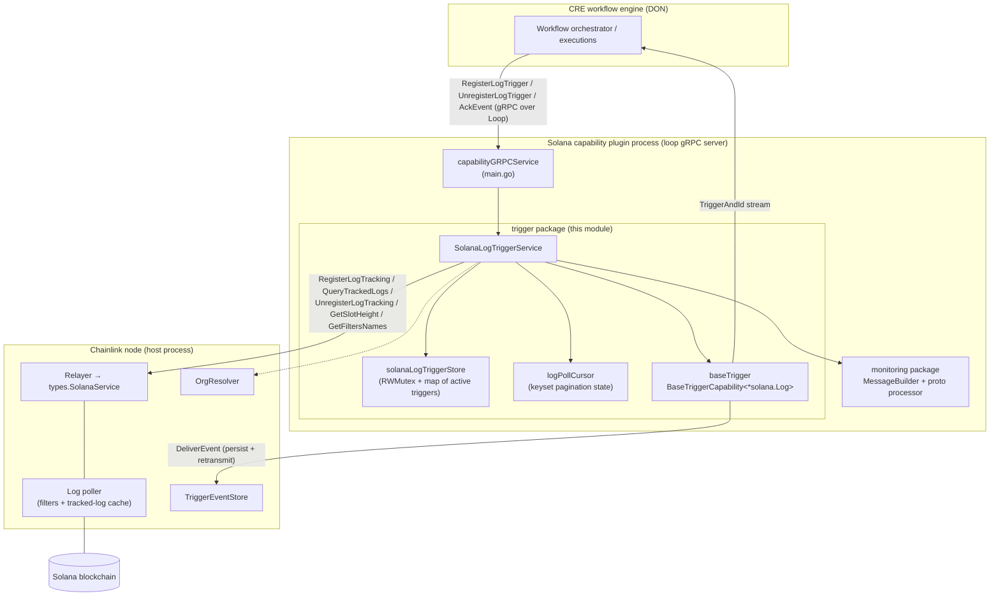
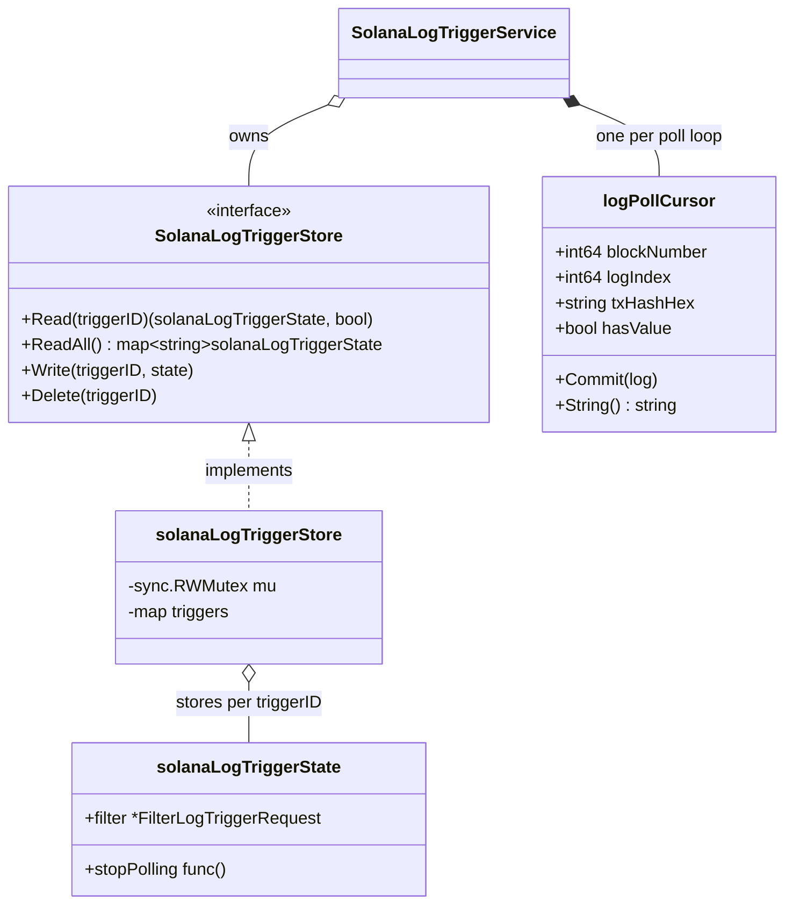
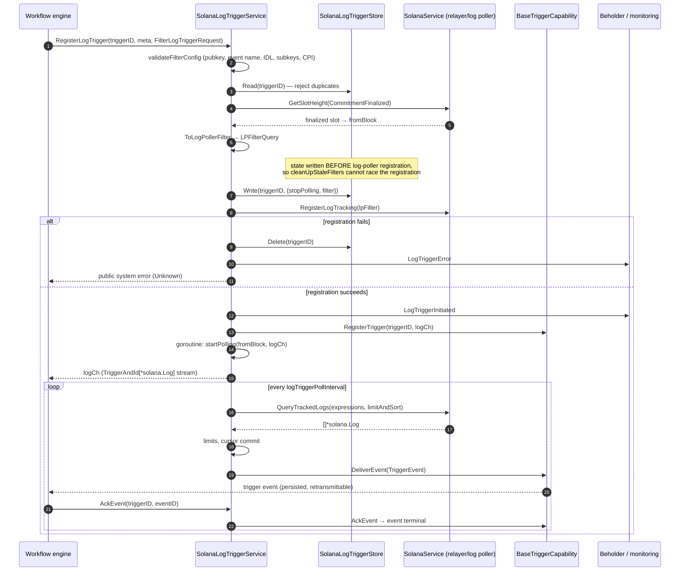
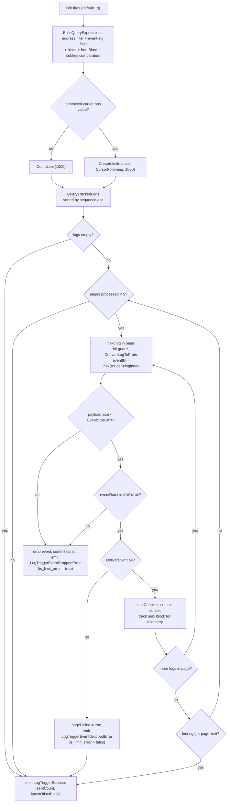
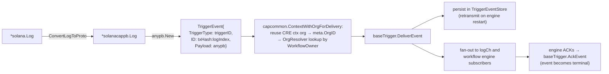
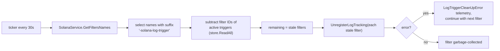
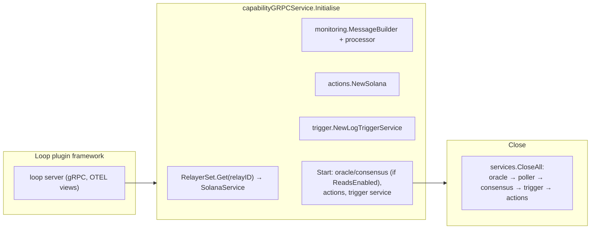

# Solana Chain Capability — Log Trigger

## 1. Introduction

The `chain_capability_solana_trigger` module implements the **trigger half of the Solana chain capability plugin**: it watches Anchor program events on Solana blockchains and delivers them as trigger events into the [CRE workflow engine](../workflows.md).

While the [actions side](chain_capability_solana_actions.md) of the Solana capability answers *executable* requests (reads and report writes), this module answers the *trigger* side of the capability contract exposed over gRPC (`RegisterLogTrigger`, `UnregisterLogTrigger`, `AckEvent`). Its responsibilities are:

1. **Filter lifecycle** — translate a workflow's trigger request (program address, event name, Anchor IDL, optional subkey comparators, optional CPI filter) into a persistent log-poller filter registered with the node's relayer.
2. **Log polling** — periodically page through newly tracked logs using keyset pagination, with per-event rate and payload-size limits.
3. **Reliable delivery** — hand events to the shared `BaseTriggerCapability` runtime, which persists them in the trigger event store, retransmits them to the workflow engine, and tracks ACKs.
4. **Hygiene** — garbage-collect log-poller filters whose triggers are no longer registered.

The module lives in `capabilities/chain_capabilities/solana/trigger/` (Go module `github.com/smartcontractkit/capabilities/chain_capabilities/solana`, see `capabilities/chain_capabilities/solana/go.mod`) and is a leaf of the [Solana chain capability](../chain_capability_solana.md).

### At a glance

| Aspect | Summary |
|---|---|
| Core types | `SolanaLogTriggerService`, `SolanaLogTriggerStore`, `logPollCursor` |
| Source files | `trigger/trigger.go`, `trigger/store.go`, `trigger/cursor.go` |
| Consumes | `types.SolanaService` (relayer + log poller), `capabilities.EventStore`, `limits.Factory`, `orgresolver.OrgResolver` |
| Produces | Stream of `capabilities.TriggerAndId[*solana.Log]` channels; beholder telemetry messages |
| Served via | gRPC standard-capability server in the plugin process (see [plugin runtime](chain_capability_solana_plugin_runtime.md)) |
| Telemetry schemas | `capabilities/chain_capabilities/solana/monitoring/log_trigger.proto` |

---

## 2. Architecture

### 2.1 Component overview

The trigger service is instantiated by the plugin's gRPC service during `Initialise` (see [plugin runtime](chain_capability_solana_plugin_runtime.md)) and started alongside the actions and consensus services. All chain I/O flows through the relayer-provided `SolanaService`; all event persistence flows through the shared base-trigger runtime.

Key dependency contracts (defined in [chainlink-common types](../../Shared_Foundation_Libraries___Domain_Types/types-chains.md)):

- **`types.SolanaService`** — combines the RPC client (`GetSlotHeight`, …) with the log-poller API: `RegisterLogTracking(ctx, solana.LPFilterQuery)`, `UnregisterLogTracking(ctx, filterName)`, `QueryTrackedLogs(ctx, expressions, limitAndSort)`, and `GetFiltersNames(ctx)`. Registration is idempotent ("noop guaranteed when filter.Name exists").
- **`capabilities.EventStore`** — the durable store behind `BaseTriggerCapability.DeliverEvent`; see [trigger event store](../core_capabilities_runtime/core_capabilities_runtime_trigger_event_store.md).
- **`limits.Factory`** — builds the per-workflow rate and payload-size limiters from CRE settings (see [settings](../../Shared_Foundation_Libraries___Domain_Types/settings.md)).
- **`orgresolver.OrgResolver`** — optional; resolves a workflow owner to an organization ID used by the deliver-time retransmit policy. The constructor logs a warning and continues when it is `nil`.

### 2.2 Core components

| Component | File | Role |
|---|---|---|
| `SolanaLogTriggerService` | `trigger/trigger.go` | Trigger capability implementation: registration, polling, delivery, cleanup, ACK handling. Embeds `services.Service`/`services.Engine` for standard lifecycle management (see [services](../../Shared_Foundation_Libraries___Domain_Types/services.md)). |
| `SolanaLogTriggerStore` | `trigger/store.go` | Concurrency-safe in-memory registry of active triggers. Each `solanaLogTriggerState` holds a `stopPolling` func (cancel + wait) and the accepted `FilterLogTriggerRequest`. `ReadAll` returns a copy, making the cleanup pass race-free. |
| `logPollCursor` | `trigger/cursor.go` | Keyset pagination cursor over tracked logs (`blockNumber`, `logIndex`, `txHashHex`, `hasValue`). `Commit(log)` advances it; `String()` renders `"<block>-<logIndex>-<txHashHex>"`, matching the log-poller cursor format. |
| Package helpers | `trigger/trigger.go` | `validateFilterConfig` / `validateSubkeyComparers` (request validation), `publicKeyFromBytes` (32-byte pubkey decoding), `ToLogPollerFilter` and `BuildQueryExpressions` (config → log-poller artifacts), `getEventSig` (Anchor event discriminator via `chainlink-solana`). |

Supporting structures:

---

## 3. Trigger registration flow

`RegisterLogTrigger` is invoked by the workflow engine (via the gRPC service in [plugin runtime](chain_capability_solana_plugin_runtime.md)) when a workflow declares a `solana` log trigger.

Step highlights:

- **Validation** (`validateFilterConfig`) rejects: missing config, a non-32-byte program address or CPI destination address, empty event name, empty filter name, empty Anchor IDL JSON, and *conflicting equality comparators* on the same subkey (two distinct `EQ` values on one subkey can never match). Validation failures surface as **public user errors** (`InvalidArgument`), safe to return to workflow owners.
- **Starting block**: the finalized slot at registration time is snapshotted and used as the query's fixed lower bound (`block > fromBlock`); progress is tracked by the cursor, not by the block filter (see §4).
- **Ordering guarantee**: the trigger is written to the store before `RegisterLogTracking` so that the periodic filter cleanup (§5) cannot unregister a filter that is mid-registration.
- **Shutdown wiring**: the polling goroutine registers `context.AfterFunc(svcCtx, pollCancel)`, so stopping the service cancels polling and deletes the trigger from the store; `pollDone` closes only after the poll loop exits, making `stopPolling` synchronous.

### Registration constants

| Constant | Value | Purpose |
|---|---|---|
| `SuffixLogTriggerFilterID` | `"-solana-log-trigger"` | Appended to `triggerID` to form the log-poller filter name; also used to identify owned filters during cleanup |
| `defaultQueryLimit` | `1000` | Page size for `QueryTrackedLogs` |
| `defaultMaxPagesPerPoll` | `5` | Max pages drained per poll tick (burst absorption) |

---

## 4. Log polling and delivery

### 4.1 Poll loop

Each trigger gets its own polling goroutine. Every `logTriggerPollInterval` tick it (re)builds query expressions and pages through newly tracked logs.

Important semantics:

- **Fixed block bound, cursor-driven progress.** `BuildQueryExpressions` is always called with the registration-time `startingBlock`; the `lastProcessedBlock` value is only used for success telemetry. Dedup and progress come from the committed `logPollCursor` passed as keyset pagination. This is intentional: *the cursor advances only for terminally processed logs*.
- **Limit violations do not stall the stream.** Events that fail the size or rate limit are dropped, but their cursor is still committed so polling continues with the next logs.
- **Delivery failure stops the page** and leaves the cursor uncommitted for the failed log, so it is re-fetched on a later tick and retried through the persistence layer.
- **Query expression stack** (built with `chainlink-common` Solana query primitives): `NewAddressFilter(programID)`, `NewEventSigFilter(discriminator)`, `query.Block(fromBlock, Gt)`, and one `NewEventBySubkeyFilter(index, comparators)` per configured subkey. Comparator values are proto `bytes` converted via `ConvertValueComparatorsFromProto`.
- **Reverted transactions are included** (`IncludeReverted: true` in the filter), so consumers can observe events from failed transactions.
- **Event identity**: `generateLogIdentifier` returns `"<txHash-hex>:<logIndex>"` — a stable, unique ID per log used for persistence, ACKs, and dedup.

### 4.2 Reliable delivery path

Delivery context enrichment (`capcommon.ContextWithOrgForDelivery`, part of [chain capabilities common](../chain_capabilities_common.md)) resolves the organization ID for the deliver-time retransmit policy from, in priority order: an existing CRE context value, `RequestMetadata.OrgID`, or an `OrgResolver` lookup by `WorkflowOwner`. Resolution failures are logged as warnings and do not block delivery.

The `logTriggerSendChannelBufferSize` (default 1000) bounds the in-memory channel handed to the workflow engine; durability is provided by the trigger event store, not the channel.

### 4.3 Telemetry and limits integration

Every registration, poll tick, drop, and failure emits both a structured log line and a beholder proto message built by the [monitoring sub-module](chain_capability_solana_monitoring.md). The message schemas live in `capabilities/chain_capabilities/solana/monitoring/log_trigger.proto`:

| Message | Emitted when |
|---|---|
| `LogTriggerInitiated` | Filter registered successfully |
| `LogTriggerSuccess` | After each poll tick (log count, latest offset block) |
| `LogTriggerError` | Query/registration/unregistration failures |
| `LogTriggerEventDroppedError` | A single event was dropped (limit violation or delivery failure); `is_limit_error` distinguishes the cause |
| `LogTriggerCleanUpError` | Stale-filter cleanup failures |

For details on the beholder pipeline itself, see [beholder telemetry](../../Telemetry___Observability_Platform/beholder-telemetry.md).

**Limits** are created from CRE settings via `limits.Factory`:

- `cresettings.Default.PerWorkflow.LogTrigger.EventSizeLimit` → upper-bound limiter on the serialized proto size (oversized events are dropped).
- `cresettings.Default.PerWorkflow.LogTrigger.EventRateLimit` → rate limiter applied per event; the implementation prefers backpressure (`Wait`) but drops the event if the limiter errors (e.g., context cancellation).

---

## 5. Filter hygiene and unregistration

### 5.1 UnregisterLogTrigger

1. Reject empty `triggerID`; reject unknown trigger IDs (not in the store).
2. Invoke the stored `stopPolling` func — cancels the poll context and blocks until the poll loop exits.
3. Delete the trigger from the store and unregister it from the base trigger capability.
4. Call `SolanaService.UnregisterLogTracking(filterID)`; a failure here is returned as a private system error (`Unknown`) since the filter may linger in the log poller.

### 5.2 Stale-filter cleanup

Because `RegisterLogTracking` is idempotent and filters can outlive their triggers (e.g., after a plugin restart with a different trigger set), the service runs a cleanup pass every **30 seconds**:

This keeps the node-side log poller from accumulating filters for triggers the plugin no longer serves.

---

## 6. Error handling taxonomy

The module distinguishes **user errors** (safe to expose to workflow owners) from **system errors**, and further splits system errors into public/private visibility (see [capabilities core](../capabilities/capabilities_core.md)):

| Situation | Error class | Code |
|---|---|---|
| Empty `triggerID` (register/unregister) | public system error | `Internal` |
| Config validation failure | public user error | `InvalidArgument` |
| Duplicate trigger registration | public system error | `Internal` |
| Finalized-slot lookup failure | private system error | `Unavailable` |
| Filter construction failure | public system error | `Internal` |
| `RegisterLogTracking` failure | public system error | `Unknown` |
| Trigger not found on unregister | public system error | `Internal` |
| `UnregisterLogTracking` failure | private system error | `Unknown` |
| `AckEvent` failure | private system error | `Internal` |

All of the above are additionally reported through the monitoring pipeline (`LogTriggerError` / `LogTriggerEventDroppedError`) so operators get both node logs and beholder events.

---

## 7. Configuration reference

The service is constructed by the plugin runtime with `LogTriggerServiceOpts`:

| Option | Default (when zero) | Notes |
|---|---|---|
| `SolanaService` | — (required by type) | Provided by the relayer set in `Initialise` |
| `Logger` | required | Service-scoped logger |
| `BeholderProcessor`, `MessageBuilder` | required | Monitoring pipeline ([monitoring sub-module](chain_capability_solana_monitoring.md)) |
| `Triggers` | `trigger.NewSolanaLogTriggerStore()` | In-memory registry |
| `LogTriggerPollInterval` | `1s` | Poll tick per trigger |
| `LogTriggerSendChannelBufferSize` | `1000` | Buffered channel per registered trigger |
| `Retention` | `24h` | Passed to the log-poller filter |
| `MaxLogsKept` | `10000` | Passed to the log-poller filter |
| `LimitsFactory` | required | Rate + payload-size limiters from CRE settings |
| `TriggerEventStore` | required | Durable event persistence via base trigger capability |
| `CapabilityID` | required | e.g. `solana:ChainSelector:<selector>@1.0.0` |
| `OrgResolver` | `nil` (warns) | Enables org-ID resolution for delivery policy |

Chain-level settings (network, chain ID, forwarder addresses, reads enablement) belong to the capability [config sub-module](chain_capability_solana_config.md) and are consumed upstream of this module.

---

## 8. Lifecycle and placement in the system

- **Startup** (`start`): starts the base trigger capability, then launches a 30-second cleanup ticker via the services engine.
- **Shutdown** (`close`): stops the base trigger capability; the plugin's `Close` (see [plugin runtime](chain_capability_solana_plugin_runtime.md)) closes the trigger service together with the oracle, consensus handler, and actions. Stopping the services engine cancels all per-trigger poll loops (each of which deletes its store entry on exit).

The trigger module is a sibling of — and depends on — the following modules within the [CRE capability runtime](../capabilities.md) workspace:

| Related module | Relationship |
|---|---|
| [Solana plugin runtime](chain_capability_solana_plugin_runtime.md) | Owns the gRPC service that delegates `RegisterLogTrigger`/`UnregisterLogTrigger`/`AckEvent` to this module; provides the loop server, limits factory, and relayer wiring |
| [Solana actions](chain_capability_solana_actions.md) | Serves the executable side (reads, `WriteReport`); shares the relayer, monitoring, and transmission-schedule plumbing |
| [Solana monitoring](chain_capability_solana_monitoring.md) | `MessageBuilder`/`processor` used by every telemetry emission; proto schemas incl. `log_trigger.proto` |
| [Solana config](chain_capability_solana_config.md) | Capability-level JSON config parsed in `Initialise` |
| [Capabilities core](../capabilities/capabilities_core.md) | `BaseTriggerCapability`, `TriggerEvent`, capability interfaces, error types |
| [Chain capabilities common](../chain_capabilities_common.md) | `ContextWithOrgForDelivery` and shared monitoring helpers |
| [Core capabilities runtime trigger event store](../core_capabilities_runtime/core_capabilities_runtime_trigger_event_store.md) | The `capabilities.EventStore` that makes delivery reliable |
| [Chain types (chains/solana)](../../Shared_Foundation_Libraries___Domain_Types/types-chains.md) | `SolanaService`, `LPFilterQuery`, `Log`, `PublicKey` |
| [Loop plugin core](../../Plugin_Process_Framework_(Loop)/loop-plugin-core.md) | Process/isolation framework hosting this capability as a plugin |

### Build & packaging notes

- The module is part of the **capabilities workspace**: a dedicated Go module declared in `capabilities/chain_capabilities/solana/go.mod` (deps include `chainlink-common`, `capabilities/chain_capabilities/common`, `capabilities/libs`, `chainlink-solana`, `chain-selectors`, and `gagliardetto/solana-go` for key types).
- Workspace-level build, protoc, and codegen targets live in `capabilities/Makefile` and `capabilities/nx.json`; the `log_trigger.proto` telemetry schema is compiled via the protoc toolchain described in [capabilities workspace tooling](../../Build,_CI___Release_Infrastructure/capabilities_workspace_tooling.md).
- The plugin binary built from `capabilities/chain_capabilities/solana/main.go` is distributed as a loop plugin; per-process behaviour (gRPC serving, OTEL metric views) is documented in the [plugin process framework](../../Plugin_Process_Framework_(Loop)/loop-plugin-core.md).
