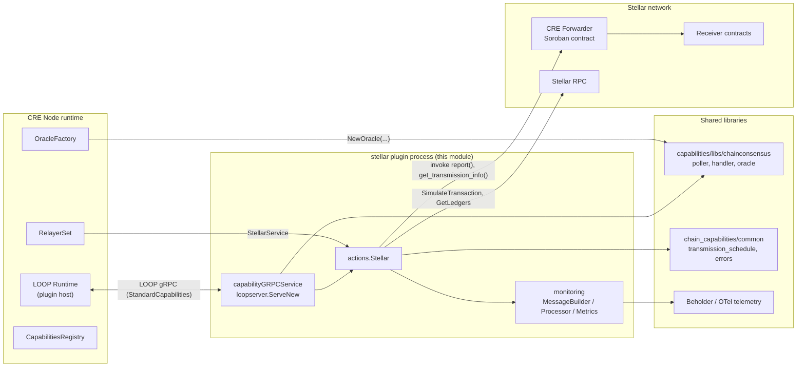
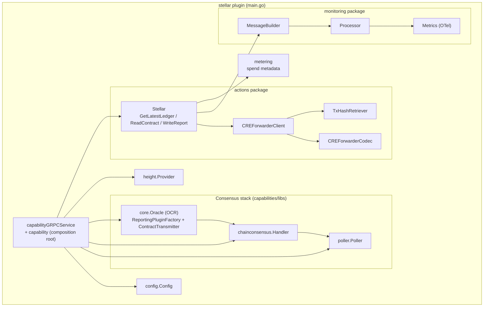
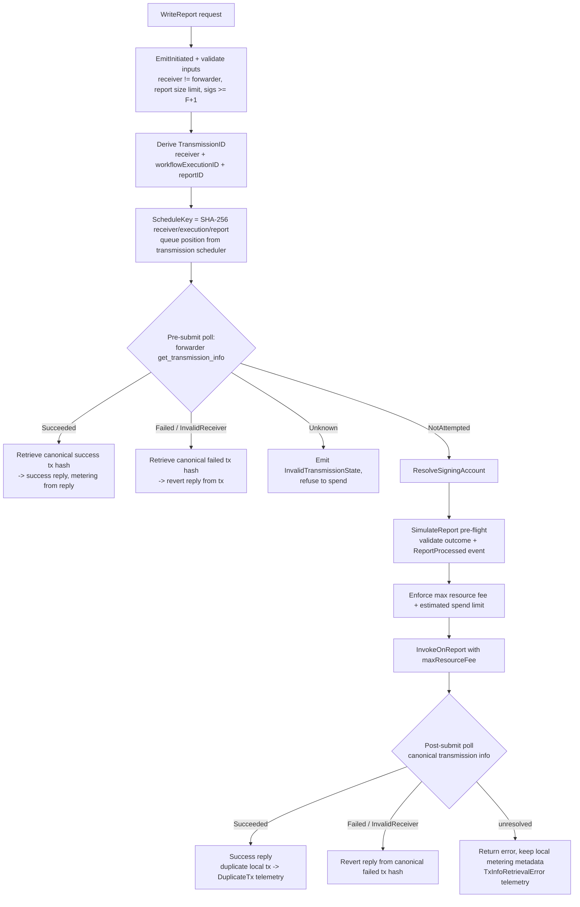

# Stellar Chain Capability (`chain_capabilities/stellar`)

## 1. Overview

The **Stellar chain capability** is the Chainlink Runtime Environment (CRE) plugin binary that gives workflows read and write access to the **Stellar network (Soroban smart contracts)**. It is a standalone Go process that is launched by the node runtime and served to it over the [LOOP plugin protocol](../Plugin_Process_Framework_(Loop)/loop-plugin-core.md) — the same architecture used by its sibling chain capabilities ([EVM](chain_capability_evm.md), [Solana](chain_capability_solana.md), and [Aptos](chain_capability_aptos.md)).

| Property | Value |
| --- | --- |
| Repository path | `capabilities/chain_capabilities/stellar/` |
| Go module | `github.com/smartcontractkit/capabilities/chain_capabilities/stellar` (`go.mod`) |
| Plugin / capability name | `stellar` (constant `CapabilityName`) |
| Plugin type | `loop.StandardCapabilities` served via `loopserver.ServeNew` |
| Built artifact | Static Linux binaries `bin/{amd64,arm64}/stellar` (see [`project.json`](../../capabilities/chain_capabilities/stellar/project.json)) |
| Workspace | `capabilities/` Nx workspace, Go module of the `capabilities/libs` family |

### What it exposes to workflows

The plugin implements the generated Stellar **client capability** interface (`stellarcapserver.ClientCapability` from `chainlink-common/pkg/capabilities/v2/chain-capabilities/stellar/server`) with three operations:

| Operation | Kind | Description |
| --- | --- | --- |
| `ReadContract` | Consensus read | Read-only Soroban contract invocation. Each node simulates the call; the DON agrees on the return value via the OCR consensus handler. |
| `GetLatestLedger` | Consensus read | Each node observes its latest closed ledger; the DON aggregates on the ledger sequence and enriches the response with ledger header / close-metadata XDR. |
| `WriteReport` | Scheduled write | Idempotent, DON-scheduled transmission of a signed OCR report to a receiver contract **through the Stellar CRE Forwarder contract**. |

In addition, the binary embeds the full OCR consensus stack for Stellar: a head/ledger poller, a chain-consensus request handler, a reporting-plugin factory, and a contract transmitter, all sourced from the shared `capabilities/libs/chainconsensus` library (documented in [Capabilities Shared Libs](capabilities_shared_libs.md)).

## 2. Position in the CRE Ecosystem



Key external contracts the module consumes:

- **`types.StellarService` / `stellartypes` client types** — the relayer-provided Stellar chain service and its request/reply types, defined in [Shared Foundation → types-chains](../Shared_Foundation_Libraries___Domain_Types/types-chains.md) and wired over gRPC via the Stellar chain proto in [chain-grpc-protos](../Shared_Foundation_Libraries___Domain_Types/chain-grpc-protos.md).
- **`chain-selectors`** — maps `chainId` to the numeric chain selector used in the capability ID and metering spend units.
- **`libocr`** — OCR2/OCR3 types (`ocrtypes.LocalConfig`) used when constructing the oracle.
- **`chainlink-framework/multinode`** — `ErrNodeError`, used to classify node-availability failures as *non-user* errors.

## 3. Architecture

### 3.1 Component map



### 3.2 Initialization sequence (`capabilityGRPCService.Initialise`)

`main.go` wires everything together when the LOOP runtime calls `Initialise` with `core.StandardCapabilitiesDependencies`:

```mermaid
sequenceDiagram
    participant Loop as LOOP runtime
    participant Svc as capabilityGRPCService
    participant RS as RelayerSet
    participant CR as CapabilitiesRegistry
    participant OF as OracleFactory
    participant Act as actions.NewStellar

    Loop->>Svc: Initialise(ctx, dependencies)
    Svc->>Svc: unmarshalConfig (JSON) + apply defaults
    Svc->>RS: Get(RelayID(network, chainId)) -> relayer
    Svc->>RS: relayer.Stellar() -> StellarService
    Svc->>RS: GetSigningAccount + ValidateSigningAccountAddress
    Svc->>Svc: setSelector (chainId -> selector, STELLAR_LOCALNET if IsLocal)
    Svc->>CR: InitMyDON + InitialiseTransmissionScheduler(deltaStage)
    Svc->>Svc: NewConsensusMetrics, poller.NewPoller, chainconsensus.NewHandler (TTL, cache size)
    Svc->>Svc: height.NewProvider(pollPeriod, stellarService)
    Svc->>OF: NewOracle(OCR LocalConfig, ReportingPluginFactory, ContractTransmitter)
    Svc->>Svc: monitoring.NewMetrics + Processor + NewMessageBuilder(node PeerID)
    Svc->>Act: NewStellar(stellarService, forwarderAddress, lookback, scheduler, handler, ...)
    Svc-->>Loop: start poller, handler, height provider, oracle
```

Notable behaviors:

- **Chain selector resolution**: `chainselectors.StellarChainIdToChainSelector()[cfg.ChainID]`; when `cfg.IsLocal` is set, the `STELLAR_LOCALNET` selector is used and chain-info lookups are skipped.
- **Capability identity**: `stellar:ChainSelector:<selector>@1.0.0`.
- **Defaults applied in `unmarshalConfig`**: poll period `3s`, `10` poller workers, unknown-request TTL `10s`, max unknown-request cache `1000`, forwarder lookback `100` ledgers.
- **Telemetry source ID**: resolved from `CapabilityRegistry.LocalNode().PeerID`; failure only degrades telemetry (warning), it does not block startup.
- **Graceful shutdown**: `Close()` closes oracle, poller, consensus handler, height provider and the actions layer via `services.CloseAll`.

## 4. Consensus Read Path (`ReadContract` / `GetLatestLedger`)

Both read operations follow the same DON-consensus pattern provided by `capabilities/libs/chainconsensus` (see [Capabilities Shared Libs](capabilities_shared_libs.md)):

1. The workflow request arrives over LOOP with `capabilities.RequestMetadata` (workflow/execution IDs).
2. The action emits a `*Initiated` telemetry message and builds a consensus request (`NewVolatileRequest` for reads, `NewLockableToBlockHashableRequest` for `GetLatestLedger`) carrying a per-node **observation function**:
   - `ReadContract`: `SimulateTransaction` on the Soroban contract; the observed value is keyed by the simulation's `LedgerSequence`.
   - `GetLatestLedger`: observes the latest ledger sequence; after consensus, `fetchLatestLedgerMetadata` fetches and decodes the ledger header and V2 ledger-close-metadata XDR (plus protocol version).
3. `chainconsensus.ReadHashableRequestReport` aggregates node observations via the OCR handler and returns `ResponseAndMetadata`.
4. Success/error telemetry (`ReadContractSuccess` / `ReadContractError`) is emitted with result length and ledger sequence; errors are classified as user errors vs. infrastructure errors (`multinode.ErrNodeError`, deadline exceeded) to control both the capability error origin and metrics.

## 5. Write Path (`WriteReport`) — Forwarder-Mediated Transmission

`WriteReport` transmits a signed OCR report to a receiver Soroban contract **through the CRE Forwarder contract**, with idempotency, DON-scheduled ordering, pre-flight simulation, fee/spend enforcement, and rich telemetry.



Highlights:

- **Idempotency**: the forwarder records per-transmission state (`NotAttempted`, `Succeeded`, `InvalidReceiver`, `Failed`, `Unknown`); prior outcomes are detected before spending and returned as success/revert replies.
- **Deterministic scheduling**: the SHA-256 "schedule key" seeds the DON-wide transmission schedule permutation, so nodes take turns submitting (`queuePosition`).
- **Safety**: unknown transmission states never authorize spend; pre-submit simulation must both succeed and record the expected `ReportProcessed` event; resource-fee and workflow spend limits are enforced before submission.
- **Duplicate detection**: if this node's local submission did not confirm but the transmission succeeded (someone else submitted first), a `WriteReportDuplicateTx` telemetry event records the local vs. canonical hashes.
- **Metering**: local submissions are always billed from the submit response even when the canonical tx hash cannot be resolved afterwards.

Detailed documentation: [Stellar Actions](chain_capability_stellar/chain_capability_stellar_actions.md) and [Stellar Forwarder Integration](chain_capability_stellar/chain_capability_stellar_forwarder.md).

## 6. Sub-modules

All five sub-modules live under `Workflow___Capability_Runtime_(CRE_Engine)/chain_capability_stellar/`:

| Sub-module | Documentation file | Contents |
| --- | --- | --- |
| Plugin runtime & lifecycle | [chain_capability_stellar_plugin_runtime.md](chain_capability_stellar/chain_capability_stellar_plugin_runtime.md) | `main.go` (`capabilityGRPCService`), `config.Config`, `height.Provider`, `go.mod` manifest |
| Actions | [chain_capability_stellar_actions.md](chain_capability_stellar/chain_capability_stellar_actions.md) | `actions.Stellar` — consensus reads and the `WriteReport` state machine |
| Forwarder integration | [chain_capability_stellar_forwarder.md](chain_capability_stellar/chain_capability_stellar_forwarder.md) | `CREForwarderClient`, `CREForwarderCodec`, `TxHashRetriever`, transmission-state model |
| Monitoring & telemetry | [chain_capability_stellar_monitoring.md](chain_capability_stellar/chain_capability_stellar_monitoring.md) | `read_contract.proto` / `write_report.proto` schemas, `MessageBuilder`, `Processor`, OTel `Metrics` |
| Metering | [chain_capability_stellar_metering.md](chain_capability_stellar/chain_capability_stellar_metering.md) | Spend-unit construction for reads and report writes |

## 7. Configuration Reference

Parsed from the JSON config string handed to `Initialise` (see `config/config.go`); required fields are validated, including the `creForwarderAddress` being a valid Stellar `strkey` contract address (`VersionByteContract`).

| Field | Type | Default | Description |
| --- | --- | --- | --- |
| `network` / `chainId` | string | required | Identify the relay/chain; used to build the `RelayID` for `RelayerSet.Get`. |
| `creForwarderAddress` | string | required | Strkey address (`C…`) of the CRE Forwarder Soroban contract. |
| `forwarderLookbackLedgers` | int64 | `100` | How many ledgers back to search for `ReportProcessed` events. |
| `deltaStage` | duration | required (`> 0`) | Offset applied by the DON transmission scheduler. |
| `isLocal` | bool | `false` | Localnet mode: uses `STELLAR_LOCALNET` selector and skips chain-info fetch. |
| `observationPollerWorkersCount` | uint | `10` | Worker count for the consensus request poller. |
| `observationPollPeriod` | duration | `3s` | Poll period for consensus observations and the height provider. |
| `unknownRequestsTTL` | duration | `10s` | TTL for unknown requests in the consensus handler cache (derived with `MaxRequestTimeoutWithMultiplier`). |
| `maxUnknownRequestsCacheSize` | int | `1000` | Cache capacity for unknown consensus requests. |

## 8. Monitoring & Telemetry

The `monitoring` package implements the Stellar-specific half of the chain-capability telemetry pattern shared by all chain capabilities. The two protobuf schemas (`monitoring/read_contract.proto`, `monitoring/write_report.proto`) intentionally capture only the **non-sensitive subset** of each request (contract id, function name, argument counts, report size, signature counts — never raw arguments, report bytes, or signatures) and embed the shared [`ExecutionContext`](capabilities_shared_libs/capabilities_shared_libs_monitoring.md) (source, chain, workflow, and capability metadata) for correlation.

- Every lifecycle message is logged as structured JSON (`[Stellar Monitoring]`).
- Terminal messages are additionally recorded as OTel metrics named `stellar_capability_<event>` with duration buckets spanning 10 ms – 60 s; **user errors are logged but not counted as error metrics**.
- Events are published through the shared Beholder helpers (`LogAndEmitSuccess`, `EmitInitiated`, `LogAndEmitError`), see [Beholder Telemetry](../Telemetry___Observability_Platform/beholder-telemetry.md).

Event catalog:

| Proto message | Emitted when |
| --- | --- |
| `ReadContractInitiated` / `ReadContractSuccess` / `ReadContractError` | ReadContract lifecycle (success includes `result_len` and `ledger_sequence`). |
| `WriteReportInitiated` / `WriteReportSuccess` / `WriteReportError` | WriteReport lifecycle. |
| `WriteReportTxInfoRetrievalError` | Forwarder transmission info could not be resolved for a known `tx_hash`. |
| `WriteReportInvalidTransmissionState` | Forwarder reported an unusable state (`transmission_state`, `invalid_receiver`, `transmitter`, `transmission_id` fields). |
| `WriteReportDuplicateTx` | Local submission lost a race; `duplicate_tx_hash` (local) vs `canonical_tx_hash`. |
| `WriteReportSuccessfulEarlyReturn` | A prior successful transmission was detected before this node submitted (no local spend). |

Details, message-building rules and metric attributes: [chain_capability_stellar_monitoring](chain_capability_stellar/chain_capability_stellar_monitoring.md).

## 9. Metering

The `metering` package produces `capabilities.ResponseMetadata` billing records attached to capability responses (consumed by the engine's metering/billing pipeline):

- **Consensus reads** (`ReadContract`, `GetLatestLedger`): placeholder spend credits (`"1"`, tracked by `PLEX-3022`) with the shared `RPC_EVM` spend unit.
- **`WriteReport`**: the confirmed transaction's fee in **stroops** (1 XLM = 10⁷ stroops) is reported as `SpendValueInGasUnits` with spend unit `GAS.<chainSelector>`, plus a legacy `SpendValue` in XLM for backwards compatibility.

Details: [chain_capability_stellar_metering](chain_capability_stellar/chain_capability_stellar_metering.md).

## 10. Build, Packaging & Tooling

- **Go module** (`capabilities/chain_capabilities/stellar/go.mod`): key dependencies are `capabilities/chain_capabilities/common` (shared chain-capability helpers, transmission scheduling, user-error convention), `capabilities/libs` (chainconsensus, LOOP server, shared monitoring), `chainlink-common` (capability types, Stellar chain types, Beholder, settings/limits), `chain-selectors`, `chainlink-framework/multinode`, `chainlink-protos/cre/go` (CRE SDK report types), `libocr`, the `stellar/go-stellar-sdk` (strkey/XDR), OpenTelemetry, zap, and protobuf.
- **Nx project** (`capabilities/chain_capabilities/stellar/project.json`, `projectType: capability`): targets `lint` (golangci-lint), `test` (coverage profile), `race`, `tidy`, `generate` (`go generate ./...` after removing generated code — this regenerates mocks via the `//go:generate mockery` directive in `gen.go` and the monitoring protobufs), and `build` (static `GOOS=linux` binaries for `amd64` and `arm64` into `../bin/<arch>/stellar`).
- **Workspace tooling**: protobuf generation and Go-module hygiene for all chain capabilities are driven from the `capabilities/` workspace root — see the `protoc`, `gomods`, and `update-chain-capabilities` targets in [`capabilities/Makefile`](../../capabilities/Makefile) and the workspace overview in [Build, CI & Release Infrastructure → capabilities_workspace_tooling](../Build,_CI___Release_Infrastructure/capabilities_workspace_tooling.md).
- **Mock generation**: `gen.go` triggers `mockery` (mocks under `height/mocks`).

## 11. Related Documentation

- Parent module: [Workflow & Capability Runtime (CRE Engine)](../Workflow___Capability_Runtime_(CRE_Engine).md)
- Sibling chain capabilities: [EVM](chain_capability_evm.md), [Solana](chain_capability_solana.md), [Aptos](chain_capability_aptos.md)
- Shared chain-capability code (transmission scheduling, user-error convention, common monitoring): [chain_capabilities_common](chain_capabilities_common.md)
- Chain-consensus library, shared `ExecutionContext`, and LOOP server: [capabilities_shared_libs](capabilities_shared_libs.md)
- Capability interfaces and registry: [capabilities](capabilities.md)
- Stellar chain service types: [types-chains](../Shared_Foundation_Libraries___Domain_Types/types-chains.md) · Stellar chain gRPC proto: [chain-grpc-protos](../Shared_Foundation_Libraries___Domain_Types/chain-grpc-protos.md)
- Plugin hosting protocol: [LOOP plugin core](../Plugin_Process_Framework_(Loop)/loop-plugin-core.md)
- Telemetry pipeline: [Beholder telemetry](../Telemetry___Observability_Platform/beholder-telemetry.md)
