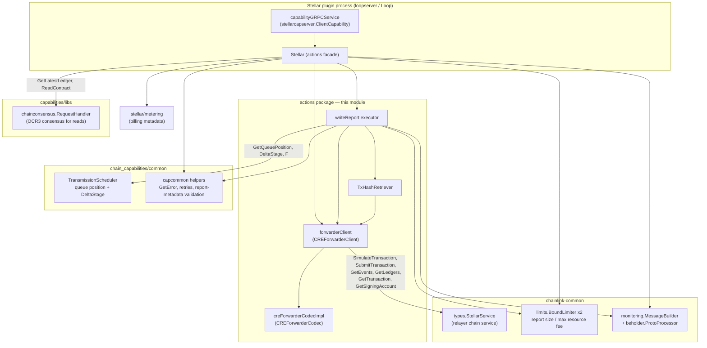
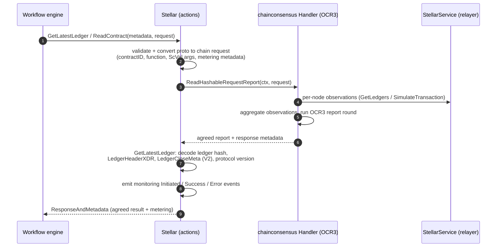
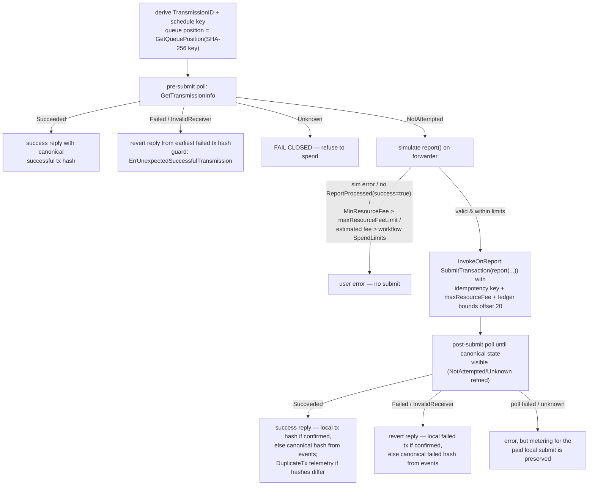
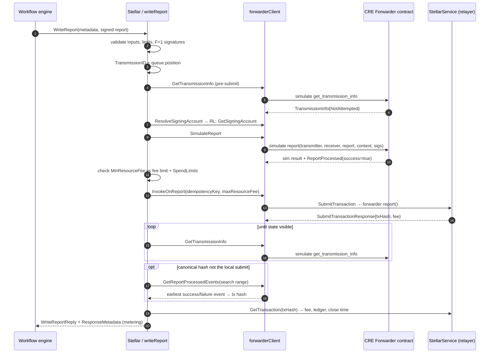
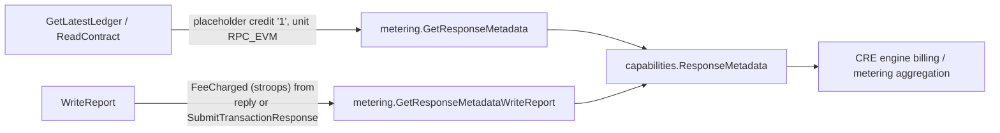

# Stellar Chain Capability — Actions (`chain_capability_stellar_actions`)

## 1. Overview

The `chain_capability_stellar_actions` module (Go package
`capabilities/chain_capabilities/stellar/actions`) implements the **executable on-chain actions** of the
Stellar chain capability for the [Workflow & Capability Runtime (CRE Engine)](../../Workflow___Capability_Runtime_(CRE_Engine).md).
It is the business-logic core of the Stellar plugin: it exposes the capability operations that workflows
invoke (`GetLatestLedger`, `ReadContract`, `WriteReport`), coordinates DON-level consensus for reads,
and performs fee-aware, idempotent transmission of OCR3 signed reports through the on-chain
**CRE Forwarder** contract.

The module lives in its own Go module (`capabilities/chain_capabilities/stellar/go.mod`) and is one of
four concerns of the Stellar capability:

| Concern | Documentation |
|---|---|
| Plugin process & gRPC runtime (this module's host) | [chain_capability_stellar_plugin_runtime](chain_capability_stellar_plugin_runtime.md) |
| **Actions — capability operations & write/report flow (this page)** | — |
| Forwarder contract client, codec & tx-hash retrieval | [chain_capability_stellar_forwarder](chain_capability_stellar_forwarder.md) |
| Monitoring processor, message builder & metrics | [chain_capability_stellar_monitoring](chain_capability_stellar_monitoring.md) |
| Metering (billing metadata) | [chain_capability_stellar_metering](chain_capability_stellar_metering.md) |

### 1.1 Responsibilities

- **Consensus reads** — `GetLatestLedger` and `ReadContract` turn single-node RPC observations into
  DON-agreed results using the shared [chainconsensus library](../capabilities_shared_libs/capabilities_shared_libs_chainconsensus.md)
  (OCR3-based aggregation keyed by ledger height/sequence).
- **Report transmission** — `WriteReport` submits an OCR3 `ReportResponse` to the receiver contract *via*
  the CRE forwarder contract (`report(...)`), with:
  - strict input validation (strkey contract addresses, OCR report-context and Ed25519 signature lengths),
  - report-size and resource-fee resource limits,
  - per-transmission DON scheduling (delta-stage queue position) to avoid duplicate spends,
  - pre-submit simulation with receiver-outcome verification (`ReportProcessed` event),
  - pre- and post-submit polling of canonical on-chain transmission state, and
  - canonical tx-hash resolution from forwarder `ReportProcessed` events.
- **Metering** — every response carries `capabilities.ResponseMetadata` billing metadata
  (see [chain_capability_stellar_metering](chain_capability_stellar_metering.md) and
  [metering-and-billing](../../Shared_Foundation_Libraries___Domain_Types/metering-and-billing.md)).
- **Observability** — lifecycle telemetry (`Initiated` / `Success` / `Error` / `DuplicateTx` /
  `InvalidTransmissionState`) is emitted through the Stellar
  [monitoring message builder](chain_capability_stellar_monitoring.md) into Beholder/OTLP
  (see [beholder-telemetry](../../Telemetry___Observability_Platform/beholder-telemetry.md)).

### 1.2 Key source files

| File | Contents |
|---|---|
| `capabilities/chain_capabilities/stellar/actions/actions.go` | `Stellar` capability facade, constructor, `GetLatestLedger`, `ReadContract`, `Info`, `Close` |
| `capabilities/chain_capabilities/stellar/actions/write_report.go` | `WriteReport` entry point, `writeReport` executor, validation, scheduling/polling, reply building, metering |
| `capabilities/chain_capabilities/stellar/actions/forwarder_client.go` | `CREForwarderClient` interface + implementation, `TransmissionID`, `TransmissionInfo`, `TransmissionState`, event search |
| `capabilities/chain_capabilities/stellar/actions/tx_hash_retriever.go` | `TxHashRetriever` — canonical success/failure tx hashes from `ReportProcessed` events |
| `capabilities/chain_capabilities/stellar/actions/cre_forwarder_codec.go` | `CREForwarderCodec` — ScVal/XDR encoding for forwarder calls and events |

---

## 2. Position in the system

The Stellar plugin process is launched by the node as a standard-capability Loop plugin
(see [Plugin Process Framework (Loop)](../../../Plugin_Process_Framework_(Loop)/loop-relayer-services.md)).
On `Initialise`, the plugin runtime ([chain_capability_stellar_plugin_runtime](chain_capability_stellar_plugin_runtime.md)):

1. resolves the [Stellar relayer service](../../Shared_Foundation_Libraries___Domain_Types/types-chains.md)
   (`types.StellarService`) from the `RelayerSet` using the configured `Network`/`ChainID`
   (`capabilities/chain_capabilities/stellar/config/config.go`),
2. resolves the chain selector and the capability DON, and builds a
   `TransmissionScheduler` from DON membership + `DeltaStage`
   (`capabilities/chain_capabilities/common/transmission_schedule/transmission_schedule.go`),
3. starts the consensus stack (request poller, `chainconsensus.Handler`, ledger height provider, OCR3
   oracle with reporting-plugin factory and contract transmitter), and
4. constructs the `Stellar` actions object with all of the above, then serves it over gRPC via
   `stellarcapserver.NewClientServer` (capability ID `stellar:ChainSelector:<selector>@1.0.0`).

Workflows reach these operations through the engine's capability calls; the request/response payloads are
the protobuf types of `chainlink-common/pkg/capabilities/v2/chain-capabilities/stellar`
(see [capabilities core](../capabilities/capabilities_core.md)).

---

## 3. Architecture

### 3.1 Component and dependency diagram



**Dependency notes**

- `Stellar` embeds `types.StellarService`, so the facade and the forwarder client share one relayer
  connection (all RPCs: simulate, submit, events, ledgers, transactions, signing account).
- The forwarder client and codec are documented in depth in
  [chain_capability_stellar_forwarder](chain_capability_stellar_forwarder.md); they are summarized here
  only to the extent the actions flow depends on them.
- Error classification uses `multinode.ErrNodeError` (node-availability failures) — imported per
  `capabilities/chain_capabilities/stellar/go.mod`.

---

## 4. Core components

### 4.1 `Stellar` — capability facade (`actions.go`)

```go
type Stellar struct {
    types.StellarService                     // embedded relayer chain service
    handler               chainconsensus.RequestHandler
    lggr                  logger.SugaredLogger
    messageBuilder        *monitoring.MessageBuilder
    beholderProcessor     beholder.ProtoProcessor
    chainSelector         uint64
    forwarderClient       CREForwarderClient
    reportSizeLimit       limits.BoundLimiter[commoncfg.Size]
    maxResourceFeeLimit   limits.BoundLimiter[uint64]
    transmissionScheduler ts.TransmissionScheduler
}
```

- **Construction** — `NewStellar(service, forwarderAddress, forwarderLookbackLedgers, lggr, limitsFactory,
  transmissionScheduler, chainSelector, handler, messageBuilder, beholderProcessor)`:
  - rejects a `nil` relayer service; defaults `forwarderLookbackLedgers` to
    `DefaultForwarderLookbackLedgers` (100) when zero;
  - builds the forwarder client (`newForwarderClient`);
  - initializes two **upper-bound limiters** from the host `limits.Factory` with CRE settings defaults:
    `cresettings.Default.PerWorkflow.ChainWrite.ReportSizeLimit` and
    `cresettings.Default.PerWorkflow.ChainWrite.Stellar.MaxResourceFee`
    (see [settings](../../Shared_Foundation_Libraries___Domain_Types/settings.md)).
- **`Info()`** — intentionally returns an empty `CapabilityInfo`; the authoritative capability ID/DON are
  owned by the plugin runtime wrapper (see [plugin runtime](chain_capability_stellar_plugin_runtime.md)).
- **`Close()`** — closes both bound limiters via `services.CloseAll`.

### 4.2 `writeReport` — WriteReport executor (`write_report.go`)

A per-request executor struct created by `Stellar.executeWriteReport`. It carries the relayer service,
forwarder client, request-scoped logger (enriched via `messageBuilder.RequestLggr`), chain selector,
limiters, transmission scheduler, and monitoring collaborators. All validation and transmission logic
in §5.3 is implemented here.

### 4.3 Transmission domain types (`forwarder_client.go`)

```go
type TransmissionState uint32
// 0 NotAttempted, 1 Succeeded, 2 InvalidReceiver, 3 Failed, 4 Unknown

type TransmissionInfo struct {
    State           TransmissionState
    Transmitter     string
    LedgerSequence  uint32
    Success         bool
    InvalidReceiver bool
}

type TransmissionID struct {
    Receiver            string    // strkey contract address of the receiver contract
    WorkflowExecutionID [32]byte  // raw workflow execution ID parsed from the raw report
    ReportID            [2]byte   // report ID parsed from the raw report
}
```

- `TransmissionID.ScheduleKey()` = SHA-256 over `receiver || workflowExecutionID || reportID`; its hex
  encoding is the input to the scheduler permutation (the scheduler itself seeds libocr with SHA3-256 of
  that string — `transmission_schedule.go`).
- `TransmissionID.idempotencyKey()` = `report:{receiver}:{execIDHex}:{reportIDHex}` and is passed to
  `SubmitTransactionRequest.IdempotencyKey` so the relayer deduplicates re-submissions.
- `Unknown` is a **fail-closed** state: it never authorizes a spend.

### 4.4 `TxHashRetriever` and `CREForwarderCodec`

The `TxHashRetriever` (canonical success/failure tx hash resolution from paginated `ReportProcessed`
event search, with `ErrUnexpectedSuccessfulTransmission` guard) and the `CREForwarderCodec`
(`report()` argument encoding with sorted, de-duplicated Ed25519 signatures; `get_transmission_info`
encoding/decoding; `ReportProcessed` topic-filter/event decoding, with `ocrReportContextLen = 96` and
`ed25519OCRSigLen = 96`) are specified in
[chain_capability_stellar_forwarder](chain_capability_stellar_forwarder.md).

---

## 5. Capability operations

### 5.1 Consensus reads — `GetLatestLedger` and `ReadContract`

Both reads delegate to the [chainconsensus](../capabilities_shared_libs/capabilities_shared_libs_chainconsensus.md)
handler (`ReadHashableRequestReport`), producing a DON-agreed, report-backed answer rather than trusting a
single RPC:

| Operation | Consensus request type | Observation | Response key |
|---|---|---|---|
| `GetLatestLedger` | `NewLockableToBlockHashableRequest` (locks to agreed chain height) | after consensus on height `H`, fetch ledger `H` via `GetLedgers` | agreed ledger sequence (bounded to `uint32`) |
| `ReadContract` | `NewVolatileRequest` | `SimulateTransaction` (read-only Soroban call) | `(returnValueXDR, ledgerSequence)` hash |



Behavioral details:

- `GetLatestLedger` verifies the RPC returned exactly the agreed sequence, requires the ledger header and
  V2 ledger-close metadata XDR, and re-encodes them into the response (`LedgerHeaderXdr`,
  `LedgerMetadataXdr`, `Hash`, `ProtocolVersion`).
- `ReadContract` emits `BuildReadContractInitiated/Success/Error` telemetry and classifies failures with
  `isUserError` (§6): deadline timeouts and node-availability errors are **infra** errors; anything else
  is surfaced as a user error.
- Read metering attaches placeholder spend credits (`ReadContract` / `GetLatestLedger` = `"1"`, unit
  `RPC_EVM`; tracked by [PLEX-3022] in `stellar/metering/metering.go`).

### 5.2 `WriteReport` — entry point and validation

`WriteReport(ctx, metadata, input)` executes the write with lifecycle telemetry:

```mermaid
flowchart TD
    A["WriteReport(metadata, WriteReportRequest)"] --> B["validateWriteReportInputs"]
    B -->|"nil request / nil report / empty or non-strkey contractId,<br/>report context != 96 bytes, no signatures,<br/>signature length != 96 (32-byte pubkey &#124;&#124; 64-byte sig),<br/>raw-report metadata mismatch"| C["user error (InvalidArgument)<br/>+ BuildWriteReportError telemetry"]
    B -->|"valid"| D["executeWriteReport"]
    D --> E["transmission scheduling, polling,<br/>simulation, limits, submit, reply"]
    E --> F["build reply + metering metadata"]
    F --> G["BuildWriteReportSuccess telemetry"]
```



Additional executor-level (user-error) checks before any spend:

1. receiver contract ≠ the forwarder contract itself,
2. raw report size within `reportSizeLimit`,
3. signature count ≥ `transmissionScheduler.F + 1` (fault-tolerance quorum).

### 5.3 `WriteReport` — transmission flow

The executor is **state-machine driven by the forwarder's canonical transmission state** and is designed
so that exactly one node's submission "wins" per transmission while others observe and return early.



**Delta-stage scheduling** (queue position > 0): the node waits `queuePosition × DeltaStage`
(configured in `config.DeltaStage`) before submitting, polling `GetTransmissionInfo` with exponential
backoff (100 ms « attempt, capped at 2 s). A terminal state observed before the slot expires short-circuits
the wait (`BuildWriteReportSuccessfulEarlyReturn` telemetry); a still-`NotAttempted` state at the boundary
triggers one final poll; if *all* polls failed during the window the node errors out rather than guessing.

**Reply building**: for both success and revert outcomes the executor fetches the canonical transaction
(`GetTransaction`) with quick retry and populates `TxHash`, `TxStatus = SUCCESS`,
`ReceiverContractExecutionStatus` (`SUCCESS` / `REVERTED`), `ErrorMessage` (revert reason:
`InvalidReceiverMessage` for `InvalidReceiver`, otherwise "receiver contract execution failed"),
`TransactionFee` (`FeeStroops`), `BlockTimestamp` (ledger close time scaled) and `LedgerSequence`.

### 5.4 End-to-end `WriteReport` sequence (queue position 0)



---

## 6. Error-handling model

The module distinguishes **user errors** (workflow-author mistakes: invalid addresses, oversized reports,
receiver rejections, insufficient funds) from **infrastructure errors** (node/RPC availability, timeouts):

- Executor-level failures are marked with the `capcommon.UserError` prefix and converted via
  `capcommon.GetError(err, isUserError...)` into `caperrors.Error`; user errors are raised as
  `caperrors.NewPublicUserError` (e.g. `InvalidArgument` for malformed read requests) so they are safely
  surfaced to callers (see [capabilities core](../capabilities/capabilities_core.md)).
- `ReadContract`/`GetLatestLedger` treat an error as a *user* error unless it is a context deadline or a
  Stellar node-availability error. Because these errors cross the Loop gRPC boundary (which preserves only
  status code + message), node errors are matched both by `errors.Is(err, multinode.ErrNodeError)` and by
  message-substring check (`isStellarNodeInfraError`).
- `Unknown` transmission state is always fail-closed, with an `InvalidTransmissionState` telemetry event.

---

## 7. Limits, metering, and observability

### 7.1 Resource limits

| Limiter | Default source | Enforcement point |
|---|---|---|
| `reportSizeLimit` | `cresettings.Default.PerWorkflow.ChainWrite.ReportSizeLimit` | pre-submit: `SizeOf(request.Report.RawReport)` |
| `maxResourceFeeLimit` | `cresettings.Default.PerWorkflow.ChainWrite.Stellar.MaxResourceFee` | pre-submit: `simResp.MinResourceFee`; the limiter's value is also sent as `MaxResourceFee` on the submit |

The estimated fee is additionally checked against the workflow's per-action `SpendLimits`
(unit `GAS.<chainSelector>`, compared as exact `big.Rat` values in stroops); a missing limit is logged as a
warning and allowed.

### 7.2 Metering data flow



`GetResponseMetadataWriteReport` converts stroops to XLM for the legacy `SpendValue`, reports
`SpendValueInGasUnits` in stroops, and uses the `GAS.<chainSelector>` spend unit. Zero fees are reported
explicitly (with error logs) rather than omitting metering for a paid submit — see
[chain_capability_stellar_metering](chain_capability_stellar_metering.md).

### 7.3 Observability

Every operation emits lifecycle messages through `monitoring.MessageBuilder` and the Beholder
`ProtoProcessor` (protos: `capabilities/chain_capabilities/stellar/monitoring/read_contract.proto` and
`write_report.proto`):

- `ReadContract`: `Initiated` / `Success` (result size + ledger) / `Error`.
- `WriteReport`: `Initiated` / `Success` / `Error`, plus `DuplicateTx` (local submit hash ≠ canonical hash),
  `SuccessfulEarlyReturn` (terminal state seen before the delta stage elapsed), `TxInfoRetrievalError`, and
  `InvalidTransmissionState` (de-duplicated per polling loop).

Details and metric definitions: [chain_capability_stellar_monitoring](chain_capability_stellar_monitoring.md).

---

## 8. Construction & configuration

The actions object is created only by the plugin runtime's `Initialise`
(`capabilities/chain_capabilities/stellar/main.go`). Relevant configuration fields
(`capabilities/chain_capabilities/stellar/config/config.go`):

| Field | Used by actions for |
|---|---|
| `CREForwarderAddress` | forwarder contract address (submit/simulate target, event source) |
| `ForwarderLookbackLedgers` | `ReportProcessed` event search window (default 100) |
| `DeltaStage` | transmission queue delay per queue position (required, > 0) |
| `Network`, `ChainID`, `IsLocal` | relay ID resolution and chain selector (localnet selector when `IsLocal`) |

Other fields (`ObservationPollerWorkersCount`, `ObservationPollPeriod`, `UnknownRequestsTTL`,
`MaxUnknownRequestsCacheSize`) configure the consensus stack owned by the plugin runtime
(see [chain_capability_stellar_plugin_runtime](chain_capability_stellar_plugin_runtime.md)).

Module dependencies are declared in `capabilities/chain_capabilities/stellar/go.mod` — notably
`chainlink-common` (capabilities/types/limits/beholder), `capabilities/libs` (chainconsensus),
`chainlink-framework/multinode` (node-error classification), `chainlink-protos/cre/go` (`sdk.ReportResponse`),
and the Stellar `go-stellar-sdk` (XDR/strkey).

---

## 9. Related documentation

- Parent capability: [chain_capability_stellar](../chain_capability_stellar.md)
- Plugin process & gRPC runtime: [chain_capability_stellar_plugin_runtime](chain_capability_stellar_plugin_runtime.md)
- Forwarder client, codec & tx-hash retrieval: [chain_capability_stellar_forwarder](chain_capability_stellar_forwarder.md)
- Monitoring: [chain_capability_stellar_monitoring](chain_capability_stellar_monitoring.md)
- Metering: [chain_capability_stellar_metering](chain_capability_stellar_metering.md)
- Shared chain-capability helpers & transmission scheduler: [chain_capabilities_common](../chain_capabilities_common.md)
- Consensus library: [capabilities_shared_libs_chainconsensus](../capabilities_shared_libs/capabilities_shared_libs_chainconsensus.md)
- Capability contracts & errors: [capabilities_core](../capabilities/capabilities_core.md)
- Stellar chain/relayer types: [types-chains](../../Shared_Foundation_Libraries___Domain_Types/types-chains.md)
- Loop plugin framework: [loop-relayer-services](../../../Plugin_Process_Framework_(Loop)/loop-relayer-services.md)
- Telemetry platform: [beholder-telemetry](../../Telemetry___Observability_Platform/beholder-telemetry.md)
