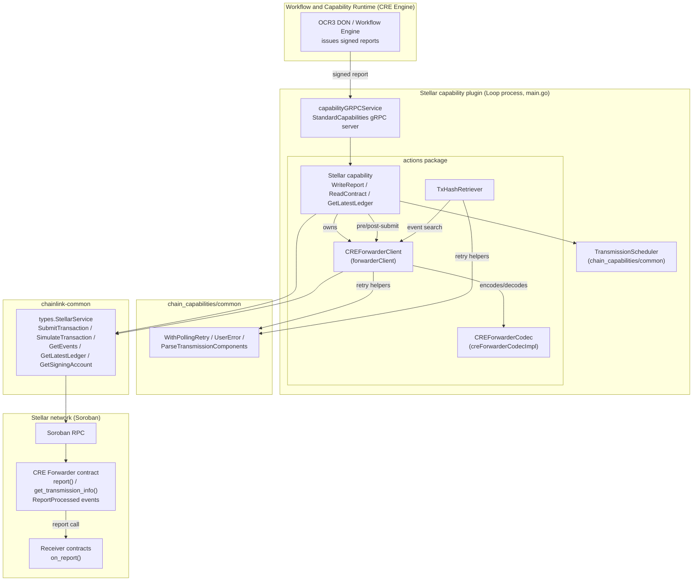
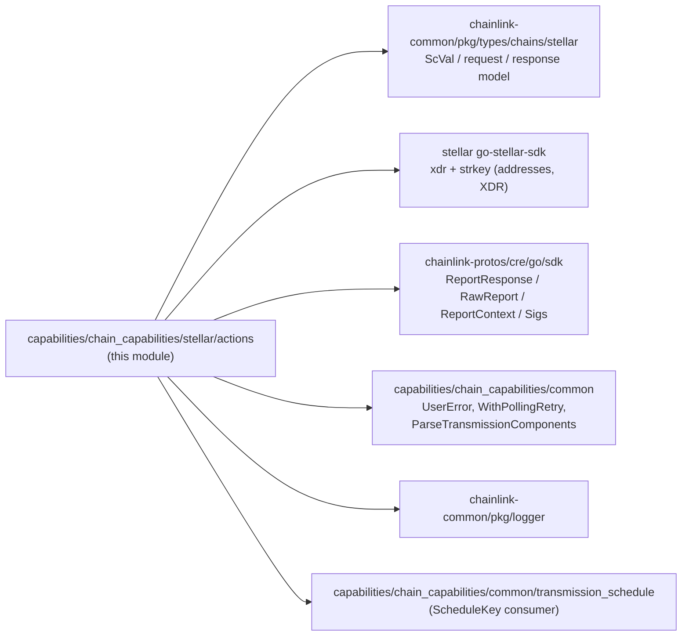
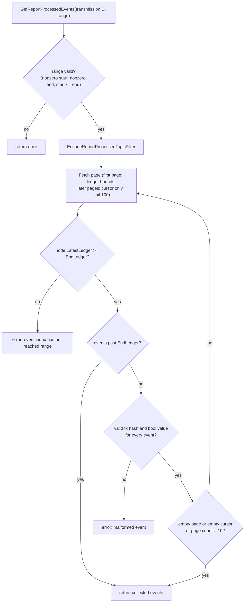

# Chain Capability Stellar Forwarder

> **Module scope:** `capabilities/chain_capabilities/stellar/actions` — the forwarder-interaction layer of the Stellar chain capability plugin: `CREForwarderClient` (`forwarder_client.go`), `TxHashRetriever` (`tx_hash_retriever.go`), and `CREForwarderCodec` (`cre_forwarder_codec.go`).

## Introduction

The Stellar chain capability plugin (`stellar` binary, see [chain_capability_stellar](../chain_capability_stellar.md)) executes OCR3-signed reports on Stellar Soroban contracts. Reports are **not** sent to receiver contracts directly: every node submits them to a single, shared **CRE Forwarder contract**, which records a per-transmission state machine on-chain and emits `ReportProcessed` events. This module is the client side of that contract.

The module has three tightly coupled components:

| Component | File | Responsibility |
|---|---|---|
| `CREForwarderClient` | `forwarder_client.go` | Typed façade over the forwarder contract: resolve the signing account, simulate and submit `report()`, query `get_transmission_info()`, and search `ReportProcessed` events. |
| `CREForwarderCodec` | `cre_forwarder_codec.go` | Pure encoding/decoding between Go types and Soroban XDR/`ScVal` values (call args, return values, event topics). |
| `TxHashRetriever` | `tx_hash_retriever.go` | Resolves the **canonical on-chain transaction hash** for a transmission by finding the earliest matching `ReportProcessed` event (success or failure). |

Key design goals visible in the code:

- **Idempotency & race safety across the DON.** Each transmission is identified by a `TransmissionID` (receiver + workflow execution ID + report ID). It produces an RPC idempotency key and a deterministic schedule key, so all nodes agree on ordering and duplicate submissions collapse into one on-chain outcome.
- **Spend protection.** `TransmissionStateUnknown` (empty on-chain state) must never authorize spending; the parent `WriteReport` flow refuses to submit unless state is `NotAttempted`.
- **Canonical outcome.** The local submit result is *not* authoritative. The forwarder's recorded state and its `ReportProcessed` events are the source of truth, which lets the DON return a consistent `txHash` even when several nodes raced to submit.

## Position in the System

This module lives inside the [Workflow & Capability Runtime (CRE Engine)](../../Workflow___Capability_Runtime_(CRE_Engine).md) as part of the Stellar chain capability:

- Parent chain capability and plugin process wiring: [chain_capability_stellar](../chain_capability_stellar.md) and [chain_capability_stellar_plugin_runtime](chain_capability_stellar_plugin_runtime.md).
- The consumer of this module, `Stellar.WriteReport`: [chain_capability_stellar_actions](chain_capability_stellar_actions.md).
- Telemetry emitted around forwarder operations: [chain_capability_stellar_monitoring](chain_capability_stellar_monitoring.md).
- Metering metadata attached to replies: [chain_capability_stellar_metering](chain_capability_stellar_metering.md).
- Contract interface conventions shared with the EVM/Solana forwarders: [chain_capability_evm](../chain_capability_evm.md), [chain_capability_solana](../chain_capability_solana.md), [chain_capabilities_common](../chain_capabilities_common.md).
- The forwarder **contract itself is deployed/configured** by the deployment suite: [cre-forwarder](../../CRE___Keystone_Deployment_Suite/cre-forwarder.md) (`chainlink/deployment/cre/forwarder/stellar/{deploy_forwarder,configure_forwarder,clear_config}.go`).
- On-chain client primitives (`types.StellarService`, `SubmitTransactionRequest`, `SimulateTransactionRequest`, `GetEventsRequest`, ScVal model): [types-chains](../../Shared_Foundation_Libraries___Domain_Types/types-chains.md).
- Process hosting (the plugin runs as a Loop gRPC process): [loop-plugin-core](../../../Plugin_Process_Framework_(Loop)/loop-plugin-core.md).

## Architecture

### Component diagram



Ownership and lifecycle: `Stellar.NewStellar` (actions.go) constructs exactly one `forwarderClient` per capability via the unexported `newForwarderClient(service, lggr, forwarderAddress, forwarderLookbackLedgers)`. The client embeds `types.StellarService` for all chain I/O and owns a `CREForwarderCodec`. `TxHashRetriever` is a lightweight value type created per `WriteReport` request (`NewTxHashRetriever`); the interface-based `CREForwarderClient` makes both unit-testable (see `forwarder_client_test.go`, `tx_hash_retriever_test.go`).

### Package dependency graph



Per `capabilities/chain_capabilities/stellar/go.mod`, the module pins `github.com/stellar/go-stellar-sdk v0.7.1` (XDR + `strkey` codecs), `chainlink-common` (Stellar types and capability contracts), `chainlink-protos/cre/go` (report protobufs), and the in-repo `capabilities/chain_capabilities/common` module. The plugin and its monitoring protos are generated/built with the workspace tooling in `capabilities/Makefile` (targets `protoc`, `gomods`, `tidy`) under the nx workspace (`capabilities/nx.json`).

## Core Components

### `CREForwarderClient` — forwarder contract façade

```go
type CREForwarderClient interface {
    ResolveSigningAccount(ctx context.Context) (string, error)
    InvokeOnReport(ctx, transmitter, receiver string, report *sdk.ReportResponse,
        transmissionID TransmissionID, maxResourceFee uint64) (*stellartypes.SubmitTransactionResponse, error)
    SimulateReport(ctx, transmitter, receiver string, report *sdk.ReportResponse) (stellartypes.SimulateTransactionResponse, error)
    ValidateReportSimulation(simResp stellartypes.SimulateTransactionResponse, transmissionID TransmissionID) error
    GetTransmissionInfo(ctx, transmissionID TransmissionID) (TransmissionInfo, error)
    GetReportProcessedEventSearchRange(ctx) (EventSearchRange, error)
    GetReportProcessedEventSearchEndLedger(ctx) (uint32, error)
    GetReportProcessedEvents(ctx, transmissionID TransmissionID, searchRange EventSearchRange) ([]ReportProcessedEvent, error)
    ForwarderAddress() string
}
```

| Method | Behaviour |
|---|---|
| `ResolveSigningAccount` | Calls `StellarService.GetSigningAccount` and validates via `ValidateSigningAccountAddress` (non-empty, `strkey` account-ID, exactly 32 bytes). The address is used both as the forwarder `transmitter` argument and as `SubmitTransactionRequest.FromAddress`. |
| `InvokeOnReport` | Encodes args via the codec and submits the forwarder `report` function with `FromAddress`, an `IdempotencyKey`, `MaxResourceFee`, and `LedgerBoundsOffset: defaultLedgerBoundsOffset` (20 ledgers of validity window). |
| `SimulateReport` | Simulates the identical `report` invocation (`SourceAccount: transmitter`) before funds are committed. |
| `ValidateReportSimulation` | Requires at least one simulated `ReportProcessed` event matching the `TransmissionID` **and** `success=true`. This is essential because the forwarder can return `Ok` while recording a receiver failure — only the event proves the receiver accepted the report. |
| `GetTransmissionInfo` | Simulates `get_transmission_info` and decodes the on-chain `TransmissionInfo {state: u32, transmitter: Option<Address>}`. An empty return value maps to `TransmissionStateUnknown` — deliberately *not* `NotAttempted`, so unknown state cannot authorize spend. |
| `GetReportProcessedEventSearch*` | Computes the `[latest − lookback, latest]` ledger window (`DefaultForwarderLookbackLedgers = 100` when unset) and drains `ReportProcessed` events from it. |
| `ForwarderAddress` | Configured forwarder contract address (strkey contract ID). |

**Identity, idempotency and scheduling keys.** `TransmissionID{Receiver, WorkflowExecutionID [32]byte, ReportID [2]byte}` is built by `WriteReport` from request metadata via `capcommon.ParseTransmissionComponents` (see [chain_capabilities_common](../chain_capabilities_common.md)):

- `idempotencyKey()` → `"report:<receiver>:<execIDHex>:<reportIDHex>"`, passed to the node's transaction service so retried submissions dedupe.
- `ScheduleKey()` → `SHA-256(receiverBytes ‖ workflowExecutionID ‖ reportID)`. Its hex string seeds `TransmissionScheduler.GetQueuePosition` (libocr permutation over sorted DON peer IDs), giving every node the same deterministic transmission order — see `transmission_schedule.go` in `capabilities/chain_capabilities/common`. Invalid receiver addresses are surfaced as user errors (`capcommon.UserError` prefix).
- `LogAttrs()` provides compact structured-log fields (`receiver`, `reportID`, `workflowExecutionID`).

**Event search protocol** (`GetReportProcessedEvents`). Soroban `getEvents` treats a pagination cursor and a ledger range as mutually exclusive, and some RPCs return trailing cursors that repeat or walk past the range. The implementation therefore:

1. Filters contract events from the forwarder with the codec-generated 4-segment topic filter (see below).
2. Sends the first page bounded by `StartLedger`/`EndLedger`; subsequent pages carry only the cursor.
3. Stops as soon as a page is empty, the cursor is exhausted, or an event past `EndLedger` appears (events arrive in ascending ledger order).
4. Fails if the node's `LatestLedger` has not yet reached `EndLedger`, if any event lacks a transaction hash, or if the event value is not a bool.
5. Caps the search at `reportProcessedEventMaxPages = 10` pages × `reportProcessedEventPageLimit = 100` events.



### `CREForwarderCodec` — XDR/ScVal boundary

The codec (`creForwarderCodecImpl`) is stateless and converts between Go domain types and Soroban values:

| Operation | Details |
|---|---|
| `EncodeReport(transmitter, receiver, report)` | Produces the `report()` argument vector: `transmitter` (account address ScVal), `receiver` (contract address ScVal), raw report bytes, report context (must be exactly `ocrReportContextLen = 96` bytes), and a signature vector. Signatures arrive as attributed OCR signatures of `ed25519OCRSigLen = 96` bytes (32-byte public key ‖ 64-byte signature); they are **sorted by public key**, **duplicate signers are rejected**, and each is encoded as a ScVal map `{public_key: bytes, signature: bytes}`. |
| `EncodeQueryTransmissionInputs(tid)` | `get_transmission_info` args: receiver contract address, workflow execution ID bytes, report ID bytes. |
| `DecodeQueryTransmissionInfo(xdr, ledger)` | Safe-unmarshals the return value and decodes the on-chain struct `TransmissionInfo {state: TransmissionState (u32 ≤ Failed), transmitter: Option<Address>}`; rejects unknown/duplicate/missing fields and invalid enum values. |
| `EncodeReportProcessedTopicFilter(tid)` | Four topic segments: symbol `forwarder_ReportProcessed`, receiver address, workflow execution ID bytes, report ID bytes — the exact topic layout emitted by the contract. |
| `DecodeReportProcessedEvent(eventXDR, forwarderAddr, tid)` | Parses a `DiagnosticEvent`, verifies: contract event type, contract ID equals the forwarder, V0 body with exactly 4 topics matching the filter, and a bool data payload. Returns the success flag. Non-matching events return an error so callers can skip them. |
| Helpers | `contractAddressToScVal` / `accountAddressToScVal` (strkey decode to exactly 32 bytes, address ScVals), `addressFromScVal` (XDR address → strkey), `encodeEd25519Signature`. |

### `TxHashRetriever` — canonical transaction hash resolution

`TxHashRetriever` turns forwarder events into the single transaction hash that `WriteReport` returns to the workflow:

| Method | Semantics |
|---|---|
| `GetSuccessfulTransmissionHash` | Fetches events (see below) and returns the tx hash of the **earliest** successful `ReportProcessed` event (lowest ledger). If none, logs and returns an error listing every observed transaction (`hash=… ledger=… result=…`). |
| `GetFailedTransmissionHash` / `GetFailedTransmissionHashWithCount` | Returns the earliest failed event's hash plus the total event count. If **any** successful event exists it wraps the `ErrUnexpectedSuccessfulTransmission` sentinel — a critical inconsistency signal the caller turns into telemetry. No events at all → "no failed transmission found". |
| `fetchAndParseEvents` (internal) | Computes the search range from the client, then wraps `GetReportProcessedEvents` in `capcommon.WithPollingRetry` (60 s budget, ~3 s max backoff, ≤25 attempts). While polling, if no events are found it **extends `EndLedger` to the node's latest ledger** and retries — this handles the race where the report confirms between range computation and event indexing. |

Earliest-event selection (`earliestEvent`) is deterministic across DON members because ledger sequences are globally ordered, so every node converges on the same canonical hash.

## Data Flow: `WriteReport` transmission lifecycle

The sequence below shows how the forwarder module participates in `Stellar.WriteReport` (full flow in [chain_capability_stellar_actions](chain_capability_stellar_actions.md)):

```mermaid
sequenceDiagram
    autonumber
    participant W as WriteReport (Stellar capability)
    participant F as CREForwarderClient
    participant C as CREForwarderCodec
    participant R as TxHashRetriever
    participant N as StellarService (node tx/RPC service)
    participant K as Forwarder contract

    W->>W: validate (receiver != forwarder, report size, sigs >= F+1)<br/>build TransmissionID, ScheduleKey -> queue position
    W->>F: GetTransmissionInfo(tid) [pre-submit poll]
    F->>C: EncodeQueryTransmissionInputs(tid)
    F->>N: SimulateTransaction(get_transmission_info)
    N->>K: read-only call
    K-->>N: {state, transmitter}
    N-->>F: ReturnValueXDR + ledger
    F->>C: DecodeQueryTransmissionInfo
    F-->>W: TransmissionInfo

    alt state = Succeeded / Failed / InvalidReceiver
        W->>R: GetSuccessfulTransmissionHash / GetFailedTransmissionHash
        R->>F: GetReportProcessedEvents (poll until visible)
        F->>N: GetEvents (topic-filtered, paginated)
        R-->>W: canonical tx hash
        W-->>W: success reply or revert reply (no new spend)
    else state = Unknown
        W-->>W: refuse to spend (InvalidTransmissionState telemetry)
    else state = NotAttempted
        W->>F: ResolveSigningAccount()
        W->>F: SimulateReport(transmitter, receiver, report)
        F->>N: SimulateTransaction(report)
        F->>C: ValidateReportSimulation (needs ReportProcessed success event)
        W->>W: enforce maxResourceFee + spend limits
        W->>F: InvokeOnReport(..., maxResourceFee)
        F->>C: EncodeReport (sorted, dedup-checked signatures)
        F->>N: SubmitTransaction(report, idempotencyKey, ledger bounds)
        N->>K: submit tx
        K->>K: call receiver.on_report, record state, emit ReportProcessed
        W->>F: GetTransmissionInfo(tid) [post-submit poll, WithPollingRetry]
        F-->>W: postInfo
        alt postInfo = Succeeded
            W->>R: GetSuccessfulTransmissionHash (if local tx unconfirmed)
            W-->>W: success reply; duplicate-tx telemetry if local hash != canonical
        else postInfo = Failed / InvalidReceiver
            W->>R: GetFailedTransmissionHash
            W-->>W: revert reply; duplicate-tx telemetry if local hash != canonical
        end
    end
```

Notes:

- Every poll in the loop (transmission info and event search) uses the shared `WithPollingRetry` helper, bounded by the request context.
- The pre-submit poll implements DON-wide deduplication: only the node(s) whose queue position allows them to transmit reach the simulate/invoke stages; the others either return an existing outcome or wait.

## Transmission State Model

`TransmissionState` mirrors the forwarder contract's on-chain enum (decoding rejects any value greater than `TransmissionStateFailed`):

```mermaid
stateDiagram-v2
    direction LR
    NA["NotAttempted"] --> SUCC["Succeeded"]
    NA --> FAIL["Failed"]
    NA --> INV["InvalidReceiver"]
    note right of NA
        WriteReport is allowed to
        simulate + submit only here
    end note
    UNK["Unknown (query-time: empty on-chain state)"]
    note left of UNK
        Never authorizes spend;
        pre-submit -> refuse;
        post-submit -> keep polling
    end note
```

| State | Meaning | `WriteReport` behaviour |
|---|---|---|
| `NotAttempted` (0) | No transmission recorded for this ID. | Proceed to simulate + submit. |
| `Succeeded` (1) | Receiver accepted the report. | Return success reply with the earliest successful event's tx hash; no new submission. |
| `InvalidReceiver` (2) | Receiver is not a Wasm contract or lacks `on_report` (`InvalidReceiverMessage`). | Return revert reply built from the earliest failed tx; `Success=false`, `InvalidReceiver=true`. |
| `Failed` (3) | A transmission attempt failed on-chain. | Return revert reply built from the earliest failed tx. |
| `Unknown` (query-time) | `get_transmission_info` returned empty. | Refuse to spend (`invalidTransmissionStateError`), emit `WriteReportInvalidTransmissionState`. |

## Configuration, Deployment and Build

- **Capability config** (`capabilities/chain_capabilities/stellar/config/config.go`): `creForwarderAddress` (forwarder contract strkey) and `forwarderLookbackLedgers` (event search window; `0` or negative falls back to `DefaultForwarderLookbackLedgers = 100` in both `newForwarderClient` and `NewStellar`). Remaining fields (network, chain ID, poller settings, `deltaStage`) configure the surrounding capability.
- **Contract lifecycle:** the forwarder contract is deployed, configured (receiver allow-listing) and cleared via the deployment suite — see [cre-forwarder](../../CRE___Keystone_Deployment_Suite/cre-forwarder.md), which includes Stellar-specific operations (`chainlink/deployment/cre/forwarder/stellar/…`).
- **Build/module:** `capabilities/chain_capabilities/stellar/go.mod` (Go 1.27 module; Stellar SDK, chainlink-common, cre protos, libocr). Protobuf code for monitoring lives in `monitoring/*.proto` and is generated via `capabilities/Makefile` target `protoc` (protoc installed by `capabilities/script/install-protoc.sh`).

## Error Handling and Observability

- **User vs. system errors.** Messages addressed to workflow owners are prefixed with the `capcommon.UserError` constant (`"user error:"`); `Stellar.isUserErrorWriteReport` classifies such errors as public user errors (`caperrors.NewPublicUserError`), while everything else becomes a public system error. Address-validation failures in this module (receiver, forwarder, signing account) follow this convention.
- **Sentinels.** `ErrUnexpectedSuccessfulTransmission` (`tx_hash_retriever.go`) marks the inconsistent case where a "failed" transmission query finds a successful event; callers escalate it to `WriteReportInvalidTransmissionState` telemetry.
- **Wrapped retrieval failures.** Tx-hash retrieval errors are wrapped with `failedToRetrieveTxHashErrorMsg` for consistent log/telemetry summaries.
- **Beholder telemetry** (see [chain_capability_stellar_monitoring](chain_capability_stellar_monitoring.md) and `monitoring/write_report.proto`): `WriteReportTxInfoRetrievalError` (with `tx_hash`), `WriteReportInvalidTransmissionState` (with `transmission_id`, `transmitter`, `state`, flags), and `WriteReportDuplicateTx` (local `duplicate_tx_hash` vs. canonical `canonical_tx_hash`) are emitted by the parent capability using data produced by this module.

## Related Documentation

- [chain_capability_stellar](../chain_capability_stellar.md) — Stellar chain capability overview.
- [chain_capability_stellar_plugin_runtime](chain_capability_stellar_plugin_runtime.md) — Loop process hosting, gRPC service, height provider.
- [chain_capability_stellar_actions](chain_capability_stellar_actions.md) — `Stellar` capability and the `WriteReport` state machine that drives this module.
- [chain_capability_stellar_monitoring](chain_capability_stellar_monitoring.md) — telemetry messages, processor, metrics.
- [chain_capability_stellar_metering](chain_capability_stellar_metering.md) — metering metadata for replies.
- [capabilities_core](../capabilities/capabilities_core.md) — `ExecutableAndTriggerCapability` contracts implemented by chain capabilities.
- [types-chains](../../Shared_Foundation_Libraries___Domain_Types/types-chains.md) — `StellarService` client and request/response types used for all chain I/O.
- [cre-forwarder](../../CRE___Keystone_Deployment_Suite/cre-forwarder.md) — deployment and configuration of the forwarder contracts.
