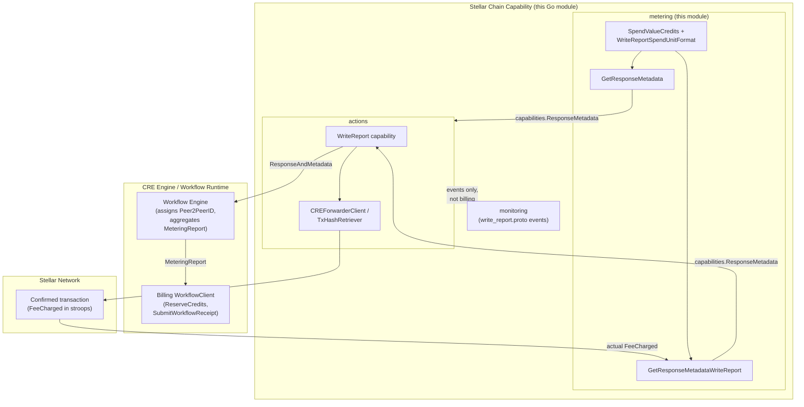
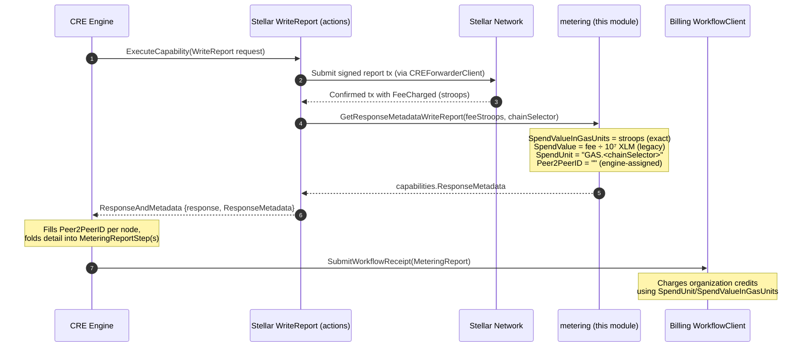
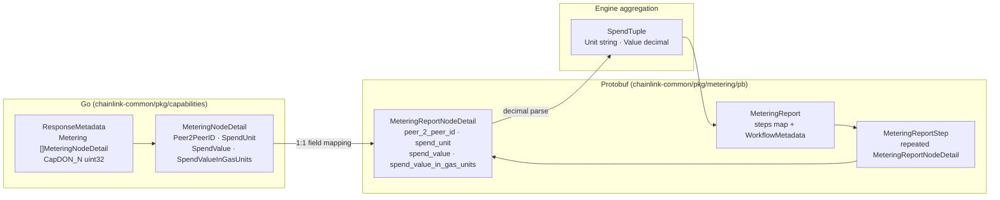

# chain_capability_stellar_metering

## Overview

The `chain_capability_stellar_metering` module implements **usage metering (billing) support for the Stellar chain capability** in the Chainlink Workflow & Capability Runtime (CRE Engine). It is a small, focused package (`capabilities/chain_capabilities/stellar/metering`) whose single responsibility is to translate *actual, on-chain resource consumption* from Stellar transactions into the standardized `capabilities.ResponseMetadata` metering structure that the CRE engine aggregates into workflow metering reports and forwards to the billing platform.

Unlike its sibling [Stellar monitoring](chain_capability_stellar_monitoring.md) package — which captures observability events — this module answers the question: **"What did executing this capability on Stellar cost, and in what units should it be billed?"**

The module lives inside the `github.com/smartcontractkit/capabilities/chain_capabilities/stellar` Go module (see `capabilities/chain_capabilities/stellar/go.mod`), which depends on `github.com/smartcontractkit/chainlink-common` for the shared `capabilities` data types and (indirectly) on `github.com/smartcontractkit/chainlink-protos/metering/go` for the metering wire protocol.

## Core Functionality

The module exposes three concerns, all defined in `capabilities/chain_capabilities/stellar/metering/metering.go`:

### 1. Write-report spend accounting — `GetResponseMetadataWriteReport`

```go
func GetResponseMetadataWriteReport(feeStroops uint64, chainSelector uint64) capabilities.ResponseMetadata
```

This is the module's core component. After a Stellar write-report transaction is confirmed, the capability calls this function with:

- `feeStroops` — the actual `FeeCharged` value from the confirmed transaction, expressed in **stroops** (the native Stellar fixed-point integer, where 1 XLM = 10⁷ stroops).
- `chainSelector` — the canonical Chainlink chain selector for the destination network.

It produces a `capabilities.ResponseMetadata` containing a single `MeteringNodeDetail`:

| Field | Value | Purpose |
|---|---|---|
| `Peer2PeerID` | *(empty)* | Assigned later by the engine; capability stubs leave it blank. |
| `SpendValue` | `feeStroops / 10⁷`, formatted via `big.Float.Text('f', -1)` | **Legacy** decimal XLM amount for backwards compatibility. |
| `SpendValueInGasUnits` | raw `feeStroops` as a decimal string | **Native fixed-point integer** (the authoritative value, per the metering proto: *"wei, lamports, etc."* — stroops for Stellar). |
| `SpendUnit` | `GAS.<chainSelector>` | Chain-selector-parameterized unit (via `WriteReportSpendUnitFormat = "GAS.%d"`), so billing can distinguish gas spend per network. |

The dual-field design is deliberate: `SpendValueInGasUnits` preserves full native precision for modern billing, while `SpendValue` in XLM keeps legacy consumers working (legacy consumers that see an empty native field fall back to `spend_value` shifted by 18 decimals, per `chainlink-common/pkg/metering/pb/meteringdetail.proto`).

### 2. Read-action spend placeholders — `GetResponseMetadata`

```go
func GetResponseMetadata(action SpendValueCredits) capabilities.ResponseMetadata
```

Produces metering metadata for Stellar **read** operations, using a typed `SpendValueCredits` enum:

- `ReadContract` — a `simulateTransaction`-based contract read (placeholder spend value `"1"`, tracked under `TODO: PLEX-3022`).
- `GetLatestLedger` — a consensus/ledger read (placeholder spend value `"1"`, same TODO).

Reads currently report the spend unit `"RPC_EVM"` — a known limitation flagged by `TODO: PLEX-3022` to generalize the spend unit across chain capabilities.

### 3. Spend-unit conventions — `WriteReportSpendUnitFormat`

The constant `"GAS.%d"` defines the write-operation spend-unit format, parameterized by chain selector so that a single billing unit namespace can host per-chain gas ledgers.

## Architecture & Component Relationships

The metering package sits at the bottom of the Stellar chain capability stack: it holds no chain-client logic of its own and is invoked by the [Stellar actions](chain_capability_stellar_actions.md) layer (specifically the write-report execution path) once an on-chain result is known. Its output flows up through the capability response envelope into the engine's metering aggregation and the shared billing client.



**Key relationships:**

- **Consumed by [Stellar actions](chain_capability_stellar_actions.md)** — the `WriteReport` capability calls `GetResponseMetadataWriteReport` with the fee from the confirmed transaction (retrieved via the [forwarder / tx-retrieval layer](chain_capability_stellar_forwarder.md)) and attaches the result to its capability response.
- **Produces the shared contract types** — `capabilities.ResponseMetadata` / `capabilities.MeteringNodeDetail` from `chainlink-common/pkg/capabilities/capabilities.go` (documented in [capabilities_core](../capabilities/capabilities_core.md)), which map 1:1 onto the `MeteringReportNodeDetail` proto.
- **Feeds the engine metering pipeline** — the engine wraps node details into `MeteringReportStep`/`MeteringReport` protos (`chainlink-common/pkg/metering/pb/`) and converts them to `SpendTuple {Unit, Value}` records; see [workflows_metering](../workflows/workflows_metering.md).
- **Billing handoff** — the aggregated report reaches the platform via the shared `billing.WorkflowClient` (documented in [metering-and-billing](../../Shared_Foundation_Libraries___Domain_Types/metering-and-billing.md)).
- **Complements, not overlaps, monitoring** — `monitoring/write_report.proto` (`WriteReportSuccess`, `WriteReportError`, `WriteReportDuplicateTx`, …) captures *what happened* for observability; metering captures *what it cost*. They run side by side on the same executions.

## Data Flow: Write-Report Metering

The sequence below traces one metered write-report execution from trigger to billing receipt.



The read-action path is simpler: `GetResponseMetadata(ReadContract | GetLatestLedger)` is invoked when a read returns, attaching a placeholder-cost `ResponseMetadata` to the read response so that per-execution RPC spend is still visible to the engine even before real credit prices land (PLEX-3022).

## Metering Data Model

The metering payload travels through three representations — Go struct, capability response, and wire proto — with a stable field mapping:



Notes on the mapping (per `meteringdetail.proto`):

- `spend_value_in_gas_units` is the *native fixed-point integer* channel — for Stellar this is stroops, exactly what `GetResponseMetadataWriteReport` writes into `SpendValueInGasUnits`.
- If `spend_value_in_gas_units` is **empty** (legacy producers), consumers fall back to `spend_value` shifted by 18 decimals — which is why the Stellar capability still populates the decimal-XLM `SpendValue` alongside the native stroops value.

## Cross-Chain Parallels

The Stellar metering package follows the shared pattern established by the other chain capabilities, differing only in native unit and conversion factor:

| Capability | Function | Native unit (SpendValueInGasUnits) | Legacy conversion | SpendUnit format |
|---|---|---|---|---|
| **Stellar (this module)** | `GetResponseMetadataWriteReport` | stroops (10⁻⁷ XLM) | ÷ 10⁷ → XLM | `GAS.%d` |
| Solana — see [Solana actions](../chain_capability_solana/chain_capability_solana_actions.md) | `GetResponseMetadataWriteReport` | lamports (10⁻⁹ SOL) | ÷ 10⁹ → SOL | `GAS.%d` |
| EVM — see [EVM monitoring/metering](../chain_capability_evm/chain_capability_evm_monitoring.md) | `CheckHasFunds` | wei | n/a (limit comparison) | spend-limit keyed by unit |

The EVM package additionally demonstrates the *enforcement* side of metering — comparing a request's intended spend against the caller's `RequestMetadata.SpendLimits` before execution — which complements the *accounting* side implemented here.

## Dependencies

From `capabilities/chain_capabilities/stellar/go.mod`:

- **`github.com/smartcontractkit/chainlink-common`** — provides `capabilities.ResponseMetadata`, `capabilities.MeteringNodeDetail` (the types produced by this module) and the `pkg/metering` protos.
- **`github.com/smartcontractkit/chainlink-protos/metering/go`** (indirect) — generated billing/metering wire types consumed downstream.
- **`github.com/smartcontractkit/chain-selectors`** — semantic source of the `chainSelector` values baked into `GAS.%d` spend units.

The module has **no** direct dependency on Stellar SDK types: it operates purely on `uint64` fee values and selector IDs, keeping the billing seam chain-agnostic.

## Known Limitations

1. **Placeholder read pricing** — `ReadContract` and `GetLatestLedger` carry spend value `"1"` under `TODO: PLEX-3022`; real credit values are pending.
2. **`RPC_EVM` spend unit for reads** — read metadata currently reuses the EVM RPC unit name; PLEX-3022 also tracks generalizing this across chain capabilities.
3. **Single-node detail** — both helpers emit exactly one `MeteringNodeDetail` per response; per-node attribution (beyond the engine-assigned `Peer2PeerID`) is delegated to the engine.

## Related Documentation

- Parent: [chain_capability_stellar](../chain_capability_stellar.md) — the full Stellar chain capability.
- Siblings: [Stellar plugin runtime](chain_capability_stellar_plugin_runtime.md) · [Stellar actions](chain_capability_stellar_actions.md) · [Stellar forwarder](chain_capability_stellar_forwarder.md) · [Stellar monitoring](chain_capability_stellar_monitoring.md)
- Engine-side consumption: [workflows_metering](../workflows/workflows_metering.md)
- Shared contracts: [capabilities_core](../capabilities/capabilities_core.md) · [metering-and-billing](../../Shared_Foundation_Libraries___Domain_Types/metering-and-billing.md)
- Cross-chain peers: [chain_capability_solana](../chain_capability_solana.md) · [chain_capability_evm](../chain_capability_evm.md)
