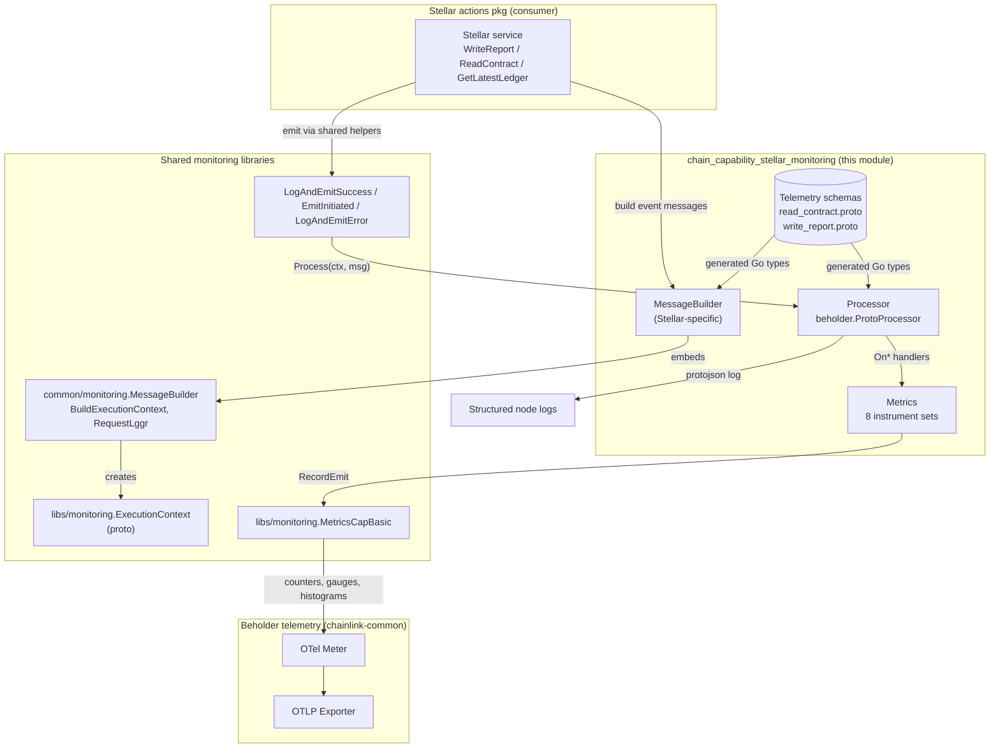
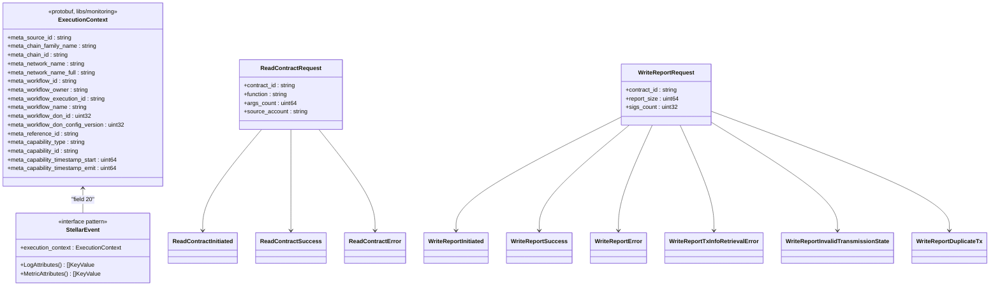
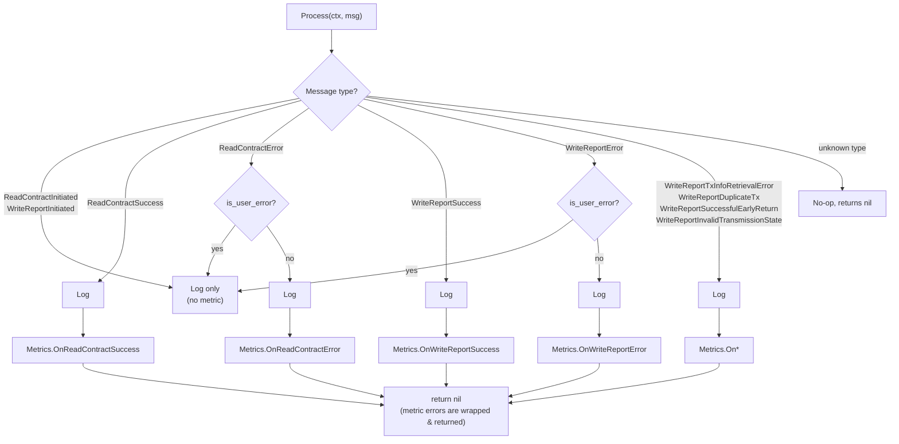
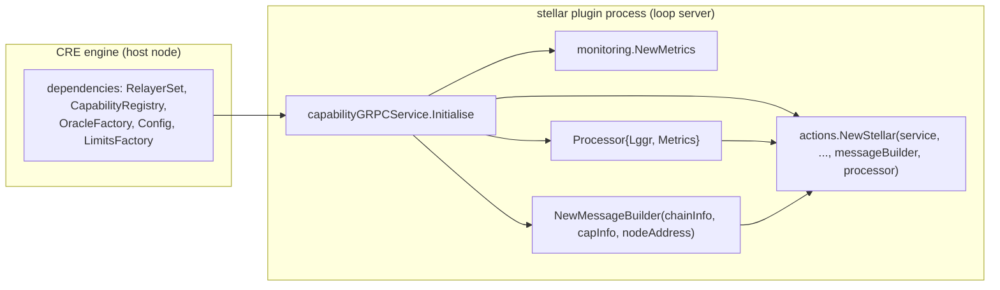

# Stellar Chain Capability — Monitoring

## Introduction

The `chain_capability_stellar_monitoring` module (`capabilities/chain_capabilities/stellar/monitoring/`) is the **observability layer of the Stellar chain capability** in the Workflow & Capability Runtime (CRE). It turns the runtime events of Stellar operations — contract reads and consensus report writes — into structured telemetry: **typed protobuf messages** (schema-defined and generated), **structured logs**, and **OpenTelemetry metrics** exported through [Beholder](../../Telemetry___Observability_Platform/beholder-telemetry.md).

The module is intentionally thin and declarative:

- **[Message schemas](#telemetry-message-schemas)** (`read_contract.proto`, `write_report.proto`) define what is observed and deliberately exclude sensitive payloads (raw call arguments, report bytes, signatures).
- **`MessageBuilder`** stamps every observation with a shared `ExecutionContext` (node, chain, workflow, capability metadata).
- **`Processor`** is the single dispatch point: it logs every message as JSON and routes terminal events (success/error) to the matching metric handler. It implements the `beholder.ProtoProcessor` interface, so it slots directly into the shared emit helpers used by the actions layer.
- **`Metrics`** owns eight OTel instrument sets (`count`, `cap_timestamp_start`, `cap_timestamp_emit`, `cap_duration` per event) with Stellar-tuned duration buckets.

The monitoring package is consumed exclusively by the [Stellar actions layer](chain_capability_stellar_actions.md) and wired up by the [plugin runtime](chain_capability_stellar_plugin_runtime.md). It shares all plumbing with the other chain capabilities (EVM, Solana, Aptos) via the [common chain-capability monitoring library](../chain_capabilities_common.md) and the [shared `libs/monitoring` library](../capabilities_shared_libs/capabilities_shared_libs_monitoring.md).

---

## Architecture Overview

The module sits between the Stellar capability's business logic (actions) and the node's telemetry backend (Beholder → OTLP collector). It is a pure fan-out: actions produce messages, the monitoring layer converts them to logs + metrics, and no monitoring state influences workflow outcomes.



**Key relationships:**

| Component | Role | Depends on |
|---|---|---|
| `MessageBuilder` | Constructs typed telemetry messages with execution context | `common/monitoring.MessageBuilder` (embedded), generated proto types |
| `Processor` | Dispatches messages → logs + metrics; filters user errors from error metrics | `Metrics`, `logger.Logger`, generated proto types |
| `Metrics` | OTel instruments per event type | `libs/monitoring.MetricsCapBasic`, Beholder meter |
| `.proto` schemas | Contract for what is emitted | `libs/monitoring/execution_context.proto` |

---

## Core Components

### 1. Telemetry Message Schemas

Two protobuf files define the telemetry vocabulary (package `chain_capabilities.stellar`, generated into this package via [generate.go](#generated-code)):

- [`read_contract.proto`](../../capabilities/chain_capabilities/stellar/monitoring/read_contract.proto) — events for the **ReadContract** flow (simulation-based reads).
- [`write_report.proto`](../../capabilities/chain_capabilities/stellar/monitoring/write_report.proto) — events for the **WriteReport** flow (consensus report transmission through the CRE forwarder).

**Event catalogue:**

| Event | Operation | Carries | Metric emitted? |
|---|---|---|---|
| `ReadContractInitiated` | ReadContract | sanitized request | No — log only |
| `ReadContractSuccess` | ReadContract | sanitized request, `result_len`, `ledger_sequence` | Yes |
| `ReadContractError` | ReadContract | sanitized request, `summary`, `cause`, `is_user_error` | Yes (non-user errors) |
| `WriteReportInitiated` | WriteReport | sanitized request | No — log only |
| `WriteReportSuccess` | WriteReport | sanitized request | Yes |
| `WriteReportError` | WriteReport | sanitized request, `summary`, `cause`, `is_user_error` | Yes (non-user errors) |
| `WriteReportTxInfoRetrievalError` | WriteReport | + `tx_hash` | Yes |
| `WriteReportDuplicateTx` | WriteReport | + `duplicate_tx_hash`, `canonical_tx_hash` | Yes |
| `WriteReportSuccessfulEarlyReturn` | WriteReport | execution context only | Yes |
| `WriteReportInvalidTransmissionState` | WriteReport | + `transmission_state`, `invalid_receiver`, `success`, `transmission_id`, `transmitter` | Yes |

**Privacy-by-design:** both request messages capture only the *non-sensitive subset* of capability requests — `contract_id`, `function`, `args_count` (not raw args), `source_account` for reads; `contract_id`, `report_size`, `sigs_count` (not raw report bytes or signatures) for writes. This keeps telemetry useful for alerting without leaking payload data into logs or metrics backends.

Every event embeds a shared `monitoring.ExecutionContext` (field number 20) defined once in [`capabilities/libs/monitoring/execution_context.proto`](../capabilities_shared_libs/capabilities_shared_libs_monitoring.md):



### 2. `MessageBuilder` (`messages.go`)

`MessageBuilder` is the **factory for all Stellar telemetry messages**. It embeds `*commonmon.MessageBuilder` (from the [chain-capabilities common library](../chain_capabilities_common.md)), inheriting:

- `BuildExecutionContext(tc)` — flattens the builder's chain info (`types.ChainInfo`), capability info (`capabilities.CapabilityInfo`), node address, and a `TelemetryContext` (start timestamp + `capabilities.RequestMetadata`) into a `capmonitoring.ExecutionContext`.
- `RequestLggr(lggr, tc)` — a sugared logger pre-enriched with execution-context attributes for request-scoped logging.

On top of that, the Stellar builder adds typed constructors:

- `BuildReadContract*` — initiated / success / error for simulation reads (success records `result_len` and `ledger_sequence`).
- `BuildWriteReport*` — initiated, success, generic error, tx-info retrieval error (includes `tx_hash`), invalid transmission state (includes transmission ID, transmitter, state flags), duplicate tx (includes duplicate/canonical hashes), and successful-early-return.
- `convertReadContractRequest` / `convertWriteReportRequest` — enforce the "counts, not contents" privacy rule; `nil`-safe on both request shapes.

The file also implements, for every generated event type, the two projection methods required by the shared `Message` interface:

- `LogAttributes()` — high-cardinality attributes for structured logs: request fields plus the full `ExecutionContext.LogAttributes()` (including `request_id` = `workflowExecutionID:referenceID`).
- `MetricAttributes()` — deliberately low-cardinality: only `ExecutionContext.MetricsAttributes()` (chain family/id, network names, workflow DON id, capability type/id), so Prometheus-style backends are not flooded with per-execution labels. Empty string values are normalized to `"unknown"` to keep OTel→Prometheus export valid.

### 3. `Processor` (`processor.go`)

`Processor` is the **single entry point for telemetry emission**. Its `Process(ctx, proto.Message, attrKVs...)` signature satisfies `beholder.ProtoProcessor`, which is why the [plugin runtime](chain_capability_stellar_plugin_runtime.md) can hand it to the actions layer as the *beholder processor* — every emit call from actions flows through it.

Dispatch logic:



Behaviour details:

- **Logging:** every routed message is serialized with `protojson` (proto field names, unpopulated fields included) into a map and logged at `Info` level with the `[Stellar Monitoring]` prefix, the message descriptor name as `entity_name`, plus common attributes. Serialization failures are logged as errors rather than crashing emission.
- **User-error filtering:** `ReadContractError` / `WriteReportError` events flagged `is_user_error` (error origin `caperrors.OriginUser`) are logged but **excluded from error metrics**. This mirrors the shared helper's log-level policy (user errors → `Warn`, system errors → `Error`) and prevents client misuse from polluting system-health alerts.
- **Terminal-only metrics:** `*Initiated` events are logged but produce no metric; success/error/edge-case events each produce one metric observation (see [Metrics](#4-metrics-metricsgo)).
- The package also re-exports the shared emit helpers as package-level variables — `LogAndEmitSuccess`, `EmitInitiated`, `LogAndEmitError` — aliasing `common/monitoring` so the actions layer imports a single monitoring package. `LogAndEmitError` strips the duplicate `summary` log attribute (it is rendered in the log line itself) and demotes user errors to warnings.

### 4. `Metrics` (`metrics.go`)

`Metrics` holds **eight instrument sets**, one per terminal event type, created in `NewMetrics()` via the shared `capmonitoring.NewMetricsCapBasic` factory (indirected through `newMetricsCapBasic` for test override). Each set is a `capmonitoring.MetricsCapBasic` containing four OTel instruments on the Beholder meter:

| Instrument | Type | Unit | Semantics |
|---|---|---|---|
| `stellar_capability_<event>_count` | `Int64Counter` | — | Emissions of the event |
| `stellar_capability_<event>_cap_timestamp_start` | `Int64Gauge` | ms | Local timestamp of capability-exec start |
| `stellar_capability_<event>_cap_timestamp_emit` | `Int64Gauge` | ms | Local timestamp of the emit |
| `stellar_capability_<event>_cap_duration` | `Int64Histogram` | ms | `emit − start`, i.e. capability latency at emit time |

Event names (`ns()` prefix `stellar_capability_`): `read_contract_success`, `read_contract_error`, `write_report_success`, `write_report_error`, `write_report_duplicate_tx`, `write_report_tx_info_retrieval_error`, `write_report_successful_early_return`, `write_report_invalid_transmission_state`. Each metric is registered with the Beholder schema full name of its protobuf message, tying metric streams to the emitted telemetry events (see [Beholder telemetry](../../Telemetry___Observability_Platform/beholder-telemetry.md)).

**Stellar-tuned histogram buckets** (`capDurationBucketBoundariesMs`, in ms):

```
10, 25, 50, 100, 250, 500, 1000, 2500, 5000, 10000, 20000, 30000, 60000
```

These span the full write-report lifecycle — fast read-contract simulations (~10 ms) through ledger-confirmation waits (~5–30 s) up to the max-retry timeout (~60 s) — giving useful resolution at both ends instead of the SDK default buckets.

Recording (`recordBasicCapEmit`) attaches the message's `MetricAttributes()` (the low-cardinality execution-context set) and pulls `start`/`emit` from the embedded `ExecutionContext` timestamps, so every observation is internally consistent with the logged event.

---

## Data Flow: Telemetry Lifecycle

The sequence below traces a `WriteReport` call (the richest flow; `ReadContract` follows the same pattern):

```mermaid
sequenceDiagram
    autonumber
    participant W as Workflow Engine (CRE)
    participant A as Stellar actions<br/>(WriteReport)
    participant MB as MessageBuilder
    participant P as Processor
    participant M as Metrics
    participant T as Beholder / OTel backend

    W->>A: WriteReport(req, RequestMetadata)
    A->>A: tc = TelemetryContext{TsStart: now, metadata}
    A->>MB: BuildWriteReportInitiated(tc, req)
    A->>P: EmitInitiated(ctx, processor, msg)
    P->>T: log only (Initiated events carry no metric)
    A->>A: validate inputs, execute report transmission

    alt success
        A->>MB: BuildWriteReportSuccess(tc, req)
        A->>P: LogAndEmitSuccess(ctx, ..., processor, msg)
        P->>T: Info log (LogAttributes)
        P->>M: OnWriteReportSuccess(ctx, msg)
        M->>T: count++ ; ts_start ; ts_emit ; duration
    else system error
        A->>MB: BuildWriteReportError(tc, req, summary, err)
        A->>P: LogAndEmitError(ctx, ..., processor, errMsg)
        P->>T: Error log (Warn if user error)
        P->>M: OnWriteReportError (skipped if user error)
    else tx-finality edge cases
        A->>MB: BuildWriteReportTxInfoRetrievalError / DuplicateTx / InvalidTransmissionState / SuccessfulEarlyReturn
        A->>P: LogAndEmit*(ctx, ..., processor, msg)
        P->>M: On* → dedicated metric
    end

    A-->>W: ResponseAndMetadata / caperrors.Error
```

Notable properties of this flow:

- The **`TelemetryContext`** is created once per request from `capabilities.RequestMetadata` and the wall-clock start time; it feeds both the enriched request logger and every message's `ExecutionContext`, so all logs and metrics for one execution share the same identity (`request_id`).
- The `Processor` never blocks or fails the capability: metric-handler errors are returned from `Process` (and logged by the shared helpers as *"Failed to process …"*), but they never propagate into workflow results.
- Emission of telemetry is **synchronous** with the action; the OTel SDK handles batching/async export to the collector.

---

## Integration in the Stellar Capability

The [plugin runtime](chain_capability_stellar_plugin_runtime.md) wires the monitoring module in `capabilityGRPCService.Initialise` (`capabilities/chain_capabilities/stellar/main.go`):

1. **Node identity:** resolves the local node's PeerID from the capability registry as the telemetry `source_id` (with a warning fallback to an empty source id when the registry is unavailable, e.g. local runs).
2. **Metrics:** `monitoring.NewMetrics()` — fails startup if any instrument cannot be registered.
3. **Processor:** `&monitoring.Processor{Lggr, Metrics}` — created fresh per capability instance; it *is* the `beholder.ProtoProcessor` handed to actions.
4. **MessageBuilder:** `monitoring.NewMessageBuilder(chainInfo, capInfo, nodeAddress)` where `chainInfo` comes from the Stellar relayer (`GetChainInfo`) and `capInfo` is the capability's registered identity (`stellar:ChainSelector:<selector>@1.0.0`).
5. **Consumption:** both are injected into `actions.NewStellar(...)`; the [actions layer](chain_capability_stellar_actions.md) then emits telemetry at every phase boundary (initiated → validation → execution → finality check → success/error), including forwarder interactions handled by the [forwarder module](chain_capability_stellar_forwarder.md) and metering metadata produced by the [metering module](chain_capability_stellar_metering.md).



Because the Stellar capability runs as a standalone plugin process (`loop.StandardCapabilities` served over gRPC — see the [Plugin Process Framework](../../Plugin_Process_Framework_(Loop).md)), its telemetry is emitted **inside the plugin process** against the Beholder meter configured by that process, then exported via OTLP to the observability stack. Workflow-level orchestration context (workflow owner, DON, execution IDs) is available because the engine passes `capabilities.RequestMetadata` with every capability call — the monitoring module never needs to talk back to the engine.

---

## Observability Semantics Summary

**Metric label strategy** (from `ExecutionContext`):

- *Metric attributes* (cardinality-safe): `chain_family_name`, `chain_id`, `network_name`, `network_name_full`, `workflow_don_id`, `capability_type`, `capability_id`.
- *Log attributes* (cardinality-rich, log-only): everything above plus `source_id`, `workflow_id`, `workflow_owner`, `workflow_execution_id`, `workflow_name` (hex-decoded to plain text), `workflow_don_config_version`, `reference_id`, `request_id`.

**Alerting-oriented distinctions** an operator can build from these streams:

- `*_error` metrics exclude user errors → alerts on these indicate *system* faults (network, forwarder, relayer), not caller mistakes.
- Dedicated streams for `duplicate_tx`, `tx_info_retrieval_error`, `invalid_transmission_state`, and `successful_early_return` surface the finality/edge cases unique to Stellar's ledger-based confirmation model.
- `cap_duration` histograms with the Stellar bucket set distinguish read latency from ledger-wait latency directly in percentiles.

---

## Generated Code & Build Considerations

- [`generate.go`](../../capabilities/chain_capabilities/stellar/monitoring/generate.go) declares the `go:generate` protoc invocations. The proto path root is the `capabilities/` module root, which is why the schemas import the shared context as `libs/monitoring/execution_context.proto`.
- Generated artifacts in-package: `read_contract.pb.go`, `write_report.pb.go` (plus `*_test.go` suites: `messages_test.go`, `metrics_test.go`, `metrics_internal_test.go`, `processor_internal_test.go`, `monitoring_test.go`).
- The package lives in the `github.com/smartcontractkit/capabilities/chain_capabilities/stellar` Go module (`capabilities/chain_capabilities/stellar/go.mod`); its monitoring-relevant direct dependencies are `capabilities/chain_capabilities/common`, `capabilities/libs`, `chainlink-common` (Beholder), `go.opentelemetry.io/otel`, and `google.golang.org/protobuf`.
- Lint annotations (`//nolint:gosec`) document the bounded-range conversions (`uint64 → int64` attribute values, signature counts); regenerate metrics names only in lockstep with dashboard/alerter definitions in the [observability platform](../../Telemetry___Observability_Platform/monitoring.md).

---

## Related Documentation

- [Stellar chain capability (parent)](../chain_capability_stellar.md) — module overview and DON role of the Stellar capability.
- [Stellar plugin runtime](chain_capability_stellar_plugin_runtime.md) — process entrypoint, config, wiring of this module.
- [Stellar actions](chain_capability_stellar_actions.md) — the producer of every telemetry message.
- [Stellar forwarder](chain_capability_stellar_forwarder.md) — CRE forwarder client whose outcomes feed `WriteReport*` events.
- [Stellar metering](chain_capability_stellar_metering.md) — spend metering metadata (sibling concern, distinct from monitoring).
- [Shared monitoring libs](../capabilities_shared_libs/capabilities_shared_libs_monitoring.md) — `ExecutionContext` schema and `MetricsCapBasic` instruments.
- [Chain-capabilities common](../chain_capabilities_common.md) — shared `MessageBuilder` and emit helpers for all chain capabilities.
- [Capabilities core](../capabilities/capabilities_core.md) — capability interfaces and error origins (`OriginUser`).
- [Beholder telemetry](../../Telemetry___Observability_Platform/beholder-telemetry.md) — OTLP export pipeline consuming these metrics and events.
- [Workflows / CRE engine](../workflows.md) — how workflow executions generate the `RequestMetadata` observed here.
