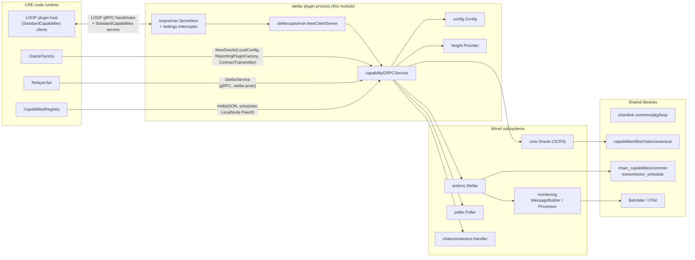
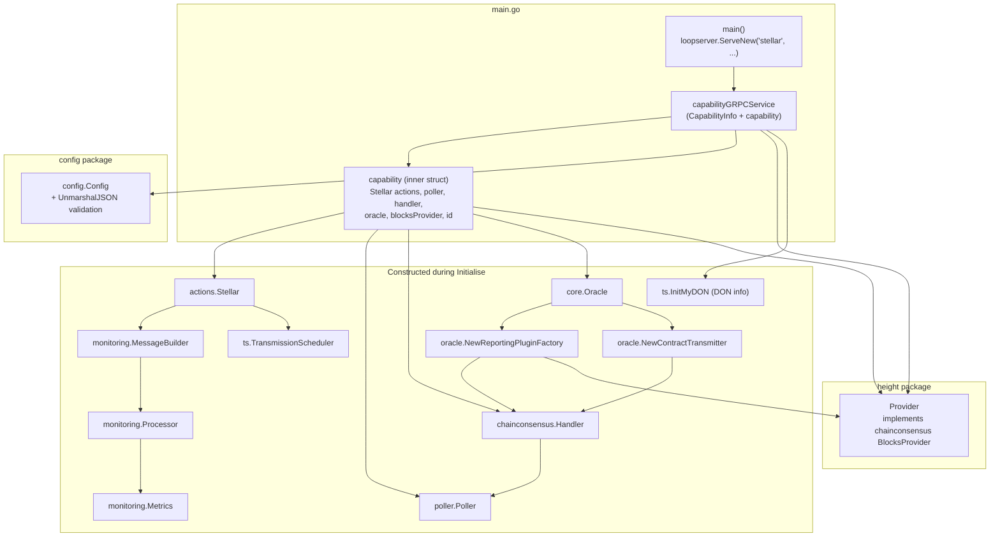
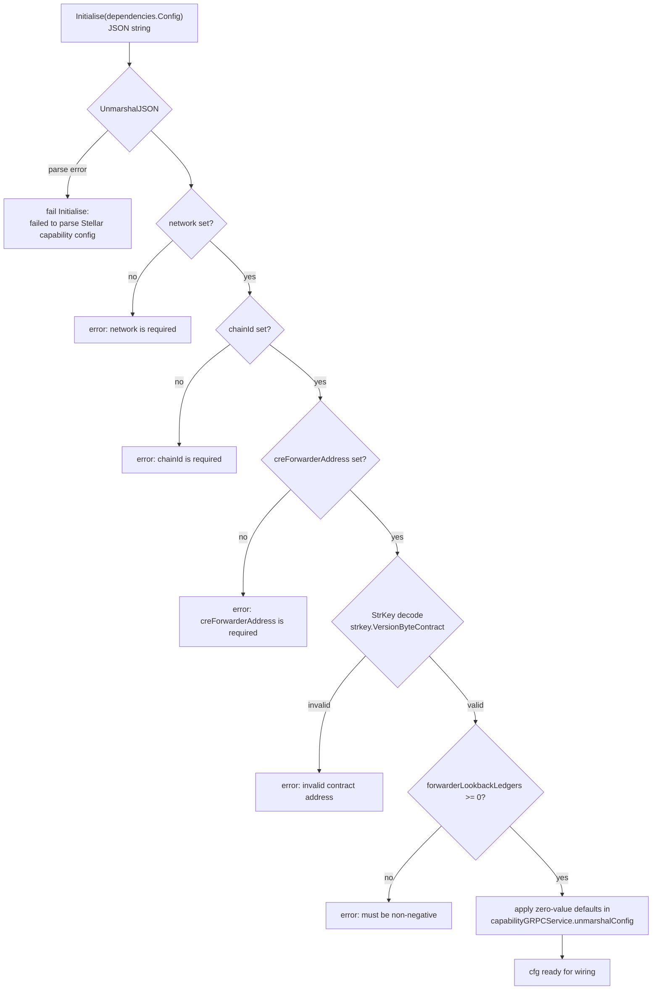
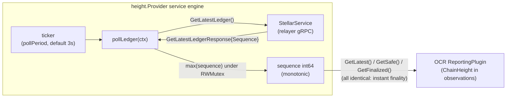

# Stellar Plugin Runtime (`chain_capabilities/stellar` — plugin lifecycle & wiring)

## 1. Overview

This module is the **process runtime of the Stellar chain capability**: it defines the executable entry point, the LOOP plugin server that the CRE node hosts over gRPC, the top-level service object (`capabilityGRPCService`) that owns and wires every subsystem, the plugin's JSON configuration, and the ledger-height provider used by the consensus stack. It is the "composition root" of the [Stellar chain capability](../chain_capability_stellar.md) — the capability behaviour itself (consensus reads, `WriteReport` transmission) lives in the sibling sub-modules and is only *wired together* here.

| Property | Value |
| --- | --- |
| Repository path | `capabilities/chain_capabilities/stellar/` |
| Go module | `github.com/smartcontractkit/capabilities/chain_capabilities/stellar` (`go.mod`) |
| Capability name | `stellar` (constant `CapabilityName`) |
| Plugin contract | `loop.StandardCapabilities` (wrapped by `stellarcapserver.NewClientServer`) |
| Capability interface implemented | `stellarcapserver.ClientCapability` (`chainlink-common/pkg/capabilities/v2/chain-capabilities/stellar/server`) |
| Built artifact | Static Linux binaries `../bin/{amd64,arm64}/stellar` — see [Build & packaging](#9-build--packaging) |
| Files in scope | `main.go`, `config/config.go`, `height/provider.go`, `go.mod`, `project.json` |

### Responsibilities

1. **Process bootstrap** — `main()` serves the capability as a [LOOP plugin](../../../Plugin_Process_Framework_(Loop)/loop-plugin-core.md) via `loopserver.ServeNew`, with consensus-specific OpenTelemetry metric views.
2. **Dependency wiring** — `Initialise` resolves the Stellar relayer from the `RelayerSet`, builds the consensus stack (poller → handler → OCR oracle), the height provider, monitoring, metering and the `actions.Stellar` capability implementation.
3. **Lifecycle management** — ordered start-up of background services and ordered, idempotent shutdown via `services.CloseAll`.
4. **Configuration parsing & validation** — `config.Config` with required-field validation, StrKey contract-address validation and zero-value defaults.
5. **Ledger height tracking** — `height.Provider`, the `BlocksProvider` implementation consumed by the OCR reporting plugin.

## 2. Position in the CRE Ecosystem

The binary is launched by the node's LOOP runtime and communicates exclusively over the plugin protocol. All chain I/O is delegated to the relayer-provided `StellarService` (see [loop-relayer-services](../../../Plugin_Process_Framework_(Loop)/loop-relayer-services.md) and [types-core](../../Shared_Foundation_Libraries___Domain_Types/types-core.md)); all consensus machinery comes from the shared [capabilities libs](../capabilities_shared_libs.md).



External contracts this module depends on at compile time (from `go.mod`):

| Dependency | Used for |
| --- | --- |
| `capabilities/libs` | `loopserver`, `chainconsensus` (handler, poller, oracle adapters, metrics) |
| `capabilities/chain_capabilities/common` | transmission scheduler helpers, request-timeout derivation (`MaxRequestTimeoutWithMultiplier`) |
| `chainlink-common` | `capabilities` API, `loop`, `services` framework, `logger`, `settings/limits`, `types` & `types/core`, the generated Stellar capability gRPC server |
| `chain-selectors` | `chainId` → numeric chain selector mapping, `STELLAR_LOCALNET` |
| `libocr` | `ocrtypes.LocalConfig` passed to the OracleFactory |
| `go-stellar-sdk` | StrKey decoding of the forwarder contract address (`strkey.VersionByteContract`) |
| `chainlink-framework/multinode` | node-error classification (consumed transitively by actions) |
| OpenTelemetry / zap / protobuf | metrics views, logging, generated code |

## 3. Architecture

### 3.1 Component map



### 3.2 Key type: `capabilityGRPCService`

`capabilityGRPCService` is the top-level server object. It embeds:

- `capabilities.CapabilityInfo` — populated with the capability identity (`stellar:ChainSelector:<selector>@1.0.0`) and the DON info during `Initialise`; this is what the runtime reads via `Info()` to register the capability.
- `capability` — the inner composition struct holding `*actions.Stellar` (so the service *is* the client capability), the `requestPoller`, `consensusHandler`, `oracle` and `blocksProvider`, plus the capability `id`.
- `chainSelector uint64` and accessors used by the generated server (`ChainSelector()`).
- `limitsFactory limits.Factory` — captured from the LOOP server and forwarded to `actions.NewStellar`, which uses it to build bound limiters (report size, resource fee); the factory is fed by CRE settings updates intercepted by the loopserver (see [settings](../../Shared_Foundation_Libraries___Domain_Types/settings.md)).

Compile-time contracts are enforced with `var _ stellarcapserver.ClientCapability = &capabilityGRPCService{}`; lifecycle methods (`Start`, `Close`, `Ready`, `HealthReport`, `Name`, `Description`) satisfy both the LOOP `StandardCapabilities` and the `services.Service` conventions.

## 4. Process bootstrap (`main`)

```go
loopserver.ServeNew(CapabilityName, func(s *loop.Server) loop.StandardCapabilities {
    return stellarcapserver.NewClientServer(&capabilityGRPCService{
        lggr:          s.Logger.Named(CapabilityName),
        limitsFactory: s.LimitsFactory,
    })
}, loop.WithOtelViews(consMetrics.MetricViews()))
```

What `loopserver.ServeNew` (in `capabilities/libs/loopserver/main.go`) does on behalf of this plugin:

1. Starts a LOOP server (`loop.MustNewStartedServer`) named `stellar`, installing an atomic CRE-settings getter.
2. Serves the plugin through `hashicorp/go-plugin` with the `StandardCapabilitiesLoop` handshake config and a gRPC broker; the *node* side connects as the plugin client (see [loop-plugin-core](../../../Plugin_Process_Framework_(Loop)/loop-plugin-core.md)).
3. Wraps the server in a `settingsInterceptor`: when the runtime supplies `deps.CRESettings`, the interceptor subscribes (with exponential-backoff retry) and pushes every `SettingsUpdate` into the atomic settings store — this is how runtime limit changes reach the `limits.Factory` used by actions.
4. Registers the consensus metric views (`consMetrics.MetricViews()`) on the OTel meter provider via `loop.WithOtelViews`.

Because the wrapper function returns `stellarcapserver.NewClientServer(...)`, the gRPC surface exposed to the node is the generated Stellar *client-capability* service (`ReadContract`, `GetLatestLedger`, `WriteReport`), backed by `capabilityGRPCService`.

## 5. Initialisation sequence

`Initialise` is invoked once by the LOOP runtime with `core.StandardCapabilitiesDependencies`. The order below is significant — later steps depend on artefacts of earlier ones.

```mermaid
sequenceDiagram
    autonumber
    participant Loop as LOOP runtime
    participant Svc as capabilityGRPCService
    participant RS as RelayerSet
    participant CR as CapabilitiesRegistry
    participant OF as OracleFactory
    participant Net as Stellar RPC

    Loop->>Svc: Initialise(ctx, dependencies)
    Svc->>Svc: unmarshalConfig(JSON) → validate + apply defaults
    Svc->>RS: Get(NewRelayID(network, chainId)) → relayer
    Svc->>RS: relayer.Stellar() → StellarService
    Svc->>RS: GetSigningAccount() → ValidateSigningAccountAddress
    Svc->>Svc: setSelector (chainId→selector; STELLAR_LOCALNET if IsLocal)
    Svc->>Svc: id = "stellar:ChainSelector:<sel>@1.0.0"
    opt not IsLocal
        Svc->>RS: GetChainInfo(ctx) → chainInfo
    end
    Svc->>CR: InitMyDON(id, CapabilityDonID) → DON
    Svc->>CR: InitialiseTransmissionScheduler(deltaStage) → scheduler
    Svc->>Svc: NewConsensusMetrics(chainInfo)
    Svc->>Svc: poller.NewPoller(workers, pollPeriod)
    Svc->>Svc: MaxRequestTimeoutWithMultiplier → derived TTL
    Svc->>Svc: chainconsensus.NewHandler(TTL, cacheSize)
    Svc->>Net: height.NewProvider(pollPeriod) (starts polling)
    Svc->>OF: NewOracle(LocalConfig, ReportingPluginFactory, ContractTransmitter)
    Svc->>CR: LocalNode() → PeerID (telemetry source; warn-only on failure)
    Svc->>Svc: monitoring Metrics + Processor + MessageBuilder
    Svc->>Svc: actions.NewStellar(service, forwarder, lookback, scheduler, handler, ...)
    Svc-->>Loop: Start(poller, handler, height provider, oracle)
```

Notes and failure semantics:

- **Relayer resolution first**: the plugin fails fast if no relayer exists for `RelayID(network, chainId)`, if the relayer cannot provide a `StellarService`, or if the signing account is missing/invalid (`actions.ValidateSigningAccountAddress`).
- **Chain selector**: resolved from `chainselectors.StellarChainIdToChainSelector()[cfg.ChainID]`; `cfg.IsLocal` switches to `STELLAR_LOCALNET.Selector` and skips the chain-info lookup (localnet does not provide full chain info).
- **`deltaStage` must be > 0** — the DON transmission scheduler requires a positive offset (enforced before scheduler construction).
- **Unknown-request TTL derivation**: `capcommon.MaxRequestTimeoutWithMultiplier` combines the configured TTL with the registry's max request timeout for the capability/DON pair, then the handler cache is bounded by `MaxUnknownRequestsCacheSize`.
- **OCR oracle**: created through the runtime's `OracleFactory` with a hard-coded `ocrtypes.LocalConfig` (all timeouts 10–20 s, `ContractConfigConfirmations: 1`) and the two chain-consensus adapters — `oracle.NewReportingPluginFactory` (consumes the handler, height provider, consensus metrics and limits factory) and `oracle.NewContractTransmitter` (consumes the handler). The adapters are documented in [Capabilities Shared Libs](../capabilities_shared_libs.md).
- **Telemetry source**: `CapabilityRegistry.LocalNode().PeerID` becomes the telemetry `source`; resolution failure logs a warning and continues (empty source in telemetry) — it never blocks start-up.
- **Start-up order**: `requestPoller → consensusHandler → blocksProvider → oracle` (actions do not need their own `Start`); the first error aborts `Initialise`, leaving previously started services to be closed via `Close`.

## 6. Shutdown and health

- **`Close()`** builds a closer list in the reverse-of-dependency order — `oracle`, `requestPoller`, `consensusHandler`, `blocksProvider`, then `actions.Stellar` — and tears them down through `services.CloseAll`, which closes all closers and aggregates errors. This mirrors the start-up order above.
- **`HealthReport()`** returns `{name: nil}` (the plugin has no internal health probes of its own; subsystem health is surfaced by the shared `services` framework).
- **`Ready()`** returns `nil` once the process is serving; readiness gating happens at the LOOP layer.
- **`Description()`** returns `"Contains Stellar chain functionalities"` — the human-readable capability description surfaced to the registry.

```mermaid
sequenceDiagram
    participant Loop as LOOP runtime / host
    participant Svc as capabilityGRPCService
    participant Svc1 as Oracle (OCR)
    participant Svc2 as Poller
    participant Svc3 as Consensus handler
    participant Svc4 as Height provider
    participant Act as actions.Stellar

    Loop->>Svc: Close()
    Svc->>Svc1: Close (oracle engine stops)
    Svc->>Svc2: Close (drain poll workers)
    Svc->>Svc3: Close (flush request cache)
    Svc->>Svc4: Close (stop ledger ticker)
    Svc->>Act: Close
    Svc-->>Loop: aggregated CloseAll error (or nil)
```

## 7. Configuration

`Initialise` receives the capability config as a JSON string, parsed by `config.Config.UnmarshalJSON`. Validation is strict — the process refuses to initialise on invalid config.



Zero-value defaults are applied *after* JSON validation, in `unmarshalConfig` on the service (each application is logged):

| Field | Type | Default | Description |
| --- | --- | --- | --- |
| `network`, `chainId` | string | **required** | Identify the relay; combined into the `RelayID` used for `RelayerSet.Get`. |
| `creForwarderAddress` | string | **required** | CRE Forwarder Soroban contract address; must decode as a Stellar contract StrKey (`C…`, `strkey.VersionByteContract`). |
| `forwarderLookbackLedgers` | int64 | `100` (`actions.DefaultForwarderLookbackLedgers`) | Ledgers to search back for `ReportProcessed` events (consumed by the forwarder client — see [Stellar Forwarder](chain_capability_stellar_forwarder.md)). |
| `deltaStage` | duration | **required (`> 0`)** | Offset for the DON transmission scheduler. |
| `isLocal` | bool | `false` (`omitempty`) | Localnet mode: uses `STELLAR_LOCALNET` selector, skips `GetChainInfo`. |
| `observationPollerWorkersCount` | uint | `10` | Worker pool size of the consensus request poller. |
| `observationPollPeriod` | duration | `3s` | Poll cadence for consensus observations **and** the height provider. |
| `unknownRequestsTTL` | duration | `10s` | Base TTL for unknown consensus requests (multiplied via `MaxRequestTimeoutWithMultiplier`). |
| `maxUnknownRequestsCacheSize` | int | `1000` | Capacity of the handler's unknown-request cache. |

## 8. Ledger height provider (`height.Provider`)

`height.Provider` is the module's only standalone background service. It implements the `chainconsensus.BlocksProvider` interface consumed by the OCR reporting plugin to stamp observations with chain height (`ChainHeight{latest, safe, finalized}` in the [chainconsensus types](../capabilities_shared_libs/capabilities_shared_libs_chainconsensus_types.md)).

Design points:

- **`LedgerProvider` seam**: the provider depends only on `GetLatestLedger(ctx) (stellartypes.GetLatestLedgerResponse, error)` — the relayer's gRPC method from the [Stellar chain proto](../../Shared_Foundation_Libraries___Domain_Types/chain-grpc-protos.md) — which keeps the provider testable and transport-agnostic.
- **Monotonic maximum**: the polled sequence is stored under a read/write mutex and only ever increases; a lagging RPC response cannot lower the height agreed across OCR rounds.
- **Instant finality**: `GetLatest`, `GetSafe` and `GetFinalized` all return the same sequence, because a closed Stellar ledger is final — unlike EVM, there is no reorg window separating safe/finalized from latest.
- **Service framework**: built on `services.Config.NewServiceEngine` (`Start`/`Close` wired into the engine), so it participates in the same lifecycle and logging conventions as the other subsystems; construction rejects a non-positive poll period or a nil service.
- **Poll cadence** reuses `cfg.ObservationPollPeriod` (default `3s`), keeping observation freshness aligned with the consensus poller.



## 9. Build & packaging

The module is built and tested as part of the `capabilities/` Nx workspace (see [capabilities workspace tooling](../../Build,_CI___Release_Infrastructure/capabilities_workspace_tooling.md)). `project.json` declares:

- `"name": "stellar"`, `"projectType": "capability"`, with an **implicit dependency on `loopserver`** (it links the LOOP server code that the `main()` entry point uses).
- `build` — `CGO_ENABLED=0` static Linux binaries for `amd64` and `arm64`, emitted to `../bin/{amd64,arm64}/stellar` (consumable as a LOOP plugin binary by the node's plugin loader).
- `test` / `race` — `go test ./...` with coverage profile and race detector respectively.
- `lint` — `golangci-lint run ./...` under the workspace's [.golangci.yml](../../Build,_CI___Release_Infrastructure/capabilities_workspace_tooling.md).
- `generate` — deletes generated-code markers then `go generate -x ./...` (regenerates mocks/protobuf-backed code).
- `tidy` / `gomodtidy` — module hygiene.

The `go.mod` manifest pins `go 1.27.1` and the direct dependency set listed in [Section 2](#2-position-in-the-cre-ecosystem); notable runtime-facing pins are `libocr` (OCR types/behaviour), `go-stellar-sdk` (StrKey/XDR), and the OTel SDK metric packages backing the custom consensus views. Because the binary is a separate process, dependency upgrades here are decoupled from the node (`chainlink/`) module — version skew is negotiated by the LOOP handshake rather than by a shared build.

## 10. Related documentation

| Topic | Page |
| --- | --- |
| Stellar capability overview, capability surface, config reference | [chain_capability_stellar](../chain_capability_stellar.md) |
| Capability operations (`ReadContract`, `GetLatestLedger`, `WriteReport`) | [chain_capability_stellar_actions](chain_capability_stellar_actions.md) |
| CRE Forwarder client, codec, transmission-state model | [chain_capability_stellar_forwarder](chain_capability_stellar_forwarder.md) |
| Telemetry schemas, MessageBuilder, Processor, OTel metrics | [chain_capability_stellar_monitoring](chain_capability_stellar_monitoring.md) |
| Spend units / metering metadata | [chain_capability_stellar_metering](chain_capability_stellar_metering.md) |
| Shared chain-consensus library (poller, handler, oracle adapters) | [capabilities_shared_libs](../capabilities_shared_libs.md) |
| LOOP plugin protocol (host side, handshake, gRPC bindings) | [loop-plugin-core](../../../Plugin_Process_Framework_(Loop)/loop-plugin-core.md), [loop-relayer-services](../../../Plugin_Process_Framework_(Loop)/loop-relayer-services.md) |
| `StellarService`, `RelayerSet`, `OracleFactory` domain types | [types-core](../../Shared_Foundation_Libraries___Domain_Types/types-core.md), [types-chains](../../Shared_Foundation_Libraries___Domain_Types/types-chains.md) |
| CRE settings & limits plumbing | [settings](../../Shared_Foundation_Libraries___Domain_Types/settings.md) |
| Beholder telemetry pipeline | [beholder-telemetry](../../Telemetry___Observability_Platform/beholder-telemetry.md) |
| Sibling chain capabilities (same runtime pattern) | [EVM](../chain_capability_evm.md), [Solana](../chain_capability_solana.md), [Aptos](../chain_capability_aptos.md) |
