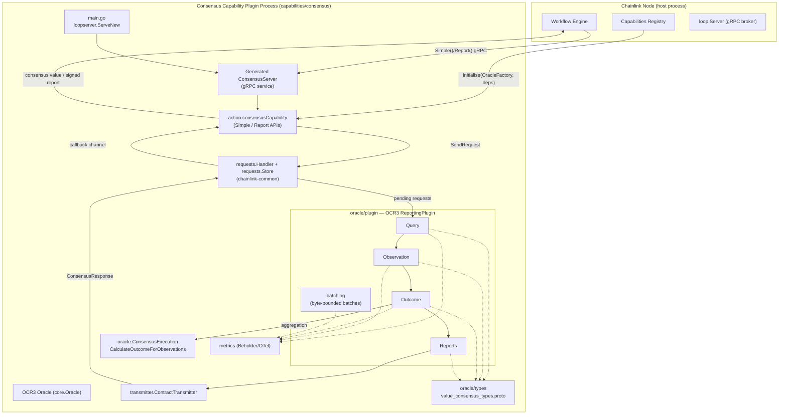
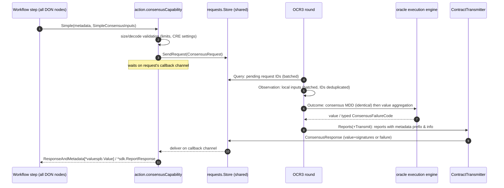
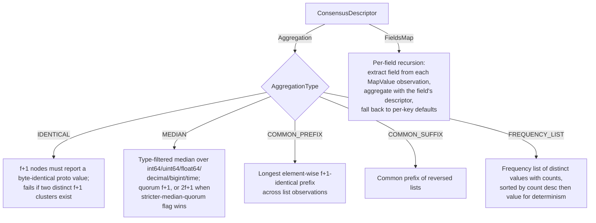

# Consensus Capability

## Overview

The **Consensus Capability** (Go module `github.com/smartcontractkit/capabilities/consensus`, source root `capabilities/consensus`) is a standalone DON (Decentralised Oracle Network) capability for the Chainlink **Capability Runtime Engine (CRE)**. It allows workflow steps to reach agreement on a value across all nodes of a workflow DON, even when each node may have observed a *different* value (e.g. because an upstream HTTP API returned slightly different responses per node).

Callers describe *how* consensus should be reached — via a `ConsensusDescriptor` (aggregation algorithm, or a per-field descriptor map for arbitrarily complex objects) — and the capability's OCR3 reporting plugin deterministically aggregates all nodes' observations into a single, threshold-signed outcome that is returned to the calling workflow. It additionally exposes a **report generation** API that produces an identically-consensus-checked, threshold-signed report ready for on-chain submission via a workflow's forwarder.

As summarised in `capabilities/consensus/README.md`:

> The consensus capability is a DON capability that allows callers to reach a consensus value across a set of nodes where each node may have observed differing values. The API allows the user to specify how consensus is reached for an arbitrarily complex object.

The module compiles to its own plugin binary (`capabilities/consensus/main.go`) which is loaded by Chainlink nodes as a *remote standard capability* through the [Loop plugin process framework](../Plugin_Process_Framework_(Loop).md).

## Key characteristics

| Aspect | Detail |
|---|---|
| Go module | `github.com/smartcontractkit/capabilities/consensus` (`capabilities/consensus/go.mod`, go 1.27.1) |
| Distribution | Standalone binary built via Nx (`capabilities/consensus/project.json`: linux amd64/arm64, `CGO_ENABLED=0`) |
| Consensus engine | OCR3 (`libocr/offchainreporting2plus/ocr3types.ReportingPlugin[[]byte]`) — no on-chain contract; the "transmitter" routes results back to the workflow in-process |
| User APIs | `Simple` (value consensus) and `Report` (signed report generation) on the generated `server.ConsensusCapability` interface |
| Aggregation algorithms | Identical, Median (f+1 or 2f+1 quorum), Common Prefix, Common Suffix, Frequency List, and recursive per-field Maps |
| Fault tolerance | Byzantine-tolerant thresholds: f+1 for identical/value-type agreement, 2f+1 for OCR observation quorum |
| Batch management | Byte-size-bounded query/observation/outcome batches (proto-accurate size accounting) |
| Observability | OpenTelemetry/Beholder metrics (`capabilities/consensus/metrics`) |

## Architecture

### How the pieces fit

1. **Bootstrap** — `main.go` serves the capability as a hashicorp go-plugin via `capabilities/libs/loopserver.ServeNew` (see [Capabilities Shared Libs](capabilities_shared_libs.md)), wrapping the `consensusCapability` in the generated `ConsensusServer` from `chainlink-common/pkg/capabilities/v2/consensus/server` and installing the module's OTel metric views.
2. **Request intake** — workflow steps call `Simple()` or `Report()`. The capability validates the request (observation decoding, size limits via `limits.BoundLimiter`, report request algorithm/key-bundle checks), wraps it in an `oracle.ConsensusRequest` and hands it to the shared [consensus request store/handler](capabilities/capabilities_consensus.md) (`chainlink-common/pkg/capabilities/consensus/requests`), which adds it to the store and awaits a response on a per-request callback channel (with response caching for late retries and timeout expiry).
3. **OCR3 rounds** — the capability hosts an OCR3 oracle created through the node's `OracleFactory` (`Initialise`). Its [reporting plugin](consensus_capability/consensus_capability_reporting_plugin.md) runs the standard OCR3 phases over *batches* of pending requests:
   - **Query** — the leader publishes the IDs of pending requests (minus requests that already have historical outcomes).
   - **Observation** — each node reports its local observation (value or error) for the queried IDs, together with request metadata, timestamps and feature flags.
   - **Outcome** — for each request with ≥ 2f+1 observations, the plugin first reaches *identical consensus* on the request's metadata/descriptor/default (MDD), then invokes the [aggregation engine](consensus_capability/consensus_capability_oracle_core.md) on the observed values. Results are accumulated into a byte-bounded `OutcomeBatch` that also tracks historical outcome sequence numbers to prevent duplicate processing.
   - **Reports** — one report per outcome: successful value-consensus outcomes carry the serialised `valuespb.Value`; report-generation outcomes carry the raw report bytes prepended with a fixed 109-byte `Metadata` header. Report *info* (a `structpb.Struct`) carries the request ID, key-bundle name and, on failure, a `ConsensusFailureCode` + message.
4. **Response routing** — the plugin's `ContractTransmitter` never talks to a blockchain; it parses the report info and forwards a `ConsensusResponse` (value, signatures, report context — or a typed failure) back into the request handler, which delivers it to the blocked workflow step and caches it.

## Consensus round data flow

## Aggregation algorithms

`oracle.CalculateOutcomeForObservations` dispatches on the `ConsensusDescriptor` supplied by the caller (from the CRE SDK — see [Capabilities Core](capabilities/capabilities_core.md) and the [CRE SDK](../Developer_Toolchain_(CLI,_SDKs___API_Clients)/cre-sdk-core.md)):

Failure is always expressed through the typed `ConsensusFailureCode` enum in `oracle/types/value_consensus_types.proto` (e.g. `RECEIVED_FPLUS1_ERRORS`, `NO_VALUES_MET_FPLUS1_THRESHOLD_FOR_IDENTICAL_CONSENSUS`, `OUTCOME_TOO_LARGE`), which the transmitter maps to public user errors vs. system errors so workflow authors can react appropriately.

## Sub-module documentation

Detailed documentation for each sub-module lives in the `consensus_capability/` folder, mirroring the package layout of `capabilities/consensus`:

| Documentation file | Sub-module | Contents |
|---|---|---|
| [`consensus_capability/consensus_capability_oracle_core.md`](consensus_capability/consensus_capability_oracle_core.md) | `oracle/` (core + `oracle/types`) | Aggregation algorithms (`consensus_execution.go`), request/response model (`consensus_request.go`), observation quorum tracking (`observation_quorum_tracker.go`), and the wire protocol schema (`oracle/types/value_consensus_types.proto`) including the `ConsensusFailureCode` taxonomy |
| [`consensus_capability/consensus_capability_reporting_plugin.md`](consensus_capability/consensus_capability_reporting_plugin.md) | `oracle/plugin/` + `oracle/transmitter/` | The OCR3 reporting plugin factory and Query/Observation/Outcome/Reports phase implementations, byte-bounded batching, the in-process `ContractTransmitter` that routes outcomes back to callers, and the protocol-round test harness (`plugin/value_consensus_test.go`) |
| [`consensus_capability/consensus_capability_service_api.md`](consensus_capability/consensus_capability_service_api.md) | `main.go` + `action/` + `metrics/` | The plugin binary entry point and Loop serving, the `consensusCapability` implementation of the `server.ConsensusCapability` interface (`Simple`/`Report` APIs, configuration, size limits, feature-flag limiters), and Beholder/OTel metrics |

Build, lint and code-generation targets for this module are defined in `capabilities/consensus/project.json` and the workspace-wide tooling described in [Capabilities Workspace Tooling](../Build,_CI___Release_Infrastructure/capabilities_workspace_tooling.md).

## Dependencies on other modules

- **[Capabilities Shared Libs](capabilities_shared_libs.md)** — `capabilities/libs/loopserver` provides the plugin-process serving shell used by `main.go` (a declared implicit Nx dependency, see `capabilities/consensus/project.json`).
- **[Capabilities (chainlink-common)](capabilities.md)** — provides the `server.ConsensusCapability` gRPC interface, the generic [consensus request store/handler and OCR3 config/metadata types](capabilities/capabilities_consensus.md) (`ReportingPluginConfig`, 109-byte report `Metadata`), capability error taxonomy, `settings/limits` (per-workflow `ObservationSizeLimit`, stricter-median-quorum and include-all-timestamps active periods), and [Beholder telemetry](../Telemetry___Observability_Platform/beholder-telemetry.md).
- **CRE SDK protos** (`chainlink-protos/cre/go`, `cre-sdk-go`) — `SimpleConsensusInputs`, `ConsensusDescriptor`, `valuespb.Value`, used by both the API and the aggregation engine.
- **Loop framework** — the binary is hosted through the [Plugin Process Framework (Loop)](../Plugin_Process_Framework_(Loop).md) exactly like other standard capabilities.
- **Deployment** — job specs that run this plugin as a remote standard capability are provisioned by the [CRE/Keystone Deployment Suite job tooling](../CRE___Keystone_Deployment_Suite/cre-jobs.md).

## Build, test and generation

Per `capabilities/consensus/project.json` (Nx project `consensus`, type `capability`, implicit dependency `loopserver`):

- `nx build consensus` — cross-compiles the plugin binary for linux amd64/arm64 (`CGO_ENABLED=0`).
- `nx test consensus` / `nx race consensus` — `go test ./...` (with coverage / race detector).
- `nx generate consensus` — regenerates code (including protobufs) after deleting generated files; protobuf toolchains are installed by the workspace-level `make protoc` / `make generate` targets in `capabilities/Makefile`.
- `nx lint consensus` — `golangci-lint run ./...` (workspace rules in `capabilities/.golangci.yml`).

The module depends (see `capabilities/consensus/go.mod`) on `github.com/smartcontractkit/capabilities/libs`, `github.com/smartcontractkit/chainlink-common`, `chainlink-protos/cre/go`, `cre-sdk-go` and `libocr`, plus `shopspring/decimal`, OpenTelemetry and `zap` for logging.
