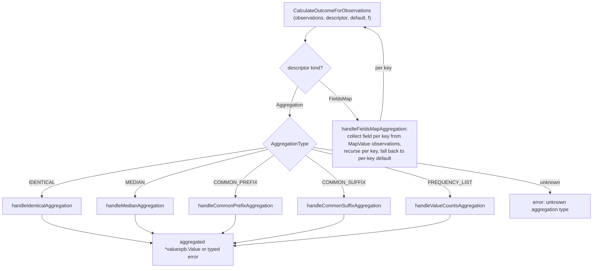
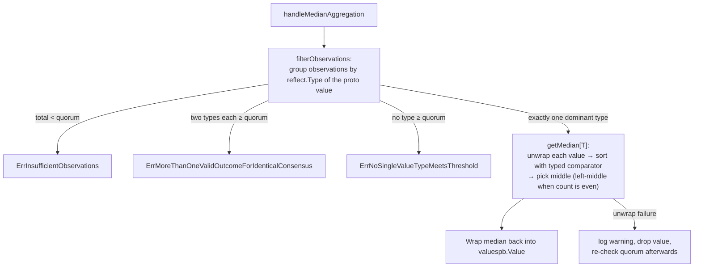
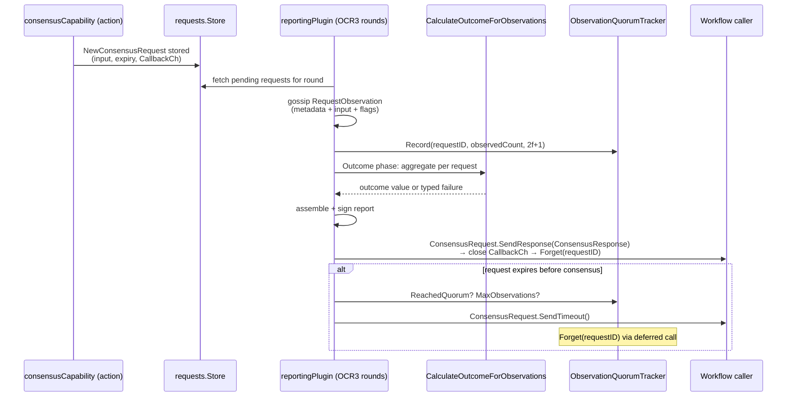
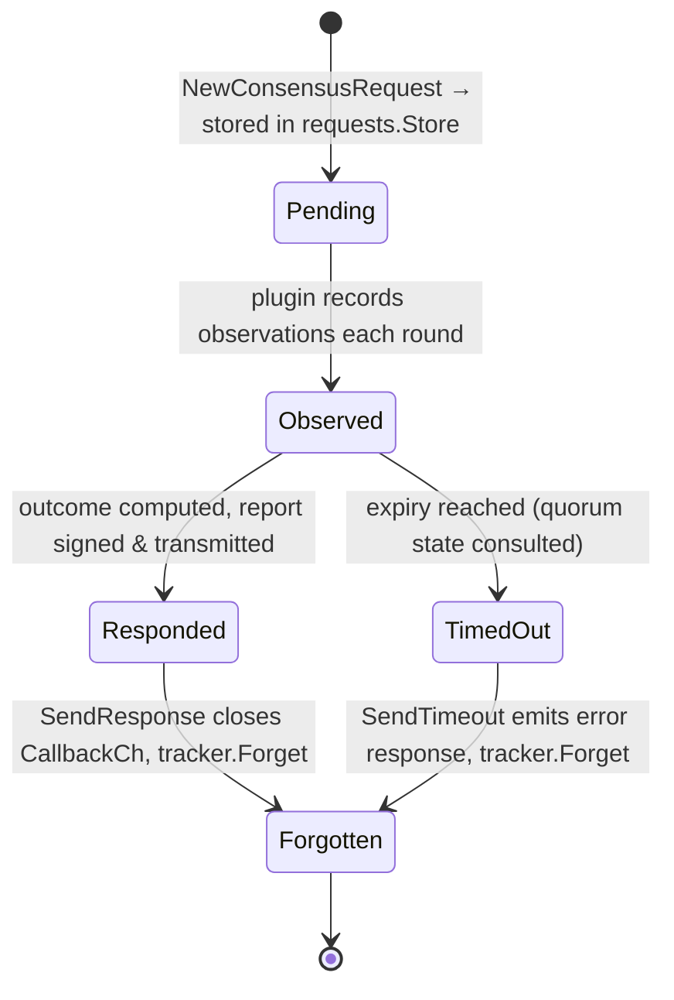
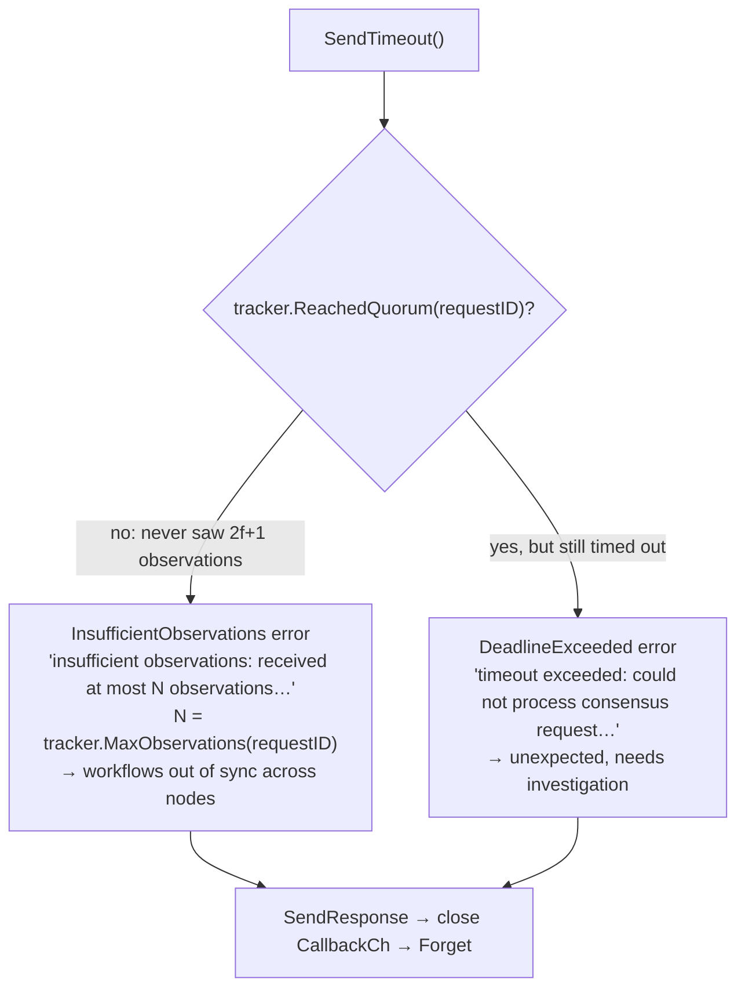

# Consensus Capability — Oracle Core

The **oracle core** is the deterministic "brain" of the Consensus Capability in the Chainlink Runtime Environment (CRE). It is a Go package (`capabilities/consensus/oracle`, Go module `github.com/smartcontractkit/capabilities/consensus`, see `capabilities/consensus/go.mod`) that contains:

1. **Value-consensus execution algorithms** (`consensus_execution.go`) — the deterministic aggregation strategies (identical, median, common prefix/suffix, frequency list, recursive fields-map) that turn a set of per-node observations into a single agreed outcome value.
2. **The consensus request/response domain model** (`consensus_request.go`) — `ConsensusRequest`, `ConsensusResponse` and `ConsensusRequestMetadata`, which implement the generic request-handling contracts of [chainlink-common's consensus framework](../capabilities/capabilities_consensus.md).
3. **Observation quorum tracking** (`observation_quorum_tracker.go`) — a thread-safe component that lets the system distinguish "not enough nodes observed" timeouts from other system errors.
4. **The wire schema** (`types/value_consensus_types.proto`) — the protobuf contract exchanged between DON nodes during rounds, including the taxonomy of consensus failure codes.

This module is consumed primarily by the OCR3 reporting plugin (see [Consensus Capability — Reporting Plugin](consensus_capability_reporting_plugin.md)) and wired into the node by the capability entrypoint (see [Consensus Capability — Service API](consensus_capability_service_api.md)). For the capability family as a whole, see the parent page [Consensus Capability](../consensus_capability.md) and the [Workflow & Capability Runtime overview](../../Workflow___Capability_Runtime_(CRE_Engine).md).

---

## 1. Why this module exists

A CRE workflow step that requests consensus (via the `consensus` standard capability) needs the nodes of a Decentralized Operator Network (DON) to agree on a single value derived from independently observed inputs. Agreement must be:

- **Deterministic** — every honest node must compute exactly the same outcome from the same observation set, so the OCR3 report produced is identical across nodes.
- **Byzantine-fault tolerant** — with `f` tolerated faults, quorum thresholds (`f+1`, or `2f+1` for the stricter median mode) guarantee the outcome reflects honest consensus.
- **Typed and general** — consensus must work over arbitrary CRE values (integers, floats, decimals, big integers, times, strings, lists, maps), not just prices.

The oracle core implements exactly these properties, isolated from transport (OCR3 gossip, on-chain transmission) and from capability service concerns (registration, metrics, request ingestion).

## 2. Component inventory

| Source file | Components | Role |
|---|---|---|
| `capabilities/consensus/oracle/consensus_execution.go` | `CalculateOutcomeForObservations`, `valueOccurrence`, aggregation handlers, `filterObservations`, `getMedian` | Deterministic aggregation engine |
| `capabilities/consensus/oracle/consensus_request.go` | `ConsensusRequest`, `ConsensusResponse`, `ConsensusRequestMetadata` | Request/response lifecycle domain model |
| `capabilities/consensus/oracle/observation_quorum_tracker.go` | `ObservationQuorumTracker` | Round-level quorum bookkeeping for timeout classification |
| `capabilities/consensus/oracle/types/value_consensus_types.proto` | `RequestMetaData`, `RequestObservation`, `Observation`, `ConsensusOutcome`, `Outcome`, `ConsensusFailureCode`, … | Wire protocol between DON nodes |

## 3. Architecture and component relationships

The capability action creates a single shared `ObservationQuorumTracker` and a typed request store, then hands both to the reporting plugin factory. The OCR3 framework drives the plugin through its `Query → Observation → Outcome → Reports` phases; in the Outcome phase the plugin delegates per-request aggregation to `CalculateOutcomeForObservations`. Responses travel back to the workflow caller through the request's own callback channel.

```mermaid
flowchart TB
    subgraph EXT["External actors"]
        WF["Workflow caller<br/>(consensus step)"]
        OCR["OCR3 oracle framework<br/>(libocr rounds)"]
    end

    subgraph SVC["Consensus Capability service layer<br/>(see Service API doc)"]
        ACT["consensusCapability<br/>(action)"]
        HANDLER["requests.Handler"]
        STORE["requests.Store[*ConsensusRequest]"]
        FACTORY["plugin factory"]
        RP["reportingPlugin<br/>(OCR3 lifecycle)"]
        TX["ContractTransmitter"]
    end

    subgraph CORE["Oracle core (this module)"]
        REQ["ConsensusRequest / ConsensusResponse /<br/>ConsensusRequestMetadata"]
        EXEC["CalculateOutcomeForObservations<br/>(aggregation engine)"]
        QUT["ObservationQuorumTracker"]
        PB["types/value_consensus_types.proto<br/>(wire schema)"]
    end

    WF -- "SimpleConsensusInputs" --> ACT
    ACT --> HANDLER --> STORE
    ACT -- "creates once, shares" --> QUT
    ACT --> FACTORY --> RP
    STORE -- "pending requests" --> RP
    OCR <--> RP
    RP -- "gossip Observation" --> OCR
    RP -- "aggregate per request" --> EXEC
    RP -- "Record(count, 2f+1)" --> QUT
    REQ -- "SendResponse / SendTimeout" --> QUT
    REQ -- "ConsensusResponse via CallbackCh" --> WF
    RP --> TX
    PB -.-> "encoded in round messages" .-> OCR
```

Key relationships:

- **Oracle core ↔ chainlink-common consensus framework**: `ConsensusRequest` implements the generic `ConsensusRequest[T, R]` interface (`ID`, `Copy`, `ExpiryTime`, `SendResponse`, `SendTimeout`) and `StoredRequest[T]` (`ID`, `Copy`) defined in `chainlink-common/pkg/capabilities/consensus/requests`; the store and expiry handler used by the capability are generics instantiated with `*oracle.ConsensusRequest`. This framework is documented at [Capabilities — Consensus](../capabilities/capabilities_consensus.md).
- **Oracle core ↔ reporting plugin**: the plugin holds the tracker and calls the aggregation engine during its Outcome phase. The OCR3 phase contract (Query/Observation/Outcome/Reports, batching, report signing) lives in [Consensus Capability — Reporting Plugin](consensus_capability_reporting_plugin.md).
- **Oracle core ↔ shared chainconsensus libs**: `capabilities/libs/chainconsensus` provides the `RequestsHandler`/`BlocksProvider` interfaces and `HashableRequest` used by chain-native consensus flows; the value-consensus proto's `RequestType` enum (`VALUE_CONSENSUS`, `REPORT_GENERATION`) marks which flow a request belongs to. See [Capabilities — Shared Libs: chainconsensus](../capabilities_shared_libs/capabilities_shared_libs_chainconsensus.md).
- **Deployment shape**: the consensus capability runs as a Loop plugin process (gRPC-isolated from the node); the process model is described in [Plugin Process Framework (Loop)](../../Plugin_Process_Framework_(Loop)/loop-plugin-core.md), and its factory wiring in [Consensus Capability — Service API](consensus_capability_service_api.md).

## 4. Consensus execution engine (`consensus_execution.go`)

### 4.1 Entry point and dispatch

`CalculateOutcomeForObservations` is the single aggregation entry point. It receives:

- `observations []*valuespb.Value` — the per-node observations already validated to unmarshal as CRE `values.Value`s,
- `consensusDescriptor *sdk.ConsensusDescriptor` — declares *how* to agree: either a single `AggregationType`, or a `FieldsMap` of per-field descriptors,
- `defaultValue *valuespb.Value` — per-field fallbacks (fields-map mode),
- `f` (tolerated faults) and `medianQuorumFlag` (activates the stricter `2f+1` median quorum).



### 4.2 Aggregation strategies

| Strategy | Quorum rule | Algorithm | Deterministic? | Primary failure modes |
|---|---|---|---|---|
| `AGGREGATION_TYPE_IDENTICAL` | `f+1` | Key every observation by `proto.Marshal` with `Deterministic: true`; the first key to reach `f+1` occurrences becomes the *unique* candidate; a second key reaching `f+1` is an error | Yes (deterministic serialization) | `ErrNoValuesMetFPlusOneThresholdForIdenticalConsensus`, `ErrMoreThanOneValidOutcomeForIdenticalConsensus` |
| `AGGREGATION_TYPE_MEDIAN` | `f+1`, or `2f+1` when `medianQuorumFlag` is set | `filterObservations` (single dominant proto type) → typed `getMedian` sort and pick | Yes | `ErrInsufficientObservations`, `ErrNoSingleValueTypeMeetsThreshold`, `ErrMoreThanOneValidOutcomeForIdenticalConsensus`, `ErrDecimalExponentOutOfRange` |
| `AGGREGATION_TYPE_COMMON_PREFIX` | `f+1` per list index | Longest prefix where each index reaches identical consensus (`f+1` equal elements) and at least `f+1` contributing lists still match | Yes | `ErrInsufficientObservations` |
| `AGGREGATION_TYPE_COMMON_SUFFIX` | `f+1` per list index | Reverse each list, run common-prefix, reverse the result | Yes | `ErrInsufficientObservations` |
| `AGGREGATION_TYPE_FREQUENCY_LIST` | `f+1` total observations | Emit every distinct value with its count as `{value, count}` maps in a list, sorted count-descending, then by serialized value ascending | Yes (explicit tiebreak) | `ErrInsufficientObservations` |
| `ConsensusDescriptor_FieldsMap` | per key | Recurses into `CalculateOutcomeForObservations` for each key's sub-descriptor; per-key failure falls back to that key's default, otherwise fails with the key name wrapped | Yes (keys processed in sorted order) | Per-key wrapped error when no default exists |

Notes on specific handlers:

- **Fields map recursion** (`handleFieldsMapAggregation`): observations must be `MapValue`s; values are collected *per key* across all observations, then each key is aggregated independently with its own descriptor and default. This allows a single workflow step to agree on a structured record (e.g. `{price: MEDIAN, feedID: IDENTICAL}`).
- **Common prefix** (`handleCommonPrefixAggregation`): proceeds index by index. At each index it runs identical aggregation over the elements contributed by the still-active lists; lists whose element does not match the consensus value are dropped, and if the surviving set drops below `f+1`, the prefix ends. This yields the longest sequence of elements that at least `f+1` lists agree on.
- **Common suffix** (`handleCommonSuffixAggregation`): implemented by reversing the input lists, delegating to the prefix handler, and reversing the result — avoiding a duplicate algorithm.

### 4.3 Median pipeline

Median aggregation supports six CRE value types — `Uint64`, `Int64`, `Float64`, `Decimal`, `BigInt`, and `Time` — via one generic helper:



Deterministic-comparison details worth knowing when maintaining this code:

- **Float ordering**: `float64ToSortableInt` maps IEEE-754 bit patterns onto a totally ordered `uint64` (sign-bit trick), so `NaN` and mixed-sign floats sort consistently.
- **Decimal exponent clamp**: `maxDecimalExponent = 1000` rejects observations whose decimal exponent is outside `[-1000, 1000]` with `ErrDecimalExponentOutOfRange`, because decimal comparison rescales exponents and a single extreme exponent could stall every node's median computation.
- **Even-length medians** take the *left* of the two middle elements after sorting — a deliberate, documented choice to keep all nodes identical.
- **Unwrap resilience**: a value that fails to unwrap is dropped with a warning, and the quorum check is repeated on the reduced set (corrupt values cannot silently produce an under-quorum median).
- **Quorum selection**: `medianQuorum` is `f+1` by default and `2f+1` when the workflow opts into the stricter mode (propagated from the `median_2fplus1_quorum_flag` wire flag, see §6).

## 5. Request/response lifecycle (`consensus_request.go`)

### 5.1 Domain model

- **`ConsensusRequestMetadata`** embeds `capabilities.RequestMetadata` (from [types-core](../../Shared_Foundation_Libraries___Domain_Types/types-core.md)) and adds `KeyBundleID`, `ReportID`, and `RequestType` (`VALUE_CONSENSUS` or `REPORT_GENERATION`). `RequestID()` is `WorkflowExecutionID + "-" + ReferenceID` — globally unique per workflow execution step.
- **`ConsensusRequest`** carries the caller's `*sdk.SimpleConsensusInputs`, receive/expiry timestamps, a `CallbackCh chan ConsensusResponse`, the metadata, and two per-request feature flags (`StricterMedianQuorum`, `IncludeAllTimestamps`) that mirror the corresponding wire flags. It implements the generic contracts expected by the shared store/handler:
  - `ID()` → `RequestID`
  - `ExpiryTime()` → `ExpiresAt` (used by the expiry sweeper in chainlink-common's handler)
  - `Copy()` → deep clone: `proto.Clone` of the input; timestamps/metadata are value types; `CallbackCh` and the `ObservationQuorumTracker` are *intentionally shared* because both are thread-safe.
  - `SendResponse(ctx, resp)` → delivers the response on `CallbackCh` (respecting context cancellation) and closes the channel; a deferred call forgets the request from the quorum tracker.
  - `SendTimeout(ctx)` → sends a `ConsensusResponse` carrying only an error (see §5.3).
- **`ConsensusResponse`** carries `ConfigDigest`, `SeqNr`, `ReportContext`, `RawReport` and `Sigs []types.AttributedOnchainSignature` on success, or an `Err caperrors.Error` on failure, plus `ReqID` for correlation.

### 5.2 Lifecycle



State view of a single request:



### 5.3 Timeout classification

When a request expires, `SendTimeout` consults the `ObservationQuorumTracker` to produce an actionable, *public* system error (safe to surface to workflow callers via `caperrors.NewPublicSystemError`):



## 6. `ObservationQuorumTracker` (`observation_quorum_tracker.go`)

A small, mutex-guarded tracker shared by the capability action, every live `ConsensusRequest`, and the reporting plugin:

| API | Behaviour |
|---|---|
| `Record(requestID, observationCount, quorumThreshold)` | Keeps the *highest* observation count seen and marks the request as quorum-reached once the count meets the threshold (2f+1 for this capability). Called by the plugin during rounds. |
| `ReachedQuorum(requestID)` | Has the request *ever* met the observation quorum? |
| `MaxObservations(requestID)` | Highest observation count seen — included in the insufficient-observations error message for diagnosability. |
| `Forget(requestID)` | Removes tracking state after a request is responded to or times out (invoked from `ConsensusRequest.SendResponse`, which `SendTimeout` also funnels through). |

Design rationale: the tracker exists purely to classify timeouts. Because it is created once per capability instance (in `NewConsensusCapability`) and shared across plugin instances and request copies, bookkeeping survives OCR round churn and plugin restarts within the process while being cleaned up per-request.

## 7. Wire protocol (`types/value_consensus_types.proto`)

The proto defines what nodes exchange during rounds. `option go_package = "consensus/oracle/types"`; generated code is produced through the workspace codegen pipeline (see §9).

| Message | Purpose |
|---|---|
| `RequestType` (enum) | `VALUE_CONSENSUS` (workflow value agreement) or `REPORT_GENERATION` (chain-consensus report flow, cf. [chainconsensus libs](../capabilities_shared_libs/capabilities_shared_libs_chainconsensus.md)) |
| `RequestMetaData` | Full request identity: request id, workflow execution/step/id/owner/name, workflow DON id & config version, report id, key bundle id, request type |
| `Query` | Repeated `requestIDs` — the compact set of requests a node observed in a round |
| `RequestObservation` | One node's view of one request: metadata, `SimpleConsensusInputs`, `received_at`, plus feature flags `median_2fplus1_quorum_flag` and `include_all_timestamps_flag` (two older formatting/error-handling flags are deprecated) |
| `Observation` | `map<string, RequestObservation>` — the round's full observation set |
| `ObservationMapEntry` / `HistoricalOutcomeMapEntry` | Helper messages used only when computing the current batch size (cf. batching in the [reporting plugin](consensus_capability_reporting_plugin.md)) |
| `ConsensusOutcome` | Oneof `ConsensusSuccessOutcome` (metadata, outcome bytes, timestamp) or `ConsensusFailedOutcome` (requestID, failure message, key bundle id, code) |
| `Outcome` | `repeated ConsensusOutcome` plus `historical_outcomes` (requestID → seqNr at which the outcome was calculated), used to expire recent historical outcomes after `HistoricalOutcomeExpirySeqNrSpan` rounds |

Failure codes (`ConsensusFailureCode`) — the cross-node failure taxonomy, with the Go-side sources mapped:

| Code | Meaning | Go-side origin |
|---|---|---|
| `CONSENSUS_CALCULATION_FAILED` | Generic calculation failure (e.g. < f+1 identical observations) | aggregation engine errors |
| `FAILED_TO_CALCULATE_CONSENSUS_MDD` | Failed to calculate consensus metadata, descriptor and default (MDD) — F+1 identical MDDs required | plugin Outcome phase |
| `RECEIVED_FPLUS1_ERRORS` | f+1 observer errors received when attempting consensus | plugin Observation phase |
| `OUTCOME_TOO_LARGE` | Outcome cannot fit any batch | outcome batching (`maxRequestOutcomeSize`) |
| `REPORT_TOO_LARGE` | Report too large to transmit | report assembly / [transmitter](consensus_capability_reporting_plugin.md) |
| `MORE_THAN_ONE_VALID_OUTCOME_FOR_IDENTICAL_CONSENSUS` | Multiple non-identical clusters of f+1 identical observations (volatile data source) | `ErrMoreThanOneValidOutcomeForIdenticalConsensus` |
| `NO_VALUES_MET_FPLUS1_THRESHOLD_FOR_IDENTICAL_CONSENSUS` | No cluster of f+1 identical observations (volatile data source) | `ErrNoValuesMetFPlusOneThresholdForIdenticalConsensus` |
| `NO_SINGLE_VALUE_TYPE_MET_FPLUS1_THRESHOLD_FOR_CONSENSUS` | No single value type reached the threshold — inconsistent value types across observers | `ErrNoSingleValueTypeMeetsThreshold` |

Note the contract distinction embedded in the codes: `MORE_THAN_ONE_VALID_OUTCOME…` and `NO_VALUES_MET_FPLUS1…` are documented as **user-facing** conditions (the workflow is using identical consensus on volatile data), while the timeout path in §5.3 produces **public system errors** (`InsufficientObservations`, `DeadlineExceeded`) because no user action can cause them.

## 8. Concurrency, determinism and safety notes

- **Determinism is the primary invariant.** All comparisons use explicit comparators (never Go `<` on floats), serialization keys use `proto.MarshalOptions{Deterministic: true}`, fields-map keys are processed in sorted order, and the frequency list has an explicit tiebreak (count desc, serialized value asc). Any change here risks nodes computing divergent outcomes.
- **Shared-state discipline.** `ConsensusRequest.Copy()` deliberately shares `CallbackCh` and `ObservationQuorumTracker` (both safe for concurrent use); everything else is either value-copied or deep-cloned. The tracker guards its two maps with a single mutex.
- **Channel protocol.** `CallbackCh` is closed exactly once — after a successful `SendResponse`. Cancellation via context simply abandons the send (the channel is not closed in that branch), and the deferred `Forget` still runs so tracker state never leaks.
- **DoS hardening.** The decimal exponent clamp (§4.3) prevents a single malicious/extreme observation from making median computation prohibitively expensive on every node.

## 9. Build & codegen notes

- The module is defined in `capabilities/consensus/go.mod` (`module github.com/smartcontractkit/capabilities/consensus`, go 1.27.1). Direct dependencies include `github.com/smartcontractkit/capabilities/libs` (shared chainconsensus libs), `github.com/smartcontractkit/chainlink-common` (capabilities framework, requests store/handler, `caperrors`, `cresettings`, logger), `github.com/smartcontractkit/chainlink-protos/cre/go` (`sdk.ConsensusDescriptor`, CRE `values` protobufs), `github.com/smartcontractkit/libocr` (reporting/signature types), `shopspring/decimal` and OpenTelemetry metrics.
- `capabilities/consensus/oracle/types/value_consensus_types.proto` is compiled via the workspace pipeline: `capabilities/Makefile` target `make protoc` installs protoc 29.3 and `protoc-gen-go v1.36.10`, and `make generate` runs go:generate across all modules (`./script/install-protoc.sh`, `gomods -w go generate -x ./...`).
- The workflow-facing feature flags (`StricterMedianQuorum`, `IncludeAllTimestamps`) are gated by CRE settings range limiters created in the capability action — see [Consensus Capability — Service API](consensus_capability_service_api.md) for limits and metrics wiring.

## 10. Related documentation

- [Consensus Capability](../consensus_capability.md) — parent module: how value consensus fits the capability suite.
- [Consensus Capability — Reporting Plugin](consensus_capability_reporting_plugin.md) — OCR3 plugin lifecycle (Query/Observation/Outcome/Reports), batching, and the `ContractTransmitter` that publishes signed reports on-chain.
- [Consensus Capability — Service API](consensus_capability_service_api.md) — capability entrypoint (`NewConsensusCapability`), limits, and `Metrics` (e.g. `PendingConsensusRequests`).
- [Capabilities — Consensus](../capabilities/capabilities_consensus.md) — the chainlink-common generic request handler/store framework this module plugs into.
- [Capabilities — Shared Libs: chainconsensus](../capabilities_shared_libs/capabilities_shared_libs_chainconsensus.md) — `RequestsHandler`, `BlocksProvider`, `HashableRequest` for the chain-consensus flow (`REPORT_GENERATION`).
- [Plugin Process Framework (Loop)](../../Plugin_Process_Framework_(Loop)/loop-plugin-core.md) — process isolation and gRPC hosting of capabilities.
- [Shared Foundation Libraries — types-core](../../Shared_Foundation_Libraries___Domain_Types/types-core.md) — `capabilities.RequestMetadata` and related core types.
- [Workflow & Capability Runtime (CRE Engine)](../../Workflow___Capability_Runtime_(CRE_Engine).md) — the runtime that executes workflows invoking this capability.
