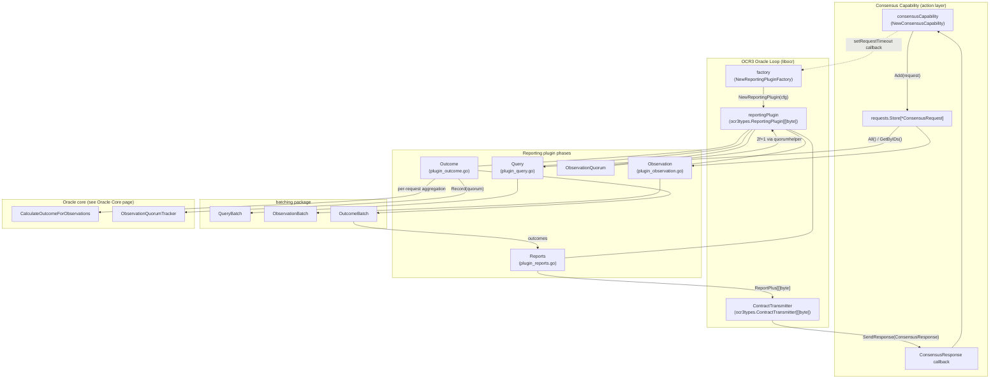
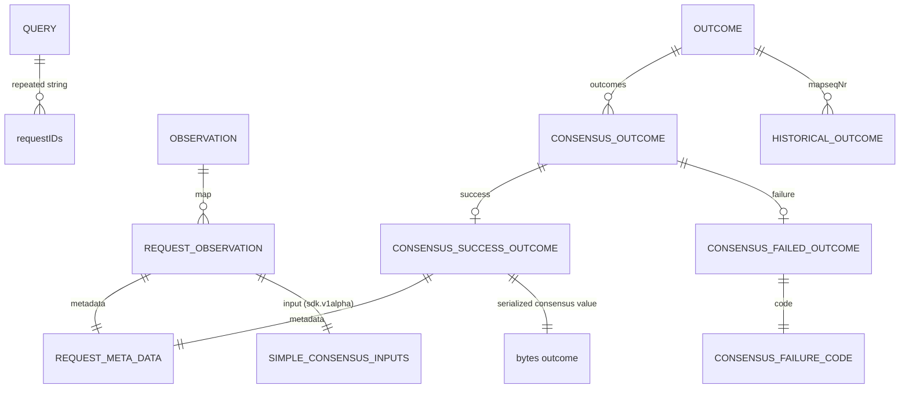
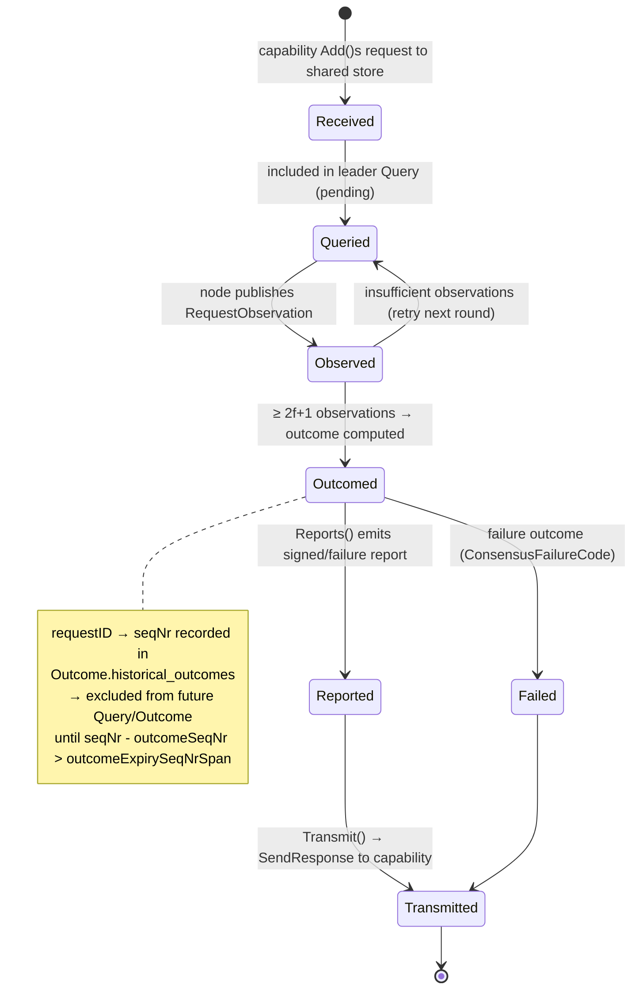

# Consensus Capability — OCR3 Reporting Plugin

> **Module scope:** `capabilities/consensus/oracle/plugin/` and `capabilities/consensus/oracle/transmitter/` in the `capabilities/consensus` Go module.

## 1. Introduction

This module implements the **OCR3 reporting plugin** for the Consensus Capability — the component that runs inside a libOCR-driven oracle loop on every node of a workflow DON and performs multi-round, Byzantine-fault-tolerant consensus over workflow observation data.

The plugin implements the libocr interface `ocr3types.ReportingPlugin[[]byte]`. Each OCR round it:

1. **Queries** which pending consensus requests it should work on (leader-driven).
2. **Observes** the locally stored requests and publishes them as attributed observations.
3. **Checks quorum** (2f+1 of n nodes observed).
4. **Computes an outcome** — for each request that reached quorum, it aggregates the observations (median, identical, common-prefix/suffix, frequency list, or per-field aggregation) into a single consensus value or a structured failure.
5. **Produces reports** — one signed report per outcome, prefixed with workflow execution metadata.
6. **Transmits** — a companion `ContractTransmitter` routes the signed report (or consensus failure) back to the in-process Consensus Capability via a response callback rather than an on-chain transaction.

The plugin is *stateless between processes but stateful across rounds*: request-level state lives in a shared `requests.Store` owned by the capability, and round-level state (historical outcomes) is threaded through the OCR `OutcomeContext` so every node deterministically derives the same outcome.

**Relationship to the rest of the system:**

| Concern | Where it lives |
|---|---|
| Request types, consensus algorithms, quorum tracking, response plumbing | [Consensus Capability — Oracle Core](consensus_capability_oracle_core.md) |
| Capability registration, request ingestion, `main.go` plugin service bootstrap | [Consensus Capability — Service API](consensus_capability_service_api.md) |
| Capability interfaces (`ReportingPluginFactory`, error taxonomy) | [Capabilities Core types](../capabilities/capabilities_core.md) |
| gRPC/plugin-process serving of the factory | [Plugin Process Framework (Loop)](../../Plugin_Process_Framework_(Loop).md) |
| Signed report metadata encoding (`ocrtypes.Metadata`, `ReportingPluginConfig`) | [Capabilities Consensus types (chainlink-common)](../capabilities/capabilities_consensus.md) |
| Overall runtime context | [Workflow & Capability Runtime (CRE Engine)](../../Workflow___Capability_Runtime_(CRE_Engine).md) |

---

## 2. Architecture

### 2.1 Component overview



Key implementation facts (`capabilities/consensus/oracle/plugin/plugin.go`):

- `reportingPlugin` satisfies `ocr3types.ReportingPlugin[[]byte]` (compile-time assertion `var _ ocr3types.ReportingPlugin[[]byte] = (*reportingPlugin)(nil)`).
- `ObservationQuorum` delegates to `quorumhelper.ObservationCountReachesObservationQuorum(quorumhelper.QuorumTwoFPlusOne, n, f, …)`.
- `ShouldAcceptAttestedReport` / `ShouldTransmitAcceptedReport` always return `true` — every attested report is transmitted (failure reports must reach the workflow too).
- `ToRequestMetaData` maps the oracle-level `ConsensusRequestMetadata` (workflow id/owner/name/DON/config version, report ID, key bundle ID, request type) to the wire format `oracletypes.RequestMetaData` defined in the proto schema.

### 2.2 Plugin factory

`capabilities/consensus/oracle/plugin/factory.go::NewReportingPluginFactory` creates the long-lived `factory`, which implements `ReportingPluginFactory` plus the node-wide `services.StateMachine` (`Start`/`Close`/`HealthReport`). For every OCR config change, `NewReportingPlugin(config)`:

1. Unmarshals `config.OffchainConfig` into `ocrtypes.ReportingPluginConfig` (proto).
2. Applies defaults for anything unset:

| Config field | Default | Meaning |
|---|---|---|
| `MaxQueryLengthBytes` / `MaxObservationLengthBytes` / `MaxOutcomeLengthBytes` | `ocr3types.MaxMaxObservationLength` | Phase payload limits fed to the batching layer |
| `MaxReportLengthBytes` | `1_000_000` (1 MB) | Max transmitted report size |
| `MaxReportCount` | `100` | Max reports/outcomes per round |
| `RequestTimeout` | `20s` | Propagated via the `SetRequestTimeout` callback to the capability so ingested requests expire consistently |
| `HistoricalOutcomeExpirySeqNrSpan` | `4` | How many sequence numbers an outcome is protected from reprocessing (see §5) |

3. Calls `o.setRequestTimeout(...)` so the capability's request expiry matches the new OCR config.
4. Constructs the `reportingPlugin` and returns `ReportingPluginInfo` declaring the same limits to libocr.

The factory also logs the effective config (limits, config digest, oracle ID, n/f, round timings, `maxRequestOutcomeSize`, `defaultKeyBundleIDForConsensusFailure`) at plugin creation.

`defaultKeyBundleIDForConsensusFailure` is the key bundle advertised on failure reports emitted *before* consensus on request metadata is reached — it lets the transmitter classify failures even when the workflow's own key bundle is unknown.

---

## 3. OCR round flow

```mermaid
sequenceDiagram
    autonumber
    participant W as Workflow execution
    participant Cap as Consensus Capability
    participant S as requests.Store
    participant OCR as OCR3 loop (libocr)
    participant RP as reportingPlugin
    participant B as batching.*
    participant Calc as oracle core<br/>CalculateOutcomeForObservations
    participant TX as ContractTransmitter

    W->>Cap: consensus request (SimpleConsensusInputs)
    Cap->>S: Add(ConsensusRequest)

    OCR->>RP: Query(outctx)
    RP->>S: All() → filter pending (skip historical outcomes)
    RP->>B: QueryBatch.AddRequestID(...) until size cap
    RP-->>OCR: deterministic proto Query{requestIDs}

    OCR->>RP: Observation(outctx, query)
    RP->>RP: deduplicateRequestIDs (byzantine-leader defense)
    RP->>S: GetByIDs(...)
    RP->>B: ObservationBatch.AddObservation(RequestObservation)
    RP-->>OCR: deterministic proto Observation{map[requestID]RequestObservation}

    OCR->>RP: ObservationQuorum(outctx, query, observations)
    RP-->>OCR: quorumhelper.QuorumTwoFPlusOne(n, f)

    OCR->>RP: Outcome(outctx, query, attributedObservations)
    RP->>B: NewOutcomeBatch (carries non-expired historical outcomes)
    loop each requestID with ≥ 2f+1 observations and no historical outcome
        RP->>Calc: observations + ConsensusDescriptor + default + f
        Calc-->>RP: consensus value OR failure (code + message)
        RP->>B: AddSuccessful/Failed...OutcomeToBatch (+ default fallback)
    end
    RP-->>OCR: deterministic proto Outcome{outcomes, historical_outcomes}

    OCR->>RP: Reports(seqNr, outcome)
    RP->>RP: prepend encoded ocrtypes.Metadata; enforce maxReportLengthBytes / maxReportCount
    RP-->>OCR: []ReportPlus[[]byte]

    OCR->>TX: Transmit(configDigest, seqNr, report, signatures)
    alt success report
        TX-->>Cap: ConsensusResponse{ReqID, ConfigDigest, SeqNr, ReportContext, RawReport, Sigs}
    else failure report
        TX-->>Cap: ConsensusResponse{ReqID, SeqNr, Err: public user/system error}
    end
```

Notes per phase:

- **Query** (`plugin_query.go`): only *pending* requests are queried — requests with an entry in the previous outcome's `historical_outcomes` are excluded, which is the primary mechanism preventing a request from being processed twice.
- **Observation** (`plugin_observation.go`): request IDs from the (possibly byzantine) leader query are **deduplicated** before lookup. Each local request becomes a `RequestObservation` carrying its metadata, protobuf input (`sdk.SimpleConsensusInputs`), received-at timestamp, `median_2fplus1_quorum_flag` (`StricterMedianQuorum`) and `include_all_timestamps_flag`. Two deprecated rollout flags are force-set to `true` so they cannot accidentally revert during migration.
- **Outcome** (`plugin_outcome.go`): observations are grouped by request ID; quorum tracking is recorded for observability (`ObservationQuorumTracker`); the threshold is hard-coded as `2f+1`. Requests without quorum are simply skipped and retried next round. Aggregation dispatch is handled by `CalculateOutcomeForObservations` (see the [Oracle Core page](consensus_capability_oracle_core.md)): identical, median (with optional stricter 2f+1 quorum), common prefix/suffix, frequency list, and per-field `FieldsMap` aggregation.
- **Reports** (`plugin_reports.go`): the report payload depends on `RequestType`:
  - `VALUE_CONSENSUS` — the report is the serialized consensus value (`valuespb.Value`).
  - `REPORT_GENERATION` — the consensus value is unmarshalled and its inner `bytes` value extracted as the report.
  
  The payload is prefixed with the encoded `ocrtypes.Metadata{Version: 1, ExecutionID, Timestamp, DONID, DONConfigVersion, WorkflowID, WorkflowName, WorkflowOwner, ReportID}` (constant `plugin.ReportMetaDataPrependLength`). Reports exceeding `maxReportLengthBytes` are replaced by a `REPORT_TOO_LARGE` failure report (empty payload + failure info) so the workflow still gets a deterministic response. Report generation stops at `maxNumberOfReports`.

---

## 4. Wire data model

All inter-node payloads are protobuf messages from `capabilities/consensus/oracle/types/value_consensus_types.proto` (generated via `make protoc`/`make generate`, see [§8](#8-build--dependencies)):



Report *info* (attached to every `ReportWithInfo`) is a `structpb.Struct` containing at least:

| Field key | Presence | Content |
|---|---|---|
| `InfoRequestID` | always | Request ID the report belongs to |
| `keyBundleName` | success (when set) | Key bundle the workflow requested for signing |
| `InfoConsensusFailureCode` | failures only | `ConsensusFailureCode` enum name |
| `InfoConsensusFailureMessage` | failures only | Human-readable failure message |

`ConsensusFailureCode` values (from the proto):

| Code | Semantics | Transmitter classification |
|---|---|---|
| `CONSENSUS_CALCULATION_FAILED` (0) | Generic consensus calculation failure | public **system** error |
| `FAILED_TO_CALCULATE_CONSENSUS_MDD` (1) | No f+1-identical metadata/descriptor/default (MDD) triplets | public **system** error |
| `RECEIVED_FPLUS1_ERRORS` (2) | ≥ f+1 observers returned errors | public **user** error (`ConsensusFailed`) |
| `OUTCOME_TOO_LARGE` (3) | Consensus result can never fit in any outcome batch | public **system** error |
| `REPORT_TOO_LARGE` (4) | Signed report exceeds max transmit size | public **system** error |
| `MORE_THAN_ONE_VALID_OUTCOME_FOR_IDENTICAL_CONSENSUS` (5) | Multiple f+1-identical clusters (volatile data under identical consensus) | public **user** error |
| `NO_VALUES_MET_FPLUS1_THRESHOLD_FOR_IDENTICAL_CONSENSUS` (6) | No f+1-identical cluster found | public **user** error |
| `NO_SINGLE_VALUE_TYPE_MET_FPLUS1_THRESHOLD_FOR_CONSENSUS` (7) | Observers disagree on the value *type* (workflow bug) | public **user** error |

---

## 5. State management: historical outcomes & request lifecycle

Because the transmit call is asynchronous, a second round can start before 2f+1 nodes have observed the transmit for the first round. Without protection, a node that misses the transmit could reprocess a request and produce a *different* outcome. The plugin solves this by embedding a **historical outcome registry** inside the serialized `Outcome` itself:



On every `Outcome` call, `getNonExpiredHistoricalRequestOutcomes` replays the previous outcome's `historical_outcomes` map, dropping entries older than `HistoricalOutcomeExpirySeqNrSpan`. Entries still fresh are both carried forward and used to skip reprocessing. The span trades the risk of re-submission (after a missed transmit) against the storage cost of the history inside the outcome blob (see the rationale comment in `factory.go`).

Request-level state (`ConsensusRequest`: protobuf input, validity window, callback channel, metadata, quorum flags) and its store live in the oracle core — see [Consensus Capability — Oracle Core](consensus_capability_oracle_core.md).

---

## 6. Size-aware batching layer

The `batching` sub-package keeps every phase payload within the limits reported to libocr, using incremental protobuf size accounting (`proto.Size` of synthetic map-entry messages) and deterministic marshalling (`proto.MarshalOptions{Deterministic: true}`) so all nodes produce byte-identical payloads.

| Batch | Contents | When capacity is exceeded |
|---|---|---|
| `QueryBatch` (`batching/query_batch.go`) | `repeated string requestIDs` | `AddRequestID` returns `false`; further IDs wait for the next round |
| `ObservationBatch` (`batching/observation_batch.go`) | `map<requestID, RequestObservation>` | `AddObservation` returns `false`; observation retries next round |
| `OutcomeBatch` (`batching/outcome_batch.go`) | `repeated ConsensusOutcome` + `historical_outcomes` map | `AddSuccessful...` returns `false`; if the outcome would not fit even in an *empty* batch, it is converted into an `OUTCOME_TOO_LARGE` failure instead |

`OutcomeBatch` additionally provides failure-handling semantics:

- **Default-value fallback** — `FailConsensusWithDefaultCheck`: if consensus failed but the request carries a default value (`Input.Default`), a *successful* outcome with the default is emitted instead of a failure.
- **Failure-message truncation** — if a failure outcome exceeds `maxRequestOutcomeSize`, the message is byte-truncated to fit (dropping invalid UTF-8 bytes to keep the proto string marshalable) and suffixed with the `":TRUNCATED"` marker (`FailureMessageTruncated`). If even the header can't fit, the message is dropped entirely.
- **Report-count cap** — the outcome count never exceeds `maxNumberOfReports`, so outcomes can't be silently lost and recomputed differently on later rounds.

All batching events are instrumented: `IncBatchRequestsTotal` (per phase), `IncBatchCapacityExceeded`, and `RecordObservationBatchSize` / `RecordOutcomeBatchSize` gauges — see [Telemetry & Observability Platform](../../Telemetry___Observability_Platform.md).

---

## 7. Transmitter

`capabilities/consensus/oracle/transmitter/transmitter.go::ContractTransmitter` implements `ocr3types.ContractTransmitter[[]byte]` but is **not on-chain**: `FromAccount` returns an empty account, and `Transmit` routes results back into the node via the `SendResponse` callback wired by the capability action.

```mermaid
flowchart LR
    subgraph OCR3["OCR3 attested report"]
        RWI["ReportWithInfo: Report bytes + Info struct"]
        SIGS["AttributedOnchainSignatures"]
    end
    TX["ContractTransmitter.Transmit"]
    subgraph BRANCH{"failure code in info?"}
        Y["Yes → map ConsensusFailureCode to caperrors:<br/>user codes → NewPublicUserError(ConsensusFailed)<br/>other codes → NewPublicSystemError"]
        N["No → GenerateReportContext(seqNr, configDigest)"]
    end
    RESP["ConsensusResponse{<br/>ReqID, SeqNr,<br/>Err | ConfigDigest, ReportContext, RawReport, Sigs}"]
    CH["ConsensusResponse callback channel<br/>(per ConsensusRequest)"]
    RWI --> TX
    SIGS --> TX
    TX --> BRANCH
    BRANCH --> RESP
    RESP -->|"sendResponse(ctx, response)"| CH
```

Failure classification follows the table in §4: `RECEIVED_FPLUS1_ERRORS`, `MORE_THAN_ONE_VALID_OUTCOME_FOR_IDENTICAL_CONSENSUS`, `NO_VALUES_MET_FPLUS1_THRESHOLD_FOR_IDENTICAL_CONSENSUS`, and `NO_SINGLE_VALUE_TYPE_MET_FPLUS1_THRESHOLD_FOR_CONSENSUS` are surfaced to workflows as **public user errors** (the workflow author can act on them); everything else is a **public system error**. The error taxonomy itself comes from `chainlink-common/pkg/capabilities/errors` (see [Capabilities Core types](../capabilities/capabilities_core.md)).

---

## 8. Build & dependencies

- **Go module:** `github.com/smartcontractkit/capabilities/consensus` — see `capabilities/consensus/go.mod` (Go 1.27.1). Core dependencies: `libocr` (OCR3 interfaces, `quorumhelper`), `chainlink-common` (`pkg/capabilities/consensus/ocr3/types`, `pkg/capabilities/consensus/requests`, logger, services), `chainlink-protos/cre/go` (`values`, `sdk`), OpenTelemetry metric APIs, and the shared `capabilities/libs` module.
- **Proto codegen:** `value_consensus_types.proto` is compiled with `protoc`/`protoc-gen-go` — install via `make protoc` and run `make generate` from `capabilities/Makefile` (pins `protoc-gen-go` v1.36.10; executes `go generate ./...` across all workspace modules).
- **Workspace tooling:** linting (`capabilities/.golangci.yml`), Sonar analysis (`capabilities/sonar-project.properties`), and module housekeeping targets are documented under [Capabilities Workspace Tooling](../../Build,_CI___Release_Infrastructure/capabilities_workspace_tooling.md).
- **Process hosting:** in the standard node, the capability (and therefore this plugin's factory) runs in-process; when deployed as a standalone plugin binary (`capabilities/consensus/main.go`), it is served over the Loop plugin framework — see [Plugin Process Framework (Loop)](../../Plugin_Process_Framework_(Loop).md) and [Consensus Capability — Service API](consensus_capability_service_api.md).

---

## 9. Testing

`capabilities/consensus/oracle/plugin/value_consensus_test.go` contains a full **multi-node protocol-round simulator** (`consensusPluginTest` harness):

- Spins up `n = 7` independent reporting plugins (`f = 2`), each with its own `requests.Store` and `ObservationQuorumTracker`, all configured with 1 MB phase limits, `maxReportCount = 10000`, outcome-expiry span `5`, and `maxRequestOutcomeSize = 1000`.
- Executes a complete round: leader `Query` → all nodes `Observation` → cross-validation of observations → `ObservationQuorum` → `Outcome` → asserts **all nodes derive byte-identical outcomes** → `Reports` → asserts **identical reports** (payload and info) across nodes.
- Verifies report content by unmarshalling the metadata-prepended payload (`plugin.ReportMetaDataPrependLength`) and comparing the `valuespb.Value` against expectations, plus verifying failure codes/messages in report info.

Coverage highlights:

| Test | Scenario verified |
|---|---|
| `Test_ReceivedAllObservationsFromAllNodes` | Median consensus with full participation |
| `Test_MissingButSufficientObservations` | Consensus with some nil observations; requests below quorum produce no report |
| `Test_LeaderHasNoMatchingRequest` | Leader unaware of a request → no report (nil observation for leader) |
| `Test_InsufficientIdenticalObservations` | Identical aggregation failure → `NO_VALUES_MET_FPLUS1_THRESHOLD_FOR_IDENTICAL_CONSENSUS` |
| `Test_ObservationDefaults`, `Test_SliceObservationAndDefaults` | Nil observations, defaults as fallback, byte-slice values |
| `Test_ReceivedObservationsWithSomeMisMatchedDefaults_*`, `Test_MisMatchedDefaults_*` | Default (MDD) consensus, sufficient vs insufficient, `FAILED_TO_CALCULATE_CONSENSUS_MDD` |
| `Test_MismatchedLeader/NonLeaderConsensusDescriptor`, `Test_MismatchedLeader/NonLeaderMetaData` | Byzantine/mismatched descriptor or metadata tolerated below f+1 |
| `Test_QuorumReachedWithSomeOversizedRequests` | Oversized observations converted to error inputs still allow quorum-based median consensus |

These tests complement the chainlink-common request-store and consensus-type tests documented on the [Capabilities Consensus types page](../capabilities/capabilities_consensus.md).

---

## 10. Operational notes

- **Always-transmit policy:** both `ShouldAcceptAttestedReport` and `ShouldTransmitAcceptedReport` return `true`; failure reports are essential for unblocking workflows, so never gate them.
- **Determinism:** every serialized payload uses deterministic proto marshalling, and map iteration outputs are only used through protobuf serialization — never add non-deterministic ordering (e.g. Go map iteration into slices) to phase payloads.
- **Limits propagation:** when changing `ReportingPluginConfig` on-chain, remember that the same proto drives phase batch caps, report caps, and the capability-side request timeout via the factory callback.
- **Metrics:** batch counters/sizes are exported through OpenTelemetry; views are registered in the capability binary (`loop.WithOtelViews(metrics.MetricViews())`). Alert on sustained `IncBatchCapacityExceeded` — it indicates throughput pressure on any phase.

---

## 11. Related documentation

- [Consensus Capability](../consensus_capability.md) — module overview of the whole consensus capability.
- [Consensus Capability — Oracle Core](consensus_capability_oracle_core.md) — `ConsensusRequest`, consensus algorithms, quorum tracker, response channel.
- [Consensus Capability — Service API](consensus_capability_service_api.md) — capability action, plugin binary entry point, metrics wiring.
- [Capabilities Core types](../capabilities/capabilities_core.md) — `ReportingPluginFactory`, capability errors.
- [Capabilities Consensus types](../capabilities/capabilities_consensus.md) — `ReportingPluginConfig`, report metadata, request store (chainlink-common).
- [Capabilities protobuf schemas](../capabilities/capabilities_pb.md) — shared capability protobufs.
- [Plugin Process Framework (Loop)](../../Plugin_Process_Framework_(Loop).md) — gRPC hosting of plugin factories.
- [Shared Foundation Libraries & Domain Types](../../Shared_Foundation_Libraries___Domain_Types.md) — logger, settings, sqlutil and other foundations.
- [Telemetry & Observability Platform](../../Telemetry___Observability_Platform.md) — OTel/Beholder pipeline consuming the metrics emitted here.
