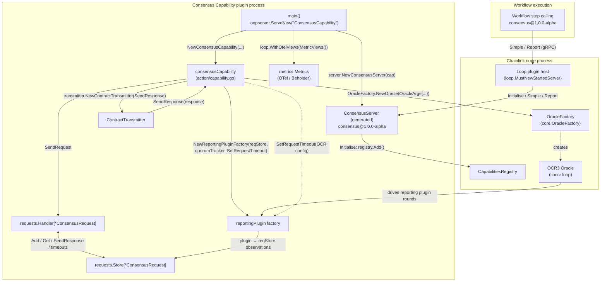
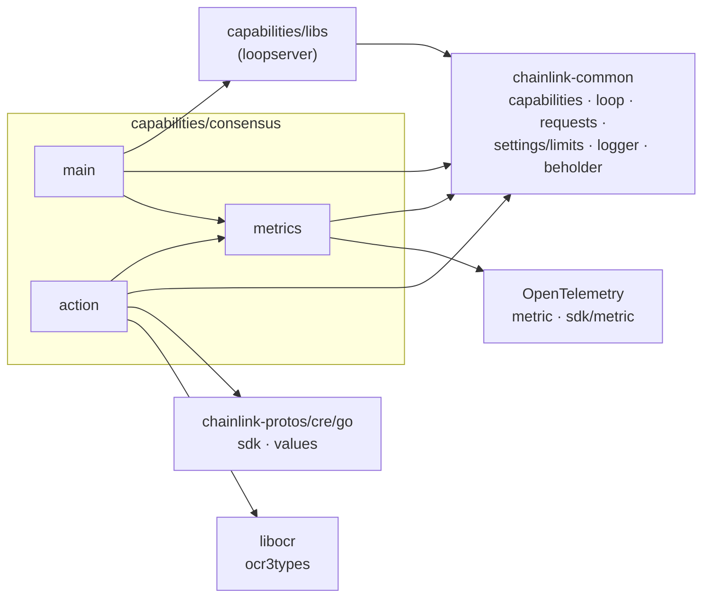
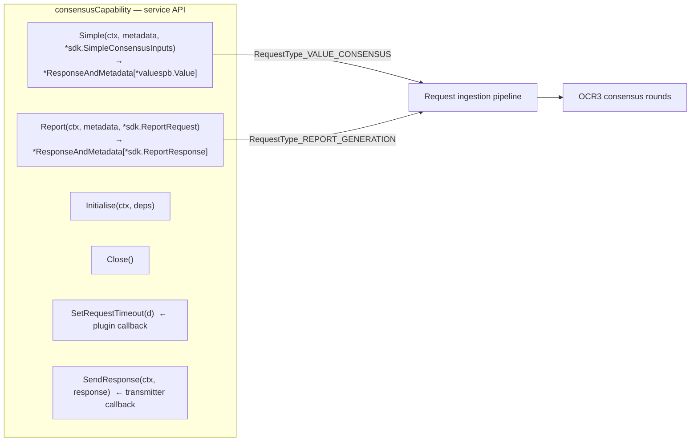
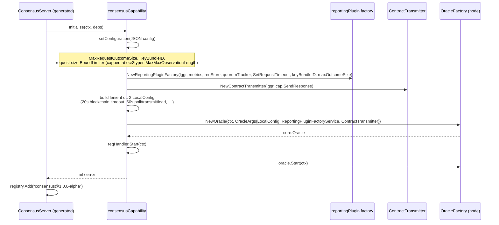
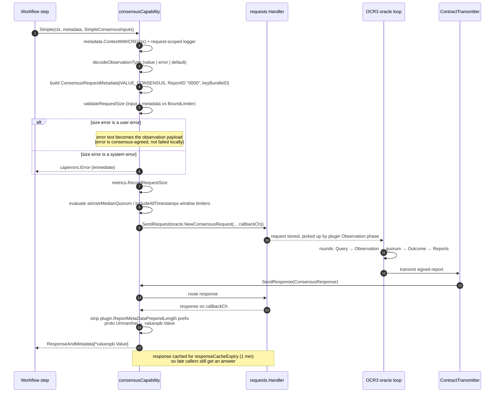
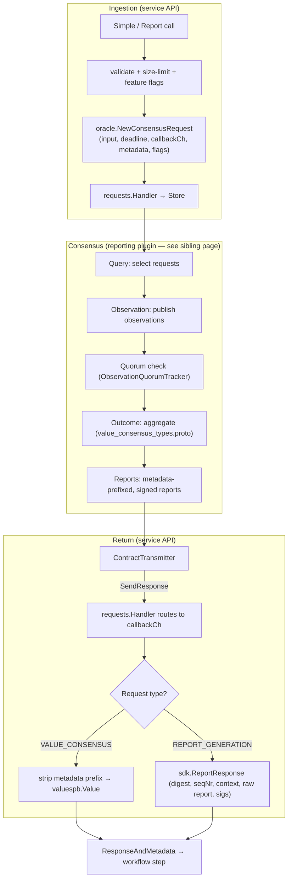

# Consensus Capability — Service API

> **Module scope:** the process entry point and capability API layer of the `capabilities/consensus` Go module — `main.go`, `action/capability.go` and `metrics/metrics.go`.

## 1. Introduction

This module is the **service wrapper and public API surface** of the Consensus Capability. The Consensus Capability itself is a DON-level standard capability (`consensus@1.0.0-alpha`) that lets CRE workflow steps reach deterministic agreement across the nodes of a workflow DON when those nodes may have observed differing values — either by computing a **consensus value** (medians, identical-value agreement, per-field aggregation, …) or by producing a **signed OCR3 report** for on-chain submission.

The service API layer is responsible for:

1. **Process bootstrap** — `main()` launches the capability as a standalone [Loop](../../Plugin_Process_Framework_(Loop)/loop-plugin-core.md) plugin process (hashicorp go-plugin over gRPC) that the Chainlink node loads as a remote standard capability.
2. **Capability registration** — a generated server wrapper registers `consensus@1.0.0-alpha` with the node's `CapabilitiesRegistry` on `Initialise` and deregisters it on `Close`.
3. **Request ingestion & correlation** — the `Simple` (value consensus) and `Report` (report generation) methods validate inputs, enforce request size limits, enqueue requests into a shared request store, and block the caller until the OCR consensus round produces a response on a per-request callback channel.
4. **OCR wiring** — `Initialise` builds the [reporting plugin factory](consensus_capability_reporting_plugin.md) and the response transmitter, and instantiates the node-side OCR3 oracle through the `OracleFactory` dependency supplied by the node.
5. **Feature-flag gating & limits** — per-request feature flags (`stricterMedianQuorum`, `includeAllTimestamps`) and the request-size bound limiter are evaluated against CRE settings with time-ranged activation windows.
6. **Observability** — an OpenTelemetry metrics package, exported via [Beholder](../../Telemetry___Observability_Platform/beholder-telemetry.md).

The heavy lifting — consensus algorithms, quorum tracking, batching and report production — lives in the sibling modules and is not duplicated here:

| Concern | Where it lives |
|---|---|
| Request/response types, quorum tracking, consensus algorithms, wire schema | [Consensus Capability — Oracle Core](consensus_capability_oracle_core.md) |
| OCR3 reporting plugin lifecycle, query/observation/outcome/report phases, batching, transmitter | [Consensus Capability — Reporting Plugin](consensus_capability_reporting_plugin.md) |
| Generic `requests.Handler` / `requests.Store` used for correlation | [Capabilities Consensus types (chainlink-common)](../capabilities/capabilities_consensus.md) |
| Capability interfaces & error taxonomy (`ResponseAndMetadata`, `caperrors.Error`) | [Capabilities Core types](../capabilities/capabilities_core.md) |
| Loop plugin-process serving and gRPC bindings | [Plugin Process Framework (Loop)](../../Plugin_Process_Framework_(Loop)/loop-plugin-core.md) |
| CRE settings, limiters and feature activation windows | [Settings & Limits](../../Shared_Foundation_Libraries___Domain_Types/settings.md) |
| Overall runtime context | [Workflow & Capability Runtime (CRE Engine)](../consensus_capability.md) |

---

## 2. Module composition

The module is a standalone Go module (`github.com/smartcontractkit/capabilities/consensus`) inside the [capabilities Nx workspace](../../Build,_CI___Release_Infrastructure/capabilities_workspace_tooling.md):

| File | Role |
|---|---|
| `capabilities/consensus/go.mod` | Module manifest. Go 1.27.1; declares all direct dependencies. |
| `capabilities/consensus/main.go` | `main()` — boots the Loop plugin server and serves the capability. |
| `capabilities/consensus/action/capability.go` | `NewConsensusCapability` constructor and the `consensusCapability` implementation (the service API). |
| `capabilities/consensus/metrics/metrics.go` | `Metrics` — OpenTelemetry instruments and histogram views. |

Key direct dependencies from [`capabilities/consensus/go.mod`](../../../repo/capabilities/consensus/go.mod):

| Dependency | Used for |
|---|---|
| `github.com/smartcontractkit/capabilities/libs` | `loopserver.ServeNew` (plugin bootstrap) and shared consensus libraries |
| `github.com/smartcontractkit/chainlink-common` | Capability framework (`capabilities`, `caperrors`), generated consensus `server`, `requests.Handler`/`Store`, `loop` plugin server, `logger`, `settings/cresettings`, `settings/limits`, `config`, `types/core` |
| `github.com/smartcontractkit/chainlink-protos/cre/go` | `sdk` protos (`SimpleConsensusInputs`, `ReportRequest`, `ReportResponse`) and `values` protos |
| `github.com/smartcontractkit/libocr` | OCR3 types, notably `ocr3types.MaxMaxObservationLength` used to cap request size |
| `go.opentelemetry.io/otel`, `otel/metric`, `otel/sdk/metric` | Metrics instrumentation and view configuration |
| `github.com/jonboulle/clockwork` | Injectable clock for response-cache expiry |
| `github.com/smartcontractkit/cre-sdk-go` | Generated standard-capability bindings |

---

## 3. Architecture

### 3.1 Process & component topology

The capability runs as a **separate plugin process** beside the Chainlink node. The node discovers it via the Loop handshake and calls it through the `StandardCapabilities` gRPC plugin; the capability in turn asks the node to create a real OCR3 oracle on its behalf.

### 3.2 Dependency structure

---

## 4. Component reference

### 4.1 `main` — process entry point (`main.go`)

`main()` does three things and nothing else:

1. Creates the capability via `action.NewConsensusCapability(s.Logger, clockwork.NewRealClock(), 1*time.Minute, s.LimitsFactory)`.
   The `1 * time.Minute` argument is the **response cache expiry**: how long a consensus response is cached after it is computed, so late-arriving workflow calls for the same request can still be answered.
2. Wraps it with the generated `server.NewConsensusServer(capability)`.
3. Serves it with `loopserver.ServeNew("ConsensusCapability", …, loop.WithOtelViews(metrics.MetricViews()))`.

`loopserver.ServeNew` (from `capabilities/libs/loopserver`):

- Builds a `loop.Server` and a hashicorp go-plugin gRPC server registered under the `StandardCapabilities` plugin name.
- Installs a **settings interceptor** around `Initialise` that subscribes to node-pushed CRE settings updates (with exponential-backoff retries) and stores them atomically — this is how the limiters and feature windows below stay current.
- Applies the OTel metric views so the size histograms use custom bucket boundaries.

The generated `ConsensusServer` (in `chainlink-common/pkg/capabilities/v2/consensus/server`) adds:

- `Initialise` — delegates to the capability, records initialization metrics, then adds `consensus@1.0.0-alpha` (a `CapabilityTypeCombined` capability) to the node's `CapabilitiesRegistry`.
- `Close` — removes the capability from the registry, closes the stop channel, and closes the inner capability.
- `Infos` / `Info` — advertises the capability ID `consensus@1.0.0-alpha`.

### 4.2 `NewConsensusCapability` / `consensusCapability` (`action/capability.go`)

`consensusCapability` implements the generated `server.ConsensusCapability` interface (compile-time checked with `var _ server.ConsensusCapability = &consensusCapability{}`).

**Constructor wiring** (`NewConsensusCapability`):

| Artifact created | Purpose |
|---|---|
| `metrics.Metrics` | OTel instruments (see §4.3) |
| `requests.Store[*oracle.ConsensusRequest]` with a `storeStatsCollector` | Shared request storage; the collector feeds the store's live request count into the `PendingConsensusRequests` gauge |
| `requests.Handler[*ConsensusRequest, ConsensusResponse]` | Request correlation, response routing and expiry handling, with the 1-minute response cache |
| `limits.RangeLimiter` for `FeatureConsensusStricterMedianQuorumActivePeriod` | Time-window gate for the stricter-median-quorum feature flag |
| `limits.RangeLimiter` for `FeatureConsensusIncludeAllTimestampsActivePeriod` | Time-window gate for the include-all-timestamps feature flag |
| `oracle.ObservationQuorumTracker` | Shared quorum bookkeeping handed to the reporting plugin (see [Oracle Core](consensus_capability_oracle_core.md)) |

**Fields of `consensusCapability`:**

| Field | Description |
|---|---|
| `oracle core.Oracle` | Node-side OCR3 oracle created during `Initialise` |
| `reqStore` / `reqHandler` | Shared request store + handler (see [capabilities_consensus](../capabilities/capabilities_consensus.md)) |
| `observationQuorumTracker` | Quorum tracker shared with the plugin |
| `requestTimeout` (+ `requestTimeoutLock sync.RWMutex`) | Consensus request timeout, **set by the reporting plugin** via `SetRequestTimeout` once it learns the OCR offchain config |
| `maxRequestSizeBytes limits.BoundLimiter[config.Size]` | Request size bound limiter |
| `stricterMedianQuorum`, `includeAllTimestamps limits.RangeLimiter[config.Timestamp]` | Per-request feature-flag windows |
| `valueConsensusKeyBundleID` | Key bundle used for value-consensus signing (default `"evm"`) |
| `maxRequestOutcomeSize` | Upper bound for consensus outcomes (default `10000`) |
| `metrics` | Observability |

**Lifecycle contract:**

| Method | Behavior |
|---|---|
| `Initialise(ctx, deps)` | Full initialization; **replaces `Start`** when running as a remote standard capability (the generated server calls it via the Loop host). See §5.1. |
| `Start(ctx)` | No-op (kept for interface compatibility). |
| `Close()` | Closes the request handler, both range limiters (logging errors) and the oracle. |
| `Ready()` / `HealthReport()` / `Name()` / `Description()` | Always-ready health stub; health reports `{Name(): nil}`. |

### 4.3 `Metrics` (`metrics/metrics.go`)

All instruments are created from the Beholder meter (`beholder.GetMeter()`), so they flow into the node's standard OTLP telemetry pipeline (see [Beholder telemetry](../../Telemetry___Observability_Platform/beholder-telemetry.md)).

| Instrument | Type | Meaning |
|---|---|---|
| `consensus_capability_pending_consensus_requests` | Int64Gauge | Number of consensus requests awaiting a response (fed by the request-store stats collector) |
| `consensus_capability_batch_capacity_exceeded` | Int64Counter | Times the plugin's batch capacity was exceeded (attributed by `step`) |
| `consensus_capability_batch_requests_total` | Int64Counter | Total batch requests (attributed by `step`) |
| `consensus_capability_request_size_bytes` | Float64Histogram | Size distribution of `Simple`/`Report` requests |
| `consensus_capability_observation_batch_size_bytes` | Float64Histogram | Size of serialized OCR observation batches |
| `consensus_capability_outcome_batch_size_bytes` | Float64Histogram | Size of serialized OCR outcome batches |
| `consensus_capability_stricter_median_quorum` | Int64Counter | Requests by stricter-median-quorum flag, per `stage` (`request` = local flag, aggregated = outcome after voting) and `enabled` |
| `consensus_capability_include_all_timestamps` | Int64Counter | Requests by include-all-timestamps flag, same stages |

`MetricViews()` returns three explicit-bucket histogram views — boundaries `[0, 10, 100, 1_000, 10_000, 100_000, 1_000_000]` — for the request, observation-batch and outcome-batch size histograms. These views are injected into the Loop server via `loop.WithOtelViews(...)` in `main()` so they apply process-wide.

---

## 5. API surface

The generated `server.ConsensusCapability` interface exposes exactly two workflow-facing methods plus lifecycle hooks:

### 5.1 `Initialise` — wiring the oracle

Notes:

- The `LocalConfig` timeouts are deliberately generous ("response time for config update is not critical").
- `SetRequestTimeout` is a **callback handed to the plugin factory**: after `Initialise`, the plugin receives the OCR offchain config and pushes the effective request timeout back into the capability (guarded by an `RWMutex`).

### 5.2 `Simple` — value consensus

Called by workflow steps that want the DON to agree on a value (median, identical, field-wise aggregation, etc. — the aggregation semantics are carried in the input `Descriptors`).

Key behaviors:

- **Report ID**: value-consensus requests use the dummy report ID `"0000"` because no on-chain report is produced.
- **Error-as-observation**: when the request exceeds the size limit, the *user-facing* `LimitExceeded` error is converted into an `Error` observation and sent through consensus, so every node converges on the same failure outcome instead of failing locally.
- **Context cancellation**: the method returns a `Canceled` system error if the workflow context ends before the response arrives.
- **Feature flags**: `stricterMedianQuorum` and `includeAllTimestamps` are evaluated per request against time-ranged limiters; limiter evaluation errors default the flag to *off* (with a warning), and both evaluations are counted in metrics.

### 5.3 `Report` — signed report generation

Called by workflow steps that need a **signed OCR3 report** (config digest, sequence number, report context, raw report, signatures) to submit on-chain — e.g. for chain-specific forwarder flows.

Processing differs from `Simple` in three ways:

1. **Report ID derivation** — the workflow step's `ReferenceID` is parsed to an integer, converted to hex, zero-padded to at least 4 characters, and must decode to exactly 2 bytes (`toReportID`). Empty or malformed reference IDs are rejected.
2. **Request validation** (`validateReportRequest`) — allowed values:
   - Encoder/key-bundle name: `evm`, `aptos`, `solana`, `stellar`
   - Signing algorithm: `ecdsa`, `ed25519`
   - Hashing algorithm: `keccak256`, `blake2b_256`

   Violations are returned as public **user** errors (`InvalidArgument`). The validated key-bundle ID is placed in the request metadata so the node's signing keystores can select the correct key (see [Keystore — node keyring](../../Node_Platform_Services/keystore/keystore_node_keyring.md)).
3. **Input construction** — the caller's `EncodedPayload` is wrapped as a bytes value with an `AGGREGATION_TYPE_IDENTICAL` descriptor, so the DON must agree bit-for-bit on the payload before signing.

On success, the OCR `ConsensusResponse` fields are mapped into `sdk.ReportResponse`:

| `oracle.ConsensusResponse` field | `sdk.ReportResponse` field |
|---|---|
| `ConfigDigest` | `ConfigDigest` (as `[]byte`) |
| `SeqNr` | `SeqNr` |
| `ReportContext` | `ReportContext` |
| `RawReport` | `RawReport` (metadata prefix **not** stripped, unlike `Simple`) |
| `Sigs ([]types.AttributedOnchainSignature)` | `Sigs ([]*sdk.AttributedSignature{Signature, SignerId})` |

### 5.4 Request size validation

`validateRequestSize` is shared by both methods:

1. Proto-serializes the input message and the request metadata separately, then sums the sizes.
2. Checks the total against the `maxRequestSizeBytes` bound limiter.
3. **User errors** (`limits.ErrorBoundLimited` → `caperrors.NewLimitExceededError`) are funnelled through consensus as error observations (see above); unexpected limiter failures become `Internal` system errors returned immediately.
4. The configured limit is resolved in `setConfiguration`: explicit `MaxRequestSizeBytes` capability config wins, otherwise the CRE setting default (`cresettings.Default.PerWorkflow.Consensus.ObservationSizeLimit`); either way it is **capped at `ocr3types.MaxMaxObservationLength`** (with a warning) so the OCR protocol can never be violated.

---

## 6. End-to-end data flow

The wire schema for observations, outcomes and failure codes (`RequestMetaData`, `RequestObservation`, `ConsensusOutcome`, `ConsensusFailureCode`, …) is defined in `capabilities/consensus/oracle/types/value_consensus_types.proto` and documented in the [Oracle Core](consensus_capability_oracle_core.md) page.

---

## 7. Configuration

### 7.1 Capability config (`ConsensusCapabilityConfig`)

Passed as a JSON string on the capability's `Initialise` dependencies config:

| Field | Default | Meaning |
|---|---|---|
| `MaxRequestOutcomeSize` | `10000` (`defaultMaxRequestOutcomeSize`) | Max serialized outcome size the plugin may produce |
| `MaxRequestSizeBytes` | CRE setting `Consensus.ObservationSizeLimit` | Max serialized request size (input + metadata); capped at libOCR `MaxMaxObservationLength` |
| `KeyBundleIDForValueConsensus` | `"evm"` | Key bundle used to sign value-consensus reports |
| `RequestBatchSize` | (parsed, informational) | Hint for plugin-side batching |

### 7.2 CRE settings integration

The capability consumes two layers of node-pushed settings (delivered by the Loop settings interceptor):

- **Bound limits** — request size (`config.Size`) via `limits.MakeBoundLimiter`.
- **Range-gated features** — `FeatureConsensusStricterMedianQuorumActivePeriod` and `FeatureConsensusIncludeAllTimestampsActivePeriod` via `limits.MakeRangeLimiter`; a request is flagged in or out depending on whether its execution timestamp falls inside the active window. See [Settings & Limits](../../Shared_Foundation_Libraries___Domain_Types/settings.md).

### 7.3 Constants

| Constant | Value |
|---|---|
| `defaultMaxRequestOutcomeSize` | `10000` |
| `defaultKeyBundleIDForValueConsensus` / `KeyBundleIDEvm` | `"evm"` |
| `KeyBundleIDAptos` / `KeyBundleIDSolana` / `KeyBundleIDStellar` | `"aptos"` / `"solana"` / `"stellar"` |
| `SigningAlgoEcdsa` / `SigningAlgoEd25519` | `"ecdsa"` / `"ed25519"` |
| `HashingAlgoKeccak256` / `HashingAlgoBlake2b256` | `"keccak256"` / `"blake2b_256"` |

---

## 8. Build, packaging & CI

The module is an Nx project inside the `capabilities` workspace (see [`capabilities/consensus/project.json`](../../../repo/capabilities/consensus/project.json) and the [workspace tooling page](../../Build,_CI___Release_Infrastructure/capabilities_workspace_tooling.md)):

| Target | Command | Notes |
|---|---|---|
| `build` | `CGO_ENABLED=0 GOOS=linux GOARCH=amd64\|arm64 go build -o ./../bin/<arch>/consensus .` | Produces static linux binaries for both architectures |
| `lint` | `golangci-lint run ./...` | Uses `capabilities/.golangci.yml` |
| `test` / `race` | `go test ./...` (with `-coverprofile` / `-race`) | |
| `generate` | strip `// Code generated by` files, then `go generate -x ./...` | Regenerates protobuf/grpc artifacts |
| `tidy` | `go mod tidy` | Workspace-wide via `capabilities/Makefile` (`gomodtidy`) |
| `update-libs` | `go get capabilities/libs@<ref>` + workspace tidy | Bumps the shared libs dependency |

Protobuf code generation for the workspace (including the consensus wire types) is toolchained through `make protoc` / `make generate` in [`capabilities/Makefile`](../../../repo/capabilities/Makefile). The resulting binary is deployed as a Loop plugin and loaded by nodes through the plugin handshake described in [Plugin Process Framework (Loop)](../../Plugin_Process_Framework_(Loop)/loop-plugin-core.md).

---

## 9. Related documentation

- [Consensus Capability (parent)](../consensus_capability.md) — runtime context and module family overview.
- [Consensus Capability — Oracle Core](consensus_capability_oracle_core.md) — request/response types, quorum tracking, consensus algorithms, wire proto.
- [Consensus Capability — Reporting Plugin](consensus_capability_reporting_plugin.md) — OCR3 plugin phases, batching, transmitter internals.
- [Capabilities Core types](../capabilities/capabilities_core.md) — capability interfaces and error taxonomy.
- [Capabilities Consensus types (chainlink-common)](../capabilities/capabilities_consensus.md) — generic request handler/store.
- [Plugin Process Framework (Loop)](../../Plugin_Process_Framework_(Loop)/loop-plugin-core.md) — plugin serving and gRPC bindings.
- [Settings & Limits](../../Shared_Foundation_Libraries___Domain_Types/settings.md) — CRE settings and limiter primitives.
- [Beholder telemetry](../../Telemetry___Observability_Platform/beholder-telemetry.md) — metrics export pipeline.
- [Keystore — node keyring](../../Node_Platform_Services/keystore/keystore_node_keyring.md) — signing key bundles referenced by key-bundle IDs.
