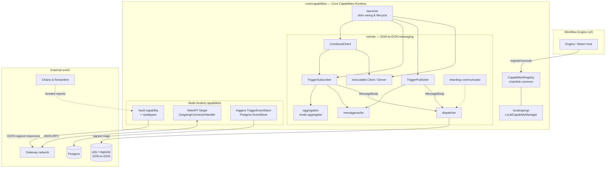
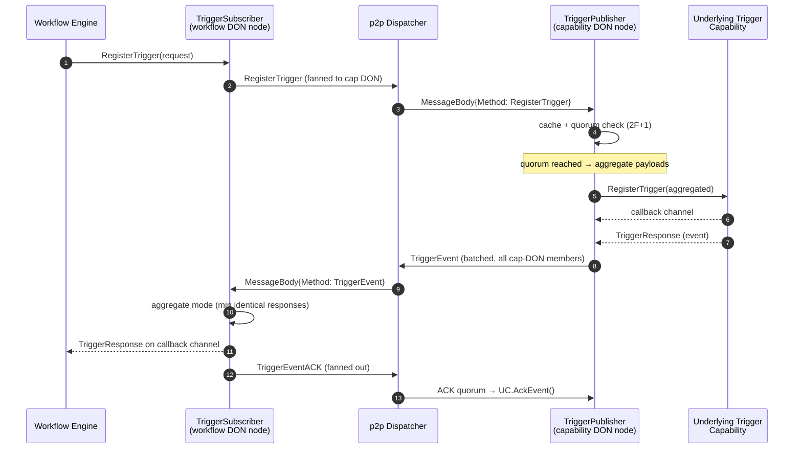
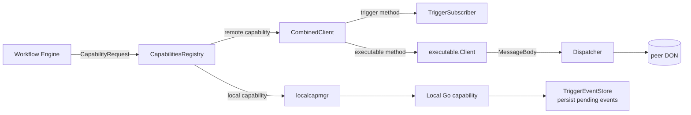

# Core Capabilities Runtime (Node-Side CRE Runtime)

> **Module:** `chainlink/core/capabilities` (with shared types in `chainlink/core/capabilities/vault/vaulttypes`)
> **Part of:** [Workflow & Capability Runtime (CRE Engine)](../Workflow___Capability_Runtime_(CRE_Engine).md)

## 1. Purpose and Scope

The **Core Capabilities Runtime** is the node-side host for the Chainlink Runtime Environment (CRE). It is the layer inside a Chainlink node that:

1. **Hosts capabilities** — wires local Go capabilities and remote (other-DON) capabilities into the node's [`CapabilitiesRegistry`](capabilities.md#capabilities-registry) so the [workflow engine](workflows.md) can discover and invoke them.
2. **Moves messages between DONs** — implements the trigger/event messaging protocol that lets a *capability DON* publish trigger events to, and receive registrations/ACKs from, *workflow DONs* over p2p.
3. **Provides node-hosted capabilities** — the Vault secrets capability and the WebAPI ("Target") gateway connector that workflows use through the gateway network.
4. **Supports testing** — a library of fakes (local gateway, mock Keystone forwarder contract bindings) used by engine and integration tests.

Conceptually it sits *between* two worlds:

```
   Workflow Engine (Wasm/binary workflows)          Chain/Off-chain World
   ┌───────────────────────────────────┐        ┌──────────────────────────────┐
   │  runs workflow → calls capabilities│        │  other DONs, gateways, chains │
   └──────────────┬────────────────────┘        └──────────────▲───────────────┘
                  │ capabilities API                           │
   ┌──────────────▼────────────────────────────────────────────┴───────────────┐
   │                    CORE CAPABILITIES RUNTIME (this module)                 │
   │  registry shims · dispatcher · trigger publisher/subscriber · vault · API  │
   └───────────────────────────────────────────────────────────────────────────┘
```

The capability *contracts* (interfaces such as `ExecutableAndTriggerCapability`, `TriggerCapability`, protobufs and the `CapabilitiesRegistry`) are defined in the sibling [capabilities](capabilities.md) module — this page documents the *node runtime* that implements and drives them.

## 2. Architecture Overview

### 2.1 Component Map



### 2.2 Integration Point: the Launcher

The [`launcher`](https://github.com/smartcontractkit/chainlink/blob/main/chainlink/core/capabilities/launcher.go) (`chainlink/core/capabilities/launcher.go`) is the composition root. It:

- holds the `CapabilitiesRegistry`, the `Dispatcher`, and the DON-to-DON shared p2p peer (`p2ptypes.SharedPeer`), plus stream configuration (buffer sizes and token-bucket rate limits, defaulting to 500-message buffers / 500 KB max message / 100 msg/s).
- creates **cached shims** — one `CombinedClient`, `TriggerSubscriber`, `TriggerPublisher`, and executable `Client`/`Server` pair per (`capabilityID`, `donID`, `method`) — whose configuration is updated dynamically as workflow DONs join or change (`DonNotifier`).
- delegates local capability serving to `localcapmgr.LocalCapabilityManager` and enforces workflow-DON binding and rate-limit gates from `chainlink-common/pkg/settings/limits`.

### 2.3 Remote Capability Shims

A remote capability (one that lives on another DON) is represented *locally* by three cooperating objects; they communicate only through `remote/types.MessageBody` envelopes dispatched over p2p:

| Shim | Role | Runs on |
|---|---|---|
| `CombinedClient` | The `ExecutableAndTriggerCapability` handle the workflow registry sees; fans methods out to per-method trigger/executable shims. | Consumer DON |
| `TriggerSubscriber` | Registers triggers on the remote capability DON, aggregates incoming trigger events (quorum via `aggregation.Aggregator`), ACKs events, forwards results to the engine. | Consumer DON |
| `TriggerPublisher` | On the capability DON: collects `RegisterTrigger`/`UnregisterTrigger` requests with **2F+1 quorum**, publishes trigger events (optionally batched), processes ACK quorums, and runs periodic `TriggerRegistrationCheck` sweeps. | Capability DON |
| `executable.Client` / `Server` | Bidirectional RPC-style shims for `Execute` calls and `ExecutionStatusUpdate`s. | Both sides |

All wire traffic is protobuf `MessageBody` (see [remote messaging](core_capabilities_runtime/core_capabilities_runtime_remote_messaging.md)), signed and rate-limited by the concrete [dispatcher](../Node_Platform_Services/p2p.md) implementation in `remote/dispatcher.go`.

## 3. Sub-Modules

| Sub-module | Documentation | Contents |
|---|---|---|
| **Remote capability messaging** | [core_capabilities_runtime_remote_messaging.md](core_capabilities_runtime/core_capabilities_runtime_remote_messaging.md) | `CombinedClient`, `TriggerPublisher`, `TriggerSubscriber` (tested via `subscriberSvc`), `MessageBody` protobuf metadata, `Dispatcher`/`DON`/`Receiver` wire types |
| **Trigger event store** | [core_capabilities_runtime_trigger_event_store.md](core_capabilities_runtime/core_capabilities_runtime_trigger_event_store.md) | Postgres-backed `capabilities.EventStore` (`cre.trigger_pending_events`) for durable pending trigger events |
| **Vault types** | [core_capabilities_runtime_vault_types.md](core_capabilities_runtime/core_capabilities_runtime_vault_types.md) | `SecretsService` API, request/response envelope, `SignedOCRResponse` signature validation, `UserError` taxonomy |
| **WebAPI configuration** | [core_capabilities_runtime_webapi_config.md](core_capabilities_runtime/core_capabilities_runtime_webapi_config.md) | `ServiceConfig` — incoming/outgoing rate-limiter settings for the gateway "Target" capability |
| **Test fakes** | [core_capabilities_runtime_test_fakes.md](core_capabilities_runtime/core_capabilities_runtime_test_fakes.md) | `LocalGateway` HTTP trigger stub and generated `MockKeystoneForwarder` contract bindings |

Other in-repo packages that belong to this module but are covered elsewhere:

- `core/capabilities/ccip/**` — the CCIP cross-chain oracle, documented under [CCIP Cross-Chain Protocol](../CCIP_Cross-Chain_Protocol/ccip.md).
- `core/capabilities/confidentialrelay`, `gateway_connector`, `validation`, `mocks` — supporting services for the gateway-mediated HTTP and validation flows described with the WebAPI and remote sub-modules above.

## 4. Key Flows

### 4.1 Remote trigger registration and event delivery



Key properties:

- **Quorum safety:** both registration and ACK processing require `2F + 1` agreeing messages from the caller DON's members (`messagecache.MessageCache` dedupes per peer, `once=true` semantics prevent duplicate `RegisterTrigger` calls); event delivery requires `MinResponsesToAggregate` identical payloads (`aggregation.AggregateModeRaw`).
- **Reconciliation:** the publisher periodically sends `TriggerRegistrationCheck` batches; subscribers reply with `UnregisterTrigger` for entries missing locally, so state converges without per-event re-registration.
- **Backpressure:** the publisher routes registrations and ACKs through `ParallelExecutor`s (default 100 slots each) and batches events per `MaxBatchSize` / `BatchCollectionPeriod`.

### 4.2 Local execution path



## 5. Relationship to the Rest of the System

| Dependency | Used for | Where documented |
|---|---|---|
| `chainlink-common/pkg/capabilities` | Capability interfaces, `CapabilitiesRegistry`, protobufs (`pb.MarshalTriggerResponse`, etc.), `RemoteTriggerConfig` | [capabilities](capabilities.md) |
| Workflow engine (`core/services/workflows`, `chainlink-common/pkg/workflows`) | The consumer of this runtime; executes workflows that call registered capabilities | [workflows](workflows.md) |
| `core/services/p2p/types` (`PeerID`, `Signer`, `SharedPeer`) | Transport for all `Dispatcher` traffic | [p2p](../Node_Platform_Services/p2p.md) |
| `core/services/keystore` (OCR2 keys) | Signing of vault/OCR responses and messages | [keystore](../Node_Platform_Services/keystore.md) |
| `chainlink-common/pkg/beholder` | OTel metrics/counters/histograms emitted by publisher, dispatcher and WebAPI handlers | [beholder-telemetry](../Telemetry___Observability_Platform/beholder-telemetry.md) |
| `chainlink-common/pkg/loop` | Remote/standard capabilities can be served or consumed across plugin process boundaries | [loop-plugin-core](../Plugin_Process_Framework_(Loop)/loop-plugin-core.md) |
| `capabilities/` workspace (separate Go module `github.com/smartcontractkit/capabilities`, see [capabilities/go.mod](https://github.com/smartcontractkit/chainlink/blob/main/capabilities/go.mod)) | Chain capabilities (cron, HTTP, EVM/Solana/Aptos/Stellar writers) that get registered into the same registry | [capabilities](capabilities.md), [chain_capability_evm](chain_capability_evm.md) |
| `chainlink-common/pkg/workflows/wasm/host` | Wasm workflow host that the engine runs; capability calls funnel through this runtime | [workflows_engine](workflows/workflows_engine.md) |

Deployment of the contracts these capabilities talk to (forwarders, capability registries, workflow registries) is handled by the [CRE & Keystone Deployment Suite](../CRE___Keystone_Deployment_Suite/cre-core.md).

## 6. Configuration Notes

- Remote trigger behavior (`RegistrationRefresh`, `RegistrationExpiry`, `MessageExpiry`, `BatchCollectionPeriod`, `MaxBatchSize`, `MinResponsesToAggregate`) is carried in `commoncap.RemoteTriggerConfig` and applied at runtime via `SetConfig` on the publisher/subscriber — no node restart required.
- WebAPI rate limiting is TOML-configured through `webapi.ServiceConfig` (see [WebAPI configuration](core_capabilities_runtime/core_capabilities_runtime_webapi_config.md)); the `Dispatcher` applies its own `config.Dispatcher`-derived rate limits.
- P2P stream limits are set from the node's `StreamConfig` section with the safe defaults shown in `launcher.go`.
