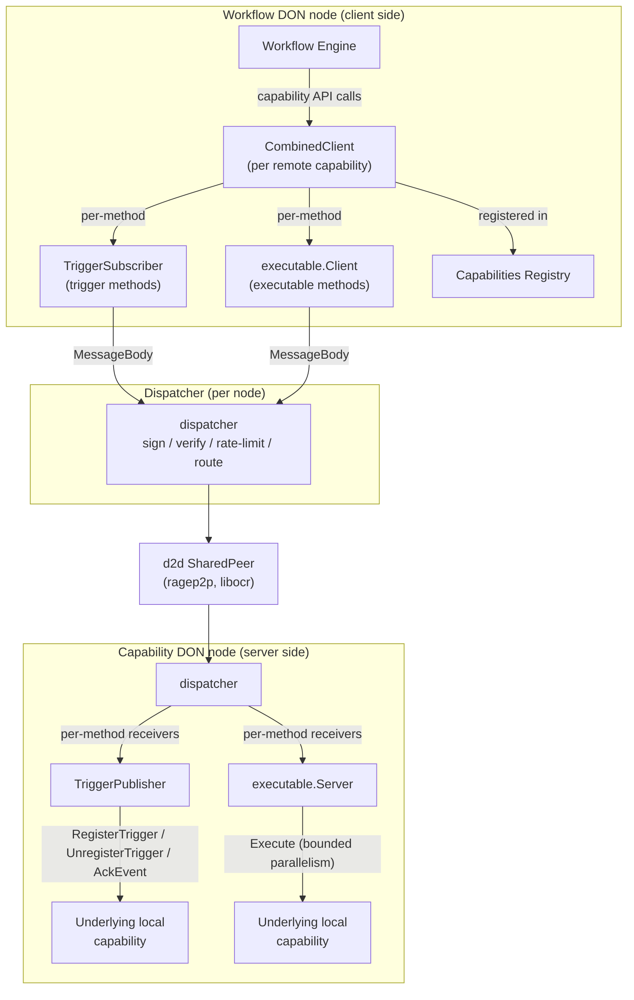
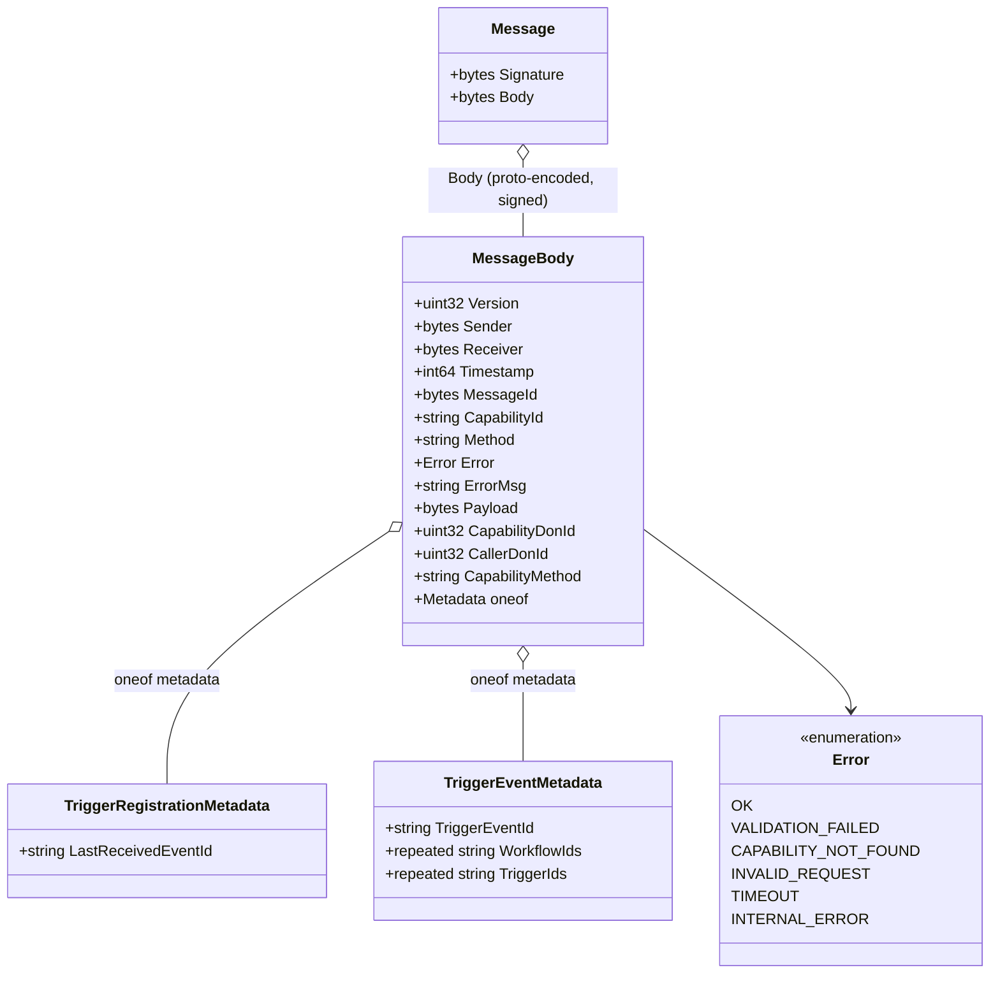
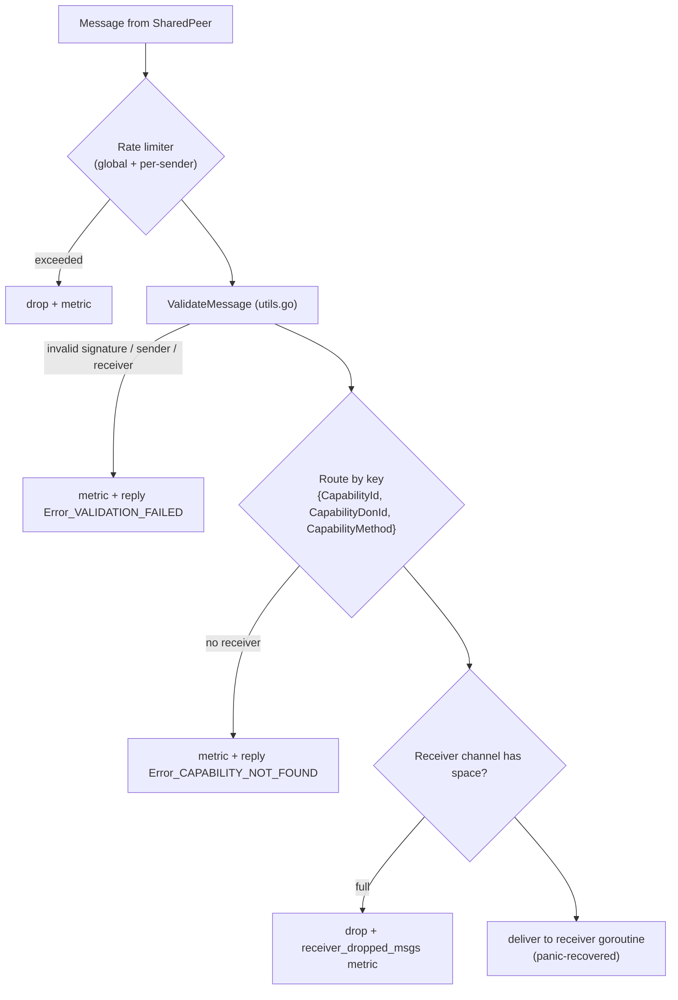
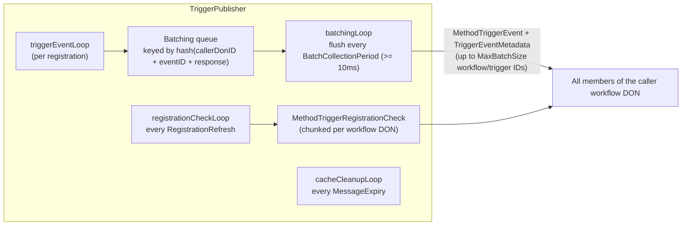

# Core Capabilities Runtime — Remote Messaging

## 1. Introduction

The **remote messaging** module (`chainlink/core/capabilities/remote`) implements DON-to-DON (d2d) messaging for the Chainlink Runtime Environment (CRE). It is the transport layer that lets a workflow DON consume capabilities hosted on a different DON, and lets a capability DON expose its local capabilities to workflow DONs — without either side knowing anything about the underlying P2P network.

The module provides:

- **A signed wire protocol** (`types/messages.proto`) for capability requests, responses, trigger events, trigger registrations and acknowledgements.
- **A dispatcher** that signs outbound traffic, verifies and rate-limits inbound traffic, and routes messages to per-capability/method receivers.
- **Client-side shims** that translate the standard capability API ([ExecutableAndTriggerCapability](../../Shared_Foundation_Libraries___Domain_Types/types-core.md)) into network messages: `CombinedClient`, `TriggerSubscriber`, and the remote `executable.Client`.
- **Server-side shims** that expose local capabilities over the network, with quorum-based registration, event fan-out, batching and acknowledgement tracking: `TriggerPublisher` and the remote `executable.Server`.
- **Supporting infrastructure**: a message cache for quorum collection, a byzantine-tolerant mode aggregator, a bounded parallel executor, shard-failover communication, and message-validation utilities.

Everything here is consumed by the [core capabilities runtime](../core_capabilities_runtime.md); the shims are created and reconciled by the capabilities launcher (`chainlink/core/capabilities/launcher.go`) when the [capabilities registry](../capabilities.md) publishes new DON topology metadata.

> **Terminology.** A *capability DON* is a public DON that hosts capability implementations. A *workflow DON* is a DON that accepts workflows and calls remote capabilities. Each node may belong to one workflow DON and any number of capability DONs. F denotes the maximum number of byzantine nodes in a DON.

---

## 2. Module Scope

| Area | Location | Core components |
|---|---|---|
| Wire protocol types | `chainlink/core/capabilities/remote/types/messages.proto` / `messages.pb.go` | `Message`, `MessageBody`, `TriggerRegistrationMetadata`, `TriggerEventMetadata`, `Error` |
| Shared contracts | `chainlink/core/capabilities/remote/types/types.go` | `Dispatcher`, `Receiver`, `ReceiverService`, `Aggregator`, `MessageHasher`, method constants |
| Message routing | `chainlink/core/capabilities/remote/dispatcher.go` | `dispatcher` (implements `types.Dispatcher`) |
| Multi-method client facade | `chainlink/core/capabilities/remote/combined_client.go` | `CombinedClient` |
| Trigger shims | `chainlink/core/capabilities/remote/trigger_subscriber.go`, `trigger_publisher.go` | `TriggerSubscriber`, `TriggerPublisher` |
| Executable shims | `chainlink/core/capabilities/remote/executable/` | `Client`, `Server`, request state machines |
| Infrastructure | `messagecache/`, `aggregation/`, `parallel_executor.go`, `sharding/`, `utils.go` | `MessageCache`, mode aggregator, `ParallelExecutor`, `ShardFailoverCommunicator` |

---

## 3. Architecture

Each node runs exactly one `dispatcher`, which owns the DON-to-DON P2P shared peer. Above the dispatcher live per-capability-method **shims**: client-side shims present remote capabilities as local ones to the workflow engine, and server-side shims present local capabilities to remote workflow DONs.



### 3.1 How the runtime wires the shims

The [core capabilities runtime](../core_capabilities_runtime.md) launcher caches shims keyed by `{capabilityID, donID, method}` and reconciles them on every registry update:

1. **Client side** (`addRemoteCapabilities`): for each remote capability DON, a single `CombinedClient` is created per capability and registered in the local capabilities registry. Each method with a `RemoteTriggerConfig` gets a `TriggerSubscriber`; each method with a `RemoteExecutableConfig` gets an `executable.Client`. Both are attached to the `CombinedClient` via `SetTriggerSubscriber` / `SetExecutableClient`.
2. **Server side** (`serveCapabilities`): for each capability the node hosts in a public capability DON, each method gets a `TriggerPublisher` (backed by the local `TriggerCapability`) or an `executable.Server` (backed by the local `ExecutableCapability`, plus a configurable `MessageHasher`).
3. **Registration**: `startNewShim` starts each shim as a `services.Service` and calls `dispatcher.SetReceiverForMethod(capabilityID, donID, method, receiver)` — receiver routing keys therefore match the `CapabilityId`, `CapabilityDonId` and `CapabilityMethod` stamped on every outbound message.
4. **Pruning**: stale shims (capability moved DON, capability removed) are pruned before new ones are created, because the registry rejects duplicate capability IDs.

---

## 4. Wire Protocol

The protocol is defined in `chainlink/core/capabilities/remote/types/messages.proto` (generated Go code in `messages.pb.go`). Every P2P payload is a signed envelope:



Field semantics that matter across the module:

- `Method` carries a transport-level operation; `CapabilityMethod` carries the capability's own method name. `CapabilityMethod` is empty for legacy "v1" messages, in which case receivers are registered without a method component.
- `Payload` holds a proto-encoded `CapabilityRequest` or `CapabilityResponse` (for `Execute`) or a `TriggerRegistrationRequest` / `TriggerResponse` (for trigger methods).
- `MessageId` is scoped to the sender; executable request/response correlation is based on it.
- `TriggerEventMetadata.TriggerIds` must be the same length as `WorkflowIds` (or empty for legacy events), enabling batching of one event to many workflows.
- Transport methods are constants in `types/types.go`: `RegisterTrigger`, `UnregisterTrigger`, `TriggerRegistrationCheck`, `TriggerEvent`, `Execute`, `TriggerEventACK`, `ExecutionStatusUpdate` (shard failover), `ShardHeartbeat`.

---

## 5. Dispatcher — Signing, Validation and Routing

`dispatcher.go` implements `types.Dispatcher` (a `services.Service`) on top of three injected dependencies:

| Dependency | Role |
|---|---|
| `p2ptypes.SharedPeer` | DON-to-DON P2P connection (see [P2P](../../Node_Platform_Services/p2p.md)); provides local peer ID, send and a receive channel |
| `p2ptypes.Signer` | Ed25519-style message signing (keys from the node [keystore](../../Node_Platform_Services/keystore.md)) |
| `registry.CapabilitiesRegistry` | Local capability metadata |

**Outbound (`Send`)**: stamps `Version` (protocol version `1`), `Sender`, `Receiver`, `Timestamp`; marshals the `MessageBody`, signs it, wraps it in a `Message`, and transmits through the shared peer. Successes and errors are counted per transport method.

**Inbound (`receive` loop → `handleMessage`)**:



- `ValidateMessage` (in `utils.go`) unmarshals the envelope and body, verifies the signature over the body, requires that the P2P-level sender equals `body.Sender` (no relaying), and that `body.Receiver` matches the local peer.
- Error replies (`tryRespondWithError`) are never sent for messages that already carry an error, preventing error loops, and the payload is cleared to keep replies small.
- Each receiver gets its own goroutine and buffered channel sized by the [dispatcher config](../../Node_Application_Core___Interfaces/core_config/core_config_dispatcher.md) (`ReceiverBufferSize()`, plus `RateLimit()` global/per-sender RPS and burst — `chainlink/core/config/dispatcher_config.go`). Panics in receivers are recovered and logged.

---

## 6. Client-Side Shims

### 6.1 `CombinedClient` (`combined_client.go`)

`CombinedClient` is the object registered in the local capabilities registry for one remote capability. It implements `capabilities.ExecutableAndTriggerCapability` and fans every capability API call out to the per-method shim registered for the request's method:

- `RegisterTrigger` / `UnregisterTrigger` / `AckEvent` → the method's `TriggerCapability` (`TriggerSubscriber`).
- `Execute` → the method's `ExecutableCapability` (`executable.Client`).
- `RegisterToWorkflow` / `UnregisterFromWorkflow` are **not supported** for remote capabilities and return an error.
- `SetInfo` refreshes the capability info (e.g. when DON membership changes) without recreating the client; all maps are guarded by an `RWMutex`.

This is what makes a remote capability indistinguishable from a local one to the [workflow engine](../workflows/workflows_engine.md).

### 6.2 `TriggerSubscriber` (`trigger_subscriber.go`)

Client-side shim for a remote *trigger* method. It implements `capabilities.TriggerCapability`, `types.Receiver` and `services.Service`.

**Registration lifecycle:**

```mermaid
sequenceDiagram
    participant Eng as Workflow Engine
    participant Sub as TriggerSubscriber
    participant Disp as Dispatcher
    participant Pub as TriggerPublisher (remote)

    Eng->>Sub: RegisterTrigger(request)
    Sub->>Sub: store rawRequest + buffered callback channel (1000)
    Sub-->>Eng: callback channel

    loop registrationLoop (buckets across RegistrationRefresh window)
        Sub->>Disp: MethodRegisterTrigger → all capability DON members
        Disp->>Pub: signed MessageBody
    end

    Note over Sub,Pub: RegistrationRefresh periods keep the<br/>registration alive; resends are jittered<br/>across 1-second buckets to avoid bursts.

    Eng->>Sub: UnregisterTrigger(request)
    Sub->>Sub: close channel, remove local state
    Note over Sub,Pub: No message is sent; publisher state is cleaned up via<br/>TriggerRegistrationCheck responses or expiry.
```

Key details:

- Registration resends are bucketed (`registrationBucketDuration = 1s`), with each registration assigned a random bucket; the effective resend period is `RegistrationRefresh` floored to whole seconds (never below 1s). Bucket catch-up logic tolerates dropped ticks and clock steps.
- `Receive` rejects senders that are not members of the capability DON.
- `MethodTriggerEvent`: the event is routed by `(workflowID, triggerID)`; legacy messages without a trigger ID are routed to the single registered trigger of that workflow (a warning is logged if there are several). Payloads from peers are inserted into a `MessageCache` and delivered to the engine only once `MinResponsesToAggregate` fresh responses have arrived and the configured `Aggregator` produces a matching response (`MarkDelivered` prevents duplicate delivery per event).
- **ACK replay**: if the engine has already acknowledged an event (`ackReplayCache`), a retransmission of the same event does not re-aggregate or re-deliver; instead the subscriber replays the ACK fan-out synchronously.
- `MethodTriggerRegistrationCheck` (from the publisher): for every checked `(workflowID, triggerID)` that no longer exists locally, the subscriber replies with `MethodUnregisterTrigger` to all capability DON members. Existing registrations are *not* re-sent here — the periodic registration loop owns refreshing.
- `AckEvent` fans out a `TriggerEventAck` message to every capability DON member and records the `ackReplayKey` for replay.
- `eventCleanupLoop` prunes expired cache entries (`MessageExpiry`) and stale ACK-replay records.

### 6.3 `executable.Client` (`executable/client.go`)

Client-side shim for a remote *executable* method. `Execute`:

1. Creates a `ClientExecuteRequest` with a deterministic marshaled `CapabilityRequest`, `requestID = "Execute:<WorkflowExecutionID>:<ReferenceID>"` (parallel step execution safe), and an **AllAtOnce transmission schedule** with per-peer delays for failover-friendly delivery.
2. Sends the request to all members of the remote capability DON and waits on a buffered response channel until the required quorum of *identical* responses is reached — `minResponsesToAggregate` if configured, otherwise `F+1`. `ErrResponseQuorumUnreachable` is reported as soon as quorum becomes mathematically impossible.
3. Background loops expire requests after `requestTimeout` and cancel all pending requests when the dispatcher becomes unhealthy.

`Receive` correlates responses by `MessageId` and feeds them into the pending request's aggregation state. On success, `Metadata.CapDON_N` is set to the local DON size before returning the response to the engine.

---

## 7. Server-Side Shims

### 7.1 `TriggerPublisher` (`trigger_publisher.go`)

Server-side shim for a locally implemented trigger capability. It manages all external users of that trigger and communicates with `TriggerSubscriber`s on remote workflow DONs.

**Inbound (all methods require the caller DON to be known and the sender to be a member of it):**

- **`MethodRegisterTrigger`**: payloads are collected per `(callerDonID, workflowID, triggerID)` in a `MessageCache`. Once a **2F+1 quorum** is reached (`once=true` semantics: only one registration attempt per quorum cycle), payloads are aggregated with `AggregateModeRaw(payloads, F+1)` and the underlying capability's `RegisterTrigger` is invoked **asynchronously** via a `ParallelExecutor` (default 100 parallel slots). Error handling distinguishes:
  - *User errors* (from `caperrors.Error` with origin `OriginUser`) are recorded in `pubRegState` and suppress retries.
  - *System errors* delete the cache entry so a fresh quorum can schedule a new attempt.
- **`MethodUnregisterTrigger`**: quorum of 2F+1 unregister messages removes the registration and calls `underlying.UnregisterTrigger`.
- **`MethodTriggerEventAck`**: ACKs are cached per `(callerDonID, triggerEventID, triggerID)`; once 2F+1 ACKs arrive, `underlying.AckEvent` executes on the ack executor. Duplicate ACK traffic for an already-acknowledged event is suppressed via `once` semantics.
- **`MethodTriggerEvent`** received by a publisher indicates a failed trigger request on the sender and is logged.

**Outbound (event fan-out and liveness):**



- Batching groups identical events delivered to many workflows of the same DON into one message; it is enabled when `MaxBatchSize > 1` and `BatchCollectionPeriod >= 10ms`.
- Registrations are **not expired by timeout** on the publisher; liveness is maintained by periodic `TriggerRegistrationCheck` probes — subscribers that no longer hold a registration answer with `MethodUnregisterTrigger`, which removes the publisher-side state after quorum.

All of this is governed by a `dynamicPublisherConfig` that `SetConfig` replaces atomically (remote config with defaults applied, the underlying trigger capability, the capability DON, the workflow-DON table and a precomputed membership cache), so reconfiguration never exposes mixed state.

### 7.2 `executable.Server` (`executable/server.go`)

Server-side shim that executes a local executable capability on behalf of remote workflow DONs.

- Accepts only `MethodExecute`; the server-side request ID is `messageID + hex(hash(payload))`, where the hash comes from an injectable `MessageHasher` (`SimpleHasher` or `WriteReportExcludeSignaturesHasher`, selected via `RemoteExecutableConfig.RequestHasherType`). Tracking message-ID → payload-hash counts detects malicious or non-deterministic clients that reuse a message ID with different payloads.
- A `ServerRequest` claims execution **exactly once** (CAS on an atomic flag); all duplicate messages only append to aggregation state. When open, the shared `workflowDONBindingGate` requires the request's `Metadata.WorkflowDonID` to match the authenticated calling DON.
- Execution runs on a `ParallelExecutor` bounded by `RemoteExecutableConfig.ServerMaxParallelRequests`; responses are tracked per requester (`responseSentToRequester`) so every requester receives the aggregated result.
- Requests expire after `RequestTimeout` (cancelled with `Error_TIMEOUT`) and are evicted after a grace period.

---

## 8. Supporting Infrastructure

| Component | Location | Purpose |
|---|---|---|
| `MessageCache[E,P]` | `messagecache/message_cache.go` | Generic per-event, per-peer message store used to reach quorums: `Ready(minCount, minTimestamp, once)`, `MarkDelivered`, `WasReady`, `Peers`, `DeleteOlderThan`. |
| Mode aggregator | `aggregation/default_mode.go` | Byzantine-tolerant event aggregation: needs `minIdenticalResponses` byte-identical payloads. `AggregateModeRaw` is a benchmarked hot path (fast majority check, hash-based fallback). |
| `ParallelExecutor` | `parallel_executor.go` | Bounded-concurrency task executor with a slot-usage gauge; used by the trigger publisher (register/ack) and the executable server. |
| `ShardFailoverCommunicator` | `sharding/communicator.go` | d2d `ExecutionStatusUpdate` failover between workflow shards, registered under capability ID `shard-execution-status-update`; per-workflow handlers with per-workflow primary-DON quorum validation and a prune loop (see [workflows sharding](../workflows/workflows_sharding.md)). |
| `ValidateMessage` / `ToPeerID` / `SanitizeLogString` | `utils.go` | Envelope + signature validation, peer-ID decoding, and log-safe rendering of untrusted strings. |

---

## 9. End-to-End Flows

### 9.1 Trigger registration, event delivery and ACK

```mermaid
sequenceDiagram
    autonumber
    participant Eng as Workflow Engine (workflow DON)
    participant Sub as TriggerSubscriber (workflow DON)
    participant Pub as TriggerPublisher (capability DON)
    participant Cap as Underlying trigger capability

    Eng->>Sub: RegisterTrigger
    Sub->>Pub: RegisterTrigger x N members (periodic refresh)
    Pub->>Pub: collect 2F+1, aggregate (F+1 identical)
    Pub->>Cap: RegisterTrigger (async, executor)
    Pub-->>Sub: (no direct reply; state cached)

    Cap-->>Pub: TriggerResponse (callback channel)
    Pub->>Pub: batch events per collection period
    Pub->>Sub: TriggerEvent (+ WorkflowIds/TriggerIds batches)
    Sub->>Sub: collect MinResponsesToAggregate, aggregate, mark delivered
    Sub-->>Eng: response on callback channel
    Eng->>Sub: AckEvent
    Sub->>Pub: TriggerEventACK x N members
    Pub->>Pub: 2F+1 ACK quorum
    Pub->>Cap: AckEvent
```

### 9.2 Remote executable call

```mermaid
sequenceDiagram
    autonumber
    participant Eng as Workflow Engine (workflow DON)
    participant Cli as executable.Client (workflow DON)
    participant Srv as executable.Server (capability DON)
    participant Cap as Underlying executable capability

    Eng->>Cli: Execute(request)
    Cli->>Cli: deterministic marshal, requestID = Execute:execID:refID
    par AllAtOnce transmission schedule
        Cli->>Srv: Execute (signed MessageBody)
    end
    Srv->>Srv: requestID = msgID + hash(payload); DON-binding gate
    Srv->>Cap: Execute (once, bounded parallelism)
    Cap-->>Srv: response
    par per requester
        Srv->>Cli: CapabilityResponse (same MessageId)
    end
    Cli->>Cli: aggregate F+1 identical responses
    Cli-->>Eng: CapabilityResponse (CapDON_N set) or error
```

---

## 10. Configuration, Observability and Failure Semantics

**Configuration.**

- Dispatcher buffering and rate limiting come from the node's [dispatcher config](../../Node_Application_Core___Interfaces/core_config/core_config_dispatcher.md) (`chainlink/core/config/dispatcher_config.go`): `ReceiverBufferSize` and global/per-sender RPS+burst.
- Trigger behaviour is driven by `commoncap.RemoteTriggerConfig` (`RegistrationRefresh`, `RegistrationExpiry`, `MessageExpiry`, `MinResponsesToAggregate`, `MaxBatchSize`, `BatchCollectionPeriod`) and executable behaviour by `commoncap.RemoteExecutableConfig` (`RequestTimeout`, `ServerMaxParallelRequests`, `MinResponsesToAggregate`, `RequestHasherType`), both supplied per method by the [capabilities registry](../capabilities.md) through the launcher.
- P2P stream limits (buffer sizes, 500 KB max message, message/bytes token buckets) are configured when the launcher updates DON-pair connections on the shared peer.

**Observability.** All metrics are emitted through [Beholder / OpenTelemetry](../../Telemetry___Observability_Platform/beholder-telemetry.md): dispatcher counters (`shared_peer_msgs_rcvd`, `rate_limited_msgs`, `invalid_msgs`, `unknown_capability_msgs`, `receiver_dropped_msgs`, `messages_sent`, `send_errors`) and gauges; trigger publisher counters/histograms (`platform_trigger_publisher_{register_trigger,unregister_trigger,ack_event}_total` and `_duration_ms`); parallel-executor slot usage gauges. Transmission schedules are emitted as beholder events for execution performance tracking.

**Failure semantics.**

- Unauthenticated, rate-limited, unroutable or malformed messages are dropped; where possible the sender receives a structured transport error (`Error` enum) without payloads.
- All control-plane operations (register/unregister/ACK) require **2F+1 messages** from the caller DON; data-plane results require a configured number of **byte-identical responses** (default `F+1` for executable reads, `MinResponsesToAggregate` for trigger events) — byzantine nodes cannot fabricate or suppress a quorum result.
- Registrations converge through periodic refresh + registration checks rather than hard deletes, so transient message loss self-heals within one `RegistrationRefresh` window.
- Every shim validates `SetConfig`-then-`Start` ordering and fails fast (with descriptive errors) if started without configuration.

**Testing.** `trigger_subscriber_test.go` (core component `subscriberSvc`) covers registration/receive, event expiry windows (via `synctest`), multiple triggers per workflow, legacy trigger-ID-less messages, ACK replay on duplicate receive, partial unregistration, and all `TriggerRegistrationCheck` response paths (including mismatched/unknown senders). `trigger_publisher_test.go`, `dispatcher_test.go`, `combined_client_test.go`, `parallel_executor_test.go` and the `executable` end-to-end tests provide complementary coverage; load and byzantine-quorum variants exist (`trigger_registration_load_test.go`, `trigger_subscriber_byzantine_first_quorum_test.go`).

---

## 11. Related Documentation

- [Core Capabilities Runtime](../core_capabilities_runtime.md) — parent module: how shims integrate with the runtime, trigger event store, vault types and webapi config.
- [Workflows Engine](../workflows/workflows_engine.md) — the consumer of trigger callbacks and executor of remote executable calls.
- [Workflows Sharding](../workflows/workflows_sharding.md) — shard ownership resolved via `AllShardsResolver`; failover messaging handled by `ShardFailoverCommunicator`.
- [Capabilities (primitives & registry)](../capabilities.md) — capability API types, `CapabilityInfo`, registry and protobufs shared across the runtime.
- [P2P](../../Node_Platform_Services/p2p.md) — `SharedPeer`, `Signer` and transport-level `Message` types this module is built on.
- [Keystore](../../Node_Platform_Services/keystore.md) — signing keys used by the dispatcher.
- [Dispatcher config](../../Node_Application_Core___Interfaces/core_config/core_config_dispatcher.md) — receiver buffering and rate-limit settings.
- [Beholder telemetry](../../Telemetry___Observability_Platform/beholder-telemetry.md) — metric emission infrastructure.
- [Core domain types](../../Shared_Foundation_Libraries___Domain_Types/types-core.md) — shared `Service` contracts and capability interfaces.
