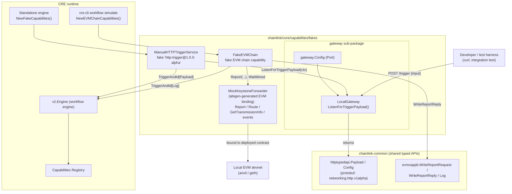
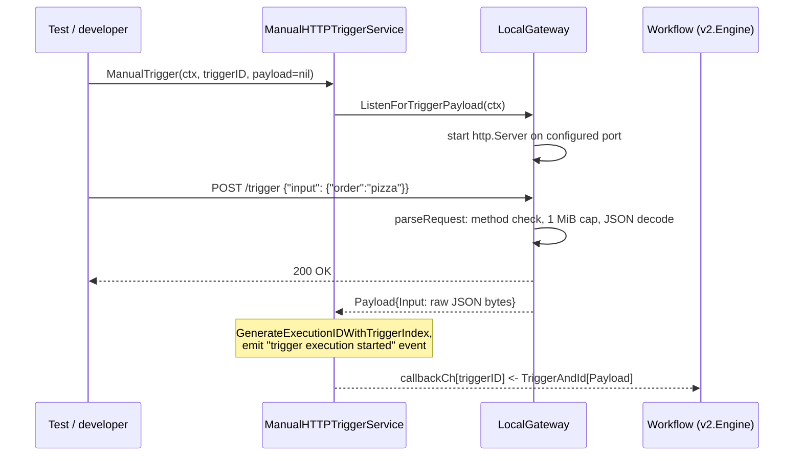
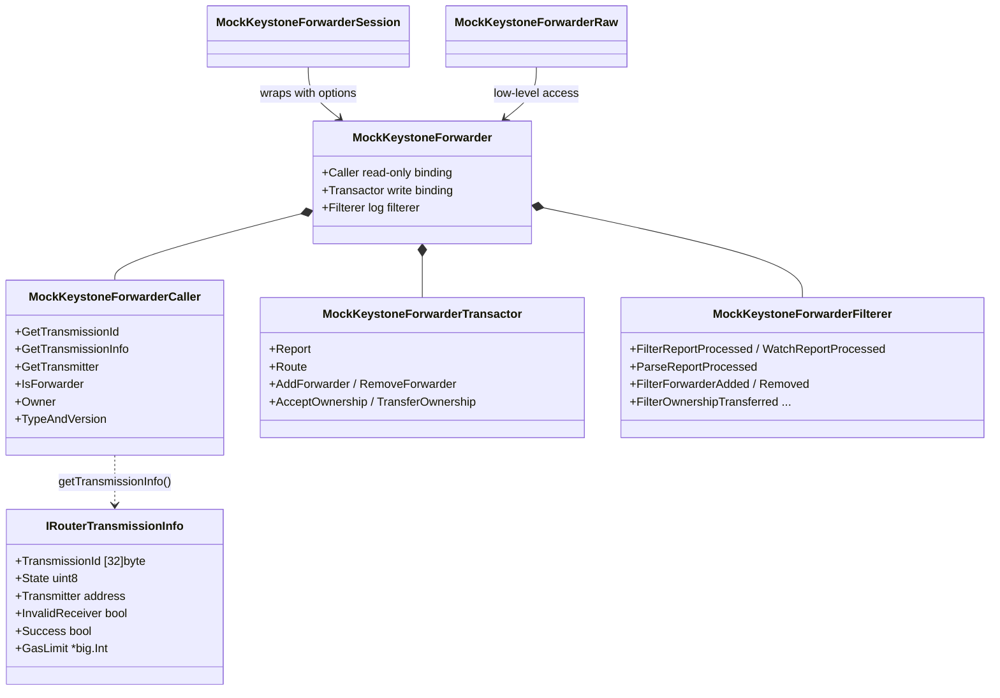
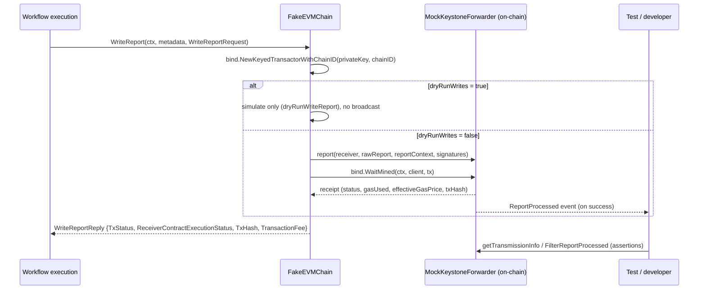

# Core Capabilities Runtime — Test Fakes

> Parent: [Core Capabilities Runtime](../core_capabilities_runtime.md) · Grandparent: [Workflow & Capability Runtime (CRE Engine)](../../Workflow___Capability_Runtime_(CRE_Engine).md)

## 1. Introduction

The `core_capabilities_runtime_test_fakes` module covers the **external-system fakes** that live in the `chainlink/core/capabilities/fakes` Go package (module path `github.com/smartcontractkit/chainlink/v2`, see `chainlink/go.mod` in the repository root of the `chainlink` module). These fakes exist so that CRE (Chainlink Runtime Environment) workflows can be executed locally — in unit tests, in the standalone workflow engine, and in `cre-cli workflow simulate` — without operating a real gateway network or a production forwarder contract.

The module provides two stand-ins for two very different external dependencies:

| Fake | File | Replaces | Used by |
|---|---|---|---|
| `LocalGateway` | `chainlink/core/capabilities/fakes/gateway/local.go` | A production HTTP gateway endpoint that delivers HTTP trigger payloads | `ManualHTTPTriggerService` (fake `http-trigger@1.0.0-alpha` capability) |
| `MockKeystoneForwarder` | `chainlink/core/capabilities/fakes/mock_keystone_forwarder.go` | A deployed Keystone `IRouter` forwarder contract on an EVM chain | `FakeEVMChain` (fake EVM chain capability used by `cre-cli simulate`) |

Everything else in the `fakes` package (`ManualHTTPTriggerService`, `FakeEVMChain`, `FakeConsensusNoDAG`, `DirectHTTPAction`, `FakeWriteChain`, cron/manual triggers, etc.) is documented from the *consumer* side here only where it clarifies how the two fakes above are used; the capability registry and standard-capability contracts themselves are described in [Capabilities](../capabilities.md) and the workflow execution loop in [Workflows Engine](../workflows/workflows_engine.md).

## 2. Architecture

The two fakes occupy opposite ends of a workflow's lifecycle: the `LocalGateway` sits at the **trigger ingress** boundary (getting external data *into* a workflow), while `MockKeystoneForwarder` sits at the **on-chain write** boundary (getting signed reports *out* onto a chain).

Key architectural points:

- **Fakes implement real capability interfaces.** `ManualHTTPTriggerService` satisfies the generated `httpserver.HTTPCapability` server interface and `FakeEVMChain` satisfies `evmserver.ClientCapability`. They are registered in the [Capabilities Registry](../capabilities.md) exactly like production capabilities, so workflows cannot tell them apart.
- **The fakes package is imported by the simulation runtimes**, not by production node services. The standalone engine's `NewFakeCapabilities` (`chainlink/core/services/workflows/cmd/cre/utils/standalone_engine.go`, see [Workflows Standalone](../workflows/workflows_standalone.md)) registers a subset of fakes (`DirectHTTPAction`, `FakeConsensusNoDAG`, `FakeWriteChain`), while `cre-cli workflow simulate` additionally wires `FakeEVMChain` against a real devnet RPC client.
- In a production DON, HTTP triggers arrive through the gateway/remote-messaging pipeline described in [Remote Messaging](core_capabilities_runtime_remote_messaging.md) and trigger deliveries are tracked in the [Trigger Event Store](core_capabilities_runtime_trigger_event_store.md); the `LocalGateway` fake replaces that whole path with a single local HTTP endpoint.

## 3. Local Gateway Fake (`gateway/local.go`)

`LocalGateway` is a minimal, single-purpose HTTP server: it accepts **one** `POST /trigger` request, extracts the `input` field of the JSON body, and hands it to the caller as a typed `*httptypedapi.Payload` — the same protobuf type (`chainlink-common/pkg/capabilities/v2/triggers/http`, generated from `capabilities/networking/http/v1alpha/trigger.proto`) that the real HTTP trigger capability consumes.

### Components

| Component | Kind | Description |
|---|---|---|
| `triggerRequest` | struct | The accepted wire format: `{"input": <raw JSON>}`. `Input` is `json.RawMessage`, so arbitrary nested JSON is preserved byte-for-byte (no base64 re-encoding of `[]byte` fields). |
| `Config` | struct | Configuration: `Port uint16`. |
| `NewLocalGateway(config)` | constructor | Returns a `LocalGateway` bound to `config.Port`. |
| `ListenForTriggerPayload(ctx)` | method | Starts the HTTP server, blocks until a valid trigger POST arrives or `ctx` is cancelled; returns `(*httptypedapi.Payload, error)`. Shuts the server down on return. |
| `parseRequest(req)` | helper | Enforces `POST`, reads the body through a 1 MiB `http.MaxBytesReader`, and unmarshals into `triggerRequest`. |

The returned `Payload` has only `Input` populated; the proto's signing-key metadata (`Payload.Key`) is left empty because the fake performs no request authentication (unlike the production gateway, which validates signatures against `Config.AuthorizedKeys`).

### Semantics and limits

| Behavior | Value / effect |
|---|---|
| Endpoint / method | `POST /trigger` only; other methods → `400` |
| Max request body | `1 MiB` (`maxRequestBytes = 1 << 20`), enforced via `http.MaxBytesReader` |
| Read header timeout | `1s` (`readHeaderTimeout`) |
| Shutdown timeout | `1s` (`shutdownTimeout`), applied in a deferred `server.Shutdown` |
| Payload delivery | Buffered channel of capacity 1 — the server delivers **exactly one** payload per call |
| Second concurrent POST while channel full | `429 Too Many Requests` |
| POST whose request context was already cancelled | `503 Service Unavailable` |
| Server lifetime | Tied to the caller's `ctx` via `BaseContext`; `ListenAndServe` errors are forwarded through the result channel; cancellation returns `ctx.Err()` |

### Request lifecycle

Notes on the flow:

- `ManualTrigger` only consults the gateway when the caller passes a `nil` payload; tests that already hold a payload can inject it directly and skip the HTTP hop entirely.
- The gateway unit/integration test (`chainlink/core/capabilities/fakes/gateway/local_test.go`) demonstrates the full round trip, including the wire-format caveat: the request body must be built as a raw JSON map, because marshaling a Go struct with a `[]byte` field would base64-encode the input instead of embedding it as JSON.
- The same payload type (`httptypedapi.Payload`) is what the workflow SDK's generated HTTP trigger client produces and consumes, so a workflow executed against the fake is byte-compatible with production.

## 4. Mock Keystone Forwarder (`mock_keystone_forwarder.go`)

This file is **generated binding code** (header: *"Code generated - DO NOT EDIT"*, produced by go-ethereum's `abigen`, with `github.com/ethereum/go-ethereum v1.17.4` pinned in `chainlink/go.mod`). It wraps a `MockKeystoneForwarder` Solidity contract (`typeAndVersion(): "MockKeystoneForwarder 1.0.0"`) that mimics the subset of the Keystone `IRouter` interface needed to test workflow report transmission end-to-end.

### Contract surface

| Call (read-only) | Transact (state-changing) | Events |
|---|---|---|
| `getTransmissionId(receiver, workflowExecutionId, reportId)` | `report(receiver, rawReport, reportContext, signatures)` | `ReportProcessed(receiver, workflowExecutionId, reportId, result)` |
| `getTransmissionInfo(...)` → `IRouterTransmissionInfo` | `route(transmissionId, transmitter, receiver, metadata, validatedReport)` | `ForwarderAdded` / `ForwarderRemoved` |
| `getTransmitter(...)`, `isForwarder(...)`, `owner()`, `typeAndVersion()` | `addForwarder`, `removeForwarder`, `acceptOwnership`, `transferOwnership` | `OwnershipTransferRequested` / `OwnershipTransferred` |

Custom Solidity errors in the ABI — `AlreadyAttempted`, `InsufficientGasForRouting`, `InvalidReport`, `UnauthorizedForwarder` — surface through the binding as regular call errors, letting tests assert specific revert reasons. `IRouterTransmissionInfo` mirrors the on-chain `IRouter.TransmissionInfo` struct (transmission id, state, transmitter, invalid-receiver and success flags, gas limit).

### Binding structure

The file follows the standard abigen layout: metadata, deployer, and the Caller / Transactor / Filterer triplet, each with `Session` (pre-set options) and `Raw` (low-level) companions.

Supporting API: `MockKeystoneForwarderMetaData` (ABI + creation bytecode), the deprecated `MockKeystoneForwarderABI` / `MockKeystoneForwarderBin` aliases, `DeployMockKeystoneForwarder(auth, backend)` for test setup, and the `NewMockKeystoneForwarder*` constructor family.

### How it is used: report writing via `FakeEVMChain`

`FakeEVMChain` (same package, `evm_chain.go`) binds to a deployed `MockKeystoneForwarder` and implements the EVM chain capability's `WriteReport`:

Notable behaviors:

- **Fee accounting**: on a mined receipt the fake computes `gasUsed × effectiveGasPrice` and returns it in `WriteReportReply.TransactionFee`, matching what the real capability reports for metering.
- **Success/revert mapping**: a successful receipt maps to `TX_STATUS_SUCCESS` + `RECEIVER_CONTRACT_EXECUTION_STATUS_SUCCESS`; otherwise `TX_STATUS_REVERTED` with `"Transaction reverted"`.
- **Dry-run mode**: when `dryRunWrites` is set (as `cre-cli` does via its `dryRunChainWrite` setting), the transaction is simulated with the signer's `from` address instead of broadcast, so `simulate` runs against read-only RPC endpoints.
- **Trigger side**: the same fake also exposes `RegisterLogTrigger` / `ManualTrigger` for log-trigger testing, including a filter matcher that deliberately rejects filters missing topic0 — a common developer mistake — with an explanatory error.

## 5. Integration points

| Consumer | What it wires | Notes |
|---|---|---|
| CRE standalone engine (`chainlink/core/services/workflows/cmd/cre/utils/standalone_engine.go`) | `NewFakeCapabilities` registers `DirectHTTPAction`, `FakeConsensusNoDAG` (with deterministic OCR2 signers via `fakes.SeedForKeys()`), and `FakeWriteChain` into the registry; the engine then runs the workflow in-process | See [Workflows Standalone](../workflows/workflows_standalone.md) |
| `cre-cli workflow simulate` (`cre-cli/cmd/workflow/simulate/chain/evm/capabilities.go`) | `fakes.NewFakeEvmChain(lggr, ethclient, privateKey, forwarderAddress, selector, dryRunChainWrite)`, wrapped in limit-enforcing and manual-trigger decorators and registered via the generated `evmserver.NewClientServer` | Uses `MockKeystoneForwarder` for real on-chain writes against a devnet, or dry-run simulation |
| Package tests | `gateway/local_test.go` (HTTP round trip), `evm_chain_test.go` (log-filter matching), `http_action_test.go`, etc. | The fakes are themselves exercised by the repo's test suites |

Because the fakes register through the normal [Capabilities Registry](../capabilities.md), the execution path from trigger delivery through [Workflows Engine](../workflows/workflows_engine.md) is identical to production; only the transport stubs differ. For the messaging layer that these fakes bypass in a real DON, see [Remote Messaging](core_capabilities_runtime_remote_messaging.md); for how real trigger deliveries are durably recorded, see [Trigger Event Store](core_capabilities_runtime_trigger_event_store.md); for the vault secrets and Web API service-config types that complete the core capabilities runtime, see [Vault Types](core_capabilities_runtime_vault_types.md) and [Web API Config](core_capabilities_runtime_webapi_config.md).

## 6. Guidance for maintainers

- **Do not hand-edit** `mock_keystone_forwarder.go`; regenerate it from the Solidity contract via `abigen` when the mock router ABI changes. The `MetaData` struct is the single source of truth for ABI and bytecode.
- `LocalGateway` is intentionally single-shot and unauthenticated; if a test needs multiple trigger deliveries, call `ManualTrigger` again (each call starts a fresh server) or inject payloads directly instead of extending the fake into a long-lived multiplexing server.
- The fakes deliberately reproduce production edge-case behavior (payload size limits, fee computation, revert mapping, filter validation) — when changing them, keep the fake's behavior aligned with the corresponding real capability in `chainlink-common/pkg/capabilities/v2/...` so simulation results remain trustworthy.
