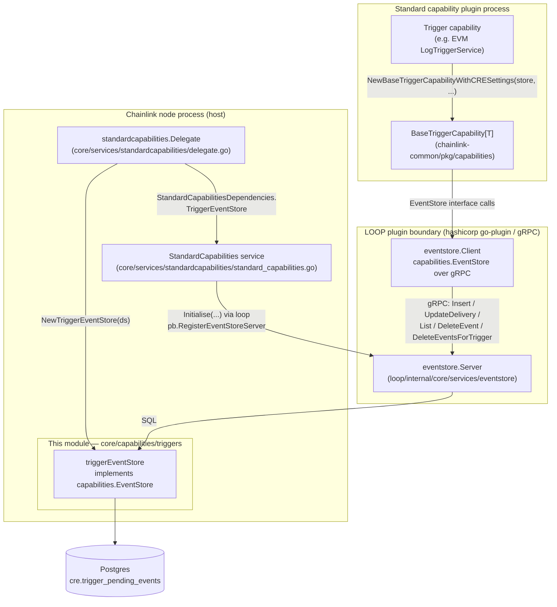
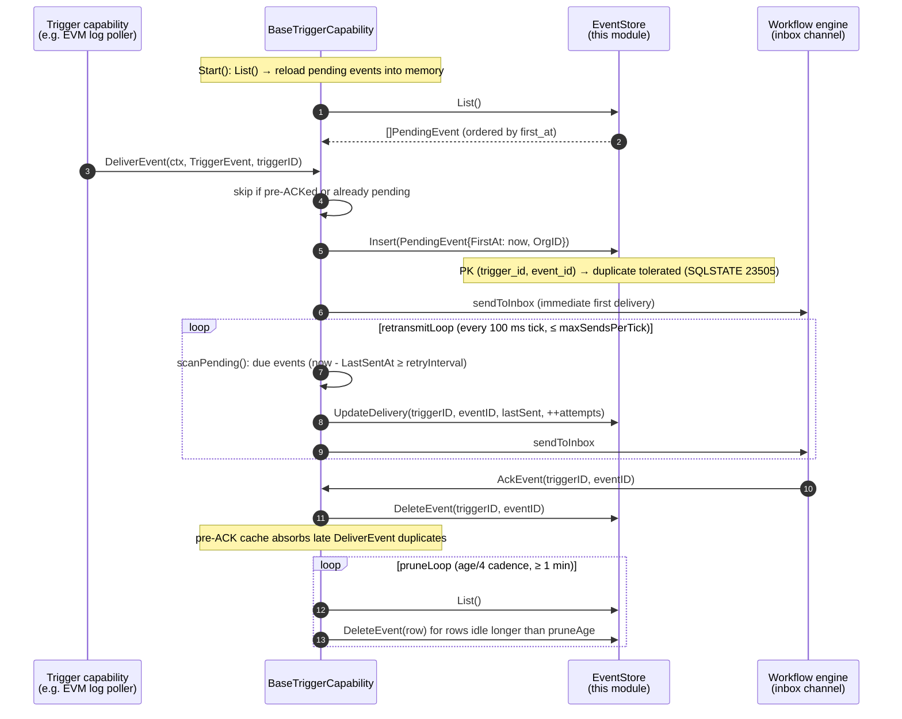

# Trigger Event Store

> **Module:** `chainlink/core/capabilities/triggers` (`trigger_event_store.go`)
> **Part of:** [Core Capabilities Runtime](../core_capabilities_runtime.md) — [Workflow & Capability Runtime (CRE Engine)](../../Workflow___Capability_Runtime_(CRE_Engine).md)

## 1. Purpose and Scope

The **Trigger Event Store** is the durable, Postgres-backed implementation of the [`capabilities.EventStore`](../capabilities.md) contract used by the CRE trigger framework. It provides **at-least-once trigger event delivery with ACK tracking that survives node restarts**:

- When a trigger capability (e.g. the EVM log trigger) produces an event that must be delivered to workflow DONs, the event is **persisted as a *pending event*** before it is sent.
- The event is **retransmitted** until the workflow engine **ACKs** it (or until retries are exhausted), and only then **deleted** from the store.
- On node restart, pending events are **reloaded** from Postgres and delivery resumes — no trigger event is silently lost across a crash.

The concrete type is `triggerEventStore` in [`chainlink/core/capabilities/triggers/trigger_event_store.go`](https://github.com/smartcontractkit/chainlink/blob/main/chainlink/core/capabilities/triggers/trigger_event_store.go), which satisfies the `EventStore` interface defined in [`chainlink-common/pkg/capabilities/base_trigger.go`](https://github.com/smartcontractkit/chainlink/blob/main/chainlink-common/pkg/capabilities/base_trigger.go). The behavioural consumer of the store is the generic [`BaseTriggerCapability`](../capabilities.md) in `chainlink-common`; this module only owns the *persistence* concern.

An in-memory implementation (`capabilities.MemEventStore`, same package) exists for tests and lightweight runs; the Postgres store is what production nodes use.

## 2. Architecture Overview



Key relationships:

| Component | Role |
|---|---|
| `triggerEventStore` | Postgres CRUD for pending trigger events; the only writer of `cre.trigger_pending_events` |
| `capabilities.EventStore` | Interface contract (Insert / UpdateDelivery / List / DeleteEvent / DeleteEventsForTrigger) |
| `BaseTriggerCapability` | Delivery engine: persists on `DeliverEvent`, retransmits on a loop, deletes on `AckEvent`, prunes orphans |
| `eventstore.Server` / `eventstore.Client` | gRPC adapters that carry the store across the LOOP plugin process boundary |
| `cre.trigger_pending_events` | The single Postgres table backing the store, in the dedicated `cre` schema |

## 3. Persistence Model

The table is created by migration `0293_cre_trigger_event_schema.sql` and extended by `0298_cre_trigger_pending_events_org_id.sql` (see [database persistence → migrations](../../Node_Platform_Services/database_persistence.md)):

```sql
CREATE SCHEMA cre;

CREATE TABLE IF NOT EXISTS cre.trigger_pending_events (
    trigger_id    TEXT        NOT NULL,
    event_id      TEXT        NOT NULL,
    payload       BYTEA       NOT NULL,
    first_at      TIMESTAMPTZ NOT NULL,
    last_sent_at  TIMESTAMPTZ NULL,
    attempts      INTEGER     NOT NULL DEFAULT 0,
    PRIMARY KEY (trigger_id, event_id)
);

-- migration 0298 adds:
ALTER TABLE cre.trigger_pending_events
    ADD COLUMN IF NOT EXISTS org_id TEXT NOT NULL DEFAULT '';
```

| Column | Go field (`capabilities.PendingEvent`) | Meaning |
|---|---|---|
| `trigger_id` | `TriggerId` | Trigger registration identifier (scoped to a capability + workflow trigger) |
| `event_id` | `EventId` | Trigger event identifier (unique per trigger) |
| `payload` | `Payload` | Marshalled protobuf payload bytes (the `Any` value of the `TriggerEvent`) |
| `first_at` | `FirstAt` | When the event was first delivered/inserted; drives deterministic `List` ordering |
| `last_sent_at` | `LastSentAt` | When the event was last sent; **NULL** when never re-sent (Go zero time ↔ `sql.NullTime`) |
| `attempts` | `Attempts` | Number of send attempts consumed (used against `BaseTriggerMaxRetries`) |
| `org_id` | `OrgID` | CRE organisation of the workflow that registered the trigger; enables **org-scoped retransmit policy** |

The composite primary key `(trigger_id, event_id)` gives the store idempotent inserts: a repeated `Insert` for the same event fails with a PostgreSQL unique-violation (SQLSTATE `23505`), which the delivery engine treats as a benign re-delivery after a give-up (see §8).

## 4. API Reference

`NewTriggerEventStore(ds sqlutil.DataSource) *triggerEventStore` — constructs the store over any [`sqlutil.DataSource`](../../Shared_Foundation_Libraries___Domain_Types/types-core.md) (the sqlx-based DB abstraction the node provides).

| Method | SQL | Semantics |
|---|---|---|
| `Insert(ctx, rec)` | `INSERT ... VALUES ($1..$7)` | Persists a new pending event. `LastSentAt` is written as NULL when the Go zero time is supplied. Duplicate `(trigger_id, event_id)` violates the PK → surfaced as an error (callers check for SQLSTATE `23505`). |
| `UpdateDelivery(ctx, triggerID, eventID, lastSentAt, attempts)` | `UPDATE ... SET last_sent_at = $3, attempts = $4 WHERE ...` | Records a retransmission. **Returns `sql.ErrNoRows` when zero rows are affected** — i.e. the event was ACKed (deleted) concurrently. Zero `lastSentAt` is again written as NULL. |
| `List(ctx)` | `SELECT ... ORDER BY first_at ASC` | Returns all pending events, oldest first. Rows are scanned through the internal `row` struct (see below); `sql.NullTime` is normalised to the Go zero time. The payload byte slice is defensively copied per record. |
| `DeleteEvent(ctx, triggerID, eventID)` | `DELETE ... WHERE trigger_id = $1 AND event_id = $2` | ACK path: removes a single event. Deleting a non-existent event is **not** an error. |
| `DeleteEventsForTrigger(ctx, triggerID)` | `DELETE ... WHERE trigger_id = $1` | Cleanup path: removes every pending event for a trigger (used by `UnregisterTrigger`). |

### The `row` scan struct

The module's `List` implementation maps SQL rows onto `capabilities.PendingEvent` through a private `row` struct annotated with sqlx `db` tags:

```go
type row struct {
    TriggerID  string       `db:"trigger_id"`
    EventID    string       `db:"event_id"`
    Payload    []byte       `db:"payload"`
    FirstAt    time.Time    `db:"first_at"`
    LastSentAt sql.NullTime `db:"last_sent_at"`
    Attempts   int          `db:"attempts"`
    OrgID      string       `db:"org_id"`
}
```

This struct is the schema's Go reflection: nullable `last_sent_at` maps to `sql.NullTime`, and the conversion loop turns each scanned row into a `capabilities.PendingEvent` with a zero time when `LastSentAt.Valid == false` and a copied payload buffer.

## 5. Wiring: How the Store Reaches the Capability

Trigger capabilities for CRE run inside **standard capability plugin processes** (LOOP plugins), while Postgres lives in the node host process. The store is created in the host and exported to the plugin over gRPC:

```mermaid
sequenceDiagram
    autonumber
    participant App as Node Application
    participant Del as standardcapabilities.Delegate
    participant SCS as StandardCapabilities service
    participant TES as triggerEventStore (host)
    participant Loop as loop.StandardCapabilitiesService
    participant Plug as Capability plugin (e.g. EVM log trigger)
    participant BTC as BaseTriggerCapability

    App->>Del: job start / registry reconcile
    Del->>TES: triggercap.NewTriggerEventStore(ds)
    Del->>SCS: NewStandardCapabilities(deps{TriggerEventStore})
    SCS->>Loop: Start() + Initialise(cctx, dependencies)
    Note over Loop: host serves eventstore.Server<br/>(pb.RegisterEventStoreServer)
    Loop->>Plug: Initialise(request{TriggerEventStoreId, ...})
    Note over Plug: plugin dials resource ID and builds<br/>eventstore.NewClient(conn)
    Plug->>Plug: capabilities.EventStore = eventstore.Client (gRPC)
    Plug->>BTC: NewBaseTriggerCapabilityWithCRESettings(store, newMsg, lggr, capID, settings)
    Note over BTC: Start(): store.List() → reload pending map,<br/>then retransmit + prune loops
```

Step references in the code:

- **Store creation:** `TriggerEventStore: triggercap.NewTriggerEventStore(d.ds)` inside `Delegate.NewServices` ([core/services/standardcapabilities/delegate.go](https://github.com/smartcontractkit/chainlink/blob/main/chainlink/core/services/standardcapabilities/delegate.go)).
- **Host-side serving:** `StandardCapabilitiesClient.Initialise` registers `eventstore.NewServer(triggerEventStore)` under a broker resource ID ([chainlink-common/pkg/loop/internal/core/services/capability/standard/standard_capabilities.go](https://github.com/smartcontractkit/chainlink/blob/main/chainlink-common/pkg/loop/internal/core/services/capability/standard/standard_capabilities.go)).
- **Wire contract:** the `loop.EventStore` gRPC service and `PendingEventProto` message are defined in [`chainlink-common/pkg/loop/internal/pb/event_store.proto`](https://github.com/smartcontractkit/chainlink/blob/main/chainlink-common/pkg/loop/internal/pb/event_store.proto).
- **Plugin-side client:** `eventstore.NewClient(conn)` implements `capabilities.EventStore` over that gRPC service ([loop/internal/core/services/eventstore/client.go](https://github.com/smartcontractkit/chainlink/blob/main/chainlink-common/pkg/loop/internal/core/services/eventstore/client.go), [server.go](https://github.com/smartcontractkit/chainlink/blob/main/chainlink-common/pkg/loop/internal/core/services/eventstore/server.go)).
- **Consumer:** e.g. the EVM log trigger builds `capabilities.NewBaseTriggerCapabilityWithCRESettings(ctx, triggerEventStore, ...)` and fails fast when no store was provided ([capabilities/chain_capabilities/evm/trigger/trigger.go](https://github.com/smartcontractkit/chainlink/blob/main/capabilities/chain_capabilities/evm/trigger/trigger.go)). Non-persisted triggers (e.g. cron) simply do not use the store.

The LOOP plugin mechanism itself is documented in [loop-plugin-core](../../Plugin_Process_Framework_(Loop)/loop-plugin-core.md) and [loop-grpc-bindings](../../Plugin_Process_Framework_(Loop)/loop-grpc-bindings.md).

## 6. Runtime Lifecycle



Behavioural notes that the store's schema directly supports:

- **Restart recovery:** because every delivery attempt is persisted (`Insert` + `UpdateDelivery`) *before* the payload hits the wire, a crashed node reloads `List()` on `Start` and resumes ACK tracking — the store is the source of truth.
- **Give-up but keep:** when `attempts` reaches `BaseTriggerMaxRetries` the event stops being retransmitted and an error/metric is emitted, but the row is **not** deleted — the prune loop cleans it up later, leaving a forensic trail. If the trigger re-delivers the same event afterwards, the PK duplicate is detected via the error string (`23505` / "duplicate key") and silently skipped.
- **Org-scoped policy:** every record carries `OrgID` (resolved from the CRE request context and the [OrgResolver](../../Shared_Foundation_Libraries___Domain_Types/services.md)); retransmit is only allowed when `PerOrg.BaseTriggerRetransmitEnabled` is on for that org, so a missing/empty org ID fails closed (no persistence, no resend).

## 7. Configuration

The store itself has no knobs — all policy lives in CRE settings read live by `BaseTriggerCapability` (see the [settings](../../Shared_Foundation_Libraries___Domain_Types/settings.md) module and `chainlink-common/pkg/settings/cresettings`):

| Setting | Effect on store data |
|---|---|
| `PerOrg.BaseTriggerRetransmitEnabled` | When false (or org unknown): events are *not* inserted at all; delivery is fire-and-forget. |
| `BaseTriggerRetryInterval` | Spacing between `UpdateDelivery`+resend cycles. |
| `BaseTriggerMaxRetries` | Ceiling on `attempts`; `0` = unlimited. Exhausted events stay in the table until pruned. |
| `BaseTriggerMaxSendsPerTick` | Backpressure cap per `scanPending` cycle (protects p2p from backlog floods). |
| `BaseTriggerPruneAge` | Age (default 24 h, measured from the newer of `first_at` / `last_sent_at`) after which the prune loop deletes a row. |

Schema changes to the table require a numbered goose migration under `chainlink/core/store/migrate/migrations/` (as 0293/0298 did) plus matching updates to the `row` scan struct and the `PendingEventProto` wire message in `event_store.proto`.

## 8. Error Handling and Edge Cases

- **`UpdateDelivery` lost race:** returns `sql.ErrNoRows` when the ACK deleted the row between the resend scan and the update — the engine logs and continues; no retry-state corruption.
- **Duplicate insert:** `Insert` surfaces the PostgreSQL unique violation; `BaseTriggerCapability` inspects the *error text* (the store crosses gRPC, so typed `*pq.Error` is unavailable) and treats SQLSTATE `23505` as an expected re-delivery rather than a failure.
- **NULL vs zero time:** `last_sent_at` is nullable; both `Insert` and `UpdateDelivery` convert the Go zero time to NULL, and `List` converts NULL back to the zero time, keeping the `PendingEvent` semantics ("never re-sent") intact across the DB boundary.
- **ACK with missing row:** `DeleteEvent` on a non-existent event is a no-op success; the ACK path relies on the in-memory `preAcked` cache for deduplication, while the store delete failure is reported via the `IncAckError("store_delete_failed")` metric.
- **Payload integrity:** `List` copies each `payload` byte slice so callers (the retransmit engine) can never mutate stored rows via shared slices.

## 9. Testing

- [`chainlink/core/capabilities/triggers/trigger_event_store_test.go`](https://github.com/smartcontractkit/chainlink/blob/main/chainlink/core/capabilities/triggers/trigger_event_store_test.go) — integration tests against a real Postgres instance (`pgtest.NewSqlxDB`): insert/list ordering across triggers, single and bulk delete, `UpdateDelivery` persistence, and the `ErrNoRows` behaviour for unknown rows.
- [`chainlink/core/capabilities/triggers/base_trigger_event_store_test.go`](https://github.com/smartcontractkit/chainlink/blob/main/chainlink/core/capabilities/triggers/base_trigger_event_store_test.go) — behaviour test that a missing org ID with CRE settings enabled leaves **no** persisted row and no retransmission, verifying the fail-closed org policy end-to-end with `MemEventStore`.
- [`chainlink-common/pkg/capabilities/mem_trigger_event_store_test.go`](https://github.com/smartcontractkit/chainlink/blob/main/chainlink-common/pkg/capabilities/mem_trigger_event_store_test.go) and the loop `eventstore` gRPC round-trip tests cover the interface contract that this Postgres implementation must satisfy.

## 10. Related Documentation

- [Core Capabilities Runtime](../core_capabilities_runtime.md) — the node runtime hosting this store and the trigger publisher/subscriber around it.
- [Remote capability messaging](core_capabilities_runtime_remote_messaging.md) — the DON-to-DON registration/event/ACK protocol whose ACK quorums drive `DeleteEvent` calls.
- [Capabilities contracts](../capabilities.md) — `BaseTriggerCapability`, `EventStore`, `PendingEvent` and the capability registry.
- [Workflows](../workflows.md) — the engine that consumes trigger events and issues ACKs.
- [LOOP plugin framework](../../Plugin_Process_Framework_(Loop)/loop-plugin-core.md) and [LOOP gRPC bindings](../../Plugin_Process_Framework_(Loop)/loop-grpc-bindings.md) — the process-boundary plumbing (`event_store.proto`).
- [Database persistence](../../Node_Platform_Services/database_persistence.md) — the Postgres layer and migration framework owning `0293`/`0298`.
- [Settings](../../Shared_Foundation_Libraries___Domain_Types/settings.md) — the CRE settings (`BaseTrigger*`) governing retransmit and pruning.
