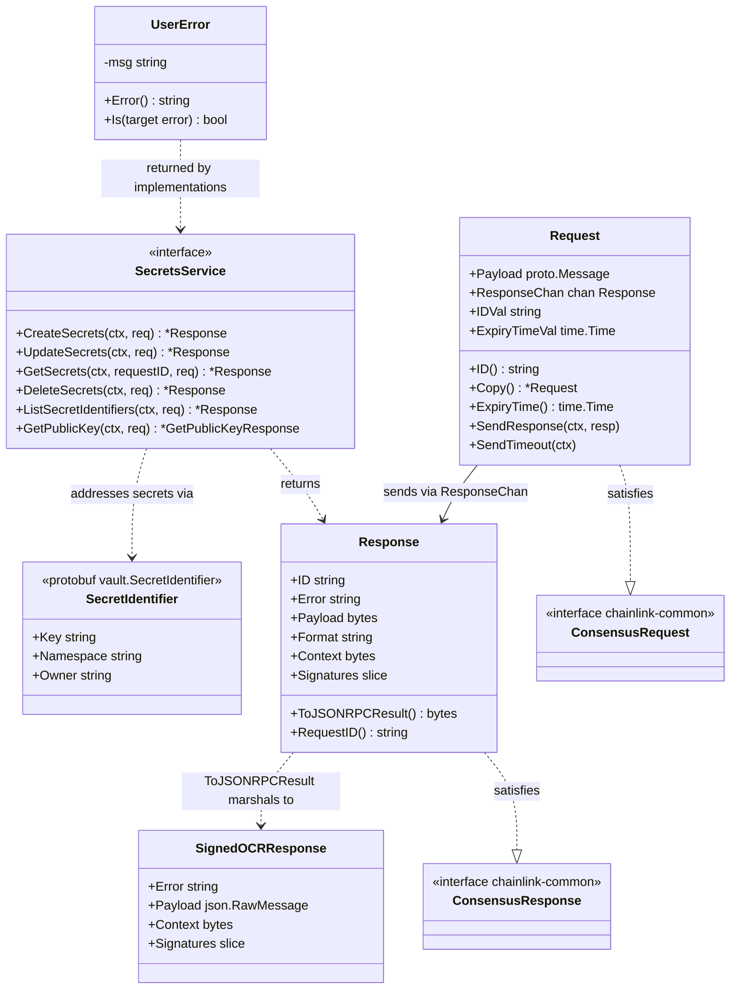
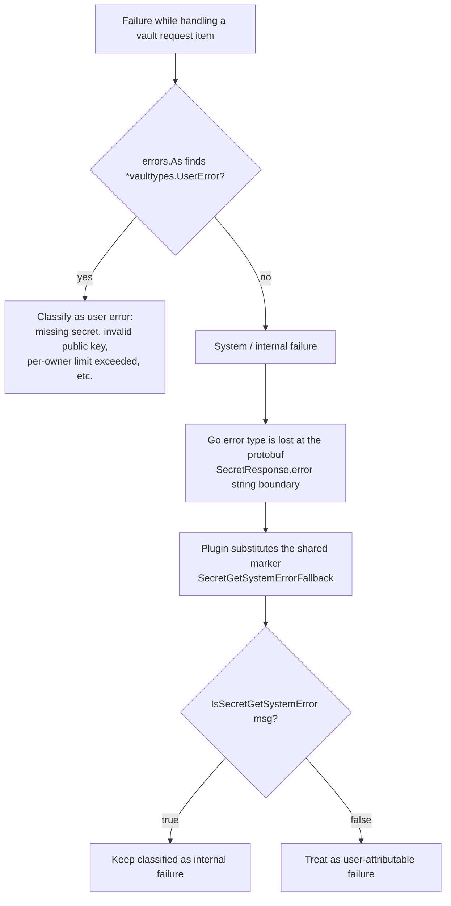
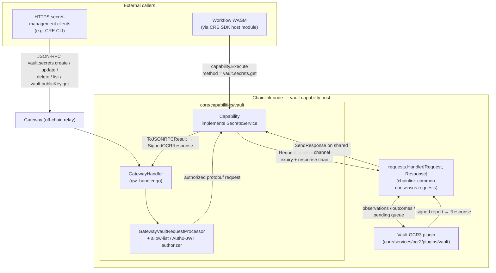
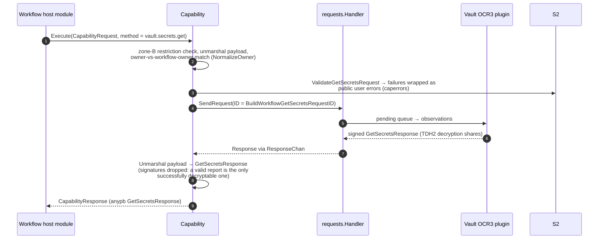
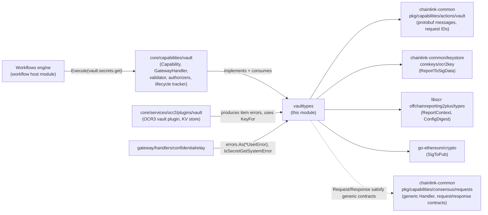

# Core Capabilities Runtime: Vault Types (`vaulttypes`)

**Source:** `chainlink/core/capabilities/vault/vaulttypes/types.go`
**Package:** `chainlink/v2/core/capabilities/vault/vaulttypes`

## 1. Introduction

The `vaulttypes` package defines the **shared contract types for the Vault secrets capability** of the Workflow & Capability Runtime (CRE) engine. It is deliberately small — one types-only file with no business logic — but it is the *lingua franca* that every participant of the vault workflow speaks:

- the **vault `Capability`** (the node-side executable capability that implements the [`SecretsService`](#3-the-secretsservice-interface) contract),
- the **`GatewayHandler`** (the node-side handler that exposes secret management over the gateway as JSON-RPC),
- the **vault OCR3 plugin** (`chainlink/core/services/ocr2/plugins/vault`), which reaches consensus over queued requests and produces signed reports,
- and **downstream consumers** such as the confidential relay gateway handler, which must classify vault failures as *user* vs *system* errors.

Because these components live in different packages (and some errors must survive serialization boundaries where Go error types are lost), the request/response shapes, method names, error markers, and signature-verification logic all live here, in a single dependency-light package.

> **Where this fits:** this module is one of the sub-areas of the [Core Capabilities Runtime](../core_capabilities_runtime.md). The surrounding capability SDK abstractions (`ExecutableCapability`, registries, consensus request handling) are documented in [Capabilities](../capabilities.md), and the workflow engine that invokes capabilities is documented in [Workflows](../workflows.md).

---

## 2. Package Overview

| Abstraction | Kind | Purpose |
|---|---|---|
| `SecretsService` | Go interface | The service contract implemented by the vault `Capability` and consumed by the `GatewayHandler` |
| `Request` / `Response` | Structs | Consensus-queue envelopes exchanged with `requests.Handler` (chainlink-common) |
| `SignedOCRResponse` | Wire type | The JSON-RPC result returned to external clients for gateway-routed operations |
| `ValidateSignatures` | Function | Client-side verification of OCR-signed vault responses |
| `UserError` / error helpers | Errors | Cross-boundary classification of caller-caused vs internal failures |
| Method constants, `KeyFor`, `NormalizeNamespace`, `MaxBatchSize` | Constants/helpers | Canonical method names, storage-key format, namespace defaults and batch limits |

### 2.1 Vault JSON-RPC method names

The package is the single source of truth for vault method identifiers:

| Constant | Value | Reachability |
|---|---|---|
| `MethodSecretsCreate` | `vault.secrets.create` | Gateway (`GatewaySecretsMethods`) |
| `MethodSecretsUpdate` | `vault.secrets.update` | Gateway (`GatewaySecretsMethods`) |
| `MethodSecretsDelete` | `vault.secrets.delete` | Gateway (`GatewaySecretsMethods`) |
| `MethodSecretsList` | `vault.secrets.list` | Gateway (`GatewaySecretsMethods`) |
| `MethodPublicKeyGet` | `vault.publicKey.get` | Gateway (`Methods` list only — public, no authorization) |
| `MethodSecretsGet` | `vault.secrets.get` | **Workflow capability interface only** (`Capability.Execute` rejects every other method); not gateway-routed |

Supporting helpers:

- `IsGatewaySecretsMethod(method)` reports whether a method is one of the gateway-accessible *management* methods (i.e. everything except `vault.publicKey.get` and `vault.secrets.get`).
- `Methods` = `[vault.publicKey.get, vault.secrets.create, vault.secrets.update, vault.secrets.delete, vault.secrets.list]` — exactly the list the node-side `GatewayHandler` registers with its `GatewayConnector` (`gw_handler.go` returns it from `Methods()`).
- `RequestIDSeparator` (`"::"`) delimits the composite parts of request IDs and secret identifiers (see below).
- `MaxBatchSize` (`10`) caps how many secrets may be created/updated/deleted in a single request.

### 2.2 Secret identifiers, namespaces and keys

Secrets are addressed by the protobuf `vault.SecretIdentifier{key, namespace, owner}` defined in `chainlink-common/pkg/capabilities/actions/vault/messages.proto`:

- `NormalizeNamespace(ns)` substitutes `DefaultNamespace` (`"main"`) for an empty namespace, so all key arithmetic is namespace-explicit.
- `KeyFor(id)` builds the canonical lookup key used by the plugin's persistent store and listing logic:

  ```text
  <owner>::<namespace>::<key>
  ```

  The same `"::"` separator is used by `vaultcommon.BuildWorkflowGetSecretsRequestID` (`chainlink-common/pkg/capabilities/actions/vault/request_id.go`), which composes workflow request IDs as `<WorkflowID>::<executionID|subscription>::<ReferenceID>` — `vaulttypes.RequestIDSeparator` documents that shared convention.

---

## 3. The `SecretsService` Interface

```go
type SecretsService interface {
    CreateSecrets(ctx context.Context, request *vaultcommon.CreateSecretsRequest) (*Response, error)
    UpdateSecrets(ctx context.Context, request *vaultcommon.UpdateSecretsRequest) (*Response, error)
    GetSecrets(ctx context.Context, requestID string, request *vaultcommon.GetSecretsRequest) (*Response, error)
    DeleteSecrets(ctx context.Context, request *vaultcommon.DeleteSecretsRequest) (*Response, error)
    ListSecretIdentifiers(ctx context.Context, request *vaultcommon.ListSecretIdentifiersRequest) (*Response, error)

    GetPublicKey(ctx context.Context, request *vaultcommon.GetPublicKeyRequest) (*vaultcommon.GetPublicKeyResponse, error)
}
```

All request/response protobuf types come from the shared vault capability package (`chainlink-common/pkg/capabilities/actions/vault`, generated from [`messages.proto`](#8-schema-artifacts)).

**Roles of the interface:**

| Role | Component | Notes |
|---|---|---|
| **Primary implementation** | `vault.Capability` (`chainlink/core/capabilities/vault/capability.go`) | Validates each request (batch limits, encryption against the current TDH2 master public key, uniform batch owners, owner-vs-workflow-owner match), then funnels it into the OCR consensus queue via `handleRequest`. |
| **Gateway adapter consumer** | `vault.GatewayHandler` (`gw_handler.go`) | Holds a `secretsService vaulttypes.SecretsService`, parses JSON-RPC params into protobuf requests, delegates, and wraps results back into JSON-RPC responses. Also caches the master public key fetched through `GetPublicKey`. |
| **Error-consumer** | confidential relay handler (`core/services/gateway/handlers/confidentialrelay`) | Uses the shared `UserError` type for user-vs-system classification (see §6). |

> Note that `GetSecrets` takes an explicit `requestID` because workflow-initiated get-secrets calls derive their ID from CRE metadata (`BuildWorkflowGetSecretsRequestID`), whereas the mutation methods carry a caller-supplied `request_id` inside their protobuf payload.

---

## 4. Request & Response Types

### 4.1 `Request` — the consensus-queue envelope

```go
type Request struct {
    Payload      proto.Message        // one of the vaultcommon *SecretsRequest protos
    ResponseChan chan *Response       // buffered; shared (not copied) by Copy()
    IDVal        string
    ExpiryTimeVal time.Time
}
```

`Request` satisfies the generic **`ConsensusRequest`** contract of `chainlink-common/pkg/capabilities/consensus/requests` (`ID()`, `Copy()`, `ExpiryTime()`, `SendResponse(ctx, R)`, `SendTimeout(ctx)`), which is what allows it to flow through the shared pending-queue machinery (`requests.Handler[*Request, *Response]`) that feeds the vault OCR3 plugin. `Response` likewise satisfies `ConsensusResponse` via `RequestID()`.

Behaviour details worth knowing:

- `Copy()` deep-clones the protobuf payload (via `proto.Clone`) but **intentionally shares the `ResponseChan`** — clones are consensus contributions for the same logical request and must all funnel to the original caller's channel.
- `SendResponse` uses a `select` against `ctx.Done()` so delivery never blocks forever on a closed/abandoned channel.
- `SendTimeout` delivers a `Response` whose `Error` is `timeout exceeded: could not process request <ID> before expiry`.

### 4.2 `Response` and the `SignedOCRResponse` wire format

```go
type Response struct {
    ID         string
    Error      string
    Payload    []byte      // marshaled protobuf result (e.g. GetSecretsResponse)
    Format     string      // report format (JSON / protobuf), mirroring vaultcommon.ReportFormat
    Context    []byte      // OCR ReportContext: config digest + epoch/round (+ extra hash)
    Signatures [][]byte    // per-node ECDSA signatures over the signed report
}
```

`ToJSONRPCResult()` marshals the response into the **`SignedOCRResponse`** shape — the *only* representation external clients ever see for gateway-routed operations:

```go
type SignedOCRResponse struct {
    Error      string          `json:"error"`
    Payload    json.RawMessage `json:"payload"`
    Context    []byte          `json:"context"`
    Signatures [][]byte        `json:"signatures"`
}
```

The `error` field is non-empty only when the Vault DON itself could not be reached or failed; otherwise `payload` carries the protobuf result and `context`/`signatures` the OCR attestation.

### 4.3 Type relationships



---

## 5. Signature Verification (`ValidateSignatures`)

External clients receive `SignedOCRResponse` values over an untrusted transport, so the package ships the verification logic they must run **before** trusting or decoding a payload:

```go
ValidateSignatures(resp *SignedOCRResponse, allowedSigners []common.Address, minRequired int) error
```

Algorithm:

1. Reject a `context` shorter than 64 bytes and a signature count below `minRequired`.
2. Parse the OCR `ReportContext` from the context blob (layout below) and reconstruct the signed hash via `ocr2key.ReportToSigData` (from `chainlink-common/keystore/corekeys/ocr2key`) over the raw `payload`.
3. For each signature, recover the signer's address with `crypto.SigToPub` (go-ethereum) and match it (case-insensitively, via `Hex()`) against `allowedSigners`.
4. Succeed as soon as the count of distinct valid signers reaches `minRequired`; otherwise report how many valid signatures were found.

**Context byte layout:**

| Bytes (of full context) | Content |
|---|---|
| `0:32` | OCR config digest (`ocr2types.BytesToConfigDigest`) |
| `32:64` | Epoch + round: bytes `32:59` of the context are zero padding, context bytes `59:63` (= offsets `27:31` of this 32-byte slice) hold the epoch as a big-endian uint32, and the final byte (`63`) holds the round |
| `64:96` | Extra hash (not used by the vault plugin) |

This lets a client pin a response to a specific vault DON configuration and round, protecting against replay of stale or forged reports.

---

## 6. Error Semantics Across Boundaries

Vault failures must be classified the same way by the OCR plugin (which *produces* item-level errors) and downstream gateway handlers (which *consume* them) — but Go error types do not survive the protobuf `SecretResponse.error` string boundary. The package therefore provides two mechanisms:

### 6.1 `UserError`

```go
type UserError struct{ msg string }          // NewUserError(msg) *UserError
func IsUserError(err error) bool              // errors.As-based
```

A `*UserError` marks failures **caused by the caller**, e.g.:

- requesting a secret that does not exist,
- providing an invalid/unsupported public key,
- exceeding the per-owner secret limit.

Its `Is` method makes `errors.Is(err, &vaulttypes.UserError{})`-style checks work, and `IsUserError` gives consumers a one-liner. The type lives in this shared package precisely so that both the vault OCR plugin and downstream consumers (such as the **confidential relay handler**) can use `errors.As` to separate user errors (surfaced to callers, counted as user-error metrics) from internal failures.

### 6.2 `SecretGetSystemErrorFallback`

For **get-secrets** request items, a non-user (system) failure is replaced by the constant marker:

```text
failed to handle get secret request
```

Because the concrete Go error is unrecoverable after the protobuf string boundary, downstream consumers match against `IsSecretGetSystemError(msg)` to guarantee system failures are **not** misclassified as user errors.



---

## 7. Architecture & Component Interaction

### 7.1 Where `vaulttypes` sits



### 7.2 Flow A — gateway-routed secret mutation (create/update/delete/list)

```mermaid
sequenceDiagram
    autonumber
    participant C as External client
    participant G as Gateway
    participant GH as GatewayHandler
    participant A as RequestProcessor (validate + authorize)
    participant S as SecretsService (Capability)
    participant H as requests.Handler
    participant P as Vault OCR3 plugin

    C->>G: JSON-RPC vault.secrets.create (TDH2-encrypted secrets, request_id)
    G->>GH: HandleGatewayMessage
    GH->>GH: method switch on vaulttypes.MethodSecrets*
    GH->>A: ProcessRequest (fetch master public key via GetPublicKey,<br/>validate ciphertext, authorize owner)
    A-->>GH: authorized (or structured error → JSON-RPC error)
    GH->>S: CreateSecrets(ctx, CreateSecretsRequest)
    S->>S: ValidateCreateSecretsRequest<br/>(batch size ≤ MaxBatchSize, limits, encryption)
    S->>H: SendRequest(Request{IDVal: request_id, Payload, ExpiryTimeVal})
    H->>P: pending queue → OCR observations
    P->>P: OCR3 consensus, decrypt key shares, persist StoredSecret
    P-->>H: outcome → signed report
    H-->>S: Response{Payload, Context, Signatures} via shared ResponseChan
    S-->>GH: *Response
    GH->>GH: resp.ToJSONRPCResult() → SignedOCRResponse JSON
    GH-->>C: result; client verifies with ValidateSignatures<br/>before trusting payload
```

### 7.3 Flow B — workflow-initiated `GetSecrets` (capability interface)



`GetPublicKey` takes a separate path entirely: it is served locally by the capability (optionally stripping the per-recipient `HArray` when the encrypt-only gate is open, so encrypt-only consumers such as the CRE CLI are unaffected by DKG reshares) and never enters the consensus queue.

---

## 8. Dependencies

### 8.1 Schema artifacts

The protobuf contract consumed by this package is defined in:

- `chainlink-common/pkg/capabilities/actions/vault/messages.proto` — `SecretIdentifier`, `SecretRequest` (with per-request `encryption_keys`), `EncryptedShares`/`SecretData` (threshold-decryption shares), the `Create/Update/Delete/List/Get` request–response pairs, OCR `Observation`/`Outcome` messages (including the pending-queue and `raw_vault_public_key` fields), persisted `StoredSecret`/`StoredMetadata` records, and the `ReportingPluginConfig` limits (`BatchSize`, `MaxSecretsPerOwner`, `MaxCiphertextLengthBytes`, identifier-length caps, `DKGInstanceID`).

Several of those limits are enforced by the validators of the consuming `Capability` and mirrored by `MaxBatchSize` in this package.

### 8.2 Module dependency graph



Related documentation:

- Parent module: [Core Capabilities Runtime](../core_capabilities_runtime.md)
- Sibling areas: [Remote Messaging](core_capabilities_runtime_remote_messaging.md) (how capability messages cross DON boundaries — the reason `UserError` must be self-classifying), [Trigger Event Store](core_capabilities_runtime_trigger_event_store.md), [WebAPI Config](core_capabilities_runtime_webapi_config.md), [Test Fakes](core_capabilities_runtime_test_fakes.md)
- Capability SDK contracts (`ExecutableCapability`, `CapabilitiesRegistry`, consensus request handling): [Capabilities](../capabilities.md)
- Engine that schedules and executes workflows against capabilities: [Workflows](../workflows.md)
- Provisioning of vault/DKG jobs in production deployments: [CRE & Keystone Deployment Suite — Jobs](../../CRE___Keystone_Deployment_Suite/cre-jobs.md)

### 8.3 Runtime configuration touchpoints

The behaviour of components implementing/consuming this contract is configured by:

| Concern | Configuration |
|---|---|
| Request expiry (bounds `Request.ExpiryTimeVal`) | `requestExpiryDuration` in the vault plugin job config (`chainlink/core/services/ocr2/plugins/vault/config.go`) |
| DKG instance binding | `dkg.dkgContractID` (same file) |
| Gateway authorization | optional `auth0` block (issuer URL / audience), plus allow-list authorization backed by the workflow registry syncer (`gw_handler.go`) |
| Volume / size limits | `ReportingPluginConfig` in `messages.proto` (batch size, per-owner secret cap, ciphertext and identifier length caps) and the node-level limits factory |

---

## 9. Testing Support

- `chainlink/core/capabilities/vault/vaulttypes/mocks` — generated mock for `SecretsService`, used by `GatewayHandler` and relay-handler tests.
- `chainlink-common/pkg/capabilities/actions/vault/mock/vault.go` — minimal function-injection mock (`Vault{Fn ...}`) for get-secrets flows against the protobuf-level API.
- `chainlink/core/capabilities/vault/vaulttypes/types_test.go` — unit tests for the helpers in this file (signature validation, namespace/key formatting, error classification).

---

## 10. Summary

`vaulttypes` is intentionally the thinnest possible layer, but it carries four responsibilities that everything else in the vault capability stack depends on:

1. **Naming** — canonical method names, gateway reachability, identifier/key formats, batch limits.
2. **Contract** — the `SecretsService` interface plus the `Request`/`Response` envelopes that plug into the shared consensus-queue machinery.
3. **Wire format & trust** — `SignedOCRResponse` and `ValidateSignatures` for client-side, quorum-aware verification of vault responses.
4. **Error semantics** — `UserError` and the get-secrets system-error fallback that keep user-vs-system classification consistent across the plugin → protobuf → gateway → client chain.
