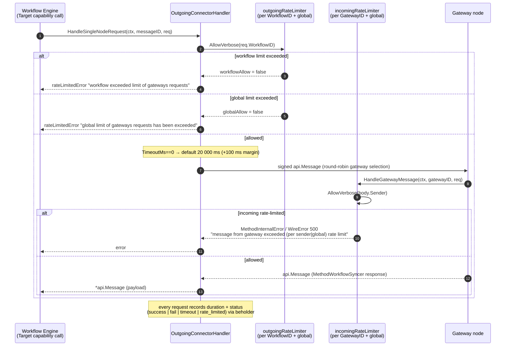
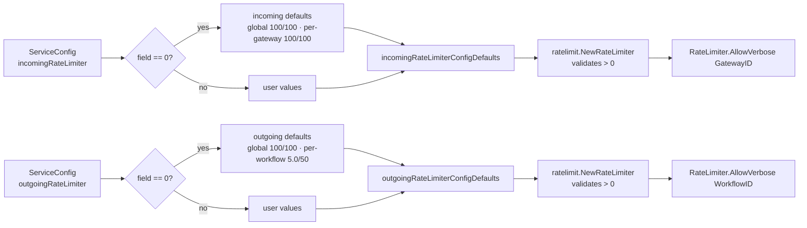

# Core Capabilities Runtime — WebAPI Configuration (`ServiceConfig`)

> **Module:** `chainlink/core/capabilities/webapi` (`types.go`, with the consuming handler in `outgoing_connector_handler.go`)
> **Part of:** [Core Capabilities Runtime](../core_capabilities_runtime.md) → [Workflow & Capability Runtime (CRE Engine)](../../Workflow___Capability_Runtime_(CRE_Engine).md)

## 1. Purpose and Scope

This module defines **`ServiceConfig`** — the configuration surface for the WebAPI capability (the node-side **"Target" capability**) that CRE workflows use to talk to the [Gateway network](../../Node_Platform_Services/gateway.md).

`ServiceConfig` answers one question: *how aggressively may this node exchange messages with gateways?* It carries two rate-limiter settings:

| Direction | Field | "Sender" identity used for per-sender limiting |
|---|---|---|
| **Incoming** (gateway → node) | `RateLimiter` (TOML key `incomingRateLimiter`) | Gateway node, identified by **Gateway ID** |
| **Outgoing** (node → gateway) | `OutgoingRateLimiter` (TOML key `outgoingRateLimiter`) | Workflow, identified by **Workflow ID** |

The struct is deliberately minimal. Per its source comment in `chainlink/core/capabilities/webapi/types.go`:

- It is *"the configuration for the Target capability and handler"*.
- **Retry configuration is not yet supported here** (tracked as `CM-472`).
- *"Workflow executions have their own internal timeouts and retries set by the user that are separate from this configuration"* — i.e. this module only governs node-level gateway-message throttling, not per-call application semantics.

The single consumer is `OutgoingConnectorHandler` (`chainlink/core/capabilities/webapi/outgoing_connector_handler.go`), which is the `connector.GatewayConnectorHandler` registered with the node's gateway connector (see [gateway](../../Node_Platform_Services/gateway.md)). Together, config + handler form the node-hosted **WebAPI Target** capability listed in the [Core Capabilities Runtime component map](../core_capabilities_runtime.md#21-component-map).

## 2. Configuration Reference

### 2.1 `webapi.ServiceConfig`

Defined in `chainlink/core/capabilities/webapi/types.go`:

```go
type ServiceConfig struct {
	// RateLimiter configuration for messages incoming to this node from the gateway.
	// The sender is a Gateway node, which is identified by the Gateway ID.
	RateLimiter ratelimit.RateLimiterConfig `toml:"incomingRateLimiter" json:"incomingRateLimiter" yaml:"incomingRateLimiter" mapstructure:"incomingRateLimiter"`

	// RateLimiter configuration for outgoing messages from this node to the gateway.
	// The sender is a workflow, which is identified by the Workflow ID.
	OutgoingRateLimiter ratelimit.RateLimiterConfig `toml:"outgoingRateLimiter" json:"outgoingRateLimiter" yaml:"outgoingRateLimiter" mapstructure:"outgoingRateLimiter"`
}
```

Because the struct carries `toml`, `json`, `yaml`, and `mapstructure` tags, the same settings can be deserialized from the node's TOML configuration, from YAML/JSON capability config blobs, or programmatically via `mapstructure` decoders. The [parent module](../core_capabilities_runtime.md#6-configuration-notes) notes that WebAPI rate limiting is TOML-configured through this struct.

The same file also declares the capability's delivery-mode constants:

| Constant | Value | Status |
|---|---|---|
| `SingleNode` | `"SingleNode"` | Implemented — a request is sent to one gateway node (the first available) and the caller blocks until its response arrives |
| `AllAtOnce` | `"AllAtOnce"` | **Not yet implemented** (declared with a TODO in source) |

### 2.2 `ratelimit.RateLimiterConfig`

Both fields embed the shared `RateLimiterConfig` from `chainlink-common/pkg/ratelimit` (`chainlink-common/pkg/ratelimit/ratelimiter.go`):

```go
type RateLimiterConfig struct {
	GlobalRPS      float64 `json:"globalRPS"`
	GlobalBurst    int     `json:"globalBurst"`
	PerSenderRPS   float64 `json:"perSenderRPS"`
	PerSenderBurst int     `json:"perSenderBurst"`
}
```

| Field | Meaning |
|---|---|
| `GlobalRPS` / `GlobalBurst` | Token-bucket rate and burst capacity shared across **all** senders (a hard ceiling for the whole node in the given direction) |
| `PerSenderRPS` / `PerSenderBurst` | Token-bucket rate and burst capacity applied **individually** to each sender key (Gateway ID for incoming, Workflow ID for outgoing) |

The `RateLimiter` implementation wraps `golang.org/x/time/rate`: one global limiter plus per-sender limiters created lazily on first `Allow`/`AllowVerbose(sender)` call. `NewRateLimiter` **rejects non-positive values** ("RPS values must be positive", "burst values must be positive"), so a limiter can never be fully disabled — only tuned. `SetConfig` allows the limits to be adjusted at runtime without restart.

### 2.3 Effective Defaults

`ServiceConfig` fields are *optional*. When `OutgoingConnectorHandler` is constructed, zero-valued entries fall back to defaults (`incomingRateLimiterConfigDefaults` / `outgoingRateLimiterConfigDefaults` in `outgoing_connector_handler.go`):

| Direction | Field | Default | Named constant |
|---|---|---|---|
| Incoming & Outgoing | `GlobalRPS` | `100.0` | `DefaultGlobalRPS` |
| Incoming & Outgoing | `GlobalBurst` | `100` | `DefaultGlobalBurst` |
| Incoming (`incomingRateLimiter`) | `PerSenderRPS` | `100.0` | `DefaultPerSenderRPS` |
| Incoming (`incomingRateLimiter`) | `PerSenderBurst` | `100` | `DefaultPerSenderBurst` |
| Outgoing (`outgoingRateLimiter`) | `PerSenderRPS` | `5.0` | `DefaultWorkflowRPS` |
| Outgoing (`outgoingRateLimiter`) | `PerSenderBurst` | `50` | `DefaultWorkflowBurst` |

Two asymmetries are worth highlighting:

- **Per-sender semantics differ by direction.** Incoming per-sender limits are per **gateway** (default 100 RPS / 100 burst), outgoing per-sender limits are per **workflow** (default 5 RPS / 50 burst) — a single noisy workflow is throttled well below what one gateway may send.
- **Zero means "unset".** Because the defaults are applied on zero values *and* `NewRateLimiter` rejects non-positive values, it is impossible to explicitly configure a zero limit; omitting a field simply selects the default above.

The handler also supplies an outbound-call timeout default that is *not* part of `ServiceConfig`: if a `capabilities.Request` has `TimeoutMs == 0`, `defaultFetchTimeoutMs` = **20 000 ms** is used, plus a 100 ms margin for gateway processing.

## 3. Architecture

### 3.1 Where `ServiceConfig` Sits

```mermaid
flowchart TB
    subgraph ConfigSources["Configuration sources (toml / yaml / json / mapstructure tags)"]
        TOML[Node TOML config<br/>[incomingRateLimiter] / [outgoingRateLimiter]]
        JOBCFG[Capability config blob]
    end

    subgraph WebAPIPkg["chainlink/core/capabilities/webapi"]
        SC["ServiceConfig<br/>types.go"]
        OCH["OutgoingConnectorHandler<br/>outgoing_connector_handler.go<br/>(connector.GatewayConnectorHandler)"]
        IRL["incomingRateLimiter<br/>ratelimit.RateLimiter"]
        ORL["outgoingRateLimiter<br/>ratelimit.RateLimiter"]
    end

    subgraph Common["chainlink-common/pkg/ratelimit"]
        RLC["RateLimiterConfig<br/>(GlobalRPS/Burst, PerSenderRPS/Burst)"]
        RLIM["RateLimiter<br/>global + lazy per-sender token buckets<br/>(golang.org/x/time/rate)"]
    end

    subgraph NodeRuntime["Node runtime"]
        GWC[GatewayConnector<br/>connector.GatewayConnector]
        REG[CapabilitiesRegistry]
        WF[Workflow Engine / Wasm host]
    end

    GW[Gateway network<br/>MethodWorkflowSyncer]

    TOML & JOBCFG -->|deserialize| SC
    SC -->|"NewOutgoingConnectorHandler(gc, config, method, …)"| OCH
    SC -->|incomingRateLimiter + defaults| IRL
    SC -->|outgoingRateLimiter + defaults| ORL
    IRL & ORL --- RLC
    RLC --> RLIM
    OCH -->|AllowVerbose / AddHandler| GWC
    GWC <-->|signed JSON-RPC messages| GW
    WF -->|Target capability call| REG
    REG -->|registered Target capability| OCH
```

The handler is constructed via:

```go
NewOutgoingConnectorHandler(gc connector.GatewayConnector, config ServiceConfig,
    method string, lgger logger.Logger, opts ...func(*gateway.RoundRobinSelector))
```

which (1) builds the outgoing rate limiter from `config.OutgoingRateLimiter` with workflow-oriented defaults, (2) builds the incoming rate limiter from `config.RateLimiter` with gateway-oriented defaults, (3) validates `method` — currently only `capabilities.MethodWorkflowSyncer` is accepted (`validMethod`) — and (4) initializes [beholder](../../Telemetry___Observability_Platform/beholder-telemetry.md) OTel histograms. On success the handler registers itself for that method with the `GatewayConnector` (`Start` → `gc.AddHandler`).

### 3.2 Component Relationship Summary

| Component | Relationship to `ServiceConfig` |
|---|---|
| `ServiceConfig` (`types.go`) | Declares the two rate-limiter settings; the only exported configuration type of the `webapi` package |
| `ratelimit.RateLimiterConfig` / `RateLimiter` (`chainlink-common/pkg/ratelimit`) | Value type stored in both fields; `NewRateLimiter` validates and instantiates two runtime limiters (one per direction) |
| `OutgoingConnectorHandler` (`outgoing_connector_handler.go`) | Sole consumer; applies directional defaults, enforces the limits, applies the 20 s default fetch timeout |
| `connector.GatewayConnector` ([gateway service](../../Node_Platform_Services/gateway.md)) | Receives the handler via `AddHandler`; transports signed JSON-RPC messages to/from gateways |
| Capabilities contract (`ExecutableAndTriggerCapability`, see [capabilities](../capabilities.md)) | The Target capability interface the workflow engine invokes; its runtime behavior is throttled by this config |
| Workflow engine ([workflows](../workflows.md)) | Indirect consumer — workflow `Execute` calls on the WebAPI Target pass through the outgoing limiter keyed by `WorkflowID` |

## 4. Data Flow

### 4.1 Outgoing request (workflow → gateway) and incoming response (gateway → node)



Key enforcement details from `outgoing_connector_handler.go`:

- **Outgoing checks run before any work is done.** Both per-workflow and global denials return a `rateLimitedError{}` immediately; because the error type is distinguishable, request metrics record status `rate_limited` — separate from `timeout` (`context.DeadlineExceeded`) and generic `fail` — on the `platform_outgoing_connector_handler_single_node_request_duration_ms` histogram.
- **Incoming denials fail *closed* with a structured error.** Rather than dropping the message, the handler responds on the pending-response channel with a JSON-RPC `WireError` (code 500) under `api.MethodInternalError`, with messages `errorIncomingRatelimitSender` ("message from gateway exceeded per sender rate limit") and/or `errorIncomingRatelimitGlobal` ("message from gateway exceeded global rate limit"). The caller's blocked `HandleSingleNodeRequest` surfaces this as an error.
- **The 20 s default timeout is independent of `ServiceConfig`** — it applies per outgoing request, whereas rate limits apply across requests. This matches the type's contract that user-level timeouts/retries live with workflow execution, not here.

### 4.2 Configuration-to-enforcement pipeline



Because a misconfigured `RateLimiterConfig` (any non-positive value surviving the defaulting step) makes `NewRateLimiter` return an error, construction of `OutgoingConnectorHandler` — and therefore registration of the Target capability — fails fast at startup instead of silently misbehaving.

## 5. Operational Notes & Limitations

1. **Retries are out of scope** — source TODO `CM-472` notes retry configuration is intended for this struct but not yet implemented; do not expect `ServiceConfig` to influence retry behavior.
2. **Delivery mode** — only `SingleNode` semantics are implemented; `AllAtOnce` is a reserved constant.
3. **Method allow-list** — the handler accepts exactly one gateway method (`capabilities.MethodWorkflowSyncer`); extending the Target capability to other methods requires extending `validMethod`.
4. **Zero-value caveat** — defaults are applied on zero, and non-positive values are rejected by `NewRateLimiter`; there is no supported way to disable a limiter.
5. **No hot-reload wiring in this module** — although `ratelimit.RateLimiter.SetConfig` supports live updates, `OutgoingConnectorHandler` builds its limiters once at construction from `ServiceConfig`.
6. **Observability** — all rate-limit outcomes are visible through two beholder OTel histograms (`platform_outgoing_connector_handler_single_node_request_duration_ms`, `platform_outgoing_connector_handler_await_conn_duration_ms`) with `workflowID`, `method`, `status`, and `gateway` attributes; see [beholder telemetry](../../Telemetry___Observability_Platform/beholder-telemetry.md).
7. **Separation from node-level dispatcher limits** — the p2p [dispatcher](core_capabilities_runtime_remote_messaging.md) applies its own rate limits for DON-to-DON traffic; `ServiceConfig` governs only the node↔gateway channel.

## 6. Related Documentation

| Topic | Page |
|---|---|
| Parent runtime: launcher, registry, dispatcher, node-hosted capabilities | [Core Capabilities Runtime](../core_capabilities_runtime.md) |
| DON-to-DON remote capability messaging (`Dispatcher`, `TriggerPublisher`/`Subscriber`) | [core_capabilities_runtime_remote_messaging](core_capabilities_runtime_remote_messaging.md) |
| Vault secrets capability types (`SecretsService`) | [core_capabilities_runtime_vault_types](core_capabilities_runtime_vault_types.md) |
| Durable pending-trigger event store | [core_capabilities_runtime_trigger_event_store](core_capabilities_runtime_trigger_event_store.md) |
| Test fakes (local gateway, mock forwarder) | [core_capabilities_runtime_test_fakes](core_capabilities_runtime_test_fakes.md) |
| Capability interfaces & `CapabilitiesRegistry` contracts | [capabilities](../capabilities.md) |
| Workflow engine consuming this capability | [workflows](../workflows.md) |
| Gateway network service (`GatewayConnector`, handlers) | [gateway](../../Node_Platform_Services/gateway.md) |
| p2p transport for dispatcher traffic | [p2p](../../Node_Platform_Services/p2p.md) |
