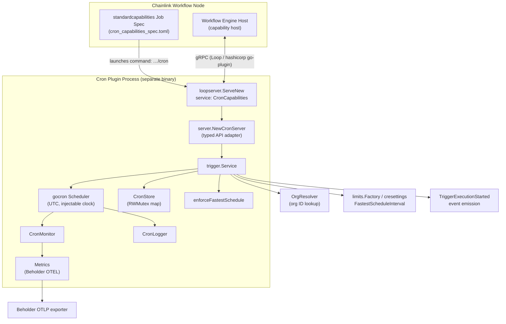
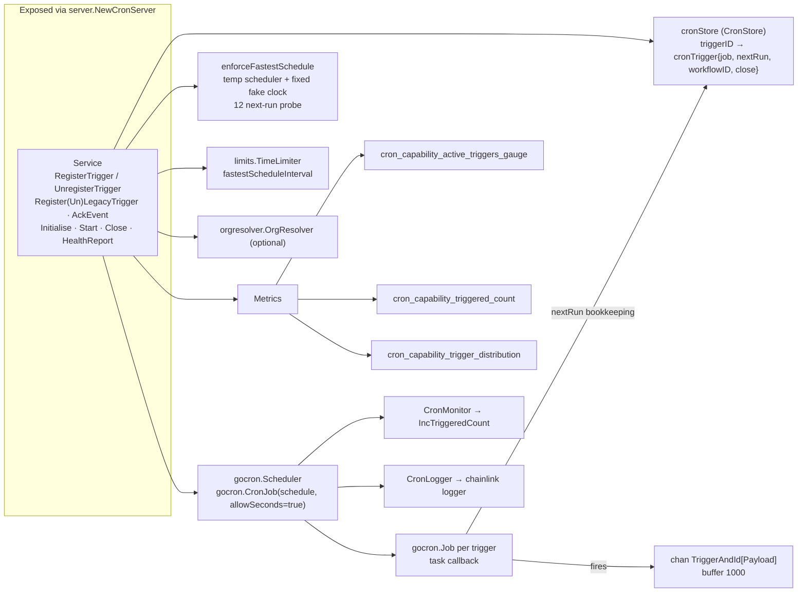
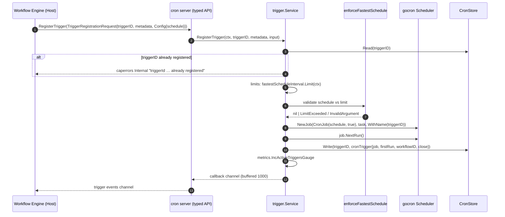
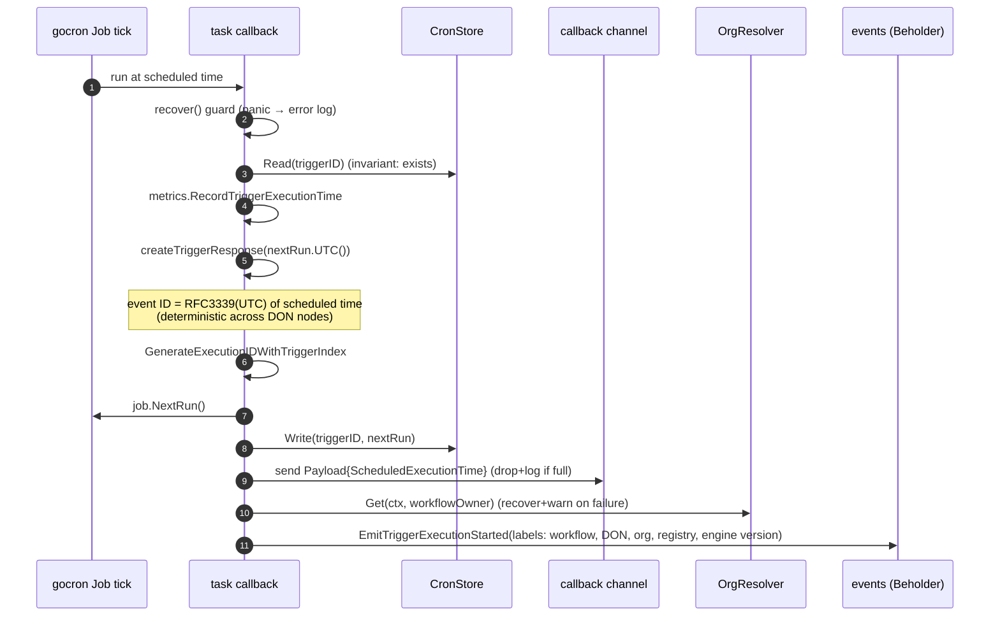
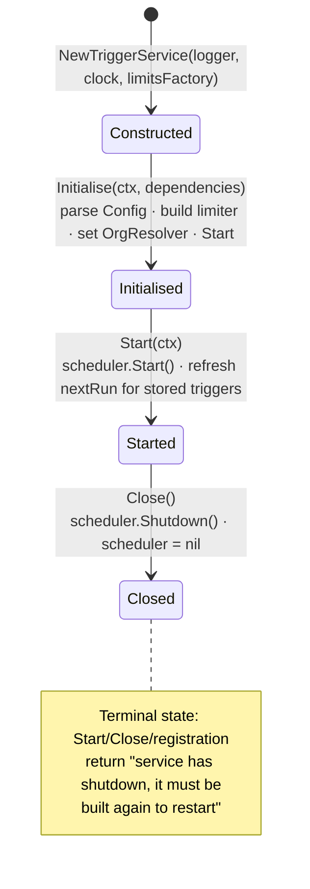
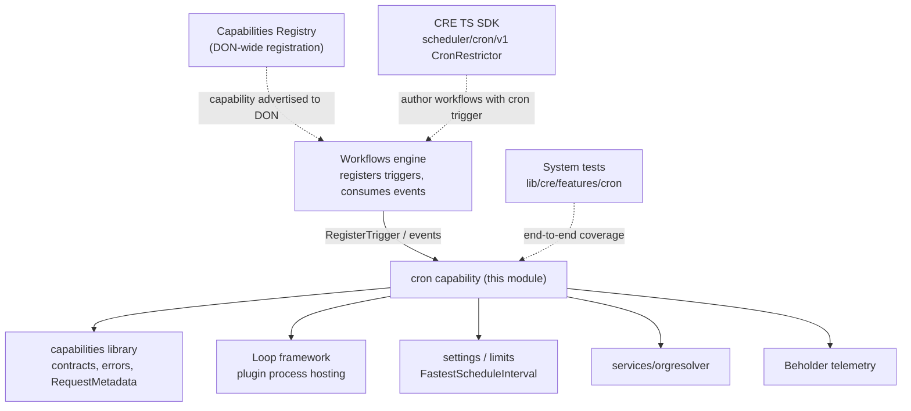

# Cron Capability (CRE Engine)

> **Capability type:** Standard Capability (Trigger) · **Go module:** `github.com/smartcontractkit/capabilities/cron` · **Service name:** `CronCapabilities`

## 1. Overview

The **Cron capability** is a standard trigger capability of the [Workflow & Capability Runtime (CRE Engine)](../Workflow___Capability_Runtime_(CRE_Engine).md). It fires workflow executions on a user-defined [cron schedule](https://cloud.google.com/scheduler/docs/configuring/cron-job-schedules) — at fixed times, dates, or intervals — with optional second-level granularity and timezone support.

It is intentionally **self-contained**: unlike the chain capabilities (see [chain_capability_evm](chain_capability_evm.md), [chain_capability_aptos](chain_capability_aptos.md), …), it observes no blockchain state. Instead it owns a scheduler process that emits *deterministic trigger events* at wall-clock times, which the workflow engine fans out to the DON for execution.

Design goals visible in the code:

| Goal | How it is achieved |
|---|---|
| **Cross-node determinism** | The trigger event ID *is* the scheduled execution time formatted as `RFC3339` in **UTC** (`createTriggerResponse`), so every node in the DON derives the same event ID for the same tick. The scheduler itself runs in `time.UTC` (`gocron.WithLocation(time.UTC)`). |
| **Fair resource usage** | A *fastest schedule interval* limit (default **30s**, per `capabilities/cron/README.md`) is enforced on every registration via `enforceFastestSchedule` and the `limits.Factory` time limiter (see [settings & limits](../Shared_Foundation_Libraries___Domain_Types/settings.md)). |
| **Robustness** | Panics inside job callbacks are recovered and logged; the callback channel is guarded by an `RWMutex` to prevent send-on-closed-channel races; full channels drop events loudly (error log + custom telemetry event) instead of blocking the scheduler. |
| **Observability** | OpenTelemetry metrics through [Beholder](../Telemetry___Observability_Platform/beholder-telemetry.md): active-trigger gauge, triggered counter, and a seconds-of-minute distribution histogram. |
| **Multi-tenancy metadata** | After each firing, the [OrgResolver](../Shared_Foundation_Libraries___Domain_Types/services.md) resolves the workflow owner's organization ID and a `TriggerExecutionStarted` event is emitted with workflow/DON/registry labels. |

### Deployment model

The cron capability is **not** linked into the node binary. It is compiled into its own plugin executable (`cron`) and hosted as a [Loop plugin process](../Plugin_Process_Framework_(Loop).md), attached to the node through a `standardcapabilities` job spec:

```toml
# capabilities/cron/cron_capabilities_spec.toml
type = "standardcapabilities"
schemaVersion = 1
name = "cron-capabilities"
command="${PATH_TO_BINARY}/cron"
config=""
```

`main.go` bootstraps the plugin: it serves a Loop gRPC server under the service name `CronCapabilities`, constructs the `trigger.Service`, wraps it in the typed-API `server.NewCronServer`, and registers the OTEL metric views:

```go
// capabilities/cron/main.go (excerpt)
loopserver.ServeNew(trigger.ServiceName, func(s *loop.Server) loop.StandardCapabilities {
    triggerService, err := trigger.NewTriggerService(s.Logger, nil, s.LimitsFactory)
    ...
    return server.NewCronServer(triggerService)
}, loop.WithOtelViews(trigger.MetricViews()))
```

## 2. Module Layout

| File | Responsibility |
|---|---|
| `capabilities/cron/main.go` | Plugin entry point; serves the capability over the Loop framework. |
| `capabilities/cron/cron_capabilities_spec.toml` | Node job spec (`standardcapabilities`) that binds the plugin binary. |
| `capabilities/cron/go.mod` | Go module manifest: `gocron/v2`, `clockwork`, `uuid`, `capabilities/libs` (loopserver), `chainlink-common`, OTEL, zap. |
| `capabilities/cron/project.json` | Nx project: `build` (static linux amd64/arm64), `test`, `race`, `lint`, `generate`, `tidy`. |
| `capabilities/cron/trigger/trigger.go` | **Core**: the `Service` — capability info, trigger registration/unregistration, gocron job lifecycle, event generation & emission. |
| `capabilities/cron/trigger/store.go` | `CronStore` — concurrency-safe in-memory registry of active triggers. |
| `capabilities/cron/trigger/utils.go` | `enforceFastestSchedule` — schedule validation against the rate limit. |
| `capabilities/cron/trigger/metrics.go` | `Metrics` — Beholder/OTEL instruments and metric views. |
| `capabilities/cron/trigger/monitor.go` | `CronMonitor` — gocron monitor hook feeding the triggered counter. |
| `capabilities/cron/trigger/logger.go` | `CronLogger` — adapts the chainlink logger to the gocron logger interface. |
| `capabilities/cron/trigger/trigger_test.go` | Unit, timezone, load (1000 triggers), panic-recovery and validation tests; `MockOrgResolver`. |

## 3. Architecture

### 3.1 Process & host architecture



The gRPC boundary and plugin negotiation are provided by the [Loop plugin framework](../Plugin_Process_Framework_(Loop).md); the capability-side contracts (`TriggerCapability`, capability info, error taxonomy) come from the shared [capabilities library](capabilities/capabilities_core.md).

### 3.2 Internal components of `capabilities/cron/trigger`



## 4. Core Functionality

### 4.1 Capability identity & configuration

The service embeds a static `capabilities.CapabilityInfo` built with `capabilities.MustNewCapabilityInfo(server.CronID, capabilities.CapabilityTypeTrigger, "A trigger that uses a cron schedule to run periodically at fixed times, dates, or intervals.")` — the canonical capability ID lives in `chainlink-common/pkg/capabilities/v2/triggers/cron/server`.

Capability-level configuration (`trigger.Config`):

```go
type Config struct {
    FastestScheduleIntervalSeconds int `json:"fastestScheduleIntervalSeconds"`
}
```

| Setting | Source | Default |
|---|---|---|
| `fastestScheduleIntervalSeconds` | Capability config passed via `StandardCapabilitiesDependencies.Config` | falls back to `cresettings.Default.PerWorkflow.CRONTrigger.FastestScheduleInterval` (30s) |
| Per-workflow enforcement | `limits.Factory.MakeTimeLimiter` → `fastestScheduleInterval.Limit(ctx)` at each registration | see [settings & limits](../Shared_Foundation_Libraries___Domain_Types/settings.md) |

Per-trigger registration input is the schedule itself (`{"schedule": "0 * * * * *"}`, 5- or 6-field cron with optional `TZ=` prefix).

### 4.2 Trigger registration flow



Key registration behaviours (from `trigger.go`):

- **Duplicate protection** — registering an existing `triggerID` returns a public `Internal` capability error.
- **Rate limiting** — the schedule is probed against the configured *fastest schedule interval*; violations surface as user-origin `LimitExceeded` errors. `enforceFastestSchedule` runs a throwaway scheduler on a fixed fake clock, computes 12 consecutive run times and rejects the schedule if any gap is shorter than the limit — this catches non-uniform fields like `0,5,10,…,55-59 * * * * *`.
- **Trigger index / execution IDs** — `workflows.GetTriggerIndexFromReferenceID(metadata.ReferenceID)` feeds `workflows.GenerateExecutionIDWithTriggerIndex`, making execution IDs unique per trigger within a multi-trigger workflow (observable, non-fatal on failure).
- **Race-safe channel close** — an `RWMutex` guards both registration and the callback channel so the task callback never sends on a closed channel; `closeCh` locks, closes and nils the channel.

### 4.3 Firing a trigger (task callback)



Important properties:

- **Slow paths are deferred**: org resolution (network) and event emission happen *after* the trigger event is delivered and `nextRun` bookkeeping is done, so telemetry cannot delay the next scheduled run.
- **Backpressure**: if the 1000-slot callback buffer is full, the event is dropped and a custom telemetry event is emitted with workflow owner/name labels — the scheduler is never blocked.
- **Legacy API**: `RegisterLegacyTrigger`/`UnregisterLegacyTrigger` wrap the typed registration and translate payloads to the deprecated `LegacyPayload` (RFC3339Nano string).
- **AckEvent is a no-op** — cron events need no acknowledgement.

### 4.4 Unregistration & lifecycle



- `UnregisterTrigger` removes the gocron job, closes the callback channel and deletes the store entry; unregistering an unknown ID is a no-op (idempotent), and `metrics.DecActiveTriggersGauge` keeps the gauge accurate.
- `HealthReport()` reports healthy for the service; `Ready()` is a no-op; `Name()` is the logger name (`"CRONTrigger"` hierarchy), `Description()` is `"Cron Trigger Capability"`.

## 5. Sub-modules

The module is documented in depth per sub-module. All sub-module pages live in the [`cron_capability/`](cron_capability/) folder:

| Sub-module | Contents | Documentation |
|---|---|---|
| **Trigger Service** | `Service`, registration/unregistration, schedule enforcement, event generation, plugin entry point, tests | [cron_capability_trigger_service.md](cron_capability/cron_capability_trigger_service.md) |
| **Trigger Store** | `CronStore` interface and the `RWMutex`-based in-memory implementation | [cron_capability_trigger_store.md](cron_capability/cron_capability_trigger_store.md) |
| **Observability** | `Metrics` (Beholder/OTEL instruments), `CronMonitor`, `CronLogger` | [cron_capability_trigger_observability.md](cron_capability/cron_capability_trigger_observability.md) |

Quick navigation by concern:

- **How triggers are registered, validated and fired** → [cron_capability_trigger_service.md](cron_capability/cron_capability_trigger_service.md) (covers `Service`, `Config`, `enforceFastestSchedule`, `main.go` and the test suite)
- **How active triggers are tracked between scheduler ticks** → [cron_capability_trigger_store.md](cron_capability/cron_capability_trigger_store.md) (covers the `CronStore` contract)
- **How the capability is monitored** → [cron_capability_trigger_observability.md](cron_capability/cron_capability_trigger_observability.md) (covers `Metrics`, `CronMonitor`, `CronLogger`)

## 6. Interaction with the Wider System



- **Workflows engine** — the engine holds the other end of each callback channel, delivers trigger events into workflow executions, and derives execution IDs. See [workflows](workflows.md) (syncer, engine host module) and the shared execution result types in [workflows_common_types](workflows/workflows_common_types.md).
- **Capability contracts** — `capabilities.CapabilityInfo`, `RequestMetadata`, the typed cron API (`crontypedapi`) and the `caperrors` taxonomy are defined in the shared [capabilities library](capabilities/capabilities_core.md) with protobuf contracts in [capabilities_pb](capabilities/capabilities_pb.md).
- **Plugin hosting** — process lifecycle, gRPC transports and `loop.Server` come from the [Loop plugin framework](../Plugin_Process_Framework_(Loop).md); the `loopserver` helper itself is part of the [capabilities shared libs](capabilities_shared_libs.md).
- **Configuration & limits** — the fastest-schedule limiter is built on the shared settings/limits packages ([settings](../Shared_Foundation_Libraries___Domain_Types/settings.md)).
- **Telemetry** — all metrics flow through [Beholder](../Telemetry___Observability_Platform/beholder-telemetry.md); the trigger-started event uses the shared workflow event labels.
- **Developer toolchain** — workflow authors consume the cron capability through the generated TypeScript SDK client ([cre-sdk-generated-capabilities](../Developer_Toolchain_(CLI,_SDKs___API_Clients)/cre-sdk-generated-capabilities.md)).
- **Testing in the wild** — the system-test suite drives the capability end-to-end via `system-tests/lib/cre/features/cron` ([system-tests](../Dev,_Test___Simulation_Environments/system-tests.md)).

## 7. Build, Packaging & CI

- **Build** — `capabilities/cron/project.json` defines the Nx targets used by the [capabilities workspace tooling](../Build,_CI___Release_Infrastructure/capabilities_workspace_tooling.md): `build` produces statically-linked (`CGO_ENABLED=0`) linux `amd64`/`arm64` binaries into `capabilities/bin/<arch>/cron`; `test`, `race`, `lint` (golangci-lint), `tidy` and `generate` round out the targets.
- **Wiring into a node** — the compiled binary is referenced by a `standardcapabilities` job spec (`cron_capabilities_spec.toml`); the empty `config=""` field means the capability starts with the library defaults unless the node passes `fastestScheduleIntervalSeconds`.
- **Dependencies** — `go.mod` pins `gocron/v2`, `clockwork`, `go.uber.org/zap`, OTEL metric packages and the `chainlink-common`/`chainlink-protos` versions that provide the typed cron API, loop, limits, orgresolver and Beholder packages.
- **Consistency with other capabilities** — the module follows the same Go-module-per-capability layout as its siblings (see [http_action_capability](http_action_capability.md), [http_trigger_capability](http_trigger_capability.md), [consensus_capability](consensus_capability.md)).

## 8. Testing Strategy

`capabilities/cron/trigger/trigger_test.go` provides:

| Area | Coverage |
|---|---|
| Standard intervals | Table-driven tests for second/minute/hour/day/week/month/year schedules against a fake clock (both typed and untyped APIs). |
| Time windows & timezones | `TZ=America/New_York` handling, hour-range schedules (`0 9-10 * * *`), event-ID collisions on shared ticks. |
| Load | 1 000 triggers firing every second for 3 executions, asserting ≤1s skew between scheduled and actual time. |
| Validation | Malformed schedules, invalid timezones, fastest-interval violations (incl. non-uniform seconds fields), temporary-scheduler shutdown regression, scheduler-construction failure. |
| Robustness | Panic recovery in the task callback, duplicate registration errors, idempotent unregistration, restart-after-close errors. |
| Test doubles | `MockOrgResolver` (`orgresolver.OrgResolver`), panic-injecting clock, mock scheduler factory. |
