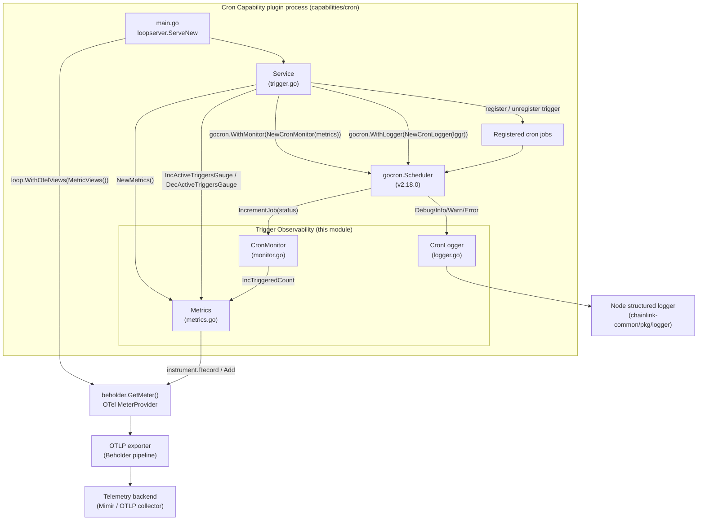
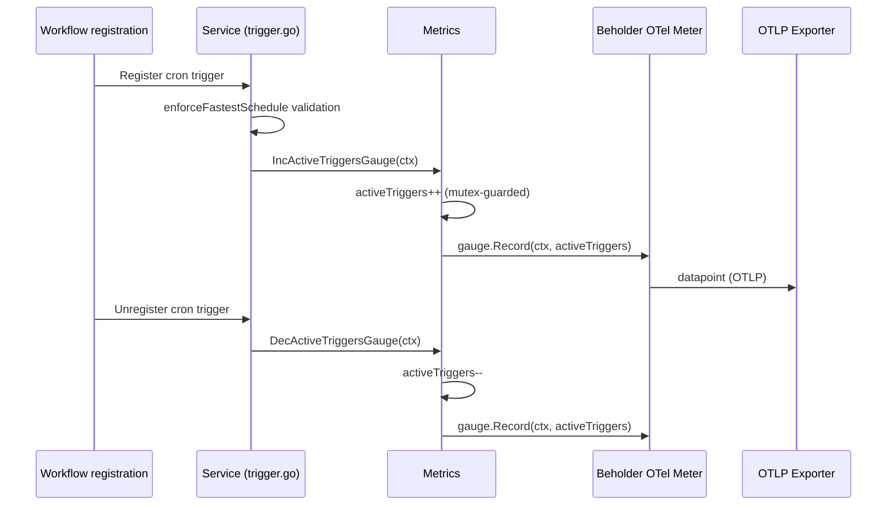
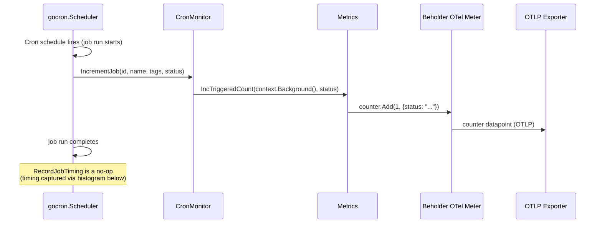
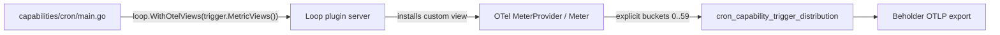

# Cron Capability — Trigger Observability

## 1. Introduction

The **Trigger Observability** module provides the metrics, monitoring hooks, and logging plumbing for the [Cron Capability](cron_capability_trigger_service.md)'s trigger engine. The cron capability fires workflow triggers on user-defined cron schedules by delegating scheduling to the [`go-co-op/gocron/v2`](https://github.com/go-co-op/gocron) library (see [capabilities/cron/go.mod](../../../capabilities/cron/go.mod)). This module supplies the three integration points that gocron exposes for external instrumentation — a `gocron.Monitor`, a `gocron.Logger`, and an OpenTelemetry (OTel) metric bundle — so that every scheduled trigger execution is observable without the trigger service itself having to embed telemetry calls.

The module lives entirely inside the `trigger` package of the standalone cron capability plugin (`capabilities/cron/trigger/`):

| File | Component | Role |
|---|---|---|
| `metrics.go` | `Metrics` | OTel instrument definitions, gauge bookkeeping, custom histogram view |
| `monitor.go` | `CronMonitor` | gocron `Monitor` implementation bridging job-run events into counters |
| `logger.go` | `CronLogger` | gocron `Logger` implementation adapting the Chainlink structured logger |

## 2. Purpose & Scope

The module answers three operational questions about the cron trigger:

1. **How many triggers are live?** — `cron_capability_active_triggers_gauge`
2. **How often are triggers firing, and with what result status?** — `cron_capability_triggered_count`
3. **When within the minute are triggers firing?** — `cron_capability_trigger_distribution`

Out of scope (handled elsewhere): trigger registration semantics and persistence ([Trigger Store](cron_capability_trigger_store.md)), schedule validation and workflow event dispatch ([Trigger Service](cron_capability_trigger_service.md)), and the remote transport of telemetry to the observability backend ([Beholder Telemetry](../../Telemetry___Observability_Platform/beholder-telemetry.md)).

## 3. Architecture

All three components are consumed by the trigger `Service` at construction time (`trigger.NewTriggerService`), which wires them into a single `gocron.Scheduler` instance:

- `Metrics` is instantiated first via `NewMetrics()`; it is owned by the `Service` and shared with the monitor.
- `CronMonitor` is attached to the scheduler via `gocron.WithMonitor(...)`, so gocron invokes it on every completed job run.
- `CronLogger` is attached via `gocron.WithLogger(...)`, routing all scheduler-internal log output to the node's structured logger.

Metric emission flows through **Beholder**, the shared telemetry client library (`beholder.GetMeter()`), which owns the OTel `MeterProvider` and the OTLP export pipeline.



Key structural points:

- **gocron is the event source.** The scheduler — not the trigger service — decides when jobs run; therefore the observability hooks (`Monitor`, `Logger`) are the only reliable way to observe actual executions.
- **Metrics is the single fan-in point.** Both the `Service` (lifecycle gauge) and the `CronMonitor` (execution counter) write through the same `Metrics` instance, guaranteeing a consistent instrument set.
- **Beholder is the egress point.** Instruments are created against `beholder.GetMeter()`, so export, resource attribution, and backend routing follow the platform-wide telemetry configuration ([Beholder Telemetry](../../Telemetry___Observability_Platform/beholder-telemetry.md)).

## 4. Component Reference

### 4.1 `Metrics` (`metrics.go`)

`Metrics` owns the three OTel instruments for the cron capability plus an internal, mutex-guarded count of active triggers. It is created once per trigger `Service` via `NewMetrics()`, which fails fast if any instrument cannot be registered against the Beholder meter.

**Public API**

| Method | Behaviour |
|---|---|
| `NewMetrics() (*Metrics, error)` | Creates all three instruments via `beholder.GetMeter()`; returns an error wrapping the specific instrument that failed. |
| `MetricViews() []sdkmetric.View` | Returns the custom OTel SDK view (see §4.2) that must be installed by the process entrypoint. |
| `IncActiveTriggersGauge(ctx)` | Under a `sync.Mutex`, increments the internal `activeTriggers` value and records it on `activeTriggersGauge`. |
| `DecActiveTriggersGauge(ctx)` | Symmetric decrement; records the new value. |
| `IncTriggeredCount(ctx, status)` | Adds `1` to `triggeredCount` with the string attribute `status` (gocron job status). |
| `RecordTriggerExecutionTime(ctx)` | Records `time.Now().Second()` (0–59) on `triggerDistributionHistogram` — i.e. *where in the minute* the trigger fired, not its duration. |

**Metric catalog**

| Instrument | Name | Type | Description | Attributes |
|---|---|---|---|---|
| `activeTriggersGauge` | `cron_capability_active_triggers_gauge` | `Int64Gauge` | Number of active cron triggers | — |
| `triggeredCount` | `cron_capability_triggered_count` | `Int64Counter` | Number of times the cron trigger capability has been triggered | `status` (`string`, gocron `JobStatus`) |
| `triggerDistributionHistogram` | `cron_capability_trigger_distribution` | `Float64Histogram` | Distribution of trigger execution times over 5-second intervals | — |

### 4.2 `MetricViews` — histogram bucket configuration

OTel default explicit-bucket boundaries are unsuitable for the distribution metric, so the module defines a custom view with boundaries aligned to seconds-within-minute at 5-second resolution:

```text
Boundaries: [0, 5, 10, 15, 20, 25, 30, 35, 40, 45, 50, 55, 59]
```

These views are **not** applied automatically. The process entrypoint registers them when starting the Loop plugin server:

```go
// capabilities/cron/main.go
loopserver.ServeNew(trigger.ServiceName, func(s *loop.Server) loop.StandardCapabilities {
    ...
}, loop.WithOtelViews(trigger.MetricViews()))
```

`loop.WithOtelViews` installs the views into the OTel `MeterProvider` that backs `beholder.GetMeter()` for this plugin process. If the entrypoint omitted this call, the histogram would fall back to default bucket boundaries and the 5-second-interval semantics would be lost. The plugin-process mechanism itself is documented in [Plugin Process Framework (Loop)](../../Plugin_Process_Framework_(Loop)/loop-plugin-core.md).

### 4.3 `CronMonitor` (`monitor.go`)

`CronMonitor` implements gocron's `Monitor` interface (asserted via `var _ gocron.Monitor = (*CronMonitor)(nil)`) and is the bridge between scheduler lifecycle events and the metric layer.

| Method | Called when | Implementation |
|---|---|---|
| `IncrementJob(jobID, name, tags, status)` | After a scheduled job has finished a run | Delegates to `metrics.IncTriggeredCount(context.Background(), string(status))` |
| `RecordJobTiming(start, end, jobID, name, tags)` | After a run, with timing info | **Intentional no-op** — execution-time observation is handled by `Metrics.RecordTriggerExecutionTime` |

Design notes:

- `IncrementJob` uses `context.Background()` because gocron monitor callbacks carry no request-scoped context; the `status` attribute (e.g. gocron's success/failure states) is the discriminating label for the counter.
- Constructed via `NewCronMonitor(m *Metrics) gocron.Monitor`, keeping the concrete type unexported and the dependency surface minimal.

### 4.4 `CronLogger` (`logger.go`)

`CronLogger` implements gocron's `Logger` interface (`var _ gocron.Logger = (*CronLogger)(nil)`), adapting scheduler output to the Chainlink structured logger contract ([Logger](../../Shared_Foundation_Libraries___Domain_Types/logger.md)).

| gocron call | Chainlink logger call |
|---|---|
| `Debug(msg, args...)` | `lggr.Debugw(msg, "args", args)` |
| `Info(msg, args...)` | `lggr.Infow(msg, "args", args)` |
| `Warn(msg, args...)` | `lggr.Warnw(msg, "args", args)` |
| `Error(msg, args...)` | `lggr.Errorw(msg, "args", args)` |

All scheduler-internal messages (job creation, start/stop, errors) are funnelled through the trigger service's named logger (`"CRONTrigger"`), preserving structured-logging key/value conventions — the variadic args are collapsed under a single `"args"` key.

## 5. Data Flow

### 5.1 Trigger lifecycle → active-triggers gauge



### 5.2 Scheduled execution → counter + distribution



The distribution histogram is recorded from the trigger execution path (`RecordTriggerExecutionTime`), stamping the wall-clock second (0–59) at which the trigger fired. Because `CronMonitor.RecordJobTiming` is deliberately empty, the histogram carries **schedule position** rather than run duration — this is what enables the "distribution over 5-second intervals" alerting described in §7.

### 5.3 Startup wiring (once per plugin process)



## 6. Integration & Wiring Details

Wiring in `trigger.NewTriggerService` (`capabilities/cron/trigger/trigger.go`):

1. `metrics, err := NewMetrics()` — instrument creation is on the critical path; a Beholder/meter failure aborts service startup with `error creating metrics`.
2. `gocron.WithMonitor(NewCronMonitor(metrics))` — scheduler option attaching the execution counter bridge.
3. `gocron.WithLogger(NewCronLogger(lggr))` — scheduler option attaching the log adapter, using the service's named logger.
4. The `Service` retains `metrics` for the trigger lifecycle gauge (inc on registration, dec on deregistration).

Dependency versions of note (from [capabilities/cron/go.mod](../../../capabilities/cron/go.mod)): `go-co-op/gocron/v2 v2.18.0`, `go.opentelemetry.io/otel{,/metric,/sdk/metric} v1.46.0`, and `chainlink-common` (which provides `pkg/beholder` and `pkg/logger`).

## 7. Operational Notes

- **Active triggers gauge** — a sustained drop (e.g. gauge dropping while jobs are expected) or a rise without registrations indicates trigger-store/scheduler drift; alert on deltas, not absolute values.
- **Triggered count by `status`** — partition `rate(cron_capability_triggered_count[5m])` by `status`; non-success gocron statuses should page, since a failing scheduler means silent missed triggers (cron misses do not retry).
- **Distribution histogram** — with the custom buckets, the metric shows clustering of executions within the minute. Under heavy multi-trigger load, executions naturally cluster at the top of the minute; bucket skew (e.g. mass concentration in `le="5"`) can indicate schedule contention across many workflows.
- **Logger coupling** — scheduler internals surface through the node log under the `CRONTrigger` name with an `args` field; exclude/include these in log pipelines accordingly.

## 8. Concurrency & Correctness

- `Metrics` guards `activeTriggers` with a `sync.Mutex`; gauge recordings are always consistent with the internal count, preventing lost updates when registration and deregistration race.
- The counter and histogram are OTel instruments and are safe for concurrent use by contract.
- `CronMonitor` is stateless (holds only the `Metrics` reference), matching gocron's expectation that monitor callbacks may be invoked from scheduler goroutines.

## 9. Extending the Module

- **Adding an instrument:** add the instrument field, create it in `Metrics.init()` with a wrapped error, and expose a method that records it. No view change is required unless custom aggregation is needed; if so, extend `MetricViews()`.
- **Changing histogram semantics:** `RecordTriggerExecutionTime` currently records second-within-minute. Any change to what the histogram measures must be reflected in both the metric description and the bucket boundaries in `MetricViews()` to keep dashboards meaningful.
- **New gocron hooks:** if gocron's `Monitor` interface gains methods (e.g. per-job timing), prefer implementing them in `CronMonitor` and delegating to `Metrics`, keeping the trigger service free of telemetry calls.

## 10. Related Documentation

| Topic | Page |
|---|---|
| Cron capability overview (sibling) | [Cron Capability](../cron_capability.md) |
| Trigger service — scheduling, validation, event dispatch | [Cron Capability — Trigger Service](cron_capability_trigger_service.md) |
| Trigger registry | [Cron Capability — Trigger Store](cron_capability_trigger_store.md) |
| Capability abstraction & registry | [Capabilities](../capabilities.md) |
| CRE engine root | [Workflow & Capability Runtime (CRE Engine)](../../Workflow___Capability_Runtime_(CRE_Engine).md) |
| Beholder telemetry client (metric egress) | [Beholder Telemetry](../../Telemetry___Observability_Platform/beholder-telemetry.md) |
| Structured logger contract | [Logger](../../Shared_Foundation_Libraries___Domain_Types/logger.md) |
| Loop plugin process framework | [Loop Plugin Core](../../Plugin_Process_Framework_(Loop)/loop-plugin-core.md) |
