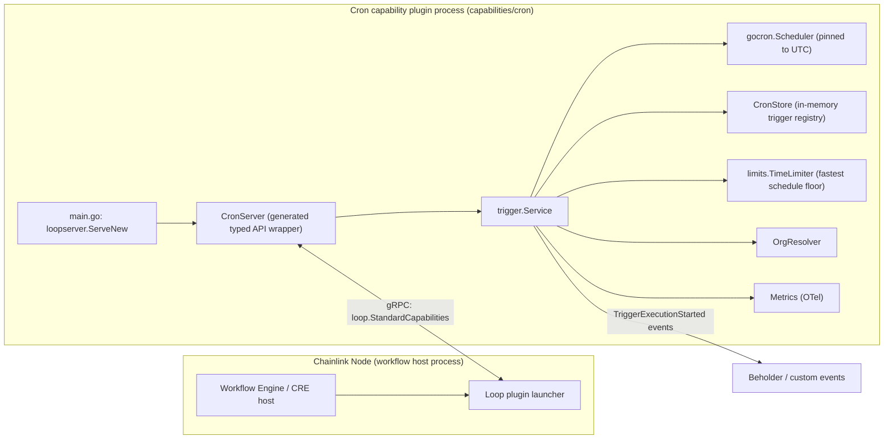
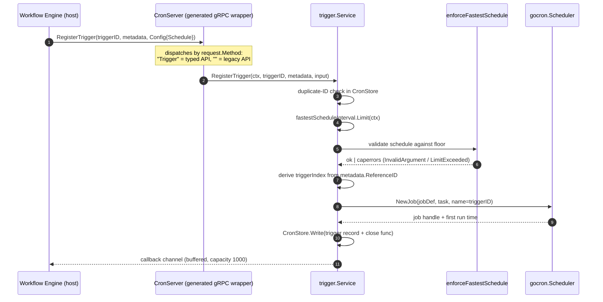
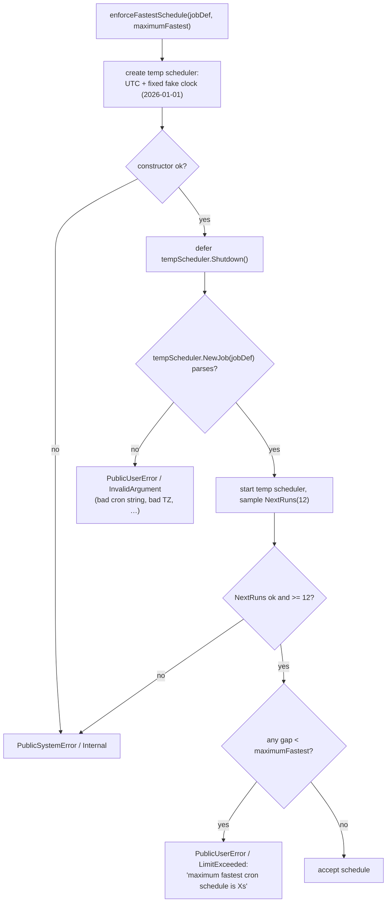
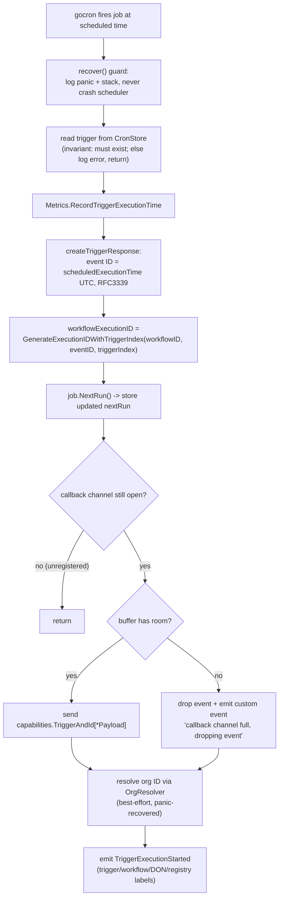

# Cron Capability — Trigger Service

The **cron trigger service** (`capabilities/cron`) is a standard Capability Runtime (CRE) trigger capability that fires workflow executions on [cron](https://en.wikipedia.org/wiki/Cron) schedules ("every hour at :00", "every day at 12am Eastern", "every second", …). It is packaged as an out-of-process **Loop plugin** that the workflow engine loads into a Chainlink node, and it guarantees that every node in a Decentralized Operating Node (DON) produces *identical trigger events for the same scheduled tick* — the property that makes downstream consensus possible.

This page documents the trigger **service** itself: its public API, execution semantics, scheduling and validation logic, lifecycle, and configuration. Companion pages cover the in-memory trigger registry ([Cron Trigger Store](cron_capability_trigger_store.md)) and the metrics/logging stack ([Cron Trigger Observability](cron_capability_trigger_observability.md)).

---

## 1. Purpose and Responsibilities

The module owns everything required to turn a cron expression into a stream of deterministic workflow trigger events:

| Responsibility | Where |
|---|---|
| Serve the capability as a Loop plugin (gRPC, hashicorp go-plugin) | `capabilities/cron/main.go` |
| Expose the typed trigger API (`RegisterTrigger` / `UnregisterTrigger` / `AckEvent`) to the workflow engine | generated `CronServer` wrapper (`chainlink-common/pkg/capabilities/v2/triggers/cron/server`) |
| Schedule jobs per registered workflow trigger and emit events on a callback channel | `capabilities/cron/trigger/trigger.go` (`Service`) |
| Reject invalid cron strings and schedules faster than the configured floor | `capabilities/cron/trigger/utils.go` (`enforceFastestSchedule`) |
| Track registered triggers and their next run times | `capabilities/cron/trigger/store.go` → see [Cron Trigger Store](cron_capability_trigger_store.md) |
| Expose OTel metrics, adapt logging, emit custom/workflow events | `metrics.go`, `monitor.go`, `logger.go` → see [Cron Trigger Observability](cron_capability_trigger_observability.md) |

It is **not** responsible for workflow execution itself — once an event is delivered on the callback channel, the workflow engine takes over (see [Workflows Engine](../workflows/workflows_engine.md)).

### Key source files

| File | Core components |
|---|---|
| `capabilities/cron/main.go` | `main` — plugin entrypoint |
| `capabilities/cron/trigger/trigger.go` | `Config`, `Service`, `cronTrigger`, `createTriggerResponse` |
| `capabilities/cron/trigger/utils.go` | `enforceFastestSchedule`, `schedulerFactory` |
| `capabilities/cron/trigger/store.go` | `CronStore` (interface + in-memory implementation) |
| `capabilities/cron/trigger/metrics.go`, `monitor.go`, `logger.go` | `Metrics`, `CronMonitor`, `CronLogger` |
| `capabilities/cron/trigger/trigger_test.go` | Unit/load tests, `MockOrgResolver` |
| `capabilities/cron/go.mod` | Module manifest: `github.com/smartcontractkit/capabilities/cron` |

---

## 2. Position in the System

The cron trigger is one of the built-in **standard capabilities** of the CRE engine. The capability identity registered with the engine is **`cron-trigger@1.0.0`** (constant `server.CronID`), of type `CapabilityTypeTrigger`.



Execution flow at a glance:

1. **Boot** — the node starts the plugin binary; `main` serves `trigger.Service` wrapped in the generated `CronServer` over gRPC via the Loop framework (see [Loop Plugin Core](../../Plugin_Process_Framework_(Loop)/loop-plugin-core.md)).
2. **Initialise** — the host calls `Initialise` with `core.StandardCapabilitiesDependencies` (capability config JSON, `OrgResolver`, `CapabilitiesRegistry`, limits factory). The service parses its config, builds its rate limiter, and starts the scheduler.
3. **Register** — workflows compiled with a cron trigger (e.g. via the SDK's cron restrictor) register with a schedule; the service validates it and creates a `gocron` job.
4. **Fire** — on every scheduled tick, the job emits a trigger event with a **deterministic event ID** on the callback channel, plus a `TriggerExecutionStarted` telemetry event.
5. **Unregister** — when the workflow is deleted/paused, the job is removed, the channel is closed, and the gauge is decremented.

For how the engine consumes these events, see [Workflows Engine](../workflows/workflows_engine.md) and the capability contract in [Capabilities Core](../capabilities/capabilities_core.md).

---

## 3. Architecture and Core Components

### 3.1 Component structure

```mermaid
classDiagram
    class Service {
        +CapabilityInfo embedded
        -scheduler: gocron.Scheduler
        -triggers: *cronStore
        -fastestScheduleInterval: limits.TimeLimiter
        -limitsFactory: limits.Factory
        -clock: clockwork.Clock
        -lggr: logger.Logger
        -labeler: custmsg.MessageEmitter
        -metrics: *Metrics
        -orgResolver: orgresolver.OrgResolver
        +Initialise(ctx, dependencies) error
        +RegisterTrigger(ctx, triggerID, metadata, config) ~chan TriggerAndId~
        +UnregisterTrigger(ctx, triggerID, metadata, config) caperrors.Error
        +RegisterLegacyTrigger(...) / UnregisterLegacyTrigger(...)
        +AckEvent(ctx, triggerID, eventID, method) caperrors.Error
        +Start(ctx) error
        +Close() error
        +Ready() error
        +HealthReport() map~string,error~
        +Name() string
        +Description() string
    }
    class Config {
        +FastestScheduleIntervalSeconds int
    }
    class cronTrigger {
        +job: gocron.Job
        +nextRun: time.Time
        +workflowID: string
        +close: func()
    }
    class CronStore {
        <<interface>>
        +Read(triggerID) (cronTrigger, bool)
        +ReadAll() map
        +Write(triggerID, value)
        +Delete(triggerID)
    }
    class Metrics {
        +IncActiveTriggersGauge(ctx)
        +DecActiveTriggersGauge(ctx)
        +RecordTriggerExecutionTime(ctx)
    }

    Service "1" o-- "0..*" cronTrigger : schedules one per trigger
    Service "1" o-- "1" CronStore : tracks triggers
    Service "1" o-- "1" Metrics
    Service ..> Config : initialised from
    cronTrigger ..> "gocron.Job" : wraps
```

### 3.2 The `Service`

`Service` (in `capabilities/cron/trigger/trigger.go`) embeds `capabilities.CapabilityInfo` for the trigger `cron-trigger@1.0.0` and implements the `services.Service` lifecycle contract as well as the generated `CronCapability` interface.

Construction (`NewTriggerService(parentLggr, clock, limitsFactory)`):

- Wraps the parent logger as `"CRONTrigger"`.
- Builds OTel `Metrics` and wires a `CronMonitor` into gocron so scheduler internals feed the metrics (see [Cron Trigger Observability](cron_capability_trigger_observability.md)).
- Configures the scheduler with **`time.UTC`** as its location (determinism across nodes) and adapts the Chainlink logger to gocron's logging interface via `CronLogger`.
- Accepts an injected `clockwork.Clock` for testing; `nil` falls back to the system clock.

`Initialise(ctx, dependencies core.StandardCapabilitiesDependencies)`:

1. Unmarshals the optional JSON capability `Config` from `dependencies.Config`.
2. Copies the default limit `cresettings.Default.PerWorkflow.CRONTrigger.FastestScheduleInterval` and, if `fastestScheduleIntervalSeconds > 0`, overrides its default value. Builds the `limits.TimeLimiter` through the injected `limits.Factory`. Settings and limits infrastructure are documented in [Settings & Limits](../../Shared_Foundation_Libraries___Domain_Types/settings.md).
3. Stores `dependencies.OrgResolver` (logs a warning and degrades gracefully when `nil` — see [Services libraries](../../Shared_Foundation_Libraries___Domain_Types/services.md)).
4. Calls `Start(ctx)` so the scheduler begins firing.

### 3.3 `Config`

```json
{ "fastestScheduleIntervalSeconds": 30 }
```

| Field | Type | Meaning |
|---|---|---|
| `fastestScheduleIntervalSeconds` | `int` | Minimum allowed gap between cron firings for *any* trigger on this capability. `0` / absent means "use the platform default" (`cresettings.Default.PerWorkflow.CRONTrigger.FastestScheduleInterval`, 30s in current tests). Only values `> 0` override the default. |

Accepted schedules are standard 5- or 6-field crontab expressions (seconds allowed, hence `gocron.CronJob(schedule, allowSeconds=true)`), with optional `TZ=<IANA zone>` prefixes (e.g. `TZ=America/New_York 0 0 * * * *`).

---

## 4. Trigger Registration Flow



Step-by-step semantics of `RegisterTrigger` (`capabilities/cron/trigger/trigger.go`):

1. **Context enrichment** — `metadata.ContextWithCRE(ctx)` attaches workflow metadata to the context used by the whole registration.
2. **Duplicate guard** — if the trigger ID already exists in the `CronStore`, the call fails with a public `Internal` system error (`"triggerId %s already registered"`).
3. **Rate-limit lookup** — `fastestScheduleInterval.Limit(ctx)` resolves the effective floor (per-tenant settings can narrow the configured default).
4. **Schedule validation** — `enforceFastestSchedule` (below) rejects unparsable expressions and schedules that fire more often than the floor.
5. **Trigger index** — `workflows.GetTriggerIndexFromReferenceID(metadata.ReferenceID)` extracts the trigger's position within the workflow (used for execution IDs). Failures are logged and default to `0`; registration continues.
6. **Job creation** — `scheduler.NewJob(jobDef, task, gocron.WithName(triggerID))`. If the service is already closed (`scheduler == nil`), a public `Internal` error is returned. If the first run time cannot be resolved, the job is removed again and an error is returned.
7. **Bookkeeping** — the trigger record (job, first `nextRun`, workflow ID, `close` function that closes the callback channel under lock) is written to the store, the active-triggers gauge is incremented, and the buffered callback channel is returned to the engine.

> Registration is supported **before** `Start` (and before `Initialise` finishes starting the scheduler); pending jobs are picked up when the scheduler starts, and `Start` refreshes the stored `nextRun` for every trigger.

### 4.1 Schedule validation — `enforceFastestSchedule`

`capabilities/cron/trigger/utils.go` implements a dry-run validation using a **disposable** gocron scheduler:



Design notes:

- The temporary scheduler runs on **UTC with a fixed fake clock** so validation results are identical on every node and at any wall-clock time.
- The `defer tempScheduler.Shutdown()` is placed *immediately after construction*: gocron starts a goroutine inside `NewScheduler`, and shutdown is the only way to stop it. A regression test (`TestEnforceFastestSchedule_ShutsDownTempScheduler`) guarantees the temp scheduler is disposed on **every** return path, so a malformed user-supplied cron string cannot leak a goroutine for the life of the plugin.
- **12 next runs** are sampled (not 2) because some schedules have non-uniform gaps — e.g. `0,5,10,15,20,25,30,35,40,45,50,55-59 * * * * *` looks fine over long gaps but contains 1-second bursts that must trip the floor.
- Errors use the capability error taxonomy with public visibility so the workflow author sees actionable feedback (see [Capabilities Core](../capabilities/capabilities_core.md)).

---

## 5. Trigger Firing — the Job Task

Each gocron job runs one task callback per scheduled tick:



Behaviour highlights:

- **Deterministic event IDs.** `createTriggerResponse` uses the *scheduled* execution time (UTC, formatted `RFC3339`, second granularity) as the event ID — never the actual firing time. Because every node's scheduler is pinned to UTC and evaluates the same cron expression, all DON members generate the **same event ID for the same tick**, which is what allows the engine to align executions across nodes (see [Workflows Engine](../workflows/workflows_engine.md)).
- **Execution ID.** `workflows.GenerateExecutionIDWithTriggerIndex(workflowID, eventID, triggerIndex)` mixes the trigger index (parsed from `metadata.ReferenceID`) into the execution ID so multiple cron triggers in one workflow get distinct execution IDs. If generation fails, the event is still delivered but the `TriggerExecutionStarted` telemetry emission is skipped (the ID is observability-only).
- **Backpressure.** The callback channel is buffered (capacity `defaultSendChannelBufferSize = 1000`) and sends are **non-blocking**: if the engine falls behind, events are dropped rather than blocking the scheduler, and a custom event is emitted via the `custmsg` labeler for diagnosis.
- **Slow work happens last.** Org resolution (a potential network call) and telemetry emission run *after* event generation and bookkeeping, so they can never delay the trigger event or the next scheduled run. Org resolution is best-effort: failures and panics are logged, and the org-ID label is simply left empty.
- **`TriggerExecutionStarted` labels** include trigger event ID, workflow ID/execution ID, owner, display name (decoded name preferred), DON ID/version, org ID, workflow-registry chain selector and address, and engine version — enabling per-owner/per-org analytics downstream.

### Legacy API adapter

`RegisterLegacyTrigger` delegates to `RegisterTrigger` and spawns a goroutine that re-publishes the typed `Payload` (a protobuf `Timestamp`) as the deprecated `LegacyPayload` (`ScheduledExecutionTime` as an `RFC3339Nano` string) on a mapped channel. `UnregisterLegacyTrigger` simply delegates to `UnregisterTrigger`. The generated `CronServer` selects between the two APIs based on `request.Method` (`"Trigger"` → typed; `""` → legacy).

### `AckEvent`

A no-op. Unlike event-store-backed triggers (see [Trigger Event Store](../core_capabilities_runtime/core_capabilities_runtime_trigger_event_store.md)), cron events are fire-and-forget: missed ticks are simply the next scheduled tick.

---

## 6. Unregistration and Lifecycle

```mermaid
stateDiagram-v2
    [*] --> Constructed: NewTriggerService
    Constructed --> Initialised: Initialise(ctx, deps)<br/>config parsed, limiter built,<br/>OrgResolver wired, Start()
    Initialised --> Initialised: RegisterTrigger / UnregisterTrigger /<br/>Start (refresh nextRun) — idempotent loop
    Initialised --> Closed: Close()<br/>scheduler.Shutdown(), scheduler = nil
    Closed --> Closed: Register/Unregister/Start/Close return errors
    Closed --> [*]: plugin process exits;<br/>service must be re-built to run again
```

`UnregisterTrigger` semantics (`capabilities/cron/trigger/trigger.go`):

1. Read the trigger; **not found is not an error** (warn + return `nil`) — unregistration is idempotent, and repeated unregisters are safe.
2. If the service is closed, return a public `Internal` error (`"cannot unregister a new trigger, service has been closed"`).
3. Remove the job from the scheduler (`scheduler.RemoveJob`); failures are surfaced as public `Internal` errors.
4. Call the trigger's `close()` — this closes the callback channel *under the registration's RW lock*, so any task callback racing to send observes a `nil` channel and exits instead of panicking on a send-to-closed-channel.
5. Delete the record from the store and decrement the active-triggers gauge.

`Close` is one-way: the scheduler is shut down and the field is nilled, so `Start`, `RegisterTrigger`, `UnregisterTrigger` and `Close` all fail fast afterwards. The plugin must be rebuilt to run again. `Ready` always reports healthy, and `HealthReport` reports a clean status for the service name (`CronCapabilities`).

### Concurrency model

| Concern | Mechanism |
|---|---|
| Send-on-closed-channel race between a firing task and `UnregisterTrigger` | Per-registration `sync.RWMutex` (`muCh`): `close()` takes the write lock; the task's send takes the read lock and re-checks `callbackCh == nil` |
| Registration vs. task write to the same store entry | The registration write-lock is held until the initial `triggers.Write` |
| Panic isolation | `recover()` in the task callback (tested with a panicking clock) and around OrgResolver calls; a panicking task never kills the scheduler |
| Store access | `CronStore` (mutex-guarded map) — see [Cron Trigger Store](cron_capability_trigger_store.md) |

---

## 7. Error Taxonomy

All registration/unregistration failures are `caperrors.Error` values with **public visibility** (safe to show to workflow authors):

| Situation | Code / Origin | Example |
|---|---|---|
| Unparsable cron string, bad timezone | `InvalidArgument`, user | `[3]InvalidArgument: failed to initialize job: gocron: CronJob: crontab parse failure …` |
| Schedule faster than the configured floor | `LimitExceeded`, user | `[101]LimitExceeded: maximum fastest cron schedule is 30s` |
| Duplicate trigger ID | `Internal`, system | `[13]Internal: triggerId test-id-1 already registered` |
| Operation attempted after `Close` | `Internal`, system | `cannot register/unregister a new trigger, service has been closed` |
| Temp-scheduler or next-runs sampling failure in validation | `Internal`, system | `failed to initialize temp scheduler: …` / `failed to initialize next runs: …` |

---

## 8. Configuration Reference

| Setting | Source | Notes |
|---|---|---|
| `fastestScheduleIntervalSeconds` | Capability config JSON passed via `core.StandardCapabilitiesDependencies.Config` | Overrides the default fastest-schedule floor when `> 0` |
| Default floor | `cresettings.Default.PerWorkflow.CRONTrigger.FastestScheduleInterval` | Platform default (30s in current tests); can be adjusted per tenant through the settings system ([Settings & Limits](../../Shared_Foundation_Libraries___Domain_Types/settings.md)) |
| Schedule expression | Per-registration `crontypedapi.Config.Schedule` | 5- or 6-field crontab, seconds allowed, optional `TZ=` prefix |
| Scheduler location | Hard-coded | `time.UTC` for cross-node determinism |
| Callback buffer | Hard-coded | `1000` events, non-blocking sends |

---

## 9. Observability

The service integrates with three complementary channels, detailed in [Cron Trigger Observability](cron_capability_trigger_observability.md):

- **OTel metrics** (`Metrics`): active-triggers gauge (inc/dec on register/unregister), trigger execution-time histogram, trigger counts. `main.go` installs these metric definitions into the Loop server via `loop.WithOtelViews(trigger.MetricViews())`.
- **Structured logging** (`CronLogger` adapts Chainlink logging into gocron) with debug-level lifecycle traces (`Trigger registered`, `sending trigger event`, `UnregisterTrigger`).
- **Events**: custom events for dropped callbacks (with workflow owner/name/ID labels) and `TriggerExecutionStarted` workflow events carrying the full execution context for billing/analytics.

---

## 10. Dependencies

Internal (from `capabilities/cron/go.mod` and imports):

| Dependency | Role |
|---|---|
| `chainlink-common/pkg/capabilities` | `CapabilityInfo`, `TriggerAndId`, `RequestMetadata`, error types |
| `chainlink-common/pkg/capabilities/v2/triggers/cron` (+ `server`) | Typed API protobufs and the generated `CronServer`/`CronCapability` wrapper (see [Capabilities v2 Tooling](../capabilities/capabilities_v2_tooling.md)) |
| `chainlink-common/pkg/settings/cresettings`, `.../limits` | Default fastest-schedule setting; `limits.Factory` / `TimeLimiter` |
| `chainlink-common/pkg/services/orgresolver` | Best-effort workflow-owner → org-ID resolution ([Services libraries](../../Shared_Foundation_Libraries___Domain_Types/services.md)) |
| `chainlink-common/pkg/workflows` | Trigger-index parsing, execution-ID generation, workflow events |
| `chainlink-common/pkg/custmsg`, `.../logger`, `.../services` | Labeler/custom events, logging, service lifecycle contract |
| `capabilities/libs/loopserver`, `chainlink-common/pkg/loop` | Plugin hosting ([Loop Plugin Core](../../Plugin_Process_Framework_(Loop)/loop-plugin-core.md)) |

External: `go-co-op/gocron/v2` (scheduler), `jonboulle/clockwork` (clock injection), OpenTelemetry metric SDK, `zap`, protobuf; `testify` in tests.

---

## 11. Testing

`capabilities/cron/trigger/trigger_test.go` provides extensive coverage, exercising both the typed and legacy APIs via `server.NewCronServer`:

- **Standard intervals** (table-driven, fake clock): second/minute/hour/day/week/month/year schedules fire at exact expected times, unregistration closes the channel, and service `Close` succeeds.
- **Load test**: 1,000 triggers × 3 executions on the real clock, asserting ≤1s scheduling skew and execution-after-scheduled-time invariants.
- **Time windows & timezones**: hour-range schedules (`0 9-10 * * *`) and `TZ=America/New_York` schedules fire at the correct wall-clock instants.
- **Multi-schedule alignment**: triggers with overlapping schedules produce identical event IDs for identical ticks (determinism check).
- **Validation**: exact error strings/codes for invalid cron strings, bad timezones, too-fast schedules; duplicate registration; idempotent unregistration; closed-service errors.
- **Resilience**: panic recovery in the task callback (via a `panicOnNowClock`), execution-ID generation with trigger index, and `enforceFastestSchedule` properties — non-uniform seconds fields, temp-scheduler disposal on every path, and constructor failure.
- **Test doubles**: `MockOrgResolver` (mockery-style) implements `orgresolver.OrgResolver` for org-resolution paths.

---

## 12. Build and Release Notes

The module lives in its own Go module (`github.com/smartcontractkit/capabilities/cron`, see `capabilities/cron/go.mod`) inside the `capabilities` pnpm/Go workspace:

- `capabilities/Makefile` provides the shared targets used for this module: `make protoc` (installs protoc + `protoc-gen-go` via `capabilities/script/install-protoc.sh`), `make generate` (runs all `go:generate` directives, including the typed-API/server code generation the cron capability consumes), `make mockery` (mock generation), and `make gomodtidy`/`tidy` for module hygiene.
- Linting follows the workspace `.golangci.yml` (`capabilities/.golangci.yml`).
- The plugin is shipped as a standard-capability binary consumed by node deployments; system tests exercise it end-to-end via the cron feature harness (`chainlink/system-tests/lib/cre/features/cron/cron.go`).

---

## 13. Related Documentation

- [Cron Capability (parent)](../cron_capability.md) — capability overview and module tree
- [Cron Trigger Store](cron_capability_trigger_store.md) — in-memory trigger registry behind `Service.triggers`
- [Cron Trigger Observability](cron_capability_trigger_observability.md) — `Metrics`, `CronMonitor`, `CronLogger`
- [Capabilities Core](../capabilities/capabilities_core.md) — capability contract, `TriggerAndId`, error taxonomy
- [Capabilities v2 Tooling](../capabilities/capabilities_v2_tooling.md) — code generation behind `CronServer` / typed configs
- [Workflows Engine](../workflows/workflows_engine.md) — how trigger events drive workflow executions
- [Loop Plugin Core](../../Plugin_Process_Framework_(Loop)/loop-plugin-core.md) — plugin transport and hosting (`loopserver.ServeNew`)
- [Settings & Limits](../../Shared_Foundation_Libraries___Domain_Types/settings.md) — `cresettings`, `limits.Factory` / `TimeLimiter`
- [Services Libraries](../../Shared_Foundation_Libraries___Domain_Types/services.md) — `OrgResolver` and service lifecycle helpers
