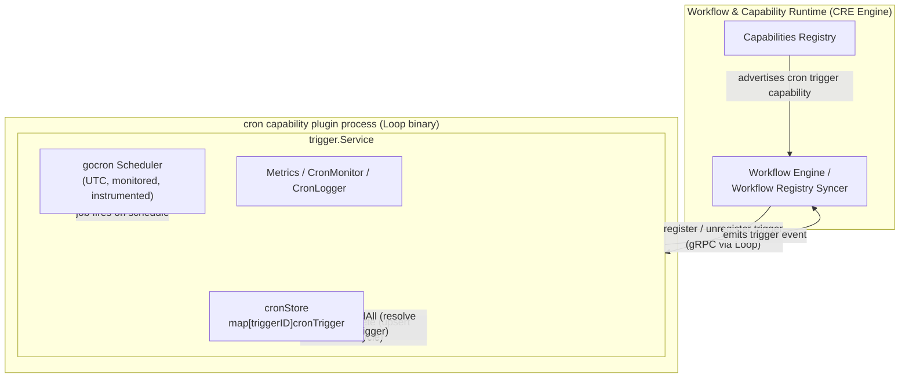
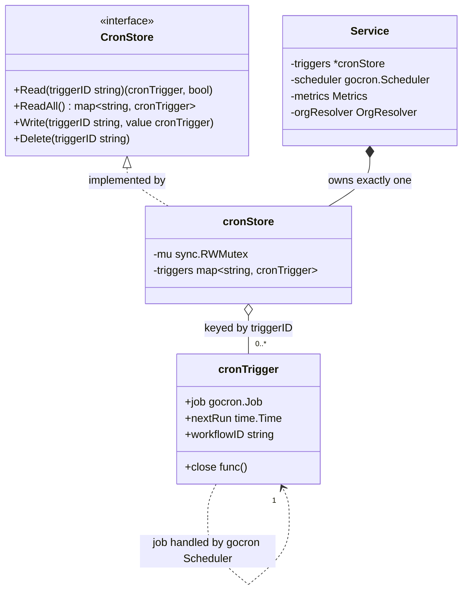
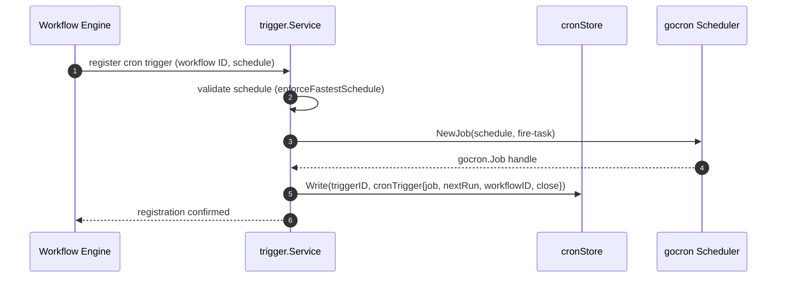
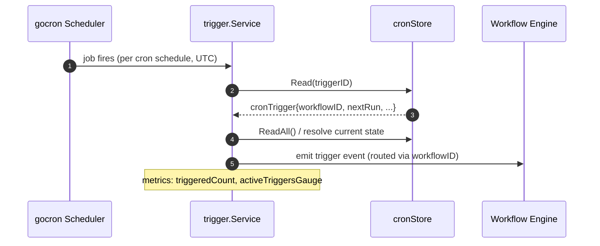
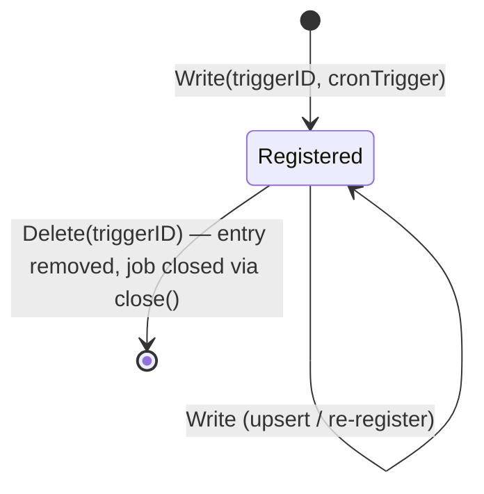

# Cron Capability — Trigger Store (`CronStore`)

The **trigger store** is the in-memory, concurrency-safe registry at the heart of the [cron capability](../cron_capability.md). It maps a *trigger ID* to the live, scheduled state of a cron trigger — the running `gocron` job handle, the next scheduled run time, the owning workflow, and a cleanup handle. It lives in `capabilities/cron/trigger/store.go` and is a single, deliberately small component (~60 lines, Go standard library only) that the [cron trigger service](cron_capability_trigger_service.md) reads from and writes to throughout the trigger lifecycle.

This page documents the store's contract, data model, concurrency guarantees, and its role within the [Workflow & Capability Runtime (CRE Engine)](../../Workflow___Capability_Runtime_(CRE_Engine).md).

---

## 1. Purpose and Scope

The cron capability is a **standard trigger capability** in the CRE engine: workflows subscribe to it, and it fires trigger events on a schedule (cron expression) agreed upon at registration. To do this, the capability process must track, per registered trigger:

- the **scheduler job** that will fire the event (`gocron.Job`),
- the **next scheduled run**, used for bookkeeping and observability,
- the **owning workflow**, so fired events can be routed back,
- a **close/cleanup function** that tears down the scheduler job on unregistration.

`CronStore` is the authoritative in-process record of exactly which triggers are live. It is:

| Property | Value |
|---|---|
| Storage | In-process memory (`map[string]cronTrigger`) |
| Concurrency control | `sync.RWMutex` (shared readers, exclusive writers) |
| Key | `triggerID` (unique per registered trigger) |
| Durability | **None** — process-scoped; state is rebuilt by re-registration on restart |
| External dependencies | None (stdlib `sync` and `maps` only) |
| Visibility | Package-private (`cronStore`, `cronTrigger` are unexported) |

> **Scope boundary:** the store does **not** validate schedules, fire events, emit metrics, or talk to the network. Those responsibilities belong to the [trigger service](cron_capability_trigger_service.md), the [schedule-limit validator (`enforceFastestSchedule`)](cron_capability_trigger_service.md), and the [observability layer](cron_capability_trigger_observability.md) respectively.

---

## 2. Position in the System

The cron capability is built and deployed as a **Loop plugin binary** (module `github.com/smartcontractkit/capabilities/cron`, see `capabilities/cron/go.mod`). Its `main` entrypoint boots the trigger service inside a Loop server, which exposes the capability over gRPC to the workflow engine. The `CronStore` is created once, inside [`NewTriggerService`](cron_capability_trigger_service.md), and lives for the lifetime of the plugin process (`capabilities/cron/trigger/trigger.go`).



The registration/unregistration RPCs originate from the workflow engine (see [workflows syncer](../workflows/workflows_syncer.md)) and reach the cron capability through the [Loop plugin framework](../../Plugin_Process_Framework_(Loop)/loop-plugin-core.md). Discovery and advertisement of the capability itself is handled by the [capabilities registry](../capabilities/capabilities_registry.md).

---

## 3. Core Component: `CronStore`

### 3.1 Interface Contract

Defined in `capabilities/cron/trigger/store.go`:

```go
type CronStore interface {
    Read(triggerID string) (value cronTrigger, ok bool)
    ReadAll() (values map[string]cronTrigger)
    Write(triggerID string, value cronTrigger)
    Delete(triggerID string)
}
```

| Operation | Lock acquired | Semantics |
|---|---|---|
| `Read(triggerID)` | `RLock` (shared) | Point lookup. Returns the stored value and `true`, or the **zero value** `cronTrigger` and `false` if the ID is absent. |
| `ReadAll()` | `RLock` (shared) | Returns a **defensive snapshot**: a brand-new map populated via `maps.Copy`. Safe to iterate and mutate freely; never reflects concurrent writes made after the call. |
| `Write(triggerID, value)` | `Lock` (exclusive) | **Upsert**. Creates the entry or overwrites an existing one for the same ID. |
| `Delete(triggerID)` | `Lock` (exclusive) | Removes the entry. A no-op if the ID is absent (Go's `delete` on a missing key is safe). |

### 3.2 Implementation (`cronStore`)

The concrete type is unexported; callers obtain it via the constructor:

```go
func NewCronStore() *cronStore {
    return &cronStore{triggers: map[string]cronTrigger{}}
}
```

- A single `sync.RWMutex` guards the entire map. Reads (`Read`, `ReadAll`) take `RLock`, so **any number of trigger lookups — including concurrent scheduler callbacks — proceed in parallel**; writes (`Write`, `Delete`) take the exclusive `Lock`.
- `ReadAll` copies value structs into a fresh map while holding the read lock and releases it before returning, so the snapshot cannot deadlock against writers and keeps lock hold times minimal (one map iteration).
- The struct copy returned by `Read` is shallow: the embedded `job` handle and `close` function reference shared scheduler state. Callers must treat them as read-only (this is the pattern used within the `trigger` package).

### 3.3 Data Model: `cronTrigger`

Each stored value describes one live, scheduled trigger (`capabilities/cron/trigger/trigger.go`):

```go
type cronTrigger struct {
    job        gocron.Job  // handle to the scheduled job in the gocron scheduler
    nextRun    time.Time   // next scheduled fire time (UTC-based schedule)
    workflowID string      // workflow that registered this trigger
    close      func()      // cleanup handle to stop/remove the job
}
```

The store is therefore more than a passive map — its entries hold *live references to scheduler state*. This is why the store is the correct place to answer "which cron triggers are currently active in this process?" and why `Delete` is the final step of unregistration.



### 3.4 Construction and Wiring

Wiring is fixed at service construction (`NewTriggerService`): the service owns the concrete `*cronStore` directly — there is no runtime injection of alternative store implementations. This keeps the data path simple, though it also means the interface currently serves as a documentation/testing seam rather than an extension point (see [design notes](#7-design-notes-and-constraints)).

---

## 4. Runtime Flows

### 4.1 Registration

When a workflow registers a cron trigger, the service validates the schedule (rejecting schedules faster than the configured limit via [`enforceFastestSchedule`](cron_capability_trigger_service.md)), creates the scheduler job, and commits the live trigger to the store:



`Write` is an upsert: re-registering an existing trigger ID atomically replaces its entry (a new registration typically closes the previous job first via the old entry's `close` handle).

### 4.2 Trigger Firing

The gocron scheduler invokes the service's task closure at each scheduled time. The service resolves the live trigger from the store and emits the trigger event back to the workflow engine:



Because `Read`/`ReadAll` take only a read lock, many jobs firing concurrently — including across many registered workflows — never serialize on the store.

### 4.3 Unregistration and Entry Lifecycle



On unregistration, the service stops the scheduler job (through the stored `close`/job handle) and removes the entry with `Delete`. Since the store is the single source of truth for "live" triggers, an ID absent from the store means the trigger is not running in this process.

---

## 5. Concurrency Model

Invariants guaranteed by the implementation:

1. **Safe concurrent access** — all four operations are internally synchronized; callers never lock the store themselves.
2. **Readers don't block readers** — `RLock` allows unlimited parallel `Read`/`ReadAll`, matching the access pattern of scheduler callbacks.
3. **Snapshots are stable** — `ReadAll` returns a copy; the caller can iterate it indefinitely without holding any lock and without observing mid-iteration mutations.
4. **Atomic upsert/remove** — `Write` and `Delete` serialize against each other and against reads, so a `Delete` either fully precedes or fully follows any `Write` for the same ID.

What is **not** guaranteed (and is out of scope by design):

- **Cross-process / cross-node consistency.** Each cron capability plugin process owns an isolated store. There is no coordination between nodes; schedule determinism across nodes is achieved instead by pinning the scheduler to UTC and validating schedules consistently (see the [trigger service](cron_capability_trigger_service.md)).
- **Durability.** Entries vanish on process restart. Recovery is *reconstructive, not restorative*: the workflow engine/syncer re-registers triggers after the capability restarts (see [workflows syncer](../workflows/workflows_syncer.md)).
- **Eviction.** There is no TTL, LRU, or size cap. Store size is bounded implicitly by the number of registered workflows' triggers; cleanup relies on the service honoring unregister calls.

---

## 6. Build and Packaging Context

- The store belongs to the Go module `github.com/smartcontractkit/capabilities/cron` (`capabilities/cron/go.mod`), one of several independent modules inside the `capabilities` workspace (`capabilities/go.mod`, `capabilities/nx.json`). Module hygiene commands live in `capabilities/Makefile` (`gomodtidy`, `generate`, `mockery`).
- Runtime dependencies of the surrounding capability include `go-co-op/gocron/v2` (scheduler), `jonboulle/clockwork` (clock injection), and OpenTelemetry (metrics). The store itself adds **zero** third-party dependencies — a deliberate property that keeps the concurrency-critical core trivially auditable and testable.
- The whole capability is compiled into a plugin binary (`capabilities/cron/main.go`) and served over gRPC via the Loop framework; the store never crosses process boundaries and has no serialization surface.

---

## 7. Design Notes and Constraints

- **Encapsulation by unexported types.** `cronStore` and `cronTrigger` are unexported, so the store is only meaningfully usable inside the `trigger` package. External consumers interact exclusively through the [service](cron_capability_trigger_service.md). This trades flexibility (no external mocking of the store) for a tight, reviewable API surface.
- **Interface/implementation skew.** The constructor returns the concrete `*cronStore` rather than the `CronStore` interface, and the service field is typed concretely. Also note the compile-time assertion in `store.go` reads `var _ CronStore = (CronStore)(nil)` — this converts `nil` to the interface and is satisfied trivially, so it does **not** verify that `*cronStore` implements `CronStore`. The idiomatic form would be `var _ CronStore = (*cronStore)(nil)`. Correctness currently rests on the service's use of the concrete type satisfying call sites.
- **Value-copy semantics.** `cronTrigger` is stored and returned by value. The struct's reference-typed fields (`job`, `close`) are shared across copies; treat them as owned by the service, not by store callers.
- **Observability is adjacent, not embedded.** Active-trigger gauges and fire counters (see [observability](cron_capability_trigger_observability.md)) are maintained by the service/metrics layer when it mutates or fires triggers — the store itself is instrumentation-free, which keeps it free of telemetry failure modes.

---

## 8. Related Documentation

| Topic | Page |
|---|---|
| Cron capability overview | [cron_capability](../cron_capability.md) |
| Trigger service lifecycle, registration, schedule limits | [cron_capability_trigger_service](cron_capability_trigger_service.md) |
| Cron metrics, monitor and logger | [cron_capability_trigger_observability](cron_capability_trigger_observability.md) |
| Standard capability interfaces (`CapabilityInfo`, trigger contracts) | [capabilities_core](../capabilities/capabilities_core.md) |
| Capability discovery & registration | [capabilities_registry](../capabilities/capabilities_registry.md) |
| Workflow registration & sync (source of register/unregister calls) | [workflows_syncer](../workflows/workflows_syncer.md) |
| Loop plugin process framework (how the capability is hosted) | [loop-plugin-core](../../Plugin_Process_Framework_(Loop)/loop-plugin-core.md) |
| CRE engine root | [Workflow & Capability Runtime](../../Workflow___Capability_Runtime_(CRE_Engine).md) |

---

## 9. Source References

| Symbol | Location |
|---|---|
| `CronStore`, `cronStore`, `NewCronStore` | `capabilities/cron/trigger/store.go` |
| `Service`, `cronTrigger`, `NewTriggerService`, `Config` | `capabilities/cron/trigger/trigger.go` |
| `enforceFastestSchedule` (schedule-limit validation at registration) | `capabilities/cron/trigger/utils.go` |
| `Metrics`, `CronMonitor`, `CronLogger` | `capabilities/cron/trigger/metrics.go`, `monitor.go`, `logger.go` |
| Plugin entrypoint (`main`) | `capabilities/cron/main.go` |
| Module manifest & dependencies | `capabilities/cron/go.mod` |
| Workspace build tooling | `capabilities/Makefile`, `capabilities/go.mod` |
