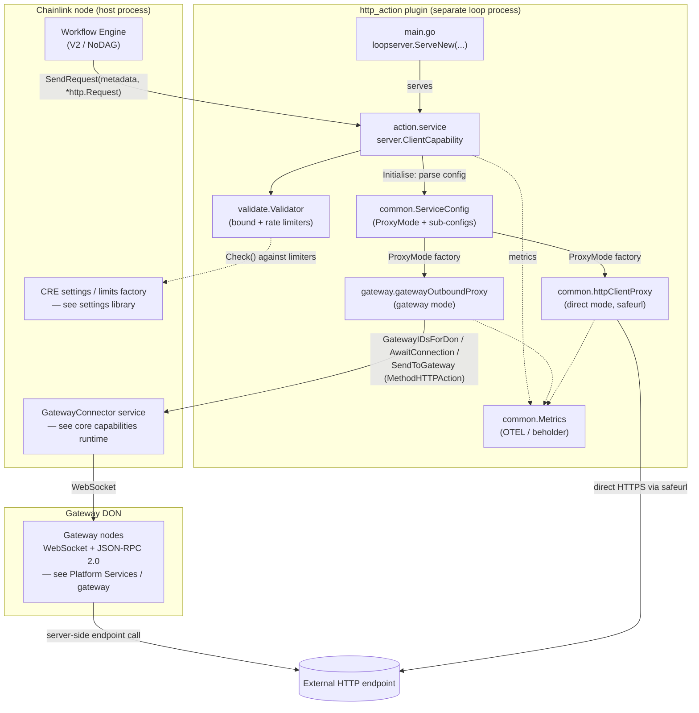
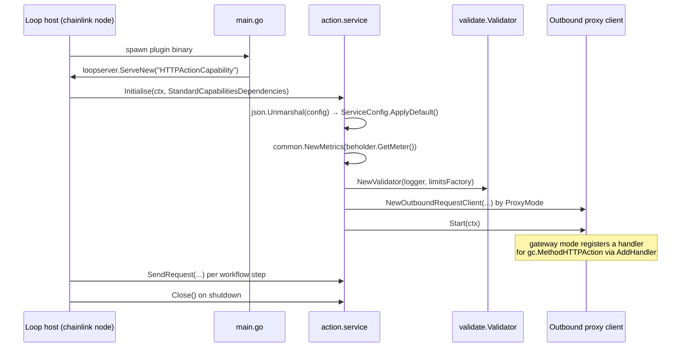
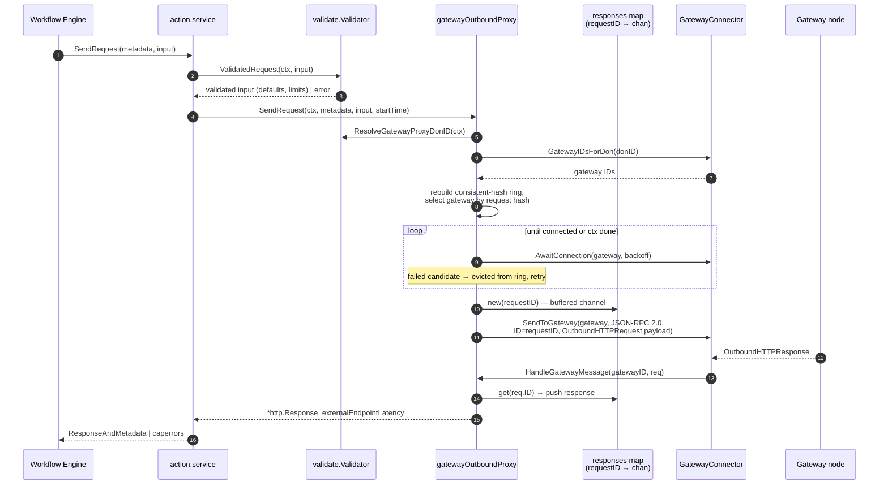

# HTTP Action Capability (`http_action`)

> **Module:** `github.com/smartcontractkit/capabilities/http_action` (repo root: `capabilities/http_action/`)
> **Domain:** [Workflow & Capability Runtime (CRE Engine)](Workflow___Capability_Runtime_(CRE_Engine).md)

## 1. Purpose

The HTTP Action Capability is a standalone **standard capability** plugin that lets CRE workflows (the V2/NoDAG engine) perform secure, rate-limited **outbound HTTP requests** to external systems. It is packaged as a separate binary that runs beside the chainlink node and communicates with it through the [Loop plugin framework](../Plugin_Process_Framework_(Loop)/loop-plugin-core.md); `capabilities/http_action/project.json` identifies it as `projectType: "capability"` with an implicit dependency on `loopserver`.

Core responsibilities:

| # | Responsibility | Where |
|---|----------------|-------|
| 1 | Expose `SendRequest(metadata, http.Request) → ResponseAndMetadata[http.Response]` to the workflow engine | `action` package |
| 2 | Route outbound calls through one of two **proxy modes** — `direct` or `gateway` (production default) | `common.NewOutboundRequestClient` factory in `action/action.go` |
| 3 | Validate and rate-limit every request/response against the CRE settings/limits framework (SSRF, sizes, timeouts, headers, mTLS) | `validate` package |
| 4 | Attribute every failure to the party responsible (user vs. platform) via a strict error taxonomy | `gateway/user_error.go`, `common/util.go` |
| 5 | Emit OpenTelemetry metrics through [Beholder](../Telemetry___Observability_Platform/beholder-telemetry.md) | `common/metrics.go` |

Supported HTTP methods: `GET`, `POST`, `PUT`, `DELETE`, `PATCH` (case-insensitive, enforced by the validator).

---

## 2. Architecture Overview

### 2.1 Component map



### 2.2 Package layout

```
capabilities/http_action/
├── main.go                  # Loop-plugin entry point (loopserver.ServeNew)
├── action/action.go         # Capability service: lifecycle, proxy-mode factory, error mapping
├── gateway/
│   ├── gateway_outbound_proxy.go  # Gateway-mode client (consistent hashing, backoff, response correlation)
│   └── user_error.go        # UserError / TimeoutError / CanceledError taxonomy
├── common/
│   ├── proxy.go             # OutboundRequestClient interface + direct-mode httpClientProxy (safeurl)
│   ├── service_config.go    # ServiceConfig, ProxyMode, GatewayConnectionConfig, HTTPClientConfig
│   ├── metrics.go           # OTEL counters/histograms + histogram views
│   └── util.go              # Request IDs, user error-code mapping
├── validate/validator.go    # Request/response validation against CRE settings limiters
├── go.mod                   # Module manifest (see §6)
└── project.json             # Nx build/test/lint targets
```

### 2.3 Startup and lifecycle



`main.go` wires `action.NewService(s.Logger, s.LimitsFactory)` into `server.NewClientServer(...)` and registers the custom OTEL histogram views from `common.MetricViews()` on the loop server — bucket definitions must be supplied when the beholder client is created (OTEL specification requirement).

---

## 3. Request Lifecycle (Gateway Mode)

The gateway proxy implements `core.GatewayConnectorHandler` (inbound) and `common.OutboundRequestClient` (outbound). One JSON-RPC request ID correlates the send and the asynchronous response.



Key mechanics of `gateway/gateway_outbound_proxy.go`:

- **Request identity.** `requestID = common.GetRequestID(gc.MethodHTTPAction, workflowID, workflowExecutionID)` — method + workflow identifiers + a UUID, joined with `/`. The `responses` map guarantees uniqueness per ID (duplicate ⇒ error) and is cleaned up via `defer`.
- **Two deadlines, deliberately split.** `timeoutMs` bounds only *delivery to the gateway* (`sendCtx`); the response wait gets its own `waitCtx` = `timeoutMs + ResponseGraceMs` (default 5 000 ms) started *after* the send. Because the gateway applies `timeoutMs` to the endpoint call and mirrors the same grace budget for reporting back, exhausting the grace means the gateway went silent — a platform fault.
- **Consistent-hash routing.** Every request rebuilds a `stathat.com/c/consistent` ring from `GatewayIDsForDon(donID)`. The request hash deterministically picks a gateway (good for gateway-side caching); if `AwaitConnection` fails, the node is evicted and the next candidate is tried; when the ring empties, the gateway list is refetched after an exponential backoff (`InitialIntervalMs` × `Multiplier`, capped at `MaxElapsedTimeMs`; defaults 100 ms / 2.0 / 5 000 ms).
- **Header handling.** Requests carry either `Headers` (legacy single-value) or `MultiHeaders`, never both (validator-enforced). Responses always populate both fields — one sourced, one derived — and every header key/value is passed through `common.SanitizeUTF8` because proto string fields must be valid UTF-8 to marshal over gRPC.
- **Round-trip telemetry.** The node-observed round trip (send → gateway processing → response delivery, including loop-plugin boundary latency) is recorded *before* inspecting the response, so received error responses are measured too; failed waits are instead counted by `gateway_round_trip_failures` with `reason ∈ {send_error, context_done}` (cardinality kept deliberately low).

### 3.1 Direct mode vs gateway mode

| Aspect | Direct (`common.httpClientProxy`) | Gateway (`gateway.gatewayOutboundProxy`) |
|---|---|---|
| Transport | In-process `safeurl` HTTP client | Node's `GatewayConnector` → gateway DON over WebSocket/JSON-RPC 2.0 |
| SSRF protection | safeurl allow/deny lists (IPs, CIDRs, ports, schemes), redirects disabled | Enforced gateway-side; node still validates input |
| Caching | Not supported | `CacheSettings{Store, MaxAgeMs}` honored by the gateway |
| mTLS | Passed through from `http.Request.Mtls` | Wrapped as `gc.MtlsAuth` (key as `gc.Secret`) |
| Retry/routing | None (single attempt) | Consistent-hash selection + exponential-backoff ring eviction |
| Request ID | Fresh `uuid.New()` | Composite workflow-scoped ID (dedup-safe) |

Direct mode exists mainly for local development/simulation; gateway mode is the production default because egress, caching, and SSRF policy are centralized in the [gateway DON](../Node_Platform_Services/gateway.md).

---

## 4. Error Taxonomy

Failures are attributed to the party responsible — only platform faults increment `http_action_execution_error_count`, so a slow or failing customer endpoint never pages operations. Wrappers live in `gateway/user_error.go` (`UserError`, `TimeoutError`, `CanceledError`) and `common/proxy.go` (`InputValidationError`); `action/service.SendRequest` maps them onto the capabilities error model (`caperrors`) via `common.UserErrorCode` (`LimitExceeded` for `limits.LimitError`, otherwise `InvalidArgument`).

| Condition | Error type | Capability error | Counter (`http_action_` prefix) |
|---|---|---|---|
| Input validation failed | `UserError` / `InputValidationError` | user, `InvalidArgument`/`LimitExceeded` | `validation_failure_count` |
| Gateway reports endpoint send/read failure | `UserError` (`IsExternalEndpointError`) | user, `InvalidArgument` | `external_endpoint_error_count` |
| Gateway reports a blocked request | `UserError` (`IsValidationError`) | user, `InvalidArgument` | `validation_failure_count` |
| Response exceeds size limit | `UserError` | user, `LimitExceeded` | `external_endpoint_error_count` |
| No gateway reachable / unclassified gateway error | plain error | system, `Internal` | `gateway_send_error_count`, `execution_error_count` |
| Gateway silent past response deadline | `TimeoutError` | system, `DeadlineExceeded` | `execution_timeout_count` (+ `execution_error_count`) |
| Caller canceled before response | `CanceledError` | system, `Canceled` | `request_canceled_count` (deliberately **not** an execution error) |

Cancellation is not the user's fault, but `caperrors.Origin` has no "neither side" state, so it surfaces as a system error carrying `Canceled`; alerts over capability failures should exclude that code.

---

## 5. Validation and Limits

`validate.Validator` is the single gate every request passes (`ValidatedRequest` at the send boundary) plus the response-size check at the receive boundary. It is built from the [CRE settings/limits framework](../Shared_Foundation_Libraries___Domain_Types/settings.md):

- **Bound limiters** (per-workflow settings): request size (marshaled JSON), connection timeout (default 5 s when unset), cache age (`MaxAgeMs` ≥ 0), response size.
- **Rate limiter** (per-org): mTLS-authenticated requests.
- **Rules:** URL non-empty after trim; method in the allowed set (normalized to upper-case); `Headers` XOR `MultiHeaders` (`ErrRequestHeadersBothSet`); mTLS requires both key and certificate; missing `CacheSettings` defaults to disabled/zero.
- **Gateway routing:** `ResolveGatewayProxyDonID` reads the `GatewayProxyDonID` CRE setting; empty means all connected gateways are eligible.

---

## 6. Observability

All metrics are OpenTelemetry instruments on the Beholder meter (`common/metrics.go`):

| Instrument | Type | Notes |
|---|---|---|
| `http_action_request_count` | counter | every `SendRequest` |
| `http_action_validation_failure_count` | counter | user-input faults |
| `http_action_capability_gateway_send_count` / `_send_error_count` | counters | attrs: `node_address`, `gateway_proxy_don_id` |
| `http_action_successful_response_count` | counter | attrs: `proxy_mode`, `status_code` |
| `http_action_execution_error_count` / `_execution_timeout_count` / `_request_canceled_count` | counters | platform-fault page signal vs. cancellation |
| `http_action_external_endpoint_error_count` | counter | user-endpoint faults |
| `http_action_request_latency_ms`, `_ms_excluding_external_endpoint`, `http_action_external_endpoint_latency_ms` | histograms | success/failure split via `success` attr |
| `http_action_capability_gateway_round_trip_ms` | histogram | attrs: `gateway_id`; custom buckets 10 ms → 90 s via `MetricViews()` |
| `http_action_capability_gateway_round_trip_failures` | counter | attrs: `gateway_id`, `reason ∈ {send_error, context_done}` |
| `http_action_no_gateways_available_count` | counter | attrs: `gateway_proxy_don_id` |

Logs are correlation-tagged with `requestID`, `workflowID`, `workflowExecutionID`, `workflowOwner`; the node-side gateway counterpart service is documented in [Node Platform Services / gateway](../Node_Platform_Services/gateway.md).

---

## 7. Configuration

Top-level `ServiceConfig` (`common/service_config.go`), unmarshaled from the capability's JSON config during `Initialise` (`ProxyMode` parsed from `"direct"`/`"gateway"`):

```json
{
  "proxyMode": "gateway",
  "gatewayConnection": {
    "initialIntervalMs": 100,
    "maxElapsedTimeMs": 30000,
    "multiplier": 2.0,
    "responseGraceMs": 5000
  },
  "httpClient": {
    "allowedPorts": [443],
    "allowedSchemes": ["https"],
    "blockedIPs": [], "blockedIPsCIDR": [],
    "allowedIPs": [], "allowedIPsCIDR": []
  }
}
```

Defaults applied in code: `ApplyDefault` sets `allowedPorts=[443]` and `allowedSchemes=["https"]` when empty; `applyDefaults` fills gateway backoff fields (100 ms initial, 2.0× multiplier, 5 000 ms max elapsed, 5 000 ms response grace); the validator defaults `timeoutMs` to 5 000 ms.

---

## 8. Build, Packaging & Dependencies

`capabilities/http_action/project.json` (Nx workspace) defines the targets used in CI: `build` cross-compiles CGO-free Linux binaries to `capabilities/bin/{amd64,arm64}/http_action` (deployed as standard-capability jobs — see [CRE & Keystone Deployment Suite / cre-jobs](../CRE___Keystone_Deployment_Suite/cre-jobs.md)), plus `test` (with coverage), `race`, `lint`, `tidy`, and `generate`. Workspace-level orchestration lives in the [capabilities workspace tooling](../Build,_CI___Release_Infrastructure/capabilities_workspace_tooling.md) page.

Key dependencies from `capabilities/http_action/go.mod`:

| Dependency | Role |
|---|---|
| `chainlink-common` | capability framework & proto types (`capabilities/v2/actions/http`), `types/core` (`GatewayConnector`, `StandardCapabilitiesDependencies`), `types/gateway` (JSON-RPC methods, `OutboundHTTPRequest/Response`), logger, services state machine, settings/limits, jsonrpc2 |
| `capabilities/libs` | `loopserver` (plugin serving) — part of the [shared capability libs](capabilities_shared_libs.md) |
| `doyensec/safeurl` | SSRF-hardened HTTP client (direct mode) |
| `stathat.com/c/consistent` | consistent-hash ring for gateway selection |
| `go.opentelemetry.io/otel{,/metric,/sdk/metric}` | metrics |
| `google/uuid`, `google.golang.org/protobuf` | request IDs, `durationpb` timeouts |

---

## 9. Sub-modules

Detailed documentation per area:

| Sub-module | Contents | Page |
|---|---|---|
| Action service | `main.go` entry point, `action.service` lifecycle, proxy-mode factory, capability error mapping | [http_action_capability_action_service](http_action_capability/http_action_capability_action_service.md) |
| Gateway proxy | `gatewayOutboundProxy`, consistent-hash routing, response correlation, error taxonomy | [http_action_capability_gateway_proxy](http_action_capability/http_action_capability_gateway_proxy.md) |
| Direct proxy | `OutboundRequestClient` contract, `httpClientProxy` with safeurl SSRF policy | [http_action_capability_direct_proxy](http_action_capability/http_action_capability_direct_proxy.md) |
| Validation & limits | `validate.Validator`, bound/rate limiters, gateway-DON resolution | [http_action_capability_validation_limits](http_action_capability/http_action_capability_http_action_capability_validation_limits.md) |
| Shared runtime | `ServiceConfig`, OTEL metrics, request IDs & error codes | [http_action_capability_shared_runtime](http_action_capability/http_action_capability_shared_runtime.md) |

---

## 10. Related Documentation

- [Capabilities framework](capabilities.md) — `ExecutableCapability`/`ResponseAndMetadata` contracts and the capabilities registry this plugin implements against.
- [Workflows](workflows.md) and [core capabilities runtime](core_capabilities_runtime.md) — the engines and node runtime that invoke and host standard capabilities, including the `GatewayConnector` dependency.
- [HTTP trigger capability](http_trigger_capability.md) and [cron capability](cron_capability.md) — sibling capabilities in the same workspace.
- [Gateway (platform service)](../Node_Platform_Services/gateway.md) — the DON that terminates gateway-mode requests.
- [Beholder telemetry](../Telemetry___Observability_Platform/beholder-telemetry.md) — meter/export pipeline behind `common.Metrics`.
- [Settings library](../Shared_Foundation_Libraries___Domain_Types/settings.md) — CRE settings and limits powering the validator.
