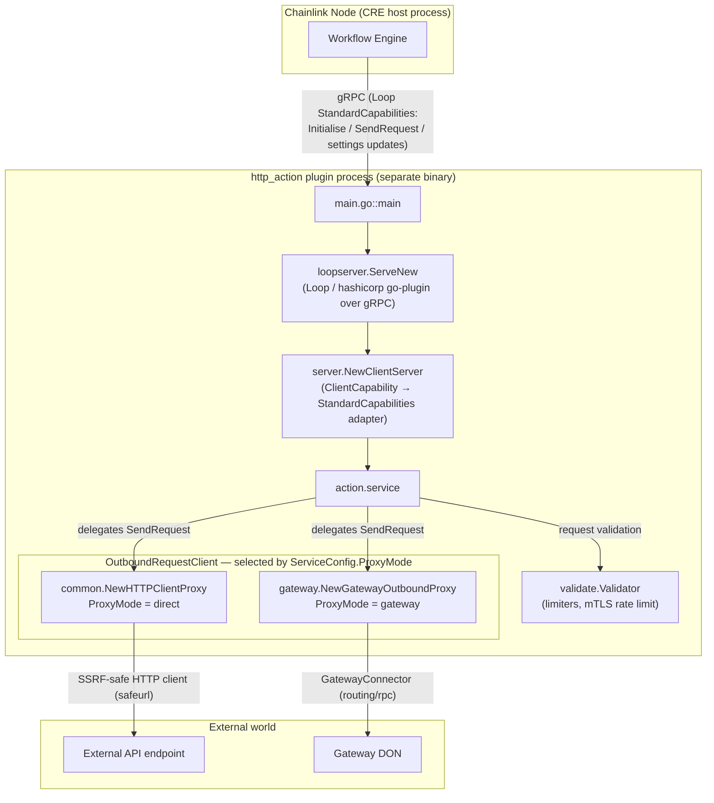
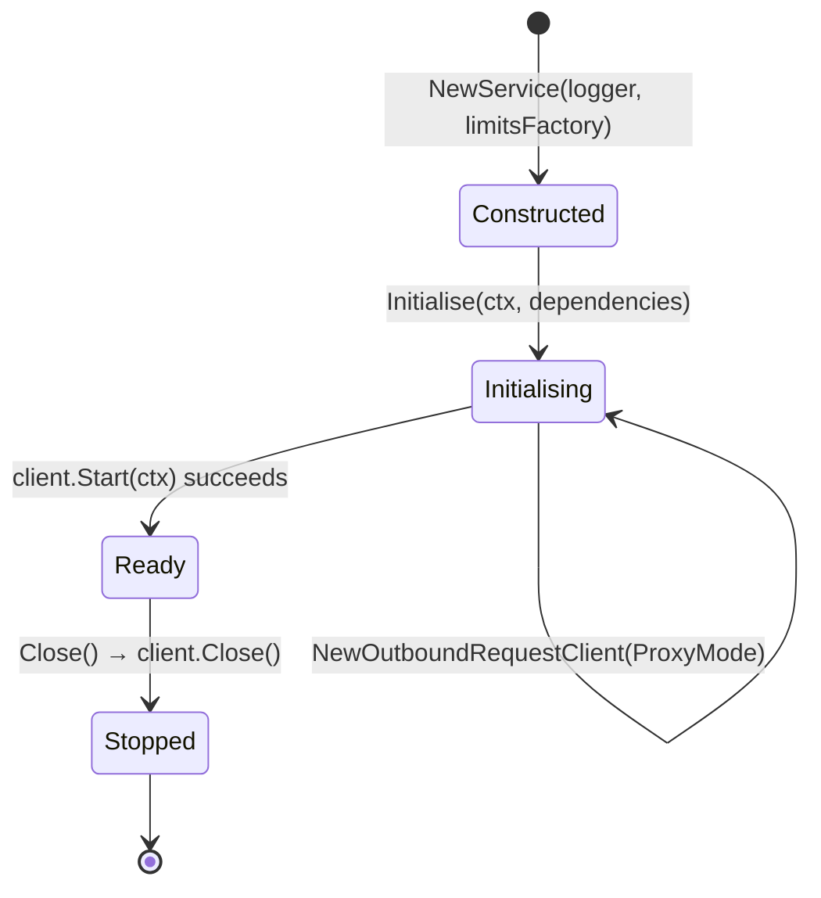
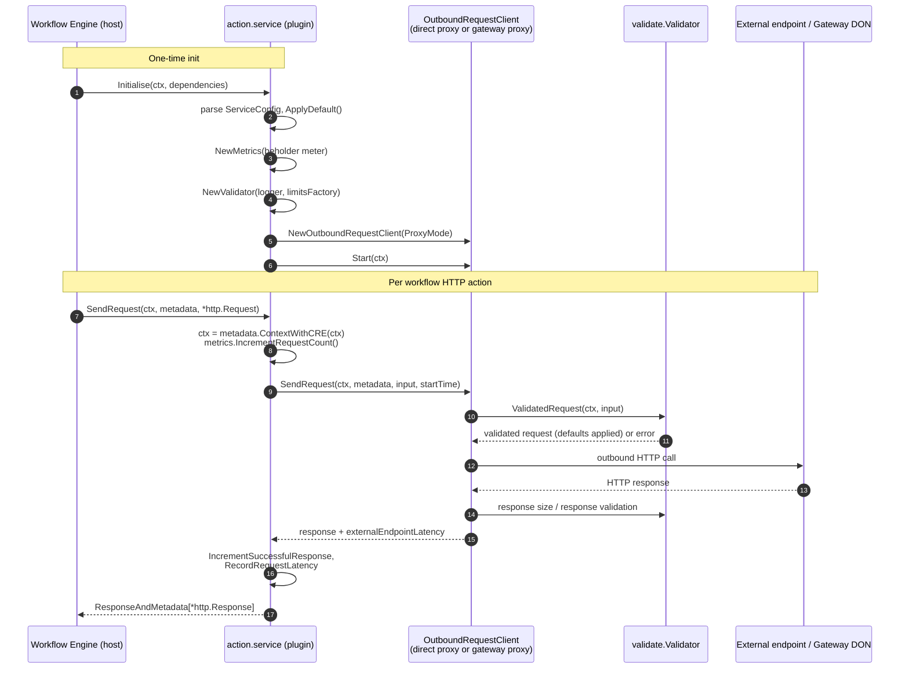
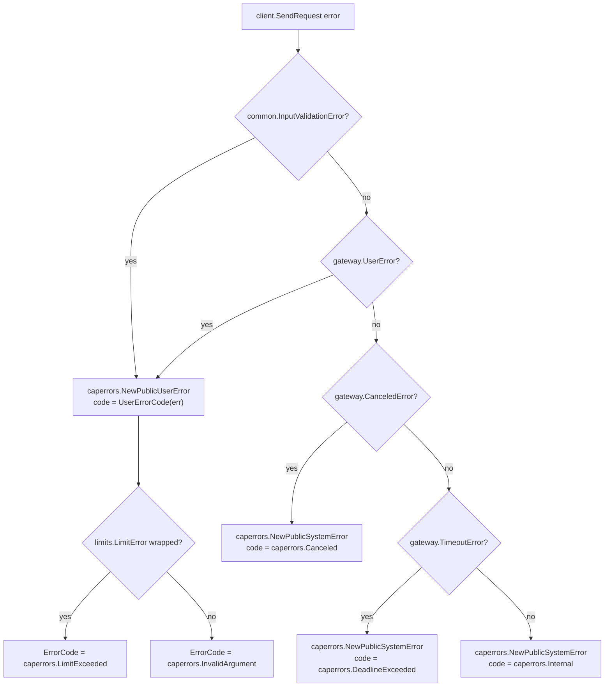

# HTTP Action Capability — Action Service

> **Module path:** `capabilities/http_action/action` (Go module `github.com/smartcontractkit/capabilities/http_action`, see [`capabilities/http_action/go.mod`](../../../capabilities/http_action/go.mod))
> **Parent module:** [HTTP Action Capability](../http_action_capability.md)
> **Grandparent:** [Workflow & Capability Runtime (CRE Engine)](../../Workflow___Capability_Runtime_(CRE_Engine).md)

## Introduction

The **action service** is the heart of the HTTP Action capability: it is the component that CRE workflows actually call when they need to perform an outbound HTTP request. This module contains two things:

1. **The plugin binary entry point** — `capabilities/http_action/main.go::main`, which hosts the capability as a standalone plugin process served over the [Loop plugin framework](../../Plugin_Process_Framework_(Loop)/loop-plugin-core.md).
2. **The `service` implementation** — `capabilities/http_action/action/action.go::service`, which implements the standard capability lifecycle and the `SendRequest` capability method, selects the outbound transport (direct HTTP client or gateway-routed proxy), classifies errors, and emits telemetry.

The service itself is deliberately thin: it delegates the actual outbound work to one of two pluggable proxies and delegates request/response policy enforcement to the validator. The heavy lifting is documented in the sibling sub-modules:

| Concern | Sub-module |
|---|---|
| Direct (node-local) outbound HTTP proxy | [http_action_capability_direct_proxy](http_action_capability_direct_proxy.md) |
| Gateway-routed outbound proxy | [http_action_capability_gateway_proxy](http_action_capability_gateway_proxy.md) |
| Shared config, metrics & error-code utilities | [http_action_capability_shared_runtime](http_action_capability_shared_runtime.md) |
| Request validation & resource limits | [http_action_capability_validation_limits](http_action_capability_validation_limits.md) |

---

## Architecture

### Component relationships

`main` boots a Loop plugin server (`loopserver.ServeNew`), which spawns the hashicorp `go-plugin` handshake over gRPC and exposes the service as a `loop.StandardCapabilities` implementation. The `service` implements the `server.ClientCapability` contract and, during `Initialise`, wires together metrics, the validator, and one of the two outbound proxies chosen by `ProxyMode`.



Key structural points:

- **Process isolation.** The capability runs in its own OS process. The workflow engine in the node host talks to it over gRPC using the Loop `StandardCapabilities` contract (see [Plugin Process Framework (Loop)](../../Plugin_Process_Framework_(Loop).md)). This isolates workflow-originated network calls from the node core.
- **Settings propagation.** `loopserver.ServeNew` installs an atomic settings getter/interceptor (`loop.NewAtomicSettings(cresettings.DefaultGetter)`, `settingsInterceptor.updateSettings`) so CRE settings — including the per-workflow HTTP Action limits consumed by the validator — can be hot-updated from the host (see [settings](../../Shared_Foundation_Libraries___Domain_Types/settings.md)).
- **Transport abstraction.** The `service` only knows the `common.OutboundRequestClient` interface (`SendRequest(ctx, metadata, input, startTime) (*httpcap.Response, time.Duration, error)` plus `services.Service` lifecycle). The concrete proxy is chosen once, at initialisation.
- **Shared dependency contract.** Both proxies consume the same `common.RequestValidator` (`ValidatedRequest`, response validation, `ResolveGatewayProxyDonID`) and the same `common.Metrics`, guaranteeing consistent policy and telemetry regardless of transport.

### Service lifecycle

The service follows the `services.Service` lifecycle and the capability-specific `Initialise` hook. `Initialise` is where all wiring happens; after it succeeds, the plugin signals readiness to the host.



Notes:

- `Start` / `Close` are pure delegation to the selected proxy client (`s.client.Start` / `s.client.Close`).
- `HealthReport` reports per-service health keyed by `Name()` (the logger name, `HTTPActionCapability`); `Ready` is a no-op once started.
- `Description()` returns `"HTTP Actions Service"`; the plugin service name constant is `ServiceName = "HTTPActionCapability"`.

---

## Core Components

### 1. Plugin entry point — `main.go::main`

```go
func main() {
	loopserver.ServeNew(action.ServiceName, func(s *loop.Server) loop.StandardCapabilities {
		return server.NewClientServer(action.NewService(s.Logger, s.LimitsFactory))
	}, loop.WithOtelViews(common.MetricViews()))
}
```

Responsibilities:

- **Serve the plugin**: `loopserver.ServeNew` (`capabilities/libs/loopserver/main.go::ServeNew`) starts the Loop server, registers the `PluginStandardCapabilitiesName` plugin, and blocks serving gRPC until shutdown.
- **Compose the capability**: `action.NewService(s.Logger, s.LimitsFactory)` constructs the service with the Loop-provided logger and limits factory; `server.NewClientServer` wraps it in the `loop.StandardCapabilities` adapter expected by the host.
- **Observability wiring**: `loop.WithOtelViews(common.MetricViews())` registers the OpenTelemetry metric views used by the [shared metrics](http_action_capability_shared_runtime.md) counters/histograms (Beholder OTLP pipeline — see [beholder-telemetry](../../Telemetry___Observability_Platform/beholder-telemetry.md)).

### 2. The `service` — `action.go::service`

Compile-time contract (asserted in the source):

```go
var (
	_ services.Service        = &service{}
	_ server.ClientCapability = &service{}
)
```

**Fields**

| Field | Type | Purpose |
|---|---|---|
| `lggr` | `logger.SugaredLogger` | Named logger (`HTTPActionCapability`) |
| `client` | `common.OutboundRequestClient` | The selected outbound proxy (direct or gateway) |
| `cfg` | `common.ServiceConfig` | Parsed capability configuration |
| `metrics` | `*common.Metrics` | Beholder/OTel metrics |
| `limitsFactory` | `limits.Factory` | Source of bound/rate limiters and settings getter |
| `validator` | `*validate.Validator` | Request/response validation and limit enforcement |

**`Initialise(ctx, dependencies core.StandardCapabilitiesDependencies)`**

The initialisation sequence, in order:

1. Unmarshal `dependencies.Config` (JSON) into `common.ServiceConfig` and call `cfg.ApplyDefault()`.
2. Build `common.Metrics` from the Beholder meter (`beholder.GetMeter()`).
3. Build `validate.NewValidator(lggr, limitsFactory)` — creates bound limiters from CRE settings (request size, response size, connection timeout, cache age) plus the per-org mTLS rate limiter (details in [validation_limits](http_action_capability_validation_limits.md)).
4. Call `NewOutboundRequestClient(...)` to select and construct the proxy.
5. `Start(ctx)` — starts the proxy client.

If any step fails, initialisation returns the error and the host can tear the plugin down.

**`SendRequest(ctx, metadata capabilities.RequestMetadata, input *http.Request)`**

This is the capability method invoked by the workflow engine for every `sendrequest` HTTP action in a workflow (capability semantics are defined in [capabilities_core](../capabilities/capabilities_core.md)).

Happy path:

1. Enrich the context with workflow identity via `metadata.ContextWithCRE(ctx)` (workflow owner / ID / execution ID — required for request/response bookkeeping and logging; the call is intentionally repeated and idempotent).
2. Start the wall clock; increment the request-count metric.
3. Delegate to `s.client.SendRequest(ctx, metadata, input, startTime)`. **Validation runs inside the client** (direct or gateway) via the validator's `ValidatedRequest` — the service layer performs no request mutation itself.
4. On success: increment the successful-response counter (tagged with proxy mode and status code), record total and external-endpoint latency, and return `&capabilities.ResponseAndMetadata[*http.Response]{Response, ResponseMetadata:{}}`.

Failure path — error classification (see below).

### 3. Transport selection — `action.go::NewOutboundRequestClient`

```go
switch serviceConfig.ProxyMode {
case common.ProxyModeDirect:
	return common.NewHTTPClientProxy(serviceConfig, lggr, validator, metrics)
case common.ProxyModeGateway:
	return gateway.NewGatewayOutboundProxy(gatewayConnector, serviceConfig, lggr, metrics, validator)
default:
	return nil, errors.New("invalid ProxyMode: " + serviceConfig.ProxyMode.String())
}
```

| ProxyMode | Client | Behaviour |
|---|---|---|
| `direct` | `common.NewHTTPClientProxy` | Node-local outbound HTTP using a `doyensec/safeurl`-hardened client. The safeurl builder is configured from `HTTPClientConfig` (`AllowedIPs`, `AllowedIPsCIDR`, `AllowedPorts`, `AllowedSchemes`, `BlockedIPs`, `BlockedIPsCIDR`) with redirects disabled — an SSRF defense-in-depth layer (see [direct_proxy](http_action_capability_direct_proxy.md)). |
| `gateway` | `gateway.NewGatewayOutboundProxy` | Requests are routed through a Gateway DON via `dependencies.GatewayConnector`, with consistent-hash routing (`stathat.com/c/consistent`) in the `routingGatewayConnector` and a user-facing error taxonomy (see [gateway_proxy](http_action_capability_gateway_proxy.md)). |
| anything else | error | Initialisation fails with `invalid ProxyMode: …`. |

---

## Configuration

The capability is configured with a JSON blob delivered in `core.StandardCapabilitiesDependencies.Config` at `Initialise` time. The shape (see [shared_runtime](http_action_capability_shared_runtime.md) for full definitions):

```jsonc
{
  "proxyMode": "gateway",          // "direct" | "gateway"
  "gatewayConnection": { ... },    // GatewayConnectionConfig — used in gateway mode
  "httpClient": {                  // HTTPClientConfig — used in direct mode
    "allowedIPs": [], "allowedIPsCIDR": [], "allowedPorts": [],
    "allowedSchemes": [], "blockedIPs": [], "blockedIPsCIDR": []
  }
}
```

Defaults are applied via `ServiceConfig.ApplyDefault()` after unmarshalling.

**Runtime (CRE) settings** consumed indirectly through the limits factory by the validator (module `chainlink-common/pkg/settings/cresettings`):

- `PerWorkflow.HTTPAction.ResponseSizeLimit`, `.RequestSizeLimit`, `.ConnectionTimeout`, `.CacheAgeLimit`, `.GatewayProxyDonID`
- `PerOrg.HTTPAction.MtlsRateLimit`

These are hot-updatable through the Loop settings channel (the `settingsInterceptor` in `loopserver`), which is why the validator holds a `settings.Getter` and reads them per-request.

---

## Request flow



---

## Error handling

The service is the single place where transport-level errors are translated into the **capability error taxonomy** (`chainlink-common/pkg/capabilities/errors`, abbreviated `caperrors`) that the workflow engine understands. Classification is strict error-type matching via `errors.AsType`:



How the codes resolve (`common/util.go::UserErrorCode`):

| Underlying error | Returned error | Error code |
|---|---|---|
| `common.InputValidationError` (request validation, produced by the proxy's validator call) | `PublicUserError` | `LimitExceeded` if the cause is a `limits.LimitError`, otherwise `InvalidArgument` |
| `gateway.UserError` | `PublicUserError` | same mapping as above |
| `gateway.CanceledError` | `PublicSystemError` | `Canceled` |
| `gateway.TimeoutError` | `PublicSystemError` | `DeadlineExceeded` |
| any other error | `PublicSystemError` | `Internal` |

Every returned error message includes the workflow identity (`WorkflowID`, `WorkflowOwner`, `WorkflowName`, `WorkflowExecutionID`) for traceability, and every failure path records request latency (tagged as failed) on the metrics recorder.

This taxonomy matters operationally: **user errors** (bad input, exceeded limits, gateway-rejected requests) are surfaced to workflow authors, while **system errors** (cancel/timeout/internal) are treated as infrastructure conditions by the execution engine.

---

## Observability

`common.Metrics` (created from the Beholder OTel meter, views registered by `main`) instruments the whole request path. Counters and histograms maintained by this module and its clients:

- `requestCount`, `successfulResponse` (tagged by proxy mode / status code), `inputValidationFailures`
- `executionError`, `executionTimeout`, `requestCanceled`, `externalEndpointError`
- `requestLatency`, `requestLatencyExcludingExternal`, `externalEndpointLatency`
- Gateway-specific: `gatewaySendCount`, `gatewaySendError`, `gatewayRoundTrip`, `gatewayRoundTripFailures`, `noGatewaysAvailable`

Latency is recorded on **both success and failure** paths with a success flag, and with the configured proxy mode as a dimension, so direct vs gateway deployments can be compared in dashboards. Export happens through the Beholder OTLP pipeline ([beholder-telemetry](../../Telemetry___Observability_Platform/beholder-telemetry.md)).

---

## Security posture highlights

- **SSRF hardening in direct mode**: outbound HTTP uses `doyensec/safeurl` with allow-lists for IPs/CIDRs/ports/schemes, block-lists, and redirects disabled (`capabilities/http_action/common/proxy.go::NewHTTPClientProxy`).
- **Resource limits**: every request passes through bound limiters (request/response size, connection timeout, cache age) and the mTLS path is rate-limited per org — breaches surface as user errors with `LimitExceeded` (see [validation_limits](http_action_capability_validation_limits.md)).
- **HTTP method allow-list**: only `GET`, `POST`, `PUT`, `DELETE`, `PATCH` are accepted; timeout defaults to 5 s when unset.
- **Process isolation** via the Loop plugin model keeps untrusted outbound traffic handling outside the node's core process.

---

## How it fits into the overall system

- The **workflow engine** (host side, see [workflows_engine](../workflows/workflows_engine.md)) invokes this capability as one of the standard capabilities available to CRE workflows; capability interface semantics live in [capabilities_core](../capabilities/capabilities_core.md).
- In **gateway mode**, this module depends on the node's `core.GatewayConnector` to reach the Gateway DON; in **direct mode** it performs node-local egress only.
- It is one of the standalone capability binaries in the `capabilities/` workspace (alongside [cron](../cron_capability.md), [consensus](../consensus_capability.md), chain capabilities, etc.), each built as its own Go module — here `github.com/smartcontractkit/capabilities/http_action` with deps on `capabilities/libs` (loopserver), `chainlink-common` (Loop, capabilities v2, settings/limits, beholder) as declared in [`capabilities/http_action/go.mod`](../../../capabilities/http_action/go.mod).

## Related documentation

- [HTTP Action Capability (parent)](../http_action_capability.md)
- [Direct Proxy](http_action_capability_direct_proxy.md) · [Gateway Proxy](http_action_capability_gateway_proxy.md) · [Shared Runtime](http_action_capability_shared_runtime.md) · [Validation & Limits](http_action_capability_validation_limits.md)
- [Plugin Process Framework (Loop)](../../Plugin_Process_Framework_(Loop).md)
- [Settings & limits foundation library](../../Shared_Foundation_Libraries___Domain_Types/settings.md)
- [Beholder telemetry](../../Telemetry___Observability_Platform/beholder-telemetry.md)
