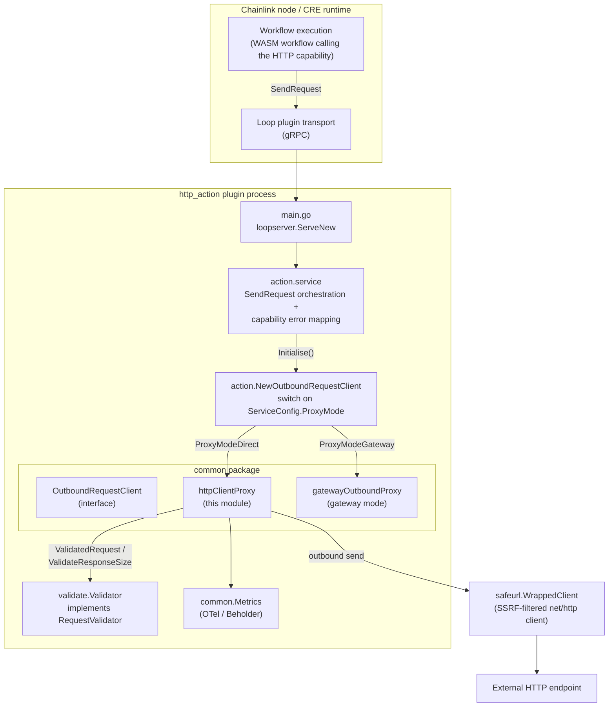
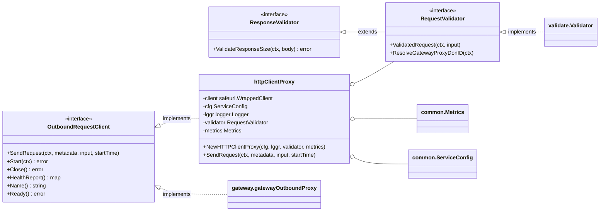
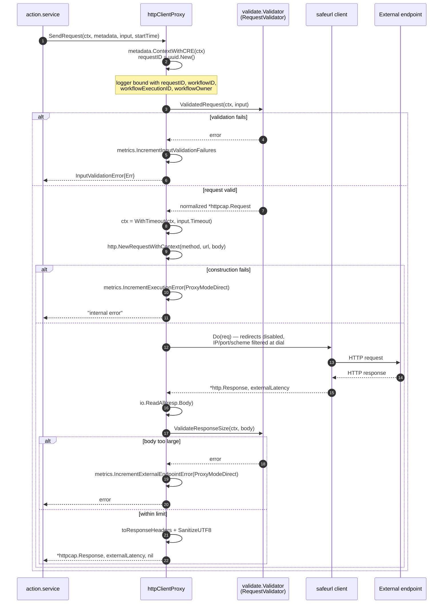

# HTTP Action Capability — Direct Proxy

> **Module:** `capabilities/http_action/common/proxy.go` (Go module `github.com/smartcontractkit/capabilities/http_action`)
> **Parent capability:** [HTTP Action Capability](../http_action_capability.md) · **Engine:** [Workflow & Capability Runtime (CRE)](../../Workflow___Capability_Runtime_(CRE_Engine).md)

The **direct proxy** (`httpClientProxy`) is one of two outbound request clients of the HTTP Action capability. When the capability is configured with `"proxyMode": "direct"`, it executes outbound HTTP requests for CRE workflows **directly from the node process** — no gateway DON is involved. It is the execution boundary where every workflow-issued HTTP request is validated, SSRF-filtered, sent to the external endpoint, size-checked, and converted back into the capability wire format.

In contrast, the [gateway proxy](http_action_capability_gateway_proxy.md) forwards requests through a gateway DON. Both implement the same `common.OutboundRequestClient` contract; the [action service](http_action_capability_action_service.md) selects between them at start-up.

---

## 1. Purpose and Responsibilities

`httpClientProxy` is intentionally a thin, focused component. It owns:

| Responsibility | How |
|---|---|
| **Single validation boundary** | Calls `RequestValidator.ValidatedRequest` before dialing and `ValidateResponseSize` after reading the body, so all checks run in one place at the send boundary |
| **SSRF-safe dialing** | Executes requests through a [`doyensec/safeurl`](https://github.com/doyensec/safeurl) client built from `HTTPClientConfig` (allow/block IPs & CIDRs, ports, schemes), with **redirects disabled** |
| **Wire-format translation** | Converts capability `httpcap.Request`/`httpcap.Response` protos to/from `net/http` types, including multi-value headers |
| **gRPC-safe output** | Sanitizes response headers to valid UTF-8 so protobuf responses can always be marshaled back over gRPC |
| **Per-request timeouts** | Applies the workflow-supplied `Timeout` via a `context.WithTimeout` wrapper |
| **Observability** | Emits OTel counters/histograms (via [Beholder](../../Telemetry___Observability_Platform/beholder-telemetry.md)) tagged with `ProxyModeDirect` and structured per-request logging |
| **Lifecycle** | Implements `services.Service` (`Start`/`Close`/`HealthReport`/`Ready`/`Name`) as no-ops — the proxy is a stateless client |

It deliberately does **not** handle: retry/backoff, gateway routing, cache reads, or user-facing error classification — those belong to the gateway proxy, the [shared runtime](http_action_capability_shared_runtime.md), and the [action service](http_action_capability_action_service.md).

---

## 2. Position in the System

The HTTP Action capability is a **standard capability plugin**: `capabilities/http_action/main.go` serves it through the loop plugin framework (`loopserver.ServeNew(...)` with `loop.WithOtelViews(common.MetricViews())`), so workflows invoke it over gRPC. See [Plugin Process Framework (Loop)](../../../Plugin_Process_Framework_(Loop)/loop-plugin-core.md) for the transport, and [Capabilities Core](../capabilities/capabilities_core.md) for the `StandardCapabilities` contract.

At start-up, `action.service.Initialise` (`capabilities/http_action/action/action.go`):

1. Unmarshals `dependencies.Config` into `common.ServiceConfig` and applies defaults (`ApplyDefault`).
2. Builds `common.Metrics` on the Beholder meter.
3. Builds the `validate.Validator` (see [Validation & Limits](http_action_capability_validation_limits.md)).
4. Calls `action.NewOutboundRequestClient`, which switches on `ProxyMode`:
   - `"direct"` → `common.NewHTTPClientProxy(...)` ← **this module**
   - `"gateway"` → `gateway.NewGatewayOutboundProxy(...)`

In production the plugin is deployed as a standard capability job whose configuration carries the `ServiceConfig` JSON (see [CRE Jobs deployment](../../CRE___Keystone_Deployment_Suite/cre-jobs.md)). The workflow-facing API that produces the `httpcap.Request` is the generated HTTP client capability in the cre-sdk (see [SDK generated capabilities](../../../Developer_Toolchain_(CLI,_SDKs___API_Clients)/cre-sdk-generated-capabilities.md)).

### Architecture



### Component map

| Component | Location | Role |
|---|---|---|
| `OutboundRequestClient` | `common/proxy.go` | Contract both proxy modes implement; consumed by the action service |
| `RequestValidator` / `ResponseValidator` | `common/proxy.go` | Interfaces implemented by `validate.Validator`; injected into the proxy |
| `InputValidationError` | `common/proxy.go` | Wrapper that lets the action service map validation failures to user-facing capability errors |
| `httpClientProxy` | `common/proxy.go` | The direct-mode client (this module) |
| `validate.Validator` | `validate/validator.go` | Concrete request/response validation — see [Validation & Limits](http_action_capability_validation_limits.md) |
| `ServiceConfig`, `HTTPClientConfig`, `ProxyMode` | `common/service_config.go` | Configuration types — see [Shared Runtime](http_action_capability_shared_runtime.md) |
| `Metrics` | `common/metrics.go` | OTel instruments — see [Shared Runtime](http_action_capability_shared_runtime.md) |

---

## 3. Public Interfaces



### `OutboundRequestClient`

Embeds `services.Service` (the common node [service lifecycle](../../Shared_Foundation_Libraries___Domain_Types/services.md)) and adds the single method:

```go
SendRequest(ctx context.Context, metadata capabilities.RequestMetadata,
    input *httpcap.Request, startTime time.Time) (*httpcap.Response, time.Duration, error)
```

The returned `time.Duration` is the **external endpoint latency** (the wall-clock time of the outbound call only), which the action service uses to split total vs. external latency in its histograms. The compile-time assertion `var _ OutboundRequestClient = &httpClientProxy{}` pins the implementation.

### `RequestValidator` / `ResponseValidator`

Validation is *injected*, not embedded, so the direct proxy and gateway proxy share identical semantics:

- `ValidatedRequest(ctx, input)` — normalizes and validates the request (method allowlist, header count/size, body size, timeout bound, cache settings) and returns the canonical request. Defined by the [validation & limits](http_action_capability_validation_limits.md) module.
- `ValidateResponseSize(ctx, body)` — enforces `maxResponseBytes` against the fully read body.
- `ResolveGatewayProxyDonID(ctx)` — part of the shared interface for gateway routing; **unused in direct mode** but required by the `NewOutboundRequestClient` signature so both modes receive the same validator.

### `InputValidationError`

```go
type InputValidationError struct{ Err error }
```

Wraps any error from `ValidatedRequest`. The [action service](http_action_capability_action_service.md) unwraps it with `errors.AsType` and converts it into a **public user error** (`caperrors.NewPublicUserError`) whose code comes from `common.UserErrorCode(err)` — `LimitExceeded` for limit violations (`limits.LimitError`), `InvalidArgument` otherwise (see [shared runtime](http_action_capability_shared_runtime.md)). In gateway mode the equivalent signal is `gateway.UserError`; both map to the same capability error (see the capability `README.md` error-classification table).

---

## 4. The `httpClientProxy`

### 4.1 Structure

| Field | Type | Purpose |
|---|---|---|
| `client` | `*safeurl.WrappedClient` | The SSRF-protected HTTP client (built once in the constructor) |
| `cfg` | `ServiceConfig` | Resolved service configuration (only `HTTPClientConfig` is consumed in direct mode) |
| `lggr` | `logger.Logger` | Structured logger; `Name()` delegates to it |
| `validator` | `RequestValidator` | Injected validation boundary |
| `metrics` | `*Metrics` | OTel instruments |

### 4.2 Constructor and safeurl configuration

`NewHTTPClientProxy(cfg, lggr, validator, metrics)` builds the safeurl client from `cfg.HTTPClientConfig`:

| `HTTPClientConfig` field | safeurl builder call | Meaning |
|---|---|---|
| `AllowedIPs` | `SetAllowedIPs` | Explicitly allowed destination IPs |
| `AllowedIPsCIDR` | `SetAllowedIPsCIDR` | Explicitly allowed CIDR blocks |
| `BlockedIPs` | `SetBlockedIPs` | Forbidden destination IPs |
| `BlockedIPsCIDR` | `SetBlockedIPsCIDR` | Forbidden CIDR blocks |
| `AllowedPorts` | `SetAllowedPorts` | Dialable ports (default `[443]` via `ApplyDefault`) |
| `AllowedSchemes` | `SetAllowedSchemes` | Permitted URL schemes (default `["https"]` via `ApplyDefault`) |

In addition, `SetCheckRedirect(disableRedirects)` is always installed: every redirect attempt returns the sentinel error `errRedirectsDisabled` ("redirects are not allowed"), so the proxy **never follows redirects**. This closes a classic SSRF bypass where a seemingly-safe initial URL redirects to an internal address after the initial validation.

safeurl validates the **resolved IP at dial time**, which also mitigates DNS-rebinding attacks (the hostname may resolve to a different address between validation and connect).

### 4.3 Constants

| Constant | Value | Use |
|---|---|---|
| `ClientName` | `"HTTPClientProxy"` | Client identifier |
| `internalError` | `"internal error"` | Opaque error text returned when request *construction* fails, to avoid leaking internals |
| `ProxyModeDirect` | `iota` (mode `"direct"`) | Tag for metrics attribution |

---

## 5. Request Processing Flow



Step-by-step (`SendRequest` in `common/proxy.go`):

1. **Context & tracing** — `metadata.ContextWithCRE(ctx)` attaches the workflow identity (required for capability request/response checks); a fresh UUID `requestID` plus `workflowID` / `workflowExecutionID` / `workflowOwner` are bound to a scoped logger.
2. **Request validation** — the *validator* runs first. On failure the proxy increments `input_validation_failures` and returns `InputValidationError` (never a raw validator error), giving the action service a single typed signal to map to a user error.
3. **Timeout** — `context.WithTimeout(ctx, input.Timeout.AsDuration())` bounds the entire exchange. The validator has already bounded this duration against `maxTimeoutMs`. A deadline that expires mid-call surfaces as a context error from `client.Do`.
4. **Send** — `http.NewRequestWithContext` builds the request (failures return the opaque `internal error` after incrementing `execution_error`), request headers are mapped via `toRequestHeaders`, and the safeurl client performs the call. The measured `externalLatency` covers only `client.Do`.
5. **Read & size-check** — the body is fully read, then `ValidateResponseSize` enforces the response-size limit. Failures here count as `external_endpoint_error` (a misbehaving endpoint, not a platform fault).
6. **Response mapping** — headers are converted with `toResponseHeaders` (with UTF-8 sanitization) and the result is returned as an `httpcap.Response` (`StatusCode`, `Headers`, `MultiHeaders`, `Body`).

Note what the direct proxy **ignores** in the wire `Request`: `CacheSettings` (cache is a gateway-mode feature only) and the `Mtls` field — neither affects this implementation.

---

## 6. Header Mapping and UTF-8 Sanitization

Header handling bridges two worlds: HTTP allows arbitrary bytes and repeated keys; the capability protos use string maps and are marshaled over gRPC.

**Request side — `toRequestHeaders`:**
- If `MultiHeaders` is populated (preferred), each key maps to a *cloned* slice of values.
- Otherwise it falls back to the deprecated single-value `Headers` map (one value per key). A staticcheck suppression marks this as legacy-compat code.

**Response side — `toResponseHeaders`:** builds both representations:
- `MultiHeaders` — every value preserved separately (e.g. multiple `Set-Cookie` headers, which RFC 6265 forbids from comma-joining).
- `Headers` (deprecated) — the same values **joined with `","`** for backwards compatibility with older workflow SDKs.

**Sanitization — `SanitizeUTF8`:** HTTP header names/values may contain arbitrary bytes, but protobuf `string` fields must be valid UTF-8 to marshal over gRPC. `SanitizeUTF8` returns valid strings unchanged and replaces every invalid byte in others with the Unicode replacement character (`U+FFFD`), applied to both keys and values. Without this, a hostile endpoint could return headers that make the capability response impossible to deliver.

---

## 7. Security Model

| Control | Mechanism | Rationale |
|---|---|---|
| SSRF / DNS rebinding | safeurl dial-time IP filtering against allow/block lists (IPs + CIDRs) | Workflow-supplied hostnames can resolve to internal infrastructure; the dial target itself is checked |
| Port restriction | `AllowedPorts` (default `[443]`) | Blocks access to internal services on exotic ports |
| Scheme restriction | `AllowedSchemes` (default `["https"]`) | Defaults to TLS-only; operators may opt into `http` |
| Redirect denial | `SetCheckRedirect(disableRedirects)` → `errRedirectsDisabled` | Prevents validated URLs from redirecting into blocked ranges |
| Request validation | `ValidatedRequest` at the send boundary | Method allowlist, header count/length, body size, timeout bound — see [Validation & Limits](http_action_capability_validation_limits.md) |
| Response size limit | `ValidateResponseSize` after full read | Caps memory usage from hostile/oversized endpoints |
| Wire safety | `SanitizeUTF8` on all response header keys/values | Guarantees the gRPC response can be marshaled |
| Information hiding | Generic `"internal error"` for request-construction failures | Avoids echoing parse errors to untrusted callers |

**Defaults:** `ServiceConfig.ApplyDefault` (invoked by the action service before the proxy is constructed) sets `AllowedPorts = [443]` and `AllowedSchemes = ["https"]` when unset — the direct proxy never runs with unrestricted dialing unless an operator explicitly configures it.

---

## 8. Error Handling and Metrics

All failures carry a `ProxyModeDirect` attribution so dashboards can distinguish direct vs. gateway behavior (metric definitions live in the [shared runtime](http_action_capability_shared_runtime.md); platform alerting on these counters is described in the capability `README.md`).

| Condition in direct mode | Returned error | Proxy metric | Action-service mapping |
|---|---|---|---|
| `ValidatedRequest` fails | `InputValidationError{Err}` | `input_validation_failure_count` | Public **user** error; code = `LimitExceeded` if the wrapped error is a `limits.LimitError`, else `InvalidArgument` |
| `http.NewRequestWithContext` fails (bad URL/method) | Opaque `"internal error"` | `execution_error_count` (mode `direct`) | Public **system** error, `Internal` |
| `client.Do` fails (network, blocked dial, blocked redirect, **context deadline**) | Raw transport error | `external_endpoint_error_count` (mode `direct`) | Public **system** error, `Internal` |
| Response body read fails | Raw I/O error | `external_endpoint_error_count` (mode `direct`) | Public **system** error, `Internal` |
| Response exceeds size limit | Validator limit error | `external_endpoint_error_count` (mode `direct`) | Public **system** error (plain error, no wrapper in direct mode) |

Design principle (from the capability `README.md`): errors are attributed to the responsible party — a slow or failing *customer endpoint* increments `external_endpoint_error` but must not page the platform; only platform faults reach `execution_error_count`. Note the asymmetry with gateway mode: in direct mode a per-request timeout surfaces as a plain context error (system/`Internal`), whereas the gateway proxy has typed `TimeoutError` / `CanceledError` mappings (see [gateway proxy](http_action_capability_gateway_proxy.md)).

The proxy itself records only failure counters and returns; the action service records `request_count`, `successful_response`, and the total/external **latency histograms** (using the returned `externalLatency`) on both success and failure paths.

---

## 9. Configuration

The proxy is configured entirely through `ServiceConfig` (JSON in the standard capability job's `dependencies.Config`; type definitions in [shared runtime](http_action_capability_shared_runtime.md)). Only the `httpClient` block is relevant in direct mode:

```json
{
  "proxyMode": "direct",
  "httpClient": {
    "blockedIPs": [],
    "blockedIPsCIDR": [],
    "allowedPorts": [80, 443],
    "allowedSchemes": ["http", "https"],
    "allowedIPs": [],
    "allowedIPsCIDR": []
  }
}
```

- `"direct"` / `"gateway"` are parsed by `ParseProxyMode`; anything else fails service initialisation.
- `gatewayConnection` is ignored in direct mode.
- Unset `allowedPorts` / `allowedSchemes` default to `[443]` / `["https"]` via `ApplyDefault` (see §7).

Build & packaging context: `capabilities/http_action/go.mod` is a standalone Go module within the [capabilities workspace tooling](../../Build,_CI___Release_Infrastructure/capabilities_workspace_tooling.md); its direct dependencies relevant to this module are `github.com/doyensec/safeurl` (SSRF-safe dialing), `github.com/google/uuid` (request IDs), and OpenTelemetry metric packages. The plugin binary is built with `go build -o ./bin/<arch>/http_action .` per the capability `README.md`.

---

## 10. Lifecycle and Concurrency

- `Start` and `Close` are no-ops: the safeurl client is constructed in `NewHTTPClientProxy` and needs no background resources.
- `HealthReport` always reports healthy (`{name: nil}`); `Ready` returns `nil`. The proxy holds no state that can fail — per-request state (context, logger, UUID) is stack-local.
- `SendRequest` is safe for concurrent use: it shares only the immutable config, validator, metrics, and the underlying `net/http`-based client (safe for concurrent requests).

---

## 11. Testing

`common/proxy_test.go` exercises the proxy against `httptest` servers using a real `validate.Validator` and no-op OTel instruments:

- **Construction** — default and custom `HTTPClientConfig`.
- **Happy paths** — GET/POST with header and body echo; status code, headers, and body mapped correctly.
- **Timeout** — request deadline shorter than server delay yields a `context deadline exceeded` error.
- **Invalid URL** — unresolvable host yields an error.
- **Response size limit** — a >1 MiB response is rejected by `ValidateResponseSize` ("ResponseSizeLimit limited").
- **Multi-headers** — three `Set-Cookie` headers appear as three values in `MultiHeaders` and comma-joined in the legacy `Headers` field (backward compatibility asserted for every `MultiHeaders` key).
- **UTF-8 sanitization** — non-UTF-8 header bytes are replaced with `U+FFFD`.

Run with `go test ./...` inside `capabilities/http_action` (see the capability `README.md`, §5.1).

---

## 12. Related Documentation

- [HTTP Action Capability](../http_action_capability.md) — parent capability overview
- [Action Service](http_action_capability_action_service.md) — orchestration, proxy-mode selection, capability error mapping
- [Gateway Proxy](http_action_capability_gateway_proxy.md) — the alternative `OutboundRequestClient` implementation
- [Shared Runtime](http_action_capability_shared_runtime.md) — `ServiceConfig`, `Metrics`, `ProxyMode`, `UserErrorCode`, `GetRequestID`
- [Validation & Limits](http_action_capability_validation_limits.md) — the `RequestValidator` implementation backing `ValidatedRequest` / `ValidateResponseSize`
- [Capabilities Core](../capabilities/capabilities_core.md) — `StandardCapabilities` / `RequestMetadata` contracts
- [Plugin Process Framework (Loop)](../../../Plugin_Process_Framework_(Loop)/loop-plugin-core.md) — plugin transport hosting this capability
- [Beholder Telemetry](../../Telemetry___Observability_Platform/beholder-telemetry.md) — OTel meter provisioning
- [CRE Jobs Deployment](../../CRE___Keystone_Deployment_Suite/cre-jobs.md) — how standard capability jobs (and their `ServiceConfig`) are proposed/deployed
