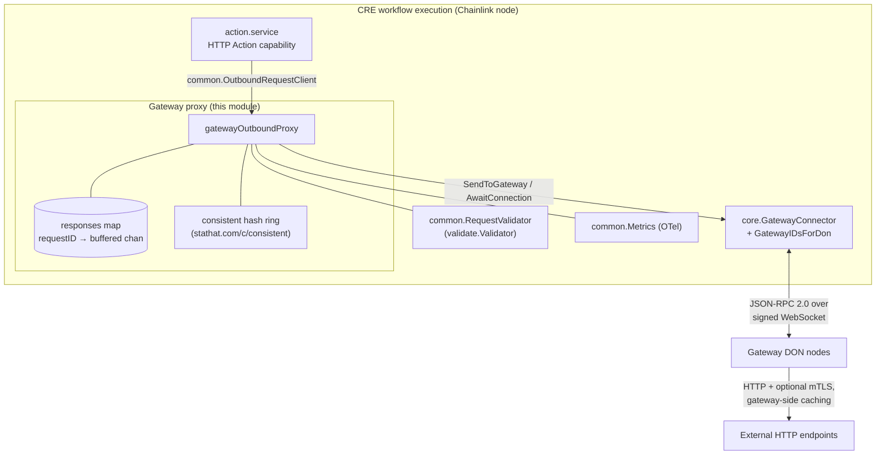
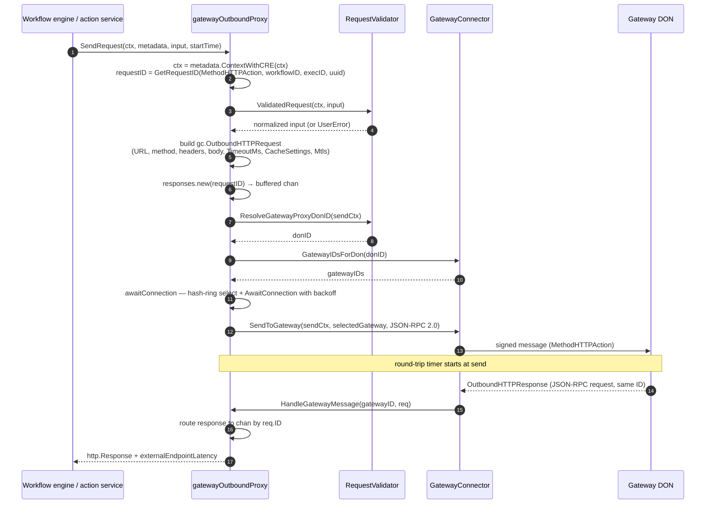
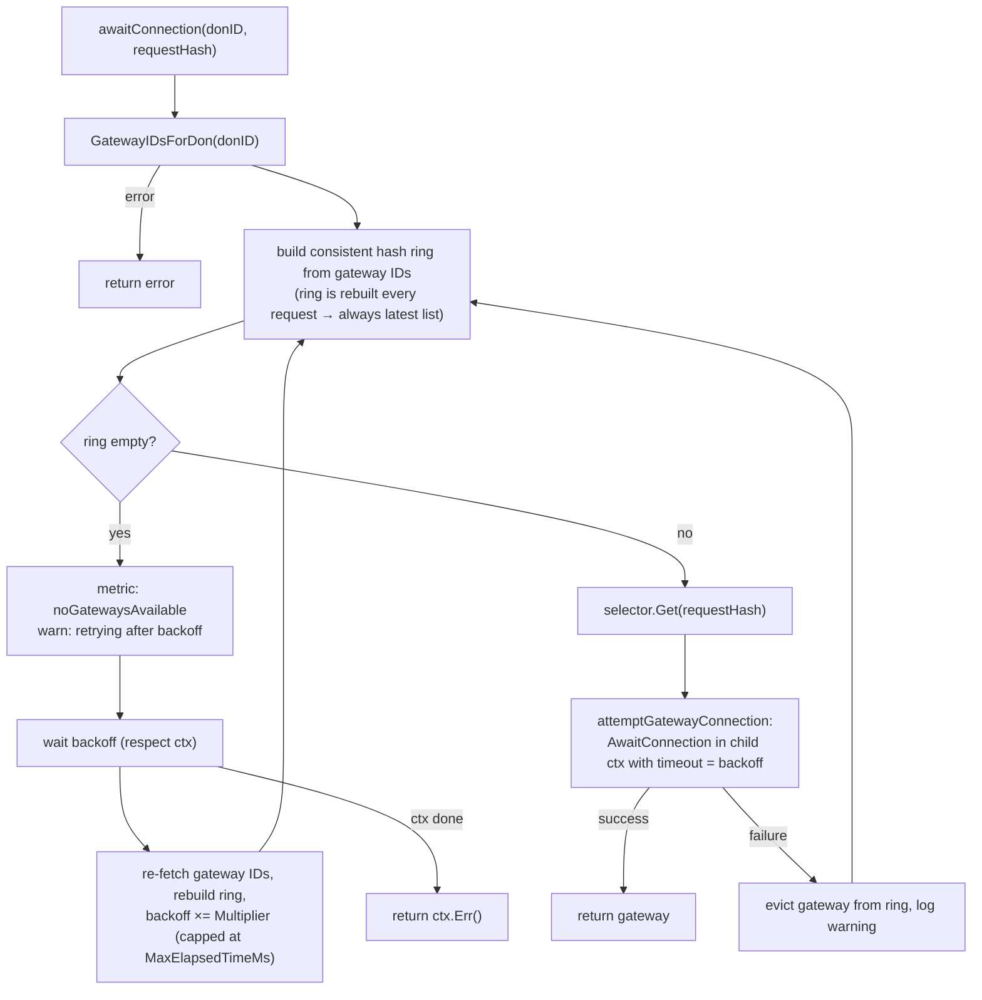

# HTTP Action Capability — Gateway Outbound Proxy

The `http_action_capability_gateway_proxy` module implements the **gateway mode** of the outbound HTTP client for the [HTTP Action capability](../http_action_capability.md). When `ServiceConfig.ProxyMode` is `"gateway"`, outbound HTTP requests issued by CRE workflows are **not** executed inside the node process. Instead, the proxy packages each validated request as a JSON-RPC 2.0 message, forwards it over the node's `core.GatewayConnector` (signed WebSocket transport) to a remote **gateway DON**, and blocks until the gateway returns the corresponding `OutboundHTTPResponse`.

Routing egress through a gateway DON centralizes controls that would otherwise run on every workflow node: upstream response caching (`CacheSettings`), mTLS credentials toward external endpoints, and platform-level endpoint policy enforcement. The proxy's job is therefore to *relay, route, and wait* — it performs no HTTP I/O itself.

| Fact | Value |
|---|---|
| Go module | `github.com/smartcontractkit/capabilities/http_action` (`capabilities/http_action/go.mod`, Go 1.27.1) |
| Files | `capabilities/http_action/gateway/gateway_outbound_proxy.go`, `capabilities/http_action/gateway/user_error.go` |
| Core types | `gatewayOutboundProxy`, `routingGatewayConnector`, `UserError`, `TimeoutError`, `CanceledError` |
| Implements | `common.OutboundRequestClient` (outbound) and `core.GatewayConnectorHandler` (inbound) |
| Key dependency | `stathat.com/c/consistent v1.0.0` (consistent hash ring), `chainlink-common` (`GatewayConnector`, `jsonrpc2`, `services`, `logger`) |
| Selected by | `common.ServiceConfig.ProxyMode == "gateway"` — see [Shared runtime](http_action_capability_shared_runtime.md) |

---

## Position in the system

This module is one of two interchangeable outbound clients behind the HTTP Action capability; the [action service](http_action_capability_action_service.md) picks one at start time based on `ProxyMode`:

- **Gateway mode** (this page) — requests are relayed to a gateway DON over the node's `GatewayConnector`.
- **Direct mode** — requests are executed locally by an SSRF-hardened HTTP client; see [Direct proxy](http_action_capability_direct_proxy.md).

Both modes share the [common runtime](http_action_capability_shared_runtime.md) (`ServiceConfig`, `Metrics`, request-ID helpers) and the [validation & limits layer](http_action_capability_validation_limits.md). The gateway connector itself is provided by the node platform — see [Gateway service](../../Node_Platform_Services/gateway.md) and its [network layer](../../Node_Platform_Services/gateway/gateway_network.md).



The proxy never talks to external endpoints directly; all wire I/O beyond the node is delegated to the gateway DON (see [capabilities core contracts](../capabilities/capabilities_core.md) for the capability-level interfaces and [remote messaging](../core_capabilities_runtime/core_capabilities_runtime_remote_messaging.md) for DON-level message dispatch).

---

## Core components

### `gatewayOutboundProxy`

The single struct in this module, wired by `NewGatewayOutboundProxy(gatewayConnector, config, lggr, metrics, validator)`. It dual-implements the outbound and inbound halves of the relay:

| Role | Method(s) | Description |
|---|---|---|
| Outbound client | `SendRequest(ctx, metadata, input, startTime)` | Validates the request, routes it to a gateway, and blocks until the gateway response or deadline. |
| Inbound handler | `HandleGatewayMessage(ctx, gatewayID, req)` | Receives JSON-RPC requests from the gateway and dispatches `OutboundHTTPResponse`s to the waiting `SendRequest` call by request ID. |
| Lifecycle | `Start`, `Close`, `HealthReport`, `Name`, `ID` | Backed by `services.StateMachine` (`StartOnce`/`StopOnce`). `Start` registers this handler for the single method `gc.MethodHTTPAction`; `Close` stops the state machine (no handler removal is performed). |

### `routingGatewayConnector`

A locally-declared interface narrowing the connector contract to exactly what routing needs:

```go
type routingGatewayConnector interface {
    core.GatewayConnector
    GatewayIDsForDon(ctx context.Context, donID string) ([]string, error)
}
```

`SendRequest` type-asserts the injected `core.GatewayConnector` to this interface; a connector that does not support multi-gateway routing fails with `"gateway connector does not support multi-gateway routing"`. The base `core.GatewayConnector` contract used here is:

| Method | Use in this module |
|---|---|
| `AddHandler(ctx, methods, handler)` | Registers `HandleGatewayMessage` for `gc.MethodHTTPAction` during `Start`. |
| `SendToGateway(ctx, gatewayID, *jsonrpc.Response[json.RawMessage])` | Delivers the signed outbound request to the selected gateway. |
| `AwaitConnection(ctx, gatewayID)` | Blocks until the WebSocket session to a gateway is established. |
| `GatewayIDsForDon(ctx, donID)` *(via `routingGatewayConnector`)* | Enumerates candidate gateways for the resolved DON. |

### Response registry (`responses`)

A mutex-guarded `map[string]chan gc.OutboundHTTPResponse` keyed by request ID:

- `new(id)` — creates a **buffered (capacity 1)** channel and registers it; duplicate IDs are rejected with an error. Buffering guarantees `HandleGatewayMessage` never blocks on delivery.
- `get(id)` — lookup used by the inbound handler.
- `cleanup(id)` — deferred in `SendRequest`, so channels never leak even on timeout/cancel.

### Error taxonomy (`user_error.go`)

Three opaque error wrappers give `SendRequest` a stable, caller-classifiable outcome, plus two stable message prefixes used in logs and wrapped errors:

| Type | Meaning | Metrics side effect |
|---|---|---|
| `UserError` | Caused by user input or the user's endpoint (request validation failure, gateway-reported external-endpoint error, gateway-reported validation error, oversized response body). Surfaces as a **public** error to the user. | `inputValidationFailures` or `externalEndpointError` |
| `TimeoutError` | The gateway delivered **no** response before the deadline. Endpoint failures are reported back explicitly, so silence is treated as a platform fault. | `executionTimeout` |
| `CanceledError` | The caller cancelled while waiting (engine shutdown, exhausted execution budget). Not the user's fault, but `caperrors.Origin` has no "neither side" state, so it surfaces as a system error coded `Canceled`; alerting should exclude that code. | `requestCanceled` |

Stable prefixes: `ErrMsgGatewayResponseWait` ("request canceled before gateway response") and `ErrMsgGatewayResponseTimeout` ("gateway did not respond before deadline").

---

## Request lifecycle (`SendRequest`)



Step highlights:

1. **Identity & context** — CRE request metadata (`WorkflowID`, `WorkflowExecutionID`, `WorkflowOwner`) is attached to the context and to a scoped logger. The request ID is `MethodHTTPAction/<workflowID>/<executionID>/<uuid>`; the UUID makes IDs unique even across replays of the same execution.
2. **Validation** — `validator.ValidatedRequest` normalizes input (URL/method/limits/mTLS policy). Failures are user errors, not system faults.
3. **Message construction** — exactly one of `Headers` or `MultiHeaders` is set on the outgoing gateway request (see [Header handling](#header-handling)). mTLS material from the input is mapped to `gc.MtlsAuth{PrivateKey: gc.Secret(...), Certificate}` so secrets flow only to the gateway DON, which terminates TLS toward the external endpoint. `CacheSettings{Store, MaxAgeMs}` is passed through for gateway-side caching.
4. **Envelope** — the request is marshalled into a `jsonrpc.Response[json.RawMessage]` (version `"2.0"`, ID = request ID, method = `gc.MethodHTTPAction`). Note the deliberate inversion: outbound traffic is a JSON-RPC *response* envelope, and the gateway's reply arrives as a JSON-RPC *request* carrying an `OutboundHTTPResponse` payload.
5. **Dual timeouts** — `sendCtx` bounds only the delivery to the gateway (`input.Timeout`); the response wait gets its own deadline of `input.Timeout + ResponseGraceMs` (see [Configuration](#configuration--build)).
6. **Wait** — `select` on the response channel vs. `waitCtx.Done()`. A live parent context means the proxy hit its own deadline → `TimeoutError`; a dead parent means the caller cancelled → `CanceledError` (with `context.Cause` in the message).

---

## Gateway routing and connection management

`awaitConnection` selects a gateway per request using **consistent hashing** over the DON's gateway list, so requests map stably onto gateways while keeping load spread:



Behaviour:

- **Eviction & retry** — a gateway that fails `AwaitConnection` is removed from the ring and the next hash-consistent candidate is tried immediately; only an *empty* ring triggers a timed backoff.
- **Backoff** — exponential, seeded by `GatewayConnectionConfig` (see defaults below) and computed by `nextBackoff` as `min(current × Multiplier, MaxElapsedTimeMs)`. The per-attempt connection timeout equals the current backoff value.
- **Freshness** — the ring is rebuilt on every `SendRequest` (and after every empty-ring backoff), so a request always uses the latest gateway set reported by `GatewayIDsForDon`.

---

## Response handling and error classification

When `HandleGatewayMessage` delivers an `OutboundHTTPResponse`, `SendRequest` classifies it before returning. The round-trip sample is recorded **before** inspecting the payload so error responses are measured too; timed-out waits produce no sample.

```mermaid
flowchart TD
    R["OutboundHTTPResponse received"] --> E{"ErrorMessage != \"\"?"}
    E -->|no| S["convert headers (UTF-8 sanitized)<br/>ValidateResponseSize(body)"]
    S -->|ok| OK["return http.Response<br/>+ externalEndpointLatency"]
    S -->|size breach| UE["UserError<br/>+ externalEndpointError"]
    E -->|yes| T{"IsExternalEndpointError?"}
    T -->|yes| U1["UserError + externalEndpointError"]
    T -->|no| V{"IsValidationError?"}
    V -->|yes| U2["UserError + inputValidationFailures"]
    V -->|no| X["system error + executionError"]
```

Edge cases handled inside `HandleGatewayMessage` (it never returns errors to the connector):

- **Unmarshalable params** — logged and dropped.
- **Unknown request ID** — warn "no response channel found; this may indicate that the node timed out the request" and drop (the waiting `SendRequest` has already returned).
- **Unsupported method** — error log, dropped.
- **Context cancelled mid-delivery** — the buffered channel makes the send non-blocking, so this cannot stall the handler.

### Latency semantics

- `externalEndpointLatency` — gateway-reported duration of the external call; returned on success and on classified error paths (zero on timeout/cancel).
- `RecordGatewayRoundTrip` — the **node-observed** application round trip, starting at `SendToGateway`: delivery, gateway processing, response delivery, including loop-plugin boundary latency. It is *not* pure WebSocket latency.

### Header handling

| Direction | Rule |
|---|---|
| Request (`gatewayHeadersFromInput`) | Set exactly one of `Headers` or `MultiHeaders` — `MultiHeaders` when the input has it, otherwise the deprecated `Headers` field (validation enforces at most one upstream). |
| Response (`responseHeadersFromGateway`) | The gateway sets exactly one; both fields are **always** populated on the capability response, with the other derived (multi-values comma-joined for backward compatibility; single values wrapped as one-element `http.HeaderValues`). |

All header keys and values pass through `common.SanitizeUTF8`: proto string fields must be valid UTF-8 to marshal over gRPC, so invalid sequences arriving from arbitrary external endpoints are neutralized before the response crosses the Loop process boundary.

---

## Concurrency and lifecycle

- **One goroutine pair per request**: the caller of `SendRequest` and the connector's dispatch goroutine calling `HandleGatewayMessage` coordinate purely through the buffered channel in the `responses` registry — no shared request state, no goroutine leaks (`cleanup` is deferred).
- **StateMachine discipline**: `Start` is idempotent via `StartOnce` (registers the `gc.MethodHTTPAction` handler exactly once); `Close` uses `StopOnce`. `HealthReport` exposes the state machine health under the logger's name.

---

## Configuration and build

Proxy behaviour is driven by `common.ServiceConfig` (JSON keys shown; see [Shared runtime](http_action_capability_shared_runtime.md) for the full schema):

| Field | Meaning |
|---|---|
| `proxyMode` | `"gateway"` (this proxy) or `"direct"` ([Direct proxy](http_action_capability_direct_proxy.md)). |
| `gatewayConnection` | `GatewayConnectionConfig` — retry/backoff tuning for the routing loop above. |
| `httpClient` | Direct mode only; ignored here. |

`applyDefaults` fills unset `GatewayConnectionConfig` values:

| Setting | Default | Notes |
|---|---|---|
| `InitialIntervalMs` | 100 | First backoff / first `AwaitConnection` timeout. |
| `MaxElapsedTimeMs` | 5 000 | Backoff ceiling. |
| `Multiplier` | 2.0 | Exponential growth factor. |
| `ResponseGraceMs` | 5 000 | Extra wait beyond `input.Timeout`; mirrors the gateway's own budget for delivering a response back. |

The capability is a separate Go module (`capabilities/http_action/go.mod`) within the `capabilities` workspace, whose module hygiene (`gomodtidy`, codegen via `protoc`/`mockery`) is orchestrated by `capabilities/Makefile`. Per-request randomness (UUID request IDs) comes from `github.com/google/uuid`; consistent hashing from `stathat.com/c/consistent`; OTel instrumentation from `go.opentelemetry.io/otel/metric`.

---

## Observability

The proxy reports exclusively through the injected `common.Metrics` (OTel counters/histograms defined in the [shared runtime](http_action_capability_shared_runtime.md)):

| Metric | Emitted when |
|---|---|
| `requestCount` | Request accepted and about to be sent. |
| `inputValidationFailures` | `ValidatedRequest` failure; gateway-reported validation error; response-body size breach. |
| `gatewaySendCount` / `gatewaySendError` | Per selected gateway + DON, on successful/failed `SendToGateway`. |
| `gatewayRoundTrip` (histogram) | Node-observed round trip in ms, recorded on every received response (including error responses). |
| `gatewayRoundTripFailures` | Send errors (`RoundTripReasonSendError`) and wait-context expiry (`RoundTripReasonContextDone`). |
| `externalEndpointError` | Gateway-reported external endpoint failure; oversized response body. |
| `executionError` | Proxy-side faults: marshal failure, duplicate request ID, DON resolution failure, connector routing unsupported, send failure, gateway error not classified as user/validation. |
| `executionTimeout` | Proxy's own wait deadline expired while the caller was still live. |
| `requestCanceled` | Caller cancelled (parent context done). |
| `noGatewaysAvailable` | Empty hash ring for the DON (empty gateway list or all evicted). |

Request-scoped log lines carry `requestID`, `workflowID`, `workflowExecutionID`, `workflowOwner`, and (after selection) `selectedGateway`/`donID`.

---

## Related documentation

- [HTTP Action capability](../http_action_capability.md) — capability overview and mode selection.
- [Action service](http_action_capability_action_service.md) — owns the proxy, executable-capability plumbing, and Loop entrypoint.
- [Direct proxy](http_action_capability_direct_proxy.md) — the `"direct"` outbound client alternative.
- [Shared runtime](http_action_capability_shared_runtime.md) — `ServiceConfig`, `GatewayConnectionConfig`, `Metrics`, request-ID and UTF-8 utilities.
- [Validation & limits](http_action_capability_validation_limits.md) — the `RequestValidator` implementation (`ValidatedRequest`, `ResolveGatewayProxyDonID`, `ValidateResponseSize`).
- [Capabilities core](../capabilities/capabilities_core.md) — capability interfaces this module interops with.
- [Gateway service](../../Node_Platform_Services/gateway.md) · [Gateway network](../../Node_Platform_Services/gateway/gateway_network.md) — the node-side connector and WebSocket client the proxy drives.
